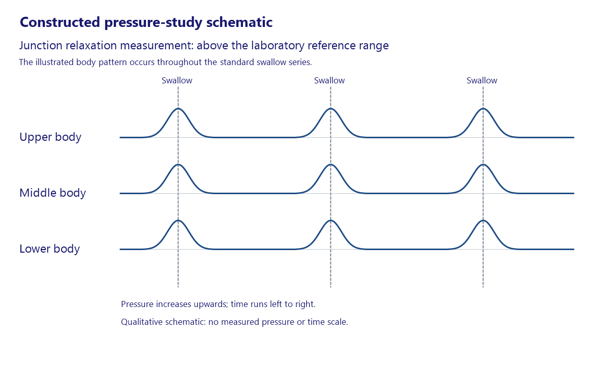
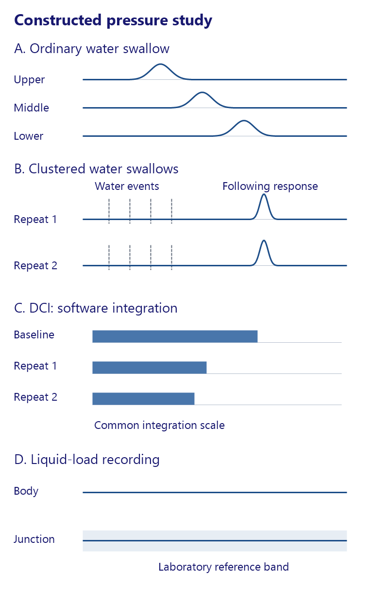
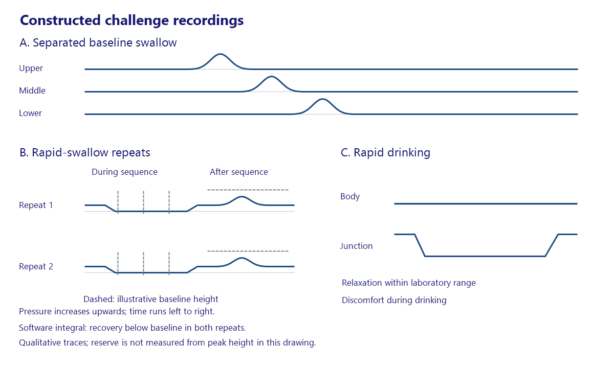
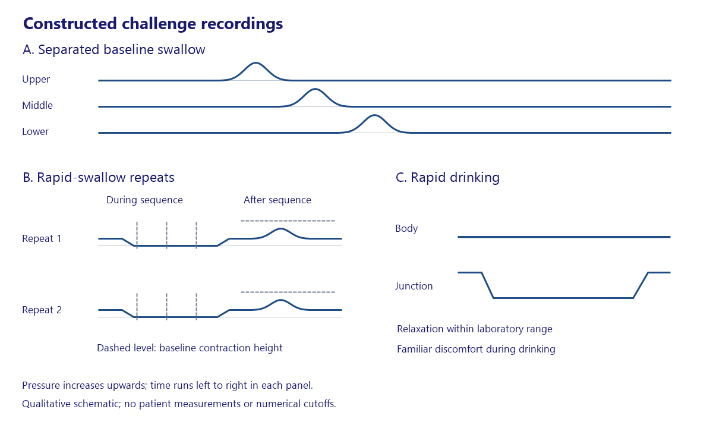

# Esophagus motility and achalasia topic packet

> Current review: **1 revised recurrent-clearance salvage case only**. See [Salvage revision - current one-case review](#salvage-revision---current-one-case-review). The passed salvage-before-resection case is frozen. All earlier sections are historical.

> Previous review scope: **2 standalone salvage cases only**. See [Acceptance salvage - current review scope](#acceptance-salvage---current-review-scope). The four accepted topic nodes are frozen; all earlier audit/revision sections remain historical evidence.

> Previous revision: **3 pass-preserved, 4 revised, 3 parked**. See [Independent review revision - current packet](#independent-review-revision---current-packet) for exact current versions, holds and validation. The initial assignment and audit below remain historical evidence.

## Assignment

Wave 3, manager dispatch 2026-11-11. Topic `esophagus-motility-achalasia`. Priority **high**. Common foregut decision chains support both diagnostic interpretation and procedure selection.

Motor physiology, manometry interpretation and adequacy, achalasia, junction outflow disorders, motility-directed treatment and post-treatment failure.

Reflux and Barrett pathways belong to esophagus-gerd-barrett-hiatal. Structural dysphagia, EoE and diverticula belong to esophagus-structural-inflammatory-emergencies.

Program capture `2026-11-11T15:28:05.732Z` used manifest `question-ship.2026-11-10.v9`, 145 acceptance rows, 1,151 cases, 1,462 nodes and 610 registered concepts. This topic has four live concepts, eight live nodes in four cases, 47 retained draft rows, twelve registered identities and eight registry-only identities. Assigned unkeyed slots and withheld teaching points both total zero.

Active coordination follows `docs/research/question-topic-program-20261111.md` and `docs/handoffs/CURRENT_THREAD_HANDOFF.md`. The manager maintains shared planning and acceptance. Melissa Rowland is the named clinical sign-off.

<details>
<summary>Complete assignment rows, source hashes, holds and exact historical review references</summary>

```json
{
  "topicSlug": "esophagus-motility-achalasia",
  "title": "Esophagus — motility and achalasia",
  "wave": 3,
  "taxonomy": {
    "slug": "esophagus-motility-achalasia",
    "title": "Esophagus — motility and achalasia",
    "priority": "high",
    "scopeIn": "Motor physiology, manometry interpretation and adequacy, achalasia, junction outflow disorders, motility-directed treatment and post-treatment failure.",
    "scopeOut": "Reflux and Barrett pathways belong to esophagus-gerd-barrett-hiatal. Structural dysphagia, EoE and diverticula belong to esophagus-structural-inflammatory-emergencies.",
    "priorityReason": "Common foregut decision chains support both diagnostic interpretation and procedure selection.",
    "researchAgenda": [
      "Primary versus secondary outflow obstruction",
      "Motor-pattern interpretation linked to a specific treatment",
      "Treatment failure and competing reflux or mechanical causes"
    ],
    "counts": {
      "liveConcepts": 4,
      "liveNodes": 8,
      "liveCases": 4,
      "liveVariants": 8,
      "liveAcceptedNodes": 3,
      "liveOriginalNodes": 5,
      "registeredConcepts": 12,
      "registeredWithoutLiveNodes": 8,
      "drafts": 47,
      "draftVariants": 47,
      "draftConcepts": 11,
      "explicitOwnerHeldVersions": 0,
      "unassembledDraftVariants": 0,
      "unkeyedParkedSlots": 0,
      "withheldTeachingPoints": 0,
      "liveClinicalConcepts": 4
    },
    "coverageSignal": "thin",
    "coverageReason": "At most four distinct live clinical concept identities cover this scope. Variants repeat those identities.",
    "testingWeightBasis": "Owner-directed editorial estimate of general-surgery testing relevance. No exam percentages or official blueprint weights are asserted.",
    "workerLane": [
      "packages/clinical-content/src/question-topic-esophagus-motility-achalasia-20261111.ts",
      "packages/clinical-content/src/question-topic-esophagus-motility-achalasia-20261111.test.ts",
      "docs/research/question-topic-esophagus-motility-achalasia-20261111.json",
      "docs/research/question-topic-esophagus-motility-achalasia-20261111.md",
      "docs/research/sources-question-topic-esophagus-motility-achalasia-20261111.json"
    ],
    "wave": 3
  },
  "boundaryTaxonomy": [
    {
      "slug": "esophagus-gerd-barrett-hiatal",
      "title": "Esophagus — GERD, Barrett and hiatal hernia",
      "priority": "high",
      "scopeIn": "Reflux confirmation, reflux-test interpretation, antireflux assessment, hiatal/paraesophageal hernia and Barrett dysplasia, surveillance and treatment selection.",
      "scopeOut": "A standalone motor-disorder objective belongs to esophagus-motility-achalasia. Esophageal malignancy beyond the Barrett pathway belongs to esophagus-structural-inflammatory-emergencies.",
      "priorityReason": "Frequent foregut care combines objective testing with consequential treatment boundaries.",
      "researchAgenda": [
        "Reflux evidence before invasive treatment",
        "Paraesophageal hernia complications and operative planning",
        "Barrett dysplasia confirmation and stage-appropriate therapy"
      ],
      "counts": {
        "liveConcepts": 4,
        "liveNodes": 14,
        "liveCases": 10,
        "liveVariants": 14,
        "liveAcceptedNodes": 0,
        "liveOriginalNodes": 14,
        "registeredConcepts": 4,
        "registeredWithoutLiveNodes": 0,
        "drafts": 1,
        "draftVariants": 1,
        "draftConcepts": 1,
        "explicitOwnerHeldVersions": 0,
        "unassembledDraftVariants": 0,
        "unkeyedParkedSlots": 0,
        "withheldTeachingPoints": 1,
        "liveClinicalConcepts": 4
      },
      "coverageSignal": "thin",
      "coverageReason": "At most four distinct live clinical concept identities cover this scope. Variants repeat those identities.",
      "testingWeightBasis": "Owner-directed editorial estimate of general-surgery testing relevance. No exam percentages or official blueprint weights are asserted.",
      "workerLane": [
        "packages/clinical-content/src/question-topic-esophagus-gerd-barrett-hiatal-20261111.ts",
        "packages/clinical-content/src/question-topic-esophagus-gerd-barrett-hiatal-20261111.test.ts",
        "docs/research/question-topic-esophagus-gerd-barrett-hiatal-20261111.json",
        "docs/research/question-topic-esophagus-gerd-barrett-hiatal-20261111.md",
        "docs/research/sources-question-topic-esophagus-gerd-barrett-hiatal-20261111.json"
      ],
      "wave": 3
    },
    {
      "slug": "esophagus-structural-inflammatory-emergencies",
      "title": "Esophagus — structural disease, inflammation and emergencies",
      "priority": "medium",
      "scopeIn": "Structural dysphagia, Zenker and other diverticula, EoE, strictures, foreign bodies, perforation and esophageal cancer staging/resection essentials.",
      "scopeOut": "Achalasia and motor physiology belong to esophagus-motility-achalasia. GERD, hiatal hernia and Barrett belong to esophagus-gerd-barrett-hiatal.",
      "priorityReason": "These focused diagnostic and emergency decisions complement the two larger foregut pathways.",
      "researchAgenda": [
        "Sampling adequacy and EoE treatment sequence",
        "Perforation and foreign-body escalation",
        "Esophageal cancer staging and operative essentials"
      ],
      "counts": {
        "liveConcepts": 9,
        "liveNodes": 30,
        "liveCases": 22,
        "liveVariants": 30,
        "liveAcceptedNodes": 2,
        "liveOriginalNodes": 28,
        "registeredConcepts": 9,
        "registeredWithoutLiveNodes": 0,
        "drafts": 10,
        "draftVariants": 10,
        "draftConcepts": 5,
        "explicitOwnerHeldVersions": 1,
        "unassembledDraftVariants": 0,
        "unkeyedParkedSlots": 0,
        "withheldTeachingPoints": 0,
        "liveClinicalConcepts": 9
      },
      "coverageSignal": "partial",
      "coverageReason": "Live identities cover part of this scope. The research agenda flags breadth to check, and the topic worker must judge redundancy and question quality.",
      "testingWeightBasis": "Owner-directed editorial estimate of general-surgery testing relevance. No exam percentages or official blueprint weights are asserted.",
      "workerLane": [
        "packages/clinical-content/src/question-topic-esophagus-structural-inflammatory-emergencies-20261111.ts",
        "packages/clinical-content/src/question-topic-esophagus-structural-inflammatory-emergencies-20261111.test.ts",
        "docs/research/question-topic-esophagus-structural-inflammatory-emergencies-20261111.json",
        "docs/research/question-topic-esophagus-structural-inflammatory-emergencies-20261111.md",
        "docs/research/sources-question-topic-esophagus-structural-inflammatory-emergencies-20261111.json"
      ],
      "wave": 10
    }
  ],
  "inventory": [
    {
      "recordId": "inventory.0a63d6c78fadd4c7",
      "inventoryKind": "materialized case/node",
      "primaryTopicSlug": "esophagus-motility-achalasia",
      "secondaryTopicSlugs": [],
      "secondaryTags": [],
      "conceptId": "concept.achalasia.high-resolution-manometry.v2",
      "caseId": "case.achalasia.clinic-referral",
      "nodeIds": [
        "node.achalasia.clinic-referral.1"
      ],
      "variantIds": [
        "question.achalasia.high-resolution-manometry.v4.r5"
      ],
      "chiefComplaint": "Difficulty swallowing",
      "taskTextShort": "How should {patientName}'s next physiologic assessment be arranged?",
      "taskText": "How should {patientName}'s next physiologic assessment be arranged?",
      "status": "live original",
      "retentionState": "default release",
      "live": true,
      "declaredClinicalReviewStatuses": [
        "needs_clinician_review"
      ],
      "editorialAcceptance": null,
      "recordedHoldIds": [],
      "fileLocation": {
        "file": "packages/clinical-content/src/question-quality-adversarial-r4-20261102-data.ts",
        "line": 734,
        "export": "QUESTION_QUALITY_ADVERSARIAL_R4_DEFINITIONS",
        "locator": "exact identity literal"
      },
      "fileLocations": [
        {
          "file": "packages/clinical-content/src/question-quality-adversarial-r4-20261102-data.ts",
          "line": 734,
          "export": "QUESTION_QUALITY_ADVERSARIAL_R4_DEFINITIONS",
          "locator": "exact identity literal"
        },
        {
          "file": "packages/clinical-content/src/question-quality-adversarial-20261102.ts",
          "line": 26,
          "export": "QUESTION_QUALITY_CURRENT_REVISIONS",
          "locator": "exported computed definition"
        },
        {
          "file": "packages/clinical-content/src/question-quality-adversarial-r4-20261102.ts",
          "line": 26,
          "export": "QUESTION_QUALITY_ADVERSARIAL_R4_QUESTIONS",
          "locator": "exported computed definition"
        }
      ],
      "caseMaterializerLocations": [
        {
          "file": "packages/clinical-content/src/pilot-content.ts",
          "line": 114,
          "export": "PILOT_CLINICAL_RELEASE",
          "locator": "exported computed definition"
        }
      ],
      "distinctRetainedNodeSerializations": 1,
      "sourceEvidenceClaimIds": [
        "claim.achalasia.high-resolution-manometry",
        "claim.qq20261102a.esophageal-physiology-sequence",
        "claim.qq20261102c.hrm-incomplete-placement"
      ],
      "casePrimaryTopicSlug": "esophagus-motility-achalasia",
      "crossTopicCase": false,
      "canonicalNodeTopicAssignments": [
        {
          "nodeId": "node.achalasia.clinic-referral.1",
          "primaryTopicSlug": "esophagus-motility-achalasia"
        }
      ]
    },
    {
      "recordId": "inventory.315a8a44aff8a7af",
      "inventoryKind": "materialized case/node",
      "primaryTopicSlug": "esophagus-motility-achalasia",
      "secondaryTopicSlugs": [],
      "secondaryTags": [],
      "conceptId": "concept.achalasia.manometric-recognition",
      "caseId": "case.achalasia.clinic-referral",
      "nodeIds": [
        "node.achalasia.clinic-referral.2"
      ],
      "variantIds": [
        "question.achalasia.manometric-recognition.v4.r4"
      ],
      "chiefComplaint": "Difficulty swallowing",
      "taskTextShort": "Which interpretation and next plan should guide {patientName}'s care?",
      "taskText": "Which interpretation and next plan should guide {patientName}'s care?",
      "status": "live original",
      "retentionState": "default release",
      "live": true,
      "declaredClinicalReviewStatuses": [
        "needs_clinician_review"
      ],
      "editorialAcceptance": null,
      "recordedHoldIds": [],
      "fileLocation": {
        "file": "packages/clinical-content/src/question-quality-adversarial-r3-20261102-data.ts",
        "line": 1407,
        "export": "QUESTION_QUALITY_ADVERSARIAL_R3_DEFINITIONS",
        "locator": "exact identity literal"
      },
      "fileLocations": [
        {
          "file": "packages/clinical-content/src/question-quality-adversarial-r3-20261102-data.ts",
          "line": 1407,
          "export": "QUESTION_QUALITY_ADVERSARIAL_R3_DEFINITIONS",
          "locator": "exact identity literal"
        },
        {
          "file": "packages/clinical-content/src/question-quality-adversarial-20261102.ts",
          "line": 26,
          "export": "QUESTION_QUALITY_CURRENT_REVISIONS",
          "locator": "exported computed definition"
        },
        {
          "file": "packages/clinical-content/src/question-quality-adversarial-r3-20261102.ts",
          "line": 7,
          "export": "QUESTION_QUALITY_ADVERSARIAL_R3_QUESTIONS",
          "locator": "exported computed definition"
        }
      ],
      "caseMaterializerLocations": [
        {
          "file": "packages/clinical-content/src/pilot-content.ts",
          "line": 114,
          "export": "PILOT_CLINICAL_RELEASE",
          "locator": "exported computed definition"
        }
      ],
      "distinctRetainedNodeSerializations": 1,
      "sourceEvidenceClaimIds": [
        "claim.achalasia.manometric-recognition",
        "claim.achalasia.high-resolution-manometry",
        "claim.qq20261102.motility-egjoo",
        "claim.qq20261102.motility-absent-contractility",
        "claim.qq20261102a.failed-contraction-threshold",
        "claim.qq20261102b.secondary-achalasia-assessment"
      ],
      "casePrimaryTopicSlug": "esophagus-motility-achalasia",
      "crossTopicCase": false,
      "canonicalNodeTopicAssignments": [
        {
          "nodeId": "node.achalasia.clinic-referral.2",
          "primaryTopicSlug": "esophagus-motility-achalasia"
        }
      ]
    },
    {
      "recordId": "inventory.ed813fb0cbefce11",
      "inventoryKind": "materialized case/node",
      "primaryTopicSlug": "esophagus-motility-achalasia",
      "secondaryTopicSlugs": [],
      "secondaryTags": [],
      "conceptId": "concept.achalasia.high-resolution-manometry.v2",
      "caseId": "case.achalasia.night-regurgitation",
      "nodeIds": [
        "node.achalasia.night-regurgitation.1"
      ],
      "variantIds": [
        "question.achalasia.high-resolution-manometry.v2.r6"
      ],
      "chiefComplaint": "Difficulty swallowing",
      "taskTextShort": "Which acquisition should determine {patientName}'s esophageal-body classification?",
      "taskText": "Which acquisition should determine {patientName}'s esophageal-body classification?",
      "status": "live original",
      "retentionState": "default release",
      "live": true,
      "declaredClinicalReviewStatuses": [
        "needs_clinician_review"
      ],
      "editorialAcceptance": null,
      "recordedHoldIds": [],
      "fileLocation": {
        "file": "packages/clinical-content/src/question-quality-adversarial-r5-20261102-data.ts",
        "line": 158,
        "export": "QUESTION_QUALITY_ADVERSARIAL_R5_DEFINITIONS",
        "locator": "exact identity literal"
      },
      "fileLocations": [
        {
          "file": "packages/clinical-content/src/question-quality-adversarial-r5-20261102-data.ts",
          "line": 158,
          "export": "QUESTION_QUALITY_ADVERSARIAL_R5_DEFINITIONS",
          "locator": "exact identity literal"
        },
        {
          "file": "packages/clinical-content/src/question-quality-adversarial-20261102.ts",
          "line": 26,
          "export": "QUESTION_QUALITY_CURRENT_REVISIONS",
          "locator": "exported computed definition"
        },
        {
          "file": "packages/clinical-content/src/question-quality-adversarial-r5-20261102.ts",
          "line": 26,
          "export": "QUESTION_QUALITY_ADVERSARIAL_R5_QUESTIONS",
          "locator": "exported computed definition"
        }
      ],
      "caseMaterializerLocations": [
        {
          "file": "packages/clinical-content/src/question-flags3-20261107.ts",
          "line": 25,
          "export": "QUESTION_FLAGS3_CASES",
          "locator": "exported computed definition"
        },
        {
          "file": "packages/clinical-content/src/pilot-content.ts",
          "line": 114,
          "export": "PILOT_CLINICAL_RELEASE",
          "locator": "exported computed definition"
        },
        {
          "file": "packages/clinical-content/src/question-flags3-accepted-20261107.ts",
          "line": 31,
          "export": "QUESTION_FLAGS3_ACCEPTED_CASES",
          "locator": "exported computed definition"
        },
        {
          "file": "packages/clinical-content/src/question-flags3-retained-input-20261107.ts",
          "line": 249,
          "export": "QUESTION_FLAGS3_RETAINED_INPUT",
          "locator": "exact identity literal"
        }
      ],
      "distinctRetainedNodeSerializations": 1,
      "sourceEvidenceClaimIds": [
        "claim.achalasia.high-resolution-manometry",
        "claim.qq20261102a.esophageal-physiology-sequence",
        "claim.qq20261102c.hrm-protocol-and-provocation",
        "claim.qq20261102d.hrm-rapid-swallow-interpretation",
        "claim.qq20261102d.hrm-rapid-drink-purpose"
      ],
      "casePrimaryTopicSlug": "esophagus-motility-achalasia",
      "crossTopicCase": false,
      "canonicalNodeTopicAssignments": [
        {
          "nodeId": "node.achalasia.night-regurgitation.1",
          "primaryTopicSlug": "esophagus-motility-achalasia"
        }
      ]
    },
    {
      "recordId": "inventory.3c48d83b6722674a",
      "inventoryKind": "materialized case/node",
      "primaryTopicSlug": "esophagus-motility-achalasia",
      "secondaryTopicSlugs": [],
      "secondaryTags": [],
      "conceptId": "concept.achalasia.secondary-junction-lesion-assessment.v1",
      "caseId": "case.achalasia.night-regurgitation",
      "nodeIds": [
        "node.achalasia.night-regurgitation.2"
      ],
      "variantIds": [
        "question.achalasia.manometric-recognition.v2.r7"
      ],
      "chiefComplaint": "Difficulty swallowing",
      "taskTextShort": "Which procedure should be requested next for {patientName}'s swallowing problem?",
      "taskText": "Which procedure should be requested next for {patientName}'s swallowing problem?",
      "status": "live accepted",
      "retentionState": "default release",
      "live": true,
      "declaredClinicalReviewStatuses": [
        "needs_clinician_review"
      ],
      "editorialAcceptance": {
        "acceptanceId": "F3-02",
        "sourceView": "flags3-accepted",
        "decisionFile": "docs/research/question-flags3-manager-decision-20261107.md"
      },
      "recordedHoldIds": [],
      "fileLocation": {
        "file": "packages/clinical-content/src/question-flags3-20261107-data.ts",
        "line": 87,
        "export": "QUESTION_FLAGS3_DEFINITIONS",
        "locator": "exact identity literal"
      },
      "fileLocations": [
        {
          "file": "packages/clinical-content/src/question-flags3-20261107-data.ts",
          "line": 87,
          "export": "QUESTION_FLAGS3_DEFINITIONS",
          "locator": "exact identity literal"
        },
        {
          "file": "packages/clinical-content/src/question-flags3-20261107.ts",
          "line": 9,
          "export": "QUESTION_FLAGS3_QUESTIONS",
          "locator": "exported computed definition"
        },
        {
          "file": "packages/clinical-content/src/question-flags3-accepted-20261107.ts",
          "line": 23,
          "export": "QUESTION_FLAGS3_ACCEPTED_QUESTIONS",
          "locator": "exported computed definition"
        }
      ],
      "caseMaterializerLocations": [
        {
          "file": "packages/clinical-content/src/question-flags3-20261107.ts",
          "line": 25,
          "export": "QUESTION_FLAGS3_CASES",
          "locator": "exported computed definition"
        },
        {
          "file": "packages/clinical-content/src/pilot-content.ts",
          "line": 114,
          "export": "PILOT_CLINICAL_RELEASE",
          "locator": "exported computed definition"
        },
        {
          "file": "packages/clinical-content/src/question-flags3-accepted-20261107.ts",
          "line": 31,
          "export": "QUESTION_FLAGS3_ACCEPTED_CASES",
          "locator": "exported computed definition"
        }
      ],
      "distinctRetainedNodeSerializations": 2,
      "sourceEvidenceClaimIds": [
        "claim.flags3.20261107.motor-pattern-scope",
        "claim.flags3.20261107.junction-wall-target"
      ],
      "casePrimaryTopicSlug": "esophagus-motility-achalasia",
      "crossTopicCase": false,
      "canonicalNodeTopicAssignments": [
        {
          "nodeId": "node.achalasia.night-regurgitation.2",
          "primaryTopicSlug": "esophagus-motility-achalasia"
        }
      ]
    },
    {
      "recordId": "inventory.cf3a9faae9579cd3",
      "inventoryKind": "materialized case/node",
      "primaryTopicSlug": "esophagus-motility-achalasia",
      "secondaryTopicSlugs": [],
      "secondaryTags": [],
      "conceptId": "concept.esophageal-physiology.integrated-pressure-report.v2",
      "caseId": "case.achalasia.slow-meals",
      "nodeIds": [
        "node.achalasia.slow-meals.1"
      ],
      "variantIds": [
        "question.achalasia.high-resolution-manometry.v3.r11"
      ],
      "chiefComplaint": "Difficulty swallowing",
      "taskTextShort": "Which report of the pressure study should accompany {patientName}’s timed esophagram request?",
      "taskText": "Which report of the pressure study should accompany {patientName}’s timed esophagram request?",
      "status": "live accepted",
      "retentionState": "default release",
      "live": true,
      "declaredClinicalReviewStatuses": [
        "needs_clinician_review"
      ],
      "editorialAcceptance": {
        "acceptanceId": "B2A04",
        "sourceView": "batch2a-round3",
        "decisionFile": "docs/research/question-bank-batch2a-manager-decision-20261104.md"
      },
      "recordedHoldIds": [],
      "fileLocation": {
        "file": "packages/clinical-content/src/question-bank-batch2a-round3-20261104-data.ts",
        "line": 162,
        "export": "QUESTION_BANK_BATCH2A_ROUND3_DEFINITIONS",
        "locator": "exact identity literal"
      },
      "fileLocations": [
        {
          "file": "packages/clinical-content/src/question-bank-batch2a-round3-20261104-data.ts",
          "line": 162,
          "export": "QUESTION_BANK_BATCH2A_ROUND3_DEFINITIONS",
          "locator": "exact identity literal"
        },
        {
          "file": "packages/clinical-content/src/question-bank-batch2a-round3-20261104.ts",
          "line": 8,
          "export": "QUESTION_BANK_BATCH2A_ROUND3_QUESTIONS",
          "locator": "exported computed definition"
        }
      ],
      "caseMaterializerLocations": [
        {
          "file": "packages/clinical-content/src/pilot-content.ts",
          "line": 114,
          "export": "PILOT_CLINICAL_RELEASE",
          "locator": "exported computed definition"
        }
      ],
      "distinctRetainedNodeSerializations": 1,
      "sourceEvidenceClaimIds": [
        "claim.qq20261102d.hrm-rapid-swallow-interpretation",
        "claim.qq20261102d.hrm-rapid-drink-purpose",
        "claim.qq20261102e.hrm-reserve-versus-outflow",
        "claim.qbp2ar3.pressure-report-boundary"
      ],
      "casePrimaryTopicSlug": "esophagus-motility-achalasia",
      "crossTopicCase": false,
      "canonicalNodeTopicAssignments": [
        {
          "nodeId": "node.achalasia.slow-meals.1",
          "primaryTopicSlug": "esophagus-motility-achalasia"
        }
      ]
    },
    {
      "recordId": "inventory.dcae999381b2e18e",
      "inventoryKind": "materialized case/node",
      "primaryTopicSlug": "esophagus-motility-achalasia",
      "secondaryTopicSlugs": [],
      "secondaryTags": [],
      "conceptId": "concept.achalasia.manometric-recognition",
      "caseId": "case.achalasia.slow-meals",
      "nodeIds": [
        "node.achalasia.slow-meals.2"
      ],
      "variantIds": [
        "question.achalasia.manometric-recognition.v3.r5"
      ],
      "chiefComplaint": "Difficulty swallowing",
      "taskTextShort": "Which interpretation and next plan best fit {patientName}'s record?",
      "taskText": "Which interpretation and next plan best fit {patientName}'s record?",
      "status": "live original",
      "retentionState": "default release",
      "live": true,
      "declaredClinicalReviewStatuses": [
        "needs_clinician_review"
      ],
      "editorialAcceptance": null,
      "recordedHoldIds": [],
      "fileLocation": {
        "file": "packages/clinical-content/src/question-quality-adversarial-r4-20261102-data.ts",
        "line": 428,
        "export": "QUESTION_QUALITY_ADVERSARIAL_R4_DEFINITIONS",
        "locator": "exact identity literal"
      },
      "fileLocations": [
        {
          "file": "packages/clinical-content/src/question-quality-adversarial-r4-20261102-data.ts",
          "line": 428,
          "export": "QUESTION_QUALITY_ADVERSARIAL_R4_DEFINITIONS",
          "locator": "exact identity literal"
        },
        {
          "file": "packages/clinical-content/src/question-quality-adversarial-20261102.ts",
          "line": 26,
          "export": "QUESTION_QUALITY_CURRENT_REVISIONS",
          "locator": "exported computed definition"
        },
        {
          "file": "packages/clinical-content/src/question-quality-adversarial-r4-20261102.ts",
          "line": 26,
          "export": "QUESTION_QUALITY_ADVERSARIAL_R4_QUESTIONS",
          "locator": "exported computed definition"
        }
      ],
      "caseMaterializerLocations": [
        {
          "file": "packages/clinical-content/src/pilot-content.ts",
          "line": 114,
          "export": "PILOT_CLINICAL_RELEASE",
          "locator": "exported computed definition"
        }
      ],
      "distinctRetainedNodeSerializations": 1,
      "sourceEvidenceClaimIds": [
        "claim.achalasia.manometric-recognition",
        "claim.achalasia.high-resolution-manometry",
        "claim.qq20261102.motility-egjoo",
        "claim.qq20261102.motility-absent-contractility",
        "claim.qq20261102a.spastic-achalasia",
        "claim.qq20261102b.opioid-spastic-pattern"
      ],
      "casePrimaryTopicSlug": "esophagus-motility-achalasia",
      "crossTopicCase": false,
      "canonicalNodeTopicAssignments": [
        {
          "nodeId": "node.achalasia.slow-meals.2",
          "primaryTopicSlug": "esophagus-motility-achalasia"
        }
      ]
    },
    {
      "recordId": "inventory.7a689054d54fb72f",
      "inventoryKind": "materialized case/node",
      "primaryTopicSlug": "esophagus-motility-achalasia",
      "secondaryTopicSlugs": [],
      "secondaryTags": [],
      "conceptId": "concept.achalasia.high-resolution-manometry.v2",
      "caseId": "case.achalasia.water-and-solids",
      "nodeIds": [
        "node.achalasia.water-and-solids.1"
      ],
      "variantIds": [
        "question.achalasia.high-resolution-manometry.v1.r6"
      ],
      "chiefComplaint": "Difficulty swallowing",
      "taskTextShort": "Which investigation should guide procedural planning for {patientName}?",
      "taskText": "Which investigation should guide procedural planning for {patientName}?",
      "status": "live original",
      "retentionState": "default release",
      "live": true,
      "declaredClinicalReviewStatuses": [
        "needs_clinician_review"
      ],
      "editorialAcceptance": null,
      "recordedHoldIds": [],
      "fileLocation": {
        "file": "packages/clinical-content/src/question-quality-adversarial-r5-20261102-data.ts",
        "line": 11,
        "export": "QUESTION_QUALITY_ADVERSARIAL_R5_DEFINITIONS",
        "locator": "exact identity literal"
      },
      "fileLocations": [
        {
          "file": "packages/clinical-content/src/question-quality-adversarial-r5-20261102-data.ts",
          "line": 11,
          "export": "QUESTION_QUALITY_ADVERSARIAL_R5_DEFINITIONS",
          "locator": "exact identity literal"
        },
        {
          "file": "packages/clinical-content/src/question-quality-adversarial-20261102.ts",
          "line": 26,
          "export": "QUESTION_QUALITY_CURRENT_REVISIONS",
          "locator": "exported computed definition"
        },
        {
          "file": "packages/clinical-content/src/question-quality-adversarial-r5-20261102.ts",
          "line": 26,
          "export": "QUESTION_QUALITY_ADVERSARIAL_R5_QUESTIONS",
          "locator": "exported computed definition"
        }
      ],
      "caseMaterializerLocations": [
        {
          "file": "packages/clinical-content/src/pilot-content.ts",
          "line": 114,
          "export": "PILOT_CLINICAL_RELEASE",
          "locator": "exported computed definition"
        }
      ],
      "distinctRetainedNodeSerializations": 1,
      "sourceEvidenceClaimIds": [
        "claim.achalasia.high-resolution-manometry",
        "claim.qq20261102a.esophageal-physiology-sequence",
        "claim.qq20261102c.hrm-incomplete-placement"
      ],
      "casePrimaryTopicSlug": "esophagus-motility-achalasia",
      "crossTopicCase": false,
      "canonicalNodeTopicAssignments": [
        {
          "nodeId": "node.achalasia.water-and-solids.1",
          "primaryTopicSlug": "esophagus-motility-achalasia"
        }
      ]
    },
    {
      "recordId": "inventory.f2a7ed838411e90c",
      "inventoryKind": "materialized case/node",
      "primaryTopicSlug": "esophagus-motility-achalasia",
      "secondaryTopicSlugs": [],
      "secondaryTags": [],
      "conceptId": "concept.achalasia.manometric-recognition",
      "caseId": "case.achalasia.water-and-solids",
      "nodeIds": [
        "node.achalasia.water-and-solids.2"
      ],
      "variantIds": [
        "question.achalasia.manometric-recognition.v1.r5"
      ],
      "chiefComplaint": "Difficulty swallowing",
      "taskTextShort": "Which motility diagnosis fits {patientName}'s pressure tracing?",
      "taskText": "Which motility diagnosis fits {patientName}'s pressure tracing?",
      "status": "live accepted",
      "retentionState": "default release",
      "live": true,
      "declaredClinicalReviewStatuses": [
        "needs_clinician_review"
      ],
      "editorialAcceptance": {
        "acceptanceId": "B2A01",
        "sourceView": "batch2a-round3",
        "decisionFile": "docs/research/question-bank-batch2a-manager-decision-20261104.md"
      },
      "recordedHoldIds": [],
      "fileLocation": {
        "file": "packages/clinical-content/src/question-bank-batch2a-20261104-data.ts",
        "line": 12,
        "export": "QUESTION_BANK_BATCH2A_DEFINITIONS",
        "locator": "exact identity literal"
      },
      "fileLocations": [
        {
          "file": "packages/clinical-content/src/question-bank-batch2a-20261104-data.ts",
          "line": 12,
          "export": "QUESTION_BANK_BATCH2A_DEFINITIONS",
          "locator": "exact identity literal"
        },
        {
          "file": "packages/clinical-content/src/question-bank-batch2a-20261104.ts",
          "line": 10,
          "export": "QUESTION_BANK_BATCH2A_QUESTIONS",
          "locator": "exported computed definition"
        }
      ],
      "caseMaterializerLocations": [
        {
          "file": "packages/clinical-content/src/pilot-content.ts",
          "line": 114,
          "export": "PILOT_CLINICAL_RELEASE",
          "locator": "exported computed definition"
        }
      ],
      "distinctRetainedNodeSerializations": 1,
      "sourceEvidenceClaimIds": [
        "claim.achalasia.manometric-recognition",
        "claim.achalasia.high-resolution-manometry",
        "claim.qq20261102.motility-egjoo",
        "claim.qq20261102a.pressure-not-peristalsis"
      ],
      "casePrimaryTopicSlug": "esophagus-motility-achalasia",
      "crossTopicCase": false,
      "canonicalNodeTopicAssignments": [
        {
          "nodeId": "node.achalasia.water-and-solids.2",
          "primaryTopicSlug": "esophagus-motility-achalasia"
        }
      ]
    },
    {
      "recordId": "inventory.67710f1c0319e949",
      "inventoryKind": "materialized case/node",
      "primaryTopicSlug": "esophagus-motility-achalasia",
      "secondaryTopicSlugs": [],
      "secondaryTags": [],
      "conceptId": "concept.achalasia.high-resolution-manometry",
      "caseId": "case.achalasia.clinic-referral",
      "nodeIds": [
        "node.achalasia.clinic-referral.1"
      ],
      "variantIds": [
        "question.achalasia.high-resolution-manometry.v4"
      ],
      "chiefComplaint": "My endoscopy was clear, but swallowing is still difficult.",
      "taskTextShort": "Which test should confirm the suspected motility disorder in {patientName}?",
      "taskText": "Which test should confirm the suspected motility disorder in {patientName}?",
      "status": "draft parked",
      "retentionState": "retained nonlive definition",
      "live": false,
      "declaredClinicalReviewStatuses": [
        "needs_clinician_review"
      ],
      "editorialAcceptance": null,
      "recordedHoldIds": [],
      "fileLocation": {
        "file": "packages/clinical-content/src/development-batch/2026-09-10/achalasia.ts",
        "line": 51,
        "export": "ACHALASIA_QUESTIONS",
        "locator": "exported computed definition"
      },
      "fileLocations": [
        {
          "file": "packages/clinical-content/src/development-batch/2026-09-10/achalasia.ts",
          "line": 51,
          "export": "ACHALASIA_QUESTIONS",
          "locator": "exported computed definition"
        },
        {
          "file": "packages/clinical-content/src/development-batch/2026-09-10/surgery-center-batch.ts",
          "line": 14,
          "export": "SURGERY_CENTER_QUESTIONS",
          "locator": "exported computed definition"
        }
      ],
      "caseMaterializerLocations": [
        {
          "file": "packages/clinical-content/src/development-batch/2026-09-10/achalasia.ts",
          "line": 52,
          "export": "ACHALASIA_CASES",
          "locator": "exported computed definition"
        },
        {
          "file": "packages/clinical-content/src/development-batch/2026-09-10/surgery-center-batch.ts",
          "line": 15,
          "export": "SURGERY_CENTER_CASES",
          "locator": "exported computed definition"
        }
      ],
      "distinctRetainedNodeSerializations": 1,
      "sourceEvidenceClaimIds": [
        "claim.achalasia.high-resolution-manometry"
      ],
      "casePrimaryTopicSlug": "esophagus-motility-achalasia",
      "crossTopicCase": false,
      "canonicalNodeTopicAssignments": [
        {
          "nodeId": "node.achalasia.clinic-referral.1",
          "primaryTopicSlug": "esophagus-motility-achalasia"
        }
      ]
    },
    {
      "recordId": "inventory.56e3975af45b9912",
      "inventoryKind": "materialized case/node",
      "primaryTopicSlug": "esophagus-motility-achalasia",
      "secondaryTopicSlugs": [],
      "secondaryTags": [],
      "conceptId": "concept.achalasia.high-resolution-manometry",
      "caseId": "case.achalasia.clinic-referral",
      "nodeIds": [
        "node.achalasia.clinic-referral.1"
      ],
      "variantIds": [
        "question.achalasia.high-resolution-manometry.v4.r2"
      ],
      "chiefComplaint": "Difficulty swallowing",
      "taskTextShort": "Which investigation should {patientName} have next for persistent swallowing difficulty?",
      "taskText": "Which investigation should {patientName} have next for persistent swallowing difficulty?",
      "status": "draft parked",
      "retentionState": "retained nonlive definition",
      "live": false,
      "declaredClinicalReviewStatuses": [
        "needs_clinician_review"
      ],
      "editorialAcceptance": null,
      "recordedHoldIds": [],
      "fileLocation": {
        "file": "packages/clinical-content/src/question-quality-batch1-20261102-data.ts",
        "line": 664,
        "export": "QUESTION_QUALITY_BATCH1_DEFINITIONS",
        "locator": "exact identity literal"
      },
      "fileLocations": [
        {
          "file": "packages/clinical-content/src/question-quality-batch1-20261102-data.ts",
          "line": 664,
          "export": "QUESTION_QUALITY_BATCH1_DEFINITIONS",
          "locator": "exact identity literal"
        },
        {
          "file": "packages/clinical-content/src/question-quality-batch1-20261102.ts",
          "line": 7,
          "export": "QUESTION_QUALITY_BATCH1_QUESTIONS",
          "locator": "exported computed definition"
        }
      ],
      "caseMaterializerLocations": [
        {
          "file": "packages/clinical-content/src/index.ts",
          "line": null,
          "export": "QUESTION_QUALITY_PRE_ADVERSARIAL_RELEASE",
          "locator": "exported computed definition"
        },
        {
          "file": "packages/clinical-content/src/synthetic-content.ts",
          "line": 1342,
          "export": "QUESTION_QUALITY_PRE_ADVERSARIAL_RELEASE",
          "locator": "exported computed definition"
        }
      ],
      "distinctRetainedNodeSerializations": 1,
      "sourceEvidenceClaimIds": [
        "claim.achalasia.high-resolution-manometry"
      ],
      "casePrimaryTopicSlug": "esophagus-motility-achalasia",
      "crossTopicCase": false,
      "canonicalNodeTopicAssignments": [
        {
          "nodeId": "node.achalasia.clinic-referral.1",
          "primaryTopicSlug": "esophagus-motility-achalasia"
        }
      ]
    },
    {
      "recordId": "inventory.d5054854a5286f03",
      "inventoryKind": "materialized case/node",
      "primaryTopicSlug": "esophagus-motility-achalasia",
      "secondaryTopicSlugs": [],
      "secondaryTags": [],
      "conceptId": "concept.achalasia.high-resolution-manometry",
      "caseId": "case.achalasia.clinic-referral",
      "nodeIds": [
        "node.achalasia.clinic-referral.1"
      ],
      "variantIds": [
        "question.achalasia.high-resolution-manometry.v4.r3"
      ],
      "chiefComplaint": "Difficulty swallowing",
      "taskTextShort": "Which physiologic investigation should be obtained next for {patientName}'s persistent swallowing symptoms?",
      "taskText": "Which physiologic investigation should be obtained next for {patientName}'s persistent swallowing symptoms?",
      "status": "draft parked",
      "retentionState": "retained nonlive definition",
      "live": false,
      "declaredClinicalReviewStatuses": [
        "needs_clinician_review"
      ],
      "editorialAcceptance": null,
      "recordedHoldIds": [],
      "fileLocation": {
        "file": "packages/clinical-content/src/question-quality-adversarial-20261102-data.ts",
        "line": 1968,
        "export": "QUESTION_QUALITY_ADVERSARIAL_DEFINITIONS",
        "locator": "exact identity literal"
      },
      "fileLocations": [
        {
          "file": "packages/clinical-content/src/question-quality-adversarial-20261102-data.ts",
          "line": 1968,
          "export": "QUESTION_QUALITY_ADVERSARIAL_DEFINITIONS",
          "locator": "exact identity literal"
        },
        {
          "file": "packages/clinical-content/src/question-quality-adversarial-20261102.ts",
          "line": 13,
          "export": "QUESTION_QUALITY_ADVERSARIAL_QUESTIONS",
          "locator": "exported computed definition"
        }
      ],
      "caseMaterializerLocations": [
        {
          "file": "packages/clinical-content/src/index.ts",
          "line": null,
          "export": "QUESTION_QUALITY_PRE_ADVERSARIAL_R3_RELEASE",
          "locator": "exported computed definition"
        },
        {
          "file": "packages/clinical-content/src/synthetic-content.ts",
          "line": 1347,
          "export": "QUESTION_QUALITY_PRE_ADVERSARIAL_R3_RELEASE",
          "locator": "exported computed definition"
        }
      ],
      "distinctRetainedNodeSerializations": 1,
      "sourceEvidenceClaimIds": [
        "claim.achalasia.high-resolution-manometry",
        "claim.qq20261102a.esophageal-physiology-sequence"
      ],
      "casePrimaryTopicSlug": "esophagus-motility-achalasia",
      "crossTopicCase": false,
      "canonicalNodeTopicAssignments": [
        {
          "nodeId": "node.achalasia.clinic-referral.1",
          "primaryTopicSlug": "esophagus-motility-achalasia"
        }
      ]
    },
    {
      "recordId": "inventory.e2c866d41f31ee7c",
      "inventoryKind": "materialized case/node",
      "primaryTopicSlug": "esophagus-motility-achalasia",
      "secondaryTopicSlugs": [],
      "secondaryTags": [],
      "conceptId": "concept.achalasia.high-resolution-manometry",
      "caseId": "case.achalasia.clinic-referral",
      "nodeIds": [
        "node.achalasia.clinic-referral.1"
      ],
      "variantIds": [
        "question.achalasia.high-resolution-manometry.v4.r4"
      ],
      "chiefComplaint": "Difficulty swallowing",
      "taskTextShort": "Which physiologic investigation should be obtained next for {patientName}'s persistent swallowing symptoms?",
      "taskText": "Which physiologic investigation should be obtained next for {patientName}'s persistent swallowing symptoms?",
      "status": "draft parked",
      "retentionState": "retained nonlive definition",
      "live": false,
      "declaredClinicalReviewStatuses": [
        "needs_clinician_review"
      ],
      "editorialAcceptance": null,
      "recordedHoldIds": [],
      "fileLocation": {
        "file": "packages/clinical-content/src/question-quality-adversarial-r3-20261102-data.ts",
        "line": 1563,
        "export": "QUESTION_QUALITY_ADVERSARIAL_R3_DEFINITIONS",
        "locator": "exact identity literal"
      },
      "fileLocations": [
        {
          "file": "packages/clinical-content/src/question-quality-adversarial-r3-20261102-data.ts",
          "line": 1563,
          "export": "QUESTION_QUALITY_ADVERSARIAL_R3_DEFINITIONS",
          "locator": "exact identity literal"
        },
        {
          "file": "packages/clinical-content/src/question-quality-adversarial-20261102.ts",
          "line": 14,
          "export": "QUESTION_QUALITY_PRE_ADVERSARIAL_R4_REVISIONS",
          "locator": "exported computed definition"
        },
        {
          "file": "packages/clinical-content/src/question-quality-adversarial-r3-20261102.ts",
          "line": 7,
          "export": "QUESTION_QUALITY_ADVERSARIAL_R3_QUESTIONS",
          "locator": "exported computed definition"
        }
      ],
      "caseMaterializerLocations": [
        {
          "file": "packages/clinical-content/src/index.ts",
          "line": null,
          "export": "QUESTION_QUALITY_PRE_ADVERSARIAL_R4_RELEASE",
          "locator": "exported computed definition"
        },
        {
          "file": "packages/clinical-content/src/synthetic-content.ts",
          "line": 1352,
          "export": "QUESTION_QUALITY_PRE_ADVERSARIAL_R4_RELEASE",
          "locator": "exported computed definition"
        }
      ],
      "distinctRetainedNodeSerializations": 1,
      "sourceEvidenceClaimIds": [
        "claim.achalasia.high-resolution-manometry",
        "claim.qq20261102a.esophageal-physiology-sequence"
      ],
      "casePrimaryTopicSlug": "esophagus-motility-achalasia",
      "crossTopicCase": false,
      "canonicalNodeTopicAssignments": [
        {
          "nodeId": "node.achalasia.clinic-referral.1",
          "primaryTopicSlug": "esophagus-motility-achalasia"
        }
      ]
    },
    {
      "recordId": "inventory.fb59d67bda4118f6",
      "inventoryKind": "materialized case/node",
      "primaryTopicSlug": "esophagus-motility-achalasia",
      "secondaryTopicSlugs": [],
      "secondaryTags": [],
      "conceptId": "concept.achalasia.manometric-recognition",
      "caseId": "case.achalasia.clinic-referral",
      "nodeIds": [
        "node.achalasia.clinic-referral.2"
      ],
      "variantIds": [
        "question.achalasia.manometric-recognition.v4"
      ],
      "chiefComplaint": "My endoscopy was clear, but swallowing is still difficult.",
      "taskTextShort": "Which diagnosis best explains {patientName}'s manometric pattern?",
      "taskText": "Which diagnosis best explains {patientName}'s manometric pattern?",
      "status": "draft parked",
      "retentionState": "retained nonlive definition",
      "live": false,
      "declaredClinicalReviewStatuses": [
        "needs_clinician_review"
      ],
      "editorialAcceptance": null,
      "recordedHoldIds": [],
      "fileLocation": {
        "file": "packages/clinical-content/src/development-batch/2026-09-10/achalasia.ts",
        "line": 51,
        "export": "ACHALASIA_QUESTIONS",
        "locator": "exported computed definition"
      },
      "fileLocations": [
        {
          "file": "packages/clinical-content/src/development-batch/2026-09-10/achalasia.ts",
          "line": 51,
          "export": "ACHALASIA_QUESTIONS",
          "locator": "exported computed definition"
        },
        {
          "file": "packages/clinical-content/src/development-batch/2026-09-10/surgery-center-batch.ts",
          "line": 14,
          "export": "SURGERY_CENTER_QUESTIONS",
          "locator": "exported computed definition"
        }
      ],
      "caseMaterializerLocations": [
        {
          "file": "packages/clinical-content/src/development-batch/2026-09-10/achalasia.ts",
          "line": 52,
          "export": "ACHALASIA_CASES",
          "locator": "exported computed definition"
        },
        {
          "file": "packages/clinical-content/src/development-batch/2026-09-10/surgery-center-batch.ts",
          "line": 15,
          "export": "SURGERY_CENTER_CASES",
          "locator": "exported computed definition"
        }
      ],
      "distinctRetainedNodeSerializations": 1,
      "sourceEvidenceClaimIds": [
        "claim.achalasia.manometric-recognition",
        "claim.achalasia.high-resolution-manometry"
      ],
      "casePrimaryTopicSlug": "esophagus-motility-achalasia",
      "crossTopicCase": false,
      "canonicalNodeTopicAssignments": [
        {
          "nodeId": "node.achalasia.clinic-referral.2",
          "primaryTopicSlug": "esophagus-motility-achalasia"
        }
      ]
    },
    {
      "recordId": "inventory.9ddf3859ce4fd9c1",
      "inventoryKind": "materialized case/node",
      "primaryTopicSlug": "esophagus-motility-achalasia",
      "secondaryTopicSlugs": [],
      "secondaryTags": [],
      "conceptId": "concept.achalasia.manometric-recognition",
      "caseId": "case.achalasia.clinic-referral",
      "nodeIds": [
        "node.achalasia.clinic-referral.2"
      ],
      "variantIds": [
        "question.achalasia.manometric-recognition.v4.r2"
      ],
      "chiefComplaint": "Difficulty swallowing",
      "taskTextShort": "Which motility diagnosis best accounts for {patientName}'s returned study?",
      "taskText": "Which motility diagnosis best accounts for {patientName}'s returned study?",
      "status": "draft parked",
      "retentionState": "retained nonlive definition",
      "live": false,
      "declaredClinicalReviewStatuses": [
        "needs_clinician_review"
      ],
      "editorialAcceptance": null,
      "recordedHoldIds": [],
      "fileLocation": {
        "file": "packages/clinical-content/src/question-quality-batch1-20261102-data.ts",
        "line": 554,
        "export": "QUESTION_QUALITY_BATCH1_DEFINITIONS",
        "locator": "exact identity literal"
      },
      "fileLocations": [
        {
          "file": "packages/clinical-content/src/question-quality-batch1-20261102-data.ts",
          "line": 554,
          "export": "QUESTION_QUALITY_BATCH1_DEFINITIONS",
          "locator": "exact identity literal"
        },
        {
          "file": "packages/clinical-content/src/question-quality-batch1-20261102.ts",
          "line": 7,
          "export": "QUESTION_QUALITY_BATCH1_QUESTIONS",
          "locator": "exported computed definition"
        }
      ],
      "caseMaterializerLocations": [
        {
          "file": "packages/clinical-content/src/index.ts",
          "line": null,
          "export": "QUESTION_QUALITY_PRE_ADVERSARIAL_RELEASE",
          "locator": "exported computed definition"
        },
        {
          "file": "packages/clinical-content/src/synthetic-content.ts",
          "line": 1342,
          "export": "QUESTION_QUALITY_PRE_ADVERSARIAL_RELEASE",
          "locator": "exported computed definition"
        }
      ],
      "distinctRetainedNodeSerializations": 1,
      "sourceEvidenceClaimIds": [
        "claim.achalasia.manometric-recognition",
        "claim.achalasia.high-resolution-manometry",
        "claim.qq20261102.motility-egjoo",
        "claim.qq20261102.motility-absent-contractility"
      ],
      "casePrimaryTopicSlug": "esophagus-motility-achalasia",
      "crossTopicCase": false,
      "canonicalNodeTopicAssignments": [
        {
          "nodeId": "node.achalasia.clinic-referral.2",
          "primaryTopicSlug": "esophagus-motility-achalasia"
        }
      ]
    },
    {
      "recordId": "inventory.c251db94b46f5e6d",
      "inventoryKind": "materialized case/node",
      "primaryTopicSlug": "esophagus-motility-achalasia",
      "secondaryTopicSlugs": [],
      "secondaryTags": [],
      "conceptId": "concept.achalasia.manometric-recognition",
      "caseId": "case.achalasia.clinic-referral",
      "nodeIds": [
        "node.achalasia.clinic-referral.2"
      ],
      "variantIds": [
        "question.achalasia.manometric-recognition.v4.r3"
      ],
      "chiefComplaint": "Difficulty swallowing",
      "taskTextShort": "Which motility diagnosis best accounts for {patientName}'s combined study findings?",
      "taskText": "Which motility diagnosis best accounts for {patientName}'s combined study findings?",
      "status": "draft parked",
      "retentionState": "retained nonlive definition",
      "live": false,
      "declaredClinicalReviewStatuses": [
        "needs_clinician_review"
      ],
      "editorialAcceptance": null,
      "recordedHoldIds": [],
      "fileLocation": {
        "file": "packages/clinical-content/src/question-quality-adversarial-20261102-data.ts",
        "line": 1746,
        "export": "QUESTION_QUALITY_ADVERSARIAL_DEFINITIONS",
        "locator": "exact identity literal"
      },
      "fileLocations": [
        {
          "file": "packages/clinical-content/src/question-quality-adversarial-20261102-data.ts",
          "line": 1746,
          "export": "QUESTION_QUALITY_ADVERSARIAL_DEFINITIONS",
          "locator": "exact identity literal"
        },
        {
          "file": "packages/clinical-content/src/question-quality-adversarial-20261102.ts",
          "line": 13,
          "export": "QUESTION_QUALITY_ADVERSARIAL_QUESTIONS",
          "locator": "exported computed definition"
        }
      ],
      "caseMaterializerLocations": [
        {
          "file": "packages/clinical-content/src/index.ts",
          "line": null,
          "export": "QUESTION_QUALITY_PRE_ADVERSARIAL_R3_RELEASE",
          "locator": "exported computed definition"
        },
        {
          "file": "packages/clinical-content/src/synthetic-content.ts",
          "line": 1347,
          "export": "QUESTION_QUALITY_PRE_ADVERSARIAL_R3_RELEASE",
          "locator": "exported computed definition"
        }
      ],
      "distinctRetainedNodeSerializations": 1,
      "sourceEvidenceClaimIds": [
        "claim.achalasia.manometric-recognition",
        "claim.achalasia.high-resolution-manometry",
        "claim.qq20261102.motility-egjoo",
        "claim.qq20261102.motility-absent-contractility",
        "claim.qq20261102a.failed-contraction-threshold"
      ],
      "casePrimaryTopicSlug": "esophagus-motility-achalasia",
      "crossTopicCase": false,
      "canonicalNodeTopicAssignments": [
        {
          "nodeId": "node.achalasia.clinic-referral.2",
          "primaryTopicSlug": "esophagus-motility-achalasia"
        }
      ]
    },
    {
      "recordId": "inventory.b00b5f40ac195d80",
      "inventoryKind": "materialized case/node",
      "primaryTopicSlug": "esophagus-motility-achalasia",
      "secondaryTopicSlugs": [],
      "secondaryTags": [],
      "conceptId": "concept.achalasia.high-resolution-manometry",
      "caseId": "case.achalasia.night-regurgitation",
      "nodeIds": [
        "node.achalasia.night-regurgitation.1"
      ],
      "variantIds": [
        "question.achalasia.high-resolution-manometry.v2"
      ],
      "chiefComplaint": "I regurgitate undigested food at night.",
      "taskTextShort": "Which test should confirm the suspected motility disorder in {patientName}?",
      "taskText": "Which test should confirm the suspected motility disorder in {patientName}?",
      "status": "draft parked",
      "retentionState": "retained nonlive definition",
      "live": false,
      "declaredClinicalReviewStatuses": [
        "needs_clinician_review"
      ],
      "editorialAcceptance": null,
      "recordedHoldIds": [],
      "fileLocation": {
        "file": "packages/clinical-content/src/development-batch/2026-09-10/achalasia.ts",
        "line": 51,
        "export": "ACHALASIA_QUESTIONS",
        "locator": "exported computed definition"
      },
      "fileLocations": [
        {
          "file": "packages/clinical-content/src/development-batch/2026-09-10/achalasia.ts",
          "line": 51,
          "export": "ACHALASIA_QUESTIONS",
          "locator": "exported computed definition"
        },
        {
          "file": "packages/clinical-content/src/development-batch/2026-09-10/surgery-center-batch.ts",
          "line": 14,
          "export": "SURGERY_CENTER_QUESTIONS",
          "locator": "exported computed definition"
        }
      ],
      "caseMaterializerLocations": [
        {
          "file": "packages/clinical-content/src/development-batch/2026-09-10/achalasia.ts",
          "line": 52,
          "export": "ACHALASIA_CASES",
          "locator": "exported computed definition"
        },
        {
          "file": "packages/clinical-content/src/development-batch/2026-09-10/surgery-center-batch.ts",
          "line": 15,
          "export": "SURGERY_CENTER_CASES",
          "locator": "exported computed definition"
        }
      ],
      "distinctRetainedNodeSerializations": 1,
      "sourceEvidenceClaimIds": [
        "claim.achalasia.high-resolution-manometry"
      ],
      "casePrimaryTopicSlug": "esophagus-motility-achalasia",
      "crossTopicCase": false,
      "canonicalNodeTopicAssignments": [
        {
          "nodeId": "node.achalasia.night-regurgitation.1",
          "primaryTopicSlug": "esophagus-motility-achalasia"
        }
      ]
    },
    {
      "recordId": "inventory.c70cf1d1845d594c",
      "inventoryKind": "materialized case/node",
      "primaryTopicSlug": "esophagus-motility-achalasia",
      "secondaryTopicSlugs": [],
      "secondaryTags": [],
      "conceptId": "concept.achalasia.high-resolution-manometry",
      "caseId": "case.achalasia.night-regurgitation",
      "nodeIds": [
        "node.achalasia.night-regurgitation.1"
      ],
      "variantIds": [
        "question.achalasia.high-resolution-manometry.v2.r2"
      ],
      "chiefComplaint": "Difficulty swallowing",
      "taskTextShort": "Which investigation should {patientName} have next for persistent swallowing difficulty?",
      "taskText": "Which investigation should {patientName} have next for persistent swallowing difficulty?",
      "status": "draft parked",
      "retentionState": "retained nonlive definition",
      "live": false,
      "declaredClinicalReviewStatuses": [
        "needs_clinician_review"
      ],
      "editorialAcceptance": null,
      "recordedHoldIds": [],
      "fileLocation": {
        "file": "packages/clinical-content/src/question-quality-batch1-20261102-data.ts",
        "line": 302,
        "export": "QUESTION_QUALITY_BATCH1_DEFINITIONS",
        "locator": "exact identity literal"
      },
      "fileLocations": [
        {
          "file": "packages/clinical-content/src/question-quality-batch1-20261102-data.ts",
          "line": 302,
          "export": "QUESTION_QUALITY_BATCH1_DEFINITIONS",
          "locator": "exact identity literal"
        },
        {
          "file": "packages/clinical-content/src/question-quality-batch1-20261102.ts",
          "line": 7,
          "export": "QUESTION_QUALITY_BATCH1_QUESTIONS",
          "locator": "exported computed definition"
        }
      ],
      "caseMaterializerLocations": [
        {
          "file": "packages/clinical-content/src/index.ts",
          "line": null,
          "export": "QUESTION_QUALITY_PRE_ADVERSARIAL_RELEASE",
          "locator": "exported computed definition"
        },
        {
          "file": "packages/clinical-content/src/synthetic-content.ts",
          "line": 1342,
          "export": "QUESTION_QUALITY_PRE_ADVERSARIAL_RELEASE",
          "locator": "exported computed definition"
        }
      ],
      "distinctRetainedNodeSerializations": 1,
      "sourceEvidenceClaimIds": [
        "claim.achalasia.high-resolution-manometry"
      ],
      "casePrimaryTopicSlug": "esophagus-motility-achalasia",
      "crossTopicCase": false,
      "canonicalNodeTopicAssignments": [
        {
          "nodeId": "node.achalasia.night-regurgitation.1",
          "primaryTopicSlug": "esophagus-motility-achalasia"
        }
      ]
    },
    {
      "recordId": "inventory.cdd1545ca79433c7",
      "inventoryKind": "materialized case/node",
      "primaryTopicSlug": "esophagus-motility-achalasia",
      "secondaryTopicSlugs": [],
      "secondaryTags": [],
      "conceptId": "concept.achalasia.high-resolution-manometry",
      "caseId": "case.achalasia.night-regurgitation",
      "nodeIds": [
        "node.achalasia.night-regurgitation.1"
      ],
      "variantIds": [
        "question.achalasia.high-resolution-manometry.v2.r3"
      ],
      "chiefComplaint": "Difficulty swallowing",
      "taskTextShort": "Which physiologic investigation should be obtained next for {patientName}'s persistent swallowing symptoms?",
      "taskText": "Which physiologic investigation should be obtained next for {patientName}'s persistent swallowing symptoms?",
      "status": "draft parked",
      "retentionState": "retained nonlive definition",
      "live": false,
      "declaredClinicalReviewStatuses": [
        "needs_clinician_review"
      ],
      "editorialAcceptance": null,
      "recordedHoldIds": [],
      "fileLocation": {
        "file": "packages/clinical-content/src/question-quality-adversarial-20261102-data.ts",
        "line": 1276,
        "export": "QUESTION_QUALITY_ADVERSARIAL_DEFINITIONS",
        "locator": "exact identity literal"
      },
      "fileLocations": [
        {
          "file": "packages/clinical-content/src/question-quality-adversarial-20261102-data.ts",
          "line": 1276,
          "export": "QUESTION_QUALITY_ADVERSARIAL_DEFINITIONS",
          "locator": "exact identity literal"
        },
        {
          "file": "packages/clinical-content/src/question-quality-adversarial-20261102.ts",
          "line": 13,
          "export": "QUESTION_QUALITY_ADVERSARIAL_QUESTIONS",
          "locator": "exported computed definition"
        }
      ],
      "caseMaterializerLocations": [
        {
          "file": "packages/clinical-content/src/index.ts",
          "line": null,
          "export": "QUESTION_QUALITY_PRE_ADVERSARIAL_R3_RELEASE",
          "locator": "exported computed definition"
        },
        {
          "file": "packages/clinical-content/src/synthetic-content.ts",
          "line": 1347,
          "export": "QUESTION_QUALITY_PRE_ADVERSARIAL_R3_RELEASE",
          "locator": "exported computed definition"
        }
      ],
      "distinctRetainedNodeSerializations": 1,
      "sourceEvidenceClaimIds": [
        "claim.achalasia.high-resolution-manometry",
        "claim.qq20261102a.esophageal-physiology-sequence"
      ],
      "casePrimaryTopicSlug": "esophagus-motility-achalasia",
      "crossTopicCase": false,
      "canonicalNodeTopicAssignments": [
        {
          "nodeId": "node.achalasia.night-regurgitation.1",
          "primaryTopicSlug": "esophagus-motility-achalasia"
        }
      ]
    },
    {
      "recordId": "inventory.90ad5842e55ecb5e",
      "inventoryKind": "materialized case/node",
      "primaryTopicSlug": "esophagus-motility-achalasia",
      "secondaryTopicSlugs": [],
      "secondaryTags": [],
      "conceptId": "concept.achalasia.high-resolution-manometry",
      "caseId": "case.achalasia.night-regurgitation",
      "nodeIds": [
        "node.achalasia.night-regurgitation.1"
      ],
      "variantIds": [
        "question.achalasia.high-resolution-manometry.v2.r4"
      ],
      "chiefComplaint": "Difficulty swallowing",
      "taskTextShort": "Which physiologic investigation should be obtained next for {patientName}'s persistent swallowing symptoms?",
      "taskText": "Which physiologic investigation should be obtained next for {patientName}'s persistent swallowing symptoms?",
      "status": "draft parked",
      "retentionState": "retained nonlive definition",
      "live": false,
      "declaredClinicalReviewStatuses": [
        "needs_clinician_review"
      ],
      "editorialAcceptance": null,
      "recordedHoldIds": [],
      "fileLocation": {
        "file": "packages/clinical-content/src/question-quality-adversarial-r3-20261102-data.ts",
        "line": 1031,
        "export": "QUESTION_QUALITY_ADVERSARIAL_R3_DEFINITIONS",
        "locator": "exact identity literal"
      },
      "fileLocations": [
        {
          "file": "packages/clinical-content/src/question-quality-adversarial-r3-20261102-data.ts",
          "line": 1031,
          "export": "QUESTION_QUALITY_ADVERSARIAL_R3_DEFINITIONS",
          "locator": "exact identity literal"
        },
        {
          "file": "packages/clinical-content/src/question-quality-adversarial-20261102.ts",
          "line": 14,
          "export": "QUESTION_QUALITY_PRE_ADVERSARIAL_R4_REVISIONS",
          "locator": "exported computed definition"
        },
        {
          "file": "packages/clinical-content/src/question-quality-adversarial-r3-20261102.ts",
          "line": 7,
          "export": "QUESTION_QUALITY_ADVERSARIAL_R3_QUESTIONS",
          "locator": "exported computed definition"
        }
      ],
      "caseMaterializerLocations": [
        {
          "file": "packages/clinical-content/src/index.ts",
          "line": null,
          "export": "QUESTION_QUALITY_PRE_ADVERSARIAL_R4_RELEASE",
          "locator": "exported computed definition"
        },
        {
          "file": "packages/clinical-content/src/synthetic-content.ts",
          "line": 1352,
          "export": "QUESTION_QUALITY_PRE_ADVERSARIAL_R4_RELEASE",
          "locator": "exported computed definition"
        }
      ],
      "distinctRetainedNodeSerializations": 1,
      "sourceEvidenceClaimIds": [
        "claim.achalasia.high-resolution-manometry",
        "claim.qq20261102a.esophageal-physiology-sequence"
      ],
      "casePrimaryTopicSlug": "esophagus-motility-achalasia",
      "crossTopicCase": false,
      "canonicalNodeTopicAssignments": [
        {
          "nodeId": "node.achalasia.night-regurgitation.1",
          "primaryTopicSlug": "esophagus-motility-achalasia"
        }
      ]
    },
    {
      "recordId": "inventory.c42de671adfb62c8",
      "inventoryKind": "materialized case/node",
      "primaryTopicSlug": "esophagus-motility-achalasia",
      "secondaryTopicSlugs": [],
      "secondaryTags": [],
      "conceptId": "concept.achalasia.high-resolution-manometry.v2",
      "caseId": "case.achalasia.night-regurgitation",
      "nodeIds": [
        "node.achalasia.night-regurgitation.1"
      ],
      "variantIds": [
        "question.achalasia.high-resolution-manometry.v2.r5"
      ],
      "chiefComplaint": "Difficulty swallowing",
      "taskTextShort": "Which next plan best fits {patientName}'s outside assessment?",
      "taskText": "Which next plan best fits {patientName}'s outside assessment?",
      "status": "draft parked",
      "retentionState": "retained nonlive definition",
      "live": false,
      "declaredClinicalReviewStatuses": [
        "needs_clinician_review"
      ],
      "editorialAcceptance": null,
      "recordedHoldIds": [],
      "fileLocation": {
        "file": "packages/clinical-content/src/question-quality-adversarial-r4-20261102-data.ts",
        "line": 282,
        "export": "QUESTION_QUALITY_ADVERSARIAL_R4_DEFINITIONS",
        "locator": "exact identity literal"
      },
      "fileLocations": [
        {
          "file": "packages/clinical-content/src/question-quality-adversarial-r4-20261102-data.ts",
          "line": 282,
          "export": "QUESTION_QUALITY_ADVERSARIAL_R4_DEFINITIONS",
          "locator": "exact identity literal"
        },
        {
          "file": "packages/clinical-content/src/question-quality-adversarial-20261102.ts",
          "line": 17,
          "export": "QUESTION_QUALITY_PRE_ADVERSARIAL_R5_REVISIONS",
          "locator": "exported computed definition"
        },
        {
          "file": "packages/clinical-content/src/question-quality-adversarial-r4-20261102.ts",
          "line": 26,
          "export": "QUESTION_QUALITY_ADVERSARIAL_R4_QUESTIONS",
          "locator": "exported computed definition"
        }
      ],
      "caseMaterializerLocations": [
        {
          "file": "packages/clinical-content/src/index.ts",
          "line": null,
          "export": "QUESTION_QUALITY_PRE_ADVERSARIAL_R5_RELEASE",
          "locator": "exported computed definition"
        },
        {
          "file": "packages/clinical-content/src/synthetic-content.ts",
          "line": 1357,
          "export": "QUESTION_QUALITY_PRE_ADVERSARIAL_R5_RELEASE",
          "locator": "exported computed definition"
        }
      ],
      "distinctRetainedNodeSerializations": 1,
      "sourceEvidenceClaimIds": [
        "claim.achalasia.high-resolution-manometry",
        "claim.qq20261102a.esophageal-physiology-sequence",
        "claim.qq20261102c.hrm-protocol-and-provocation"
      ],
      "casePrimaryTopicSlug": "esophagus-motility-achalasia",
      "crossTopicCase": false,
      "canonicalNodeTopicAssignments": [
        {
          "nodeId": "node.achalasia.night-regurgitation.1",
          "primaryTopicSlug": "esophagus-motility-achalasia"
        }
      ]
    },
    {
      "recordId": "inventory.a62feb8d6bbeb56d",
      "inventoryKind": "materialized case/node",
      "primaryTopicSlug": "esophagus-motility-achalasia",
      "secondaryTopicSlugs": [],
      "secondaryTags": [],
      "conceptId": "concept.achalasia.high-resolution-manometry.v2",
      "caseId": "case.achalasia.night-regurgitation",
      "nodeIds": [
        "node.achalasia.night-regurgitation.1"
      ],
      "variantIds": [
        "question.achalasia.high-resolution-manometry.v2.r7"
      ],
      "chiefComplaint": "Difficulty swallowing",
      "taskTextShort": "Which investigation should be arranged next for {patientName}’s dysphagia?",
      "taskText": "Which investigation should be arranged next for {patientName}’s dysphagia?",
      "status": "draft parked",
      "retentionState": "retained nonlive definition",
      "live": false,
      "declaredClinicalReviewStatuses": [
        "needs_clinician_review"
      ],
      "editorialAcceptance": null,
      "recordedHoldIds": [],
      "fileLocation": {
        "file": "packages/clinical-content/src/question-bank-batch2a-20261104-data.ts",
        "line": 363,
        "export": "QUESTION_BANK_BATCH2A_DEFINITIONS",
        "locator": "exact identity literal"
      },
      "fileLocations": [
        {
          "file": "packages/clinical-content/src/question-bank-batch2a-20261104-data.ts",
          "line": 363,
          "export": "QUESTION_BANK_BATCH2A_DEFINITIONS",
          "locator": "exact identity literal"
        },
        {
          "file": "packages/clinical-content/src/question-bank-batch2a-20261104.ts",
          "line": 10,
          "export": "QUESTION_BANK_BATCH2A_QUESTIONS",
          "locator": "exported computed definition"
        }
      ],
      "caseMaterializerLocations": [
        {
          "file": "packages/clinical-content/src/index.ts",
          "line": null,
          "export": "QUESTION_BANK_PRE_BATCH2A_ROUND2_RELEASE",
          "locator": "exported computed definition"
        },
        {
          "file": "packages/clinical-content/src/synthetic-content.ts",
          "line": 1457,
          "export": "QUESTION_BANK_PRE_BATCH2A_ROUND2_RELEASE",
          "locator": "exported computed definition"
        }
      ],
      "distinctRetainedNodeSerializations": 1,
      "sourceEvidenceClaimIds": [
        "claim.achalasia.high-resolution-manometry",
        "claim.qq20261102c.hrm-protocol-and-provocation",
        "claim.qq20261102d.hrm-rapid-swallow-interpretation"
      ],
      "casePrimaryTopicSlug": "esophagus-motility-achalasia",
      "crossTopicCase": false,
      "canonicalNodeTopicAssignments": [
        {
          "nodeId": "node.achalasia.night-regurgitation.1",
          "primaryTopicSlug": "esophagus-motility-achalasia"
        }
      ]
    },
    {
      "recordId": "inventory.f2112ce2f029940b",
      "inventoryKind": "materialized case/node",
      "primaryTopicSlug": "esophagus-motility-achalasia",
      "secondaryTopicSlugs": [],
      "secondaryTags": [],
      "conceptId": "concept.achalasia.high-resolution-manometry.v2",
      "caseId": "case.achalasia.night-regurgitation",
      "nodeIds": [
        "node.achalasia.night-regurgitation.1"
      ],
      "variantIds": [
        "question.achalasia.high-resolution-manometry.v2.r8"
      ],
      "chiefComplaint": "Difficulty swallowing",
      "taskTextShort": "Which acquisition should be requested to classify {patientName}’s esophageal body motility?",
      "taskText": "Which acquisition should be requested to classify {patientName}’s esophageal body motility?",
      "status": "draft parked",
      "retentionState": "retained nonlive definition",
      "live": false,
      "declaredClinicalReviewStatuses": [
        "needs_clinician_review"
      ],
      "editorialAcceptance": null,
      "recordedHoldIds": [],
      "fileLocation": {
        "file": "packages/clinical-content/src/question-bank-batch2a-round2-20261104-data.ts",
        "line": 148,
        "export": "QUESTION_BANK_BATCH2A_ROUND2_DEFINITIONS",
        "locator": "exact identity literal"
      },
      "fileLocations": [
        {
          "file": "packages/clinical-content/src/question-bank-batch2a-round2-20261104-data.ts",
          "line": 148,
          "export": "QUESTION_BANK_BATCH2A_ROUND2_DEFINITIONS",
          "locator": "exact identity literal"
        },
        {
          "file": "packages/clinical-content/src/question-bank-batch2a-round2-20261104.ts",
          "line": 8,
          "export": "QUESTION_BANK_BATCH2A_ROUND2_QUESTIONS",
          "locator": "exported computed definition"
        }
      ],
      "caseMaterializerLocations": [
        {
          "file": "packages/clinical-content/src/index.ts",
          "line": null,
          "export": "QUESTION_BANK_BATCH2A_ROUND2_RELEASE",
          "locator": "exported computed definition"
        },
        {
          "file": "packages/clinical-content/src/synthetic-content.ts",
          "line": 1466,
          "export": "QUESTION_BANK_BATCH2A_ROUND2_RELEASE",
          "locator": "exported computed definition"
        }
      ],
      "distinctRetainedNodeSerializations": 1,
      "sourceEvidenceClaimIds": [
        "claim.qq20261102c.hrm-protocol-and-provocation",
        "claim.qq20261102d.hrm-rapid-swallow-interpretation",
        "claim.qq20261102d.hrm-rapid-drink-purpose"
      ],
      "casePrimaryTopicSlug": "esophagus-motility-achalasia",
      "crossTopicCase": false,
      "canonicalNodeTopicAssignments": [
        {
          "nodeId": "node.achalasia.night-regurgitation.1",
          "primaryTopicSlug": "esophagus-motility-achalasia"
        }
      ]
    },
    {
      "recordId": "inventory.ea4113e3823fa444",
      "inventoryKind": "materialized case/node",
      "primaryTopicSlug": "esophagus-motility-achalasia",
      "secondaryTopicSlugs": [],
      "secondaryTags": [],
      "conceptId": "concept.esophageal-physiology.reserve-acquisition-integrity.v1",
      "caseId": "case.achalasia.night-regurgitation",
      "nodeIds": [
        "node.achalasia.night-regurgitation.1"
      ],
      "variantIds": [
        "question.achalasia.high-resolution-manometry.v2.r9"
      ],
      "chiefComplaint": "Difficulty swallowing",
      "taskTextShort": "Which esophageal pressure acquisition should be repeated for {patientName}?",
      "taskText": "Which esophageal pressure acquisition should be repeated for {patientName}?",
      "status": "draft parked",
      "retentionState": "retained nonlive definition",
      "live": false,
      "declaredClinicalReviewStatuses": [
        "needs_clinician_review"
      ],
      "editorialAcceptance": null,
      "recordedHoldIds": [],
      "fileLocation": {
        "file": "packages/clinical-content/src/question-bank-batch2a-round3-20261104-data.ts",
        "line": 12,
        "export": "QUESTION_BANK_BATCH2A_ROUND3_DEFINITIONS",
        "locator": "exact identity literal"
      },
      "fileLocations": [
        {
          "file": "packages/clinical-content/src/question-bank-batch2a-round3-20261104-data.ts",
          "line": 12,
          "export": "QUESTION_BANK_BATCH2A_ROUND3_DEFINITIONS",
          "locator": "exact identity literal"
        },
        {
          "file": "packages/clinical-content/src/question-bank-batch2a-round3-20261104.ts",
          "line": 8,
          "export": "QUESTION_BANK_BATCH2A_ROUND3_QUESTIONS",
          "locator": "exported computed definition"
        }
      ],
      "caseMaterializerLocations": [
        {
          "file": "packages/clinical-content/src/index.ts",
          "line": null,
          "export": "QUESTION_BANK_BATCH2A_ROUND3_RELEASE",
          "locator": "exported computed definition"
        },
        {
          "file": "packages/clinical-content/src/synthetic-content.ts",
          "line": 1475,
          "export": "QUESTION_BANK_BATCH2A_ROUND3_RELEASE",
          "locator": "exported computed definition"
        }
      ],
      "distinctRetainedNodeSerializations": 1,
      "sourceEvidenceClaimIds": [
        "claim.qq20261102c.hrm-protocol-and-provocation",
        "claim.qq20261102d.hrm-rapid-swallow-interpretation",
        "claim.qq20261102d.hrm-rapid-drink-purpose",
        "claim.qbp2ar3.reserve-recording-integrity"
      ],
      "casePrimaryTopicSlug": "esophagus-motility-achalasia",
      "crossTopicCase": false,
      "canonicalNodeTopicAssignments": [
        {
          "nodeId": "node.achalasia.night-regurgitation.1",
          "primaryTopicSlug": "esophagus-motility-achalasia"
        }
      ]
    },
    {
      "recordId": "inventory.d1b495f93ef88b4b",
      "inventoryKind": "materialized case/node",
      "primaryTopicSlug": "esophagus-motility-achalasia",
      "secondaryTopicSlugs": [],
      "secondaryTags": [],
      "conceptId": "concept.achalasia.manometric-recognition",
      "caseId": "case.achalasia.night-regurgitation",
      "nodeIds": [
        "node.achalasia.night-regurgitation.2"
      ],
      "variantIds": [
        "question.achalasia.manometric-recognition.v2"
      ],
      "chiefComplaint": "I regurgitate undigested food at night.",
      "taskTextShort": "Which diagnosis best explains {patientName}'s manometric pattern?",
      "taskText": "Which diagnosis best explains {patientName}'s manometric pattern?",
      "status": "draft parked",
      "retentionState": "retained nonlive definition",
      "live": false,
      "declaredClinicalReviewStatuses": [
        "needs_clinician_review"
      ],
      "editorialAcceptance": null,
      "recordedHoldIds": [],
      "fileLocation": {
        "file": "packages/clinical-content/src/development-batch/2026-09-10/achalasia.ts",
        "line": 51,
        "export": "ACHALASIA_QUESTIONS",
        "locator": "exported computed definition"
      },
      "fileLocations": [
        {
          "file": "packages/clinical-content/src/development-batch/2026-09-10/achalasia.ts",
          "line": 51,
          "export": "ACHALASIA_QUESTIONS",
          "locator": "exported computed definition"
        },
        {
          "file": "packages/clinical-content/src/development-batch/2026-09-10/surgery-center-batch.ts",
          "line": 14,
          "export": "SURGERY_CENTER_QUESTIONS",
          "locator": "exported computed definition"
        }
      ],
      "caseMaterializerLocations": [
        {
          "file": "packages/clinical-content/src/development-batch/2026-09-10/achalasia.ts",
          "line": 52,
          "export": "ACHALASIA_CASES",
          "locator": "exported computed definition"
        },
        {
          "file": "packages/clinical-content/src/development-batch/2026-09-10/surgery-center-batch.ts",
          "line": 15,
          "export": "SURGERY_CENTER_CASES",
          "locator": "exported computed definition"
        }
      ],
      "distinctRetainedNodeSerializations": 1,
      "sourceEvidenceClaimIds": [
        "claim.achalasia.manometric-recognition",
        "claim.achalasia.high-resolution-manometry"
      ],
      "casePrimaryTopicSlug": "esophagus-motility-achalasia",
      "crossTopicCase": false,
      "canonicalNodeTopicAssignments": [
        {
          "nodeId": "node.achalasia.night-regurgitation.2",
          "primaryTopicSlug": "esophagus-motility-achalasia"
        }
      ]
    },
    {
      "recordId": "inventory.963a308bce5666c4",
      "inventoryKind": "materialized case/node",
      "primaryTopicSlug": "esophagus-motility-achalasia",
      "secondaryTopicSlugs": [],
      "secondaryTags": [],
      "conceptId": "concept.achalasia.manometric-recognition",
      "caseId": "case.achalasia.night-regurgitation",
      "nodeIds": [
        "node.achalasia.night-regurgitation.2"
      ],
      "variantIds": [
        "question.achalasia.manometric-recognition.v2.r2"
      ],
      "chiefComplaint": "Difficulty swallowing",
      "taskTextShort": "Which motility diagnosis best accounts for {patientName}'s returned study?",
      "taskText": "Which motility diagnosis best accounts for {patientName}'s returned study?",
      "status": "draft parked",
      "retentionState": "retained nonlive definition",
      "live": false,
      "declaredClinicalReviewStatuses": [
        "needs_clinician_review"
      ],
      "editorialAcceptance": null,
      "recordedHoldIds": [],
      "fileLocation": {
        "file": "packages/clinical-content/src/question-quality-batch1-20261102-data.ts",
        "line": 192,
        "export": "QUESTION_QUALITY_BATCH1_DEFINITIONS",
        "locator": "exact identity literal"
      },
      "fileLocations": [
        {
          "file": "packages/clinical-content/src/question-quality-batch1-20261102-data.ts",
          "line": 192,
          "export": "QUESTION_QUALITY_BATCH1_DEFINITIONS",
          "locator": "exact identity literal"
        },
        {
          "file": "packages/clinical-content/src/question-quality-batch1-20261102.ts",
          "line": 7,
          "export": "QUESTION_QUALITY_BATCH1_QUESTIONS",
          "locator": "exported computed definition"
        }
      ],
      "caseMaterializerLocations": [
        {
          "file": "packages/clinical-content/src/index.ts",
          "line": null,
          "export": "QUESTION_QUALITY_PRE_ADVERSARIAL_RELEASE",
          "locator": "exported computed definition"
        },
        {
          "file": "packages/clinical-content/src/synthetic-content.ts",
          "line": 1342,
          "export": "QUESTION_QUALITY_PRE_ADVERSARIAL_RELEASE",
          "locator": "exported computed definition"
        }
      ],
      "distinctRetainedNodeSerializations": 1,
      "sourceEvidenceClaimIds": [
        "claim.achalasia.manometric-recognition",
        "claim.achalasia.high-resolution-manometry",
        "claim.qq20261102.motility-egjoo",
        "claim.qq20261102.motility-absent-contractility"
      ],
      "casePrimaryTopicSlug": "esophagus-motility-achalasia",
      "crossTopicCase": false,
      "canonicalNodeTopicAssignments": [
        {
          "nodeId": "node.achalasia.night-regurgitation.2",
          "primaryTopicSlug": "esophagus-motility-achalasia"
        }
      ]
    },
    {
      "recordId": "inventory.ccd68db69ca819a4",
      "inventoryKind": "materialized case/node",
      "primaryTopicSlug": "esophagus-motility-achalasia",
      "secondaryTopicSlugs": [],
      "secondaryTags": [],
      "conceptId": "concept.achalasia.manometric-recognition",
      "caseId": "case.achalasia.night-regurgitation",
      "nodeIds": [
        "node.achalasia.night-regurgitation.2"
      ],
      "variantIds": [
        "question.achalasia.manometric-recognition.v2.r3"
      ],
      "chiefComplaint": "Difficulty swallowing",
      "taskTextShort": "Which motility diagnosis best accounts for {patientName}'s combined study findings?",
      "taskText": "Which motility diagnosis best accounts for {patientName}'s combined study findings?",
      "status": "draft parked",
      "retentionState": "retained nonlive definition",
      "live": false,
      "declaredClinicalReviewStatuses": [
        "needs_clinician_review"
      ],
      "editorialAcceptance": null,
      "recordedHoldIds": [],
      "fileLocation": {
        "file": "packages/clinical-content/src/question-quality-adversarial-20261102-data.ts",
        "line": 1054,
        "export": "QUESTION_QUALITY_ADVERSARIAL_DEFINITIONS",
        "locator": "exact identity literal"
      },
      "fileLocations": [
        {
          "file": "packages/clinical-content/src/question-quality-adversarial-20261102-data.ts",
          "line": 1054,
          "export": "QUESTION_QUALITY_ADVERSARIAL_DEFINITIONS",
          "locator": "exact identity literal"
        },
        {
          "file": "packages/clinical-content/src/question-quality-adversarial-20261102.ts",
          "line": 13,
          "export": "QUESTION_QUALITY_ADVERSARIAL_QUESTIONS",
          "locator": "exported computed definition"
        }
      ],
      "caseMaterializerLocations": [
        {
          "file": "packages/clinical-content/src/index.ts",
          "line": null,
          "export": "QUESTION_QUALITY_PRE_ADVERSARIAL_R3_RELEASE",
          "locator": "exported computed definition"
        },
        {
          "file": "packages/clinical-content/src/synthetic-content.ts",
          "line": 1347,
          "export": "QUESTION_QUALITY_PRE_ADVERSARIAL_R3_RELEASE",
          "locator": "exported computed definition"
        }
      ],
      "distinctRetainedNodeSerializations": 1,
      "sourceEvidenceClaimIds": [
        "claim.achalasia.manometric-recognition",
        "claim.achalasia.high-resolution-manometry",
        "claim.qq20261102.motility-egjoo",
        "claim.qq20261102.motility-absent-contractility",
        "claim.qq20261102a.primary-position-achalasia"
      ],
      "casePrimaryTopicSlug": "esophagus-motility-achalasia",
      "crossTopicCase": false,
      "canonicalNodeTopicAssignments": [
        {
          "nodeId": "node.achalasia.night-regurgitation.2",
          "primaryTopicSlug": "esophagus-motility-achalasia"
        }
      ]
    },
    {
      "recordId": "inventory.543b9209e010b1c3",
      "inventoryKind": "materialized case/node",
      "primaryTopicSlug": "esophagus-motility-achalasia",
      "secondaryTopicSlugs": [],
      "secondaryTags": [],
      "conceptId": "concept.achalasia.manometric-recognition",
      "caseId": "case.achalasia.night-regurgitation",
      "nodeIds": [
        "node.achalasia.night-regurgitation.2"
      ],
      "variantIds": [
        "question.achalasia.manometric-recognition.v2.r4"
      ],
      "chiefComplaint": "Difficulty swallowing",
      "taskTextShort": "Which interpretation and planning decision should follow {patientName}'s study?",
      "taskText": "Which interpretation and planning decision should follow {patientName}'s study?",
      "status": "draft parked",
      "retentionState": "retained nonlive definition",
      "live": false,
      "declaredClinicalReviewStatuses": [
        "needs_clinician_review"
      ],
      "editorialAcceptance": null,
      "recordedHoldIds": [],
      "fileLocation": {
        "file": "packages/clinical-content/src/question-quality-adversarial-r3-20261102-data.ts",
        "line": 883,
        "export": "QUESTION_QUALITY_ADVERSARIAL_R3_DEFINITIONS",
        "locator": "exact identity literal"
      },
      "fileLocations": [
        {
          "file": "packages/clinical-content/src/question-quality-adversarial-r3-20261102-data.ts",
          "line": 883,
          "export": "QUESTION_QUALITY_ADVERSARIAL_R3_DEFINITIONS",
          "locator": "exact identity literal"
        },
        {
          "file": "packages/clinical-content/src/question-quality-adversarial-20261102.ts",
          "line": 26,
          "export": "QUESTION_QUALITY_CURRENT_REVISIONS",
          "locator": "exported computed definition"
        },
        {
          "file": "packages/clinical-content/src/question-quality-adversarial-r3-20261102.ts",
          "line": 7,
          "export": "QUESTION_QUALITY_ADVERSARIAL_R3_QUESTIONS",
          "locator": "exported computed definition"
        }
      ],
      "caseMaterializerLocations": [
        {
          "file": "packages/clinical-content/src/index.ts",
          "line": null,
          "export": "QUESTION_BANK_PRE_BATCH2A_RELEASE",
          "locator": "exported computed definition"
        },
        {
          "file": "packages/clinical-content/src/synthetic-content.ts",
          "line": 1387,
          "export": "QUESTION_BANK_PRE_BATCH2A_RELEASE",
          "locator": "exported computed definition"
        }
      ],
      "distinctRetainedNodeSerializations": 1,
      "sourceEvidenceClaimIds": [
        "claim.achalasia.manometric-recognition",
        "claim.achalasia.high-resolution-manometry",
        "claim.qq20261102.motility-egjoo",
        "claim.qq20261102.motility-absent-contractility",
        "claim.qq20261102a.primary-position-achalasia",
        "claim.qq20261102b.primary-position-classification",
        "claim.qq20261102a.failed-contraction-threshold"
      ],
      "casePrimaryTopicSlug": "esophagus-motility-achalasia",
      "crossTopicCase": false,
      "canonicalNodeTopicAssignments": [
        {
          "nodeId": "node.achalasia.night-regurgitation.2",
          "primaryTopicSlug": "esophagus-motility-achalasia"
        }
      ]
    },
    {
      "recordId": "inventory.ee22e809878d3db9",
      "inventoryKind": "materialized case/node",
      "primaryTopicSlug": "esophagus-motility-achalasia",
      "secondaryTopicSlugs": [],
      "secondaryTags": [],
      "conceptId": "concept.achalasia.physiology-directed-treatment.v1",
      "caseId": "case.achalasia.night-regurgitation",
      "nodeIds": [
        "node.achalasia.night-regurgitation.2"
      ],
      "variantIds": [
        "question.achalasia.manometric-recognition.v2.r5"
      ],
      "chiefComplaint": "Difficulty swallowing",
      "taskTextShort": "Which treatment should be offered to {patientName} on the basis of this workup?",
      "taskText": "Which treatment should be offered to {patientName} on the basis of this workup?",
      "status": "draft parked",
      "retentionState": "retained nonlive definition",
      "live": false,
      "declaredClinicalReviewStatuses": [
        "needs_clinician_review"
      ],
      "editorialAcceptance": null,
      "recordedHoldIds": [],
      "fileLocation": {
        "file": "packages/clinical-content/src/question-bank-batch2a-20261104-data.ts",
        "line": 134,
        "export": "QUESTION_BANK_BATCH2A_DEFINITIONS",
        "locator": "exact identity literal"
      },
      "fileLocations": [
        {
          "file": "packages/clinical-content/src/question-bank-batch2a-20261104-data.ts",
          "line": 134,
          "export": "QUESTION_BANK_BATCH2A_DEFINITIONS",
          "locator": "exact identity literal"
        },
        {
          "file": "packages/clinical-content/src/question-bank-batch2a-20261104.ts",
          "line": 10,
          "export": "QUESTION_BANK_BATCH2A_QUESTIONS",
          "locator": "exported computed definition"
        }
      ],
      "caseMaterializerLocations": [
        {
          "file": "packages/clinical-content/src/index.ts",
          "line": null,
          "export": "QUESTION_BANK_PRE_BATCH2A_ROUND2_RELEASE",
          "locator": "exported computed definition"
        },
        {
          "file": "packages/clinical-content/src/synthetic-content.ts",
          "line": 1457,
          "export": "QUESTION_BANK_PRE_BATCH2A_ROUND2_RELEASE",
          "locator": "exported computed definition"
        }
      ],
      "distinctRetainedNodeSerializations": 1,
      "sourceEvidenceClaimIds": [
        "claim.qq20261102a.primary-position-achalasia",
        "claim.qq20261102.motility-egjoo",
        "claim.achalasia.manometric-recognition",
        "claim.qbp2a.achalasia-heller",
        "claim.qbp2a.achalasia-ppi",
        "claim.qbp2a.achalasia-nitrates"
      ],
      "casePrimaryTopicSlug": "esophagus-motility-achalasia",
      "crossTopicCase": false,
      "canonicalNodeTopicAssignments": [
        {
          "nodeId": "node.achalasia.night-regurgitation.2",
          "primaryTopicSlug": "esophagus-motility-achalasia"
        }
      ]
    },
    {
      "recordId": "inventory.455ed18ce370a778",
      "inventoryKind": "materialized case/node",
      "primaryTopicSlug": "esophagus-motility-achalasia",
      "secondaryTopicSlugs": [],
      "secondaryTags": [],
      "conceptId": "concept.achalasia.secondary-junction-lesion-assessment.v1",
      "caseId": "case.achalasia.night-regurgitation",
      "nodeIds": [
        "node.achalasia.night-regurgitation.2"
      ],
      "variantIds": [
        "question.achalasia.manometric-recognition.v2.r6"
      ],
      "chiefComplaint": "Difficulty swallowing",
      "taskTextShort": "Which procedure should be requested next for {patientName}?",
      "taskText": "Which procedure should be requested next for {patientName}?",
      "status": "draft parked",
      "retentionState": "retained nonlive definition",
      "live": false,
      "declaredClinicalReviewStatuses": [
        "needs_clinician_review"
      ],
      "editorialAcceptance": null,
      "recordedHoldIds": [],
      "fileLocation": {
        "file": "packages/clinical-content/src/question-bank-batch2a-round2-20261104-data.ts",
        "line": 12,
        "export": "QUESTION_BANK_BATCH2A_ROUND2_DEFINITIONS",
        "locator": "exact identity literal"
      },
      "fileLocations": [
        {
          "file": "packages/clinical-content/src/question-bank-batch2a-round2-20261104-data.ts",
          "line": 12,
          "export": "QUESTION_BANK_BATCH2A_ROUND2_DEFINITIONS",
          "locator": "exact identity literal"
        },
        {
          "file": "packages/clinical-content/src/question-bank-batch2a-round2-20261104.ts",
          "line": 8,
          "export": "QUESTION_BANK_BATCH2A_ROUND2_QUESTIONS",
          "locator": "exported computed definition"
        }
      ],
      "caseMaterializerLocations": [
        {
          "file": "packages/clinical-content/src/question-flags3-20261107.ts",
          "line": 4,
          "export": "QUESTION_FLAGS3_RETAINED_INPUT",
          "locator": "exported computed definition"
        },
        {
          "file": "packages/clinical-content/src/question-flags3-retained-input-20261107.ts",
          "line": 249,
          "export": "QUESTION_FLAGS3_RETAINED_INPUT",
          "locator": "exact identity literal"
        }
      ],
      "distinctRetainedNodeSerializations": 1,
      "sourceEvidenceClaimIds": [
        "claim.qq20261102a.primary-position-achalasia",
        "claim.qq20261102b.secondary-achalasia-assessment",
        "claim.qq20261102c.hrm-incomplete-placement",
        "claim.qbp2ar2.junction-wall-assessment"
      ],
      "casePrimaryTopicSlug": "esophagus-motility-achalasia",
      "crossTopicCase": false,
      "canonicalNodeTopicAssignments": [
        {
          "nodeId": "node.achalasia.night-regurgitation.2",
          "primaryTopicSlug": "esophagus-motility-achalasia"
        }
      ]
    },
    {
      "recordId": "inventory.deb55ca91602fd9a",
      "inventoryKind": "materialized case/node",
      "primaryTopicSlug": "esophagus-motility-achalasia",
      "secondaryTopicSlugs": [],
      "secondaryTags": [],
      "conceptId": "concept.achalasia.high-resolution-manometry",
      "caseId": "case.achalasia.slow-meals",
      "nodeIds": [
        "node.achalasia.slow-meals.1"
      ],
      "variantIds": [
        "question.achalasia.high-resolution-manometry.v3"
      ],
      "chiefComplaint": "My meals take longer because liquids and solids stick.",
      "taskTextShort": "Which test should confirm the suspected motility disorder in {patientName}?",
      "taskText": "Which test should confirm the suspected motility disorder in {patientName}?",
      "status": "draft parked",
      "retentionState": "retained nonlive definition",
      "live": false,
      "declaredClinicalReviewStatuses": [
        "needs_clinician_review"
      ],
      "editorialAcceptance": null,
      "recordedHoldIds": [],
      "fileLocation": {
        "file": "packages/clinical-content/src/development-batch/2026-09-10/achalasia.ts",
        "line": 51,
        "export": "ACHALASIA_QUESTIONS",
        "locator": "exported computed definition"
      },
      "fileLocations": [
        {
          "file": "packages/clinical-content/src/development-batch/2026-09-10/achalasia.ts",
          "line": 51,
          "export": "ACHALASIA_QUESTIONS",
          "locator": "exported computed definition"
        },
        {
          "file": "packages/clinical-content/src/development-batch/2026-09-10/surgery-center-batch.ts",
          "line": 14,
          "export": "SURGERY_CENTER_QUESTIONS",
          "locator": "exported computed definition"
        }
      ],
      "caseMaterializerLocations": [
        {
          "file": "packages/clinical-content/src/development-batch/2026-09-10/achalasia.ts",
          "line": 52,
          "export": "ACHALASIA_CASES",
          "locator": "exported computed definition"
        },
        {
          "file": "packages/clinical-content/src/development-batch/2026-09-10/surgery-center-batch.ts",
          "line": 15,
          "export": "SURGERY_CENTER_CASES",
          "locator": "exported computed definition"
        }
      ],
      "distinctRetainedNodeSerializations": 1,
      "sourceEvidenceClaimIds": [
        "claim.achalasia.high-resolution-manometry"
      ],
      "casePrimaryTopicSlug": "esophagus-motility-achalasia",
      "crossTopicCase": false,
      "canonicalNodeTopicAssignments": [
        {
          "nodeId": "node.achalasia.slow-meals.1",
          "primaryTopicSlug": "esophagus-motility-achalasia"
        }
      ]
    },
    {
      "recordId": "inventory.ed2b9877a23f74a9",
      "inventoryKind": "materialized case/node",
      "primaryTopicSlug": "esophagus-motility-achalasia",
      "secondaryTopicSlugs": [],
      "secondaryTags": [],
      "conceptId": "concept.esophageal-physiology.reserve-before-junction-intervention.v1",
      "caseId": "case.achalasia.slow-meals",
      "nodeIds": [
        "node.achalasia.slow-meals.1"
      ],
      "variantIds": [
        "question.achalasia.high-resolution-manometry.v3.r10"
      ],
      "chiefComplaint": "Difficulty swallowing",
      "taskTextShort": "Which interpretation and next plan best fit {patientName}’s recordings?",
      "taskText": "Which interpretation and next plan best fit {patientName}’s recordings?",
      "status": "draft parked",
      "retentionState": "retained nonlive definition",
      "live": false,
      "declaredClinicalReviewStatuses": [
        "needs_clinician_review"
      ],
      "editorialAcceptance": null,
      "recordedHoldIds": [],
      "fileLocation": {
        "file": "packages/clinical-content/src/question-bank-batch2a-round2-20261104-data.ts",
        "line": 266,
        "export": "QUESTION_BANK_BATCH2A_ROUND2_DEFINITIONS",
        "locator": "exact identity literal"
      },
      "fileLocations": [
        {
          "file": "packages/clinical-content/src/question-bank-batch2a-round2-20261104-data.ts",
          "line": 266,
          "export": "QUESTION_BANK_BATCH2A_ROUND2_DEFINITIONS",
          "locator": "exact identity literal"
        },
        {
          "file": "packages/clinical-content/src/question-bank-batch2a-round2-20261104.ts",
          "line": 8,
          "export": "QUESTION_BANK_BATCH2A_ROUND2_QUESTIONS",
          "locator": "exported computed definition"
        }
      ],
      "caseMaterializerLocations": [
        {
          "file": "packages/clinical-content/src/index.ts",
          "line": null,
          "export": "QUESTION_BANK_BATCH2A_ROUND2_RELEASE",
          "locator": "exported computed definition"
        },
        {
          "file": "packages/clinical-content/src/synthetic-content.ts",
          "line": 1466,
          "export": "QUESTION_BANK_BATCH2A_ROUND2_RELEASE",
          "locator": "exported computed definition"
        }
      ],
      "distinctRetainedNodeSerializations": 1,
      "sourceEvidenceClaimIds": [
        "claim.qq20261102d.hrm-rapid-swallow-interpretation",
        "claim.qq20261102d.hrm-rapid-drink-purpose",
        "claim.qq20261102.motility-egjoo",
        "claim.qbp2ar2.reserve-emptying-boundary"
      ],
      "casePrimaryTopicSlug": "esophagus-motility-achalasia",
      "crossTopicCase": false,
      "canonicalNodeTopicAssignments": [
        {
          "nodeId": "node.achalasia.slow-meals.1",
          "primaryTopicSlug": "esophagus-motility-achalasia"
        }
      ]
    },
    {
      "recordId": "inventory.8e1ac78448018be7",
      "inventoryKind": "materialized case/node",
      "primaryTopicSlug": "esophagus-motility-achalasia",
      "secondaryTopicSlugs": [],
      "secondaryTags": [],
      "conceptId": "concept.achalasia.high-resolution-manometry",
      "caseId": "case.achalasia.slow-meals",
      "nodeIds": [
        "node.achalasia.slow-meals.1"
      ],
      "variantIds": [
        "question.achalasia.high-resolution-manometry.v3.r2"
      ],
      "chiefComplaint": "Difficulty swallowing",
      "taskTextShort": "Which investigation should {patientName} have next for persistent swallowing difficulty?",
      "taskText": "Which investigation should {patientName} have next for persistent swallowing difficulty?",
      "status": "draft parked",
      "retentionState": "retained nonlive definition",
      "live": false,
      "declaredClinicalReviewStatuses": [
        "needs_clinician_review"
      ],
      "editorialAcceptance": null,
      "recordedHoldIds": [],
      "fileLocation": {
        "file": "packages/clinical-content/src/question-quality-batch1-20261102-data.ts",
        "line": 483,
        "export": "QUESTION_QUALITY_BATCH1_DEFINITIONS",
        "locator": "exact identity literal"
      },
      "fileLocations": [
        {
          "file": "packages/clinical-content/src/question-quality-batch1-20261102-data.ts",
          "line": 483,
          "export": "QUESTION_QUALITY_BATCH1_DEFINITIONS",
          "locator": "exact identity literal"
        },
        {
          "file": "packages/clinical-content/src/question-quality-batch1-20261102.ts",
          "line": 7,
          "export": "QUESTION_QUALITY_BATCH1_QUESTIONS",
          "locator": "exported computed definition"
        }
      ],
      "caseMaterializerLocations": [
        {
          "file": "packages/clinical-content/src/index.ts",
          "line": null,
          "export": "QUESTION_QUALITY_PRE_ADVERSARIAL_RELEASE",
          "locator": "exported computed definition"
        },
        {
          "file": "packages/clinical-content/src/synthetic-content.ts",
          "line": 1342,
          "export": "QUESTION_QUALITY_PRE_ADVERSARIAL_RELEASE",
          "locator": "exported computed definition"
        }
      ],
      "distinctRetainedNodeSerializations": 1,
      "sourceEvidenceClaimIds": [
        "claim.achalasia.high-resolution-manometry"
      ],
      "casePrimaryTopicSlug": "esophagus-motility-achalasia",
      "crossTopicCase": false,
      "canonicalNodeTopicAssignments": [
        {
          "nodeId": "node.achalasia.slow-meals.1",
          "primaryTopicSlug": "esophagus-motility-achalasia"
        }
      ]
    },
    {
      "recordId": "inventory.200abd091c84c54e",
      "inventoryKind": "materialized case/node",
      "primaryTopicSlug": "esophagus-motility-achalasia",
      "secondaryTopicSlugs": [],
      "secondaryTags": [],
      "conceptId": "concept.achalasia.high-resolution-manometry",
      "caseId": "case.achalasia.slow-meals",
      "nodeIds": [
        "node.achalasia.slow-meals.1"
      ],
      "variantIds": [
        "question.achalasia.high-resolution-manometry.v3.r3"
      ],
      "chiefComplaint": "Difficulty swallowing",
      "taskTextShort": "Which physiologic investigation should be obtained next for {patientName}'s persistent swallowing symptoms?",
      "taskText": "Which physiologic investigation should be obtained next for {patientName}'s persistent swallowing symptoms?",
      "status": "draft parked",
      "retentionState": "retained nonlive definition",
      "live": false,
      "declaredClinicalReviewStatuses": [
        "needs_clinician_review"
      ],
      "editorialAcceptance": null,
      "recordedHoldIds": [],
      "fileLocation": {
        "file": "packages/clinical-content/src/question-quality-adversarial-20261102-data.ts",
        "line": 1622,
        "export": "QUESTION_QUALITY_ADVERSARIAL_DEFINITIONS",
        "locator": "exact identity literal"
      },
      "fileLocations": [
        {
          "file": "packages/clinical-content/src/question-quality-adversarial-20261102-data.ts",
          "line": 1622,
          "export": "QUESTION_QUALITY_ADVERSARIAL_DEFINITIONS",
          "locator": "exact identity literal"
        },
        {
          "file": "packages/clinical-content/src/question-quality-adversarial-20261102.ts",
          "line": 13,
          "export": "QUESTION_QUALITY_ADVERSARIAL_QUESTIONS",
          "locator": "exported computed definition"
        }
      ],
      "caseMaterializerLocations": [
        {
          "file": "packages/clinical-content/src/index.ts",
          "line": null,
          "export": "QUESTION_QUALITY_PRE_ADVERSARIAL_R3_RELEASE",
          "locator": "exported computed definition"
        },
        {
          "file": "packages/clinical-content/src/synthetic-content.ts",
          "line": 1347,
          "export": "QUESTION_QUALITY_PRE_ADVERSARIAL_R3_RELEASE",
          "locator": "exported computed definition"
        }
      ],
      "distinctRetainedNodeSerializations": 1,
      "sourceEvidenceClaimIds": [
        "claim.achalasia.high-resolution-manometry",
        "claim.qq20261102a.esophageal-physiology-sequence"
      ],
      "casePrimaryTopicSlug": "esophagus-motility-achalasia",
      "crossTopicCase": false,
      "canonicalNodeTopicAssignments": [
        {
          "nodeId": "node.achalasia.slow-meals.1",
          "primaryTopicSlug": "esophagus-motility-achalasia"
        }
      ]
    },
    {
      "recordId": "inventory.bc7a8f33eedb81f6",
      "inventoryKind": "materialized case/node",
      "primaryTopicSlug": "esophagus-motility-achalasia",
      "secondaryTopicSlugs": [],
      "secondaryTags": [],
      "conceptId": "concept.achalasia.high-resolution-manometry",
      "caseId": "case.achalasia.slow-meals",
      "nodeIds": [
        "node.achalasia.slow-meals.1"
      ],
      "variantIds": [
        "question.achalasia.high-resolution-manometry.v3.r4"
      ],
      "chiefComplaint": "Difficulty swallowing",
      "taskTextShort": "Which physiologic investigation should be obtained next for {patientName}'s persistent swallowing symptoms?",
      "taskText": "Which physiologic investigation should be obtained next for {patientName}'s persistent swallowing symptoms?",
      "status": "draft parked",
      "retentionState": "retained nonlive definition",
      "live": false,
      "declaredClinicalReviewStatuses": [
        "needs_clinician_review"
      ],
      "editorialAcceptance": null,
      "recordedHoldIds": [],
      "fileLocation": {
        "file": "packages/clinical-content/src/question-quality-adversarial-r3-20261102-data.ts",
        "line": 1297,
        "export": "QUESTION_QUALITY_ADVERSARIAL_R3_DEFINITIONS",
        "locator": "exact identity literal"
      },
      "fileLocations": [
        {
          "file": "packages/clinical-content/src/question-quality-adversarial-r3-20261102-data.ts",
          "line": 1297,
          "export": "QUESTION_QUALITY_ADVERSARIAL_R3_DEFINITIONS",
          "locator": "exact identity literal"
        },
        {
          "file": "packages/clinical-content/src/question-quality-adversarial-20261102.ts",
          "line": 14,
          "export": "QUESTION_QUALITY_PRE_ADVERSARIAL_R4_REVISIONS",
          "locator": "exported computed definition"
        },
        {
          "file": "packages/clinical-content/src/question-quality-adversarial-r3-20261102.ts",
          "line": 7,
          "export": "QUESTION_QUALITY_ADVERSARIAL_R3_QUESTIONS",
          "locator": "exported computed definition"
        }
      ],
      "caseMaterializerLocations": [
        {
          "file": "packages/clinical-content/src/index.ts",
          "line": null,
          "export": "QUESTION_QUALITY_PRE_ADVERSARIAL_R4_RELEASE",
          "locator": "exported computed definition"
        },
        {
          "file": "packages/clinical-content/src/synthetic-content.ts",
          "line": 1352,
          "export": "QUESTION_QUALITY_PRE_ADVERSARIAL_R4_RELEASE",
          "locator": "exported computed definition"
        }
      ],
      "distinctRetainedNodeSerializations": 1,
      "sourceEvidenceClaimIds": [
        "claim.achalasia.high-resolution-manometry",
        "claim.qq20261102a.esophageal-physiology-sequence"
      ],
      "casePrimaryTopicSlug": "esophagus-motility-achalasia",
      "crossTopicCase": false,
      "canonicalNodeTopicAssignments": [
        {
          "nodeId": "node.achalasia.slow-meals.1",
          "primaryTopicSlug": "esophagus-motility-achalasia"
        }
      ]
    },
    {
      "recordId": "inventory.a8f4f1199845ed4e",
      "inventoryKind": "materialized case/node",
      "primaryTopicSlug": "esophagus-motility-achalasia",
      "secondaryTopicSlugs": [],
      "secondaryTags": [],
      "conceptId": "concept.achalasia.high-resolution-manometry.v2",
      "caseId": "case.achalasia.slow-meals",
      "nodeIds": [
        "node.achalasia.slow-meals.1"
      ],
      "variantIds": [
        "question.achalasia.high-resolution-manometry.v3.r5"
      ],
      "chiefComplaint": "Difficulty swallowing",
      "taskTextShort": "Which investigation plan should be arranged for {patientName}'s persistent dysphagia?",
      "taskText": "Which investigation plan should be arranged for {patientName}'s persistent dysphagia?",
      "status": "draft parked",
      "retentionState": "retained nonlive definition",
      "live": false,
      "declaredClinicalReviewStatuses": [
        "needs_clinician_review"
      ],
      "editorialAcceptance": null,
      "recordedHoldIds": [],
      "fileLocation": {
        "file": "packages/clinical-content/src/question-quality-adversarial-r4-20261102-data.ts",
        "line": 590,
        "export": "QUESTION_QUALITY_ADVERSARIAL_R4_DEFINITIONS",
        "locator": "exact identity literal"
      },
      "fileLocations": [
        {
          "file": "packages/clinical-content/src/question-quality-adversarial-r4-20261102-data.ts",
          "line": 590,
          "export": "QUESTION_QUALITY_ADVERSARIAL_R4_DEFINITIONS",
          "locator": "exact identity literal"
        },
        {
          "file": "packages/clinical-content/src/question-quality-adversarial-20261102.ts",
          "line": 17,
          "export": "QUESTION_QUALITY_PRE_ADVERSARIAL_R5_REVISIONS",
          "locator": "exported computed definition"
        },
        {
          "file": "packages/clinical-content/src/question-quality-adversarial-r4-20261102.ts",
          "line": 26,
          "export": "QUESTION_QUALITY_ADVERSARIAL_R4_QUESTIONS",
          "locator": "exported computed definition"
        }
      ],
      "caseMaterializerLocations": [
        {
          "file": "packages/clinical-content/src/index.ts",
          "line": null,
          "export": "QUESTION_QUALITY_PRE_ADVERSARIAL_R5_RELEASE",
          "locator": "exported computed definition"
        },
        {
          "file": "packages/clinical-content/src/synthetic-content.ts",
          "line": 1357,
          "export": "QUESTION_QUALITY_PRE_ADVERSARIAL_R5_RELEASE",
          "locator": "exported computed definition"
        }
      ],
      "distinctRetainedNodeSerializations": 1,
      "sourceEvidenceClaimIds": [
        "claim.achalasia.high-resolution-manometry",
        "claim.qq20261102a.esophageal-physiology-sequence",
        "claim.qq20261102c.hrm-protocol-and-provocation"
      ],
      "casePrimaryTopicSlug": "esophagus-motility-achalasia",
      "crossTopicCase": false,
      "canonicalNodeTopicAssignments": [
        {
          "nodeId": "node.achalasia.slow-meals.1",
          "primaryTopicSlug": "esophagus-motility-achalasia"
        }
      ]
    },
    {
      "recordId": "inventory.ce0f0ec69428132b",
      "inventoryKind": "materialized case/node",
      "primaryTopicSlug": "esophagus-motility-achalasia",
      "secondaryTopicSlugs": [],
      "secondaryTags": [],
      "conceptId": "concept.achalasia.high-resolution-manometry.v2",
      "caseId": "case.achalasia.slow-meals",
      "nodeIds": [
        "node.achalasia.slow-meals.1"
      ],
      "variantIds": [
        "question.achalasia.high-resolution-manometry.v3.r6"
      ],
      "chiefComplaint": "Difficulty swallowing",
      "taskTextShort": "Which manometry protocol extension should be arranged for {patientName}'s persistent symptoms?",
      "taskText": "Which manometry protocol extension should be arranged for {patientName}'s persistent symptoms?",
      "status": "draft parked",
      "retentionState": "retained nonlive definition",
      "live": false,
      "declaredClinicalReviewStatuses": [
        "needs_clinician_review"
      ],
      "editorialAcceptance": null,
      "recordedHoldIds": [],
      "fileLocation": {
        "file": "packages/clinical-content/src/question-quality-adversarial-r5-20261102-data.ts",
        "line": 307,
        "export": "QUESTION_QUALITY_ADVERSARIAL_R5_DEFINITIONS",
        "locator": "exact identity literal"
      },
      "fileLocations": [
        {
          "file": "packages/clinical-content/src/question-quality-adversarial-r5-20261102-data.ts",
          "line": 307,
          "export": "QUESTION_QUALITY_ADVERSARIAL_R5_DEFINITIONS",
          "locator": "exact identity literal"
        },
        {
          "file": "packages/clinical-content/src/question-quality-adversarial-20261102.ts",
          "line": 20,
          "export": "QUESTION_QUALITY_PRE_ADVERSARIAL_R6_REVISIONS",
          "locator": "exported computed definition"
        },
        {
          "file": "packages/clinical-content/src/question-quality-adversarial-r5-20261102.ts",
          "line": 26,
          "export": "QUESTION_QUALITY_ADVERSARIAL_R5_QUESTIONS",
          "locator": "exported computed definition"
        }
      ],
      "caseMaterializerLocations": [
        {
          "file": "packages/clinical-content/src/index.ts",
          "line": null,
          "export": "QUESTION_QUALITY_PRE_ADVERSARIAL_R6_RELEASE",
          "locator": "exported computed definition"
        },
        {
          "file": "packages/clinical-content/src/synthetic-content.ts",
          "line": 1363,
          "export": "QUESTION_QUALITY_PRE_ADVERSARIAL_R6_RELEASE",
          "locator": "exported computed definition"
        }
      ],
      "distinctRetainedNodeSerializations": 1,
      "sourceEvidenceClaimIds": [
        "claim.achalasia.high-resolution-manometry",
        "claim.qq20261102a.esophageal-physiology-sequence",
        "claim.qq20261102c.hrm-protocol-and-provocation",
        "claim.qq20261102d.hrm-rapid-swallow-interpretation",
        "claim.qq20261102d.hrm-rapid-drink-purpose",
        "claim.qq20261102d.hrm-solid-meal-provocation"
      ],
      "casePrimaryTopicSlug": "esophagus-motility-achalasia",
      "crossTopicCase": false,
      "canonicalNodeTopicAssignments": [
        {
          "nodeId": "node.achalasia.slow-meals.1",
          "primaryTopicSlug": "esophagus-motility-achalasia"
        }
      ]
    },
    {
      "recordId": "inventory.0c12c00395e6c79d",
      "inventoryKind": "materialized case/node",
      "primaryTopicSlug": "esophagus-motility-achalasia",
      "secondaryTopicSlugs": [],
      "secondaryTags": [],
      "conceptId": "concept.achalasia.high-resolution-manometry.v3",
      "caseId": "case.achalasia.slow-meals",
      "nodeIds": [
        "node.achalasia.slow-meals.1"
      ],
      "variantIds": [
        "question.achalasia.high-resolution-manometry.v3.r7"
      ],
      "chiefComplaint": "Difficulty swallowing",
      "taskTextShort": "Which interpretation should accompany {patientName}'s referral for specialist manometry review?",
      "taskText": "Which interpretation should accompany {patientName}'s referral for specialist manometry review?",
      "status": "draft parked",
      "retentionState": "retained nonlive definition",
      "live": false,
      "declaredClinicalReviewStatuses": [
        "needs_clinician_review"
      ],
      "editorialAcceptance": null,
      "recordedHoldIds": [],
      "fileLocation": {
        "file": "packages/clinical-content/src/question-quality-adversarial-r6-20261102-data.ts",
        "line": 11,
        "export": "QUESTION_QUALITY_ADVERSARIAL_R6_DEFINITIONS",
        "locator": "exact identity literal"
      },
      "fileLocations": [
        {
          "file": "packages/clinical-content/src/question-quality-adversarial-r6-20261102-data.ts",
          "line": 11,
          "export": "QUESTION_QUALITY_ADVERSARIAL_R6_DEFINITIONS",
          "locator": "exact identity literal"
        },
        {
          "file": "packages/clinical-content/src/question-quality-adversarial-20261102.ts",
          "line": 23,
          "export": "QUESTION_QUALITY_PRE_ADVERSARIAL_R7_REVISIONS",
          "locator": "exported computed definition"
        },
        {
          "file": "packages/clinical-content/src/question-quality-adversarial-r6-20261102.ts",
          "line": 26,
          "export": "QUESTION_QUALITY_ADVERSARIAL_R6_QUESTIONS",
          "locator": "exported computed definition"
        }
      ],
      "caseMaterializerLocations": [
        {
          "file": "packages/clinical-content/src/index.ts",
          "line": null,
          "export": "QUESTION_QUALITY_PRE_ADVERSARIAL_R7_RELEASE",
          "locator": "exported computed definition"
        },
        {
          "file": "packages/clinical-content/src/synthetic-content.ts",
          "line": 1369,
          "export": "QUESTION_QUALITY_PRE_ADVERSARIAL_R7_RELEASE",
          "locator": "exported computed definition"
        }
      ],
      "distinctRetainedNodeSerializations": 1,
      "sourceEvidenceClaimIds": [
        "claim.achalasia.high-resolution-manometry",
        "claim.qq20261102a.esophageal-physiology-sequence",
        "claim.qq20261102c.hrm-protocol-and-provocation",
        "claim.qq20261102d.hrm-rapid-swallow-interpretation",
        "claim.qq20261102d.hrm-rapid-drink-purpose",
        "claim.qq20261102d.hrm-solid-meal-provocation",
        "claim.qq20261102e.hrm-reserve-versus-outflow"
      ],
      "casePrimaryTopicSlug": "esophagus-motility-achalasia",
      "crossTopicCase": false,
      "canonicalNodeTopicAssignments": [
        {
          "nodeId": "node.achalasia.slow-meals.1",
          "primaryTopicSlug": "esophagus-motility-achalasia"
        }
      ]
    },
    {
      "recordId": "inventory.9b670d6ad1f65d74",
      "inventoryKind": "materialized case/node",
      "primaryTopicSlug": "esophagus-motility-achalasia",
      "secondaryTopicSlugs": [],
      "secondaryTags": [],
      "conceptId": "concept.achalasia.high-resolution-manometry.v3",
      "caseId": "case.achalasia.slow-meals",
      "nodeIds": [
        "node.achalasia.slow-meals.1"
      ],
      "variantIds": [
        "question.achalasia.high-resolution-manometry.v3.r8"
      ],
      "chiefComplaint": "Difficulty swallowing",
      "taskTextShort": "Which change should be requested in {patientName}'s draft report?",
      "taskText": "Which change should be requested in {patientName}'s draft report?",
      "status": "draft parked",
      "retentionState": "retained nonlive definition",
      "live": false,
      "declaredClinicalReviewStatuses": [
        "needs_clinician_review"
      ],
      "editorialAcceptance": null,
      "recordedHoldIds": [],
      "fileLocation": {
        "file": "packages/clinical-content/src/question-quality-adversarial-r7-20261102-data.ts",
        "line": 11,
        "export": "QUESTION_QUALITY_ADVERSARIAL_R7_DEFINITIONS",
        "locator": "exact identity literal"
      },
      "fileLocations": [
        {
          "file": "packages/clinical-content/src/question-quality-adversarial-r7-20261102-data.ts",
          "line": 11,
          "export": "QUESTION_QUALITY_ADVERSARIAL_R7_DEFINITIONS",
          "locator": "exact identity literal"
        },
        {
          "file": "packages/clinical-content/src/question-quality-adversarial-20261102.ts",
          "line": 26,
          "export": "QUESTION_QUALITY_CURRENT_REVISIONS",
          "locator": "exported computed definition"
        },
        {
          "file": "packages/clinical-content/src/question-quality-adversarial-r7-20261102.ts",
          "line": 26,
          "export": "QUESTION_QUALITY_ADVERSARIAL_R7_QUESTIONS",
          "locator": "exported computed definition"
        }
      ],
      "caseMaterializerLocations": [
        {
          "file": "packages/clinical-content/src/index.ts",
          "line": null,
          "export": "QUESTION_BANK_PRE_BATCH2A_RELEASE",
          "locator": "exported computed definition"
        },
        {
          "file": "packages/clinical-content/src/synthetic-content.ts",
          "line": 1387,
          "export": "QUESTION_BANK_PRE_BATCH2A_RELEASE",
          "locator": "exported computed definition"
        }
      ],
      "distinctRetainedNodeSerializations": 1,
      "sourceEvidenceClaimIds": [
        "claim.achalasia.high-resolution-manometry",
        "claim.qq20261102a.esophageal-physiology-sequence",
        "claim.qq20261102c.hrm-protocol-and-provocation",
        "claim.qq20261102d.hrm-rapid-swallow-interpretation",
        "claim.qq20261102d.hrm-rapid-drink-purpose",
        "claim.qq20261102d.hrm-solid-meal-provocation",
        "claim.qq20261102e.hrm-reserve-versus-outflow"
      ],
      "casePrimaryTopicSlug": "esophagus-motility-achalasia",
      "crossTopicCase": false,
      "canonicalNodeTopicAssignments": [
        {
          "nodeId": "node.achalasia.slow-meals.1",
          "primaryTopicSlug": "esophagus-motility-achalasia"
        }
      ]
    },
    {
      "recordId": "inventory.1e63dbbda7a988cf",
      "inventoryKind": "materialized case/node",
      "primaryTopicSlug": "esophagus-motility-achalasia",
      "secondaryTopicSlugs": [],
      "secondaryTags": [],
      "conceptId": "concept.achalasia.high-resolution-manometry.v3",
      "caseId": "case.achalasia.slow-meals",
      "nodeIds": [
        "node.achalasia.slow-meals.1"
      ],
      "variantIds": [
        "question.achalasia.high-resolution-manometry.v3.r9"
      ],
      "chiefComplaint": "Difficulty swallowing",
      "taskTextShort": "Which paired interpretation best fits {patientName}’s displayed recordings?",
      "taskText": "Which paired interpretation best fits {patientName}’s displayed recordings?",
      "status": "draft parked",
      "retentionState": "retained nonlive definition",
      "live": false,
      "declaredClinicalReviewStatuses": [
        "needs_clinician_review"
      ],
      "editorialAcceptance": null,
      "recordedHoldIds": [],
      "fileLocation": {
        "file": "packages/clinical-content/src/question-bank-batch2a-20261104-data.ts",
        "line": 481,
        "export": "QUESTION_BANK_BATCH2A_DEFINITIONS",
        "locator": "exact identity literal"
      },
      "fileLocations": [
        {
          "file": "packages/clinical-content/src/question-bank-batch2a-20261104-data.ts",
          "line": 481,
          "export": "QUESTION_BANK_BATCH2A_DEFINITIONS",
          "locator": "exact identity literal"
        },
        {
          "file": "packages/clinical-content/src/question-bank-batch2a-20261104.ts",
          "line": 10,
          "export": "QUESTION_BANK_BATCH2A_QUESTIONS",
          "locator": "exported computed definition"
        }
      ],
      "caseMaterializerLocations": [
        {
          "file": "packages/clinical-content/src/index.ts",
          "line": null,
          "export": "QUESTION_BANK_PRE_BATCH2A_ROUND2_RELEASE",
          "locator": "exported computed definition"
        },
        {
          "file": "packages/clinical-content/src/synthetic-content.ts",
          "line": 1457,
          "export": "QUESTION_BANK_PRE_BATCH2A_ROUND2_RELEASE",
          "locator": "exported computed definition"
        }
      ],
      "distinctRetainedNodeSerializations": 1,
      "sourceEvidenceClaimIds": [
        "claim.qq20261102d.hrm-rapid-swallow-interpretation",
        "claim.qq20261102d.hrm-rapid-drink-purpose",
        "claim.qq20261102e.hrm-reserve-versus-outflow"
      ],
      "casePrimaryTopicSlug": "esophagus-motility-achalasia",
      "crossTopicCase": false,
      "canonicalNodeTopicAssignments": [
        {
          "nodeId": "node.achalasia.slow-meals.1",
          "primaryTopicSlug": "esophagus-motility-achalasia"
        }
      ]
    },
    {
      "recordId": "inventory.d2ddad88fa9d6df1",
      "inventoryKind": "materialized case/node",
      "primaryTopicSlug": "esophagus-motility-achalasia",
      "secondaryTopicSlugs": [],
      "secondaryTags": [],
      "conceptId": "concept.achalasia.manometric-recognition",
      "caseId": "case.achalasia.slow-meals",
      "nodeIds": [
        "node.achalasia.slow-meals.2"
      ],
      "variantIds": [
        "question.achalasia.manometric-recognition.v3"
      ],
      "chiefComplaint": "My meals take longer because liquids and solids stick.",
      "taskTextShort": "Which diagnosis best explains {patientName}'s manometric pattern?",
      "taskText": "Which diagnosis best explains {patientName}'s manometric pattern?",
      "status": "draft parked",
      "retentionState": "retained nonlive definition",
      "live": false,
      "declaredClinicalReviewStatuses": [
        "needs_clinician_review"
      ],
      "editorialAcceptance": null,
      "recordedHoldIds": [],
      "fileLocation": {
        "file": "packages/clinical-content/src/development-batch/2026-09-10/achalasia.ts",
        "line": 51,
        "export": "ACHALASIA_QUESTIONS",
        "locator": "exported computed definition"
      },
      "fileLocations": [
        {
          "file": "packages/clinical-content/src/development-batch/2026-09-10/achalasia.ts",
          "line": 51,
          "export": "ACHALASIA_QUESTIONS",
          "locator": "exported computed definition"
        },
        {
          "file": "packages/clinical-content/src/development-batch/2026-09-10/surgery-center-batch.ts",
          "line": 14,
          "export": "SURGERY_CENTER_QUESTIONS",
          "locator": "exported computed definition"
        }
      ],
      "caseMaterializerLocations": [
        {
          "file": "packages/clinical-content/src/development-batch/2026-09-10/achalasia.ts",
          "line": 52,
          "export": "ACHALASIA_CASES",
          "locator": "exported computed definition"
        },
        {
          "file": "packages/clinical-content/src/development-batch/2026-09-10/surgery-center-batch.ts",
          "line": 15,
          "export": "SURGERY_CENTER_CASES",
          "locator": "exported computed definition"
        }
      ],
      "distinctRetainedNodeSerializations": 1,
      "sourceEvidenceClaimIds": [
        "claim.achalasia.manometric-recognition",
        "claim.achalasia.high-resolution-manometry"
      ],
      "casePrimaryTopicSlug": "esophagus-motility-achalasia",
      "crossTopicCase": false,
      "canonicalNodeTopicAssignments": [
        {
          "nodeId": "node.achalasia.slow-meals.2",
          "primaryTopicSlug": "esophagus-motility-achalasia"
        }
      ]
    },
    {
      "recordId": "inventory.f7c6591fedcd9841",
      "inventoryKind": "materialized case/node",
      "primaryTopicSlug": "esophagus-motility-achalasia",
      "secondaryTopicSlugs": [],
      "secondaryTags": [],
      "conceptId": "concept.achalasia.manometric-recognition",
      "caseId": "case.achalasia.slow-meals",
      "nodeIds": [
        "node.achalasia.slow-meals.2"
      ],
      "variantIds": [
        "question.achalasia.manometric-recognition.v3.r2"
      ],
      "chiefComplaint": "Difficulty swallowing",
      "taskTextShort": "Which motility diagnosis best accounts for {patientName}'s returned study?",
      "taskText": "Which motility diagnosis best accounts for {patientName}'s returned study?",
      "status": "draft parked",
      "retentionState": "retained nonlive definition",
      "live": false,
      "declaredClinicalReviewStatuses": [
        "needs_clinician_review"
      ],
      "editorialAcceptance": null,
      "recordedHoldIds": [],
      "fileLocation": {
        "file": "packages/clinical-content/src/question-quality-batch1-20261102-data.ts",
        "line": 373,
        "export": "QUESTION_QUALITY_BATCH1_DEFINITIONS",
        "locator": "exact identity literal"
      },
      "fileLocations": [
        {
          "file": "packages/clinical-content/src/question-quality-batch1-20261102-data.ts",
          "line": 373,
          "export": "QUESTION_QUALITY_BATCH1_DEFINITIONS",
          "locator": "exact identity literal"
        },
        {
          "file": "packages/clinical-content/src/question-quality-batch1-20261102.ts",
          "line": 7,
          "export": "QUESTION_QUALITY_BATCH1_QUESTIONS",
          "locator": "exported computed definition"
        }
      ],
      "caseMaterializerLocations": [
        {
          "file": "packages/clinical-content/src/index.ts",
          "line": null,
          "export": "QUESTION_QUALITY_PRE_ADVERSARIAL_RELEASE",
          "locator": "exported computed definition"
        },
        {
          "file": "packages/clinical-content/src/synthetic-content.ts",
          "line": 1342,
          "export": "QUESTION_QUALITY_PRE_ADVERSARIAL_RELEASE",
          "locator": "exported computed definition"
        }
      ],
      "distinctRetainedNodeSerializations": 1,
      "sourceEvidenceClaimIds": [
        "claim.achalasia.manometric-recognition",
        "claim.achalasia.high-resolution-manometry",
        "claim.qq20261102.motility-egjoo",
        "claim.qq20261102.motility-absent-contractility"
      ],
      "casePrimaryTopicSlug": "esophagus-motility-achalasia",
      "crossTopicCase": false,
      "canonicalNodeTopicAssignments": [
        {
          "nodeId": "node.achalasia.slow-meals.2",
          "primaryTopicSlug": "esophagus-motility-achalasia"
        }
      ]
    },
    {
      "recordId": "inventory.b49fd5f2fa7803cf",
      "inventoryKind": "materialized case/node",
      "primaryTopicSlug": "esophagus-motility-achalasia",
      "secondaryTopicSlugs": [],
      "secondaryTags": [],
      "conceptId": "concept.achalasia.manometric-recognition",
      "caseId": "case.achalasia.slow-meals",
      "nodeIds": [
        "node.achalasia.slow-meals.2"
      ],
      "variantIds": [
        "question.achalasia.manometric-recognition.v3.r3"
      ],
      "chiefComplaint": "Difficulty swallowing",
      "taskTextShort": "Which motility diagnosis best accounts for {patientName}'s combined study findings?",
      "taskText": "Which motility diagnosis best accounts for {patientName}'s combined study findings?",
      "status": "draft parked",
      "retentionState": "retained nonlive definition",
      "live": false,
      "declaredClinicalReviewStatuses": [
        "needs_clinician_review"
      ],
      "editorialAcceptance": null,
      "recordedHoldIds": [],
      "fileLocation": {
        "file": "packages/clinical-content/src/question-quality-adversarial-20261102-data.ts",
        "line": 1400,
        "export": "QUESTION_QUALITY_ADVERSARIAL_DEFINITIONS",
        "locator": "exact identity literal"
      },
      "fileLocations": [
        {
          "file": "packages/clinical-content/src/question-quality-adversarial-20261102-data.ts",
          "line": 1400,
          "export": "QUESTION_QUALITY_ADVERSARIAL_DEFINITIONS",
          "locator": "exact identity literal"
        },
        {
          "file": "packages/clinical-content/src/question-quality-adversarial-20261102.ts",
          "line": 13,
          "export": "QUESTION_QUALITY_ADVERSARIAL_QUESTIONS",
          "locator": "exported computed definition"
        }
      ],
      "caseMaterializerLocations": [
        {
          "file": "packages/clinical-content/src/index.ts",
          "line": null,
          "export": "QUESTION_QUALITY_PRE_ADVERSARIAL_R3_RELEASE",
          "locator": "exported computed definition"
        },
        {
          "file": "packages/clinical-content/src/synthetic-content.ts",
          "line": 1347,
          "export": "QUESTION_QUALITY_PRE_ADVERSARIAL_R3_RELEASE",
          "locator": "exported computed definition"
        }
      ],
      "distinctRetainedNodeSerializations": 1,
      "sourceEvidenceClaimIds": [
        "claim.achalasia.manometric-recognition",
        "claim.achalasia.high-resolution-manometry",
        "claim.qq20261102.motility-egjoo",
        "claim.qq20261102.motility-absent-contractility",
        "claim.qq20261102a.spastic-achalasia"
      ],
      "casePrimaryTopicSlug": "esophagus-motility-achalasia",
      "crossTopicCase": false,
      "canonicalNodeTopicAssignments": [
        {
          "nodeId": "node.achalasia.slow-meals.2",
          "primaryTopicSlug": "esophagus-motility-achalasia"
        }
      ]
    },
    {
      "recordId": "inventory.2ac2dd06f985a722",
      "inventoryKind": "materialized case/node",
      "primaryTopicSlug": "esophagus-motility-achalasia",
      "secondaryTopicSlugs": [],
      "secondaryTags": [],
      "conceptId": "concept.achalasia.manometric-recognition",
      "caseId": "case.achalasia.slow-meals",
      "nodeIds": [
        "node.achalasia.slow-meals.2"
      ],
      "variantIds": [
        "question.achalasia.manometric-recognition.v3.r4"
      ],
      "chiefComplaint": "Difficulty swallowing",
      "taskTextShort": "Which interpretation and next plan best fit {patientName}'s record?",
      "taskText": "Which interpretation and next plan best fit {patientName}'s record?",
      "status": "draft parked",
      "retentionState": "retained nonlive definition",
      "live": false,
      "declaredClinicalReviewStatuses": [
        "needs_clinician_review"
      ],
      "editorialAcceptance": null,
      "recordedHoldIds": [],
      "fileLocation": {
        "file": "packages/clinical-content/src/question-quality-adversarial-r3-20261102-data.ts",
        "line": 1141,
        "export": "QUESTION_QUALITY_ADVERSARIAL_R3_DEFINITIONS",
        "locator": "exact identity literal"
      },
      "fileLocations": [
        {
          "file": "packages/clinical-content/src/question-quality-adversarial-r3-20261102-data.ts",
          "line": 1141,
          "export": "QUESTION_QUALITY_ADVERSARIAL_R3_DEFINITIONS",
          "locator": "exact identity literal"
        },
        {
          "file": "packages/clinical-content/src/question-quality-adversarial-20261102.ts",
          "line": 14,
          "export": "QUESTION_QUALITY_PRE_ADVERSARIAL_R4_REVISIONS",
          "locator": "exported computed definition"
        },
        {
          "file": "packages/clinical-content/src/question-quality-adversarial-r3-20261102.ts",
          "line": 7,
          "export": "QUESTION_QUALITY_ADVERSARIAL_R3_QUESTIONS",
          "locator": "exported computed definition"
        }
      ],
      "caseMaterializerLocations": [
        {
          "file": "packages/clinical-content/src/index.ts",
          "line": null,
          "export": "QUESTION_QUALITY_PRE_ADVERSARIAL_R4_RELEASE",
          "locator": "exported computed definition"
        },
        {
          "file": "packages/clinical-content/src/synthetic-content.ts",
          "line": 1352,
          "export": "QUESTION_QUALITY_PRE_ADVERSARIAL_R4_RELEASE",
          "locator": "exported computed definition"
        }
      ],
      "distinctRetainedNodeSerializations": 1,
      "sourceEvidenceClaimIds": [
        "claim.achalasia.manometric-recognition",
        "claim.achalasia.high-resolution-manometry",
        "claim.qq20261102.motility-egjoo",
        "claim.qq20261102.motility-absent-contractility",
        "claim.qq20261102a.spastic-achalasia",
        "claim.qq20261102b.opioid-spastic-pattern"
      ],
      "casePrimaryTopicSlug": "esophagus-motility-achalasia",
      "crossTopicCase": false,
      "canonicalNodeTopicAssignments": [
        {
          "nodeId": "node.achalasia.slow-meals.2",
          "primaryTopicSlug": "esophagus-motility-achalasia"
        }
      ]
    },
    {
      "recordId": "inventory.e08b55419968b10a",
      "inventoryKind": "materialized case/node",
      "primaryTopicSlug": "esophagus-motility-achalasia",
      "secondaryTopicSlugs": [],
      "secondaryTags": [],
      "conceptId": "concept.achalasia.high-resolution-manometry",
      "caseId": "case.achalasia.water-and-solids",
      "nodeIds": [
        "node.achalasia.water-and-solids.1"
      ],
      "variantIds": [
        "question.achalasia.high-resolution-manometry.v1"
      ],
      "chiefComplaint": "I feel both food and water hang up when I swallow.",
      "taskTextShort": "Which test should confirm the suspected motility disorder in {patientName}?",
      "taskText": "Which test should confirm the suspected motility disorder in {patientName}?",
      "status": "draft parked",
      "retentionState": "retained nonlive definition",
      "live": false,
      "declaredClinicalReviewStatuses": [
        "needs_clinician_review"
      ],
      "editorialAcceptance": null,
      "recordedHoldIds": [],
      "fileLocation": {
        "file": "packages/clinical-content/src/development-batch/2026-09-10/achalasia.ts",
        "line": 51,
        "export": "ACHALASIA_QUESTIONS",
        "locator": "exported computed definition"
      },
      "fileLocations": [
        {
          "file": "packages/clinical-content/src/development-batch/2026-09-10/achalasia.ts",
          "line": 51,
          "export": "ACHALASIA_QUESTIONS",
          "locator": "exported computed definition"
        },
        {
          "file": "packages/clinical-content/src/development-batch/2026-09-10/surgery-center-batch.ts",
          "line": 14,
          "export": "SURGERY_CENTER_QUESTIONS",
          "locator": "exported computed definition"
        }
      ],
      "caseMaterializerLocations": [
        {
          "file": "packages/clinical-content/src/development-batch/2026-09-10/achalasia.ts",
          "line": 52,
          "export": "ACHALASIA_CASES",
          "locator": "exported computed definition"
        },
        {
          "file": "packages/clinical-content/src/development-batch/2026-09-10/surgery-center-batch.ts",
          "line": 15,
          "export": "SURGERY_CENTER_CASES",
          "locator": "exported computed definition"
        }
      ],
      "distinctRetainedNodeSerializations": 1,
      "sourceEvidenceClaimIds": [
        "claim.achalasia.high-resolution-manometry"
      ],
      "casePrimaryTopicSlug": "esophagus-motility-achalasia",
      "crossTopicCase": false,
      "canonicalNodeTopicAssignments": [
        {
          "nodeId": "node.achalasia.water-and-solids.1",
          "primaryTopicSlug": "esophagus-motility-achalasia"
        }
      ]
    },
    {
      "recordId": "inventory.03a59b31b7c7396a",
      "inventoryKind": "materialized case/node",
      "primaryTopicSlug": "esophagus-motility-achalasia",
      "secondaryTopicSlugs": [],
      "secondaryTags": [],
      "conceptId": "concept.achalasia.high-resolution-manometry",
      "caseId": "case.achalasia.water-and-solids",
      "nodeIds": [
        "node.achalasia.water-and-solids.1"
      ],
      "variantIds": [
        "question.achalasia.high-resolution-manometry.v1.r2"
      ],
      "chiefComplaint": "Difficulty swallowing",
      "taskTextShort": "Which investigation should {patientName} have next for persistent swallowing difficulty?",
      "taskText": "Which investigation should {patientName} have next for persistent swallowing difficulty?",
      "status": "draft parked",
      "retentionState": "retained nonlive definition",
      "live": false,
      "declaredClinicalReviewStatuses": [
        "needs_clinician_review"
      ],
      "editorialAcceptance": null,
      "recordedHoldIds": [],
      "fileLocation": {
        "file": "packages/clinical-content/src/question-quality-batch1-20261102-data.ts",
        "line": 121,
        "export": "QUESTION_QUALITY_BATCH1_DEFINITIONS",
        "locator": "exact identity literal"
      },
      "fileLocations": [
        {
          "file": "packages/clinical-content/src/question-quality-batch1-20261102-data.ts",
          "line": 121,
          "export": "QUESTION_QUALITY_BATCH1_DEFINITIONS",
          "locator": "exact identity literal"
        },
        {
          "file": "packages/clinical-content/src/question-quality-batch1-20261102.ts",
          "line": 7,
          "export": "QUESTION_QUALITY_BATCH1_QUESTIONS",
          "locator": "exported computed definition"
        }
      ],
      "caseMaterializerLocations": [
        {
          "file": "packages/clinical-content/src/index.ts",
          "line": null,
          "export": "QUESTION_QUALITY_PRE_ADVERSARIAL_RELEASE",
          "locator": "exported computed definition"
        },
        {
          "file": "packages/clinical-content/src/synthetic-content.ts",
          "line": 1342,
          "export": "QUESTION_QUALITY_PRE_ADVERSARIAL_RELEASE",
          "locator": "exported computed definition"
        }
      ],
      "distinctRetainedNodeSerializations": 1,
      "sourceEvidenceClaimIds": [
        "claim.achalasia.high-resolution-manometry"
      ],
      "casePrimaryTopicSlug": "esophagus-motility-achalasia",
      "crossTopicCase": false,
      "canonicalNodeTopicAssignments": [
        {
          "nodeId": "node.achalasia.water-and-solids.1",
          "primaryTopicSlug": "esophagus-motility-achalasia"
        }
      ]
    },
    {
      "recordId": "inventory.75166ced8ee24ca4",
      "inventoryKind": "materialized case/node",
      "primaryTopicSlug": "esophagus-motility-achalasia",
      "secondaryTopicSlugs": [],
      "secondaryTags": [],
      "conceptId": "concept.achalasia.high-resolution-manometry",
      "caseId": "case.achalasia.water-and-solids",
      "nodeIds": [
        "node.achalasia.water-and-solids.1"
      ],
      "variantIds": [
        "question.achalasia.high-resolution-manometry.v1.r3"
      ],
      "chiefComplaint": "Difficulty swallowing",
      "taskTextShort": "Which physiologic investigation should be obtained next for {patientName}'s persistent swallowing symptoms?",
      "taskText": "Which physiologic investigation should be obtained next for {patientName}'s persistent swallowing symptoms?",
      "status": "draft parked",
      "retentionState": "retained nonlive definition",
      "live": false,
      "declaredClinicalReviewStatuses": [
        "needs_clinician_review"
      ],
      "editorialAcceptance": null,
      "recordedHoldIds": [],
      "fileLocation": {
        "file": "packages/clinical-content/src/question-quality-adversarial-20261102-data.ts",
        "line": 930,
        "export": "QUESTION_QUALITY_ADVERSARIAL_DEFINITIONS",
        "locator": "exact identity literal"
      },
      "fileLocations": [
        {
          "file": "packages/clinical-content/src/question-quality-adversarial-20261102-data.ts",
          "line": 930,
          "export": "QUESTION_QUALITY_ADVERSARIAL_DEFINITIONS",
          "locator": "exact identity literal"
        },
        {
          "file": "packages/clinical-content/src/question-quality-adversarial-20261102.ts",
          "line": 13,
          "export": "QUESTION_QUALITY_ADVERSARIAL_QUESTIONS",
          "locator": "exported computed definition"
        }
      ],
      "caseMaterializerLocations": [
        {
          "file": "packages/clinical-content/src/index.ts",
          "line": null,
          "export": "QUESTION_QUALITY_PRE_ADVERSARIAL_R3_RELEASE",
          "locator": "exported computed definition"
        },
        {
          "file": "packages/clinical-content/src/synthetic-content.ts",
          "line": 1347,
          "export": "QUESTION_QUALITY_PRE_ADVERSARIAL_R3_RELEASE",
          "locator": "exported computed definition"
        }
      ],
      "distinctRetainedNodeSerializations": 1,
      "sourceEvidenceClaimIds": [
        "claim.achalasia.high-resolution-manometry",
        "claim.qq20261102a.esophageal-physiology-sequence"
      ],
      "casePrimaryTopicSlug": "esophagus-motility-achalasia",
      "crossTopicCase": false,
      "canonicalNodeTopicAssignments": [
        {
          "nodeId": "node.achalasia.water-and-solids.1",
          "primaryTopicSlug": "esophagus-motility-achalasia"
        }
      ]
    },
    {
      "recordId": "inventory.a769f1fd5af7cec4",
      "inventoryKind": "materialized case/node",
      "primaryTopicSlug": "esophagus-motility-achalasia",
      "secondaryTopicSlugs": [],
      "secondaryTags": [],
      "conceptId": "concept.achalasia.high-resolution-manometry",
      "caseId": "case.achalasia.water-and-solids",
      "nodeIds": [
        "node.achalasia.water-and-solids.1"
      ],
      "variantIds": [
        "question.achalasia.high-resolution-manometry.v1.r4"
      ],
      "chiefComplaint": "Difficulty swallowing",
      "taskTextShort": "Which physiologic investigation should be obtained next for {patientName}'s persistent swallowing symptoms?",
      "taskText": "Which physiologic investigation should be obtained next for {patientName}'s persistent swallowing symptoms?",
      "status": "draft parked",
      "retentionState": "retained nonlive definition",
      "live": false,
      "declaredClinicalReviewStatuses": [
        "needs_clinician_review"
      ],
      "editorialAcceptance": null,
      "recordedHoldIds": [],
      "fileLocation": {
        "file": "packages/clinical-content/src/question-quality-adversarial-r3-20261102-data.ts",
        "line": 773,
        "export": "QUESTION_QUALITY_ADVERSARIAL_R3_DEFINITIONS",
        "locator": "exact identity literal"
      },
      "fileLocations": [
        {
          "file": "packages/clinical-content/src/question-quality-adversarial-r3-20261102-data.ts",
          "line": 773,
          "export": "QUESTION_QUALITY_ADVERSARIAL_R3_DEFINITIONS",
          "locator": "exact identity literal"
        },
        {
          "file": "packages/clinical-content/src/question-quality-adversarial-20261102.ts",
          "line": 14,
          "export": "QUESTION_QUALITY_PRE_ADVERSARIAL_R4_REVISIONS",
          "locator": "exported computed definition"
        },
        {
          "file": "packages/clinical-content/src/question-quality-adversarial-r3-20261102.ts",
          "line": 7,
          "export": "QUESTION_QUALITY_ADVERSARIAL_R3_QUESTIONS",
          "locator": "exported computed definition"
        }
      ],
      "caseMaterializerLocations": [
        {
          "file": "packages/clinical-content/src/index.ts",
          "line": null,
          "export": "QUESTION_QUALITY_PRE_ADVERSARIAL_R4_RELEASE",
          "locator": "exported computed definition"
        },
        {
          "file": "packages/clinical-content/src/synthetic-content.ts",
          "line": 1352,
          "export": "QUESTION_QUALITY_PRE_ADVERSARIAL_R4_RELEASE",
          "locator": "exported computed definition"
        }
      ],
      "distinctRetainedNodeSerializations": 1,
      "sourceEvidenceClaimIds": [
        "claim.achalasia.high-resolution-manometry",
        "claim.qq20261102a.esophageal-physiology-sequence"
      ],
      "casePrimaryTopicSlug": "esophagus-motility-achalasia",
      "crossTopicCase": false,
      "canonicalNodeTopicAssignments": [
        {
          "nodeId": "node.achalasia.water-and-solids.1",
          "primaryTopicSlug": "esophagus-motility-achalasia"
        }
      ]
    },
    {
      "recordId": "inventory.1cad2bceb750a0b3",
      "inventoryKind": "materialized case/node",
      "primaryTopicSlug": "esophagus-motility-achalasia",
      "secondaryTopicSlugs": [],
      "secondaryTags": [],
      "conceptId": "concept.achalasia.high-resolution-manometry.v2",
      "caseId": "case.achalasia.water-and-solids",
      "nodeIds": [
        "node.achalasia.water-and-solids.1"
      ],
      "variantIds": [
        "question.achalasia.high-resolution-manometry.v1.r5"
      ],
      "chiefComplaint": "Difficulty swallowing",
      "taskTextShort": "Which plan should resolve {patientName}'s pressure-study findings?",
      "taskText": "Which plan should resolve {patientName}'s pressure-study findings?",
      "status": "draft parked",
      "retentionState": "retained nonlive definition",
      "live": false,
      "declaredClinicalReviewStatuses": [
        "needs_clinician_review"
      ],
      "editorialAcceptance": null,
      "recordedHoldIds": [],
      "fileLocation": {
        "file": "packages/clinical-content/src/question-quality-adversarial-r4-20261102-data.ts",
        "line": 137,
        "export": "QUESTION_QUALITY_ADVERSARIAL_R4_DEFINITIONS",
        "locator": "exact identity literal"
      },
      "fileLocations": [
        {
          "file": "packages/clinical-content/src/question-quality-adversarial-r4-20261102-data.ts",
          "line": 137,
          "export": "QUESTION_QUALITY_ADVERSARIAL_R4_DEFINITIONS",
          "locator": "exact identity literal"
        },
        {
          "file": "packages/clinical-content/src/question-quality-adversarial-20261102.ts",
          "line": 17,
          "export": "QUESTION_QUALITY_PRE_ADVERSARIAL_R5_REVISIONS",
          "locator": "exported computed definition"
        },
        {
          "file": "packages/clinical-content/src/question-quality-adversarial-r4-20261102.ts",
          "line": 26,
          "export": "QUESTION_QUALITY_ADVERSARIAL_R4_QUESTIONS",
          "locator": "exported computed definition"
        }
      ],
      "caseMaterializerLocations": [
        {
          "file": "packages/clinical-content/src/index.ts",
          "line": null,
          "export": "QUESTION_QUALITY_PRE_ADVERSARIAL_R5_RELEASE",
          "locator": "exported computed definition"
        },
        {
          "file": "packages/clinical-content/src/synthetic-content.ts",
          "line": 1357,
          "export": "QUESTION_QUALITY_PRE_ADVERSARIAL_R5_RELEASE",
          "locator": "exported computed definition"
        }
      ],
      "distinctRetainedNodeSerializations": 1,
      "sourceEvidenceClaimIds": [
        "claim.achalasia.high-resolution-manometry",
        "claim.qq20261102a.esophageal-physiology-sequence",
        "claim.qq20261102c.hrm-incomplete-placement"
      ],
      "casePrimaryTopicSlug": "esophagus-motility-achalasia",
      "crossTopicCase": false,
      "canonicalNodeTopicAssignments": [
        {
          "nodeId": "node.achalasia.water-and-solids.1",
          "primaryTopicSlug": "esophagus-motility-achalasia"
        }
      ]
    },
    {
      "recordId": "inventory.eb402ea057f14b0f",
      "inventoryKind": "materialized case/node",
      "primaryTopicSlug": "esophagus-motility-achalasia",
      "secondaryTopicSlugs": [],
      "secondaryTags": [],
      "conceptId": "concept.achalasia.manometric-recognition",
      "caseId": "case.achalasia.water-and-solids",
      "nodeIds": [
        "node.achalasia.water-and-solids.2"
      ],
      "variantIds": [
        "question.achalasia.manometric-recognition.v1"
      ],
      "chiefComplaint": "I feel both food and water hang up when I swallow.",
      "taskTextShort": "Which diagnosis best explains {patientName}'s manometric pattern?",
      "taskText": "Which diagnosis best explains {patientName}'s manometric pattern?",
      "status": "draft parked",
      "retentionState": "retained nonlive definition",
      "live": false,
      "declaredClinicalReviewStatuses": [
        "needs_clinician_review"
      ],
      "editorialAcceptance": null,
      "recordedHoldIds": [],
      "fileLocation": {
        "file": "packages/clinical-content/src/development-batch/2026-09-10/achalasia.ts",
        "line": 51,
        "export": "ACHALASIA_QUESTIONS",
        "locator": "exported computed definition"
      },
      "fileLocations": [
        {
          "file": "packages/clinical-content/src/development-batch/2026-09-10/achalasia.ts",
          "line": 51,
          "export": "ACHALASIA_QUESTIONS",
          "locator": "exported computed definition"
        },
        {
          "file": "packages/clinical-content/src/development-batch/2026-09-10/surgery-center-batch.ts",
          "line": 14,
          "export": "SURGERY_CENTER_QUESTIONS",
          "locator": "exported computed definition"
        }
      ],
      "caseMaterializerLocations": [
        {
          "file": "packages/clinical-content/src/development-batch/2026-09-10/achalasia.ts",
          "line": 52,
          "export": "ACHALASIA_CASES",
          "locator": "exported computed definition"
        },
        {
          "file": "packages/clinical-content/src/development-batch/2026-09-10/surgery-center-batch.ts",
          "line": 15,
          "export": "SURGERY_CENTER_CASES",
          "locator": "exported computed definition"
        }
      ],
      "distinctRetainedNodeSerializations": 1,
      "sourceEvidenceClaimIds": [
        "claim.achalasia.manometric-recognition",
        "claim.achalasia.high-resolution-manometry"
      ],
      "casePrimaryTopicSlug": "esophagus-motility-achalasia",
      "crossTopicCase": false,
      "canonicalNodeTopicAssignments": [
        {
          "nodeId": "node.achalasia.water-and-solids.2",
          "primaryTopicSlug": "esophagus-motility-achalasia"
        }
      ]
    },
    {
      "recordId": "inventory.f01f7ff91d4ee6b1",
      "inventoryKind": "materialized case/node",
      "primaryTopicSlug": "esophagus-motility-achalasia",
      "secondaryTopicSlugs": [],
      "secondaryTags": [],
      "conceptId": "concept.achalasia.manometric-recognition",
      "caseId": "case.achalasia.water-and-solids",
      "nodeIds": [
        "node.achalasia.water-and-solids.2"
      ],
      "variantIds": [
        "question.achalasia.manometric-recognition.v1.r2"
      ],
      "chiefComplaint": "Difficulty swallowing",
      "taskTextShort": "Which motility diagnosis best accounts for {patientName}'s returned study?",
      "taskText": "Which motility diagnosis best accounts for {patientName}'s returned study?",
      "status": "draft parked",
      "retentionState": "retained nonlive definition",
      "live": false,
      "declaredClinicalReviewStatuses": [
        "needs_clinician_review"
      ],
      "editorialAcceptance": null,
      "recordedHoldIds": [],
      "fileLocation": {
        "file": "packages/clinical-content/src/question-quality-batch1-20261102-data.ts",
        "line": 11,
        "export": "QUESTION_QUALITY_BATCH1_DEFINITIONS",
        "locator": "exact identity literal"
      },
      "fileLocations": [
        {
          "file": "packages/clinical-content/src/question-quality-batch1-20261102-data.ts",
          "line": 11,
          "export": "QUESTION_QUALITY_BATCH1_DEFINITIONS",
          "locator": "exact identity literal"
        },
        {
          "file": "packages/clinical-content/src/question-quality-batch1-20261102.ts",
          "line": 7,
          "export": "QUESTION_QUALITY_BATCH1_QUESTIONS",
          "locator": "exported computed definition"
        }
      ],
      "caseMaterializerLocations": [
        {
          "file": "packages/clinical-content/src/index.ts",
          "line": null,
          "export": "QUESTION_QUALITY_PRE_ADVERSARIAL_RELEASE",
          "locator": "exported computed definition"
        },
        {
          "file": "packages/clinical-content/src/synthetic-content.ts",
          "line": 1342,
          "export": "QUESTION_QUALITY_PRE_ADVERSARIAL_RELEASE",
          "locator": "exported computed definition"
        }
      ],
      "distinctRetainedNodeSerializations": 1,
      "sourceEvidenceClaimIds": [
        "claim.achalasia.manometric-recognition",
        "claim.achalasia.high-resolution-manometry",
        "claim.qq20261102.motility-egjoo",
        "claim.qq20261102.motility-absent-contractility"
      ],
      "casePrimaryTopicSlug": "esophagus-motility-achalasia",
      "crossTopicCase": false,
      "canonicalNodeTopicAssignments": [
        {
          "nodeId": "node.achalasia.water-and-solids.2",
          "primaryTopicSlug": "esophagus-motility-achalasia"
        }
      ]
    },
    {
      "recordId": "inventory.81198ab4755ec765",
      "inventoryKind": "materialized case/node",
      "primaryTopicSlug": "esophagus-motility-achalasia",
      "secondaryTopicSlugs": [],
      "secondaryTags": [],
      "conceptId": "concept.achalasia.manometric-recognition",
      "caseId": "case.achalasia.water-and-solids",
      "nodeIds": [
        "node.achalasia.water-and-solids.2"
      ],
      "variantIds": [
        "question.achalasia.manometric-recognition.v1.r3"
      ],
      "chiefComplaint": "Difficulty swallowing",
      "taskTextShort": "Which motility diagnosis best accounts for {patientName}'s combined study findings?",
      "taskText": "Which motility diagnosis best accounts for {patientName}'s combined study findings?",
      "status": "draft parked",
      "retentionState": "retained nonlive definition",
      "live": false,
      "declaredClinicalReviewStatuses": [
        "needs_clinician_review"
      ],
      "editorialAcceptance": null,
      "recordedHoldIds": [],
      "fileLocation": {
        "file": "packages/clinical-content/src/question-quality-adversarial-20261102-data.ts",
        "line": 708,
        "export": "QUESTION_QUALITY_ADVERSARIAL_DEFINITIONS",
        "locator": "exact identity literal"
      },
      "fileLocations": [
        {
          "file": "packages/clinical-content/src/question-quality-adversarial-20261102-data.ts",
          "line": 708,
          "export": "QUESTION_QUALITY_ADVERSARIAL_DEFINITIONS",
          "locator": "exact identity literal"
        },
        {
          "file": "packages/clinical-content/src/question-quality-adversarial-20261102.ts",
          "line": 13,
          "export": "QUESTION_QUALITY_ADVERSARIAL_QUESTIONS",
          "locator": "exported computed definition"
        }
      ],
      "caseMaterializerLocations": [
        {
          "file": "packages/clinical-content/src/index.ts",
          "line": null,
          "export": "QUESTION_QUALITY_PRE_ADVERSARIAL_R3_RELEASE",
          "locator": "exported computed definition"
        },
        {
          "file": "packages/clinical-content/src/synthetic-content.ts",
          "line": 1347,
          "export": "QUESTION_QUALITY_PRE_ADVERSARIAL_R3_RELEASE",
          "locator": "exported computed definition"
        }
      ],
      "distinctRetainedNodeSerializations": 1,
      "sourceEvidenceClaimIds": [
        "claim.achalasia.manometric-recognition",
        "claim.achalasia.high-resolution-manometry",
        "claim.qq20261102.motility-egjoo",
        "claim.qq20261102.motility-absent-contractility",
        "claim.qq20261102a.pressure-not-peristalsis"
      ],
      "casePrimaryTopicSlug": "esophagus-motility-achalasia",
      "crossTopicCase": false,
      "canonicalNodeTopicAssignments": [
        {
          "nodeId": "node.achalasia.water-and-solids.2",
          "primaryTopicSlug": "esophagus-motility-achalasia"
        }
      ]
    },
    {
      "recordId": "inventory.acc913a2463585d1",
      "inventoryKind": "materialized case/node",
      "primaryTopicSlug": "esophagus-motility-achalasia",
      "secondaryTopicSlugs": [],
      "secondaryTags": [],
      "conceptId": "concept.achalasia.manometric-recognition",
      "caseId": "case.achalasia.water-and-solids",
      "nodeIds": [
        "node.achalasia.water-and-solids.2"
      ],
      "variantIds": [
        "question.achalasia.manometric-recognition.v1.r4"
      ],
      "chiefComplaint": "Difficulty swallowing",
      "taskTextShort": "Which motility diagnosis fits {patientName}'s pressure tracing?",
      "taskText": "Which motility diagnosis fits {patientName}'s pressure tracing?",
      "status": "draft parked",
      "retentionState": "retained nonlive definition",
      "live": false,
      "declaredClinicalReviewStatuses": [
        "needs_clinician_review"
      ],
      "editorialAcceptance": null,
      "recordedHoldIds": [],
      "fileLocation": {
        "file": "packages/clinical-content/src/question-quality-adversarial-r3-20261102-data.ts",
        "line": 626,
        "export": "QUESTION_QUALITY_ADVERSARIAL_R3_DEFINITIONS",
        "locator": "exact identity literal"
      },
      "fileLocations": [
        {
          "file": "packages/clinical-content/src/question-quality-adversarial-r3-20261102-data.ts",
          "line": 626,
          "export": "QUESTION_QUALITY_ADVERSARIAL_R3_DEFINITIONS",
          "locator": "exact identity literal"
        },
        {
          "file": "packages/clinical-content/src/question-quality-adversarial-20261102.ts",
          "line": 26,
          "export": "QUESTION_QUALITY_CURRENT_REVISIONS",
          "locator": "exported computed definition"
        },
        {
          "file": "packages/clinical-content/src/question-quality-adversarial-r3-20261102.ts",
          "line": 7,
          "export": "QUESTION_QUALITY_ADVERSARIAL_R3_QUESTIONS",
          "locator": "exported computed definition"
        }
      ],
      "caseMaterializerLocations": [
        {
          "file": "packages/clinical-content/src/index.ts",
          "line": null,
          "export": "QUESTION_BANK_PRE_BATCH2A_RELEASE",
          "locator": "exported computed definition"
        },
        {
          "file": "packages/clinical-content/src/synthetic-content.ts",
          "line": 1387,
          "export": "QUESTION_BANK_PRE_BATCH2A_RELEASE",
          "locator": "exported computed definition"
        }
      ],
      "distinctRetainedNodeSerializations": 1,
      "sourceEvidenceClaimIds": [
        "claim.achalasia.manometric-recognition",
        "claim.achalasia.high-resolution-manometry",
        "claim.qq20261102.motility-egjoo",
        "claim.qq20261102.motility-absent-contractility",
        "claim.qq20261102a.pressure-not-peristalsis"
      ],
      "casePrimaryTopicSlug": "esophagus-motility-achalasia",
      "crossTopicCase": false,
      "canonicalNodeTopicAssignments": [
        {
          "nodeId": "node.achalasia.water-and-solids.2",
          "primaryTopicSlug": "esophagus-motility-achalasia"
        }
      ]
    },
    {
      "recordId": "inventory.b9a53d07d14f2088",
      "inventoryKind": "materialized case/node",
      "primaryTopicSlug": "esophagus-motility-achalasia",
      "secondaryTopicSlugs": [],
      "secondaryTags": [],
      "conceptId": "concept.n2.solid-meal-manometry-provocation",
      "caseId": "case.n2.solid-meal-manometry-provocation.v1",
      "nodeIds": [
        "node.n2.solid-meal-manometry-provocation.v1"
      ],
      "variantIds": [
        "question.n2.solid-meal-manometry-provocation.v1"
      ],
      "chiefComplaint": "Food-associated sticking",
      "taskTextShort": "Which additional manometry maneuver most directly addresses {patientName}'s remaining meal-associated question?",
      "taskText": "Which additional manometry maneuver most directly addresses {patientName}'s remaining meal-associated question?",
      "status": "draft parked",
      "retentionState": "retained nonlive definition",
      "live": false,
      "declaredClinicalReviewStatuses": [
        "needs_clinician_review"
      ],
      "editorialAcceptance": null,
      "recordedHoldIds": [],
      "fileLocation": {
        "file": "packages/clinical-content/src/question-new-n2-20261104.ts",
        "line": 30,
        "export": "QUESTION_NEW_N2_QUESTIONS",
        "locator": "exported computed definition"
      },
      "fileLocations": [
        {
          "file": "packages/clinical-content/src/question-new-n2-20261104.ts",
          "line": 30,
          "export": "QUESTION_NEW_N2_QUESTIONS",
          "locator": "exported computed definition"
        }
      ],
      "caseMaterializerLocations": [
        {
          "file": "packages/clinical-content/src/question-new-n2-20261104.ts",
          "line": 37,
          "export": "QUESTION_NEW_N2_CASES",
          "locator": "exported computed definition"
        }
      ],
      "distinctRetainedNodeSerializations": 1,
      "sourceEvidenceClaimIds": [
        "claim.n2.57cdab035105",
        "claim.n2.ea086984184b",
        "claim.n2.2dcec9ca69eb",
        "claim.n2.3febc19ab337"
      ],
      "casePrimaryTopicSlug": "esophagus-motility-achalasia",
      "crossTopicCase": false,
      "canonicalNodeTopicAssignments": [
        {
          "nodeId": "node.n2.solid-meal-manometry-provocation.v1",
          "primaryTopicSlug": "esophagus-motility-achalasia"
        }
      ]
    },
    {
      "recordId": "inventory.8e589090e0a90b46",
      "inventoryKind": "materialized case/node",
      "primaryTopicSlug": "esophagus-motility-achalasia",
      "secondaryTopicSlugs": [],
      "secondaryTags": [],
      "conceptId": "concept.n2r2.hrm-response-phase-and-symptom-provocation",
      "caseId": "case.n2.solid-meal-manometry-provocation.v1",
      "nodeIds": [
        "node.n2.solid-meal-manometry-provocation.v1"
      ],
      "variantIds": [
        "question.n2.solid-meal-manometry-provocation.v2"
      ],
      "chiefComplaint": "Intermittent dysphagia",
      "taskTextShort": "Which report interpretation and next protocol should be sent to {patientName}'s motility team?",
      "taskText": "Which report interpretation and next protocol should be sent to {patientName}'s motility team?",
      "status": "draft parked",
      "retentionState": "retained nonlive definition",
      "live": false,
      "declaredClinicalReviewStatuses": [
        "needs_clinician_review"
      ],
      "editorialAcceptance": null,
      "recordedHoldIds": [],
      "fileLocation": {
        "file": "packages/clinical-content/src/question-new-n2-round2-20261104.ts",
        "line": 28,
        "export": "QUESTION_NEW_N2_ROUND2_QUESTIONS",
        "locator": "exported computed definition"
      },
      "fileLocations": [
        {
          "file": "packages/clinical-content/src/question-new-n2-round2-20261104.ts",
          "line": 28,
          "export": "QUESTION_NEW_N2_ROUND2_QUESTIONS",
          "locator": "exported computed definition"
        }
      ],
      "caseMaterializerLocations": [
        {
          "file": "packages/clinical-content/src/question-new-n2-round2-20261104.ts",
          "line": 36,
          "export": "QUESTION_NEW_N2_ROUND2_CASES",
          "locator": "exported computed definition"
        }
      ],
      "distinctRetainedNodeSerializations": 2,
      "sourceEvidenceClaimIds": [
        "claim.n2.57cdab035105",
        "claim.n2.ea086984184b",
        "claim.n2.2dcec9ca69eb",
        "claim.n2.3febc19ab337",
        "claim.n2r2.8b03fc3aabde"
      ],
      "casePrimaryTopicSlug": "esophagus-motility-achalasia",
      "crossTopicCase": false,
      "canonicalNodeTopicAssignments": [
        {
          "nodeId": "node.n2.solid-meal-manometry-provocation.v1",
          "primaryTopicSlug": "esophagus-motility-achalasia"
        }
      ]
    },
    {
      "recordId": "inventory.963404437d80b1a4",
      "inventoryKind": "materialized case/node",
      "primaryTopicSlug": "esophagus-motility-achalasia",
      "secondaryTopicSlugs": [],
      "secondaryTags": [],
      "conceptId": "concept.n2r3.interval-opioid-junction-reassessment",
      "caseId": "case.n2.solid-meal-manometry-provocation.v1",
      "nodeIds": [
        "node.n2.solid-meal-manometry-provocation.v1"
      ],
      "variantIds": [
        "question.n2.solid-meal-manometry-provocation.v3"
      ],
      "chiefComplaint": "Swallowing treatment review",
      "taskTextShort": "Which next acquisition best informs {patientName}'s referral before an irreversible junction procedure?",
      "taskText": "Which next acquisition best informs {patientName}'s referral before an irreversible junction procedure?",
      "status": "draft parked",
      "retentionState": "explicit editorial park",
      "live": false,
      "declaredClinicalReviewStatuses": [
        "needs_clinician_review"
      ],
      "editorialAcceptance": null,
      "recordedHoldIds": [
        "review.n2.solid-meal-manometry-provocation.v3"
      ],
      "fileLocation": {
        "file": "packages/clinical-content/src/question-new-n2-round3-20261104.ts",
        "line": 43,
        "export": "QUESTION_NEW_N2_ROUND3_QUESTIONS",
        "locator": "exported computed definition"
      },
      "fileLocations": [
        {
          "file": "packages/clinical-content/src/question-new-n2-round3-20261104.ts",
          "line": 43,
          "export": "QUESTION_NEW_N2_ROUND3_QUESTIONS",
          "locator": "exported computed definition"
        }
      ],
      "caseMaterializerLocations": [
        {
          "file": "packages/clinical-content/src/question-new-n2-round3-20261104.ts",
          "line": 50,
          "export": "QUESTION_NEW_N2_ROUND3_CASES",
          "locator": "exported computed definition"
        }
      ],
      "distinctRetainedNodeSerializations": 2,
      "sourceEvidenceClaimIds": [
        "claim.n2r3.d54862b5cf6a",
        "claim.n2.3febc19ab337"
      ],
      "casePrimaryTopicSlug": "esophagus-motility-achalasia",
      "crossTopicCase": false,
      "canonicalNodeTopicAssignments": [
        {
          "nodeId": "node.n2.solid-meal-manometry-provocation.v1",
          "primaryTopicSlug": "esophagus-motility-achalasia"
        }
      ]
    }
  ],
  "concepts": [
    {
      "conceptId": "concept.achalasia.high-resolution-manometry",
      "displayName": "High-resolution manometry for suspected achalasia",
      "learningObjective": "Select high-resolution esophageal manometry after adequate structural evaluation for persistent solids-and-liquids dysphagia with regurgitation.",
      "primaryTopicSlug": "esophagus-motility-achalasia",
      "secondaryTopicSlugs": [],
      "registeredInDefaultRelease": true,
      "activeInDefaultRelease": false,
      "status": "draft parked",
      "liveCases": 0,
      "liveNodeOccurrences": 0,
      "inventoryRecordIds": [
        "inventory.67710f1c0319e949",
        "inventory.56e3975af45b9912",
        "inventory.d5054854a5286f03",
        "inventory.e2c866d41f31ee7c",
        "inventory.b00b5f40ac195d80",
        "inventory.c70cf1d1845d594c",
        "inventory.cdd1545ca79433c7",
        "inventory.90ad5842e55ecb5e",
        "inventory.deb55ca91602fd9a",
        "inventory.8e1ac78448018be7",
        "inventory.200abd091c84c54e",
        "inventory.bc7a8f33eedb81f6",
        "inventory.e08b55419968b10a",
        "inventory.03a59b31b7c7396a",
        "inventory.75166ced8ee24ca4",
        "inventory.a769f1fd5af7cec4"
      ],
      "fileLocations": [
        {
          "file": "packages/clinical-content/src/development-batch/2026-09-10/achalasia.ts",
          "line": 39,
          "export": "ACHALASIA_CONCEPTS",
          "locator": "exact identity literal"
        },
        {
          "file": "packages/clinical-content/src/development-batch/2026-09-10/surgery-center-batch.ts",
          "line": 12,
          "export": "SURGERY_CENTER_AUTHORING_CONCEPTS",
          "locator": "exported computed definition"
        },
        {
          "file": "packages/clinical-content/src/pilot-content.ts",
          "line": 114,
          "export": "PILOT_CLINICAL_RELEASE",
          "locator": "exported computed definition"
        }
      ],
      "assignmentBasis": "Organ/decision-family assignment reviewed against the topic scope.",
      "registryOnly": true
    },
    {
      "conceptId": "concept.achalasia.high-resolution-manometry.v2",
      "displayName": "Resolve technical and symptom-protocol limitations in motility testing",
      "learningObjective": "Assess whether an existing esophageal pressure study answers the clinical question and select completion, assisted placement or provocative testing before disease-specific treatment.",
      "primaryTopicSlug": "esophagus-motility-achalasia",
      "secondaryTopicSlugs": [],
      "registeredInDefaultRelease": true,
      "activeInDefaultRelease": true,
      "status": "live original",
      "liveCases": 3,
      "liveNodeOccurrences": 3,
      "inventoryRecordIds": [
        "inventory.0a63d6c78fadd4c7",
        "inventory.ed813fb0cbefce11",
        "inventory.7a689054d54fb72f",
        "inventory.c42de671adfb62c8",
        "inventory.a62feb8d6bbeb56d",
        "inventory.f2112ce2f029940b",
        "inventory.a8f4f1199845ed4e",
        "inventory.ce0f0ec69428132b",
        "inventory.1cad2bceb750a0b3"
      ],
      "fileLocations": [
        {
          "file": "packages/clinical-content/src/question-quality-adversarial-r4-20261102-data.ts",
          "line": 217,
          "export": "QUESTION_QUALITY_ADVERSARIAL_R4_CONCEPT_VERSIONS",
          "locator": "exact identity literal"
        },
        {
          "file": "packages/clinical-content/src/question-flags3-20261107.ts",
          "line": 4,
          "export": "QUESTION_FLAGS3_RETAINED_INPUT",
          "locator": "exported computed definition"
        },
        {
          "file": "packages/clinical-content/src/question-quality-adversarial-r4-20261102.ts",
          "line": 27,
          "export": "QUESTION_QUALITY_ADVERSARIAL_R4_AUTHORING_CONCEPTS",
          "locator": "exported computed definition"
        },
        {
          "file": "packages/clinical-content/src/pilot-content.ts",
          "line": 114,
          "export": "PILOT_CLINICAL_RELEASE",
          "locator": "exported computed definition"
        },
        {
          "file": "packages/clinical-content/src/question-flags3-accepted-20261107.ts",
          "line": 42,
          "export": "QUESTION_FLAGS3_ACCEPTED_SOURCE_RELEASE",
          "locator": "exported computed definition"
        },
        {
          "file": "packages/clinical-content/src/question-flags3-retained-input-20261107.ts",
          "line": 18,
          "export": "QUESTION_FLAGS3_RETAINED_INPUT",
          "locator": "exact identity literal"
        }
      ],
      "assignmentBasis": "Organ/decision-family assignment reviewed against the topic scope.",
      "registryOnly": false
    },
    {
      "conceptId": "concept.achalasia.high-resolution-manometry.v3",
      "displayName": "Interpret provocative motility responses before further planning",
      "learningObjective": "Distinguish post-rapid-swallow contractile reserve from liquid-load outflow findings using actual pressure responses, without converting a provocative finding into a complete motor diagnosis.",
      "primaryTopicSlug": "esophagus-motility-achalasia",
      "secondaryTopicSlugs": [],
      "registeredInDefaultRelease": true,
      "activeInDefaultRelease": false,
      "status": "draft parked",
      "liveCases": 0,
      "liveNodeOccurrences": 0,
      "inventoryRecordIds": [
        "inventory.0c12c00395e6c79d",
        "inventory.9b670d6ad1f65d74",
        "inventory.1e63dbbda7a988cf"
      ],
      "fileLocations": [
        {
          "file": "packages/clinical-content/src/question-quality-adversarial-r6-20261102-data.ts",
          "line": 100,
          "export": "QUESTION_QUALITY_ADVERSARIAL_R6_CONCEPT_VERSIONS",
          "locator": "exact identity literal"
        },
        {
          "file": "packages/clinical-content/src/question-quality-adversarial-r6-20261102.ts",
          "line": 27,
          "export": "QUESTION_QUALITY_ADVERSARIAL_R6_AUTHORING_CONCEPTS",
          "locator": "exported computed definition"
        },
        {
          "file": "packages/clinical-content/src/pilot-content.ts",
          "line": 114,
          "export": "PILOT_CLINICAL_RELEASE",
          "locator": "exported computed definition"
        }
      ],
      "assignmentBasis": "Organ/decision-family assignment reviewed against the topic scope.",
      "registryOnly": true
    },
    {
      "conceptId": "concept.achalasia.manometric-recognition",
      "displayName": "Manometric recognition of achalasia",
      "learningObjective": "Recognize achalasia from absent peristalsis and impaired esophagogastric-junction relaxation without relying on an unsupported numeric threshold.",
      "primaryTopicSlug": "esophagus-motility-achalasia",
      "secondaryTopicSlugs": [],
      "registeredInDefaultRelease": true,
      "activeInDefaultRelease": true,
      "status": "live accepted",
      "liveCases": 3,
      "liveNodeOccurrences": 3,
      "inventoryRecordIds": [
        "inventory.315a8a44aff8a7af",
        "inventory.dcae999381b2e18e",
        "inventory.f2a7ed838411e90c",
        "inventory.fb59d67bda4118f6",
        "inventory.9ddf3859ce4fd9c1",
        "inventory.c251db94b46f5e6d",
        "inventory.d1b495f93ef88b4b",
        "inventory.963a308bce5666c4",
        "inventory.ccd68db69ca819a4",
        "inventory.543b9209e010b1c3",
        "inventory.d2ddad88fa9d6df1",
        "inventory.f7c6591fedcd9841",
        "inventory.b49fd5f2fa7803cf",
        "inventory.2ac2dd06f985a722",
        "inventory.eb402ea057f14b0f",
        "inventory.f01f7ff91d4ee6b1",
        "inventory.81198ab4755ec765",
        "inventory.acc913a2463585d1"
      ],
      "fileLocations": [
        {
          "file": "packages/clinical-content/src/development-batch/2026-09-10/achalasia.ts",
          "line": 40,
          "export": "ACHALASIA_CONCEPTS",
          "locator": "exact identity literal"
        },
        {
          "file": "packages/clinical-content/src/development-batch/2026-09-10/surgery-center-batch.ts",
          "line": 12,
          "export": "SURGERY_CENTER_AUTHORING_CONCEPTS",
          "locator": "exported computed definition"
        },
        {
          "file": "packages/clinical-content/src/pilot-content.ts",
          "line": 114,
          "export": "PILOT_CLINICAL_RELEASE",
          "locator": "exported computed definition"
        }
      ],
      "assignmentBasis": "Organ/decision-family assignment reviewed against the topic scope.",
      "registryOnly": false
    },
    {
      "conceptId": "concept.achalasia.physiology-directed-treatment.v1",
      "displayName": "Select an offered treatment from the esophageal physiology",
      "learningObjective": "Interpret adequate positional manometry and choose a specific offered treatment for achalasia rather than reflux therapy or palliative pharmacological relaxation.",
      "primaryTopicSlug": "esophagus-motility-achalasia",
      "secondaryTopicSlugs": [],
      "registeredInDefaultRelease": true,
      "activeInDefaultRelease": false,
      "status": "draft parked",
      "liveCases": 0,
      "liveNodeOccurrences": 0,
      "inventoryRecordIds": [
        "inventory.ee22e809878d3db9"
      ],
      "fileLocations": [
        {
          "file": "packages/clinical-content/src/question-bank-batch2a-20261104-data.ts",
          "line": 190,
          "export": "QUESTION_BANK_BATCH2A_CONCEPT_VERSIONS",
          "locator": "exact identity literal"
        },
        {
          "file": "packages/clinical-content/src/question-bank-batch2a-20261104.ts",
          "line": 11,
          "export": "QUESTION_BANK_BATCH2A_AUTHORING_CONCEPTS",
          "locator": "exported computed definition"
        },
        {
          "file": "packages/clinical-content/src/pilot-content.ts",
          "line": 114,
          "export": "PILOT_CLINICAL_RELEASE",
          "locator": "exported computed definition"
        }
      ],
      "assignmentBasis": "Organ/decision-family assignment reviewed against the topic scope.",
      "registryOnly": true
    },
    {
      "conceptId": "concept.achalasia.secondary-junction-lesion-assessment.v1",
      "displayName": "Investigate a secondary junction lesion despite achalasia-pattern physiology",
      "learningObjective": "Integrate positional motor findings with a discordant wall abnormality and select etiologic assessment before attributing the pattern to primary achalasia.",
      "primaryTopicSlug": "esophagus-motility-achalasia",
      "secondaryTopicSlugs": [],
      "registeredInDefaultRelease": true,
      "activeInDefaultRelease": true,
      "status": "live accepted",
      "liveCases": 1,
      "liveNodeOccurrences": 1,
      "inventoryRecordIds": [
        "inventory.3c48d83b6722674a",
        "inventory.455ed18ce370a778"
      ],
      "fileLocations": [
        {
          "file": "packages/clinical-content/src/question-bank-batch2a-round2-20261104-data.ts",
          "line": 72,
          "export": "QUESTION_BANK_BATCH2A_ROUND2_CONCEPT_VERSIONS",
          "locator": "exact identity literal"
        },
        {
          "file": "packages/clinical-content/src/question-flags3-20261107-data.ts",
          "line": 94,
          "export": "QUESTION_FLAGS3_AUTHORING_CONCEPTS",
          "locator": "exact identity literal"
        },
        {
          "file": "packages/clinical-content/src/question-bank-batch2a-round2-20261104.ts",
          "line": 9,
          "export": "QUESTION_BANK_BATCH2A_ROUND2_AUTHORING_CONCEPTS",
          "locator": "exported computed definition"
        },
        {
          "file": "packages/clinical-content/src/question-flags3-20261107.ts",
          "line": 3,
          "export": "QUESTION_FLAGS3_AUTHORING_CONCEPTS",
          "locator": "exported computed definition"
        },
        {
          "file": "packages/clinical-content/src/pilot-content.ts",
          "line": 114,
          "export": "PILOT_CLINICAL_RELEASE",
          "locator": "exported computed definition"
        },
        {
          "file": "packages/clinical-content/src/question-flags3-accepted-20261107.ts",
          "line": 42,
          "export": "QUESTION_FLAGS3_ACCEPTED_SOURCE_RELEASE",
          "locator": "exported computed definition"
        }
      ],
      "assignmentBasis": "Organ/decision-family assignment reviewed against the topic scope.",
      "registryOnly": false
    },
    {
      "conceptId": "concept.esophageal-physiology.integrated-pressure-report.v2",
      "displayName": "Interpret reserve separately from baseline propagation and junction relaxation",
      "learningObjective": "Use the acquired baseline, integrated post-sequence response and liquid-load behavior to choose a defensible physiological report without inferring emptying or a treatment indication.",
      "primaryTopicSlug": "esophagus-motility-achalasia",
      "secondaryTopicSlugs": [],
      "registeredInDefaultRelease": true,
      "activeInDefaultRelease": true,
      "status": "live accepted",
      "liveCases": 1,
      "liveNodeOccurrences": 1,
      "inventoryRecordIds": [
        "inventory.cf3a9faae9579cd3"
      ],
      "fileLocations": [
        {
          "file": "packages/clinical-content/src/question-bank-batch2a-round3-20261104-data.ts",
          "line": 213,
          "export": "QUESTION_BANK_BATCH2A_ROUND3_CONCEPT_VERSIONS",
          "locator": "exact identity literal"
        },
        {
          "file": "packages/clinical-content/src/question-bank-batch2a-round3-20261104.ts",
          "line": 9,
          "export": "QUESTION_BANK_BATCH2A_ROUND3_AUTHORING_CONCEPTS",
          "locator": "exported computed definition"
        },
        {
          "file": "packages/clinical-content/src/pilot-content.ts",
          "line": 114,
          "export": "PILOT_CLINICAL_RELEASE",
          "locator": "exported computed definition"
        }
      ],
      "assignmentBasis": "Organ/decision-family assignment reviewed against the topic scope.",
      "registryOnly": false
    },
    {
      "conceptId": "concept.esophageal-physiology.reserve-acquisition-integrity.v1",
      "displayName": "Check the recorded phase before interpreting contractile reserve",
      "learningObjective": "Distinguish completed baseline/outflow observations from an incomplete post-cluster acquisition before reporting a reserve deficit for operative assessment.",
      "primaryTopicSlug": "esophagus-motility-achalasia",
      "secondaryTopicSlugs": [],
      "registeredInDefaultRelease": true,
      "activeInDefaultRelease": false,
      "status": "draft parked",
      "liveCases": 0,
      "liveNodeOccurrences": 0,
      "inventoryRecordIds": [
        "inventory.ea4113e3823fa444"
      ],
      "fileLocations": [
        {
          "file": "packages/clinical-content/src/question-bank-batch2a-round3-20261104-data.ts",
          "line": 55,
          "export": "QUESTION_BANK_BATCH2A_ROUND3_CONCEPT_VERSIONS",
          "locator": "exact identity literal"
        },
        {
          "file": "packages/clinical-content/src/question-bank-batch2a-round3-20261104.ts",
          "line": 9,
          "export": "QUESTION_BANK_BATCH2A_ROUND3_AUTHORING_CONCEPTS",
          "locator": "exported computed definition"
        },
        {
          "file": "packages/clinical-content/src/pilot-content.ts",
          "line": 114,
          "export": "PILOT_CLINICAL_RELEASE",
          "locator": "exported computed definition"
        }
      ],
      "assignmentBasis": "Organ/decision-family assignment reviewed against the topic scope.",
      "registryOnly": true
    },
    {
      "conceptId": "concept.esophageal-physiology.reserve-before-junction-intervention.v1",
      "displayName": "Do not equate reduced reserve with an outflow-treatment indication",
      "learningObjective": "Interpret a recovery-integral finding separately from junction pressure behavior and select complementary emptying assessment rather than unsupported dilation.",
      "primaryTopicSlug": "esophagus-motility-achalasia",
      "secondaryTopicSlugs": [],
      "registeredInDefaultRelease": true,
      "activeInDefaultRelease": false,
      "status": "draft parked",
      "liveCases": 0,
      "liveNodeOccurrences": 0,
      "inventoryRecordIds": [
        "inventory.ed2b9877a23f74a9"
      ],
      "fileLocations": [
        {
          "file": "packages/clinical-content/src/question-bank-batch2a-round2-20261104-data.ts",
          "line": 321,
          "export": "QUESTION_BANK_BATCH2A_ROUND2_CONCEPT_VERSIONS",
          "locator": "exact identity literal"
        },
        {
          "file": "packages/clinical-content/src/question-bank-batch2a-round2-20261104.ts",
          "line": 9,
          "export": "QUESTION_BANK_BATCH2A_ROUND2_AUTHORING_CONCEPTS",
          "locator": "exported computed definition"
        },
        {
          "file": "packages/clinical-content/src/pilot-content.ts",
          "line": 114,
          "export": "PILOT_CLINICAL_RELEASE",
          "locator": "exported computed definition"
        }
      ],
      "assignmentBasis": "Organ/decision-family assignment reviewed against the topic scope.",
      "registryOnly": true
    },
    {
      "conceptId": "concept.n2.solid-meal-manometry-provocation",
      "displayName": "Matching esophageal provocation to unexplained food symptoms",
      "learningObjective": "Select symptom-matched solid-meal manometry provocation when an adequate ordinary water-swallow series does not explain food-associated obstruction symptoms.",
      "primaryTopicSlug": "esophagus-motility-achalasia",
      "secondaryTopicSlugs": [],
      "registeredInDefaultRelease": true,
      "activeInDefaultRelease": false,
      "status": "draft parked",
      "liveCases": 0,
      "liveNodeOccurrences": 0,
      "inventoryRecordIds": [
        "inventory.b9a53d07d14f2088"
      ],
      "fileLocations": [
        {
          "file": "packages/clinical-content/src/question-new-n2-20261104.ts",
          "line": 20,
          "export": "QUESTION_NEW_N2_AUTHORING_CONCEPTS",
          "locator": "exported computed definition"
        },
        {
          "file": "packages/clinical-content/src/pilot-content.ts",
          "line": 114,
          "export": "PILOT_CLINICAL_RELEASE",
          "locator": "exported computed definition"
        }
      ],
      "assignmentBasis": "Organ/decision-family assignment reviewed against the topic scope.",
      "registryOnly": true
    },
    {
      "conceptId": "concept.n2r2.hrm-response-phase-and-symptom-provocation",
      "displayName": "A pressure response and the next provocation",
      "learningObjective": "Interpret rapid-swallow response phase separately from outflow loading, then choose the residual symptom-matched acquisition before procedural planning.",
      "primaryTopicSlug": "esophagus-motility-achalasia",
      "secondaryTopicSlugs": [],
      "registeredInDefaultRelease": true,
      "activeInDefaultRelease": false,
      "status": "draft parked",
      "liveCases": 0,
      "liveNodeOccurrences": 0,
      "inventoryRecordIds": [
        "inventory.8e589090e0a90b46"
      ],
      "fileLocations": [
        {
          "file": "packages/clinical-content/src/question-new-n2-round2-20261104.ts",
          "line": 57,
          "export": "QUESTION_NEW_N2_ROUND2_AUTHORING_CONCEPTS",
          "locator": "exported computed definition"
        },
        {
          "file": "packages/clinical-content/src/pilot-content.ts",
          "line": 114,
          "export": "PILOT_CLINICAL_RELEASE",
          "locator": "exported computed definition"
        }
      ],
      "assignmentBasis": "Organ/decision-family assignment reviewed against the topic scope.",
      "registryOnly": true
    },
    {
      "conceptId": "concept.n2r3.interval-opioid-junction-reassessment",
      "displayName": "A changed pressure study before junction treatment",
      "learningObjective": "Identify the new relevant drug exposure between differing studies instead of accept the current pattern as a fixed primary disorder. Assess potential reversibility before add corroboration under the same exposure and commit to junction treatment.",
      "primaryTopicSlug": "esophagus-motility-achalasia",
      "secondaryTopicSlugs": [],
      "registeredInDefaultRelease": true,
      "activeInDefaultRelease": false,
      "status": "draft parked",
      "liveCases": 0,
      "liveNodeOccurrences": 0,
      "inventoryRecordIds": [
        "inventory.963404437d80b1a4"
      ],
      "fileLocations": [
        {
          "file": "packages/clinical-content/src/question-new-n2-round3-20261104.ts",
          "line": 66,
          "export": "QUESTION_NEW_N2_ROUND3_AUTHORING_CONCEPTS",
          "locator": "exported computed definition"
        },
        {
          "file": "packages/clinical-content/src/pilot-content.ts",
          "line": 114,
          "export": "PILOT_CLINICAL_RELEASE",
          "locator": "exported computed definition"
        }
      ],
      "assignmentBasis": "Organ/decision-family assignment reviewed against the topic scope.",
      "registryOnly": true
    }
  ],
  "caseAssignments": [
    {
      "caseId": "case.achalasia.clinic-referral",
      "primaryTopicSlug": "esophagus-motility-achalasia",
      "secondaryTopicSlugs": [],
      "live": true,
      "liveTopicSlugs": [
        "esophagus-motility-achalasia"
      ],
      "inventoryRecordIds": [
        "inventory.0a63d6c78fadd4c7",
        "inventory.315a8a44aff8a7af",
        "inventory.67710f1c0319e949",
        "inventory.56e3975af45b9912",
        "inventory.d5054854a5286f03",
        "inventory.e2c866d41f31ee7c",
        "inventory.fb59d67bda4118f6",
        "inventory.9ddf3859ce4fd9c1",
        "inventory.c251db94b46f5e6d"
      ],
      "nodeIds": [
        "node.achalasia.clinic-referral.1",
        "node.achalasia.clinic-referral.2"
      ],
      "variantIds": [
        "question.achalasia.high-resolution-manometry.v4.r5",
        "question.achalasia.manometric-recognition.v4.r4",
        "question.achalasia.high-resolution-manometry.v4",
        "question.achalasia.high-resolution-manometry.v4.r2",
        "question.achalasia.high-resolution-manometry.v4.r3",
        "question.achalasia.high-resolution-manometry.v4.r4",
        "question.achalasia.manometric-recognition.v4",
        "question.achalasia.manometric-recognition.v4.r2",
        "question.achalasia.manometric-recognition.v4.r3"
      ],
      "crossTopic": false,
      "ownershipBasis": "Most live scored nodes, then alphabetical slug for a tie. Retained-only cases use all retained rows."
    },
    {
      "caseId": "case.achalasia.night-regurgitation",
      "primaryTopicSlug": "esophagus-motility-achalasia",
      "secondaryTopicSlugs": [],
      "live": true,
      "liveTopicSlugs": [
        "esophagus-motility-achalasia"
      ],
      "inventoryRecordIds": [
        "inventory.ed813fb0cbefce11",
        "inventory.3c48d83b6722674a",
        "inventory.b00b5f40ac195d80",
        "inventory.c70cf1d1845d594c",
        "inventory.cdd1545ca79433c7",
        "inventory.90ad5842e55ecb5e",
        "inventory.c42de671adfb62c8",
        "inventory.a62feb8d6bbeb56d",
        "inventory.f2112ce2f029940b",
        "inventory.ea4113e3823fa444",
        "inventory.d1b495f93ef88b4b",
        "inventory.963a308bce5666c4",
        "inventory.ccd68db69ca819a4",
        "inventory.543b9209e010b1c3",
        "inventory.ee22e809878d3db9",
        "inventory.455ed18ce370a778"
      ],
      "nodeIds": [
        "node.achalasia.night-regurgitation.1",
        "node.achalasia.night-regurgitation.2"
      ],
      "variantIds": [
        "question.achalasia.high-resolution-manometry.v2.r6",
        "question.achalasia.manometric-recognition.v2.r7",
        "question.achalasia.high-resolution-manometry.v2",
        "question.achalasia.high-resolution-manometry.v2.r2",
        "question.achalasia.high-resolution-manometry.v2.r3",
        "question.achalasia.high-resolution-manometry.v2.r4",
        "question.achalasia.high-resolution-manometry.v2.r5",
        "question.achalasia.high-resolution-manometry.v2.r7",
        "question.achalasia.high-resolution-manometry.v2.r8",
        "question.achalasia.high-resolution-manometry.v2.r9",
        "question.achalasia.manometric-recognition.v2",
        "question.achalasia.manometric-recognition.v2.r2",
        "question.achalasia.manometric-recognition.v2.r3",
        "question.achalasia.manometric-recognition.v2.r4",
        "question.achalasia.manometric-recognition.v2.r5",
        "question.achalasia.manometric-recognition.v2.r6"
      ],
      "crossTopic": false,
      "ownershipBasis": "Most live scored nodes, then alphabetical slug for a tie. Retained-only cases use all retained rows."
    },
    {
      "caseId": "case.achalasia.slow-meals",
      "primaryTopicSlug": "esophagus-motility-achalasia",
      "secondaryTopicSlugs": [],
      "live": true,
      "liveTopicSlugs": [
        "esophagus-motility-achalasia"
      ],
      "inventoryRecordIds": [
        "inventory.cf3a9faae9579cd3",
        "inventory.dcae999381b2e18e",
        "inventory.deb55ca91602fd9a",
        "inventory.ed2b9877a23f74a9",
        "inventory.8e1ac78448018be7",
        "inventory.200abd091c84c54e",
        "inventory.bc7a8f33eedb81f6",
        "inventory.a8f4f1199845ed4e",
        "inventory.ce0f0ec69428132b",
        "inventory.0c12c00395e6c79d",
        "inventory.9b670d6ad1f65d74",
        "inventory.1e63dbbda7a988cf",
        "inventory.d2ddad88fa9d6df1",
        "inventory.f7c6591fedcd9841",
        "inventory.b49fd5f2fa7803cf",
        "inventory.2ac2dd06f985a722"
      ],
      "nodeIds": [
        "node.achalasia.slow-meals.1",
        "node.achalasia.slow-meals.2"
      ],
      "variantIds": [
        "question.achalasia.high-resolution-manometry.v3.r11",
        "question.achalasia.manometric-recognition.v3.r5",
        "question.achalasia.high-resolution-manometry.v3",
        "question.achalasia.high-resolution-manometry.v3.r10",
        "question.achalasia.high-resolution-manometry.v3.r2",
        "question.achalasia.high-resolution-manometry.v3.r3",
        "question.achalasia.high-resolution-manometry.v3.r4",
        "question.achalasia.high-resolution-manometry.v3.r5",
        "question.achalasia.high-resolution-manometry.v3.r6",
        "question.achalasia.high-resolution-manometry.v3.r7",
        "question.achalasia.high-resolution-manometry.v3.r8",
        "question.achalasia.high-resolution-manometry.v3.r9",
        "question.achalasia.manometric-recognition.v3",
        "question.achalasia.manometric-recognition.v3.r2",
        "question.achalasia.manometric-recognition.v3.r3",
        "question.achalasia.manometric-recognition.v3.r4"
      ],
      "crossTopic": false,
      "ownershipBasis": "Most live scored nodes, then alphabetical slug for a tie. Retained-only cases use all retained rows."
    },
    {
      "caseId": "case.achalasia.water-and-solids",
      "primaryTopicSlug": "esophagus-motility-achalasia",
      "secondaryTopicSlugs": [],
      "live": true,
      "liveTopicSlugs": [
        "esophagus-motility-achalasia"
      ],
      "inventoryRecordIds": [
        "inventory.7a689054d54fb72f",
        "inventory.f2a7ed838411e90c",
        "inventory.e08b55419968b10a",
        "inventory.03a59b31b7c7396a",
        "inventory.75166ced8ee24ca4",
        "inventory.a769f1fd5af7cec4",
        "inventory.1cad2bceb750a0b3",
        "inventory.eb402ea057f14b0f",
        "inventory.f01f7ff91d4ee6b1",
        "inventory.81198ab4755ec765",
        "inventory.acc913a2463585d1"
      ],
      "nodeIds": [
        "node.achalasia.water-and-solids.1",
        "node.achalasia.water-and-solids.2"
      ],
      "variantIds": [
        "question.achalasia.high-resolution-manometry.v1.r6",
        "question.achalasia.manometric-recognition.v1.r5",
        "question.achalasia.high-resolution-manometry.v1",
        "question.achalasia.high-resolution-manometry.v1.r2",
        "question.achalasia.high-resolution-manometry.v1.r3",
        "question.achalasia.high-resolution-manometry.v1.r4",
        "question.achalasia.high-resolution-manometry.v1.r5",
        "question.achalasia.manometric-recognition.v1",
        "question.achalasia.manometric-recognition.v1.r2",
        "question.achalasia.manometric-recognition.v1.r3",
        "question.achalasia.manometric-recognition.v1.r4"
      ],
      "crossTopic": false,
      "ownershipBasis": "Most live scored nodes, then alphabetical slug for a tie. Retained-only cases use all retained rows."
    },
    {
      "caseId": "case.n2.solid-meal-manometry-provocation.v1",
      "primaryTopicSlug": "esophagus-motility-achalasia",
      "secondaryTopicSlugs": [],
      "live": false,
      "liveTopicSlugs": [],
      "inventoryRecordIds": [
        "inventory.b9a53d07d14f2088",
        "inventory.8e589090e0a90b46",
        "inventory.963404437d80b1a4"
      ],
      "nodeIds": [
        "node.n2.solid-meal-manometry-provocation.v1"
      ],
      "variantIds": [
        "question.n2.solid-meal-manometry-provocation.v1",
        "question.n2.solid-meal-manometry-provocation.v2",
        "question.n2.solid-meal-manometry-provocation.v3"
      ],
      "crossTopic": false,
      "ownershipBasis": "Most live scored nodes, then alphabetical slug for a tie. Retained-only cases use all retained rows."
    }
  ],
  "nodeAssignments": [
    {
      "nodeId": "node.achalasia.clinic-referral.1",
      "primaryTopicSlug": "esophagus-motility-achalasia",
      "secondaryTopicSlugs": [],
      "live": true,
      "conceptIds": [
        "concept.achalasia.high-resolution-manometry.v2",
        "concept.achalasia.high-resolution-manometry"
      ],
      "inventoryRecordIds": [
        "inventory.0a63d6c78fadd4c7",
        "inventory.67710f1c0319e949",
        "inventory.56e3975af45b9912",
        "inventory.d5054854a5286f03",
        "inventory.e2c866d41f31ee7c"
      ]
    },
    {
      "nodeId": "node.achalasia.clinic-referral.2",
      "primaryTopicSlug": "esophagus-motility-achalasia",
      "secondaryTopicSlugs": [],
      "live": true,
      "conceptIds": [
        "concept.achalasia.manometric-recognition"
      ],
      "inventoryRecordIds": [
        "inventory.315a8a44aff8a7af",
        "inventory.fb59d67bda4118f6",
        "inventory.9ddf3859ce4fd9c1",
        "inventory.c251db94b46f5e6d"
      ]
    },
    {
      "nodeId": "node.achalasia.night-regurgitation.1",
      "primaryTopicSlug": "esophagus-motility-achalasia",
      "secondaryTopicSlugs": [],
      "live": true,
      "conceptIds": [
        "concept.achalasia.high-resolution-manometry.v2",
        "concept.achalasia.high-resolution-manometry",
        "concept.esophageal-physiology.reserve-acquisition-integrity.v1"
      ],
      "inventoryRecordIds": [
        "inventory.ed813fb0cbefce11",
        "inventory.b00b5f40ac195d80",
        "inventory.c70cf1d1845d594c",
        "inventory.cdd1545ca79433c7",
        "inventory.90ad5842e55ecb5e",
        "inventory.c42de671adfb62c8",
        "inventory.a62feb8d6bbeb56d",
        "inventory.f2112ce2f029940b",
        "inventory.ea4113e3823fa444"
      ]
    },
    {
      "nodeId": "node.achalasia.night-regurgitation.2",
      "primaryTopicSlug": "esophagus-motility-achalasia",
      "secondaryTopicSlugs": [],
      "live": true,
      "conceptIds": [
        "concept.achalasia.secondary-junction-lesion-assessment.v1",
        "concept.achalasia.manometric-recognition",
        "concept.achalasia.physiology-directed-treatment.v1"
      ],
      "inventoryRecordIds": [
        "inventory.3c48d83b6722674a",
        "inventory.d1b495f93ef88b4b",
        "inventory.963a308bce5666c4",
        "inventory.ccd68db69ca819a4",
        "inventory.543b9209e010b1c3",
        "inventory.ee22e809878d3db9",
        "inventory.455ed18ce370a778"
      ]
    },
    {
      "nodeId": "node.achalasia.slow-meals.1",
      "primaryTopicSlug": "esophagus-motility-achalasia",
      "secondaryTopicSlugs": [],
      "live": true,
      "conceptIds": [
        "concept.esophageal-physiology.integrated-pressure-report.v2",
        "concept.achalasia.high-resolution-manometry",
        "concept.esophageal-physiology.reserve-before-junction-intervention.v1",
        "concept.achalasia.high-resolution-manometry.v2",
        "concept.achalasia.high-resolution-manometry.v3"
      ],
      "inventoryRecordIds": [
        "inventory.cf3a9faae9579cd3",
        "inventory.deb55ca91602fd9a",
        "inventory.ed2b9877a23f74a9",
        "inventory.8e1ac78448018be7",
        "inventory.200abd091c84c54e",
        "inventory.bc7a8f33eedb81f6",
        "inventory.a8f4f1199845ed4e",
        "inventory.ce0f0ec69428132b",
        "inventory.0c12c00395e6c79d",
        "inventory.9b670d6ad1f65d74",
        "inventory.1e63dbbda7a988cf"
      ]
    },
    {
      "nodeId": "node.achalasia.slow-meals.2",
      "primaryTopicSlug": "esophagus-motility-achalasia",
      "secondaryTopicSlugs": [],
      "live": true,
      "conceptIds": [
        "concept.achalasia.manometric-recognition"
      ],
      "inventoryRecordIds": [
        "inventory.dcae999381b2e18e",
        "inventory.d2ddad88fa9d6df1",
        "inventory.f7c6591fedcd9841",
        "inventory.b49fd5f2fa7803cf",
        "inventory.2ac2dd06f985a722"
      ]
    },
    {
      "nodeId": "node.achalasia.water-and-solids.1",
      "primaryTopicSlug": "esophagus-motility-achalasia",
      "secondaryTopicSlugs": [],
      "live": true,
      "conceptIds": [
        "concept.achalasia.high-resolution-manometry.v2",
        "concept.achalasia.high-resolution-manometry"
      ],
      "inventoryRecordIds": [
        "inventory.7a689054d54fb72f",
        "inventory.e08b55419968b10a",
        "inventory.03a59b31b7c7396a",
        "inventory.75166ced8ee24ca4",
        "inventory.a769f1fd5af7cec4",
        "inventory.1cad2bceb750a0b3"
      ]
    },
    {
      "nodeId": "node.achalasia.water-and-solids.2",
      "primaryTopicSlug": "esophagus-motility-achalasia",
      "secondaryTopicSlugs": [],
      "live": true,
      "conceptIds": [
        "concept.achalasia.manometric-recognition"
      ],
      "inventoryRecordIds": [
        "inventory.f2a7ed838411e90c",
        "inventory.eb402ea057f14b0f",
        "inventory.f01f7ff91d4ee6b1",
        "inventory.81198ab4755ec765",
        "inventory.acc913a2463585d1"
      ]
    },
    {
      "nodeId": "node.n2.solid-meal-manometry-provocation.v1",
      "primaryTopicSlug": "esophagus-motility-achalasia",
      "secondaryTopicSlugs": [],
      "live": false,
      "conceptIds": [
        "concept.n2.solid-meal-manometry-provocation",
        "concept.n2r2.hrm-response-phase-and-symptom-provocation",
        "concept.n2r3.interval-opioid-junction-reassessment"
      ],
      "inventoryRecordIds": [
        "inventory.b9a53d07d14f2088",
        "inventory.8e589090e0a90b46",
        "inventory.963404437d80b1a4"
      ]
    }
  ],
  "variantAssignments": [
    {
      "variantId": "question.achalasia.high-resolution-manometry.v1",
      "primaryTopicSlug": "esophagus-motility-achalasia",
      "secondaryTopicSlugs": [],
      "live": false,
      "conceptIds": [
        "concept.achalasia.high-resolution-manometry"
      ],
      "inventoryRecordIds": [
        "inventory.e08b55419968b10a"
      ]
    },
    {
      "variantId": "question.achalasia.high-resolution-manometry.v1.r2",
      "primaryTopicSlug": "esophagus-motility-achalasia",
      "secondaryTopicSlugs": [],
      "live": false,
      "conceptIds": [
        "concept.achalasia.high-resolution-manometry"
      ],
      "inventoryRecordIds": [
        "inventory.03a59b31b7c7396a"
      ]
    },
    {
      "variantId": "question.achalasia.high-resolution-manometry.v1.r3",
      "primaryTopicSlug": "esophagus-motility-achalasia",
      "secondaryTopicSlugs": [],
      "live": false,
      "conceptIds": [
        "concept.achalasia.high-resolution-manometry"
      ],
      "inventoryRecordIds": [
        "inventory.75166ced8ee24ca4"
      ]
    },
    {
      "variantId": "question.achalasia.high-resolution-manometry.v1.r4",
      "primaryTopicSlug": "esophagus-motility-achalasia",
      "secondaryTopicSlugs": [],
      "live": false,
      "conceptIds": [
        "concept.achalasia.high-resolution-manometry"
      ],
      "inventoryRecordIds": [
        "inventory.a769f1fd5af7cec4"
      ]
    },
    {
      "variantId": "question.achalasia.high-resolution-manometry.v1.r5",
      "primaryTopicSlug": "esophagus-motility-achalasia",
      "secondaryTopicSlugs": [],
      "live": false,
      "conceptIds": [
        "concept.achalasia.high-resolution-manometry.v2"
      ],
      "inventoryRecordIds": [
        "inventory.1cad2bceb750a0b3"
      ]
    },
    {
      "variantId": "question.achalasia.high-resolution-manometry.v1.r6",
      "primaryTopicSlug": "esophagus-motility-achalasia",
      "secondaryTopicSlugs": [],
      "live": true,
      "conceptIds": [
        "concept.achalasia.high-resolution-manometry.v2"
      ],
      "inventoryRecordIds": [
        "inventory.7a689054d54fb72f"
      ]
    },
    {
      "variantId": "question.achalasia.high-resolution-manometry.v2",
      "primaryTopicSlug": "esophagus-motility-achalasia",
      "secondaryTopicSlugs": [],
      "live": false,
      "conceptIds": [
        "concept.achalasia.high-resolution-manometry"
      ],
      "inventoryRecordIds": [
        "inventory.b00b5f40ac195d80"
      ]
    },
    {
      "variantId": "question.achalasia.high-resolution-manometry.v2.r2",
      "primaryTopicSlug": "esophagus-motility-achalasia",
      "secondaryTopicSlugs": [],
      "live": false,
      "conceptIds": [
        "concept.achalasia.high-resolution-manometry"
      ],
      "inventoryRecordIds": [
        "inventory.c70cf1d1845d594c"
      ]
    },
    {
      "variantId": "question.achalasia.high-resolution-manometry.v2.r3",
      "primaryTopicSlug": "esophagus-motility-achalasia",
      "secondaryTopicSlugs": [],
      "live": false,
      "conceptIds": [
        "concept.achalasia.high-resolution-manometry"
      ],
      "inventoryRecordIds": [
        "inventory.cdd1545ca79433c7"
      ]
    },
    {
      "variantId": "question.achalasia.high-resolution-manometry.v2.r4",
      "primaryTopicSlug": "esophagus-motility-achalasia",
      "secondaryTopicSlugs": [],
      "live": false,
      "conceptIds": [
        "concept.achalasia.high-resolution-manometry"
      ],
      "inventoryRecordIds": [
        "inventory.90ad5842e55ecb5e"
      ]
    },
    {
      "variantId": "question.achalasia.high-resolution-manometry.v2.r5",
      "primaryTopicSlug": "esophagus-motility-achalasia",
      "secondaryTopicSlugs": [],
      "live": false,
      "conceptIds": [
        "concept.achalasia.high-resolution-manometry.v2"
      ],
      "inventoryRecordIds": [
        "inventory.c42de671adfb62c8"
      ]
    },
    {
      "variantId": "question.achalasia.high-resolution-manometry.v2.r6",
      "primaryTopicSlug": "esophagus-motility-achalasia",
      "secondaryTopicSlugs": [],
      "live": true,
      "conceptIds": [
        "concept.achalasia.high-resolution-manometry.v2"
      ],
      "inventoryRecordIds": [
        "inventory.ed813fb0cbefce11"
      ]
    },
    {
      "variantId": "question.achalasia.high-resolution-manometry.v2.r7",
      "primaryTopicSlug": "esophagus-motility-achalasia",
      "secondaryTopicSlugs": [],
      "live": false,
      "conceptIds": [
        "concept.achalasia.high-resolution-manometry.v2"
      ],
      "inventoryRecordIds": [
        "inventory.a62feb8d6bbeb56d"
      ]
    },
    {
      "variantId": "question.achalasia.high-resolution-manometry.v2.r8",
      "primaryTopicSlug": "esophagus-motility-achalasia",
      "secondaryTopicSlugs": [],
      "live": false,
      "conceptIds": [
        "concept.achalasia.high-resolution-manometry.v2"
      ],
      "inventoryRecordIds": [
        "inventory.f2112ce2f029940b"
      ]
    },
    {
      "variantId": "question.achalasia.high-resolution-manometry.v2.r9",
      "primaryTopicSlug": "esophagus-motility-achalasia",
      "secondaryTopicSlugs": [],
      "live": false,
      "conceptIds": [
        "concept.esophageal-physiology.reserve-acquisition-integrity.v1"
      ],
      "inventoryRecordIds": [
        "inventory.ea4113e3823fa444"
      ]
    },
    {
      "variantId": "question.achalasia.high-resolution-manometry.v3",
      "primaryTopicSlug": "esophagus-motility-achalasia",
      "secondaryTopicSlugs": [],
      "live": false,
      "conceptIds": [
        "concept.achalasia.high-resolution-manometry"
      ],
      "inventoryRecordIds": [
        "inventory.deb55ca91602fd9a"
      ]
    },
    {
      "variantId": "question.achalasia.high-resolution-manometry.v3.r10",
      "primaryTopicSlug": "esophagus-motility-achalasia",
      "secondaryTopicSlugs": [],
      "live": false,
      "conceptIds": [
        "concept.esophageal-physiology.reserve-before-junction-intervention.v1"
      ],
      "inventoryRecordIds": [
        "inventory.ed2b9877a23f74a9"
      ]
    },
    {
      "variantId": "question.achalasia.high-resolution-manometry.v3.r11",
      "primaryTopicSlug": "esophagus-motility-achalasia",
      "secondaryTopicSlugs": [],
      "live": true,
      "conceptIds": [
        "concept.esophageal-physiology.integrated-pressure-report.v2"
      ],
      "inventoryRecordIds": [
        "inventory.cf3a9faae9579cd3"
      ]
    },
    {
      "variantId": "question.achalasia.high-resolution-manometry.v3.r2",
      "primaryTopicSlug": "esophagus-motility-achalasia",
      "secondaryTopicSlugs": [],
      "live": false,
      "conceptIds": [
        "concept.achalasia.high-resolution-manometry"
      ],
      "inventoryRecordIds": [
        "inventory.8e1ac78448018be7"
      ]
    },
    {
      "variantId": "question.achalasia.high-resolution-manometry.v3.r3",
      "primaryTopicSlug": "esophagus-motility-achalasia",
      "secondaryTopicSlugs": [],
      "live": false,
      "conceptIds": [
        "concept.achalasia.high-resolution-manometry"
      ],
      "inventoryRecordIds": [
        "inventory.200abd091c84c54e"
      ]
    },
    {
      "variantId": "question.achalasia.high-resolution-manometry.v3.r4",
      "primaryTopicSlug": "esophagus-motility-achalasia",
      "secondaryTopicSlugs": [],
      "live": false,
      "conceptIds": [
        "concept.achalasia.high-resolution-manometry"
      ],
      "inventoryRecordIds": [
        "inventory.bc7a8f33eedb81f6"
      ]
    },
    {
      "variantId": "question.achalasia.high-resolution-manometry.v3.r5",
      "primaryTopicSlug": "esophagus-motility-achalasia",
      "secondaryTopicSlugs": [],
      "live": false,
      "conceptIds": [
        "concept.achalasia.high-resolution-manometry.v2"
      ],
      "inventoryRecordIds": [
        "inventory.a8f4f1199845ed4e"
      ]
    },
    {
      "variantId": "question.achalasia.high-resolution-manometry.v3.r6",
      "primaryTopicSlug": "esophagus-motility-achalasia",
      "secondaryTopicSlugs": [],
      "live": false,
      "conceptIds": [
        "concept.achalasia.high-resolution-manometry.v2"
      ],
      "inventoryRecordIds": [
        "inventory.ce0f0ec69428132b"
      ]
    },
    {
      "variantId": "question.achalasia.high-resolution-manometry.v3.r7",
      "primaryTopicSlug": "esophagus-motility-achalasia",
      "secondaryTopicSlugs": [],
      "live": false,
      "conceptIds": [
        "concept.achalasia.high-resolution-manometry.v3"
      ],
      "inventoryRecordIds": [
        "inventory.0c12c00395e6c79d"
      ]
    },
    {
      "variantId": "question.achalasia.high-resolution-manometry.v3.r8",
      "primaryTopicSlug": "esophagus-motility-achalasia",
      "secondaryTopicSlugs": [],
      "live": false,
      "conceptIds": [
        "concept.achalasia.high-resolution-manometry.v3"
      ],
      "inventoryRecordIds": [
        "inventory.9b670d6ad1f65d74"
      ]
    },
    {
      "variantId": "question.achalasia.high-resolution-manometry.v3.r9",
      "primaryTopicSlug": "esophagus-motility-achalasia",
      "secondaryTopicSlugs": [],
      "live": false,
      "conceptIds": [
        "concept.achalasia.high-resolution-manometry.v3"
      ],
      "inventoryRecordIds": [
        "inventory.1e63dbbda7a988cf"
      ]
    },
    {
      "variantId": "question.achalasia.high-resolution-manometry.v4",
      "primaryTopicSlug": "esophagus-motility-achalasia",
      "secondaryTopicSlugs": [],
      "live": false,
      "conceptIds": [
        "concept.achalasia.high-resolution-manometry"
      ],
      "inventoryRecordIds": [
        "inventory.67710f1c0319e949"
      ]
    },
    {
      "variantId": "question.achalasia.high-resolution-manometry.v4.r2",
      "primaryTopicSlug": "esophagus-motility-achalasia",
      "secondaryTopicSlugs": [],
      "live": false,
      "conceptIds": [
        "concept.achalasia.high-resolution-manometry"
      ],
      "inventoryRecordIds": [
        "inventory.56e3975af45b9912"
      ]
    },
    {
      "variantId": "question.achalasia.high-resolution-manometry.v4.r3",
      "primaryTopicSlug": "esophagus-motility-achalasia",
      "secondaryTopicSlugs": [],
      "live": false,
      "conceptIds": [
        "concept.achalasia.high-resolution-manometry"
      ],
      "inventoryRecordIds": [
        "inventory.d5054854a5286f03"
      ]
    },
    {
      "variantId": "question.achalasia.high-resolution-manometry.v4.r4",
      "primaryTopicSlug": "esophagus-motility-achalasia",
      "secondaryTopicSlugs": [],
      "live": false,
      "conceptIds": [
        "concept.achalasia.high-resolution-manometry"
      ],
      "inventoryRecordIds": [
        "inventory.e2c866d41f31ee7c"
      ]
    },
    {
      "variantId": "question.achalasia.high-resolution-manometry.v4.r5",
      "primaryTopicSlug": "esophagus-motility-achalasia",
      "secondaryTopicSlugs": [],
      "live": true,
      "conceptIds": [
        "concept.achalasia.high-resolution-manometry.v2"
      ],
      "inventoryRecordIds": [
        "inventory.0a63d6c78fadd4c7"
      ]
    },
    {
      "variantId": "question.achalasia.manometric-recognition.v1",
      "primaryTopicSlug": "esophagus-motility-achalasia",
      "secondaryTopicSlugs": [],
      "live": false,
      "conceptIds": [
        "concept.achalasia.manometric-recognition"
      ],
      "inventoryRecordIds": [
        "inventory.eb402ea057f14b0f"
      ]
    },
    {
      "variantId": "question.achalasia.manometric-recognition.v1.r2",
      "primaryTopicSlug": "esophagus-motility-achalasia",
      "secondaryTopicSlugs": [],
      "live": false,
      "conceptIds": [
        "concept.achalasia.manometric-recognition"
      ],
      "inventoryRecordIds": [
        "inventory.f01f7ff91d4ee6b1"
      ]
    },
    {
      "variantId": "question.achalasia.manometric-recognition.v1.r3",
      "primaryTopicSlug": "esophagus-motility-achalasia",
      "secondaryTopicSlugs": [],
      "live": false,
      "conceptIds": [
        "concept.achalasia.manometric-recognition"
      ],
      "inventoryRecordIds": [
        "inventory.81198ab4755ec765"
      ]
    },
    {
      "variantId": "question.achalasia.manometric-recognition.v1.r4",
      "primaryTopicSlug": "esophagus-motility-achalasia",
      "secondaryTopicSlugs": [],
      "live": false,
      "conceptIds": [
        "concept.achalasia.manometric-recognition"
      ],
      "inventoryRecordIds": [
        "inventory.acc913a2463585d1"
      ]
    },
    {
      "variantId": "question.achalasia.manometric-recognition.v1.r5",
      "primaryTopicSlug": "esophagus-motility-achalasia",
      "secondaryTopicSlugs": [],
      "live": true,
      "conceptIds": [
        "concept.achalasia.manometric-recognition"
      ],
      "inventoryRecordIds": [
        "inventory.f2a7ed838411e90c"
      ]
    },
    {
      "variantId": "question.achalasia.manometric-recognition.v2",
      "primaryTopicSlug": "esophagus-motility-achalasia",
      "secondaryTopicSlugs": [],
      "live": false,
      "conceptIds": [
        "concept.achalasia.manometric-recognition"
      ],
      "inventoryRecordIds": [
        "inventory.d1b495f93ef88b4b"
      ]
    },
    {
      "variantId": "question.achalasia.manometric-recognition.v2.r2",
      "primaryTopicSlug": "esophagus-motility-achalasia",
      "secondaryTopicSlugs": [],
      "live": false,
      "conceptIds": [
        "concept.achalasia.manometric-recognition"
      ],
      "inventoryRecordIds": [
        "inventory.963a308bce5666c4"
      ]
    },
    {
      "variantId": "question.achalasia.manometric-recognition.v2.r3",
      "primaryTopicSlug": "esophagus-motility-achalasia",
      "secondaryTopicSlugs": [],
      "live": false,
      "conceptIds": [
        "concept.achalasia.manometric-recognition"
      ],
      "inventoryRecordIds": [
        "inventory.ccd68db69ca819a4"
      ]
    },
    {
      "variantId": "question.achalasia.manometric-recognition.v2.r4",
      "primaryTopicSlug": "esophagus-motility-achalasia",
      "secondaryTopicSlugs": [],
      "live": false,
      "conceptIds": [
        "concept.achalasia.manometric-recognition"
      ],
      "inventoryRecordIds": [
        "inventory.543b9209e010b1c3"
      ]
    },
    {
      "variantId": "question.achalasia.manometric-recognition.v2.r5",
      "primaryTopicSlug": "esophagus-motility-achalasia",
      "secondaryTopicSlugs": [],
      "live": false,
      "conceptIds": [
        "concept.achalasia.physiology-directed-treatment.v1"
      ],
      "inventoryRecordIds": [
        "inventory.ee22e809878d3db9"
      ]
    },
    {
      "variantId": "question.achalasia.manometric-recognition.v2.r6",
      "primaryTopicSlug": "esophagus-motility-achalasia",
      "secondaryTopicSlugs": [],
      "live": false,
      "conceptIds": [
        "concept.achalasia.secondary-junction-lesion-assessment.v1"
      ],
      "inventoryRecordIds": [
        "inventory.455ed18ce370a778"
      ]
    },
    {
      "variantId": "question.achalasia.manometric-recognition.v2.r7",
      "primaryTopicSlug": "esophagus-motility-achalasia",
      "secondaryTopicSlugs": [],
      "live": true,
      "conceptIds": [
        "concept.achalasia.secondary-junction-lesion-assessment.v1"
      ],
      "inventoryRecordIds": [
        "inventory.3c48d83b6722674a"
      ]
    },
    {
      "variantId": "question.achalasia.manometric-recognition.v3",
      "primaryTopicSlug": "esophagus-motility-achalasia",
      "secondaryTopicSlugs": [],
      "live": false,
      "conceptIds": [
        "concept.achalasia.manometric-recognition"
      ],
      "inventoryRecordIds": [
        "inventory.d2ddad88fa9d6df1"
      ]
    },
    {
      "variantId": "question.achalasia.manometric-recognition.v3.r2",
      "primaryTopicSlug": "esophagus-motility-achalasia",
      "secondaryTopicSlugs": [],
      "live": false,
      "conceptIds": [
        "concept.achalasia.manometric-recognition"
      ],
      "inventoryRecordIds": [
        "inventory.f7c6591fedcd9841"
      ]
    },
    {
      "variantId": "question.achalasia.manometric-recognition.v3.r3",
      "primaryTopicSlug": "esophagus-motility-achalasia",
      "secondaryTopicSlugs": [],
      "live": false,
      "conceptIds": [
        "concept.achalasia.manometric-recognition"
      ],
      "inventoryRecordIds": [
        "inventory.b49fd5f2fa7803cf"
      ]
    },
    {
      "variantId": "question.achalasia.manometric-recognition.v3.r4",
      "primaryTopicSlug": "esophagus-motility-achalasia",
      "secondaryTopicSlugs": [],
      "live": false,
      "conceptIds": [
        "concept.achalasia.manometric-recognition"
      ],
      "inventoryRecordIds": [
        "inventory.2ac2dd06f985a722"
      ]
    },
    {
      "variantId": "question.achalasia.manometric-recognition.v3.r5",
      "primaryTopicSlug": "esophagus-motility-achalasia",
      "secondaryTopicSlugs": [],
      "live": true,
      "conceptIds": [
        "concept.achalasia.manometric-recognition"
      ],
      "inventoryRecordIds": [
        "inventory.dcae999381b2e18e"
      ]
    },
    {
      "variantId": "question.achalasia.manometric-recognition.v4",
      "primaryTopicSlug": "esophagus-motility-achalasia",
      "secondaryTopicSlugs": [],
      "live": false,
      "conceptIds": [
        "concept.achalasia.manometric-recognition"
      ],
      "inventoryRecordIds": [
        "inventory.fb59d67bda4118f6"
      ]
    },
    {
      "variantId": "question.achalasia.manometric-recognition.v4.r2",
      "primaryTopicSlug": "esophagus-motility-achalasia",
      "secondaryTopicSlugs": [],
      "live": false,
      "conceptIds": [
        "concept.achalasia.manometric-recognition"
      ],
      "inventoryRecordIds": [
        "inventory.9ddf3859ce4fd9c1"
      ]
    },
    {
      "variantId": "question.achalasia.manometric-recognition.v4.r3",
      "primaryTopicSlug": "esophagus-motility-achalasia",
      "secondaryTopicSlugs": [],
      "live": false,
      "conceptIds": [
        "concept.achalasia.manometric-recognition"
      ],
      "inventoryRecordIds": [
        "inventory.c251db94b46f5e6d"
      ]
    },
    {
      "variantId": "question.achalasia.manometric-recognition.v4.r4",
      "primaryTopicSlug": "esophagus-motility-achalasia",
      "secondaryTopicSlugs": [],
      "live": true,
      "conceptIds": [
        "concept.achalasia.manometric-recognition"
      ],
      "inventoryRecordIds": [
        "inventory.315a8a44aff8a7af"
      ]
    },
    {
      "variantId": "question.n2.solid-meal-manometry-provocation.v1",
      "primaryTopicSlug": "esophagus-motility-achalasia",
      "secondaryTopicSlugs": [],
      "live": false,
      "conceptIds": [
        "concept.n2.solid-meal-manometry-provocation"
      ],
      "inventoryRecordIds": [
        "inventory.b9a53d07d14f2088"
      ]
    },
    {
      "variantId": "question.n2.solid-meal-manometry-provocation.v2",
      "primaryTopicSlug": "esophagus-motility-achalasia",
      "secondaryTopicSlugs": [],
      "live": false,
      "conceptIds": [
        "concept.n2r2.hrm-response-phase-and-symptom-provocation"
      ],
      "inventoryRecordIds": [
        "inventory.8e589090e0a90b46"
      ]
    },
    {
      "variantId": "question.n2.solid-meal-manometry-provocation.v3",
      "primaryTopicSlug": "esophagus-motility-achalasia",
      "secondaryTopicSlugs": [],
      "live": false,
      "conceptIds": [
        "concept.n2r3.interval-opioid-junction-reassessment"
      ],
      "inventoryRecordIds": [
        "inventory.963404437d80b1a4"
      ]
    }
  ],
  "identityReuseNotes": [],
  "recordedHolds": [
    {
      "id": "review.n2.solid-meal-manometry-provocation.v3",
      "kind": "editorial_revise_park",
      "recordFile": "docs/research/question-new-n2-source-hold-disposition-20261105.json",
      "reason": "Retained REVISE disposition in the N2 source-hold/acceptance ledger.",
      "match": {
        "variantId": "question.n2.solid-meal-manometry-provocation.v3"
      },
      "inventoryRecordIds": [
        "inventory.963404437d80b1a4"
      ]
    }
  ],
  "unkeyedDraftSlots": [],
  "withheldTeachingPoints": [],
  "ownerApprovalsNeeded": [],
  "frozenPassReferences": [
    {
      "reviewId": "B01",
      "questionVariantId": "question.achalasia.manometric-recognition.v1.r4",
      "verdict": "PASS",
      "predictedDifficulty": "easy",
      "decisionFile": "docs/research/question-batch1-adversarial-review5-20261102.json",
      "baselineFile": "tools/question-quality/fixtures/adversarial-r5-before-20261102.json",
      "review": {
        "id": "B01",
        "title": "Manometric recognition of achalasia",
        "verdict": "PASS",
        "difficulty": "easy",
        "twoStep": false,
        "cues": [],
        "fairness": [
          "Preservation-only check: Presentation, Current update, Exhibit, Task, Options and variant ID exactly match the saved review-four packet in tools/question-quality/fixtures/adversarial-r5-before-20261102.json. No string normalization; deterministic UTF-8 serialization SHA-256: 0b7f14d0d4955e9d10f7a9816fcce58fd18d82a77f17db0e422bed34be2f26a5. Live question, case presentation/complaint/profiles and full node also match. Difficulty/twoStep and prior limitations are carried from review four, not reassessed."
        ],
        "suggestions": [],
        "basicVerdict": "ACCEPT_BASIC"
      },
      "contexts": [
        {
          "contextId": "context.esophagus-motility-achalasia.9f9f16276036d0b8",
          "caseSha256": "21855d1a666b25078e1c12870c2e283f31bd8fd7b84c404e07156faf2b9a527f",
          "nodeSha256": "e1cad22f24af33e114bd0e8540f5a4955c6d482f292c747ce8eee11ec0c8c30e"
        },
        {
          "contextId": "context.esophagus-motility-achalasia.89851a9a67f642dd",
          "caseSha256": "061b83958a70494ff2ee66edc962ff45d132f100fb67537ed0178f6512770c0f",
          "nodeSha256": "e1cad22f24af33e114bd0e8540f5a4955c6d482f292c747ce8eee11ec0c8c30e"
        },
        {
          "contextId": "context.esophagus-motility-achalasia.e9402f88f1a01293",
          "caseSha256": "e76843a671bf64494ef520c184edd82ce7d133978dbb0a07f9a60d81c67983aa",
          "nodeSha256": "e1cad22f24af33e114bd0e8540f5a4955c6d482f292c747ce8eee11ec0c8c30e"
        }
      ],
      "clinicalApproval": false,
      "applicability": "The decision binds the exact original source packet and visible context. Observed same-variant contexts listed here do not inherit a broader PASS.",
      "decisionFileSha256": "397ab30889308025771b0a6ec898a77b5be665a81cb8f52f76a445ce5dfa8f93"
    },
    {
      "reviewId": "B01-context",
      "questionVariantId": "question.achalasia.high-resolution-manometry.v1.r6",
      "verdict": "PASS",
      "predictedDifficulty": "moderate",
      "decisionFile": "docs/research/question-batch1-adversarial-review5-20261102.json",
      "baselineFile": "tools/question-quality/fixtures/adversarial-r5-before-20261102.json",
      "review": {
        "id": "B01-context",
        "title": "Resolve technical and symptom-protocol limitations in motility testing",
        "verdict": "PASS",
        "difficulty": "moderate",
        "twoStep": true,
        "cues": [
          {
            "phrase": "Blind advancement stopped after repeated retching.",
            "why": "Weak repair cue toward an assisted procedure, but it is necessary acquisition history, not a named omitted next step. It does not by itself establish why manometry should outrank emptying or reflux assessment."
          }
        ],
        "fairness": [
          "One defensible best offered investigation: recognize that an above-diaphragm recording cannot characterize junction relaxation, then obtain the missing pressure classification by assisted acquisition. Retained contrast emptying and regurgitation make the alternatives interpretable, although reflux monitoring is the weaker distractor.",
          "The explicit unattempted-assistance hint and grammatical outlier are gone. No assertion that manometry universally outranks FLIP is made because FLIP is no longer offered. Feasibility and how measurements are acquired after assistance still require motility clinician review; no confident clinical error identified."
        ],
        "suggestions": [
          "Retain the actual catheter position and failure mechanism. Do not add an 'assistance has not yet been tried' sentence or imply that an un-crossed junction proves an achalasia subtype."
        ]
      },
      "contexts": [
        {
          "contextId": "context.esophagus-motility-achalasia.bff522b211e4a311",
          "caseSha256": "163a3344f7e64b6bfad4def2974d8db31c0bd5b38fecb1042855c31d843ee9a8",
          "nodeSha256": "00c5191b65ce60285110259126c9d22ee01c2f8f6a41ddaa7ff1bd7bdbb282d2"
        },
        {
          "contextId": "context.esophagus-motility-achalasia.a215c2a9757884da",
          "caseSha256": "21855d1a666b25078e1c12870c2e283f31bd8fd7b84c404e07156faf2b9a527f",
          "nodeSha256": "00c5191b65ce60285110259126c9d22ee01c2f8f6a41ddaa7ff1bd7bdbb282d2"
        }
      ],
      "clinicalApproval": false,
      "applicability": "The decision binds the exact original source packet and visible context. Observed same-variant contexts listed here do not inherit a broader PASS.",
      "decisionFileSha256": "397ab30889308025771b0a6ec898a77b5be665a81cb8f52f76a445ce5dfa8f93"
    },
    {
      "reviewId": "B02",
      "questionVariantId": "question.achalasia.manometric-recognition.v2.r4",
      "verdict": "PASS",
      "predictedDifficulty": "hard",
      "decisionFile": "docs/research/question-batch1-adversarial-review5-20261102.json",
      "baselineFile": "tools/question-quality/fixtures/adversarial-r5-before-20261102.json",
      "review": {
        "id": "B02",
        "title": "Manometric recognition of achalasia",
        "verdict": "PASS",
        "difficulty": "hard",
        "twoStep": true,
        "cues": [],
        "fairness": [
          "Preservation-only check: Presentation, Current update, Exhibit, Task, Options and variant ID exactly match the saved review-four packet in tools/question-quality/fixtures/adversarial-r5-before-20261102.json. No string normalization; deterministic UTF-8 serialization SHA-256: b5cf71f319393bd4b72c257e856b2d417a98c4941c6fa22b65f8287312d86c79. Live question, case presentation/complaint/profiles and full node also match. Difficulty/twoStep and prior limitations are carried from review four, not reassessed."
        ],
        "suggestions": []
      },
      "contexts": [
        {
          "contextId": "context.esophagus-motility-achalasia.95a441aaaccf3d0b",
          "caseSha256": "fa975ae0f1660951a2bee8c646bf2b0a0097c1c4eb6f90f2a6a01855bf27d66e",
          "nodeSha256": "ef85b333719288a66f4c80d2be5875a6195bc830acfc7e2ae7b82d6937971c28"
        },
        {
          "contextId": "context.esophagus-motility-achalasia.4a4eea55e7f09a0a",
          "caseSha256": "3fdcff45e8dca44f19808661bb9421463a9184944ad3e1bd42de198392d2d825",
          "nodeSha256": "ef85b333719288a66f4c80d2be5875a6195bc830acfc7e2ae7b82d6937971c28"
        },
        {
          "contextId": "context.esophagus-motility-achalasia.bc70f5e9b79da100",
          "caseSha256": "25574b0502dd2c00514132e789e8d085ddcdd6116919d1f5586df4c73cfe0531",
          "nodeSha256": "ef85b333719288a66f4c80d2be5875a6195bc830acfc7e2ae7b82d6937971c28"
        }
      ],
      "clinicalApproval": false,
      "applicability": "The decision binds the exact original source packet and visible context. Observed same-variant contexts listed here do not inherit a broader PASS.",
      "decisionFileSha256": "397ab30889308025771b0a6ec898a77b5be665a81cb8f52f76a445ce5dfa8f93"
    },
    {
      "reviewId": "B02-context",
      "questionVariantId": "question.achalasia.high-resolution-manometry.v2.r6",
      "verdict": "PASS",
      "predictedDifficulty": "moderate",
      "decisionFile": "docs/research/question-batch1-adversarial-review5-20261102.json",
      "baselineFile": "tools/question-quality/fixtures/adversarial-r5-before-20261102.json",
      "review": {
        "id": "B02-context",
        "title": "Resolve technical and symptom-protocol limitations in motility testing",
        "verdict": "PASS",
        "difficulty": "moderate",
        "twoStep": true,
        "cues": [],
        "fairness": [
          "The competing choices are now acquisitions at the same stage. Interpreting overlapping swallows as an inhibition/recovery sequence rather than baseline body function, then choosing the acquisition needed for classification, is a meaningful two-step protocol decision.",
          "One best offered answer under the stated esophageal-body classification task. The distal contraction after the final swallow does not establish ordinary peristalsis. 'Three' describes this outside recording, not a claimed sufficient clinical protocol; no unsupported required count or interval is taught."
        ],
        "suggestions": [
          "Retain the observed sequence and parallel acquisition choices. Keep protocol teaching and any numerical acquisition requirements out of the pre-answer text unless independently supported."
        ]
      },
      "contexts": [
        {
          "contextId": "context.esophagus-motility-achalasia.1fbc302ccfb60182",
          "caseSha256": "c0228a2330760bf87ec3888ed9551b4a2a304ed4f44e72414694db634efeb303",
          "nodeSha256": "906ae9a84856eeb918fefcf58373df91a255a8f5840f21e94274580b60a28139"
        },
        {
          "contextId": "context.esophagus-motility-achalasia.7918d6fa156dc99d",
          "caseSha256": "51bcf407ca8ca3ff5243c8ec3d355912f41020645a442abf613951ea7a0627ac",
          "nodeSha256": "906ae9a84856eeb918fefcf58373df91a255a8f5840f21e94274580b60a28139"
        },
        {
          "contextId": "context.esophagus-motility-achalasia.184bed7c9c83ac68",
          "caseSha256": "bad005826ac5fc93fb23fb677f60c154217492f6b78836715840ff5e6a92c848",
          "nodeSha256": "906ae9a84856eeb918fefcf58373df91a255a8f5840f21e94274580b60a28139"
        },
        {
          "contextId": "context.esophagus-motility-achalasia.4e495ee306a0f641",
          "caseSha256": "fa975ae0f1660951a2bee8c646bf2b0a0097c1c4eb6f90f2a6a01855bf27d66e",
          "nodeSha256": "906ae9a84856eeb918fefcf58373df91a255a8f5840f21e94274580b60a28139"
        }
      ],
      "clinicalApproval": false,
      "applicability": "The decision binds the exact original source packet and visible context. Observed same-variant contexts listed here do not inherit a broader PASS.",
      "decisionFileSha256": "397ab30889308025771b0a6ec898a77b5be665a81cb8f52f76a445ce5dfa8f93"
    },
    {
      "reviewId": "B03",
      "questionVariantId": "question.achalasia.manometric-recognition.v3.r5",
      "verdict": "PASS",
      "predictedDifficulty": "moderate",
      "decisionFile": "docs/research/question-batch1-adversarial-review5-20261102.json",
      "baselineFile": "tools/question-quality/fixtures/adversarial-r5-before-20261102.json",
      "review": {
        "id": "B03",
        "title": "Manometric recognition of achalasia",
        "verdict": "PASS",
        "difficulty": "moderate",
        "twoStep": true,
        "cues": [],
        "fairness": [
          "Preservation-only check: Presentation, Current update, Exhibit, Task, Options and variant ID exactly match the saved review-four packet in tools/question-quality/fixtures/adversarial-r5-before-20261102.json. No string normalization; deterministic UTF-8 serialization SHA-256: 085c9ddf9fde6ebb1a446c8e1072adad4a799255984e0791d43d3e4e4992390e. Live question, case presentation/complaint/profiles and full node also match. Difficulty/twoStep and prior limitations are carried from review four, not reassessed."
        ],
        "suggestions": []
      },
      "contexts": [
        {
          "contextId": "context.esophagus-motility-achalasia.aac26923bcd762dd",
          "caseSha256": "6d58d4552042dff074ee51a6ff7a63acefa91be5cdab37f826278e22cc1d7fc8",
          "nodeSha256": "a3a829d4ca2023d409bab572aa7a73c7a8beea6a51bb27cdc227b0fc43eca968"
        },
        {
          "contextId": "context.esophagus-motility-achalasia.83d6ec0e9b03ee8d",
          "caseSha256": "4bf44df52fb38e9a7600d445e5bf0d51d961db7acefd591f44d2bb609eed644d",
          "nodeSha256": "a3a829d4ca2023d409bab572aa7a73c7a8beea6a51bb27cdc227b0fc43eca968"
        },
        {
          "contextId": "context.esophagus-motility-achalasia.79e98eefa695caa2",
          "caseSha256": "050194072f345c08e7161cb743c0e2c2fd86e900f7917a1443a8319f5d1c9669",
          "nodeSha256": "a3a829d4ca2023d409bab572aa7a73c7a8beea6a51bb27cdc227b0fc43eca968"
        },
        {
          "contextId": "context.esophagus-motility-achalasia.de6579bf66a4d8bb",
          "caseSha256": "af1e05bcc5693c16be71c42eeb726b34bf4016abb6e97907283eb3b5d03fb244",
          "nodeSha256": "a3a829d4ca2023d409bab572aa7a73c7a8beea6a51bb27cdc227b0fc43eca968"
        },
        {
          "contextId": "context.esophagus-motility-achalasia.8d8fd9b16d4c5684",
          "caseSha256": "b553be5641c04e25311ad26c53c0d615437e8bb5d104367140929152ad25483e",
          "nodeSha256": "a3a829d4ca2023d409bab572aa7a73c7a8beea6a51bb27cdc227b0fc43eca968"
        },
        {
          "contextId": "context.esophagus-motility-achalasia.da5ff2b0633a6765",
          "caseSha256": "0da1503f51ff111632229c7c5df3163d7ea275622f7a723ff8fe5db38f8b536d",
          "nodeSha256": "a3a829d4ca2023d409bab572aa7a73c7a8beea6a51bb27cdc227b0fc43eca968"
        },
        {
          "contextId": "context.esophagus-motility-achalasia.983496297784d2f3",
          "caseSha256": "9b089f9ffc72b80766fa145529109d44e02e77abaccbec79ae05bd3c731673f5",
          "nodeSha256": "a3a829d4ca2023d409bab572aa7a73c7a8beea6a51bb27cdc227b0fc43eca968"
        }
      ],
      "clinicalApproval": false,
      "applicability": "The decision binds the exact original source packet and visible context. Observed same-variant contexts listed here do not inherit a broader PASS.",
      "decisionFileSha256": "397ab30889308025771b0a6ec898a77b5be665a81cb8f52f76a445ce5dfa8f93"
    },
    {
      "reviewId": "B04",
      "questionVariantId": "question.achalasia.manometric-recognition.v4.r4",
      "verdict": "PASS",
      "predictedDifficulty": "moderate",
      "decisionFile": "docs/research/question-batch1-adversarial-review5-20261102.json",
      "baselineFile": "tools/question-quality/fixtures/adversarial-r5-before-20261102.json",
      "review": {
        "id": "B04",
        "title": "Manometric recognition of achalasia",
        "verdict": "PASS",
        "difficulty": "moderate",
        "twoStep": true,
        "cues": [],
        "fairness": [
          "Preservation-only check: Presentation, Current update, Exhibit, Task, Options and variant ID exactly match the saved review-four packet in tools/question-quality/fixtures/adversarial-r5-before-20261102.json. No string normalization; deterministic UTF-8 serialization SHA-256: b45254e108e0035f187b183365afc3eced1fd03f3bc6aeb5a55603b359e90378. Live question, case presentation/complaint/profiles and full node also match. Difficulty/twoStep and prior limitations are carried from review four, not reassessed."
        ],
        "suggestions": []
      },
      "contexts": [
        {
          "contextId": "context.esophagus-motility-achalasia.ab71bfde97d54e91",
          "caseSha256": "429b31537466e72409a0ed8c5d0d323f2d4f90c5cf2a567cb7f803985a9c71f4",
          "nodeSha256": "0dc29a6f9a57a45fd020dfb41bacbe17c650e46a92c40550a54ada9613f202fe"
        },
        {
          "contextId": "context.esophagus-motility-achalasia.16b5868b17b73aa9",
          "caseSha256": "c6820ef1f11fd82e5803cbb35081f5538074bb1cf44c2cfe4064a14e5d6b935c",
          "nodeSha256": "0dc29a6f9a57a45fd020dfb41bacbe17c650e46a92c40550a54ada9613f202fe"
        }
      ],
      "clinicalApproval": false,
      "applicability": "The decision binds the exact original source packet and visible context. Observed same-variant contexts listed here do not inherit a broader PASS.",
      "decisionFileSha256": "397ab30889308025771b0a6ec898a77b5be665a81cb8f52f76a445ce5dfa8f93"
    },
    {
      "reviewId": "B04-context",
      "questionVariantId": "question.achalasia.high-resolution-manometry.v4.r5",
      "verdict": "PASS",
      "predictedDifficulty": "moderate",
      "decisionFile": "docs/research/question-batch1-adversarial-review5-20261102.json",
      "baselineFile": "tools/question-quality/fixtures/adversarial-r5-before-20261102.json",
      "review": {
        "id": "B04-context",
        "title": "Resolve technical and symptom-protocol limitations in motility testing",
        "verdict": "PASS",
        "difficulty": "moderate",
        "twoStep": true,
        "cues": [],
        "fairness": [
          "Preservation-only check: Presentation, Current update, Exhibit, Task, Options and variant ID exactly match the saved review-four packet in tools/question-quality/fixtures/adversarial-r5-before-20261102.json. No string normalization; deterministic UTF-8 serialization SHA-256: 9aa52965bd0f0a4268b9b049b02ed3ce53aa37249cd05aba97020fdc011af9e3. Live question, case presentation/complaint/profiles and full node also match. Difficulty/twoStep and prior limitations are carried from review four, not reassessed."
        ],
        "suggestions": []
      },
      "contexts": [
        {
          "contextId": "context.esophagus-motility-achalasia.287ba1e98713d126",
          "caseSha256": "429b31537466e72409a0ed8c5d0d323f2d4f90c5cf2a567cb7f803985a9c71f4",
          "nodeSha256": "d43169535711b332b972899aea2d008a5b2193c98e0c265f54539a0b5a8387dc"
        }
      ],
      "clinicalApproval": false,
      "applicability": "The decision binds the exact original source packet and visible context. Observed same-variant contexts listed here do not inherit a broader PASS.",
      "decisionFileSha256": "397ab30889308025771b0a6ec898a77b5be665a81cb8f52f76a445ce5dfa8f93"
    },
    {
      "reviewId": "B2A01",
      "questionVariantId": "question.achalasia.manometric-recognition.v1.r5",
      "verdict": "PASS",
      "decisionFile": "docs/research/question-bank-batch2a-review3-20261104.json",
      "review": {
        "id": "B2A01",
        "title": "Interpret a visible pressure tracing",
        "verdict": "PASS",
        "difficulty": "easy",
        "twoStep": false,
        "cues": [
          {
            "phrase": "Achalasia",
            "why": "Weak option-form outlier: this is the sole one-word label, against two longer anatomical diagnostic names. An odd-one-out guess can favor it, but brevity does not reliably identify correctness. These are authentic names in the same diagnostic category; padding the key would not improve the item. This is not a substantive reason to reject this foundational item."
          }
        ],
        "fairness": [
          "Reviewed exact after version question.achalasia.manometric-recognition.v1.r5. This report covers all 11 entries in the supplied round-three packet; the brief's reference to 16 does not match that file. Judgments use the after Presentation, Current update, Exhibit and its referenced image, Task and Options. Titles, before fields, explanations, author self-checks and prior PASS labels were not evidence for solving an item. Runtime sequencing, wait displays and finite profiles are outside this requested review scope.",
          "Original flag fully resolved: YES for the mapped picture request. No separate in-game question flag is attached to this item.",
          "Owner note fully resolved: YES, b1-B01, 'There will be a picture?' The referenced local PNG exists and was visually inspected. It shows synchronous body-channel events, labels the junction observation, and is explicitly a constructed schematic. This verifies the artifact, not its rendering inside a live game.",
          "Achalasia is the defensible best offered diagnosis when the absent traveling contraction and elevated junction relaxation measurement are combined. The alternatives require different interpretation of the body/relaxation findings. The absence of a fixed luminal lesion is relevant context rather than a disguised exclusion of one of these three motility diagnoses. No confident clinical inaccuracy identified at this qualitative classification level.",
          "Too easy for a routine PGY-2/3 challenge: the accessible description explicitly states that no peak travels, leaving familiar manometric recognition. Combining two measurements into one diagnostic label is not two consequential reasoning steps. PASS relies on the standard's explicitly accepted B01 foundational role, not on relabelling this as moderate or hard.",
          "All verdicts in this report are editorial predictions, not measured resident performance or clinical approval. No network or fresh guideline verification was performed. Drafts remain needs_clinician_review; exact clinical sign-off belongs to Melissa Rowland."
        ],
        "suggestions": [
          "Retain the accepted foundational classification and accessible raw observations; do not claim resident-level two-step difficulty for this version.",
          "Keep the natural diagnostic names rather than adding words solely to equalize option length. Preserve this exact frozen version; a different resident application objective would need a separately reviewed version."
        ]
      },
      "contexts": [
        {
          "contextId": "context.esophagus-motility-achalasia.bc7c2da0a04a6a81",
          "caseSha256": "163a3344f7e64b6bfad4def2974d8db31c0bd5b38fecb1042855c31d843ee9a8",
          "nodeSha256": "3e19121345c9f1686a4c0146e13e9caac1f1e0d9a6d8bf2b29353f5747ee5b5e"
        }
      ],
      "clinicalApproval": false,
      "applicability": "The decision binds the exact original source packet and visible context. Observed same-variant contexts listed here do not inherit a broader PASS.",
      "decisionFileSha256": "6ff133d6755a66d76c0056a6d38790e6a781657c785402282fc15e9d3bf1b6a3"
    },
    {
      "reviewId": "B2A02",
      "questionVariantId": "question.achalasia.manometric-recognition.v2.r6",
      "verdict": "PASS",
      "decisionFile": "docs/research/question-bank-batch2a-review3-20261104.json",
      "review": {
        "id": "B2A02",
        "title": "Investigate the junction wall before treating the motor pattern",
        "verdict": "PASS",
        "difficulty": "moderate",
        "twoStep": true,
        "cues": [
          {
            "phrase": "Endoscopic ultrasound with wall sampling",
            "why": "Weak category/specificity cue: the key is the sole option that obtains tissue; the two competitors measure functional obstruction. A test-wise reader may favor sampling after the malignancy/thickening narrative. However, all three are concrete investigations, and the narrative never says that tissue sampling is required. Recognizing why this category takes priority over clarifying the discordant physiology is the legitimate clinical inference."
          }
        ],
        "fairness": [
          "Reviewed exact after version question.achalasia.manometric-recognition.v2.r6.",
          "Original flag fully resolved: YES for the mapped objection to nonspecific treatment-assessment options. No separate in-game question flag is attached.",
          "Owner note fully resolved: YES, b1-B02. Every choice now names an actual investigation. Heller and PPI were examples of specificity in the owner's note, not instructions to use those treatments regardless of the findings.",
          "The learner must reconcile an obstructive motor presentation with continued weight loss, junction-crossing resistance and eccentric cardia thickening despite benign mucosal samples, then prioritize investigation of the wall. This gives endoscopic ultrasound with sampling a defensible advantage over the two physiological studies. Benign mucosal sampling does not itself settle the deeper structural concern.",
          "The supine/upright discrepancy keeps FLIP or timed esophagram clinically credible as physiological corroboration; they are not absurd tests. The structural findings establish why that is not the most pressing unresolved issue here. The pressure table alone cannot be treated as definitive proof of primary achalasia.",
          "No confident clinical inaccuracy or missing discriminator among these three choices identified. The key does not claim that a malignancy is already proven. Moderate rather than hard: the structural warning findings are prominent, but a resident anchored on the pressure study has a plausible competing next step."
        ],
        "suggestions": [
          "Retain the concrete procedures, discordant physiology and tissue-depth distinction. Do not add a sentence naming pseudoachalasia or announcing the need for wall sampling.",
          "Preserve this exact frozen version. Clinical approval of the investigation and sampling wording remains separate from this editorial PASS."
        ]
      },
      "contexts": [
        {
          "contextId": "context.esophagus-motility-achalasia.636883dcb959e47c",
          "caseSha256": "bad005826ac5fc93fb23fb677f60c154217492f6b78836715840ff5e6a92c848",
          "nodeSha256": "9c103b3070e0509085a9bd6b8b5036dba72e28b9f8da4840c05068a45ed9d7cf"
        },
        {
          "contextId": "context.esophagus-motility-achalasia.48772b4d5a6c1c10",
          "caseSha256": "a5c170c243bb76c59a66501c3577f50713eee8d61190cd2fed4dca286c481773",
          "nodeSha256": "9c103b3070e0509085a9bd6b8b5036dba72e28b9f8da4840c05068a45ed9d7cf"
        },
        {
          "contextId": "context.esophagus-motility-achalasia.e687171d6a308399",
          "caseSha256": "95086ec0c49dcc1d478c9c076d06d746f7873cbb4ec09ae8aff1211c17fb49b7",
          "nodeSha256": "9c103b3070e0509085a9bd6b8b5036dba72e28b9f8da4840c05068a45ed9d7cf"
        }
      ],
      "clinicalApproval": false,
      "applicability": "The decision binds the exact original source packet and visible context. Observed same-variant contexts listed here do not inherit a broader PASS.",
      "decisionFileSha256": "6ff133d6755a66d76c0056a6d38790e6a781657c785402282fc15e9d3bf1b6a3"
    },
    {
      "reviewId": "F3-02",
      "questionVariantId": "question.achalasia.manometric-recognition.v2.r7",
      "verdict": "PASS",
      "decisionFile": "docs/research/question-flags3-review-20261107.json",
      "review": {
        "id": "F3-02",
        "title": "Dysphagia: read the reports, then choose the next target",
        "verdict": "PASS",
        "difficulty": "moderate",
        "twoStep": true,
        "ownerNoteResolved": true,
        "cues": [],
        "fairness": [
          "Cover-the-key attack did not identify a reliable nonmedical shortcut. All three choices are named diagnostic procedures with a with-phrase describing their assessment, and their lengths are comparable. No choice contains a teaching rationale or an absolute. Upper endoscopy and Endoscopic ultrasound share a word root, but the completed endoscopy does not itself identify which different procedure should come next. That overlap is not sufficient to select the key.",
          "The focal wall finding, continued weight loss and resistance at the junction support investigating a secondary structural process despite the negative mucosal result. Endoscopic ultrasound with guided sampling is the defensible best next procedure among these choices because it can assess the wall target and obtain tissue. The presentation does not prove malignancy, and the key should not be explained as if malignancy were already established.",
          "The two functional tests are credible alternatives for further characterization of outflow/emptying in a patient with these symptoms and pressure observations. Neither directly resolves the stated wall abnormality and limited mucosal evidence. Their potential usefulness later does not make either the best next procedure in this particular record. The ranking remains an offline clinical judgment for Melissa's exact-version sign-off, not a claim of newly verified guidance.",
          "Two consequential steps are present: interpret why a mucosal biopsy without malignant cells does not settle an asymmetric wall abnormality, then prioritize evaluation/sampling of that structural target over further functional confirmation. The pressure findings make anchoring on a primary motor disorder a credible competing error. For a typical PGY-2/3, this is moderate rather than hard; a resident who recognizes this structural-versus-functional distinction can answer quickly.",
          "The pressure rows do not establish an exact motor subtype or cancer diagnosis, and the task does not require either. I would not infer a new pressure cutoff, a quantified malignancy risk or a mandated sampling device from this text. No confident clinical inaccuracy was identified within this limited offline review.",
          "The owner clarity note is resolved by concrete, separately labelled observations: the scope encountered resistance, sampled mucosa contained no identified malignant cells, and CT showed one-sided wall thickening crossing the junction. The pressure acquisitions are separated by position. No pre-answer label such as achalasia or pseudoachalasia supplies the interpretation. This judges readability of the supplied text exhibit, not the existence or rendering of an imaging asset.",
          "Necessary observations are present for this next-test decision. The current weight-loss update reinforces the concern, but the asymmetric wall finding and mucosal sampling limitation carry the main discrimination. Absence of an amount or duration of weight loss does not prevent choosing among these three procedures. Runtime wait displays and unseen prior nodes are outside the permitted after-field review."
        ],
        "suggestions": [
          "No mandatory wording rewrite for this exact node. Retain the concrete CT and tissue-sampling observations, the functional-testing alternatives and the neutral next-procedure task.",
          "Keep any post-answer explanation explicit that further assessment is warranted, not that the record already proves a secondary malignancy or a particular motor subtype. Preserve needs_clinician_review until Melissa approves the exact version."
        ]
      },
      "contexts": [
        {
          "contextId": "context.esophagus-motility-achalasia.e42775a6a1431735",
          "caseSha256": "c0228a2330760bf87ec3888ed9551b4a2a304ed4f44e72414694db634efeb303",
          "nodeSha256": "aa53ceb04f7e202fa157a20a3264c5916106029ccbf00a2e208ef5b7cd1150d5"
        },
        {
          "contextId": "context.esophagus-motility-achalasia.c963c45e8101b529",
          "caseSha256": "51bcf407ca8ca3ff5243c8ec3d355912f41020645a442abf613951ea7a0627ac",
          "nodeSha256": "4bb04740e5da3a1cf147a879af59db49b5a7775d526ec983c5f2d04e883f2ea1"
        }
      ],
      "clinicalApproval": false,
      "applicability": "The decision binds the exact original source packet and visible context. Observed same-variant contexts listed here do not inherit a broader PASS.",
      "decisionFileSha256": "a59a748d8d616ca0e7a2c575c72e3a54b988917f98939232677936e71ea23feb",
      "exactAcceptedHashes": {
        "reviewedQuestionVariantId": "question.achalasia.manometric-recognition.v2.r7",
        "reviewedNodeSha256": "aa53ceb04f7e202fa157a20a3264c5916106029ccbf00a2e208ef5b7cd1150d5",
        "acceptedNodeSha256": "aa53ceb04f7e202fa157a20a3264c5916106029ccbf00a2e208ef5b7cd1150d5",
        "acceptedQuestionSha256": "2ef0a09304a955da4e19653e1c8365939e6248fad0ddb0517baab2334a0686a1",
        "acceptedCaseSha256": "c0228a2330760bf87ec3888ed9551b4a2a304ed4f44e72414694db634efeb303",
        "exactReviewedNode": true,
        "exactReviewedCase": true
      }
    }
  ],
  "clinicalApprovalReferences": [],
  "managerHandoff": "docs/handoffs/CURRENT_THREAD_HANDOFF.md",
  "activeManagerPlan": "docs/research/question-topic-program-20261111.md",
  "milestone": "Wave 3 topic research, audit, supported drafts and focused validation",
  "baseline": {
    "programId": "question-topic-program.2026-11-11.v1",
    "capturedAt": "2026-11-11T15:28:05.732Z",
    "release": {
      "id": "clinical.synthetic.prototype.v1",
      "manifestId": "question-ship.2026-11-10.v9",
      "manifestFile": "packages/clinical-content/src/question-ship-manifest.ts",
      "assemblyFile": "packages/clinical-content/src/synthetic-content.ts",
      "assemblyExport": "SYNTHETIC_CLINICAL_RELEASE",
      "catalogRegistryMeaning": "610 registered concept identities include 156 with no live node. Active coverage uses the 454 primaryConceptId identities actually scored in default-release nodes."
    },
    "manifestRows": 145,
    "cases": 1151,
    "nodes": 1462,
    "registeredConcepts": 610,
    "manifestSha256": "08614aeff7c4b733c96b9aff7ac3b9774343e6bd2bfd46c520ae96c221056b42",
    "programFileSha256": "a1c585199633d243bc8d7e2f166916e74253b6c4a1b1eeceb09efba871baf9e4",
    "sourceFiles": [
      {
        "file": "packages/clinical-content/src/development-batch/2026-09-10/achalasia.ts",
        "sha256": "69ede140743fcaa8768ce80d17ff89bac8fe4c5a545d2ef808575dc9adb868b8",
        "currentSha256": "69ede140743fcaa8768ce80d17ff89bac8fe4c5a545d2ef808575dc9adb868b8"
      },
      {
        "file": "packages/clinical-content/src/development-batch/2026-09-10/surgery-center-batch.ts",
        "sha256": "5de413be03fb4c14e03877e4d42a4e0df5369d5f3bc3cbe547822638e1cfe49f",
        "currentSha256": "5de413be03fb4c14e03877e4d42a4e0df5369d5f3bc3cbe547822638e1cfe49f"
      },
      {
        "file": "packages/clinical-content/src/index.ts",
        "sha256": "9b9217631c612cf22b5237808d4eedf0b065472d165190bfbcec2b691921ae5b",
        "currentSha256": "9b9217631c612cf22b5237808d4eedf0b065472d165190bfbcec2b691921ae5b"
      },
      {
        "file": "packages/clinical-content/src/pilot-content.ts",
        "sha256": "2c0d3b7e5232eb9602640601e736aa79a0d2991be19a4258f89aa38d772ac963",
        "currentSha256": "2c0d3b7e5232eb9602640601e736aa79a0d2991be19a4258f89aa38d772ac963"
      },
      {
        "file": "packages/clinical-content/src/question-bank-batch2a-20261104-data.ts",
        "sha256": "e639ddfb34f817ec12ba760910951dcbc81a2464f3da1918470f8173e4849324",
        "currentSha256": "e639ddfb34f817ec12ba760910951dcbc81a2464f3da1918470f8173e4849324"
      },
      {
        "file": "packages/clinical-content/src/question-bank-batch2a-20261104.ts",
        "sha256": "3bf51ef4423bd2a0b7e75c100bbcb06af615218e57f92786f09c3ada972940e1",
        "currentSha256": "3bf51ef4423bd2a0b7e75c100bbcb06af615218e57f92786f09c3ada972940e1"
      },
      {
        "file": "packages/clinical-content/src/question-bank-batch2a-round2-20261104-data.ts",
        "sha256": "d0b1e76e6b52606a4f3e28ec0ad59253788952a8f3fb109fa0e50998c6cee65a",
        "currentSha256": "d0b1e76e6b52606a4f3e28ec0ad59253788952a8f3fb109fa0e50998c6cee65a"
      },
      {
        "file": "packages/clinical-content/src/question-bank-batch2a-round2-20261104.ts",
        "sha256": "9a6af26f07cb6493c1406fc83b3405ea85caf1d75a2b6d6914f9fdf4d8344670",
        "currentSha256": "9a6af26f07cb6493c1406fc83b3405ea85caf1d75a2b6d6914f9fdf4d8344670"
      },
      {
        "file": "packages/clinical-content/src/question-bank-batch2a-round3-20261104-data.ts",
        "sha256": "8256b20da8d5e6c9837ee4acb44d0880448a9449e9fa3294c4d97f5b1a9084c5",
        "currentSha256": "8256b20da8d5e6c9837ee4acb44d0880448a9449e9fa3294c4d97f5b1a9084c5"
      },
      {
        "file": "packages/clinical-content/src/question-bank-batch2a-round3-20261104.ts",
        "sha256": "a7a500ba47bcf19db241c639b87c31a5b4a689da3fd494950d5a534c01dee2d7",
        "currentSha256": "a7a500ba47bcf19db241c639b87c31a5b4a689da3fd494950d5a534c01dee2d7"
      },
      {
        "file": "packages/clinical-content/src/question-flags3-20261107-data.ts",
        "sha256": "2df687fec9495647dff2a235f48d7983ed1de89d060b14c1a731142f5ae82d8d",
        "currentSha256": "2df687fec9495647dff2a235f48d7983ed1de89d060b14c1a731142f5ae82d8d"
      },
      {
        "file": "packages/clinical-content/src/question-flags3-20261107.ts",
        "sha256": "be252da89b3ceb215f8ab7de45f535272ab9ddd95caabf30bff6be4a1a2a3b35",
        "currentSha256": "be252da89b3ceb215f8ab7de45f535272ab9ddd95caabf30bff6be4a1a2a3b35"
      },
      {
        "file": "packages/clinical-content/src/question-flags3-accepted-20261107.ts",
        "sha256": "4c4c2e1b2ccbd32dba5e6cfb056fe480d11091a48bdc75ec788fd2e57398d344",
        "currentSha256": "4c4c2e1b2ccbd32dba5e6cfb056fe480d11091a48bdc75ec788fd2e57398d344"
      },
      {
        "file": "packages/clinical-content/src/question-flags3-retained-input-20261107.ts",
        "sha256": "c177ea2dba248474cae76e817614c052aa52fdecade6f50815d33e4d7a7afb35",
        "currentSha256": "c177ea2dba248474cae76e817614c052aa52fdecade6f50815d33e4d7a7afb35"
      },
      {
        "file": "packages/clinical-content/src/question-new-n2-20261104.ts",
        "sha256": "ef0f0ecadb8b46bbfdad31436d4f324d2221f064eb0f8c2545e5bfe33aec76bc",
        "currentSha256": "ef0f0ecadb8b46bbfdad31436d4f324d2221f064eb0f8c2545e5bfe33aec76bc"
      },
      {
        "file": "packages/clinical-content/src/question-new-n2-round2-20261104.ts",
        "sha256": "90b905c378e0fa31a4f9bf003c62b0e7e5f820d069f417b61f4e5ca5c0a2493c",
        "currentSha256": "90b905c378e0fa31a4f9bf003c62b0e7e5f820d069f417b61f4e5ca5c0a2493c"
      },
      {
        "file": "packages/clinical-content/src/question-new-n2-round3-20261104.ts",
        "sha256": "8c3e9b2f5d998b31d97414051911513ff4c5f1ed1581b1032210a37c5bf8bf25",
        "currentSha256": "8c3e9b2f5d998b31d97414051911513ff4c5f1ed1581b1032210a37c5bf8bf25"
      },
      {
        "file": "packages/clinical-content/src/question-quality-adversarial-20261102-data.ts",
        "sha256": "04abd031b224ea0eff55626cc983443493549517057e3a93760bcb40d1c6ab17",
        "currentSha256": "04abd031b224ea0eff55626cc983443493549517057e3a93760bcb40d1c6ab17"
      },
      {
        "file": "packages/clinical-content/src/question-quality-adversarial-20261102.ts",
        "sha256": "7da11630a357e1ed7c36c4579aa99d46e6cd14d5a5f014a8dcb9ec63df2c7a2d",
        "currentSha256": "7da11630a357e1ed7c36c4579aa99d46e6cd14d5a5f014a8dcb9ec63df2c7a2d"
      },
      {
        "file": "packages/clinical-content/src/question-quality-adversarial-r3-20261102-data.ts",
        "sha256": "c39f1bb565dba8eb5cbb32dbe0fc9dcad3c27beeb49c3af782fe2c90ccbf1b00",
        "currentSha256": "c39f1bb565dba8eb5cbb32dbe0fc9dcad3c27beeb49c3af782fe2c90ccbf1b00"
      },
      {
        "file": "packages/clinical-content/src/question-quality-adversarial-r3-20261102.ts",
        "sha256": "6f2251f33b190470131c683cf6e565fd0b13f2b104574b2e753dacc4de3ec4be",
        "currentSha256": "6f2251f33b190470131c683cf6e565fd0b13f2b104574b2e753dacc4de3ec4be"
      },
      {
        "file": "packages/clinical-content/src/question-quality-adversarial-r4-20261102-data.ts",
        "sha256": "d80fb06aee3e2e540114c1a065e988e3e303ff2ac86c3718f2b10c1a2b942574",
        "currentSha256": "d80fb06aee3e2e540114c1a065e988e3e303ff2ac86c3718f2b10c1a2b942574"
      },
      {
        "file": "packages/clinical-content/src/question-quality-adversarial-r4-20261102.ts",
        "sha256": "6ae2cfd4932c20ee946d545da7370983c21c1484f28c882d02b03989bbbc2969",
        "currentSha256": "6ae2cfd4932c20ee946d545da7370983c21c1484f28c882d02b03989bbbc2969"
      },
      {
        "file": "packages/clinical-content/src/question-quality-adversarial-r5-20261102-data.ts",
        "sha256": "077ce04e45f26182367101dfa8e412dc91344731c6b8a720c6b28fc41789f984",
        "currentSha256": "077ce04e45f26182367101dfa8e412dc91344731c6b8a720c6b28fc41789f984"
      },
      {
        "file": "packages/clinical-content/src/question-quality-adversarial-r5-20261102.ts",
        "sha256": "025c33fc3ab8a24178179c5757c67279d4bea4c664dc26ac7313682f610c6d5b",
        "currentSha256": "025c33fc3ab8a24178179c5757c67279d4bea4c664dc26ac7313682f610c6d5b"
      },
      {
        "file": "packages/clinical-content/src/question-quality-adversarial-r6-20261102-data.ts",
        "sha256": "32061f2ee39840a2d34e3b81606602dc46be78f78dbef814af69bfb08728c2d3",
        "currentSha256": "32061f2ee39840a2d34e3b81606602dc46be78f78dbef814af69bfb08728c2d3"
      },
      {
        "file": "packages/clinical-content/src/question-quality-adversarial-r6-20261102.ts",
        "sha256": "dab740ca3574fe26d5786034de8d018325e628efeb475f1e66be87e49bfcd3f2",
        "currentSha256": "dab740ca3574fe26d5786034de8d018325e628efeb475f1e66be87e49bfcd3f2"
      },
      {
        "file": "packages/clinical-content/src/question-quality-adversarial-r7-20261102-data.ts",
        "sha256": "2b426b840a97cc1ceb3ae9cdff920cee228c3deffc8e30432b294441c8d9cf03",
        "currentSha256": "2b426b840a97cc1ceb3ae9cdff920cee228c3deffc8e30432b294441c8d9cf03"
      },
      {
        "file": "packages/clinical-content/src/question-quality-adversarial-r7-20261102.ts",
        "sha256": "387cc1ee2d92839c9a3f3c787ab2a8f427d0e0b3bf8264fb3e5aa048ba056582",
        "currentSha256": "387cc1ee2d92839c9a3f3c787ab2a8f427d0e0b3bf8264fb3e5aa048ba056582"
      },
      {
        "file": "packages/clinical-content/src/question-quality-batch1-20261102-data.ts",
        "sha256": "5b49c457b95974d55858476c148ec23d5c37a88ba39d430fe67b48eb33547c85",
        "currentSha256": "5b49c457b95974d55858476c148ec23d5c37a88ba39d430fe67b48eb33547c85"
      },
      {
        "file": "packages/clinical-content/src/question-quality-batch1-20261102.ts",
        "sha256": "1aac74fec55e37bdd1463eb88e111590953bcd69e53467efc7c867d4f8d37928",
        "currentSha256": "1aac74fec55e37bdd1463eb88e111590953bcd69e53467efc7c867d4f8d37928"
      },
      {
        "file": "packages/clinical-content/src/synthetic-content.ts",
        "sha256": "5fffcaa36446800168f2c3362cff2c357f7726a9f4cc44afdb065f804ec630dd",
        "currentSha256": "5fffcaa36446800168f2c3362cff2c357f7726a9f4cc44afdb065f804ec630dd"
      }
    ],
    "capturedCurrentAt": "2026-11-11T18:07:37.941Z"
  },
  "acceptedReviseReferences": [
    {
      "reviewId": "B2A04",
      "questionVariantId": "question.achalasia.high-resolution-manometry.v3.r11",
      "decisionFile": "docs/research/question-bank-batch2a-manager-decision-20261104.md",
      "independentReviewFile": "docs/research/question-bank-batch2a-review3-20261104.json",
      "independentVerdict": "REVISE",
      "managerDecision": "Ship after owner-note resolution",
      "clinicalApproval": false
    }
  ],
  "inheritedEditorialReviewReferences": [
    {
      "reviewId": "B2A03",
      "questionVariantId": "question.achalasia.high-resolution-manometry.v2.r9",
      "decisionFile": "docs/research/question-bank-batch2a-review3-20261104.json",
      "verdict": "REVISE"
    },
    {
      "reviewId": "review.n2.solid-meal-manometry-provocation.v3",
      "questionVariantId": "question.n2.solid-meal-manometry-provocation.v3",
      "decisionFile": "docs/research/question-new-n2-review3-20261104.json",
      "verdict": "REVISE"
    }
  ],
  "fileOwnership": [
    "packages/clinical-content/src/question-topic-esophagus-motility-achalasia-20261111.ts",
    "packages/clinical-content/src/question-topic-esophagus-motility-achalasia-20261111.test.ts",
    "docs/research/question-topic-esophagus-motility-achalasia-20261111.json",
    "docs/research/question-topic-esophagus-motility-achalasia-20261111.md",
    "docs/research/sources-question-topic-esophagus-motility-achalasia-20261111.json"
  ]
}
```

</details>

## Scope, drift, progress and next action

Owned research, complete audit and candidate sidecar complete. Focused tests pass. Package-wide typecheck requires manager integration repairs.

Manager inspects the five files and validation, coordinates the GERD boundary and independent review, and resolves the listed clinical questions with Melissa Rowland.

During this worker turn the manager advanced assembly to `question-ship.2026-11-11.v10` with 167 acceptance rows, 1167 cases, 1482 nodes and 631 registered concepts. The eight assigned live topic nodes and their full case contexts still match the original hashes. The two changed assembly inputs are `index.ts` and `synthetic-content.ts`.

```json
{
  "checkedAt": "2026-11-11T18:38:39.296Z",
  "initialRelease": "question-ship.2026-11-10.v9",
  "currentManifestId": "question-ship.2026-11-11.v10",
  "currentManifestRows": 167,
  "currentRelease": {
    "cases": 1167,
    "nodes": 1482,
    "concepts": 631
  },
  "sharedAssemblyChanges": [
    {
      "file": "packages/clinical-content/src/index.ts",
      "beforeSha256": "9b9217631c612cf22b5237808d4eedf0b065472d165190bfbcec2b691921ae5b",
      "currentSha256": "0fad854518fa1babd8fd7c6e91627df094a21ad9edf338397f7432b0d3f3e878"
    },
    {
      "file": "packages/clinical-content/src/synthetic-content.ts",
      "beforeSha256": "5fffcaa36446800168f2c3362cff2c357f7726a9f4cc44afdb065f804ec630dd",
      "currentSha256": "1ce574bdf797a34ee99505ac3ad7c03cd7f09d93d8301edfd42bff1b9947a221"
    }
  ],
  "allEightOriginalLiveTopicNodesExact": true,
  "disposition": "Concurrent manager integration advanced shared assembly. Exact topic input definitions and all eight live topic contexts remain the preservation target."
}
```

Audited **55 exact variants** across **83 full case/node serializations**, **58 node serializations** and **305 finite-profile occurrences**. Verdicts are **10 Keep**, **1 Rewrite** and **44 Retire-and-replace** proposals. The candidate sidecar contains **10 nodes in 7 cases**, comprising **1 rewrite** and **9 new questions**. Ten candidate concept identities contain **2 changed-meaning versions** and **8 wholly new meanings**. Existing-meaning concept reuse totals zero.

**key shown first for review only**

Runtime nodes set `shuffleAnswers` to `true`. Every candidate, claim, concept application and presentation remains `needs_clinician_review`. Author checks, independent review, manager acceptance and exact clinical sign-off retain their own records.

## Ranked testable concepts and gap matrix

Ranks are qualitative author judgments about important, testable resident decisions. The research establishes no examination frequency or blueprint weight.

| Rank | Decision family | Existing variant count | Proposed candidates | Coverage disposition |
| --- | --- | --- | --- | --- |
| 1 | Secondary obstruction before primary motor attribution | 2 | Research or preserved coverage | Existing accepted versions already score a consequential structural-target decision. Keep their exact contexts. |
| 2 | Motor phenotype linked to a definitive procedure | 19 | question.topic.esophagus-motility-achalasia.spastic-procedure.v1 | Diagnostic labels have many variants. The new candidate compares close definitive actions and versions the changed construct. |
| 3 | Technically valid physiology before a disease label | 25 | question.topic.esophagus-motility-achalasia.flip-after-failed-assistance.v1 | Exact technical-acquisition PASS variants are preserved. The new variant tests the boundary after assistance also fails. |
| 4 | Clinical relevance of a retained-peristalsis outflow pattern | 0 | question.topic.esophagus-motility-achalasia.egjoo-supportive-study.v1 | EGJOO is currently a recognition distractor. Add its consequential corroboration decision. |
| 5 | Reversible exposure and acquired response | 1 | question.topic.esophagus-motility-achalasia.opioid-response-decision.v1 | The N2 exact REVISE hold stays open. Its changed-meaning successor resolves the old test-ranking problem by supplying a completed response. |
| 6 | Recurrent symptoms after an apparently effective myotomy | 0 | question.topic.esophagus-motility-achalasia.recurrent-clearance-test.v1 | Add a new objective in a longitudinal clinic record review. |
| 7 | Inflammation as a cause of apparent myotomy failure | 0 | question.topic.esophagus-motility-achalasia.postpoem-reflux-response.v1 | Score the post-treatment mechanism boundary in this lane. Manager coordinates the GERD companion boundary. |
| 8 | Definitive therapy versus temporary relief under rescue constraints | 0 | question.topic.esophagus-motility-achalasia.botulinum-rescue-risk.v1 | Add a clinically consequential treatment-risk decision. Age supplies patient identity and does not act as an eligibility cutoff. |
| 9 | Incomplete myotomy after prior endoscopic treatment failure | 0 | question.topic.esophagus-motility-achalasia.salvage-before-resection.v1 | Add a new historical decision stage with a narrow evidence-supported comparison. |
| 10 | Severely distorted reservoir after adequate junction therapy | 0 | question.topic.esophagus-motility-achalasia.end-stage-center-referral.v1 | Add a second natural decision whose new anatomy reverses the earlier salvage emphasis. |
| 11 | Aperistalsis with upper-normal relaxation measurements | 0 | question.topic.esophagus-motility-achalasia.borderline-aperistalsis-study.v1 | Add a new ambiguity boundary using laboratory-relative observations. |
| 12 | Purpose and adequacy of provocative maneuvers | 8 | question.topic.esophagus-motility-achalasia.borderline-aperistalsis-study.v1 | Retain the accepted r11 definition and its exact REVISE limitations as history. Propose retiring its standalone report score and redundant protocol/report variants from future supply. A consequential reserve-specific operative case remains an authoring gap. |
| 13 | Antireflux adjunct after Heller myotomy | 0 | Research or preserved coverage | Facts verified. A standalone draft was withdrawn because a same-problem counterfactual could not establish an alternate offered key. Further clinically grounded authoring is needed. |
| 14 | Isolated spasm and hypercontractile-esophagus treatment | 0 | Research or preserved coverage | Research gap. This milestone established diagnostic boundaries but not a rights-checked current drug/procedure hierarchy for those separate diagnoses. |
| 15 | Persistent motor deficit after junction-directed treatment | 0 | question.topic.esophagus-motility-achalasia.recurrent-clearance-test.v1, question.topic.esophagus-motility-achalasia.end-stage-center-referral.v1 | Integrated into consequential follow-up decisions. No separate embryology or neurotransmitter recall node is proposed. |
| 16 | Surveillance purpose and evidence limits | 0 | Research or preserved coverage | Unkeyed future teaching point. Source goals and schedules differ. No surveillance interval is authored. |

### 1. Secondary obstruction before primary motor attribution

Decide whether a focal junction-wall finding requires etiologic assessment before treatment.

**Raw evidence**

Weight trajectory, actual scope resistance, wall imaging and represented biopsy depth.

**Closest error and consequence**

Treat a motor pattern as proof of a primary disorder. Delay diagnosis of an infiltrative lesion.

Evidence claims `claim.esophagus-motility-achalasia.secondary-junction-assessment`.

Existing identities `concept.achalasia.secondary-junction-lesion-assessment.v1`.

### 2. Motor phenotype linked to a definitive procedure

Choose an offered definitive procedure using the junction and body pattern.

**Raw evidence**

Adequate positional relaxation, failed/premature responses and the involved body segment.

**Closest error and consequence**

Use the same junction-only plan for every motor phenotype. Leave clinically important spastic disease insufficiently addressed.

Evidence claims `claim.esophagus-motility-achalasia.spastic-achalasia-pattern`, `claim.esophagus-motility-achalasia.type-three-poem`, `claim.esophagus-motility-achalasia.type-three-length`.

Existing identities `concept.achalasia.manometric-recognition`, `concept.achalasia.physiology-directed-treatment.v1`.

### 3. Technically valid physiology before a disease label

Distinguish a true motor finding from an acquisition failure.

**Raw evidence**

Catheter crossing, gastric reference, separated events, retching and actual recording coverage.

**Closest error and consequence**

Use an un-crossed or inhibited sequence as a conclusive body/junction classification. Commit to an unsupported intervention.

Evidence claims `claim.esophagus-motility-achalasia.hrm-acquisition`, `claim.esophagus-motility-achalasia.failed-manometry-flip`.

Existing identities `concept.achalasia.high-resolution-manometry`, `concept.achalasia.high-resolution-manometry.v2`.

### 4. Clinical relevance of a retained-peristalsis outflow pattern

Choose an independent supportive study before the manometric category drives therapy.

**Raw evidence**

Retained propagation, positional relaxation values, intrabolus pressure, symptoms and study adequacy.

**Closest error and consequence**

Treat pressure abnormalities as sufficient evidence of clinically important obstruction. Undertake unnecessary junction treatment.

Evidence claims `claim.esophagus-motility-achalasia.egjoo-corroboration`, `claim.esophagus-motility-achalasia.tablet-obstruction`.

Existing identities No assigned stable identity.

### 5. Reversible exposure and acquired response

Use actual off-medication response to reconsider an existing myotomy referral.

**Raw evidence**

Prescriber-directed adjustment, comparable studies and present meal function.

**Closest error and consequence**

Treat the initial spastic tracing as permanently determinative. Perform an unsupported irreversible intervention.

Evidence claims `claim.esophagus-motility-achalasia.opioid-reassessment`.

Existing identities `concept.n2r3.interval-opioid-junction-reassessment`.

### 6. Recurrent symptoms after an apparently effective myotomy

Select an objective clearance study when symptoms and pressure findings diverge.

**Raw evidence**

Initial response, current hold-up and regurgitation, adequate repeat relaxation measurements.

**Closest error and consequence**

Equate improved IRP with normal emptying. Miss retention or direct treatment at an assumed reflux mechanism.

Evidence claims `claim.esophagus-motility-achalasia.post-treatment-tbe`, `claim.esophagus-motility-achalasia.myotomy-limit`.

Existing identities No assigned stable identity.

### 7. Inflammation as a cause of apparent myotomy failure

Choose treatment after effective passage and acquired erosive injury redirect the assessment.

**Raw evidence**

Timed liquid and tablet passage, endoscopic mucosa, current symptoms and prior medicines.

**Closest error and consequence**

Repeat a junction procedure because the patient once had achalasia. Expose the patient to unnecessary additional disruption.

Evidence claims `claim.esophagus-motility-achalasia.objective-postpoem-reflux`, `claim.esophagus-motility-achalasia.confirmed-reflux-treatment`.

Existing identities No assigned stable identity.

### 8. Definitive therapy versus temporary relief under rescue constraints

Select symptom relief using procedural and complication-rescue fitness.

**Raw evidence**

Established physiology, retained contrast and an individualized anesthesia/rescue assessment.

**Closest error and consequence**

Assume an endoscopic dilation needs no major rescue capacity. Choose an intervention whose complication cannot be safely rescued.

Evidence claims `claim.esophagus-motility-achalasia.botulinum-unfit`, `claim.esophagus-motility-achalasia.dilation-rescue-risk`.

Existing identities No assigned stable identity.

### 9. Incomplete myotomy after prior endoscopic treatment failure

Consider organ-preserving salvage before resection.

**Raw evidence**

Actual myotomy extent, junction opening, anatomy, prior treatments and current fitness.

**Closest error and consequence**

Count failed therapies instead of identifying the residual target. Resect a potentially salvageable esophagus.

Evidence claims `claim.esophagus-motility-achalasia.salvage-heller`.

Existing identities No assigned stable identity.

### 10. Severely distorted reservoir after adequate junction therapy

Choose a high-volume esophageal-center assessment when further junction treatment lacks a demonstrated target.

**Raw evidence**

Patent adequately treated junction, dependent retention, sigmoid anatomy, aspiration consequences and recovery/fitness.

**Closest error and consequence**

Treat every late failure as residual sphincter obstruction. Delay definitive assessment while repeating low-target-value procedures.

Evidence claims `claim.esophagus-motility-achalasia.end-stage-referral`, `claim.esophagus-motility-achalasia.myotomy-limit`.

Existing identities No assigned stable identity.

### 11. Aperistalsis with upper-normal relaxation measurements

Seek complementary evidence before assigning a final motor diagnosis.

**Raw evidence**

Universal failed body responses and relaxation at both positional upper reference limits.

**Closest error and consequence**

Use a printed normal flag to exclude achalasia. Close the obstruction assessment prematurely.

Evidence claims `claim.esophagus-motility-achalasia.borderline-aperistalsis`.

Existing identities No assigned stable identity.

### 12. Purpose and adequacy of provocative maneuvers

Choose a maneuver only when its result changes a real clinical planning uncertainty.

**Raw evidence**

Actual inhibition/recovery phase, integrated DCI, symptom-matched meal findings and acquired liquid-load data.

**Closest error and consequence**

Substitute peak height for integrated response or label a truncated recording as a negative test. Misreport reserve or plan treatment from an irrelevant surrogate.

Evidence claims `claim.esophagus-motility-achalasia.provocation-purpose`.

Existing identities `concept.achalasia.high-resolution-manometry.v3`, `concept.esophageal-physiology.integrated-pressure-report.v2`, `concept.esophageal-physiology.reserve-acquisition-integrity.v1`, `concept.esophageal-physiology.reserve-before-junction-intervention.v1`, `concept.n2.solid-meal-manometry-provocation`, `concept.n2r2.hrm-response-phase-and-symptom-provocation`.

### 13. Antireflux adjunct after Heller myotomy

Balance reflux prevention and post-myotomy clearance when choosing a partial adjunct.

**Raw evidence**

Chosen operation, baseline body function, reflux evidence and operative anatomy.

**Closest error and consequence**

Omit an antireflux plan or impose a full wrap by reflex. Increase reflux or dysphagia burden.

Evidence claims `claim.esophagus-motility-achalasia.myotomy-partial-wrap`, `claim.esophagus-motility-achalasia.complete-wrap-dysphagia`.

Existing identities No assigned stable identity.

### 14. Isolated spasm and hypercontractile-esophagus treatment

Establish a current treatment sequence after structural and exposure assessment.

**Raw evidence**

Adequate junction relaxation, body timing/strength, symptoms and treatment response.

**Closest error and consequence**

Import the spastic-achalasia procedure preference into a different motor diagnosis. Offer an inadequately supported invasive plan.

Evidence claims `claim.esophagus-motility-achalasia.spastic-achalasia-pattern`.

Existing identities No assigned stable identity.

### 15. Persistent motor deficit after junction-directed treatment

Interpret why improved junction opening can coexist with poor clearance.

**Raw evidence**

Current opening, body function and objective retained bolus.

**Closest error and consequence**

Promise restored normal propulsion after lowering junction resistance. Under-recognize severe reservoir dysfunction.

Evidence claims `claim.esophagus-motility-achalasia.myotomy-limit`.

Existing identities No assigned stable identity.

### 16. Surveillance purpose and evidence limits

Separate symptom investigation, objective reflux assessment and cancer-surveillance policy.

**Raw evidence**

Current symptoms, treatment history, acquired findings and the intended follow-up goal.

**Closest error and consequence**

Assign one fixed interval to different follow-up purposes. Overstate a schedule or overlook symptom-driven assessment.

Evidence claims `claim.esophagus-motility-achalasia.objective-postpoem-reflux`.

Existing identities No assigned stable identity.

## Complete audit

Each inventory row receives one verdict. Exact source locators, before hashes, clinical status, acceptance, freeze references and replacement mappings are in the structured rows below. Retirement concerns future supply and requires manager acceptance.

| Inventory record | Exact variant | Status | Verdict | Replacement |
| --- | --- | --- | --- | --- |
| inventory.0a63d6c78fadd4c7 | question.achalasia.high-resolution-manometry.v4.r5 | live original | Keep | Exact input preserved |
| inventory.315a8a44aff8a7af | question.achalasia.manometric-recognition.v4.r4 | live original | Keep | Exact input preserved |
| inventory.ed813fb0cbefce11 | question.achalasia.high-resolution-manometry.v2.r6 | live original | Keep | Exact input preserved |
| inventory.3c48d83b6722674a | question.achalasia.manometric-recognition.v2.r7 | live accepted | Keep | Exact input preserved |
| inventory.cf3a9faae9579cd3 | question.achalasia.high-resolution-manometry.v3.r11 | live accepted | Retire-and-replace | question.topic.esophagus-motility-achalasia.borderline-aperistalsis-study.v1 |
| inventory.dcae999381b2e18e | question.achalasia.manometric-recognition.v3.r5 | live original | Keep | Exact input preserved |
| inventory.7a689054d54fb72f | question.achalasia.high-resolution-manometry.v1.r6 | live original | Keep | Exact input preserved |
| inventory.f2a7ed838411e90c | question.achalasia.manometric-recognition.v1.r5 | live accepted | Keep | Exact input preserved |
| inventory.67710f1c0319e949 | question.achalasia.high-resolution-manometry.v4 | draft parked | Retire-and-replace | question.topic.esophagus-motility-achalasia.flip-after-failed-assistance.v1 |
| inventory.56e3975af45b9912 | question.achalasia.high-resolution-manometry.v4.r2 | draft parked | Retire-and-replace | question.topic.esophagus-motility-achalasia.flip-after-failed-assistance.v1 |
| inventory.d5054854a5286f03 | question.achalasia.high-resolution-manometry.v4.r3 | draft parked | Retire-and-replace | question.topic.esophagus-motility-achalasia.flip-after-failed-assistance.v1 |
| inventory.e2c866d41f31ee7c | question.achalasia.high-resolution-manometry.v4.r4 | draft parked | Retire-and-replace | question.topic.esophagus-motility-achalasia.flip-after-failed-assistance.v1 |
| inventory.fb59d67bda4118f6 | question.achalasia.manometric-recognition.v4 | draft parked | Retire-and-replace | question.topic.esophagus-motility-achalasia.spastic-procedure.v1 |
| inventory.9ddf3859ce4fd9c1 | question.achalasia.manometric-recognition.v4.r2 | draft parked | Retire-and-replace | question.topic.esophagus-motility-achalasia.spastic-procedure.v1 |
| inventory.c251db94b46f5e6d | question.achalasia.manometric-recognition.v4.r3 | draft parked | Retire-and-replace | question.topic.esophagus-motility-achalasia.spastic-procedure.v1 |
| inventory.b00b5f40ac195d80 | question.achalasia.high-resolution-manometry.v2 | draft parked | Retire-and-replace | question.topic.esophagus-motility-achalasia.flip-after-failed-assistance.v1 |
| inventory.c70cf1d1845d594c | question.achalasia.high-resolution-manometry.v2.r2 | draft parked | Retire-and-replace | question.topic.esophagus-motility-achalasia.flip-after-failed-assistance.v1 |
| inventory.cdd1545ca79433c7 | question.achalasia.high-resolution-manometry.v2.r3 | draft parked | Retire-and-replace | question.topic.esophagus-motility-achalasia.flip-after-failed-assistance.v1 |
| inventory.90ad5842e55ecb5e | question.achalasia.high-resolution-manometry.v2.r4 | draft parked | Retire-and-replace | question.topic.esophagus-motility-achalasia.flip-after-failed-assistance.v1 |
| inventory.c42de671adfb62c8 | question.achalasia.high-resolution-manometry.v2.r5 | draft parked | Retire-and-replace | question.topic.esophagus-motility-achalasia.flip-after-failed-assistance.v1 |
| inventory.a62feb8d6bbeb56d | question.achalasia.high-resolution-manometry.v2.r7 | draft parked | Retire-and-replace | question.topic.esophagus-motility-achalasia.flip-after-failed-assistance.v1 |
| inventory.f2112ce2f029940b | question.achalasia.high-resolution-manometry.v2.r8 | draft parked | Retire-and-replace | question.topic.esophagus-motility-achalasia.flip-after-failed-assistance.v1 |
| inventory.ea4113e3823fa444 | question.achalasia.high-resolution-manometry.v2.r9 | draft parked | Retire-and-replace | question.topic.esophagus-motility-achalasia.egjoo-supportive-study.v1 |
| inventory.d1b495f93ef88b4b | question.achalasia.manometric-recognition.v2 | draft parked | Retire-and-replace | question.topic.esophagus-motility-achalasia.spastic-procedure.v1 |
| inventory.963a308bce5666c4 | question.achalasia.manometric-recognition.v2.r2 | draft parked | Retire-and-replace | question.topic.esophagus-motility-achalasia.spastic-procedure.v1 |
| inventory.ccd68db69ca819a4 | question.achalasia.manometric-recognition.v2.r3 | draft parked | Retire-and-replace | question.topic.esophagus-motility-achalasia.spastic-procedure.v1 |
| inventory.543b9209e010b1c3 | question.achalasia.manometric-recognition.v2.r4 | draft parked | Keep | Exact input preserved |
| inventory.ee22e809878d3db9 | question.achalasia.manometric-recognition.v2.r5 | draft parked | Retire-and-replace | question.topic.esophagus-motility-achalasia.spastic-procedure.v1 |
| inventory.455ed18ce370a778 | question.achalasia.manometric-recognition.v2.r6 | draft parked | Keep | Exact input preserved |
| inventory.deb55ca91602fd9a | question.achalasia.high-resolution-manometry.v3 | draft parked | Retire-and-replace | question.topic.esophagus-motility-achalasia.flip-after-failed-assistance.v1 |
| inventory.ed2b9877a23f74a9 | question.achalasia.high-resolution-manometry.v3.r10 | draft parked | Retire-and-replace | question.topic.esophagus-motility-achalasia.borderline-aperistalsis-study.v1 |
| inventory.8e1ac78448018be7 | question.achalasia.high-resolution-manometry.v3.r2 | draft parked | Retire-and-replace | question.topic.esophagus-motility-achalasia.flip-after-failed-assistance.v1 |
| inventory.200abd091c84c54e | question.achalasia.high-resolution-manometry.v3.r3 | draft parked | Retire-and-replace | question.topic.esophagus-motility-achalasia.flip-after-failed-assistance.v1 |
| inventory.bc7a8f33eedb81f6 | question.achalasia.high-resolution-manometry.v3.r4 | draft parked | Retire-and-replace | question.topic.esophagus-motility-achalasia.flip-after-failed-assistance.v1 |
| inventory.a8f4f1199845ed4e | question.achalasia.high-resolution-manometry.v3.r5 | draft parked | Retire-and-replace | question.topic.esophagus-motility-achalasia.borderline-aperistalsis-study.v1 |
| inventory.ce0f0ec69428132b | question.achalasia.high-resolution-manometry.v3.r6 | draft parked | Retire-and-replace | question.topic.esophagus-motility-achalasia.borderline-aperistalsis-study.v1 |
| inventory.0c12c00395e6c79d | question.achalasia.high-resolution-manometry.v3.r7 | draft parked | Retire-and-replace | question.topic.esophagus-motility-achalasia.borderline-aperistalsis-study.v1 |
| inventory.9b670d6ad1f65d74 | question.achalasia.high-resolution-manometry.v3.r8 | draft parked | Retire-and-replace | question.topic.esophagus-motility-achalasia.borderline-aperistalsis-study.v1 |
| inventory.1e63dbbda7a988cf | question.achalasia.high-resolution-manometry.v3.r9 | draft parked | Retire-and-replace | question.topic.esophagus-motility-achalasia.borderline-aperistalsis-study.v1 |
| inventory.d2ddad88fa9d6df1 | question.achalasia.manometric-recognition.v3 | draft parked | Retire-and-replace | question.topic.esophagus-motility-achalasia.spastic-procedure.v1 |
| inventory.f7c6591fedcd9841 | question.achalasia.manometric-recognition.v3.r2 | draft parked | Retire-and-replace | question.topic.esophagus-motility-achalasia.spastic-procedure.v1 |
| inventory.b49fd5f2fa7803cf | question.achalasia.manometric-recognition.v3.r3 | draft parked | Retire-and-replace | question.topic.esophagus-motility-achalasia.spastic-procedure.v1 |
| inventory.2ac2dd06f985a722 | question.achalasia.manometric-recognition.v3.r4 | draft parked | Retire-and-replace | question.topic.esophagus-motility-achalasia.spastic-procedure.v1 |
| inventory.e08b55419968b10a | question.achalasia.high-resolution-manometry.v1 | draft parked | Retire-and-replace | question.topic.esophagus-motility-achalasia.flip-after-failed-assistance.v1 |
| inventory.03a59b31b7c7396a | question.achalasia.high-resolution-manometry.v1.r2 | draft parked | Retire-and-replace | question.topic.esophagus-motility-achalasia.flip-after-failed-assistance.v1 |
| inventory.75166ced8ee24ca4 | question.achalasia.high-resolution-manometry.v1.r3 | draft parked | Retire-and-replace | question.topic.esophagus-motility-achalasia.flip-after-failed-assistance.v1 |
| inventory.a769f1fd5af7cec4 | question.achalasia.high-resolution-manometry.v1.r4 | draft parked | Retire-and-replace | question.topic.esophagus-motility-achalasia.flip-after-failed-assistance.v1 |
| inventory.1cad2bceb750a0b3 | question.achalasia.high-resolution-manometry.v1.r5 | draft parked | Retire-and-replace | question.topic.esophagus-motility-achalasia.flip-after-failed-assistance.v1 |
| inventory.eb402ea057f14b0f | question.achalasia.manometric-recognition.v1 | draft parked | Retire-and-replace | question.topic.esophagus-motility-achalasia.spastic-procedure.v1 |
| inventory.f01f7ff91d4ee6b1 | question.achalasia.manometric-recognition.v1.r2 | draft parked | Retire-and-replace | question.topic.esophagus-motility-achalasia.spastic-procedure.v1 |
| inventory.81198ab4755ec765 | question.achalasia.manometric-recognition.v1.r3 | draft parked | Retire-and-replace | question.topic.esophagus-motility-achalasia.spastic-procedure.v1 |
| inventory.acc913a2463585d1 | question.achalasia.manometric-recognition.v1.r4 | draft parked | Keep | Exact input preserved |
| inventory.b9a53d07d14f2088 | question.n2.solid-meal-manometry-provocation.v1 | draft parked | Retire-and-replace | question.topic.esophagus-motility-achalasia.borderline-aperistalsis-study.v1 |
| inventory.8e589090e0a90b46 | question.n2.solid-meal-manometry-provocation.v2 | draft parked | Retire-and-replace | question.topic.esophagus-motility-achalasia.egjoo-supportive-study.v1 |
| inventory.963404437d80b1a4 | question.n2.solid-meal-manometry-provocation.v3 | draft parked | Rewrite | question.topic.esophagus-motility-achalasia.opioid-response-decision.v1 |

### inventory.0a63d6c78fadd4c7

`question.achalasia.high-resolution-manometry.v4.r5`

**Keep**

Displacement and absent gastric reference undermine the reported relaxation value and change the acquisition plan.

Exact B04-context PASS. Assisted HRM versus FLIP remains an individualized clinical ranking. The source does not support a universal hierarchy after every failed study.

Source `packages/clinical-content/src/question-quality-adversarial-r4-20261102-data.ts`, export `QUESTION_QUALITY_ADVERSARIAL_R4_DEFINITIONS`, recorded line 734.

<details>
<summary>Exact audit identity, status and before-version hashes</summary>

```json
{
  "inventoryRecordId": "inventory.0a63d6c78fadd4c7",
  "conceptId": "concept.achalasia.high-resolution-manometry.v2",
  "caseId": "case.achalasia.clinic-referral",
  "nodeIds": [
    "node.achalasia.clinic-referral.1"
  ],
  "variantIds": [
    "question.achalasia.high-resolution-manometry.v4.r5"
  ],
  "fileLocation": {
    "file": "packages/clinical-content/src/question-quality-adversarial-r4-20261102-data.ts",
    "line": 734,
    "export": "QUESTION_QUALITY_ADVERSARIAL_R4_DEFINITIONS",
    "locator": "exact identity literal"
  },
  "sourceFileSha256": "d80fb06aee3e2e540114c1a065e988e3e303ff2ac86c3718f2b10c1a2b942574",
  "status": "live original",
  "clinicalReviewStatuses": [
    "needs_clinician_review"
  ],
  "editorialAcceptance": null,
  "clinicalApprovalReferences": [],
  "freezeReferences": [
    {
      "reviewId": "B04-context",
      "decisionFile": "docs/research/question-batch1-adversarial-review5-20261102.json"
    }
  ],
  "recordedHoldIds": [],
  "beforeContextIds": [
    "context.esophagus-motility-achalasia.287ba1e98713d126"
  ],
  "beforeNodeSha256": [
    "d43169535711b332b972899aea2d008a5b2193c98e0c265f54539a0b5a8387dc"
  ],
  "beforeQuestionSha256": [
    "33a58841a34cf10d86cc36583c341854d30ef4de8338f6b60d02501ede70f833"
  ],
  "verdict": "Keep",
  "reasons": [
    "Displacement and absent gastric reference undermine the reported relaxation value and change the acquisition plan.",
    "Exact B04-context PASS. Assisted HRM versus FLIP remains an individualized clinical ranking. The source does not support a universal hierarchy after every failed study."
  ],
  "replacementQuestionIds": []
}
```

</details>

### inventory.315a8a44aff8a7af

`question.achalasia.manometric-recognition.v4.r4`

**Keep**

The subthreshold body events and junction findings require motor interpretation, then alarm-based secondary-cause assessment.

Exact B04 PASS. Weight loss and marked junction resistance are necessary evidence. The broad investigation plan is less specific than newer EUS versions but remains frozen.

Source `packages/clinical-content/src/question-quality-adversarial-r3-20261102-data.ts`, export `QUESTION_QUALITY_ADVERSARIAL_R3_DEFINITIONS`, recorded line 1407.

<details>
<summary>Exact audit identity, status and before-version hashes</summary>

```json
{
  "inventoryRecordId": "inventory.315a8a44aff8a7af",
  "conceptId": "concept.achalasia.manometric-recognition",
  "caseId": "case.achalasia.clinic-referral",
  "nodeIds": [
    "node.achalasia.clinic-referral.2"
  ],
  "variantIds": [
    "question.achalasia.manometric-recognition.v4.r4"
  ],
  "fileLocation": {
    "file": "packages/clinical-content/src/question-quality-adversarial-r3-20261102-data.ts",
    "line": 1407,
    "export": "QUESTION_QUALITY_ADVERSARIAL_R3_DEFINITIONS",
    "locator": "exact identity literal"
  },
  "sourceFileSha256": "c39f1bb565dba8eb5cbb32dbe0fc9dcad3c27beeb49c3af782fe2c90ccbf1b00",
  "status": "live original",
  "clinicalReviewStatuses": [
    "needs_clinician_review"
  ],
  "editorialAcceptance": null,
  "clinicalApprovalReferences": [],
  "freezeReferences": [
    {
      "reviewId": "B04",
      "decisionFile": "docs/research/question-batch1-adversarial-review5-20261102.json"
    }
  ],
  "recordedHoldIds": [],
  "beforeContextIds": [
    "context.esophagus-motility-achalasia.ab71bfde97d54e91",
    "context.esophagus-motility-achalasia.16b5868b17b73aa9"
  ],
  "beforeNodeSha256": [
    "0dc29a6f9a57a45fd020dfb41bacbe17c650e46a92c40550a54ada9613f202fe"
  ],
  "beforeQuestionSha256": [
    "d87cce9e13a2b84bcb021eed35f2491593deefafdd8b42ccfa8a05f7170a826c"
  ],
  "verdict": "Keep",
  "reasons": [
    "The subthreshold body events and junction findings require motor interpretation, then alarm-based secondary-cause assessment.",
    "Exact B04 PASS. Weight loss and marked junction resistance are necessary evidence. The broad investigation plan is less specific than newer EUS versions but remains frozen."
  ],
  "replacementQuestionIds": []
}
```

</details>

### inventory.ed813fb0cbefce11

`question.achalasia.high-resolution-manometry.v2.r6`

**Keep**

The overlapping-swallow record requires recognition of inhibition, then selection of a baseline acquisition. All choices are manometry acquisitions.

Exact B02-context review-five PASS. The F3 manager decision preserves the preceding node and gate while accepting a new named 66-year-old male shared context. Separate old 57/63-year finite profiles remain historical.

Source `packages/clinical-content/src/question-quality-adversarial-r5-20261102-data.ts`, export `QUESTION_QUALITY_ADVERSARIAL_R5_DEFINITIONS`, recorded line 158.

<details>
<summary>Exact audit identity, status and before-version hashes</summary>

```json
{
  "inventoryRecordId": "inventory.ed813fb0cbefce11",
  "conceptId": "concept.achalasia.high-resolution-manometry.v2",
  "caseId": "case.achalasia.night-regurgitation",
  "nodeIds": [
    "node.achalasia.night-regurgitation.1"
  ],
  "variantIds": [
    "question.achalasia.high-resolution-manometry.v2.r6"
  ],
  "fileLocation": {
    "file": "packages/clinical-content/src/question-quality-adversarial-r5-20261102-data.ts",
    "line": 158,
    "export": "QUESTION_QUALITY_ADVERSARIAL_R5_DEFINITIONS",
    "locator": "exact identity literal"
  },
  "sourceFileSha256": "077ce04e45f26182367101dfa8e412dc91344731c6b8a720c6b28fc41789f984",
  "status": "live original",
  "clinicalReviewStatuses": [
    "needs_clinician_review"
  ],
  "editorialAcceptance": null,
  "clinicalApprovalReferences": [],
  "freezeReferences": [
    {
      "reviewId": "B02-context",
      "decisionFile": "docs/research/question-batch1-adversarial-review5-20261102.json"
    }
  ],
  "recordedHoldIds": [],
  "beforeContextIds": [
    "context.esophagus-motility-achalasia.1fbc302ccfb60182",
    "context.esophagus-motility-achalasia.7918d6fa156dc99d",
    "context.esophagus-motility-achalasia.184bed7c9c83ac68",
    "context.esophagus-motility-achalasia.4e495ee306a0f641"
  ],
  "beforeNodeSha256": [
    "906ae9a84856eeb918fefcf58373df91a255a8f5840f21e94274580b60a28139"
  ],
  "beforeQuestionSha256": [
    "73ac0446dffd43d2ac9923d152b258cb182c28b700084091f5e4fe91d1eedd0b"
  ],
  "verdict": "Keep",
  "reasons": [
    "The overlapping-swallow record requires recognition of inhibition, then selection of a baseline acquisition. All choices are manometry acquisitions.",
    "Exact B02-context review-five PASS. The F3 manager decision preserves the preceding node and gate while accepting a new named 66-year-old male shared context. Separate old 57/63-year finite profiles remain historical."
  ],
  "replacementQuestionIds": []
}
```

</details>

### inventory.3c48d83b6722674a

`question.achalasia.manometric-recognition.v2.r7`

**Keep**

The report-by-report exhibit separates mucosa, wall imaging and positional pressure findings before choosing EUS sampling.

Exact F3-02 moderate PASS and manager acceptance. Both serialized node forms are retained. The accepted packet supplies the authoritative exact hashes.

Source `packages/clinical-content/src/question-flags3-20261107-data.ts`, export `QUESTION_FLAGS3_DEFINITIONS`, recorded line 87.

<details>
<summary>Exact audit identity, status and before-version hashes</summary>

```json
{
  "inventoryRecordId": "inventory.3c48d83b6722674a",
  "conceptId": "concept.achalasia.secondary-junction-lesion-assessment.v1",
  "caseId": "case.achalasia.night-regurgitation",
  "nodeIds": [
    "node.achalasia.night-regurgitation.2"
  ],
  "variantIds": [
    "question.achalasia.manometric-recognition.v2.r7"
  ],
  "fileLocation": {
    "file": "packages/clinical-content/src/question-flags3-20261107-data.ts",
    "line": 87,
    "export": "QUESTION_FLAGS3_DEFINITIONS",
    "locator": "exact identity literal"
  },
  "sourceFileSha256": "2df687fec9495647dff2a235f48d7983ed1de89d060b14c1a731142f5ae82d8d",
  "status": "live accepted",
  "clinicalReviewStatuses": [
    "needs_clinician_review"
  ],
  "editorialAcceptance": {
    "acceptanceId": "F3-02",
    "sourceView": "flags3-accepted",
    "decisionFile": "docs/research/question-flags3-manager-decision-20261107.md"
  },
  "clinicalApprovalReferences": [],
  "freezeReferences": [
    {
      "reviewId": "F3-02",
      "decisionFile": "docs/research/question-flags3-review-20261107.json"
    }
  ],
  "recordedHoldIds": [],
  "beforeContextIds": [
    "context.esophagus-motility-achalasia.e42775a6a1431735",
    "context.esophagus-motility-achalasia.c963c45e8101b529"
  ],
  "beforeNodeSha256": [
    "aa53ceb04f7e202fa157a20a3264c5916106029ccbf00a2e208ef5b7cd1150d5",
    "4bb04740e5da3a1cf147a879af59db49b5a7775d526ec983c5f2d04e883f2ea1"
  ],
  "beforeQuestionSha256": [
    "2ef0a09304a955da4e19653e1c8365939e6248fad0ddb0517baab2334a0686a1"
  ],
  "verdict": "Keep",
  "reasons": [
    "The report-by-report exhibit separates mucosa, wall imaging and positional pressure findings before choosing EUS sampling.",
    "Exact F3-02 moderate PASS and manager acceptance. Both serialized node forms are retained. The accepted packet supplies the authoritative exact hashes."
  ],
  "replacementQuestionIds": []
}
```

</details>

### inventory.cf3a9faae9579cd3

`question.achalasia.high-resolution-manometry.v3.r11`

**Retire-and-replace**

The r11 PNG is present and readable, with taller recovery peaks but smaller software DCI bars. The original B2A04 review still returned the exact task for one-step report interpretation and a weak third option.

Manager acceptance of its resolved owner picture request is historical metadata. It supplies no new basic-purpose exception or independent PASS. Propose retiring this standalone report score from future supply and replacing it with the consequential borderline-pressure corroboration decision, while retaining its definition and history.

Source `packages/clinical-content/src/question-bank-batch2a-round3-20261104-data.ts`, export `QUESTION_BANK_BATCH2A_ROUND3_DEFINITIONS`, recorded line 162.

<details>
<summary>Exact audit identity, status and before-version hashes</summary>

```json
{
  "inventoryRecordId": "inventory.cf3a9faae9579cd3",
  "conceptId": "concept.esophageal-physiology.integrated-pressure-report.v2",
  "caseId": "case.achalasia.slow-meals",
  "nodeIds": [
    "node.achalasia.slow-meals.1"
  ],
  "variantIds": [
    "question.achalasia.high-resolution-manometry.v3.r11"
  ],
  "fileLocation": {
    "file": "packages/clinical-content/src/question-bank-batch2a-round3-20261104-data.ts",
    "line": 162,
    "export": "QUESTION_BANK_BATCH2A_ROUND3_DEFINITIONS",
    "locator": "exact identity literal"
  },
  "sourceFileSha256": "8256b20da8d5e6c9837ee4acb44d0880448a9449e9fa3294c4d97f5b1a9084c5",
  "status": "live accepted",
  "clinicalReviewStatuses": [
    "needs_clinician_review"
  ],
  "editorialAcceptance": {
    "acceptanceId": "B2A04",
    "sourceView": "batch2a-round3",
    "decisionFile": "docs/research/question-bank-batch2a-manager-decision-20261104.md"
  },
  "clinicalApprovalReferences": [],
  "freezeReferences": [],
  "recordedHoldIds": [],
  "beforeContextIds": [
    "context.esophagus-motility-achalasia.de8e5add32b37fc6"
  ],
  "beforeNodeSha256": [
    "a0c528f9cf3da04c7f2ee3b89e4646fdeb5cc57d444ffbe5f48574e65f7fac40"
  ],
  "beforeQuestionSha256": [
    "54a2dea695c63766166f9cb33a4c6818a797138b359c6aac032f18807fe78151"
  ],
  "verdict": "Retire-and-replace",
  "reasons": [
    "The r11 PNG is present and readable, with taller recovery peaks but smaller software DCI bars. The original B2A04 review still returned the exact task for one-step report interpretation and a weak third option.",
    "Manager acceptance of its resolved owner picture request is historical metadata. It supplies no new basic-purpose exception or independent PASS. Propose retiring this standalone report score from future supply and replacing it with the consequential borderline-pressure corroboration decision, while retaining its definition and history."
  ],
  "replacementQuestionIds": [
    "question.topic.esophagus-motility-achalasia.borderline-aperistalsis-study.v1"
  ]
}
```

</details>

### inventory.dcae999381b2e18e

`question.achalasia.manometric-recognition.v3.r5`

**Keep**

The spastic pressure findings compete with opioid-associated physiology, changing the timing of invasive treatment.

Exact B03 PASS. The current slow-meals gate explicitly supplies a newer pressure study after the earlier reserve recording, preserving chronology. Prior gate medication information and permission wording lower the independent difficulty and must remain visible to review.

Source `packages/clinical-content/src/question-quality-adversarial-r4-20261102-data.ts`, export `QUESTION_QUALITY_ADVERSARIAL_R4_DEFINITIONS`, recorded line 428.

<details>
<summary>Exact audit identity, status and before-version hashes</summary>

```json
{
  "inventoryRecordId": "inventory.dcae999381b2e18e",
  "conceptId": "concept.achalasia.manometric-recognition",
  "caseId": "case.achalasia.slow-meals",
  "nodeIds": [
    "node.achalasia.slow-meals.2"
  ],
  "variantIds": [
    "question.achalasia.manometric-recognition.v3.r5"
  ],
  "fileLocation": {
    "file": "packages/clinical-content/src/question-quality-adversarial-r4-20261102-data.ts",
    "line": 428,
    "export": "QUESTION_QUALITY_ADVERSARIAL_R4_DEFINITIONS",
    "locator": "exact identity literal"
  },
  "sourceFileSha256": "d80fb06aee3e2e540114c1a065e988e3e303ff2ac86c3718f2b10c1a2b942574",
  "status": "live original",
  "clinicalReviewStatuses": [
    "needs_clinician_review"
  ],
  "editorialAcceptance": null,
  "clinicalApprovalReferences": [],
  "freezeReferences": [
    {
      "reviewId": "B03",
      "decisionFile": "docs/research/question-batch1-adversarial-review5-20261102.json"
    }
  ],
  "recordedHoldIds": [],
  "beforeContextIds": [
    "context.esophagus-motility-achalasia.aac26923bcd762dd",
    "context.esophagus-motility-achalasia.83d6ec0e9b03ee8d",
    "context.esophagus-motility-achalasia.79e98eefa695caa2",
    "context.esophagus-motility-achalasia.de6579bf66a4d8bb",
    "context.esophagus-motility-achalasia.8d8fd9b16d4c5684",
    "context.esophagus-motility-achalasia.da5ff2b0633a6765",
    "context.esophagus-motility-achalasia.983496297784d2f3"
  ],
  "beforeNodeSha256": [
    "a3a829d4ca2023d409bab572aa7a73c7a8beea6a51bb27cdc227b0fc43eca968"
  ],
  "beforeQuestionSha256": [
    "5694b9c07dffa0596cdbf0200520e3c0ae3fdbe98ee4bb6f7b3d8b958ff7b9a8"
  ],
  "verdict": "Keep",
  "reasons": [
    "The spastic pressure findings compete with opioid-associated physiology, changing the timing of invasive treatment.",
    "Exact B03 PASS. The current slow-meals gate explicitly supplies a newer pressure study after the earlier reserve recording, preserving chronology. Prior gate medication information and permission wording lower the independent difficulty and must remain visible to review."
  ],
  "replacementQuestionIds": []
}
```

</details>

### inventory.7a689054d54fb72f

`question.achalasia.high-resolution-manometry.v1.r6`

**Keep**

The above-diaphragm catheter and failed blind advancement require acquisition interpretation before assisted completion. The test alternatives remain real diagnostic competitors.

Exact B01-context review-five PASS. Its weaker reflux distractor and necessary assistance-history cue remain documented. Preserve the accepted word-level version and its result gate.

Source `packages/clinical-content/src/question-quality-adversarial-r5-20261102-data.ts`, export `QUESTION_QUALITY_ADVERSARIAL_R5_DEFINITIONS`, recorded line 11.

<details>
<summary>Exact audit identity, status and before-version hashes</summary>

```json
{
  "inventoryRecordId": "inventory.7a689054d54fb72f",
  "conceptId": "concept.achalasia.high-resolution-manometry.v2",
  "caseId": "case.achalasia.water-and-solids",
  "nodeIds": [
    "node.achalasia.water-and-solids.1"
  ],
  "variantIds": [
    "question.achalasia.high-resolution-manometry.v1.r6"
  ],
  "fileLocation": {
    "file": "packages/clinical-content/src/question-quality-adversarial-r5-20261102-data.ts",
    "line": 11,
    "export": "QUESTION_QUALITY_ADVERSARIAL_R5_DEFINITIONS",
    "locator": "exact identity literal"
  },
  "sourceFileSha256": "077ce04e45f26182367101dfa8e412dc91344731c6b8a720c6b28fc41789f984",
  "status": "live original",
  "clinicalReviewStatuses": [
    "needs_clinician_review"
  ],
  "editorialAcceptance": null,
  "clinicalApprovalReferences": [],
  "freezeReferences": [
    {
      "reviewId": "B01-context",
      "decisionFile": "docs/research/question-batch1-adversarial-review5-20261102.json"
    }
  ],
  "recordedHoldIds": [],
  "beforeContextIds": [
    "context.esophagus-motility-achalasia.bff522b211e4a311",
    "context.esophagus-motility-achalasia.a215c2a9757884da"
  ],
  "beforeNodeSha256": [
    "00c5191b65ce60285110259126c9d22ee01c2f8f6a41ddaa7ff1bd7bdbb282d2"
  ],
  "beforeQuestionSha256": [
    "b67bc5ed36cae68ff7e4f7667b130e6fed39d7bd9c2692e8a893f9dc1f01b124"
  ],
  "verdict": "Keep",
  "reasons": [
    "The above-diaphragm catheter and failed blind advancement require acquisition interpretation before assisted completion. The test alternatives remain real diagnostic competitors.",
    "Exact B01-context review-five PASS. Its weaker reflux distractor and necessary assistance-history cue remain documented. Preserve the accepted word-level version and its result gate."
  ],
  "replacementQuestionIds": []
}
```

</details>

### inventory.f2a7ed838411e90c

`question.achalasia.manometric-recognition.v1.r5`

**Keep**

The constructed PNG exists and was visually inspected. Its synchronous body events and abnormal junction observation support the keyed category.

Exact B2A01 review-three PASS uses the explicitly accepted B01 foundational role. Keep the easy classification purpose and full accessible observations.

Source `packages/clinical-content/src/question-bank-batch2a-20261104-data.ts`, export `QUESTION_BANK_BATCH2A_DEFINITIONS`, recorded line 12.

<details>
<summary>Exact audit identity, status and before-version hashes</summary>

```json
{
  "inventoryRecordId": "inventory.f2a7ed838411e90c",
  "conceptId": "concept.achalasia.manometric-recognition",
  "caseId": "case.achalasia.water-and-solids",
  "nodeIds": [
    "node.achalasia.water-and-solids.2"
  ],
  "variantIds": [
    "question.achalasia.manometric-recognition.v1.r5"
  ],
  "fileLocation": {
    "file": "packages/clinical-content/src/question-bank-batch2a-20261104-data.ts",
    "line": 12,
    "export": "QUESTION_BANK_BATCH2A_DEFINITIONS",
    "locator": "exact identity literal"
  },
  "sourceFileSha256": "e639ddfb34f817ec12ba760910951dcbc81a2464f3da1918470f8173e4849324",
  "status": "live accepted",
  "clinicalReviewStatuses": [
    "needs_clinician_review"
  ],
  "editorialAcceptance": {
    "acceptanceId": "B2A01",
    "sourceView": "batch2a-round3",
    "decisionFile": "docs/research/question-bank-batch2a-manager-decision-20261104.md"
  },
  "clinicalApprovalReferences": [],
  "freezeReferences": [
    {
      "reviewId": "B2A01",
      "decisionFile": "docs/research/question-bank-batch2a-review3-20261104.json"
    }
  ],
  "recordedHoldIds": [],
  "beforeContextIds": [
    "context.esophagus-motility-achalasia.bc7c2da0a04a6a81"
  ],
  "beforeNodeSha256": [
    "3e19121345c9f1686a4c0146e13e9caac1f1e0d9a6d8bf2b29353f5747ee5b5e"
  ],
  "beforeQuestionSha256": [
    "af529f33303b17363e45f0993d6efc05c656a10ae15b894fe5005ff18827a759"
  ],
  "verdict": "Keep",
  "reasons": [
    "The constructed PNG exists and was visually inspected. Its synchronous body events and abnormal junction observation support the keyed category.",
    "Exact B2A01 review-three PASS uses the explicitly accepted B01 foundational role. Keep the easy classification purpose and full accessible observations."
  ],
  "replacementQuestionIds": []
}
```

</details>

### inventory.67710f1c0319e949

`question.achalasia.high-resolution-manometry.v4`

**Retire-and-replace**

The presentation prelabels an adequate structural exclusion and asks which test confirms a suspected motility disorder. The key is the standard HRM association and the other choices revisit a completed or different workup.

The exact task "Which test should confirm the suspected motility disorder in {patientName}?" repeats one of four sibling next-test variants. Replace extra surface supply with the new failed-assisted-acquisition boundary while preserving existing HRM concepts and every frozen PASS.

Source `packages/clinical-content/src/development-batch/2026-09-10/achalasia.ts`, export `ACHALASIA_QUESTIONS`, recorded line 51.

<details>
<summary>Exact audit identity, status and before-version hashes</summary>

```json
{
  "inventoryRecordId": "inventory.67710f1c0319e949",
  "conceptId": "concept.achalasia.high-resolution-manometry",
  "caseId": "case.achalasia.clinic-referral",
  "nodeIds": [
    "node.achalasia.clinic-referral.1"
  ],
  "variantIds": [
    "question.achalasia.high-resolution-manometry.v4"
  ],
  "fileLocation": {
    "file": "packages/clinical-content/src/development-batch/2026-09-10/achalasia.ts",
    "line": 51,
    "export": "ACHALASIA_QUESTIONS",
    "locator": "exported computed definition"
  },
  "sourceFileSha256": "69ede140743fcaa8768ce80d17ff89bac8fe4c5a545d2ef808575dc9adb868b8",
  "status": "draft parked",
  "clinicalReviewStatuses": [
    "needs_clinician_review"
  ],
  "editorialAcceptance": null,
  "clinicalApprovalReferences": [],
  "freezeReferences": [],
  "recordedHoldIds": [],
  "beforeContextIds": [
    "context.esophagus-motility-achalasia.6420263f94e73a01",
    "context.esophagus-motility-achalasia.a2d9c414fa7af188"
  ],
  "beforeNodeSha256": [
    "ddfec08e3cecc5d0461f472e8c9fdd6004905f3e111faad8a58bd889174fea7a"
  ],
  "beforeQuestionSha256": [
    "55800f45e7ff20d1585dbe193f77a2140c815fea6597f683add73e33236935eb"
  ],
  "verdict": "Retire-and-replace",
  "reasons": [
    "The presentation prelabels an adequate structural exclusion and asks which test confirms a suspected motility disorder. The key is the standard HRM association and the other choices revisit a completed or different workup.",
    "The exact task \"Which test should confirm the suspected motility disorder in {patientName}?\" repeats one of four sibling next-test variants. Replace extra surface supply with the new failed-assisted-acquisition boundary while preserving existing HRM concepts and every frozen PASS."
  ],
  "replacementQuestionIds": [
    "question.topic.esophagus-motility-achalasia.flip-after-failed-assistance.v1"
  ]
}
```

</details>

### inventory.56e3975af45b9912

`question.achalasia.high-resolution-manometry.v4.r2`

**Retire-and-replace**

The revised named presentation improves clarity, but the adequate structural assessment and ordinary persistent dysphagia still select familiar HRM without a technical or clinical conflict.

The exact task "Which investigation should {patientName} have next for persistent swallowing difficulty?" repeats one of four sibling next-test variants. Replace extra surface supply with the new failed-assisted-acquisition boundary while preserving existing HRM concepts and every frozen PASS.

Source `packages/clinical-content/src/question-quality-batch1-20261102-data.ts`, export `QUESTION_QUALITY_BATCH1_DEFINITIONS`, recorded line 664.

<details>
<summary>Exact audit identity, status and before-version hashes</summary>

```json
{
  "inventoryRecordId": "inventory.56e3975af45b9912",
  "conceptId": "concept.achalasia.high-resolution-manometry",
  "caseId": "case.achalasia.clinic-referral",
  "nodeIds": [
    "node.achalasia.clinic-referral.1"
  ],
  "variantIds": [
    "question.achalasia.high-resolution-manometry.v4.r2"
  ],
  "fileLocation": {
    "file": "packages/clinical-content/src/question-quality-batch1-20261102-data.ts",
    "line": 664,
    "export": "QUESTION_QUALITY_BATCH1_DEFINITIONS",
    "locator": "exact identity literal"
  },
  "sourceFileSha256": "5b49c457b95974d55858476c148ec23d5c37a88ba39d430fe67b48eb33547c85",
  "status": "draft parked",
  "clinicalReviewStatuses": [
    "needs_clinician_review"
  ],
  "editorialAcceptance": null,
  "clinicalApprovalReferences": [],
  "freezeReferences": [],
  "recordedHoldIds": [],
  "beforeContextIds": [
    "context.esophagus-motility-achalasia.76ffb67ba895a87a"
  ],
  "beforeNodeSha256": [
    "3eb5e6f9dfdb8d590a433411b18e87881163242f2cd791b1fdbc66ba5628a2b2"
  ],
  "beforeQuestionSha256": [
    "0cead632ca14cc14344a7a72f6a86b69747e515afcb1de2b995d1bc1abf99210"
  ],
  "verdict": "Retire-and-replace",
  "reasons": [
    "The revised named presentation improves clarity, but the adequate structural assessment and ordinary persistent dysphagia still select familiar HRM without a technical or clinical conflict.",
    "The exact task \"Which investigation should {patientName} have next for persistent swallowing difficulty?\" repeats one of four sibling next-test variants. Replace extra surface supply with the new failed-assisted-acquisition boundary while preserving existing HRM concepts and every frozen PASS."
  ],
  "replacementQuestionIds": [
    "question.topic.esophagus-motility-achalasia.flip-after-failed-assistance.v1"
  ]
}
```

</details>

### inventory.d5054854a5286f03

`question.achalasia.high-resolution-manometry.v4.r3`

**Retire-and-replace**

The revised named presentation improves clarity, but the adequate structural assessment and ordinary persistent dysphagia still select familiar HRM without a technical or clinical conflict.

The exact task "Which physiologic investigation should be obtained next for {patientName}'s persistent swallowing symptoms?" repeats one of four sibling next-test variants. Replace extra surface supply with the new failed-assisted-acquisition boundary while preserving existing HRM concepts and every frozen PASS.

Source `packages/clinical-content/src/question-quality-adversarial-20261102-data.ts`, export `QUESTION_QUALITY_ADVERSARIAL_DEFINITIONS`, recorded line 1968.

<details>
<summary>Exact audit identity, status and before-version hashes</summary>

```json
{
  "inventoryRecordId": "inventory.d5054854a5286f03",
  "conceptId": "concept.achalasia.high-resolution-manometry",
  "caseId": "case.achalasia.clinic-referral",
  "nodeIds": [
    "node.achalasia.clinic-referral.1"
  ],
  "variantIds": [
    "question.achalasia.high-resolution-manometry.v4.r3"
  ],
  "fileLocation": {
    "file": "packages/clinical-content/src/question-quality-adversarial-20261102-data.ts",
    "line": 1968,
    "export": "QUESTION_QUALITY_ADVERSARIAL_DEFINITIONS",
    "locator": "exact identity literal"
  },
  "sourceFileSha256": "04abd031b224ea0eff55626cc983443493549517057e3a93760bcb40d1c6ab17",
  "status": "draft parked",
  "clinicalReviewStatuses": [
    "needs_clinician_review"
  ],
  "editorialAcceptance": null,
  "clinicalApprovalReferences": [],
  "freezeReferences": [],
  "recordedHoldIds": [],
  "beforeContextIds": [
    "context.esophagus-motility-achalasia.c4698d619a776f45"
  ],
  "beforeNodeSha256": [
    "0dcf65c686387d849317fb029a435816fded90acbfbe362d6f96149016a636eb"
  ],
  "beforeQuestionSha256": [
    "7efe9471262a561647ba02c9057566449e957c899fc3a141aa116afab6d0e325"
  ],
  "verdict": "Retire-and-replace",
  "reasons": [
    "The revised named presentation improves clarity, but the adequate structural assessment and ordinary persistent dysphagia still select familiar HRM without a technical or clinical conflict.",
    "The exact task \"Which physiologic investigation should be obtained next for {patientName}'s persistent swallowing symptoms?\" repeats one of four sibling next-test variants. Replace extra surface supply with the new failed-assisted-acquisition boundary while preserving existing HRM concepts and every frozen PASS."
  ],
  "replacementQuestionIds": [
    "question.topic.esophagus-motility-achalasia.flip-after-failed-assistance.v1"
  ]
}
```

</details>

### inventory.e2c866d41f31ee7c

`question.achalasia.high-resolution-manometry.v4.r4`

**Retire-and-replace**

The revised named presentation improves clarity, but the adequate structural assessment and ordinary persistent dysphagia still select familiar HRM without a technical or clinical conflict.

The exact task "Which physiologic investigation should be obtained next for {patientName}'s persistent swallowing symptoms?" repeats one of four sibling next-test variants. Replace extra surface supply with the new failed-assisted-acquisition boundary while preserving existing HRM concepts and every frozen PASS.

Source `packages/clinical-content/src/question-quality-adversarial-r3-20261102-data.ts`, export `QUESTION_QUALITY_ADVERSARIAL_R3_DEFINITIONS`, recorded line 1563.

<details>
<summary>Exact audit identity, status and before-version hashes</summary>

```json
{
  "inventoryRecordId": "inventory.e2c866d41f31ee7c",
  "conceptId": "concept.achalasia.high-resolution-manometry",
  "caseId": "case.achalasia.clinic-referral",
  "nodeIds": [
    "node.achalasia.clinic-referral.1"
  ],
  "variantIds": [
    "question.achalasia.high-resolution-manometry.v4.r4"
  ],
  "fileLocation": {
    "file": "packages/clinical-content/src/question-quality-adversarial-r3-20261102-data.ts",
    "line": 1563,
    "export": "QUESTION_QUALITY_ADVERSARIAL_R3_DEFINITIONS",
    "locator": "exact identity literal"
  },
  "sourceFileSha256": "c39f1bb565dba8eb5cbb32dbe0fc9dcad3c27beeb49c3af782fe2c90ccbf1b00",
  "status": "draft parked",
  "clinicalReviewStatuses": [
    "needs_clinician_review"
  ],
  "editorialAcceptance": null,
  "clinicalApprovalReferences": [],
  "freezeReferences": [],
  "recordedHoldIds": [],
  "beforeContextIds": [
    "context.esophagus-motility-achalasia.8a1d6e8009f42c97"
  ],
  "beforeNodeSha256": [
    "1477fc9748b6174fa87258a568bc7fbabcb1f5f7c5ffdc163bdbc9bd6b0636ab"
  ],
  "beforeQuestionSha256": [
    "e0291f97a7ff7690d760629e1cbe58a2a651dabb795cc7248411ecc92020976f"
  ],
  "verdict": "Retire-and-replace",
  "reasons": [
    "The revised named presentation improves clarity, but the adequate structural assessment and ordinary persistent dysphagia still select familiar HRM without a technical or clinical conflict.",
    "The exact task \"Which physiologic investigation should be obtained next for {patientName}'s persistent swallowing symptoms?\" repeats one of four sibling next-test variants. Replace extra surface supply with the new failed-assisted-acquisition boundary while preserving existing HRM concepts and every frozen PASS."
  ],
  "replacementQuestionIds": [
    "question.topic.esophagus-motility-achalasia.flip-after-failed-assistance.v1"
  ]
}
```

</details>

### inventory.fb59d67bda4118f6

`question.achalasia.manometric-recognition.v4`

**Retire-and-replace**

The update supplies absent organized peristalsis and impaired relaxation as interpreted findings. Mapping that familiar combination to achalasia is a recognition step with no consequential action.

This exact version asks "Which diagnosis best explains {patientName}'s manometric pattern?". Preserve its stable history and use the subtype-directed procedure decision as future application coverage. The replacement receives its own construct identity.

Source `packages/clinical-content/src/development-batch/2026-09-10/achalasia.ts`, export `ACHALASIA_QUESTIONS`, recorded line 51.

<details>
<summary>Exact audit identity, status and before-version hashes</summary>

```json
{
  "inventoryRecordId": "inventory.fb59d67bda4118f6",
  "conceptId": "concept.achalasia.manometric-recognition",
  "caseId": "case.achalasia.clinic-referral",
  "nodeIds": [
    "node.achalasia.clinic-referral.2"
  ],
  "variantIds": [
    "question.achalasia.manometric-recognition.v4"
  ],
  "fileLocation": {
    "file": "packages/clinical-content/src/development-batch/2026-09-10/achalasia.ts",
    "line": 51,
    "export": "ACHALASIA_QUESTIONS",
    "locator": "exported computed definition"
  },
  "sourceFileSha256": "69ede140743fcaa8768ce80d17ff89bac8fe4c5a545d2ef808575dc9adb868b8",
  "status": "draft parked",
  "clinicalReviewStatuses": [
    "needs_clinician_review"
  ],
  "editorialAcceptance": null,
  "clinicalApprovalReferences": [],
  "freezeReferences": [],
  "recordedHoldIds": [],
  "beforeContextIds": [
    "context.esophagus-motility-achalasia.15df169776b06d10",
    "context.esophagus-motility-achalasia.027d77617bcea778"
  ],
  "beforeNodeSha256": [
    "7753cf1af6fef4adebff92b9a8c7a485440d35d16854cdb108af5ae211ae93de"
  ],
  "beforeQuestionSha256": [
    "9ab8ea538b7559f7b923de5fbd4ee6a4f4b8b7ee16b16620d93b476c4ab8031e"
  ],
  "verdict": "Retire-and-replace",
  "reasons": [
    "The update supplies absent organized peristalsis and impaired relaxation as interpreted findings. Mapping that familiar combination to achalasia is a recognition step with no consequential action.",
    "This exact version asks \"Which diagnosis best explains {patientName}'s manometric pattern?\". Preserve its stable history and use the subtype-directed procedure decision as future application coverage. The replacement receives its own construct identity."
  ],
  "replacementQuestionIds": [
    "question.topic.esophagus-motility-achalasia.spastic-procedure.v1"
  ]
}
```

</details>

### inventory.9ddf3859ce4fd9c1

`question.achalasia.manometric-recognition.v4.r2`

**Retire-and-replace**

The raw relaxation/body findings improve the classification task, but the scored endpoint still ends at a diagnosis label and repeats a preserved neighboring rule.

This exact version asks "Which motility diagnosis best accounts for {patientName}'s returned study?". Preserve its stable history and use the subtype-directed procedure decision as future application coverage. The replacement receives its own construct identity.

Source `packages/clinical-content/src/question-quality-batch1-20261102-data.ts`, export `QUESTION_QUALITY_BATCH1_DEFINITIONS`, recorded line 554.

<details>
<summary>Exact audit identity, status and before-version hashes</summary>

```json
{
  "inventoryRecordId": "inventory.9ddf3859ce4fd9c1",
  "conceptId": "concept.achalasia.manometric-recognition",
  "caseId": "case.achalasia.clinic-referral",
  "nodeIds": [
    "node.achalasia.clinic-referral.2"
  ],
  "variantIds": [
    "question.achalasia.manometric-recognition.v4.r2"
  ],
  "fileLocation": {
    "file": "packages/clinical-content/src/question-quality-batch1-20261102-data.ts",
    "line": 554,
    "export": "QUESTION_QUALITY_BATCH1_DEFINITIONS",
    "locator": "exact identity literal"
  },
  "sourceFileSha256": "5b49c457b95974d55858476c148ec23d5c37a88ba39d430fe67b48eb33547c85",
  "status": "draft parked",
  "clinicalReviewStatuses": [
    "needs_clinician_review"
  ],
  "editorialAcceptance": null,
  "clinicalApprovalReferences": [],
  "freezeReferences": [],
  "recordedHoldIds": [],
  "beforeContextIds": [
    "context.esophagus-motility-achalasia.2157f018caecc91e"
  ],
  "beforeNodeSha256": [
    "5b690a852d7e747084c9e44ad37bd5170dfc8e0d7d8767a5c30e35cd379bc12e"
  ],
  "beforeQuestionSha256": [
    "e2131797be98f0dcc251bf1e6ec635c8340dd2256ad6902d08310515b8d8839c"
  ],
  "verdict": "Retire-and-replace",
  "reasons": [
    "The raw relaxation/body findings improve the classification task, but the scored endpoint still ends at a diagnosis label and repeats a preserved neighboring rule.",
    "This exact version asks \"Which motility diagnosis best accounts for {patientName}'s returned study?\". Preserve its stable history and use the subtype-directed procedure decision as future application coverage. The replacement receives its own construct identity."
  ],
  "replacementQuestionIds": [
    "question.topic.esophagus-motility-achalasia.spastic-procedure.v1"
  ]
}
```

</details>

### inventory.c251db94b46f5e6d

`question.achalasia.manometric-recognition.v4.r3`

**Retire-and-replace**

The raw relaxation/body findings improve the classification task, but the scored endpoint still ends at a diagnosis label and repeats a preserved neighboring rule.

This exact version asks "Which motility diagnosis best accounts for {patientName}'s combined study findings?". Preserve its stable history and use the subtype-directed procedure decision as future application coverage. The replacement receives its own construct identity.

Source `packages/clinical-content/src/question-quality-adversarial-20261102-data.ts`, export `QUESTION_QUALITY_ADVERSARIAL_DEFINITIONS`, recorded line 1746.

<details>
<summary>Exact audit identity, status and before-version hashes</summary>

```json
{
  "inventoryRecordId": "inventory.c251db94b46f5e6d",
  "conceptId": "concept.achalasia.manometric-recognition",
  "caseId": "case.achalasia.clinic-referral",
  "nodeIds": [
    "node.achalasia.clinic-referral.2"
  ],
  "variantIds": [
    "question.achalasia.manometric-recognition.v4.r3"
  ],
  "fileLocation": {
    "file": "packages/clinical-content/src/question-quality-adversarial-20261102-data.ts",
    "line": 1746,
    "export": "QUESTION_QUALITY_ADVERSARIAL_DEFINITIONS",
    "locator": "exact identity literal"
  },
  "sourceFileSha256": "04abd031b224ea0eff55626cc983443493549517057e3a93760bcb40d1c6ab17",
  "status": "draft parked",
  "clinicalReviewStatuses": [
    "needs_clinician_review"
  ],
  "editorialAcceptance": null,
  "clinicalApprovalReferences": [],
  "freezeReferences": [],
  "recordedHoldIds": [],
  "beforeContextIds": [
    "context.esophagus-motility-achalasia.f37662e53766e894"
  ],
  "beforeNodeSha256": [
    "b756309dc6f536669e0b1c71b54b7c4697359a76fb0e5bf5075deb2902c871c5"
  ],
  "beforeQuestionSha256": [
    "98eca9ad329df9b4c6e41aa761982f00b3aeaf2a0479ca6d4a32f20f80e5c556"
  ],
  "verdict": "Retire-and-replace",
  "reasons": [
    "The raw relaxation/body findings improve the classification task, but the scored endpoint still ends at a diagnosis label and repeats a preserved neighboring rule.",
    "This exact version asks \"Which motility diagnosis best accounts for {patientName}'s combined study findings?\". Preserve its stable history and use the subtype-directed procedure decision as future application coverage. The replacement receives its own construct identity."
  ],
  "replacementQuestionIds": [
    "question.topic.esophagus-motility-achalasia.spastic-procedure.v1"
  ]
}
```

</details>

### inventory.b00b5f40ac195d80

`question.achalasia.high-resolution-manometry.v2`

**Retire-and-replace**

The presentation prelabels an adequate structural exclusion and asks which test confirms a suspected motility disorder. The key is the standard HRM association and the other choices revisit a completed or different workup.

The exact task "Which test should confirm the suspected motility disorder in {patientName}?" repeats one of four sibling next-test variants. Replace extra surface supply with the new failed-assisted-acquisition boundary while preserving existing HRM concepts and every frozen PASS.

Source `packages/clinical-content/src/development-batch/2026-09-10/achalasia.ts`, export `ACHALASIA_QUESTIONS`, recorded line 51.

<details>
<summary>Exact audit identity, status and before-version hashes</summary>

```json
{
  "inventoryRecordId": "inventory.b00b5f40ac195d80",
  "conceptId": "concept.achalasia.high-resolution-manometry",
  "caseId": "case.achalasia.night-regurgitation",
  "nodeIds": [
    "node.achalasia.night-regurgitation.1"
  ],
  "variantIds": [
    "question.achalasia.high-resolution-manometry.v2"
  ],
  "fileLocation": {
    "file": "packages/clinical-content/src/development-batch/2026-09-10/achalasia.ts",
    "line": 51,
    "export": "ACHALASIA_QUESTIONS",
    "locator": "exported computed definition"
  },
  "sourceFileSha256": "69ede140743fcaa8768ce80d17ff89bac8fe4c5a545d2ef808575dc9adb868b8",
  "status": "draft parked",
  "clinicalReviewStatuses": [
    "needs_clinician_review"
  ],
  "editorialAcceptance": null,
  "clinicalApprovalReferences": [],
  "freezeReferences": [],
  "recordedHoldIds": [],
  "beforeContextIds": [
    "context.esophagus-motility-achalasia.00ce9e0b339737bd",
    "context.esophagus-motility-achalasia.dc0736a0759918d7"
  ],
  "beforeNodeSha256": [
    "054038e9edfa70b0d07ed79cf03e3d6c3ff14718174254cde841deaca3108f42"
  ],
  "beforeQuestionSha256": [
    "5fc9ebe78a89751c4268ccd10fab319715d8406e1cc1c8edc3d347c2653eca15"
  ],
  "verdict": "Retire-and-replace",
  "reasons": [
    "The presentation prelabels an adequate structural exclusion and asks which test confirms a suspected motility disorder. The key is the standard HRM association and the other choices revisit a completed or different workup.",
    "The exact task \"Which test should confirm the suspected motility disorder in {patientName}?\" repeats one of four sibling next-test variants. Replace extra surface supply with the new failed-assisted-acquisition boundary while preserving existing HRM concepts and every frozen PASS."
  ],
  "replacementQuestionIds": [
    "question.topic.esophagus-motility-achalasia.flip-after-failed-assistance.v1"
  ]
}
```

</details>

### inventory.c70cf1d1845d594c

`question.achalasia.high-resolution-manometry.v2.r2`

**Retire-and-replace**

The revised named presentation improves clarity, but the adequate structural assessment and ordinary persistent dysphagia still select familiar HRM without a technical or clinical conflict.

The exact task "Which investigation should {patientName} have next for persistent swallowing difficulty?" repeats one of four sibling next-test variants. Replace extra surface supply with the new failed-assisted-acquisition boundary while preserving existing HRM concepts and every frozen PASS.

Source `packages/clinical-content/src/question-quality-batch1-20261102-data.ts`, export `QUESTION_QUALITY_BATCH1_DEFINITIONS`, recorded line 302.

<details>
<summary>Exact audit identity, status and before-version hashes</summary>

```json
{
  "inventoryRecordId": "inventory.c70cf1d1845d594c",
  "conceptId": "concept.achalasia.high-resolution-manometry",
  "caseId": "case.achalasia.night-regurgitation",
  "nodeIds": [
    "node.achalasia.night-regurgitation.1"
  ],
  "variantIds": [
    "question.achalasia.high-resolution-manometry.v2.r2"
  ],
  "fileLocation": {
    "file": "packages/clinical-content/src/question-quality-batch1-20261102-data.ts",
    "line": 302,
    "export": "QUESTION_QUALITY_BATCH1_DEFINITIONS",
    "locator": "exact identity literal"
  },
  "sourceFileSha256": "5b49c457b95974d55858476c148ec23d5c37a88ba39d430fe67b48eb33547c85",
  "status": "draft parked",
  "clinicalReviewStatuses": [
    "needs_clinician_review"
  ],
  "editorialAcceptance": null,
  "clinicalApprovalReferences": [],
  "freezeReferences": [],
  "recordedHoldIds": [],
  "beforeContextIds": [
    "context.esophagus-motility-achalasia.9db4eb633bf69d45"
  ],
  "beforeNodeSha256": [
    "35e52e8396438d720087a756b5fdde2d9e37499065071d304c6ddfbe0e3a6267"
  ],
  "beforeQuestionSha256": [
    "93a40403c0fb95eb107150f51ae818f60ded45967f0fc57efbb6fa8acd4f6b8c"
  ],
  "verdict": "Retire-and-replace",
  "reasons": [
    "The revised named presentation improves clarity, but the adequate structural assessment and ordinary persistent dysphagia still select familiar HRM without a technical or clinical conflict.",
    "The exact task \"Which investigation should {patientName} have next for persistent swallowing difficulty?\" repeats one of four sibling next-test variants. Replace extra surface supply with the new failed-assisted-acquisition boundary while preserving existing HRM concepts and every frozen PASS."
  ],
  "replacementQuestionIds": [
    "question.topic.esophagus-motility-achalasia.flip-after-failed-assistance.v1"
  ]
}
```

</details>

### inventory.cdd1545ca79433c7

`question.achalasia.high-resolution-manometry.v2.r3`

**Retire-and-replace**

The revised named presentation improves clarity, but the adequate structural assessment and ordinary persistent dysphagia still select familiar HRM without a technical or clinical conflict.

The exact task "Which physiologic investigation should be obtained next for {patientName}'s persistent swallowing symptoms?" repeats one of four sibling next-test variants. Replace extra surface supply with the new failed-assisted-acquisition boundary while preserving existing HRM concepts and every frozen PASS.

Source `packages/clinical-content/src/question-quality-adversarial-20261102-data.ts`, export `QUESTION_QUALITY_ADVERSARIAL_DEFINITIONS`, recorded line 1276.

<details>
<summary>Exact audit identity, status and before-version hashes</summary>

```json
{
  "inventoryRecordId": "inventory.cdd1545ca79433c7",
  "conceptId": "concept.achalasia.high-resolution-manometry",
  "caseId": "case.achalasia.night-regurgitation",
  "nodeIds": [
    "node.achalasia.night-regurgitation.1"
  ],
  "variantIds": [
    "question.achalasia.high-resolution-manometry.v2.r3"
  ],
  "fileLocation": {
    "file": "packages/clinical-content/src/question-quality-adversarial-20261102-data.ts",
    "line": 1276,
    "export": "QUESTION_QUALITY_ADVERSARIAL_DEFINITIONS",
    "locator": "exact identity literal"
  },
  "sourceFileSha256": "04abd031b224ea0eff55626cc983443493549517057e3a93760bcb40d1c6ab17",
  "status": "draft parked",
  "clinicalReviewStatuses": [
    "needs_clinician_review"
  ],
  "editorialAcceptance": null,
  "clinicalApprovalReferences": [],
  "freezeReferences": [],
  "recordedHoldIds": [],
  "beforeContextIds": [
    "context.esophagus-motility-achalasia.766250db5084b40b"
  ],
  "beforeNodeSha256": [
    "868621256e67b522f7382e981d17aefe0ba784920b7378316a00c58e73b8884b"
  ],
  "beforeQuestionSha256": [
    "b8115955187cb2e07002949c58f9b61e39c127b6e14a5d0beddb56d6979b7acb"
  ],
  "verdict": "Retire-and-replace",
  "reasons": [
    "The revised named presentation improves clarity, but the adequate structural assessment and ordinary persistent dysphagia still select familiar HRM without a technical or clinical conflict.",
    "The exact task \"Which physiologic investigation should be obtained next for {patientName}'s persistent swallowing symptoms?\" repeats one of four sibling next-test variants. Replace extra surface supply with the new failed-assisted-acquisition boundary while preserving existing HRM concepts and every frozen PASS."
  ],
  "replacementQuestionIds": [
    "question.topic.esophagus-motility-achalasia.flip-after-failed-assistance.v1"
  ]
}
```

</details>

### inventory.90ad5842e55ecb5e

`question.achalasia.high-resolution-manometry.v2.r4`

**Retire-and-replace**

The revised named presentation improves clarity, but the adequate structural assessment and ordinary persistent dysphagia still select familiar HRM without a technical or clinical conflict.

The exact task "Which physiologic investigation should be obtained next for {patientName}'s persistent swallowing symptoms?" repeats one of four sibling next-test variants. Replace extra surface supply with the new failed-assisted-acquisition boundary while preserving existing HRM concepts and every frozen PASS.

Source `packages/clinical-content/src/question-quality-adversarial-r3-20261102-data.ts`, export `QUESTION_QUALITY_ADVERSARIAL_R3_DEFINITIONS`, recorded line 1031.

<details>
<summary>Exact audit identity, status and before-version hashes</summary>

```json
{
  "inventoryRecordId": "inventory.90ad5842e55ecb5e",
  "conceptId": "concept.achalasia.high-resolution-manometry",
  "caseId": "case.achalasia.night-regurgitation",
  "nodeIds": [
    "node.achalasia.night-regurgitation.1"
  ],
  "variantIds": [
    "question.achalasia.high-resolution-manometry.v2.r4"
  ],
  "fileLocation": {
    "file": "packages/clinical-content/src/question-quality-adversarial-r3-20261102-data.ts",
    "line": 1031,
    "export": "QUESTION_QUALITY_ADVERSARIAL_R3_DEFINITIONS",
    "locator": "exact identity literal"
  },
  "sourceFileSha256": "c39f1bb565dba8eb5cbb32dbe0fc9dcad3c27beeb49c3af782fe2c90ccbf1b00",
  "status": "draft parked",
  "clinicalReviewStatuses": [
    "needs_clinician_review"
  ],
  "editorialAcceptance": null,
  "clinicalApprovalReferences": [],
  "freezeReferences": [],
  "recordedHoldIds": [],
  "beforeContextIds": [
    "context.esophagus-motility-achalasia.5ff3376dc4296da0"
  ],
  "beforeNodeSha256": [
    "7270717dc8d65ade6e1d81c799f020448663a1be6425a69103978266803d332e"
  ],
  "beforeQuestionSha256": [
    "9a0e8bd1c7e32744349191c47426d44bf74bfacd42dfd86b3c25624185c95e50"
  ],
  "verdict": "Retire-and-replace",
  "reasons": [
    "The revised named presentation improves clarity, but the adequate structural assessment and ordinary persistent dysphagia still select familiar HRM without a technical or clinical conflict.",
    "The exact task \"Which physiologic investigation should be obtained next for {patientName}'s persistent swallowing symptoms?\" repeats one of four sibling next-test variants. Replace extra surface supply with the new failed-assisted-acquisition boundary while preserving existing HRM concepts and every frozen PASS."
  ],
  "replacementQuestionIds": [
    "question.topic.esophagus-motility-achalasia.flip-after-failed-assistance.v1"
  ]
}
```

</details>

### inventory.c42de671adfb62c8

`question.achalasia.high-resolution-manometry.v2.r5`

**Retire-and-replace**

An incomplete overlapping-swallow protocol is clinically consequential, but the key repeats testing while its competitors are treatment plans and one legacy service request mismatches the visible supportive-treatment label.

Preserve the exact r6 PASS as active historical evidence for this construct. Use a different failed-acquisition boundary after an actual assisted attempt fails, with all options at the diagnostic stage.

Source `packages/clinical-content/src/question-quality-adversarial-r4-20261102-data.ts`, export `QUESTION_QUALITY_ADVERSARIAL_R4_DEFINITIONS`, recorded line 282.

<details>
<summary>Exact audit identity, status and before-version hashes</summary>

```json
{
  "inventoryRecordId": "inventory.c42de671adfb62c8",
  "conceptId": "concept.achalasia.high-resolution-manometry.v2",
  "caseId": "case.achalasia.night-regurgitation",
  "nodeIds": [
    "node.achalasia.night-regurgitation.1"
  ],
  "variantIds": [
    "question.achalasia.high-resolution-manometry.v2.r5"
  ],
  "fileLocation": {
    "file": "packages/clinical-content/src/question-quality-adversarial-r4-20261102-data.ts",
    "line": 282,
    "export": "QUESTION_QUALITY_ADVERSARIAL_R4_DEFINITIONS",
    "locator": "exact identity literal"
  },
  "sourceFileSha256": "d80fb06aee3e2e540114c1a065e988e3e303ff2ac86c3718f2b10c1a2b942574",
  "status": "draft parked",
  "clinicalReviewStatuses": [
    "needs_clinician_review"
  ],
  "editorialAcceptance": null,
  "clinicalApprovalReferences": [],
  "freezeReferences": [],
  "recordedHoldIds": [],
  "beforeContextIds": [
    "context.esophagus-motility-achalasia.08ca1bec7f203194"
  ],
  "beforeNodeSha256": [
    "61aecc837c8aaf52e22d5fe519a6b51875bc8ca1af8dac7f120baa042480fb9e"
  ],
  "beforeQuestionSha256": [
    "163e25ffd1fadf82cab312cf2f61640cbb8307d63f6b89bd0e18e2ce7a9580e2"
  ],
  "verdict": "Retire-and-replace",
  "reasons": [
    "An incomplete overlapping-swallow protocol is clinically consequential, but the key repeats testing while its competitors are treatment plans and one legacy service request mismatches the visible supportive-treatment label.",
    "Preserve the exact r6 PASS as active historical evidence for this construct. Use a different failed-acquisition boundary after an actual assisted attempt fails, with all options at the diagnostic stage."
  ],
  "replacementQuestionIds": [
    "question.topic.esophagus-motility-achalasia.flip-after-failed-assistance.v1"
  ]
}
```

</details>

### inventory.a62feb8d6bbeb56d

`question.achalasia.high-resolution-manometry.v2.r7`

**Retire-and-replace**

The overlapping acquisition supports baseline completion, but this is another retained phrasing of the already preserved baseline-acquisition decision.

Preserve the exact r6 PASS as active historical evidence for this construct. Use a different failed-acquisition boundary after an actual assisted attempt fails, with all options at the diagnostic stage.

Source `packages/clinical-content/src/question-bank-batch2a-20261104-data.ts`, export `QUESTION_BANK_BATCH2A_DEFINITIONS`, recorded line 363.

<details>
<summary>Exact audit identity, status and before-version hashes</summary>

```json
{
  "inventoryRecordId": "inventory.a62feb8d6bbeb56d",
  "conceptId": "concept.achalasia.high-resolution-manometry.v2",
  "caseId": "case.achalasia.night-regurgitation",
  "nodeIds": [
    "node.achalasia.night-regurgitation.1"
  ],
  "variantIds": [
    "question.achalasia.high-resolution-manometry.v2.r7"
  ],
  "fileLocation": {
    "file": "packages/clinical-content/src/question-bank-batch2a-20261104-data.ts",
    "line": 363,
    "export": "QUESTION_BANK_BATCH2A_DEFINITIONS",
    "locator": "exact identity literal"
  },
  "sourceFileSha256": "e639ddfb34f817ec12ba760910951dcbc81a2464f3da1918470f8173e4849324",
  "status": "draft parked",
  "clinicalReviewStatuses": [
    "needs_clinician_review"
  ],
  "editorialAcceptance": null,
  "clinicalApprovalReferences": [],
  "freezeReferences": [],
  "recordedHoldIds": [],
  "beforeContextIds": [
    "context.esophagus-motility-achalasia.32fd97a7a220fe9e"
  ],
  "beforeNodeSha256": [
    "0cb22689f0e396ed7051bfc38d51aaf7ec27016b0432eeb969aeffed557b8707"
  ],
  "beforeQuestionSha256": [
    "86521250345538d1969d1b1d38f5a1f941ecb5763a3e7bf87116b412c1efa06a"
  ],
  "verdict": "Retire-and-replace",
  "reasons": [
    "The overlapping acquisition supports baseline completion, but this is another retained phrasing of the already preserved baseline-acquisition decision.",
    "Preserve the exact r6 PASS as active historical evidence for this construct. Use a different failed-acquisition boundary after an actual assisted attempt fails, with all options at the diagnostic stage."
  ],
  "replacementQuestionIds": [
    "question.topic.esophagus-motility-achalasia.flip-after-failed-assistance.v1"
  ]
}
```

</details>

### inventory.f2112ce2f029940b

`question.achalasia.high-resolution-manometry.v2.r8`

**Retire-and-replace**

The overlapping acquisition supports baseline completion, but this is another retained phrasing of the already preserved baseline-acquisition decision.

Preserve the exact r6 PASS as active historical evidence for this construct. Use a different failed-acquisition boundary after an actual assisted attempt fails, with all options at the diagnostic stage.

Source `packages/clinical-content/src/question-bank-batch2a-round2-20261104-data.ts`, export `QUESTION_BANK_BATCH2A_ROUND2_DEFINITIONS`, recorded line 148.

<details>
<summary>Exact audit identity, status and before-version hashes</summary>

```json
{
  "inventoryRecordId": "inventory.f2112ce2f029940b",
  "conceptId": "concept.achalasia.high-resolution-manometry.v2",
  "caseId": "case.achalasia.night-regurgitation",
  "nodeIds": [
    "node.achalasia.night-regurgitation.1"
  ],
  "variantIds": [
    "question.achalasia.high-resolution-manometry.v2.r8"
  ],
  "fileLocation": {
    "file": "packages/clinical-content/src/question-bank-batch2a-round2-20261104-data.ts",
    "line": 148,
    "export": "QUESTION_BANK_BATCH2A_ROUND2_DEFINITIONS",
    "locator": "exact identity literal"
  },
  "sourceFileSha256": "d0b1e76e6b52606a4f3e28ec0ad59253788952a8f3fb109fa0e50998c6cee65a",
  "status": "draft parked",
  "clinicalReviewStatuses": [
    "needs_clinician_review"
  ],
  "editorialAcceptance": null,
  "clinicalApprovalReferences": [],
  "freezeReferences": [],
  "recordedHoldIds": [],
  "beforeContextIds": [
    "context.esophagus-motility-achalasia.36ed506dad10ee53"
  ],
  "beforeNodeSha256": [
    "37f3df40750cc876adb7f5673ef69db97b9d1fb07e886a396c05f21cff527bde"
  ],
  "beforeQuestionSha256": [
    "e00bb0015e03a4e3dff3a3a729df70b283d5f4b50699d41e784eb76af0a5e957"
  ],
  "verdict": "Retire-and-replace",
  "reasons": [
    "The overlapping acquisition supports baseline completion, but this is another retained phrasing of the already preserved baseline-acquisition decision.",
    "Preserve the exact r6 PASS as active historical evidence for this construct. Use a different failed-acquisition boundary after an actual assisted attempt fails, with all options at the diagnostic stage."
  ],
  "replacementQuestionIds": [
    "question.topic.esophagus-motility-achalasia.flip-after-failed-assistance.v1"
  ]
}
```

</details>

### inventory.ea4113e3823fa444

`question.achalasia.high-resolution-manometry.v2.r9`

**Retire-and-replace**

The acquisition worksheet genuinely ends at the final cluster event, so this is an unacquired recovery response rather than an unexported tracing. The task still leaves the actual operation and its unresolved clinical decision unspecified.

B2A03 review-three returned this exact version for practical importance and unique-repeat uncertainty. Preserve the worksheet as history and replace protocol trivia with a clinically relevant corroboration decision.

Source `packages/clinical-content/src/question-bank-batch2a-round3-20261104-data.ts`, export `QUESTION_BANK_BATCH2A_ROUND3_DEFINITIONS`, recorded line 12.

<details>
<summary>Exact audit identity, status and before-version hashes</summary>

```json
{
  "inventoryRecordId": "inventory.ea4113e3823fa444",
  "conceptId": "concept.esophageal-physiology.reserve-acquisition-integrity.v1",
  "caseId": "case.achalasia.night-regurgitation",
  "nodeIds": [
    "node.achalasia.night-regurgitation.1"
  ],
  "variantIds": [
    "question.achalasia.high-resolution-manometry.v2.r9"
  ],
  "fileLocation": {
    "file": "packages/clinical-content/src/question-bank-batch2a-round3-20261104-data.ts",
    "line": 12,
    "export": "QUESTION_BANK_BATCH2A_ROUND3_DEFINITIONS",
    "locator": "exact identity literal"
  },
  "sourceFileSha256": "8256b20da8d5e6c9837ee4acb44d0880448a9449e9fa3294c4d97f5b1a9084c5",
  "status": "draft parked",
  "clinicalReviewStatuses": [
    "needs_clinician_review"
  ],
  "editorialAcceptance": null,
  "clinicalApprovalReferences": [],
  "freezeReferences": [],
  "recordedHoldIds": [],
  "beforeContextIds": [
    "context.esophagus-motility-achalasia.40848841a54d5d72"
  ],
  "beforeNodeSha256": [
    "933068357f70576be3b5800a1a8337511e27e8b6f611f9536f2ca5463a298fec"
  ],
  "beforeQuestionSha256": [
    "f599326bc543eedcf872466e28904eb6b4b6c4aaa4b0f5de889472358c5a7a6a"
  ],
  "verdict": "Retire-and-replace",
  "reasons": [
    "The acquisition worksheet genuinely ends at the final cluster event, so this is an unacquired recovery response rather than an unexported tracing. The task still leaves the actual operation and its unresolved clinical decision unspecified.",
    "B2A03 review-three returned this exact version for practical importance and unique-repeat uncertainty. Preserve the worksheet as history and replace protocol trivia with a clinically relevant corroboration decision."
  ],
  "replacementQuestionIds": [
    "question.topic.esophagus-motility-achalasia.egjoo-supportive-study.v1"
  ]
}
```

</details>

### inventory.d1b495f93ef88b4b

`question.achalasia.manometric-recognition.v2`

**Retire-and-replace**

The update supplies absent organized peristalsis and impaired relaxation as interpreted findings. Mapping that familiar combination to achalasia is a recognition step with no consequential action.

This exact version asks "Which diagnosis best explains {patientName}'s manometric pattern?". Preserve its stable history and use the subtype-directed procedure decision as future application coverage. The replacement receives its own construct identity.

Source `packages/clinical-content/src/development-batch/2026-09-10/achalasia.ts`, export `ACHALASIA_QUESTIONS`, recorded line 51.

<details>
<summary>Exact audit identity, status and before-version hashes</summary>

```json
{
  "inventoryRecordId": "inventory.d1b495f93ef88b4b",
  "conceptId": "concept.achalasia.manometric-recognition",
  "caseId": "case.achalasia.night-regurgitation",
  "nodeIds": [
    "node.achalasia.night-regurgitation.2"
  ],
  "variantIds": [
    "question.achalasia.manometric-recognition.v2"
  ],
  "fileLocation": {
    "file": "packages/clinical-content/src/development-batch/2026-09-10/achalasia.ts",
    "line": 51,
    "export": "ACHALASIA_QUESTIONS",
    "locator": "exported computed definition"
  },
  "sourceFileSha256": "69ede140743fcaa8768ce80d17ff89bac8fe4c5a545d2ef808575dc9adb868b8",
  "status": "draft parked",
  "clinicalReviewStatuses": [
    "needs_clinician_review"
  ],
  "editorialAcceptance": null,
  "clinicalApprovalReferences": [],
  "freezeReferences": [],
  "recordedHoldIds": [],
  "beforeContextIds": [
    "context.esophagus-motility-achalasia.13985a42c64872fb",
    "context.esophagus-motility-achalasia.d4c6be8309f11612"
  ],
  "beforeNodeSha256": [
    "4577f9df7b2198f2f765416fc8807d2613fad17a5d96421ffd9bff6d10c17806"
  ],
  "beforeQuestionSha256": [
    "1bd2fad51fa7e8f71fbf733ef48d455731411506246db46bf505cdd8c26bee5d"
  ],
  "verdict": "Retire-and-replace",
  "reasons": [
    "The update supplies absent organized peristalsis and impaired relaxation as interpreted findings. Mapping that familiar combination to achalasia is a recognition step with no consequential action.",
    "This exact version asks \"Which diagnosis best explains {patientName}'s manometric pattern?\". Preserve its stable history and use the subtype-directed procedure decision as future application coverage. The replacement receives its own construct identity."
  ],
  "replacementQuestionIds": [
    "question.topic.esophagus-motility-achalasia.spastic-procedure.v1"
  ]
}
```

</details>

### inventory.963a308bce5666c4

`question.achalasia.manometric-recognition.v2.r2`

**Retire-and-replace**

The raw relaxation/body findings improve the classification task, but the scored endpoint still ends at a diagnosis label and repeats a preserved neighboring rule.

This exact version asks "Which motility diagnosis best accounts for {patientName}'s returned study?". Preserve its stable history and use the subtype-directed procedure decision as future application coverage. The replacement receives its own construct identity.

Source `packages/clinical-content/src/question-quality-batch1-20261102-data.ts`, export `QUESTION_QUALITY_BATCH1_DEFINITIONS`, recorded line 192.

<details>
<summary>Exact audit identity, status and before-version hashes</summary>

```json
{
  "inventoryRecordId": "inventory.963a308bce5666c4",
  "conceptId": "concept.achalasia.manometric-recognition",
  "caseId": "case.achalasia.night-regurgitation",
  "nodeIds": [
    "node.achalasia.night-regurgitation.2"
  ],
  "variantIds": [
    "question.achalasia.manometric-recognition.v2.r2"
  ],
  "fileLocation": {
    "file": "packages/clinical-content/src/question-quality-batch1-20261102-data.ts",
    "line": 192,
    "export": "QUESTION_QUALITY_BATCH1_DEFINITIONS",
    "locator": "exact identity literal"
  },
  "sourceFileSha256": "5b49c457b95974d55858476c148ec23d5c37a88ba39d430fe67b48eb33547c85",
  "status": "draft parked",
  "clinicalReviewStatuses": [
    "needs_clinician_review"
  ],
  "editorialAcceptance": null,
  "clinicalApprovalReferences": [],
  "freezeReferences": [],
  "recordedHoldIds": [],
  "beforeContextIds": [
    "context.esophagus-motility-achalasia.f05aa94786882262"
  ],
  "beforeNodeSha256": [
    "4e72e439da9c5fa99e07ae6558c90aee5d71315da1095a78689357ed02cf2660"
  ],
  "beforeQuestionSha256": [
    "a81e5bff08d96e1bae050910c84bdfcbf390afe4ded5f42b2c258eed2ea951c8"
  ],
  "verdict": "Retire-and-replace",
  "reasons": [
    "The raw relaxation/body findings improve the classification task, but the scored endpoint still ends at a diagnosis label and repeats a preserved neighboring rule.",
    "This exact version asks \"Which motility diagnosis best accounts for {patientName}'s returned study?\". Preserve its stable history and use the subtype-directed procedure decision as future application coverage. The replacement receives its own construct identity."
  ],
  "replacementQuestionIds": [
    "question.topic.esophagus-motility-achalasia.spastic-procedure.v1"
  ]
}
```

</details>

### inventory.ccd68db69ca819a4

`question.achalasia.manometric-recognition.v2.r3`

**Retire-and-replace**

The raw relaxation/body findings improve the classification task, but the scored endpoint still ends at a diagnosis label and repeats a preserved neighboring rule.

This exact version asks "Which motility diagnosis best accounts for {patientName}'s combined study findings?". Preserve its stable history and use the subtype-directed procedure decision as future application coverage. The replacement receives its own construct identity.

Source `packages/clinical-content/src/question-quality-adversarial-20261102-data.ts`, export `QUESTION_QUALITY_ADVERSARIAL_DEFINITIONS`, recorded line 1054.

<details>
<summary>Exact audit identity, status and before-version hashes</summary>

```json
{
  "inventoryRecordId": "inventory.ccd68db69ca819a4",
  "conceptId": "concept.achalasia.manometric-recognition",
  "caseId": "case.achalasia.night-regurgitation",
  "nodeIds": [
    "node.achalasia.night-regurgitation.2"
  ],
  "variantIds": [
    "question.achalasia.manometric-recognition.v2.r3"
  ],
  "fileLocation": {
    "file": "packages/clinical-content/src/question-quality-adversarial-20261102-data.ts",
    "line": 1054,
    "export": "QUESTION_QUALITY_ADVERSARIAL_DEFINITIONS",
    "locator": "exact identity literal"
  },
  "sourceFileSha256": "04abd031b224ea0eff55626cc983443493549517057e3a93760bcb40d1c6ab17",
  "status": "draft parked",
  "clinicalReviewStatuses": [
    "needs_clinician_review"
  ],
  "editorialAcceptance": null,
  "clinicalApprovalReferences": [],
  "freezeReferences": [],
  "recordedHoldIds": [],
  "beforeContextIds": [
    "context.esophagus-motility-achalasia.cedb777b602267ac"
  ],
  "beforeNodeSha256": [
    "8820c4973946e10848ae1fa9dc74c66fc5d85acaef3ace056eb74ba233bb750d"
  ],
  "beforeQuestionSha256": [
    "171e056cd5953eb7725566f7a09155cdabe2643b815d6367549026bd16563e77"
  ],
  "verdict": "Retire-and-replace",
  "reasons": [
    "The raw relaxation/body findings improve the classification task, but the scored endpoint still ends at a diagnosis label and repeats a preserved neighboring rule.",
    "This exact version asks \"Which motility diagnosis best accounts for {patientName}'s combined study findings?\". Preserve its stable history and use the subtype-directed procedure decision as future application coverage. The replacement receives its own construct identity."
  ],
  "replacementQuestionIds": [
    "question.topic.esophagus-motility-achalasia.spastic-procedure.v1"
  ]
}
```

</details>

### inventory.543b9209e010b1c3

`question.achalasia.manometric-recognition.v2.r4`

**Keep**

The adequate primary-position abnormal relaxation and universal failed contractions must be interpreted before treatment assessment.

Exact B02 historical PASS. The upright-normal result does not automatically impose the EGJOO both-position rule on absent-peristalsis achalasia. Later structural-target versions remain distinct.

Source `packages/clinical-content/src/question-quality-adversarial-r3-20261102-data.ts`, export `QUESTION_QUALITY_ADVERSARIAL_R3_DEFINITIONS`, recorded line 883.

<details>
<summary>Exact audit identity, status and before-version hashes</summary>

```json
{
  "inventoryRecordId": "inventory.543b9209e010b1c3",
  "conceptId": "concept.achalasia.manometric-recognition",
  "caseId": "case.achalasia.night-regurgitation",
  "nodeIds": [
    "node.achalasia.night-regurgitation.2"
  ],
  "variantIds": [
    "question.achalasia.manometric-recognition.v2.r4"
  ],
  "fileLocation": {
    "file": "packages/clinical-content/src/question-quality-adversarial-r3-20261102-data.ts",
    "line": 883,
    "export": "QUESTION_QUALITY_ADVERSARIAL_R3_DEFINITIONS",
    "locator": "exact identity literal"
  },
  "sourceFileSha256": "c39f1bb565dba8eb5cbb32dbe0fc9dcad3c27beeb49c3af782fe2c90ccbf1b00",
  "status": "draft parked",
  "clinicalReviewStatuses": [
    "needs_clinician_review"
  ],
  "editorialAcceptance": null,
  "clinicalApprovalReferences": [],
  "freezeReferences": [
    {
      "reviewId": "B02",
      "decisionFile": "docs/research/question-batch1-adversarial-review5-20261102.json"
    }
  ],
  "recordedHoldIds": [],
  "beforeContextIds": [
    "context.esophagus-motility-achalasia.95a441aaaccf3d0b",
    "context.esophagus-motility-achalasia.4a4eea55e7f09a0a",
    "context.esophagus-motility-achalasia.bc70f5e9b79da100"
  ],
  "beforeNodeSha256": [
    "ef85b333719288a66f4c80d2be5875a6195bc830acfc7e2ae7b82d6937971c28"
  ],
  "beforeQuestionSha256": [
    "7f86cfb7807d1c7f1a995b4261aabaa37acee4e03f26a923da76840eba6fbf59"
  ],
  "verdict": "Keep",
  "reasons": [
    "The adequate primary-position abnormal relaxation and universal failed contractions must be interpreted before treatment assessment.",
    "Exact B02 historical PASS. The upright-normal result does not automatically impose the EGJOO both-position rule on absent-peristalsis achalasia. Later structural-target versions remain distinct."
  ],
  "replacementQuestionIds": []
}
```

</details>

### inventory.ee22e809878d3db9

`question.achalasia.manometric-recognition.v2.r5`

**Retire-and-replace**

Heller myotomy is a concrete treatment, but the other options are reflux therapy and palliative nitrate therapy. The broad definitive-versus-drug distinction offers limited challenge and omits the clinically close definitive competitors.

The new procedure-comparison objective is materially different. Use a new concept version for subtype-directed myotomy and retain the older physiology-directed-treatment identity.

Source `packages/clinical-content/src/question-bank-batch2a-20261104-data.ts`, export `QUESTION_BANK_BATCH2A_DEFINITIONS`, recorded line 134.

<details>
<summary>Exact audit identity, status and before-version hashes</summary>

```json
{
  "inventoryRecordId": "inventory.ee22e809878d3db9",
  "conceptId": "concept.achalasia.physiology-directed-treatment.v1",
  "caseId": "case.achalasia.night-regurgitation",
  "nodeIds": [
    "node.achalasia.night-regurgitation.2"
  ],
  "variantIds": [
    "question.achalasia.manometric-recognition.v2.r5"
  ],
  "fileLocation": {
    "file": "packages/clinical-content/src/question-bank-batch2a-20261104-data.ts",
    "line": 134,
    "export": "QUESTION_BANK_BATCH2A_DEFINITIONS",
    "locator": "exact identity literal"
  },
  "sourceFileSha256": "e639ddfb34f817ec12ba760910951dcbc81a2464f3da1918470f8173e4849324",
  "status": "draft parked",
  "clinicalReviewStatuses": [
    "needs_clinician_review"
  ],
  "editorialAcceptance": null,
  "clinicalApprovalReferences": [],
  "freezeReferences": [],
  "recordedHoldIds": [],
  "beforeContextIds": [
    "context.esophagus-motility-achalasia.f1d7f07b3f9dcd78"
  ],
  "beforeNodeSha256": [
    "b2702bbdd4e8bb0f9198a2658aa2dfab4fcf35dad1446953ac14c72c406ab01d"
  ],
  "beforeQuestionSha256": [
    "11a329e57f4621de7757fdca51bf09c5f4eddaa628e020e03255bfac3bf27cc0"
  ],
  "verdict": "Retire-and-replace",
  "reasons": [
    "Heller myotomy is a concrete treatment, but the other options are reflux therapy and palliative nitrate therapy. The broad definitive-versus-drug distinction offers limited challenge and omits the clinically close definitive competitors.",
    "The new procedure-comparison objective is materially different. Use a new concept version for subtype-directed myotomy and retain the older physiology-directed-treatment identity."
  ],
  "replacementQuestionIds": [
    "question.topic.esophagus-motility-achalasia.spastic-procedure.v1"
  ]
}
```

</details>

### inventory.455ed18ce370a778

`question.achalasia.manometric-recognition.v2.r6`

**Keep**

Focal cardia wall thickening remains unexplained by mucosal samples and makes a wall-targeted investigation consequential.

Exact B2A02 PASS is historical after F3-02 acceptance. Preserve the version and all historical case/profile contexts without restoring it to fresh supply.

Source `packages/clinical-content/src/question-bank-batch2a-round2-20261104-data.ts`, export `QUESTION_BANK_BATCH2A_ROUND2_DEFINITIONS`, recorded line 12.

<details>
<summary>Exact audit identity, status and before-version hashes</summary>

```json
{
  "inventoryRecordId": "inventory.455ed18ce370a778",
  "conceptId": "concept.achalasia.secondary-junction-lesion-assessment.v1",
  "caseId": "case.achalasia.night-regurgitation",
  "nodeIds": [
    "node.achalasia.night-regurgitation.2"
  ],
  "variantIds": [
    "question.achalasia.manometric-recognition.v2.r6"
  ],
  "fileLocation": {
    "file": "packages/clinical-content/src/question-bank-batch2a-round2-20261104-data.ts",
    "line": 12,
    "export": "QUESTION_BANK_BATCH2A_ROUND2_DEFINITIONS",
    "locator": "exact identity literal"
  },
  "sourceFileSha256": "d0b1e76e6b52606a4f3e28ec0ad59253788952a8f3fb109fa0e50998c6cee65a",
  "status": "draft parked",
  "clinicalReviewStatuses": [
    "needs_clinician_review"
  ],
  "editorialAcceptance": null,
  "clinicalApprovalReferences": [],
  "freezeReferences": [
    {
      "reviewId": "B2A02",
      "decisionFile": "docs/research/question-bank-batch2a-review3-20261104.json"
    }
  ],
  "recordedHoldIds": [],
  "beforeContextIds": [
    "context.esophagus-motility-achalasia.636883dcb959e47c",
    "context.esophagus-motility-achalasia.48772b4d5a6c1c10",
    "context.esophagus-motility-achalasia.e687171d6a308399"
  ],
  "beforeNodeSha256": [
    "9c103b3070e0509085a9bd6b8b5036dba72e28b9f8da4840c05068a45ed9d7cf"
  ],
  "beforeQuestionSha256": [
    "fd691eeb4a5e1fe86b64236a91a9f5b42053240190105b6930234b9552235503"
  ],
  "verdict": "Keep",
  "reasons": [
    "Focal cardia wall thickening remains unexplained by mucosal samples and makes a wall-targeted investigation consequential.",
    "Exact B2A02 PASS is historical after F3-02 acceptance. Preserve the version and all historical case/profile contexts without restoring it to fresh supply."
  ],
  "replacementQuestionIds": []
}
```

</details>

### inventory.deb55ca91602fd9a

`question.achalasia.high-resolution-manometry.v3`

**Retire-and-replace**

The presentation prelabels an adequate structural exclusion and asks which test confirms a suspected motility disorder. The key is the standard HRM association and the other choices revisit a completed or different workup.

The exact task "Which test should confirm the suspected motility disorder in {patientName}?" repeats one of four sibling next-test variants. Replace extra surface supply with the new failed-assisted-acquisition boundary while preserving existing HRM concepts and every frozen PASS.

Source `packages/clinical-content/src/development-batch/2026-09-10/achalasia.ts`, export `ACHALASIA_QUESTIONS`, recorded line 51.

<details>
<summary>Exact audit identity, status and before-version hashes</summary>

```json
{
  "inventoryRecordId": "inventory.deb55ca91602fd9a",
  "conceptId": "concept.achalasia.high-resolution-manometry",
  "caseId": "case.achalasia.slow-meals",
  "nodeIds": [
    "node.achalasia.slow-meals.1"
  ],
  "variantIds": [
    "question.achalasia.high-resolution-manometry.v3"
  ],
  "fileLocation": {
    "file": "packages/clinical-content/src/development-batch/2026-09-10/achalasia.ts",
    "line": 51,
    "export": "ACHALASIA_QUESTIONS",
    "locator": "exported computed definition"
  },
  "sourceFileSha256": "69ede140743fcaa8768ce80d17ff89bac8fe4c5a545d2ef808575dc9adb868b8",
  "status": "draft parked",
  "clinicalReviewStatuses": [
    "needs_clinician_review"
  ],
  "editorialAcceptance": null,
  "clinicalApprovalReferences": [],
  "freezeReferences": [],
  "recordedHoldIds": [],
  "beforeContextIds": [
    "context.esophagus-motility-achalasia.536fdbc9954a00bf",
    "context.esophagus-motility-achalasia.21c44b321a627438"
  ],
  "beforeNodeSha256": [
    "963ebe0f29ffe32e4dcee57c23ce84cf148075d1ff1c1c0b34dec275efb51bfe"
  ],
  "beforeQuestionSha256": [
    "fb45affebee26e2004f04da3144cf4450117d8e81a315ba08304259b2a1bd07a"
  ],
  "verdict": "Retire-and-replace",
  "reasons": [
    "The presentation prelabels an adequate structural exclusion and asks which test confirms a suspected motility disorder. The key is the standard HRM association and the other choices revisit a completed or different workup.",
    "The exact task \"Which test should confirm the suspected motility disorder in {patientName}?\" repeats one of four sibling next-test variants. Replace extra surface supply with the new failed-assisted-acquisition boundary while preserving existing HRM concepts and every frozen PASS."
  ],
  "replacementQuestionIds": [
    "question.topic.esophagus-motility-achalasia.flip-after-failed-assistance.v1"
  ]
}
```

</details>

### inventory.ed2b9877a23f74a9

`question.achalasia.high-resolution-manometry.v3.r10`

**Retire-and-replace**

A software-integral update repairs peak-height ambiguity, but pairing barium with a pressure interpretation against premature dilation remains a stage/category shortcut.

The retained figures were visually inspected and remain external read-only assets. Retire redundant report-level scoring from future supply and use a meaningful complementary-study decision. The current r11 definition stays exact as history while its standalone score has a separate retirement proposal.

Source `packages/clinical-content/src/question-bank-batch2a-round2-20261104-data.ts`, export `QUESTION_BANK_BATCH2A_ROUND2_DEFINITIONS`, recorded line 266.

<details>
<summary>Exact audit identity, status and before-version hashes</summary>

```json
{
  "inventoryRecordId": "inventory.ed2b9877a23f74a9",
  "conceptId": "concept.esophageal-physiology.reserve-before-junction-intervention.v1",
  "caseId": "case.achalasia.slow-meals",
  "nodeIds": [
    "node.achalasia.slow-meals.1"
  ],
  "variantIds": [
    "question.achalasia.high-resolution-manometry.v3.r10"
  ],
  "fileLocation": {
    "file": "packages/clinical-content/src/question-bank-batch2a-round2-20261104-data.ts",
    "line": 266,
    "export": "QUESTION_BANK_BATCH2A_ROUND2_DEFINITIONS",
    "locator": "exact identity literal"
  },
  "sourceFileSha256": "d0b1e76e6b52606a4f3e28ec0ad59253788952a8f3fb109fa0e50998c6cee65a",
  "status": "draft parked",
  "clinicalReviewStatuses": [
    "needs_clinician_review"
  ],
  "editorialAcceptance": null,
  "clinicalApprovalReferences": [],
  "freezeReferences": [],
  "recordedHoldIds": [],
  "beforeContextIds": [
    "context.esophagus-motility-achalasia.f52dae2312152db4"
  ],
  "beforeNodeSha256": [
    "2f6cdc7f96551b8e5dd826d81406a8beb7283a72ca9f50bdcc25a0f97504a6be"
  ],
  "beforeQuestionSha256": [
    "1839b88cfe6cf5ff8d747e2524c2a4049ba9f689ec07e3fe237a31c5717f8545"
  ],
  "verdict": "Retire-and-replace",
  "reasons": [
    "A software-integral update repairs peak-height ambiguity, but pairing barium with a pressure interpretation against premature dilation remains a stage/category shortcut.",
    "The retained figures were visually inspected and remain external read-only assets. Retire redundant report-level scoring from future supply and use a meaningful complementary-study decision. The currently accepted r11 record stays exact."
  ],
  "replacementQuestionIds": [
    "question.topic.esophagus-motility-achalasia.borderline-aperistalsis-study.v1"
  ]
}
```

</details>

### inventory.8e1ac78448018be7

`question.achalasia.high-resolution-manometry.v3.r2`

**Retire-and-replace**

The revised named presentation improves clarity, but the adequate structural assessment and ordinary persistent dysphagia still select familiar HRM without a technical or clinical conflict.

The exact task "Which investigation should {patientName} have next for persistent swallowing difficulty?" repeats one of four sibling next-test variants. Replace extra surface supply with the new failed-assisted-acquisition boundary while preserving existing HRM concepts and every frozen PASS.

Source `packages/clinical-content/src/question-quality-batch1-20261102-data.ts`, export `QUESTION_QUALITY_BATCH1_DEFINITIONS`, recorded line 483.

<details>
<summary>Exact audit identity, status and before-version hashes</summary>

```json
{
  "inventoryRecordId": "inventory.8e1ac78448018be7",
  "conceptId": "concept.achalasia.high-resolution-manometry",
  "caseId": "case.achalasia.slow-meals",
  "nodeIds": [
    "node.achalasia.slow-meals.1"
  ],
  "variantIds": [
    "question.achalasia.high-resolution-manometry.v3.r2"
  ],
  "fileLocation": {
    "file": "packages/clinical-content/src/question-quality-batch1-20261102-data.ts",
    "line": 483,
    "export": "QUESTION_QUALITY_BATCH1_DEFINITIONS",
    "locator": "exact identity literal"
  },
  "sourceFileSha256": "5b49c457b95974d55858476c148ec23d5c37a88ba39d430fe67b48eb33547c85",
  "status": "draft parked",
  "clinicalReviewStatuses": [
    "needs_clinician_review"
  ],
  "editorialAcceptance": null,
  "clinicalApprovalReferences": [],
  "freezeReferences": [],
  "recordedHoldIds": [],
  "beforeContextIds": [
    "context.esophagus-motility-achalasia.4a036d3dec6d98f2"
  ],
  "beforeNodeSha256": [
    "82a9f622e2fb52d3fd764244e88366fe42eb80b57380192296a3d33f482a92c0"
  ],
  "beforeQuestionSha256": [
    "0f87e8af15169364ba548d0df6bf219d33a11234fc0379beae1f5001d09093b6"
  ],
  "verdict": "Retire-and-replace",
  "reasons": [
    "The revised named presentation improves clarity, but the adequate structural assessment and ordinary persistent dysphagia still select familiar HRM without a technical or clinical conflict.",
    "The exact task \"Which investigation should {patientName} have next for persistent swallowing difficulty?\" repeats one of four sibling next-test variants. Replace extra surface supply with the new failed-assisted-acquisition boundary while preserving existing HRM concepts and every frozen PASS."
  ],
  "replacementQuestionIds": [
    "question.topic.esophagus-motility-achalasia.flip-after-failed-assistance.v1"
  ]
}
```

</details>

### inventory.200abd091c84c54e

`question.achalasia.high-resolution-manometry.v3.r3`

**Retire-and-replace**

The revised named presentation improves clarity, but the adequate structural assessment and ordinary persistent dysphagia still select familiar HRM without a technical or clinical conflict.

The exact task "Which physiologic investigation should be obtained next for {patientName}'s persistent swallowing symptoms?" repeats one of four sibling next-test variants. Replace extra surface supply with the new failed-assisted-acquisition boundary while preserving existing HRM concepts and every frozen PASS.

Source `packages/clinical-content/src/question-quality-adversarial-20261102-data.ts`, export `QUESTION_QUALITY_ADVERSARIAL_DEFINITIONS`, recorded line 1622.

<details>
<summary>Exact audit identity, status and before-version hashes</summary>

```json
{
  "inventoryRecordId": "inventory.200abd091c84c54e",
  "conceptId": "concept.achalasia.high-resolution-manometry",
  "caseId": "case.achalasia.slow-meals",
  "nodeIds": [
    "node.achalasia.slow-meals.1"
  ],
  "variantIds": [
    "question.achalasia.high-resolution-manometry.v3.r3"
  ],
  "fileLocation": {
    "file": "packages/clinical-content/src/question-quality-adversarial-20261102-data.ts",
    "line": 1622,
    "export": "QUESTION_QUALITY_ADVERSARIAL_DEFINITIONS",
    "locator": "exact identity literal"
  },
  "sourceFileSha256": "04abd031b224ea0eff55626cc983443493549517057e3a93760bcb40d1c6ab17",
  "status": "draft parked",
  "clinicalReviewStatuses": [
    "needs_clinician_review"
  ],
  "editorialAcceptance": null,
  "clinicalApprovalReferences": [],
  "freezeReferences": [],
  "recordedHoldIds": [],
  "beforeContextIds": [
    "context.esophagus-motility-achalasia.7d48a0f219e9eb93"
  ],
  "beforeNodeSha256": [
    "3412623a3894bea5997e0d8bf3f6cc929ebff565b0ab1cf838b85b79683148e9"
  ],
  "beforeQuestionSha256": [
    "a02760016620ca4db72cee9f155afceb636a836f82b62dde8d0352b0bfe8ed25"
  ],
  "verdict": "Retire-and-replace",
  "reasons": [
    "The revised named presentation improves clarity, but the adequate structural assessment and ordinary persistent dysphagia still select familiar HRM without a technical or clinical conflict.",
    "The exact task \"Which physiologic investigation should be obtained next for {patientName}'s persistent swallowing symptoms?\" repeats one of four sibling next-test variants. Replace extra surface supply with the new failed-assisted-acquisition boundary while preserving existing HRM concepts and every frozen PASS."
  ],
  "replacementQuestionIds": [
    "question.topic.esophagus-motility-achalasia.flip-after-failed-assistance.v1"
  ]
}
```

</details>

### inventory.bc7a8f33eedb81f6

`question.achalasia.high-resolution-manometry.v3.r4`

**Retire-and-replace**

The revised named presentation improves clarity, but the adequate structural assessment and ordinary persistent dysphagia still select familiar HRM without a technical or clinical conflict.

The exact task "Which physiologic investigation should be obtained next for {patientName}'s persistent swallowing symptoms?" repeats one of four sibling next-test variants. Replace extra surface supply with the new failed-assisted-acquisition boundary while preserving existing HRM concepts and every frozen PASS.

Source `packages/clinical-content/src/question-quality-adversarial-r3-20261102-data.ts`, export `QUESTION_QUALITY_ADVERSARIAL_R3_DEFINITIONS`, recorded line 1297.

<details>
<summary>Exact audit identity, status and before-version hashes</summary>

```json
{
  "inventoryRecordId": "inventory.bc7a8f33eedb81f6",
  "conceptId": "concept.achalasia.high-resolution-manometry",
  "caseId": "case.achalasia.slow-meals",
  "nodeIds": [
    "node.achalasia.slow-meals.1"
  ],
  "variantIds": [
    "question.achalasia.high-resolution-manometry.v3.r4"
  ],
  "fileLocation": {
    "file": "packages/clinical-content/src/question-quality-adversarial-r3-20261102-data.ts",
    "line": 1297,
    "export": "QUESTION_QUALITY_ADVERSARIAL_R3_DEFINITIONS",
    "locator": "exact identity literal"
  },
  "sourceFileSha256": "c39f1bb565dba8eb5cbb32dbe0fc9dcad3c27beeb49c3af782fe2c90ccbf1b00",
  "status": "draft parked",
  "clinicalReviewStatuses": [
    "needs_clinician_review"
  ],
  "editorialAcceptance": null,
  "clinicalApprovalReferences": [],
  "freezeReferences": [],
  "recordedHoldIds": [],
  "beforeContextIds": [
    "context.esophagus-motility-achalasia.85432c8bb863c3f7"
  ],
  "beforeNodeSha256": [
    "9bded6cfde7c04289db503cfae9b6f1829c583fdc2818d66ffedee54bf51e2a8"
  ],
  "beforeQuestionSha256": [
    "fa9c43724605129ee3adc2930f2b255dadd90f55fe814c93c131908b50f35c43"
  ],
  "verdict": "Retire-and-replace",
  "reasons": [
    "The revised named presentation improves clarity, but the adequate structural assessment and ordinary persistent dysphagia still select familiar HRM without a technical or clinical conflict.",
    "The exact task \"Which physiologic investigation should be obtained next for {patientName}'s persistent swallowing symptoms?\" repeats one of four sibling next-test variants. Replace extra surface supply with the new failed-assisted-acquisition boundary while preserving existing HRM concepts and every frozen PASS."
  ],
  "replacementQuestionIds": [
    "question.topic.esophagus-motility-achalasia.flip-after-failed-assistance.v1"
  ]
}
```

</details>

### inventory.a8f4f1199845ed4e

`question.achalasia.high-resolution-manometry.v3.r5`

**Retire-and-replace**

The food-triggered diary and normal liquid study point directly to the test-meal label. The rapid-swallow or liquid-load alternatives mostly test maneuver-purpose recall.

This repeats the parked N2 meal construct. The new borderline-aperistalsis item makes the distinction from an unrevealing liquid study consequential and records a meal counterfactual.

Source `packages/clinical-content/src/question-quality-adversarial-r4-20261102-data.ts`, export `QUESTION_QUALITY_ADVERSARIAL_R4_DEFINITIONS`, recorded line 590.

<details>
<summary>Exact audit identity, status and before-version hashes</summary>

```json
{
  "inventoryRecordId": "inventory.a8f4f1199845ed4e",
  "conceptId": "concept.achalasia.high-resolution-manometry.v2",
  "caseId": "case.achalasia.slow-meals",
  "nodeIds": [
    "node.achalasia.slow-meals.1"
  ],
  "variantIds": [
    "question.achalasia.high-resolution-manometry.v3.r5"
  ],
  "fileLocation": {
    "file": "packages/clinical-content/src/question-quality-adversarial-r4-20261102-data.ts",
    "line": 590,
    "export": "QUESTION_QUALITY_ADVERSARIAL_R4_DEFINITIONS",
    "locator": "exact identity literal"
  },
  "sourceFileSha256": "d80fb06aee3e2e540114c1a065e988e3e303ff2ac86c3718f2b10c1a2b942574",
  "status": "draft parked",
  "clinicalReviewStatuses": [
    "needs_clinician_review"
  ],
  "editorialAcceptance": null,
  "clinicalApprovalReferences": [],
  "freezeReferences": [],
  "recordedHoldIds": [],
  "beforeContextIds": [
    "context.esophagus-motility-achalasia.9924fc3b881119ca"
  ],
  "beforeNodeSha256": [
    "27d59237ddbc7b93a11934a52f0b62c9842c853089a94556206b29d43d704d26"
  ],
  "beforeQuestionSha256": [
    "200dada256d743cd11c78e8a79ecc9723806b2f544bdff4bfea9880499b0e2a1"
  ],
  "verdict": "Retire-and-replace",
  "reasons": [
    "The food-triggered diary and normal liquid study point directly to the test-meal label. The rapid-swallow or liquid-load alternatives mostly test maneuver-purpose recall.",
    "This repeats the parked N2 meal construct. The new borderline-aperistalsis item makes the distinction from an unrevealing liquid study consequential and records a meal counterfactual."
  ],
  "replacementQuestionIds": [
    "question.topic.esophagus-motility-achalasia.borderline-aperistalsis-study.v1"
  ]
}
```

</details>

### inventory.ce0f0ec69428132b

`question.achalasia.high-resolution-manometry.v3.r6`

**Retire-and-replace**

The food-triggered diary and normal liquid study point directly to the test-meal label. The rapid-swallow or liquid-load alternatives mostly test maneuver-purpose recall.

This repeats the parked N2 meal construct. The new borderline-aperistalsis item makes the distinction from an unrevealing liquid study consequential and records a meal counterfactual.

Source `packages/clinical-content/src/question-quality-adversarial-r5-20261102-data.ts`, export `QUESTION_QUALITY_ADVERSARIAL_R5_DEFINITIONS`, recorded line 307.

<details>
<summary>Exact audit identity, status and before-version hashes</summary>

```json
{
  "inventoryRecordId": "inventory.ce0f0ec69428132b",
  "conceptId": "concept.achalasia.high-resolution-manometry.v2",
  "caseId": "case.achalasia.slow-meals",
  "nodeIds": [
    "node.achalasia.slow-meals.1"
  ],
  "variantIds": [
    "question.achalasia.high-resolution-manometry.v3.r6"
  ],
  "fileLocation": {
    "file": "packages/clinical-content/src/question-quality-adversarial-r5-20261102-data.ts",
    "line": 307,
    "export": "QUESTION_QUALITY_ADVERSARIAL_R5_DEFINITIONS",
    "locator": "exact identity literal"
  },
  "sourceFileSha256": "077ce04e45f26182367101dfa8e412dc91344731c6b8a720c6b28fc41789f984",
  "status": "draft parked",
  "clinicalReviewStatuses": [
    "needs_clinician_review"
  ],
  "editorialAcceptance": null,
  "clinicalApprovalReferences": [],
  "freezeReferences": [],
  "recordedHoldIds": [],
  "beforeContextIds": [
    "context.esophagus-motility-achalasia.ccc6420f73ce060b"
  ],
  "beforeNodeSha256": [
    "44e280dc2cfa3e4ed767a3e039b9048ab140b8ec1e817517f174ca8880c70ffd"
  ],
  "beforeQuestionSha256": [
    "57bdcc76aee0c9c0a2d2a28d56c56d9af4dfb1fd43c5284562e23de611b63d2a"
  ],
  "verdict": "Retire-and-replace",
  "reasons": [
    "The food-triggered diary and normal liquid study point directly to the test-meal label. The rapid-swallow or liquid-load alternatives mostly test maneuver-purpose recall.",
    "This repeats the parked N2 meal construct. The new borderline-aperistalsis item makes the distinction from an unrevealing liquid study consequential and records a meal counterfactual."
  ],
  "replacementQuestionIds": [
    "question.topic.esophagus-motility-achalasia.borderline-aperistalsis-study.v1"
  ]
}
```

</details>

### inventory.0c12c00395e6c79d

`question.achalasia.high-resolution-manometry.v3.r7`

**Retire-and-replace**

The update already describes weaker post-sequence contractions, leaving a paired reserve/outflow report label.

The retained figures were visually inspected and remain external read-only assets. Retire redundant report-level scoring from future supply and use a meaningful complementary-study decision. The currently accepted r11 record stays exact.

Source `packages/clinical-content/src/question-quality-adversarial-r6-20261102-data.ts`, export `QUESTION_QUALITY_ADVERSARIAL_R6_DEFINITIONS`, recorded line 11.

<details>
<summary>Exact audit identity, status and before-version hashes</summary>

```json
{
  "inventoryRecordId": "inventory.0c12c00395e6c79d",
  "conceptId": "concept.achalasia.high-resolution-manometry.v3",
  "caseId": "case.achalasia.slow-meals",
  "nodeIds": [
    "node.achalasia.slow-meals.1"
  ],
  "variantIds": [
    "question.achalasia.high-resolution-manometry.v3.r7"
  ],
  "fileLocation": {
    "file": "packages/clinical-content/src/question-quality-adversarial-r6-20261102-data.ts",
    "line": 11,
    "export": "QUESTION_QUALITY_ADVERSARIAL_R6_DEFINITIONS",
    "locator": "exact identity literal"
  },
  "sourceFileSha256": "32061f2ee39840a2d34e3b81606602dc46be78f78dbef814af69bfb08728c2d3",
  "status": "draft parked",
  "clinicalReviewStatuses": [
    "needs_clinician_review"
  ],
  "editorialAcceptance": null,
  "clinicalApprovalReferences": [],
  "freezeReferences": [],
  "recordedHoldIds": [],
  "beforeContextIds": [
    "context.esophagus-motility-achalasia.475dec8738dfc70c"
  ],
  "beforeNodeSha256": [
    "9c50428370501cfe083b0ef917a2bf6c672a9201725d9dd14c8369a3b42c1cb9"
  ],
  "beforeQuestionSha256": [
    "6257930bff7bfffbbd976690b1d7d1efc3d37ec40f0070ce44a2e58c7d0c2f2e"
  ],
  "verdict": "Retire-and-replace",
  "reasons": [
    "The update already describes weaker post-sequence contractions, leaving a paired reserve/outflow report label.",
    "The retained figures were visually inspected and remain external read-only assets. Retire redundant report-level scoring from future supply and use a meaningful complementary-study decision. The currently accepted r11 record stays exact."
  ],
  "replacementQuestionIds": [
    "question.topic.esophagus-motility-achalasia.borderline-aperistalsis-study.v1"
  ]
}
```

</details>

### inventory.9b670d6ad1f65d74

`question.achalasia.high-resolution-manometry.v3.r8`

**Retire-and-replace**

The draft-report correction matrix tests two report components while neither changes an independently established operative plan.

The retained figures were visually inspected and remain external read-only assets. Retire redundant report-level scoring from future supply and use a meaningful complementary-study decision. The currently accepted r11 record stays exact.

Source `packages/clinical-content/src/question-quality-adversarial-r7-20261102-data.ts`, export `QUESTION_QUALITY_ADVERSARIAL_R7_DEFINITIONS`, recorded line 11.

<details>
<summary>Exact audit identity, status and before-version hashes</summary>

```json
{
  "inventoryRecordId": "inventory.9b670d6ad1f65d74",
  "conceptId": "concept.achalasia.high-resolution-manometry.v3",
  "caseId": "case.achalasia.slow-meals",
  "nodeIds": [
    "node.achalasia.slow-meals.1"
  ],
  "variantIds": [
    "question.achalasia.high-resolution-manometry.v3.r8"
  ],
  "fileLocation": {
    "file": "packages/clinical-content/src/question-quality-adversarial-r7-20261102-data.ts",
    "line": 11,
    "export": "QUESTION_QUALITY_ADVERSARIAL_R7_DEFINITIONS",
    "locator": "exact identity literal"
  },
  "sourceFileSha256": "2b426b840a97cc1ceb3ae9cdff920cee228c3deffc8e30432b294441c8d9cf03",
  "status": "draft parked",
  "clinicalReviewStatuses": [
    "needs_clinician_review"
  ],
  "editorialAcceptance": null,
  "clinicalApprovalReferences": [],
  "freezeReferences": [],
  "recordedHoldIds": [],
  "beforeContextIds": [
    "context.esophagus-motility-achalasia.0c9c522d9d9ee07c"
  ],
  "beforeNodeSha256": [
    "1f08e1d2fe697e6888e78e485f85c0342d191e199c6bf2241ac5204457a20516"
  ],
  "beforeQuestionSha256": [
    "e96e3c8d85ca048b419e2882b58e31bf6035d39c3282abdea43af4d6003dff59"
  ],
  "verdict": "Retire-and-replace",
  "reasons": [
    "The draft-report correction matrix tests two report components while neither changes an independently established operative plan.",
    "The retained figures were visually inspected and remain external read-only assets. Retire redundant report-level scoring from future supply and use a meaningful complementary-study decision. The currently accepted r11 record stays exact."
  ],
  "replacementQuestionIds": [
    "question.topic.esophagus-motility-achalasia.borderline-aperistalsis-study.v1"
  ]
}
```

</details>

### inventory.1e63dbbda7a988cf

`question.achalasia.high-resolution-manometry.v3.r9`

**Retire-and-replace**

The qualitative schematic contrasts peak sizes, but contraction reserve depends on the integrated response. The later r11 software bars improve that limitation.

The retained figures were visually inspected and remain external read-only assets. Retire redundant report-level scoring from future supply and use a meaningful complementary-study decision. The currently accepted r11 record stays exact.

Source `packages/clinical-content/src/question-bank-batch2a-20261104-data.ts`, export `QUESTION_BANK_BATCH2A_DEFINITIONS`, recorded line 481.

<details>
<summary>Exact audit identity, status and before-version hashes</summary>

```json
{
  "inventoryRecordId": "inventory.1e63dbbda7a988cf",
  "conceptId": "concept.achalasia.high-resolution-manometry.v3",
  "caseId": "case.achalasia.slow-meals",
  "nodeIds": [
    "node.achalasia.slow-meals.1"
  ],
  "variantIds": [
    "question.achalasia.high-resolution-manometry.v3.r9"
  ],
  "fileLocation": {
    "file": "packages/clinical-content/src/question-bank-batch2a-20261104-data.ts",
    "line": 481,
    "export": "QUESTION_BANK_BATCH2A_DEFINITIONS",
    "locator": "exact identity literal"
  },
  "sourceFileSha256": "e639ddfb34f817ec12ba760910951dcbc81a2464f3da1918470f8173e4849324",
  "status": "draft parked",
  "clinicalReviewStatuses": [
    "needs_clinician_review"
  ],
  "editorialAcceptance": null,
  "clinicalApprovalReferences": [],
  "freezeReferences": [],
  "recordedHoldIds": [],
  "beforeContextIds": [
    "context.esophagus-motility-achalasia.809b9676cc4a7977"
  ],
  "beforeNodeSha256": [
    "f223ddaa493df4d6fbb0209aa5a86f09ed47fbc431348d533af8fc80a031146f"
  ],
  "beforeQuestionSha256": [
    "496011817f1b40f9e729a21dbca17bbd99c8d34722b67d910332b9498a569993"
  ],
  "verdict": "Retire-and-replace",
  "reasons": [
    "The qualitative schematic contrasts peak sizes, but contraction reserve depends on the integrated response. The later r11 software bars improve that limitation.",
    "The retained figures were visually inspected and remain external read-only assets. Retire redundant report-level scoring from future supply and use a meaningful complementary-study decision. The currently accepted r11 record stays exact."
  ],
  "replacementQuestionIds": [
    "question.topic.esophagus-motility-achalasia.borderline-aperistalsis-study.v1"
  ]
}
```

</details>

### inventory.d2ddad88fa9d6df1

`question.achalasia.manometric-recognition.v3`

**Retire-and-replace**

The update supplies absent organized peristalsis and impaired relaxation as interpreted findings. Mapping that familiar combination to achalasia is a recognition step with no consequential action.

This exact version asks "Which diagnosis best explains {patientName}'s manometric pattern?". Preserve its stable history and use the subtype-directed procedure decision as future application coverage. The replacement receives its own construct identity.

Source `packages/clinical-content/src/development-batch/2026-09-10/achalasia.ts`, export `ACHALASIA_QUESTIONS`, recorded line 51.

<details>
<summary>Exact audit identity, status and before-version hashes</summary>

```json
{
  "inventoryRecordId": "inventory.d2ddad88fa9d6df1",
  "conceptId": "concept.achalasia.manometric-recognition",
  "caseId": "case.achalasia.slow-meals",
  "nodeIds": [
    "node.achalasia.slow-meals.2"
  ],
  "variantIds": [
    "question.achalasia.manometric-recognition.v3"
  ],
  "fileLocation": {
    "file": "packages/clinical-content/src/development-batch/2026-09-10/achalasia.ts",
    "line": 51,
    "export": "ACHALASIA_QUESTIONS",
    "locator": "exported computed definition"
  },
  "sourceFileSha256": "69ede140743fcaa8768ce80d17ff89bac8fe4c5a545d2ef808575dc9adb868b8",
  "status": "draft parked",
  "clinicalReviewStatuses": [
    "needs_clinician_review"
  ],
  "editorialAcceptance": null,
  "clinicalApprovalReferences": [],
  "freezeReferences": [],
  "recordedHoldIds": [],
  "beforeContextIds": [
    "context.esophagus-motility-achalasia.366e8ba6a65300e7",
    "context.esophagus-motility-achalasia.99c96e3e1e023bf3"
  ],
  "beforeNodeSha256": [
    "d7a734bb07d1bcd9daf4954340ab622beb84f14e75b1fdce6cabe26384e20319"
  ],
  "beforeQuestionSha256": [
    "a8005aad433425b364be981b4170ff6c52ebb2bf7ca346ba6a182408020f6740"
  ],
  "verdict": "Retire-and-replace",
  "reasons": [
    "The update supplies absent organized peristalsis and impaired relaxation as interpreted findings. Mapping that familiar combination to achalasia is a recognition step with no consequential action.",
    "This exact version asks \"Which diagnosis best explains {patientName}'s manometric pattern?\". Preserve its stable history and use the subtype-directed procedure decision as future application coverage. The replacement receives its own construct identity."
  ],
  "replacementQuestionIds": [
    "question.topic.esophagus-motility-achalasia.spastic-procedure.v1"
  ]
}
```

</details>

### inventory.f7c6591fedcd9841

`question.achalasia.manometric-recognition.v3.r2`

**Retire-and-replace**

The raw relaxation/body findings improve the classification task, but the scored endpoint still ends at a diagnosis label and repeats a preserved neighboring rule.

This exact version asks "Which motility diagnosis best accounts for {patientName}'s returned study?". Preserve its stable history and use the subtype-directed procedure decision as future application coverage. The replacement receives its own construct identity.

Source `packages/clinical-content/src/question-quality-batch1-20261102-data.ts`, export `QUESTION_QUALITY_BATCH1_DEFINITIONS`, recorded line 373.

<details>
<summary>Exact audit identity, status and before-version hashes</summary>

```json
{
  "inventoryRecordId": "inventory.f7c6591fedcd9841",
  "conceptId": "concept.achalasia.manometric-recognition",
  "caseId": "case.achalasia.slow-meals",
  "nodeIds": [
    "node.achalasia.slow-meals.2"
  ],
  "variantIds": [
    "question.achalasia.manometric-recognition.v3.r2"
  ],
  "fileLocation": {
    "file": "packages/clinical-content/src/question-quality-batch1-20261102-data.ts",
    "line": 373,
    "export": "QUESTION_QUALITY_BATCH1_DEFINITIONS",
    "locator": "exact identity literal"
  },
  "sourceFileSha256": "5b49c457b95974d55858476c148ec23d5c37a88ba39d430fe67b48eb33547c85",
  "status": "draft parked",
  "clinicalReviewStatuses": [
    "needs_clinician_review"
  ],
  "editorialAcceptance": null,
  "clinicalApprovalReferences": [],
  "freezeReferences": [],
  "recordedHoldIds": [],
  "beforeContextIds": [
    "context.esophagus-motility-achalasia.4fe6c429362ef2c0"
  ],
  "beforeNodeSha256": [
    "0e343d56ee52669c74e01aca09c5800ed0a196b5c58d2cd8be9f469af32c3a48"
  ],
  "beforeQuestionSha256": [
    "60abdb784aaa2d504a4a3440320d92c2eb0c874934561f9150064eadb7c77cad"
  ],
  "verdict": "Retire-and-replace",
  "reasons": [
    "The raw relaxation/body findings improve the classification task, but the scored endpoint still ends at a diagnosis label and repeats a preserved neighboring rule.",
    "This exact version asks \"Which motility diagnosis best accounts for {patientName}'s returned study?\". Preserve its stable history and use the subtype-directed procedure decision as future application coverage. The replacement receives its own construct identity."
  ],
  "replacementQuestionIds": [
    "question.topic.esophagus-motility-achalasia.spastic-procedure.v1"
  ]
}
```

</details>

### inventory.b49fd5f2fa7803cf

`question.achalasia.manometric-recognition.v3.r3`

**Retire-and-replace**

Premature activity with impaired relaxation is useful raw information, but choosing a motor label alone underuses the distinction from distal spasm. A subtype-directed treatment changes the action.

This exact version asks "Which motility diagnosis best accounts for {patientName}'s combined study findings?". Preserve its stable history and use the subtype-directed procedure decision as future application coverage. The replacement receives its own construct identity.

Source `packages/clinical-content/src/question-quality-adversarial-20261102-data.ts`, export `QUESTION_QUALITY_ADVERSARIAL_DEFINITIONS`, recorded line 1400.

<details>
<summary>Exact audit identity, status and before-version hashes</summary>

```json
{
  "inventoryRecordId": "inventory.b49fd5f2fa7803cf",
  "conceptId": "concept.achalasia.manometric-recognition",
  "caseId": "case.achalasia.slow-meals",
  "nodeIds": [
    "node.achalasia.slow-meals.2"
  ],
  "variantIds": [
    "question.achalasia.manometric-recognition.v3.r3"
  ],
  "fileLocation": {
    "file": "packages/clinical-content/src/question-quality-adversarial-20261102-data.ts",
    "line": 1400,
    "export": "QUESTION_QUALITY_ADVERSARIAL_DEFINITIONS",
    "locator": "exact identity literal"
  },
  "sourceFileSha256": "04abd031b224ea0eff55626cc983443493549517057e3a93760bcb40d1c6ab17",
  "status": "draft parked",
  "clinicalReviewStatuses": [
    "needs_clinician_review"
  ],
  "editorialAcceptance": null,
  "clinicalApprovalReferences": [],
  "freezeReferences": [],
  "recordedHoldIds": [],
  "beforeContextIds": [
    "context.esophagus-motility-achalasia.a3aa860fcb128b10"
  ],
  "beforeNodeSha256": [
    "b76d4096f502b7f384db13f12a554202efcdc1e9520c6cad0b80ea5c3aecf3c8"
  ],
  "beforeQuestionSha256": [
    "d6607743ab240ff9c77343912a2e4acdb03176bc078e6953fe2fae4b84a2ace6"
  ],
  "verdict": "Retire-and-replace",
  "reasons": [
    "Premature activity with impaired relaxation is useful raw information, but choosing a motor label alone underuses the distinction from distal spasm. A subtype-directed treatment changes the action.",
    "This exact version asks \"Which motility diagnosis best accounts for {patientName}'s combined study findings?\". Preserve its stable history and use the subtype-directed procedure decision as future application coverage. The replacement receives its own construct identity."
  ],
  "replacementQuestionIds": [
    "question.topic.esophagus-motility-achalasia.spastic-procedure.v1"
  ]
}
```

</details>

### inventory.2ac2dd06f985a722

`question.achalasia.manometric-recognition.v3.r4`

**Retire-and-replace**

Premature activity with impaired relaxation is useful raw information, but choosing a motor label alone underuses the distinction from distal spasm. A subtype-directed treatment changes the action.

This exact version asks "Which interpretation and next plan best fit {patientName}'s record?". Preserve its stable history and use the subtype-directed procedure decision as future application coverage. The replacement receives its own construct identity.

Source `packages/clinical-content/src/question-quality-adversarial-r3-20261102-data.ts`, export `QUESTION_QUALITY_ADVERSARIAL_R3_DEFINITIONS`, recorded line 1141.

<details>
<summary>Exact audit identity, status and before-version hashes</summary>

```json
{
  "inventoryRecordId": "inventory.2ac2dd06f985a722",
  "conceptId": "concept.achalasia.manometric-recognition",
  "caseId": "case.achalasia.slow-meals",
  "nodeIds": [
    "node.achalasia.slow-meals.2"
  ],
  "variantIds": [
    "question.achalasia.manometric-recognition.v3.r4"
  ],
  "fileLocation": {
    "file": "packages/clinical-content/src/question-quality-adversarial-r3-20261102-data.ts",
    "line": 1141,
    "export": "QUESTION_QUALITY_ADVERSARIAL_R3_DEFINITIONS",
    "locator": "exact identity literal"
  },
  "sourceFileSha256": "c39f1bb565dba8eb5cbb32dbe0fc9dcad3c27beeb49c3af782fe2c90ccbf1b00",
  "status": "draft parked",
  "clinicalReviewStatuses": [
    "needs_clinician_review"
  ],
  "editorialAcceptance": null,
  "clinicalApprovalReferences": [],
  "freezeReferences": [],
  "recordedHoldIds": [],
  "beforeContextIds": [
    "context.esophagus-motility-achalasia.9e44572e94f56238"
  ],
  "beforeNodeSha256": [
    "379981e597f70f399da66cdd045aecefea9f7150be2d24d9b06c11423a74f7ce"
  ],
  "beforeQuestionSha256": [
    "52155e0768e6fdbb7d4e6da37ed91a63a6b462c6242224470eec365eec246850"
  ],
  "verdict": "Retire-and-replace",
  "reasons": [
    "Premature activity with impaired relaxation is useful raw information, but choosing a motor label alone underuses the distinction from distal spasm. A subtype-directed treatment changes the action.",
    "This exact version asks \"Which interpretation and next plan best fit {patientName}'s record?\". Preserve its stable history and use the subtype-directed procedure decision as future application coverage. The replacement receives its own construct identity."
  ],
  "replacementQuestionIds": [
    "question.topic.esophagus-motility-achalasia.spastic-procedure.v1"
  ]
}
```

</details>

### inventory.e08b55419968b10a

`question.achalasia.high-resolution-manometry.v1`

**Retire-and-replace**

The presentation prelabels an adequate structural exclusion and asks which test confirms a suspected motility disorder. The key is the standard HRM association and the other choices revisit a completed or different workup.

The exact task "Which test should confirm the suspected motility disorder in {patientName}?" repeats one of four sibling next-test variants. Replace extra surface supply with the new failed-assisted-acquisition boundary while preserving existing HRM concepts and every frozen PASS.

Source `packages/clinical-content/src/development-batch/2026-09-10/achalasia.ts`, export `ACHALASIA_QUESTIONS`, recorded line 51.

<details>
<summary>Exact audit identity, status and before-version hashes</summary>

```json
{
  "inventoryRecordId": "inventory.e08b55419968b10a",
  "conceptId": "concept.achalasia.high-resolution-manometry",
  "caseId": "case.achalasia.water-and-solids",
  "nodeIds": [
    "node.achalasia.water-and-solids.1"
  ],
  "variantIds": [
    "question.achalasia.high-resolution-manometry.v1"
  ],
  "fileLocation": {
    "file": "packages/clinical-content/src/development-batch/2026-09-10/achalasia.ts",
    "line": 51,
    "export": "ACHALASIA_QUESTIONS",
    "locator": "exported computed definition"
  },
  "sourceFileSha256": "69ede140743fcaa8768ce80d17ff89bac8fe4c5a545d2ef808575dc9adb868b8",
  "status": "draft parked",
  "clinicalReviewStatuses": [
    "needs_clinician_review"
  ],
  "editorialAcceptance": null,
  "clinicalApprovalReferences": [],
  "freezeReferences": [],
  "recordedHoldIds": [],
  "beforeContextIds": [
    "context.esophagus-motility-achalasia.1677cc020fc16642",
    "context.esophagus-motility-achalasia.b0211c8a3ec1f1fb"
  ],
  "beforeNodeSha256": [
    "e3a6460e37623b4bd824dbf386c473689dd5268c5300d49298374e1d31ac82e3"
  ],
  "beforeQuestionSha256": [
    "4287530442df5c871bf01159ad57e32a5d8823938436c44c050c272a75496073"
  ],
  "verdict": "Retire-and-replace",
  "reasons": [
    "The presentation prelabels an adequate structural exclusion and asks which test confirms a suspected motility disorder. The key is the standard HRM association and the other choices revisit a completed or different workup.",
    "The exact task \"Which test should confirm the suspected motility disorder in {patientName}?\" repeats one of four sibling next-test variants. Replace extra surface supply with the new failed-assisted-acquisition boundary while preserving existing HRM concepts and every frozen PASS."
  ],
  "replacementQuestionIds": [
    "question.topic.esophagus-motility-achalasia.flip-after-failed-assistance.v1"
  ]
}
```

</details>

### inventory.03a59b31b7c7396a

`question.achalasia.high-resolution-manometry.v1.r2`

**Retire-and-replace**

The revised named presentation improves clarity, but the adequate structural assessment and ordinary persistent dysphagia still select familiar HRM without a technical or clinical conflict.

The exact task "Which investigation should {patientName} have next for persistent swallowing difficulty?" repeats one of four sibling next-test variants. Replace extra surface supply with the new failed-assisted-acquisition boundary while preserving existing HRM concepts and every frozen PASS.

Source `packages/clinical-content/src/question-quality-batch1-20261102-data.ts`, export `QUESTION_QUALITY_BATCH1_DEFINITIONS`, recorded line 121.

<details>
<summary>Exact audit identity, status and before-version hashes</summary>

```json
{
  "inventoryRecordId": "inventory.03a59b31b7c7396a",
  "conceptId": "concept.achalasia.high-resolution-manometry",
  "caseId": "case.achalasia.water-and-solids",
  "nodeIds": [
    "node.achalasia.water-and-solids.1"
  ],
  "variantIds": [
    "question.achalasia.high-resolution-manometry.v1.r2"
  ],
  "fileLocation": {
    "file": "packages/clinical-content/src/question-quality-batch1-20261102-data.ts",
    "line": 121,
    "export": "QUESTION_QUALITY_BATCH1_DEFINITIONS",
    "locator": "exact identity literal"
  },
  "sourceFileSha256": "5b49c457b95974d55858476c148ec23d5c37a88ba39d430fe67b48eb33547c85",
  "status": "draft parked",
  "clinicalReviewStatuses": [
    "needs_clinician_review"
  ],
  "editorialAcceptance": null,
  "clinicalApprovalReferences": [],
  "freezeReferences": [],
  "recordedHoldIds": [],
  "beforeContextIds": [
    "context.esophagus-motility-achalasia.8b904249bc443c1a"
  ],
  "beforeNodeSha256": [
    "6d0a1b6afc2f267b9a996d536240937c15a2755f96c52362cf97d78dc8ef6390"
  ],
  "beforeQuestionSha256": [
    "b05b6a74b645345ec025d6f85dc7f6714c0900c1b05760186289cad6d2654e13"
  ],
  "verdict": "Retire-and-replace",
  "reasons": [
    "The revised named presentation improves clarity, but the adequate structural assessment and ordinary persistent dysphagia still select familiar HRM without a technical or clinical conflict.",
    "The exact task \"Which investigation should {patientName} have next for persistent swallowing difficulty?\" repeats one of four sibling next-test variants. Replace extra surface supply with the new failed-assisted-acquisition boundary while preserving existing HRM concepts and every frozen PASS."
  ],
  "replacementQuestionIds": [
    "question.topic.esophagus-motility-achalasia.flip-after-failed-assistance.v1"
  ]
}
```

</details>

### inventory.75166ced8ee24ca4

`question.achalasia.high-resolution-manometry.v1.r3`

**Retire-and-replace**

The revised named presentation improves clarity, but the adequate structural assessment and ordinary persistent dysphagia still select familiar HRM without a technical or clinical conflict.

The exact task "Which physiologic investigation should be obtained next for {patientName}'s persistent swallowing symptoms?" repeats one of four sibling next-test variants. Replace extra surface supply with the new failed-assisted-acquisition boundary while preserving existing HRM concepts and every frozen PASS.

Source `packages/clinical-content/src/question-quality-adversarial-20261102-data.ts`, export `QUESTION_QUALITY_ADVERSARIAL_DEFINITIONS`, recorded line 930.

<details>
<summary>Exact audit identity, status and before-version hashes</summary>

```json
{
  "inventoryRecordId": "inventory.75166ced8ee24ca4",
  "conceptId": "concept.achalasia.high-resolution-manometry",
  "caseId": "case.achalasia.water-and-solids",
  "nodeIds": [
    "node.achalasia.water-and-solids.1"
  ],
  "variantIds": [
    "question.achalasia.high-resolution-manometry.v1.r3"
  ],
  "fileLocation": {
    "file": "packages/clinical-content/src/question-quality-adversarial-20261102-data.ts",
    "line": 930,
    "export": "QUESTION_QUALITY_ADVERSARIAL_DEFINITIONS",
    "locator": "exact identity literal"
  },
  "sourceFileSha256": "04abd031b224ea0eff55626cc983443493549517057e3a93760bcb40d1c6ab17",
  "status": "draft parked",
  "clinicalReviewStatuses": [
    "needs_clinician_review"
  ],
  "editorialAcceptance": null,
  "clinicalApprovalReferences": [],
  "freezeReferences": [],
  "recordedHoldIds": [],
  "beforeContextIds": [
    "context.esophagus-motility-achalasia.c102536921b1f4ff"
  ],
  "beforeNodeSha256": [
    "9ebba1561630b3973fbd7f8d87430c30bc7385ac55d5b5bb1f8f4364dd2f24d6"
  ],
  "beforeQuestionSha256": [
    "e4e321bc49dd202951e0a30d4d81041fdd614c85d67239bc088edcc897c53b47"
  ],
  "verdict": "Retire-and-replace",
  "reasons": [
    "The revised named presentation improves clarity, but the adequate structural assessment and ordinary persistent dysphagia still select familiar HRM without a technical or clinical conflict.",
    "The exact task \"Which physiologic investigation should be obtained next for {patientName}'s persistent swallowing symptoms?\" repeats one of four sibling next-test variants. Replace extra surface supply with the new failed-assisted-acquisition boundary while preserving existing HRM concepts and every frozen PASS."
  ],
  "replacementQuestionIds": [
    "question.topic.esophagus-motility-achalasia.flip-after-failed-assistance.v1"
  ]
}
```

</details>

### inventory.a769f1fd5af7cec4

`question.achalasia.high-resolution-manometry.v1.r4`

**Retire-and-replace**

The revised named presentation improves clarity, but the adequate structural assessment and ordinary persistent dysphagia still select familiar HRM without a technical or clinical conflict.

The exact task "Which physiologic investigation should be obtained next for {patientName}'s persistent swallowing symptoms?" repeats one of four sibling next-test variants. Replace extra surface supply with the new failed-assisted-acquisition boundary while preserving existing HRM concepts and every frozen PASS.

Source `packages/clinical-content/src/question-quality-adversarial-r3-20261102-data.ts`, export `QUESTION_QUALITY_ADVERSARIAL_R3_DEFINITIONS`, recorded line 773.

<details>
<summary>Exact audit identity, status and before-version hashes</summary>

```json
{
  "inventoryRecordId": "inventory.a769f1fd5af7cec4",
  "conceptId": "concept.achalasia.high-resolution-manometry",
  "caseId": "case.achalasia.water-and-solids",
  "nodeIds": [
    "node.achalasia.water-and-solids.1"
  ],
  "variantIds": [
    "question.achalasia.high-resolution-manometry.v1.r4"
  ],
  "fileLocation": {
    "file": "packages/clinical-content/src/question-quality-adversarial-r3-20261102-data.ts",
    "line": 773,
    "export": "QUESTION_QUALITY_ADVERSARIAL_R3_DEFINITIONS",
    "locator": "exact identity literal"
  },
  "sourceFileSha256": "c39f1bb565dba8eb5cbb32dbe0fc9dcad3c27beeb49c3af782fe2c90ccbf1b00",
  "status": "draft parked",
  "clinicalReviewStatuses": [
    "needs_clinician_review"
  ],
  "editorialAcceptance": null,
  "clinicalApprovalReferences": [],
  "freezeReferences": [],
  "recordedHoldIds": [],
  "beforeContextIds": [
    "context.esophagus-motility-achalasia.c781c95f2d680f7b"
  ],
  "beforeNodeSha256": [
    "1c6af8361c091560685be055419dfc71cd8030ae968ed0e7200ef38ad3703c26"
  ],
  "beforeQuestionSha256": [
    "44faf12f4a4b5dba73051a2f137d480ceeb85d29913b4902de888f0d178a02aa"
  ],
  "verdict": "Retire-and-replace",
  "reasons": [
    "The revised named presentation improves clarity, but the adequate structural assessment and ordinary persistent dysphagia still select familiar HRM without a technical or clinical conflict.",
    "The exact task \"Which physiologic investigation should be obtained next for {patientName}'s persistent swallowing symptoms?\" repeats one of four sibling next-test variants. Replace extra surface supply with the new failed-assisted-acquisition boundary while preserving existing HRM concepts and every frozen PASS."
  ],
  "replacementQuestionIds": [
    "question.topic.esophagus-motility-achalasia.flip-after-failed-assistance.v1"
  ]
}
```

</details>

### inventory.1cad2bceb750a0b3

`question.achalasia.high-resolution-manometry.v1.r5`

**Retire-and-replace**

The above-diaphragm recording establishes a real technical failure. The explicit sentence that assistance was unattempted names the repair and favors the key before the learner evaluates complementary tests.

The independently passed r6 version already removes that named-omission cue. Retain this earlier definition and fill the different failed-assistance boundary with a new concept.

Source `packages/clinical-content/src/question-quality-adversarial-r4-20261102-data.ts`, export `QUESTION_QUALITY_ADVERSARIAL_R4_DEFINITIONS`, recorded line 137.

<details>
<summary>Exact audit identity, status and before-version hashes</summary>

```json
{
  "inventoryRecordId": "inventory.1cad2bceb750a0b3",
  "conceptId": "concept.achalasia.high-resolution-manometry.v2",
  "caseId": "case.achalasia.water-and-solids",
  "nodeIds": [
    "node.achalasia.water-and-solids.1"
  ],
  "variantIds": [
    "question.achalasia.high-resolution-manometry.v1.r5"
  ],
  "fileLocation": {
    "file": "packages/clinical-content/src/question-quality-adversarial-r4-20261102-data.ts",
    "line": 137,
    "export": "QUESTION_QUALITY_ADVERSARIAL_R4_DEFINITIONS",
    "locator": "exact identity literal"
  },
  "sourceFileSha256": "d80fb06aee3e2e540114c1a065e988e3e303ff2ac86c3718f2b10c1a2b942574",
  "status": "draft parked",
  "clinicalReviewStatuses": [
    "needs_clinician_review"
  ],
  "editorialAcceptance": null,
  "clinicalApprovalReferences": [],
  "freezeReferences": [],
  "recordedHoldIds": [],
  "beforeContextIds": [
    "context.esophagus-motility-achalasia.c2bd9b78ca7f309d"
  ],
  "beforeNodeSha256": [
    "9f5530f5358f40463fc4337936587ce76c0e4c79608f970256b365c6226cd842"
  ],
  "beforeQuestionSha256": [
    "45db780dbedd5c6a3aab4591851c0806bea4064865980e478e66bb9a171f0aa5"
  ],
  "verdict": "Retire-and-replace",
  "reasons": [
    "The above-diaphragm recording establishes a real technical failure. The explicit sentence that assistance was unattempted names the repair and favors the key before the learner evaluates complementary tests.",
    "The independently passed r6 version already removes that named-omission cue. Retain this earlier definition and fill the different failed-assistance boundary with a new concept."
  ],
  "replacementQuestionIds": [
    "question.topic.esophagus-motility-achalasia.flip-after-failed-assistance.v1"
  ]
}
```

</details>

### inventory.eb402ea057f14b0f

`question.achalasia.manometric-recognition.v1`

**Retire-and-replace**

The update supplies absent organized peristalsis and impaired relaxation as interpreted findings. Mapping that familiar combination to achalasia is a recognition step with no consequential action.

This exact version asks "Which diagnosis best explains {patientName}'s manometric pattern?". Preserve its stable history and use the subtype-directed procedure decision as future application coverage. The replacement receives its own construct identity.

Source `packages/clinical-content/src/development-batch/2026-09-10/achalasia.ts`, export `ACHALASIA_QUESTIONS`, recorded line 51.

<details>
<summary>Exact audit identity, status and before-version hashes</summary>

```json
{
  "inventoryRecordId": "inventory.eb402ea057f14b0f",
  "conceptId": "concept.achalasia.manometric-recognition",
  "caseId": "case.achalasia.water-and-solids",
  "nodeIds": [
    "node.achalasia.water-and-solids.2"
  ],
  "variantIds": [
    "question.achalasia.manometric-recognition.v1"
  ],
  "fileLocation": {
    "file": "packages/clinical-content/src/development-batch/2026-09-10/achalasia.ts",
    "line": 51,
    "export": "ACHALASIA_QUESTIONS",
    "locator": "exported computed definition"
  },
  "sourceFileSha256": "69ede140743fcaa8768ce80d17ff89bac8fe4c5a545d2ef808575dc9adb868b8",
  "status": "draft parked",
  "clinicalReviewStatuses": [
    "needs_clinician_review"
  ],
  "editorialAcceptance": null,
  "clinicalApprovalReferences": [],
  "freezeReferences": [],
  "recordedHoldIds": [],
  "beforeContextIds": [
    "context.esophagus-motility-achalasia.1c9990d8aef0be73",
    "context.esophagus-motility-achalasia.02177688ee7f198f"
  ],
  "beforeNodeSha256": [
    "77709a4817f8411b8dd990b4a567924d601aa83f307df7e7954c7faae47cda9d"
  ],
  "beforeQuestionSha256": [
    "86b45ff057396d7d005f95a39d75f1a9c7128fe6d250519a7835980fb62cbbe7"
  ],
  "verdict": "Retire-and-replace",
  "reasons": [
    "The update supplies absent organized peristalsis and impaired relaxation as interpreted findings. Mapping that familiar combination to achalasia is a recognition step with no consequential action.",
    "This exact version asks \"Which diagnosis best explains {patientName}'s manometric pattern?\". Preserve its stable history and use the subtype-directed procedure decision as future application coverage. The replacement receives its own construct identity."
  ],
  "replacementQuestionIds": [
    "question.topic.esophagus-motility-achalasia.spastic-procedure.v1"
  ]
}
```

</details>

### inventory.f01f7ff91d4ee6b1

`question.achalasia.manometric-recognition.v1.r2`

**Retire-and-replace**

The raw relaxation/body findings improve the classification task, but the scored endpoint still ends at a diagnosis label and repeats a preserved neighboring rule.

This exact version asks "Which motility diagnosis best accounts for {patientName}'s returned study?". Preserve its stable history and use the subtype-directed procedure decision as future application coverage. The replacement receives its own construct identity.

Source `packages/clinical-content/src/question-quality-batch1-20261102-data.ts`, export `QUESTION_QUALITY_BATCH1_DEFINITIONS`, recorded line 11.

<details>
<summary>Exact audit identity, status and before-version hashes</summary>

```json
{
  "inventoryRecordId": "inventory.f01f7ff91d4ee6b1",
  "conceptId": "concept.achalasia.manometric-recognition",
  "caseId": "case.achalasia.water-and-solids",
  "nodeIds": [
    "node.achalasia.water-and-solids.2"
  ],
  "variantIds": [
    "question.achalasia.manometric-recognition.v1.r2"
  ],
  "fileLocation": {
    "file": "packages/clinical-content/src/question-quality-batch1-20261102-data.ts",
    "line": 11,
    "export": "QUESTION_QUALITY_BATCH1_DEFINITIONS",
    "locator": "exact identity literal"
  },
  "sourceFileSha256": "5b49c457b95974d55858476c148ec23d5c37a88ba39d430fe67b48eb33547c85",
  "status": "draft parked",
  "clinicalReviewStatuses": [
    "needs_clinician_review"
  ],
  "editorialAcceptance": null,
  "clinicalApprovalReferences": [],
  "freezeReferences": [],
  "recordedHoldIds": [],
  "beforeContextIds": [
    "context.esophagus-motility-achalasia.9538b6eaf25bee76"
  ],
  "beforeNodeSha256": [
    "72b0abfde6cf7c1f758fba43fc2ab2b877c2cc7b8079520a476e84f86baf5af5"
  ],
  "beforeQuestionSha256": [
    "852976a0a99a7f9751375b74a419ea4236ab55afbc5a302050d39f9e8f152b4f"
  ],
  "verdict": "Retire-and-replace",
  "reasons": [
    "The raw relaxation/body findings improve the classification task, but the scored endpoint still ends at a diagnosis label and repeats a preserved neighboring rule.",
    "This exact version asks \"Which motility diagnosis best accounts for {patientName}'s returned study?\". Preserve its stable history and use the subtype-directed procedure decision as future application coverage. The replacement receives its own construct identity."
  ],
  "replacementQuestionIds": [
    "question.topic.esophagus-motility-achalasia.spastic-procedure.v1"
  ]
}
```

</details>

### inventory.81198ab4755ec765

`question.achalasia.manometric-recognition.v1.r3`

**Retire-and-replace**

The raw relaxation/body findings improve the classification task, but the scored endpoint still ends at a diagnosis label and repeats a preserved neighboring rule.

This exact version asks "Which motility diagnosis best accounts for {patientName}'s combined study findings?". Preserve its stable history and use the subtype-directed procedure decision as future application coverage. The replacement receives its own construct identity.

Source `packages/clinical-content/src/question-quality-adversarial-20261102-data.ts`, export `QUESTION_QUALITY_ADVERSARIAL_DEFINITIONS`, recorded line 708.

<details>
<summary>Exact audit identity, status and before-version hashes</summary>

```json
{
  "inventoryRecordId": "inventory.81198ab4755ec765",
  "conceptId": "concept.achalasia.manometric-recognition",
  "caseId": "case.achalasia.water-and-solids",
  "nodeIds": [
    "node.achalasia.water-and-solids.2"
  ],
  "variantIds": [
    "question.achalasia.manometric-recognition.v1.r3"
  ],
  "fileLocation": {
    "file": "packages/clinical-content/src/question-quality-adversarial-20261102-data.ts",
    "line": 708,
    "export": "QUESTION_QUALITY_ADVERSARIAL_DEFINITIONS",
    "locator": "exact identity literal"
  },
  "sourceFileSha256": "04abd031b224ea0eff55626cc983443493549517057e3a93760bcb40d1c6ab17",
  "status": "draft parked",
  "clinicalReviewStatuses": [
    "needs_clinician_review"
  ],
  "editorialAcceptance": null,
  "clinicalApprovalReferences": [],
  "freezeReferences": [],
  "recordedHoldIds": [],
  "beforeContextIds": [
    "context.esophagus-motility-achalasia.f9177ce542b21342"
  ],
  "beforeNodeSha256": [
    "2b9d34fb73e1f04d6f7b789ec1b65d666e657924f01a0386fae790bc2b2e52bd"
  ],
  "beforeQuestionSha256": [
    "f0c1eab043cc387b3ae7be009c135f9c46a7f22e1eb03f30aa6caa42b44ae0e5"
  ],
  "verdict": "Retire-and-replace",
  "reasons": [
    "The raw relaxation/body findings improve the classification task, but the scored endpoint still ends at a diagnosis label and repeats a preserved neighboring rule.",
    "This exact version asks \"Which motility diagnosis best accounts for {patientName}'s combined study findings?\". Preserve its stable history and use the subtype-directed procedure decision as future application coverage. The replacement receives its own construct identity."
  ],
  "replacementQuestionIds": [
    "question.topic.esophagus-motility-achalasia.spastic-procedure.v1"
  ]
}
```

</details>

### inventory.acc913a2463585d1

`question.achalasia.manometric-recognition.v1.r4`

**Keep**

The body-pressure exhibit distinguishes simultaneous pressurization from propagated contraction. The question ends at a diagnostic label.

Exact B01 accepted foundational PASS remains easy by its documented purpose. This history is retained alongside the later image version.

Source `packages/clinical-content/src/question-quality-adversarial-r3-20261102-data.ts`, export `QUESTION_QUALITY_ADVERSARIAL_R3_DEFINITIONS`, recorded line 626.

<details>
<summary>Exact audit identity, status and before-version hashes</summary>

```json
{
  "inventoryRecordId": "inventory.acc913a2463585d1",
  "conceptId": "concept.achalasia.manometric-recognition",
  "caseId": "case.achalasia.water-and-solids",
  "nodeIds": [
    "node.achalasia.water-and-solids.2"
  ],
  "variantIds": [
    "question.achalasia.manometric-recognition.v1.r4"
  ],
  "fileLocation": {
    "file": "packages/clinical-content/src/question-quality-adversarial-r3-20261102-data.ts",
    "line": 626,
    "export": "QUESTION_QUALITY_ADVERSARIAL_R3_DEFINITIONS",
    "locator": "exact identity literal"
  },
  "sourceFileSha256": "c39f1bb565dba8eb5cbb32dbe0fc9dcad3c27beeb49c3af782fe2c90ccbf1b00",
  "status": "draft parked",
  "clinicalReviewStatuses": [
    "needs_clinician_review"
  ],
  "editorialAcceptance": null,
  "clinicalApprovalReferences": [],
  "freezeReferences": [
    {
      "reviewId": "B01",
      "decisionFile": "docs/research/question-batch1-adversarial-review5-20261102.json"
    }
  ],
  "recordedHoldIds": [],
  "beforeContextIds": [
    "context.esophagus-motility-achalasia.9f9f16276036d0b8",
    "context.esophagus-motility-achalasia.89851a9a67f642dd",
    "context.esophagus-motility-achalasia.e9402f88f1a01293"
  ],
  "beforeNodeSha256": [
    "e1cad22f24af33e114bd0e8540f5a4955c6d482f292c747ce8eee11ec0c8c30e"
  ],
  "beforeQuestionSha256": [
    "33d1c657d77d16ff63b14c4755f0792bd6ce3cc6add8117d3a6ecec903a55e2e"
  ],
  "verdict": "Keep",
  "reasons": [
    "The body-pressure exhibit distinguishes simultaneous pressurization from propagated contraction. The question ends at a diagnostic label.",
    "Exact B01 accepted foundational PASS remains easy by its documented purpose. This history is retained alongside the later image version."
  ],
  "replacementQuestionIds": []
}
```

</details>

### inventory.b9a53d07d14f2088

`question.n2.solid-meal-manometry-provocation.v1`

**Retire-and-replace**

The meal-associated task wording directly matches the sole solid-meal option. An unrevealing liquid series makes the protocol association useful but leaves little consequential resident decision.

Retire this surface match from future supply. Preserve its solid-meal concept identity and use the new borderline-versus-unrevealing-liquid discrimination to test when the meal pathway is appropriate.

Source `packages/clinical-content/src/question-new-n2-20261104.ts`, export `QUESTION_NEW_N2_QUESTIONS`, recorded line 30.

<details>
<summary>Exact audit identity, status and before-version hashes</summary>

```json
{
  "inventoryRecordId": "inventory.b9a53d07d14f2088",
  "conceptId": "concept.n2.solid-meal-manometry-provocation",
  "caseId": "case.n2.solid-meal-manometry-provocation.v1",
  "nodeIds": [
    "node.n2.solid-meal-manometry-provocation.v1"
  ],
  "variantIds": [
    "question.n2.solid-meal-manometry-provocation.v1"
  ],
  "fileLocation": {
    "file": "packages/clinical-content/src/question-new-n2-20261104.ts",
    "line": 30,
    "export": "QUESTION_NEW_N2_QUESTIONS",
    "locator": "exported computed definition"
  },
  "sourceFileSha256": "ef0f0ecadb8b46bbfdad31436d4f324d2221f064eb0f8c2545e5bfe33aec76bc",
  "status": "draft parked",
  "clinicalReviewStatuses": [
    "needs_clinician_review"
  ],
  "editorialAcceptance": null,
  "clinicalApprovalReferences": [],
  "freezeReferences": [],
  "recordedHoldIds": [],
  "beforeContextIds": [
    "context.esophagus-motility-achalasia.f4f4183521ee9df7"
  ],
  "beforeNodeSha256": [
    "86405173a820c9cc6f47c164b8e4762cb93828dfd06b7dcc5142d678d07601b6"
  ],
  "beforeQuestionSha256": [
    "adcd140ede54201a2efee80b1ad35bcfe42e5e041dd19c555b3a16cde5c61d8d"
  ],
  "verdict": "Retire-and-replace",
  "reasons": [
    "The meal-associated task wording directly matches the sole solid-meal option. An unrevealing liquid series makes the protocol association useful but leaves little consequential resident decision.",
    "Retire this surface match from future supply. Preserve its solid-meal concept identity and use the new borderline-versus-unrevealing-liquid discrimination to test when the meal pathway is appropriate."
  ],
  "replacementQuestionIds": [
    "question.topic.esophagus-motility-achalasia.borderline-aperistalsis-study.v1"
  ]
}
```

</details>

### inventory.8e589090e0a90b46

`question.n2.solid-meal-manometry-provocation.v2`

**Retire-and-replace**

The matrix combines a reserve report and a meal protocol, but the meal history and liquid-load repetition make the protocol component readily guessable. The report correction does not clearly alter a specific operative decision.

Retain both property-order serializations and the same finite profile. Replace the redundant combined classification exercise with a complementary-study decision for a genuinely inconclusive outflow pattern.

Source `packages/clinical-content/src/question-new-n2-round2-20261104.ts`, export `QUESTION_NEW_N2_ROUND2_QUESTIONS`, recorded line 28.

<details>
<summary>Exact audit identity, status and before-version hashes</summary>

```json
{
  "inventoryRecordId": "inventory.8e589090e0a90b46",
  "conceptId": "concept.n2r2.hrm-response-phase-and-symptom-provocation",
  "caseId": "case.n2.solid-meal-manometry-provocation.v1",
  "nodeIds": [
    "node.n2.solid-meal-manometry-provocation.v1"
  ],
  "variantIds": [
    "question.n2.solid-meal-manometry-provocation.v2"
  ],
  "fileLocation": {
    "file": "packages/clinical-content/src/question-new-n2-round2-20261104.ts",
    "line": 28,
    "export": "QUESTION_NEW_N2_ROUND2_QUESTIONS",
    "locator": "exported computed definition"
  },
  "sourceFileSha256": "90b905c378e0fa31a4f9bf003c62b0e7e5f820d069f417b61f4e5ca5c0a2493c",
  "status": "draft parked",
  "clinicalReviewStatuses": [
    "needs_clinician_review"
  ],
  "editorialAcceptance": null,
  "clinicalApprovalReferences": [],
  "freezeReferences": [],
  "recordedHoldIds": [],
  "beforeContextIds": [
    "context.esophagus-motility-achalasia.20cbdc2c0f63b6bb",
    "context.esophagus-motility-achalasia.8b38a11c15715bf8"
  ],
  "beforeNodeSha256": [
    "f7a89d29f00dec2378487bff1817830b241c00c425ae2cbb959e2a57036c8bf1",
    "25c7f92b6e4518bc39e6bcb99b03d85b730cfaddb3d9b760a362d9cd2729eb0c"
  ],
  "beforeQuestionSha256": [
    "be8da20bc4993e85840674cecb94c120400a04029a563a30889e91db75ef82d1"
  ],
  "verdict": "Retire-and-replace",
  "reasons": [
    "The matrix combines a reserve report and a meal protocol, but the meal history and liquid-load repetition make the protocol component readily guessable. The report correction does not clearly alter a specific operative decision.",
    "Retain both property-order serializations and the same finite profile. Replace the redundant combined classification exercise with a complementary-study decision for a genuinely inconclusive outflow pattern."
  ],
  "replacementQuestionIds": [
    "question.topic.esophagus-motility-achalasia.egjoo-supportive-study.v1"
  ]
}
```

</details>

### inventory.963404437d80b1a4

`question.n2.solid-meal-manometry-provocation.v3`

**Rewrite**

The review-three task names an irreversible procedure and both distractors repeat the unchanged-opioid qualifier. That pattern cues the reversible medication plan.

The old next-acquisition ranking remains uncertain when safe adjustment feasibility is unspecified. The successor provides a completed coordinated adjustment, comparable actual repeat results and current recovered meal function, then asks a referral decision.

Source `packages/clinical-content/src/question-new-n2-round3-20261104.ts`, export `QUESTION_NEW_N2_ROUND3_QUESTIONS`, recorded line 43.

<details>
<summary>Exact audit identity, status and before-version hashes</summary>

```json
{
  "inventoryRecordId": "inventory.963404437d80b1a4",
  "conceptId": "concept.n2r3.interval-opioid-junction-reassessment",
  "caseId": "case.n2.solid-meal-manometry-provocation.v1",
  "nodeIds": [
    "node.n2.solid-meal-manometry-provocation.v1"
  ],
  "variantIds": [
    "question.n2.solid-meal-manometry-provocation.v3"
  ],
  "fileLocation": {
    "file": "packages/clinical-content/src/question-new-n2-round3-20261104.ts",
    "line": 43,
    "export": "QUESTION_NEW_N2_ROUND3_QUESTIONS",
    "locator": "exported computed definition"
  },
  "sourceFileSha256": "8c3e9b2f5d998b31d97414051911513ff4c5f1ed1581b1032210a37c5bf8bf25",
  "status": "draft parked",
  "clinicalReviewStatuses": [
    "needs_clinician_review"
  ],
  "editorialAcceptance": null,
  "clinicalApprovalReferences": [],
  "freezeReferences": [],
  "recordedHoldIds": [
    "review.n2.solid-meal-manometry-provocation.v3"
  ],
  "beforeContextIds": [
    "context.esophagus-motility-achalasia.2495f862b881ccad",
    "context.esophagus-motility-achalasia.cc2f3ea7dfc627a1"
  ],
  "beforeNodeSha256": [
    "5dade5c74832e8870373f1f2bb4db1b2ebc4ebd61916bc8bd465e25cc0000e30",
    "2672a8c5ae4cd4441d8a31b4aa61835fb449f414c7bde3165b7031bfdab4f844"
  ],
  "beforeQuestionSha256": [
    "4d32b792f2ff6804beb75be8dee07724becd8ee2538c197a3c7c8f0a2c98b522"
  ],
  "verdict": "Rewrite",
  "reasons": [
    "The review-three task names an irreversible procedure and both distractors repeat the unchanged-opioid qualifier. That pattern cues the reversible medication plan.",
    "The old next-acquisition ranking remains uncertain when safe adjustment feasibility is unspecified. The successor provides a completed coordinated adjustment, comparable actual repeat results and current recovered meal function, then asks a referral decision."
  ],
  "replacementQuestionIds": [
    "question.topic.esophagus-motility-achalasia.opioid-response-decision.v1"
  ]
}
```

</details>

## Before contexts and exact retained evidence

All 83 full serialization contexts follow. Some pairs differ in property ordering, companion version or accepted header rather than the displayed task. The JSON stores each complete case, node, authored question, source origin and original hash. Prior visible results and feedback are rendered only up to the current node.

<details>
<summary>context.esophagus-motility-achalasia.bff522b211e4a311 ? question.achalasia.high-resolution-manometry.v1.r6 ? Keep</summary>

### Exact before identity

```json
{
  "inventoryRecordIds": [
    "inventory.7a689054d54fb72f"
  ],
  "caseId": "case.achalasia.water-and-solids",
  "nodeId": "node.achalasia.water-and-solids.1",
  "variantId": "question.achalasia.high-resolution-manometry.v1.r6",
  "conceptId": "concept.achalasia.high-resolution-manometry.v2",
  "caseSha256": "163a3344f7e64b6bfad4def2974d8db31c0bd5b38fecb1042855c31d843ee9a8",
  "nodeSha256": "00c5191b65ce60285110259126c9d22ee01c2f8f6a41ddaa7ff1bd7bdbb282d2",
  "questionVersions": [
    {
      "id": "question.achalasia.high-resolution-manometry.v1.r6",
      "contentVersion": "question-authoring.2026-11-02.v8",
      "questionSha256": "b67bc5ed36cae68ff7e4f7667b130e6fed39d7bd9c2692e8a893f9dc1f01b124"
    }
  ],
  "liveExact": true
}
```

### Complaint

Difficulty swallowing

### Presentation

{patientName}, a 42-year-old woman, visits the clinic because food and drinks stick and food returns after meals. A contrast swallow retains a barium column above the junction; endoscopy shows no fixed narrowing or intraluminal mass.

```json
{
  "patientDisplayName": "{patientName}",
  "prototypeDemographics": {
    "ageYears": 42,
    "sexLabel": "Female"
  },
  "approvedInstantiationProfiles": [
    {
      "id": "profile.achalasia.water-and-solids.female.42",
      "prototypeDemographics": {
        "ageYears": 42,
        "sexLabel": "Female"
      },
      "prototypeVitalSigns": {
        "heartRateBpm": 76,
        "systolicBloodPressureMmHg": 118,
        "diastolicBloodPressureMmHg": 74,
        "temperatureF": 98.4,
        "oxygenSaturationPercent": 99
      },
      "presentation": "{patientName}, a 42-year-old woman, visits the clinic because food and drinks stick and food returns after meals. A contrast swallow retains a barium column above the junction; endoscopy shows no fixed narrowing or intraluminal mass."
    },
    {
      "id": "profile.achalasia.water-and-solids.male.42",
      "prototypeDemographics": {
        "ageYears": 42,
        "sexLabel": "Male"
      },
      "prototypeVitalSigns": {
        "heartRateBpm": 76,
        "systolicBloodPressureMmHg": 118,
        "diastolicBloodPressureMmHg": 74,
        "temperatureF": 98.4,
        "oxygenSaturationPercent": 99
      },
      "presentation": "{patientName}, a 42-year-old man, visits the clinic because food and drinks stick and food returns after meals. A contrast swallow retains a barium column above the junction; endoscopy shows no fixed narrowing or intraluminal mass."
    },
    {
      "id": "profile.achalasia.water-and-solids.female.48",
      "prototypeDemographics": {
        "ageYears": 48,
        "sexLabel": "Female"
      },
      "prototypeVitalSigns": {
        "heartRateBpm": 76,
        "systolicBloodPressureMmHg": 118,
        "diastolicBloodPressureMmHg": 74,
        "temperatureF": 98.4,
        "oxygenSaturationPercent": 99
      },
      "presentation": "{patientName}, a 48-year-old woman, visits the clinic because food and drinks stick and food returns after meals. A contrast swallow retains a barium column above the junction; endoscopy shows no fixed narrowing or intraluminal mass."
    },
    {
      "id": "profile.achalasia.water-and-solids.male.48",
      "prototypeDemographics": {
        "ageYears": 48,
        "sexLabel": "Male"
      },
      "prototypeVitalSigns": {
        "heartRateBpm": 76,
        "systolicBloodPressureMmHg": 118,
        "diastolicBloodPressureMmHg": 74,
        "temperatureF": 98.4,
        "oxygenSaturationPercent": 99
      },
      "presentation": "{patientName}, a 48-year-old man, visits the clinic because food and drinks stick and food returns after meals. A contrast swallow retains a barium column above the junction; endoscopy shows no fixed narrowing or intraluminal mass."
    }
  ]
}
```

### Prior visible context

First or standalone scored node.

### Current update and exhibit

The catheter tip remains above the diaphragm throughout the outside recording. Blind advancement stopped after repeated retching. During swallows, pressure rises simultaneously in the recorded esophageal channels.

Exhibit absent in this exact version.

### Complete task

Which investigation should guide procedural planning for {patientName}?

### Options and rationales

**key shown first for review only**

1. **Endoscopically assisted manometry** ? key

   Junction-crossing manometry can provide the relaxation and body measurements absent from this recording. Assisted placement addresses the documented technical failure.

2. **Timed barium esophagram with a barium tablet**

   Emptying and tablet passage can corroborate obstruction, but the prior contrast study already shows retention and this does not provide the missing manometric phenotype.

3. **Ambulatory esophageal pH-impedance monitoring**

   Regurgitation can tempt reflux testing, but it does not resolve junction relaxation and contractile classification after this technically failed pressure study.

### Explanation

The observed pressure events cannot classify junction relaxation when the catheter has not crossed it. Assisted catheter placement can permit the manometric assessment needed for procedural planning. Contrast emptying and reflux monitoring answer other questions. This comparison makes no claim that manometry universally precedes FLIP after every failed attempt.

### Context audit

Named-token presentation supplies canonical age and sex. Finite profiles were checked for matching age and sex.

First or standalone node. No earlier task or feedback in this case.

The complete saved case preserves all acquired results, previous explanations and gates. Node-local snapshots do not collapse earlier and later studies.

</details>

<details>
<summary>context.esophagus-motility-achalasia.bc7c2da0a04a6a81 ? question.achalasia.manometric-recognition.v1.r5 ? Keep</summary>

### Exact before identity

```json
{
  "inventoryRecordIds": [
    "inventory.f2a7ed838411e90c"
  ],
  "caseId": "case.achalasia.water-and-solids",
  "nodeId": "node.achalasia.water-and-solids.2",
  "variantId": "question.achalasia.manometric-recognition.v1.r5",
  "conceptId": "concept.achalasia.manometric-recognition",
  "caseSha256": "163a3344f7e64b6bfad4def2974d8db31c0bd5b38fecb1042855c31d843ee9a8",
  "nodeSha256": "3e19121345c9f1686a4c0146e13e9caac1f1e0d9a6d8bf2b29353f5747ee5b5e",
  "questionVersions": [
    {
      "id": "question.achalasia.manometric-recognition.v1.r5",
      "contentVersion": "question-authoring.2026-11-04.v13",
      "questionSha256": "af529f33303b17363e45f0993d6efc05c656a10ae15b894fe5005ff18827a759"
    }
  ],
  "liveExact": true
}
```

### Complaint

Difficulty swallowing

### Presentation

{patientName}, a 42-year-old woman, visits the clinic because food and drinks stick and food returns after meals. A contrast swallow retains a barium column above the junction; endoscopy shows no fixed narrowing or intraluminal mass.

```json
{
  "patientDisplayName": "{patientName}",
  "prototypeDemographics": {
    "ageYears": 42,
    "sexLabel": "Female"
  },
  "approvedInstantiationProfiles": [
    {
      "id": "profile.achalasia.water-and-solids.female.42",
      "prototypeDemographics": {
        "ageYears": 42,
        "sexLabel": "Female"
      },
      "prototypeVitalSigns": {
        "heartRateBpm": 76,
        "systolicBloodPressureMmHg": 118,
        "diastolicBloodPressureMmHg": 74,
        "temperatureF": 98.4,
        "oxygenSaturationPercent": 99
      },
      "presentation": "{patientName}, a 42-year-old woman, visits the clinic because food and drinks stick and food returns after meals. A contrast swallow retains a barium column above the junction; endoscopy shows no fixed narrowing or intraluminal mass."
    },
    {
      "id": "profile.achalasia.water-and-solids.male.42",
      "prototypeDemographics": {
        "ageYears": 42,
        "sexLabel": "Male"
      },
      "prototypeVitalSigns": {
        "heartRateBpm": 76,
        "systolicBloodPressureMmHg": 118,
        "diastolicBloodPressureMmHg": 74,
        "temperatureF": 98.4,
        "oxygenSaturationPercent": 99
      },
      "presentation": "{patientName}, a 42-year-old man, visits the clinic because food and drinks stick and food returns after meals. A contrast swallow retains a barium column above the junction; endoscopy shows no fixed narrowing or intraluminal mass."
    },
    {
      "id": "profile.achalasia.water-and-solids.female.48",
      "prototypeDemographics": {
        "ageYears": 48,
        "sexLabel": "Female"
      },
      "prototypeVitalSigns": {
        "heartRateBpm": 76,
        "systolicBloodPressureMmHg": 118,
        "diastolicBloodPressureMmHg": 74,
        "temperatureF": 98.4,
        "oxygenSaturationPercent": 99
      },
      "presentation": "{patientName}, a 48-year-old woman, visits the clinic because food and drinks stick and food returns after meals. A contrast swallow retains a barium column above the junction; endoscopy shows no fixed narrowing or intraluminal mass."
    },
    {
      "id": "profile.achalasia.water-and-solids.male.48",
      "prototypeDemographics": {
        "ageYears": 48,
        "sexLabel": "Male"
      },
      "prototypeVitalSigns": {
        "heartRateBpm": 76,
        "systolicBloodPressureMmHg": 118,
        "diastolicBloodPressureMmHg": 74,
        "temperatureF": 98.4,
        "oxygenSaturationPercent": 99
      },
      "presentation": "{patientName}, a 48-year-old man, visits the clinic because food and drinks stick and food returns after meals. A contrast swallow retains a barium column above the junction; endoscopy shows no fixed narrowing or intraluminal mass."
    }
  ]
}
```

### Prior visible context

```json
[
  {
    "questionVariantId": "question.achalasia.high-resolution-manometry.v1.r6",
    "stem": "Which investigation should guide procedural planning for {patientName}?",
    "currentUpdate": "The catheter tip remains above the diaphragm throughout the outside recording. Blind advancement stopped after repeated retching. During swallows, pressure rises simultaneously in the recorded esophageal channels.",
    "explanation": "The observed pressure events cannot classify junction relaxation when the catheter has not crossed it. Assisted catheter placement can permit the manometric assessment needed for procedural planning. Contrast emptying and reflux monitoring answer other questions. This comparison makes no claim that manometry universally precedes FLIP after every failed attempt.",
    "resultGateAfter": {
      "id": "gate.achalasia.manometry.1",
      "resultTypeId": "service.esophageal_manometry",
      "pendingLabel": "Esophageal manometry pending",
      "resultNarrative": "The esophageal pressure-study report is available for review.",
      "readiness": "all",
      "allowedServiceRouteIds": [
        "route.esophageal_manometry.outsourced"
      ]
    }
  }
]
```

### Current update and exhibit

Current update unavailable in the exact version.

**Constructed pressure-study schematic; qualitative teaching observations, not a patient recording.**



The junction relaxation measurement is above this laboratory’s reference range. In each illustrated swallow the upper, middle and lower esophageal-body channels rise together and fall together; no peak travels from the upper to the lower channel. The report states that this pattern occurs throughout the standard swallow series.

Asset `clinical-exhibits/batch2a-b01-pressure.png`, 1200 by 720 pixels.

### Complete task

Which motility diagnosis fits {patientName}'s pressure tracing?

### Options and rationales

**key shown first for review only**

1. **Achalasia** ? key

   Integrates the body-pressure/contraction distinction with the appropriate junction-relaxation criterion; an apparent pressure event is not automatically normal peristalsis.

2. **Esophagogastric junction outflow obstruction**

   Represents a competing motility classification; check whether its relaxation and true-peristalsis requirements fit all of the reported observations.

3. **Distal esophageal spasm**

   Represents a competing motility classification; check whether its relaxation and true-peristalsis requirements fit all of the reported observations.

### Explanation

Simultaneous pressurization does not establish a propagated contraction. Integrating absent true peristalsis with impaired junction relaxation supports achalasia rather than preserved-peristalsis outflow obstruction or spasm.

### Context audit

Named-token presentation supplies canonical age and sex. Finite profiles were checked for matching age and sex.

Prior nodes question.achalasia.high-resolution-manometry.v1.r6 and their feedback/results are retained in the before case. This is an explicitly accepted foundational diagnostic role.

The complete saved case preserves all acquired results, previous explanations and gates. Node-local snapshots do not collapse earlier and later studies.

</details>

<details>
<summary>context.esophagus-motility-achalasia.1fbc302ccfb60182 ? question.achalasia.high-resolution-manometry.v2.r6 ? Keep</summary>

### Exact before identity

```json
{
  "inventoryRecordIds": [
    "inventory.ed813fb0cbefce11"
  ],
  "caseId": "case.achalasia.night-regurgitation",
  "nodeId": "node.achalasia.night-regurgitation.1",
  "variantId": "question.achalasia.high-resolution-manometry.v2.r6",
  "conceptId": "concept.achalasia.high-resolution-manometry.v2",
  "caseSha256": "c0228a2330760bf87ec3888ed9551b4a2a304ed4f44e72414694db634efeb303",
  "nodeSha256": "906ae9a84856eeb918fefcf58373df91a255a8f5840f21e94274580b60a28139",
  "questionVersions": [
    {
      "id": "question.achalasia.high-resolution-manometry.v2.r6",
      "contentVersion": "question-authoring.2026-11-02.v8",
      "questionSha256": "73ac0446dffd43d2ac9923d152b258cb182c28b700084091f5e4fe91d1eedd0b"
    }
  ],
  "liveExact": true
}
```

### Complaint

Difficulty swallowing

### Presentation

Gavin Keller, a 66-year-old man, visits the surgery clinic because food and drinks pause behind the sternum and return at night.

```json
{
  "patientDisplayName": "Gavin Keller",
  "prototypeDemographics": {
    "ageYears": 66,
    "sexLabel": "Male"
  },
  "approvedInstantiationProfiles": [
    {
      "id": "profile.flags3.achalasia.night-regurgitation.20261107",
      "prototypeDemographics": {
        "ageYears": 66,
        "sexLabel": "Male"
      },
      "chiefComplaint": "Difficulty swallowing",
      "presentation": "{patientName}, a 66-year-old man, visits the surgery clinic because food and drinks pause behind the sternum and return at night."
    }
  ]
}
```

### Prior visible context

First or standalone scored node.

### Current update and exhibit

The catheter spans the junction. The outside tracing has three water swallows in quick succession: a second swallow begins before the pressure response to the first has ended, followed by the third. Distal contraction appears after the last swallow. Other attempts were stopped during retching.

Exhibit absent in this exact version.

### Complete task

Which acquisition should determine Gavin Keller's esophageal-body classification?

### Options and rationales

**key shown first for review only**

1. **Single wet swallows after baseline recovery** ? key

   Separated swallows assess ordinary swallow-induced peristalsis; overlapping swallows can inhibit a developing contraction.

2. **Multiple rapid swallows followed by a recovery swallow**

   This probes inhibition and contractile reserve rather than replacing the baseline series needed to classify the body pattern.

3. **Upright rapid drinking followed by clearance swallows**

   This is an outflow challenge and does not replace separated baseline swallows for the disputed peristaltic classification.

### Explanation

The acquisition sequence changes how absence of contraction is interpreted. A swallow delivered during the preceding response can inhibit that response; a rapid-swallow maneuver is not an ordinary separated-swallow series. Use baseline wet swallows separated by recovery before assigning the body classification. Provocative sequences have additional roles.

### Context audit

Named-token presentation supplies canonical age and sex. Finite profiles were checked for matching age and sex.

First or standalone node. No earlier task or feedback in this case.

The complete saved case preserves all acquired results, previous explanations and gates. Node-local snapshots do not collapse earlier and later studies.

</details>

<details>
<summary>context.esophagus-motility-achalasia.e42775a6a1431735 ? question.achalasia.manometric-recognition.v2.r7 ? Keep</summary>

### Exact before identity

```json
{
  "inventoryRecordIds": [
    "inventory.3c48d83b6722674a"
  ],
  "caseId": "case.achalasia.night-regurgitation",
  "nodeId": "node.achalasia.night-regurgitation.2",
  "variantId": "question.achalasia.manometric-recognition.v2.r7",
  "conceptId": "concept.achalasia.secondary-junction-lesion-assessment.v1",
  "caseSha256": "c0228a2330760bf87ec3888ed9551b4a2a304ed4f44e72414694db634efeb303",
  "nodeSha256": "aa53ceb04f7e202fa157a20a3264c5916106029ccbf00a2e208ef5b7cd1150d5",
  "questionVersions": [
    {
      "id": "question.achalasia.manometric-recognition.v2.r7",
      "contentVersion": "question-authoring.2026-11-07.flags3-r1",
      "questionSha256": "2ef0a09304a955da4e19653e1c8365939e6248fad0ddb0517baab2334a0686a1"
    }
  ],
  "liveExact": true
}
```

### Complaint

Difficulty swallowing

### Presentation

Gavin Keller, a 66-year-old man, visits the surgery clinic because food and drinks pause behind the sternum and return at night.

```json
{
  "patientDisplayName": "Gavin Keller",
  "prototypeDemographics": {
    "ageYears": 66,
    "sexLabel": "Male"
  },
  "approvedInstantiationProfiles": [
    {
      "id": "profile.flags3.achalasia.night-regurgitation.20261107",
      "prototypeDemographics": {
        "ageYears": 66,
        "sexLabel": "Male"
      },
      "chiefComplaint": "Difficulty swallowing",
      "presentation": "{patientName}, a 66-year-old man, visits the surgery clinic because food and drinks pause behind the sternum and return at night."
    }
  ]
}
```

### Prior visible context

```json
[
  {
    "questionVariantId": "question.achalasia.high-resolution-manometry.v2.r6",
    "stem": "Which acquisition should determine {patientName}'s esophageal-body classification?",
    "currentUpdate": "The catheter spans the junction. The outside tracing has three water swallows in quick succession: a second swallow begins before the pressure response to the first has ended, followed by the third. Distal contraction appears after the last swallow. Other attempts were stopped during retching.",
    "explanation": "The acquisition sequence changes how absence of contraction is interpreted. A swallow delivered during the preceding response can inhibit that response; a rapid-swallow maneuver is not an ordinary separated-swallow series. Use baseline wet swallows separated by recovery before assigning the body classification. Provocative sequences have additional roles.",
    "resultGateAfter": {
      "id": "gate.achalasia.manometry.2",
      "resultTypeId": "service.esophageal_manometry",
      "pendingLabel": "Esophageal manometry pending",
      "resultNarrative": "The esophageal pressure-study report is available for review.",
      "readiness": "all",
      "allowedServiceRouteIds": [
        "route.esophageal_manometry.outsourced"
      ]
    }
  }
]
```

### Current update and exhibit

At the return visit, Gavin Keller reports continued unintentional weight loss.

**Investigation record**

- **Upper endoscopy**

  No mucosal mass or fixed luminal narrowing. Resistance when the scope crossed the gastroesophageal junction.

- **Junction mucosal biopsy**

  Mucosa present; malignant cells not identified.

- **CT: gastric cardia and junction**

  Wall thickening is greater on one side and extends across the gastroesophageal junction.

- **Pressure study: primary supine series**

  Catheter spans the junction. Median relaxation pressure above this laboratory's upper reference limit during separated water swallows.

- **Pressure study: upright series**

  Median relaxation pressure within this laboratory's reference interval.

- **Pressure study: body channels**

  No propagated distal contractions in either position.

### Complete task

Which procedure should be requested next for Gavin Keller's swallowing problem?

### Options and rationales

**key shown first for review only**

1. **Endoscopic ultrasound with guided sampling** ? key

   The motor pattern can coexist with a secondary junction process. Weight loss, one-sided wall thickening and resistance despite unrevealing mucosal samples make wall assessment and directed tissue acquisition the next target.

2. **Functional lumen imaging with distensibility measurement**

   The positional pressure difference could tempt further functional testing. A distensibility measurement would not determine what accounts for the focal CT wall abnormality beyond the sampled mucosa.

3. **Timed barium swallow with tablet passage**

   Quantifying emptying is credible for a motility question. It would not establish the cause of the focal junction-wall finding that remains unresolved after the mucosal samples.

### Explanation

The primary pressure acquisition can support an achalasia motor pattern despite the upright reference-range value. That pattern does not establish a primary cause. Interpret the focal wall finding, weight loss and resistance together with the limited mucosal sample: endoscopic ultrasound can assess and sample the wall target. Another emptying or distensibility measurement addresses function rather than that unresolved target.

### Context audit

Named-token presentation supplies canonical age and sex. Finite profiles were checked for matching age and sex.

Prior nodes question.achalasia.high-resolution-manometry.v2.r6 and their feedback/results are retained in the before case. Reassess exact prior feedback for overlap when integrating any successor.

The complete saved case preserves all acquired results, previous explanations and gates. Node-local snapshots do not collapse earlier and later studies.

</details>

<details>
<summary>context.esophagus-motility-achalasia.de8e5add32b37fc6 ? question.achalasia.high-resolution-manometry.v3.r11 ? Retire-and-replace</summary>

### Exact before identity

```json
{
  "inventoryRecordIds": [
    "inventory.cf3a9faae9579cd3"
  ],
  "caseId": "case.achalasia.slow-meals",
  "nodeId": "node.achalasia.slow-meals.1",
  "variantId": "question.achalasia.high-resolution-manometry.v3.r11",
  "conceptId": "concept.esophageal-physiology.integrated-pressure-report.v2",
  "caseSha256": "6d58d4552042dff074ee51a6ff7a63acefa91be5cdab37f826278e22cc1d7fc8",
  "nodeSha256": "a0c528f9cf3da04c7f2ee3b89e4646fdeb5cc57d444ffbe5f48574e65f7fac40",
  "questionVersions": [
    {
      "id": "question.achalasia.high-resolution-manometry.v3.r11",
      "contentVersion": "question-authoring.2026-11-04.batch2a-r3",
      "questionSha256": "54a2dea695c63766166f9cb33a4c6818a797138b359c6aac032f18807fe78151"
    }
  ],
  "liveExact": true
}
```

### Complaint

Difficulty swallowing

### Presentation

{patientName}, a 34-year-old woman, visits the clinic with dysphagia to food and drinks and intermittent swallowing-related chest pain. Endoscopy shows no ring or intraluminal mass, and the instrument crosses the junction.

```json
{
  "patientDisplayName": "{patientName}",
  "prototypeDemographics": {
    "ageYears": 34,
    "sexLabel": "Female"
  },
  "approvedInstantiationProfiles": [
    {
      "id": "profile.achalasia.slow-meals.female.34",
      "prototypeDemographics": {
        "ageYears": 34,
        "sexLabel": "Female"
      },
      "prototypeVitalSigns": {
        "heartRateBpm": 76,
        "systolicBloodPressureMmHg": 118,
        "diastolicBloodPressureMmHg": 74,
        "temperatureF": 98.4,
        "oxygenSaturationPercent": 99
      },
      "presentation": "{patientName}, a 34-year-old woman, visits the clinic with dysphagia to food and drinks and intermittent swallowing-related chest pain. Endoscopy shows no ring or intraluminal mass, and the instrument crosses the junction."
    },
    {
      "id": "profile.achalasia.slow-meals.male.34",
      "prototypeDemographics": {
        "ageYears": 34,
        "sexLabel": "Male"
      },
      "prototypeVitalSigns": {
        "heartRateBpm": 76,
        "systolicBloodPressureMmHg": 118,
        "diastolicBloodPressureMmHg": 74,
        "temperatureF": 98.4,
        "oxygenSaturationPercent": 99
      },
      "presentation": "{patientName}, a 34-year-old man, visits the clinic with dysphagia to food and drinks and intermittent swallowing-related chest pain. Endoscopy shows no ring or intraluminal mass, and the instrument crosses the junction."
    },
    {
      "id": "profile.achalasia.slow-meals.female.40",
      "prototypeDemographics": {
        "ageYears": 40,
        "sexLabel": "Female"
      },
      "prototypeVitalSigns": {
        "heartRateBpm": 76,
        "systolicBloodPressureMmHg": 118,
        "diastolicBloodPressureMmHg": 74,
        "temperatureF": 98.4,
        "oxygenSaturationPercent": 99
      },
      "presentation": "{patientName}, a 40-year-old woman, visits the clinic with dysphagia to food and drinks and intermittent swallowing-related chest pain. Endoscopy shows no ring or intraluminal mass, and the instrument crosses the junction."
    },
    {
      "id": "profile.achalasia.slow-meals.male.40",
      "prototypeDemographics": {
        "ageYears": 40,
        "sexLabel": "Male"
      },
      "prototypeVitalSigns": {
        "heartRateBpm": 76,
        "systolicBloodPressureMmHg": 118,
        "diastolicBloodPressureMmHg": 74,
        "temperatureF": 98.4,
        "oxygenSaturationPercent": 99
      },
      "presentation": "{patientName}, a 40-year-old man, visits the clinic with dysphagia to food and drinks and intermittent swallowing-related chest pain. Endoscopy shows no ring or intraluminal mass, and the instrument crosses the junction."
    }
  ]
}
```

### Prior visible context

First or standalone scored node.

### Current update and exhibit

Current update unavailable in the exact version.

**Constructed pressure study and software integration; schematic traces, not patient measurements.**



The baseline upper, middle and lower body peaks occur successively. During each clustered-swallow sequence the body channels are quiet, followed by a taller, narrower recovery peak. The software DCI bars for both recovery responses are shorter than the baseline DCI bar. During the liquid load, the junction relaxation trace lies within the shaded laboratory reference band and the body channels do not form a sustained simultaneous pressure column.

Asset `clinical-exhibits/batch2a-r3-b04-pressure.png`, 760 by 1220 pixels.

### Complete task

Which report of the pressure study should accompany {patientName}’s timed esophagram request?

### Options and rationales

**key shown first for review only**

1. **Reduced post-swallow reserve with preserved junction relaxation** ? key

   The software-integrated recovery responses do not augment the baseline despite taller peaks. Baseline propagation and the liquid-load relaxation observations do not establish absent body contractility or impaired junction relaxation.

2. **Preserved post-swallow reserve with preserved junction relaxation**

   The junction component fits, but peak height is not the integrated contractile response. The measured recovery integrals do not demonstrate augmentation.

3. **Absent esophageal body contractility with impaired junction relaxation**

   This mistakes the quiet clustered-swallow phase for baseline failure and the presence of dysphagia for junction obstruction. Traveling baseline waves and the recorded relaxation behavior contradict those claims.

### Explanation

Read the separate measurements for their separate purposes. The integrated post-sequence contraction, rather than its peak alone, is the reserve comparison. The baseline waves show propagation, and the junction trace during liquid loading does not support impaired relaxation. Report reduced reserve with preserved relaxation. The common timed-esophagram request assesses actual emptying; this question does not claim that a reserve result selects barium over every other investigation or proves the cause of dysphagia.

### Context audit

Named-token presentation supplies canonical age and sex. Finite profiles were checked for matching age and sex.

First or standalone node. No earlier task or feedback in this case.

The complete saved case preserves all acquired results, previous explanations and gates. Node-local snapshots do not collapse earlier and later studies.

</details>

<details>
<summary>context.esophagus-motility-achalasia.aac26923bcd762dd ? question.achalasia.manometric-recognition.v3.r5 ? Keep</summary>

### Exact before identity

```json
{
  "inventoryRecordIds": [
    "inventory.dcae999381b2e18e"
  ],
  "caseId": "case.achalasia.slow-meals",
  "nodeId": "node.achalasia.slow-meals.2",
  "variantId": "question.achalasia.manometric-recognition.v3.r5",
  "conceptId": "concept.achalasia.manometric-recognition",
  "caseSha256": "6d58d4552042dff074ee51a6ff7a63acefa91be5cdab37f826278e22cc1d7fc8",
  "nodeSha256": "a3a829d4ca2023d409bab572aa7a73c7a8beea6a51bb27cdc227b0fc43eca968",
  "questionVersions": [
    {
      "id": "question.achalasia.manometric-recognition.v3.r5",
      "contentVersion": "question-authoring.2026-11-02.v7",
      "questionSha256": "5694b9c07dffa0596cdbf0200520e3c0ae3fdbe98ee4bb6f7b3d8b958ff7b9a8"
    }
  ],
  "liveExact": true
}
```

### Complaint

Difficulty swallowing

### Presentation

{patientName}, a 34-year-old woman, visits the clinic with dysphagia to food and drinks and intermittent swallowing-related chest pain. Endoscopy shows no ring or intraluminal mass, and the instrument crosses the junction.

```json
{
  "patientDisplayName": "{patientName}",
  "prototypeDemographics": {
    "ageYears": 34,
    "sexLabel": "Female"
  },
  "approvedInstantiationProfiles": [
    {
      "id": "profile.achalasia.slow-meals.female.34",
      "prototypeDemographics": {
        "ageYears": 34,
        "sexLabel": "Female"
      },
      "prototypeVitalSigns": {
        "heartRateBpm": 76,
        "systolicBloodPressureMmHg": 118,
        "diastolicBloodPressureMmHg": 74,
        "temperatureF": 98.4,
        "oxygenSaturationPercent": 99
      },
      "presentation": "{patientName}, a 34-year-old woman, visits the clinic with dysphagia to food and drinks and intermittent swallowing-related chest pain. Endoscopy shows no ring or intraluminal mass, and the instrument crosses the junction."
    },
    {
      "id": "profile.achalasia.slow-meals.male.34",
      "prototypeDemographics": {
        "ageYears": 34,
        "sexLabel": "Male"
      },
      "prototypeVitalSigns": {
        "heartRateBpm": 76,
        "systolicBloodPressureMmHg": 118,
        "diastolicBloodPressureMmHg": 74,
        "temperatureF": 98.4,
        "oxygenSaturationPercent": 99
      },
      "presentation": "{patientName}, a 34-year-old man, visits the clinic with dysphagia to food and drinks and intermittent swallowing-related chest pain. Endoscopy shows no ring or intraluminal mass, and the instrument crosses the junction."
    },
    {
      "id": "profile.achalasia.slow-meals.female.40",
      "prototypeDemographics": {
        "ageYears": 40,
        "sexLabel": "Female"
      },
      "prototypeVitalSigns": {
        "heartRateBpm": 76,
        "systolicBloodPressureMmHg": 118,
        "diastolicBloodPressureMmHg": 74,
        "temperatureF": 98.4,
        "oxygenSaturationPercent": 99
      },
      "presentation": "{patientName}, a 40-year-old woman, visits the clinic with dysphagia to food and drinks and intermittent swallowing-related chest pain. Endoscopy shows no ring or intraluminal mass, and the instrument crosses the junction."
    },
    {
      "id": "profile.achalasia.slow-meals.male.40",
      "prototypeDemographics": {
        "ageYears": 40,
        "sexLabel": "Male"
      },
      "prototypeVitalSigns": {
        "heartRateBpm": 76,
        "systolicBloodPressureMmHg": 118,
        "diastolicBloodPressureMmHg": 74,
        "temperatureF": 98.4,
        "oxygenSaturationPercent": 99
      },
      "presentation": "{patientName}, a 40-year-old man, visits the clinic with dysphagia to food and drinks and intermittent swallowing-related chest pain. Endoscopy shows no ring or intraluminal mass, and the instrument crosses the junction."
    }
  ]
}
```

### Prior visible context

```json
[
  {
    "questionVariantId": "question.achalasia.high-resolution-manometry.v3.r11",
    "stem": "Which report of the pressure study should accompany {patientName}’s timed esophagram request?",
    "exhibit": {
      "kind": "image",
      "caption": "Constructed pressure study and software integration; schematic traces, not patient measurements.",
      "assetPath": "clinical-exhibits/batch2a-r3-b04-pressure.png",
      "description": "The baseline upper, middle and lower body peaks occur successively. During each clustered-swallow sequence the body channels are quiet, followed by a taller, narrower recovery peak. The software DCI bars for both recovery responses are shorter than the baseline DCI bar. During the liquid load, the junction relaxation trace lies within the shaded laboratory reference band and the body channels do not form a sustained simultaneous pressure column.",
      "width": 760,
      "height": 1220
    },
    "explanation": "Read the separate measurements for their separate purposes. The integrated post-sequence contraction, rather than its peak alone, is the reserve comparison. The baseline waves show propagation, and the junction trace during liquid loading does not support impaired relaxation. Report reduced reserve with preserved relaxation. The common timed-esophagram request assesses actual emptying; this question does not claim that a reserve result selects barium over every other investigation or proves the cause of dysphagia.",
    "resultGateAfter": {
      "id": "gate.achalasia.contrast.batch2a-r2.3",
      "resultTypeId": "service.contrast_swallow",
      "pendingLabel": "Contrast esophagram pending",
      "resultNarrative": "The timed contrast images retain a barium column above the junction; the tablet remains at the junction during the recorded examination. The outside laboratory also supplies a more recent full pressure study, acquired after the illustrated challenge recording, for the interval review. Medication reconciliation records oxycodone taken before that later pressure study.",
      "readiness": "all",
      "allowedServiceRouteIds": [
        "route.contrast_swallow.outsourced"
      ]
    }
  }
]
```

### Current update and exhibit

Medication reconciliation shows that {patientName} takes oxycodone regularly for back pain and took it before the pressure study. The prescribing team can supervise a medication adjustment, and the patient can maintain oral intake during reassessment.

**Constructed esophageal pressure-study observations; reference ranges are laboratory-specific.**

- **Junction measurement**

  Median relaxation pressure above the laboratory reference range

- **Most swallows**

  An early distal contraction begins before the laboratory's latency reference; no normal propagating sequence occurs

- **Remaining swallows**

  No distal contraction develops

### Complete task

Which interpretation and next plan best fit {patientName}'s record?

### Options and rationales

**key shown first for review only**

1. **Achalasia-like spastic pattern; reassess after coordinated opioid withdrawal** ? key

   Recognizes the pattern and the potentially reversible medication-associated contribution before committing to irreversible therapy.

2. **Achalasia-like spastic pattern; proceed to myotomy planning while continuing the opioid**

   Recognizes the tracing but treats it as sufficient proof of a primary irreversible disorder despite a relevant drug exposure.

3. **Distal-spasm pattern; coordinate opioid withdrawal and reassessment before myotomy planning**

   Notices the medication issue but ignores the abnormal junction relaxation when classifying the tracing.

4. **Distal-spasm pattern; proceed to myotomy planning while continuing the opioid**

   Combines an incorrect relaxation-pattern classification with premature invasive treatment planning during the relevant exposure.

### Explanation

The failed/premature body activity with impaired junction relaxation is an achalasia-like spastic pattern. Opioids can produce this phenotype; Chicago v4 advises studying off opioids when possible. Coordinate a clinically appropriate withdrawal/reassessment plan before treating this as established primary disease requiring myotomy. No abrupt cessation or fixed washout is prescribed.

### Context audit

Named-token presentation supplies canonical age and sex. Finite profiles were checked for matching age and sex.

Prior nodes question.achalasia.high-resolution-manometry.v3.r11 and their feedback/results are retained in the before case. Reassess exact prior feedback for overlap when integrating any successor.

For the accepted r11/r5 pairing, the contrast gate explicitly introduces a more recent full pressure study and opioid reconciliation. Historical pairings retain their own exact gates.

</details>

<details>
<summary>context.esophagus-motility-achalasia.287ba1e98713d126 ? question.achalasia.high-resolution-manometry.v4.r5 ? Keep</summary>

### Exact before identity

```json
{
  "inventoryRecordIds": [
    "inventory.0a63d6c78fadd4c7"
  ],
  "caseId": "case.achalasia.clinic-referral",
  "nodeId": "node.achalasia.clinic-referral.1",
  "variantId": "question.achalasia.high-resolution-manometry.v4.r5",
  "conceptId": "concept.achalasia.high-resolution-manometry.v2",
  "caseSha256": "429b31537466e72409a0ed8c5d0d323f2d4f90c5cf2a567cb7f803985a9c71f4",
  "nodeSha256": "d43169535711b332b972899aea2d008a5b2193c98e0c265f54539a0b5a8387dc",
  "questionVersions": [
    {
      "id": "question.achalasia.high-resolution-manometry.v4.r5",
      "contentVersion": "question-authoring.2026-11-02.v7",
      "questionSha256": "33a58841a34cf10d86cc36583c341854d30ef4de8338f6b60d02501ede70f833"
    }
  ],
  "liveExact": true
}
```

### Complaint

Difficulty swallowing

### Presentation

{patientName}, a 66-year-old woman, visits the clinic with continued difficulty swallowing both food and drinks and passive regurgitation. Endoscopy shows no fixed narrowing or intraluminal mass; a contrast swallow empties slowly through the distal junction.

```json
{
  "patientDisplayName": "{patientName}",
  "prototypeDemographics": {
    "ageYears": 66,
    "sexLabel": "Female"
  },
  "approvedInstantiationProfiles": [
    {
      "id": "profile.achalasia.clinic-referral.female.66",
      "prototypeDemographics": {
        "ageYears": 66,
        "sexLabel": "Female"
      },
      "prototypeVitalSigns": {
        "heartRateBpm": 76,
        "systolicBloodPressureMmHg": 118,
        "diastolicBloodPressureMmHg": 74,
        "temperatureF": 98.4,
        "oxygenSaturationPercent": 99
      },
      "presentation": "{patientName}, a 66-year-old woman, visits the clinic with continued difficulty swallowing both food and drinks and passive regurgitation. Endoscopy shows no fixed narrowing or intraluminal mass; a contrast swallow empties slowly through the distal junction."
    },
    {
      "id": "profile.achalasia.clinic-referral.male.66",
      "prototypeDemographics": {
        "ageYears": 66,
        "sexLabel": "Male"
      },
      "prototypeVitalSigns": {
        "heartRateBpm": 76,
        "systolicBloodPressureMmHg": 118,
        "diastolicBloodPressureMmHg": 74,
        "temperatureF": 98.4,
        "oxygenSaturationPercent": 99
      },
      "presentation": "{patientName}, a 66-year-old man, visits the clinic with continued difficulty swallowing both food and drinks and passive regurgitation. Endoscopy shows no fixed narrowing or intraluminal mass; a contrast swallow empties slowly through the distal junction."
    },
    {
      "id": "profile.achalasia.clinic-referral.female.72",
      "prototypeDemographics": {
        "ageYears": 72,
        "sexLabel": "Female"
      },
      "prototypeVitalSigns": {
        "heartRateBpm": 76,
        "systolicBloodPressureMmHg": 118,
        "diastolicBloodPressureMmHg": 74,
        "temperatureF": 98.4,
        "oxygenSaturationPercent": 99
      },
      "presentation": "{patientName}, a 72-year-old woman, visits the clinic with continued difficulty swallowing both food and drinks and passive regurgitation. Endoscopy shows no fixed narrowing or intraluminal mass; a contrast swallow empties slowly through the distal junction."
    },
    {
      "id": "profile.achalasia.clinic-referral.male.72",
      "prototypeDemographics": {
        "ageYears": 72,
        "sexLabel": "Male"
      },
      "prototypeVitalSigns": {
        "heartRateBpm": 76,
        "systolicBloodPressureMmHg": 118,
        "diastolicBloodPressureMmHg": 74,
        "temperatureF": 98.4,
        "oxygenSaturationPercent": 99
      },
      "presentation": "{patientName}, a 72-year-old man, visits the clinic with continued difficulty swallowing both food and drinks and passive regurgitation. Endoscopy shows no fixed narrowing or intraluminal mass; a contrast swallow empties slowly through the distal junction."
    }
  ]
}
```

### Prior visible context

First or standalone scored node.

### Current update and exhibit

The exported outside manometry plots have no gastric baseline channel. During the test the entire catheter moves upward with retching; the report nevertheless gives a junction relaxation value and recommends dilation.

Exhibit absent in this exact version.

### Complete task

How should {patientName}'s next physiologic assessment be arranged?

### Options and rationales

**key shown first for review only**

1. **Manometry with endoscopic catheter placement** ? key

   A displaced catheter without a gastric reference cannot provide a dependable junction relaxation assessment; technically adequate repeat testing is feasible.

2. **Obtain junction distensibility measurements with endoscopic FLIP**

   FLIP can complement an obstructive-symptom assessment, especially when manometry cannot be completed despite assisted placement, but does not replace the still-feasible pressure classification required here.

3. **Obtain a timed barium esophagram with a tablet**

   Timed barium emptying helps assess obstruction but does not supply the missing junction-relaxation and peristaltic classification measurements.

### Explanation

Check how the reported number was obtained rather than accepting the report label. Repeat an interpretable assessment before an irreversible intervention. Manometry classification requires a technically adequate acquisition. Complementary tests do not make a missing pressure measurement valid; protocols should answer the particular unresolved question.

### Context audit

Named-token presentation supplies canonical age and sex. Finite profiles were checked for matching age and sex.

First or standalone node. No earlier task or feedback in this case.

The complete saved case preserves all acquired results, previous explanations and gates. Node-local snapshots do not collapse earlier and later studies.

</details>

<details>
<summary>context.esophagus-motility-achalasia.ab71bfde97d54e91 ? question.achalasia.manometric-recognition.v4.r4 ? Keep</summary>

### Exact before identity

```json
{
  "inventoryRecordIds": [
    "inventory.315a8a44aff8a7af"
  ],
  "caseId": "case.achalasia.clinic-referral",
  "nodeId": "node.achalasia.clinic-referral.2",
  "variantId": "question.achalasia.manometric-recognition.v4.r4",
  "conceptId": "concept.achalasia.manometric-recognition",
  "caseSha256": "429b31537466e72409a0ed8c5d0d323f2d4f90c5cf2a567cb7f803985a9c71f4",
  "nodeSha256": "0dc29a6f9a57a45fd020dfb41bacbe17c650e46a92c40550a54ada9613f202fe",
  "questionVersions": [
    {
      "id": "question.achalasia.manometric-recognition.v4.r4",
      "contentVersion": "question-authoring.2026-11-02.v6",
      "questionSha256": "d87cce9e13a2b84bcb021eed35f2491593deefafdd8b42ccfa8a05f7170a826c"
    }
  ],
  "liveExact": true
}
```

### Complaint

Difficulty swallowing

### Presentation

{patientName}, a 66-year-old woman, visits the clinic with continued difficulty swallowing both food and drinks and passive regurgitation. Endoscopy shows no fixed narrowing or intraluminal mass; a contrast swallow empties slowly through the distal junction.

```json
{
  "patientDisplayName": "{patientName}",
  "prototypeDemographics": {
    "ageYears": 66,
    "sexLabel": "Female"
  },
  "approvedInstantiationProfiles": [
    {
      "id": "profile.achalasia.clinic-referral.female.66",
      "prototypeDemographics": {
        "ageYears": 66,
        "sexLabel": "Female"
      },
      "prototypeVitalSigns": {
        "heartRateBpm": 76,
        "systolicBloodPressureMmHg": 118,
        "diastolicBloodPressureMmHg": 74,
        "temperatureF": 98.4,
        "oxygenSaturationPercent": 99
      },
      "presentation": "{patientName}, a 66-year-old woman, visits the clinic with continued difficulty swallowing both food and drinks and passive regurgitation. Endoscopy shows no fixed narrowing or intraluminal mass; a contrast swallow empties slowly through the distal junction."
    },
    {
      "id": "profile.achalasia.clinic-referral.male.66",
      "prototypeDemographics": {
        "ageYears": 66,
        "sexLabel": "Male"
      },
      "prototypeVitalSigns": {
        "heartRateBpm": 76,
        "systolicBloodPressureMmHg": 118,
        "diastolicBloodPressureMmHg": 74,
        "temperatureF": 98.4,
        "oxygenSaturationPercent": 99
      },
      "presentation": "{patientName}, a 66-year-old man, visits the clinic with continued difficulty swallowing both food and drinks and passive regurgitation. Endoscopy shows no fixed narrowing or intraluminal mass; a contrast swallow empties slowly through the distal junction."
    },
    {
      "id": "profile.achalasia.clinic-referral.female.72",
      "prototypeDemographics": {
        "ageYears": 72,
        "sexLabel": "Female"
      },
      "prototypeVitalSigns": {
        "heartRateBpm": 76,
        "systolicBloodPressureMmHg": 118,
        "diastolicBloodPressureMmHg": 74,
        "temperatureF": 98.4,
        "oxygenSaturationPercent": 99
      },
      "presentation": "{patientName}, a 72-year-old woman, visits the clinic with continued difficulty swallowing both food and drinks and passive regurgitation. Endoscopy shows no fixed narrowing or intraluminal mass; a contrast swallow empties slowly through the distal junction."
    },
    {
      "id": "profile.achalasia.clinic-referral.male.72",
      "prototypeDemographics": {
        "ageYears": 72,
        "sexLabel": "Male"
      },
      "prototypeVitalSigns": {
        "heartRateBpm": 76,
        "systolicBloodPressureMmHg": 118,
        "diastolicBloodPressureMmHg": 74,
        "temperatureF": 98.4,
        "oxygenSaturationPercent": 99
      },
      "presentation": "{patientName}, a 72-year-old man, visits the clinic with continued difficulty swallowing both food and drinks and passive regurgitation. Endoscopy shows no fixed narrowing or intraluminal mass; a contrast swallow empties slowly through the distal junction."
    }
  ]
}
```

### Prior visible context

```json
[
  {
    "questionVariantId": "question.achalasia.high-resolution-manometry.v4.r5",
    "stem": "How should {patientName}'s next physiologic assessment be arranged?",
    "currentUpdate": "The exported outside manometry plots have no gastric baseline channel. During the test the entire catheter moves upward with retching; the report nevertheless gives a junction relaxation value and recommends dilation.",
    "explanation": "Check how the reported number was obtained rather than accepting the report label. Repeat an interpretable assessment before an irreversible intervention. Manometry classification requires a technically adequate acquisition. Complementary tests do not make a missing pressure measurement valid; protocols should answer the particular unresolved question.",
    "resultGateAfter": {
      "id": "gate.achalasia.manometry.4",
      "resultTypeId": "service.esophageal_manometry",
      "pendingLabel": "Esophageal manometry pending",
      "resultNarrative": "The esophageal pressure-study report is available for review.",
      "readiness": "all",
      "allowedServiceRouteIds": [
        "route.esophageal_manometry.outsourced"
      ]
    }
  }
]
```

### Current update and exhibit

The endoscopy report also records marked resistance as the instrument crossed the distal junction. {patientName}'s clothes have become loose during the recent progression of symptoms; prior weights document a substantial decline.

**Constructed esophageal pressure-study observations; reference ranges are laboratory-specific.**

- **Junction measurement**

  Median relaxation pressure above the laboratory reference range

- **Distal contractile integral**

  Readouts of 30–80 mmHg·s·cm across the test swallows

- **Trace appearance**

  Small pressure deflections, without a moving distal contraction peak

### Complete task

Which interpretation and next plan should guide {patientName}'s care?

### Options and rationales

**key shown first for review only**

1. **Achalasia-pattern physiology; investigate a secondary junction lesion before treatment planning** ? key

   Recognizes failed contractions and impaired relaxation while responding to the older patient's progressive weight loss and endoscopic resistance.

2. **Achalasia-pattern physiology; proceed to treatment planning after the mucosal endoscopy**

   Correctly reads the pressure pattern but overstates what a mucosal examination without an intraluminal mass excludes.

3. **Ineffective-motility physiology; investigate a secondary junction lesion before treatment planning**

   Notices the alarm observations but counts subthreshold pressure deflections as retained effective contractions despite impaired relaxation.

4. **Ineffective-motility physiology; proceed to treatment planning after the mucosal endoscopy**

   Combines a mistaken interpretation of the contractile measurements with premature closure of the secondary-cause assessment.

### Explanation

The very low contractile measurements represent failed contractions, not preserved effective peristalsis. Impaired junction relaxation yields an achalasia pattern, but substantial recent weight loss and marked scope resistance in this older patient warrant targeted secondary-cause assessment before treatment planning. A normal-looking mucosa does not exclude a mural or extrinsic lesion.

### Context audit

Named-token presentation supplies canonical age and sex. Finite profiles were checked for matching age and sex.

Prior nodes question.achalasia.high-resolution-manometry.v4.r5 and their feedback/results are retained in the before case. Reassess exact prior feedback for overlap when integrating any successor.

The complete saved case preserves all acquired results, previous explanations and gates. Node-local snapshots do not collapse earlier and later studies.

</details>

<details>
<summary>context.esophagus-motility-achalasia.7918d6fa156dc99d ? question.achalasia.high-resolution-manometry.v2.r6 ? Keep</summary>

### Exact before identity

```json
{
  "inventoryRecordIds": [
    "inventory.ed813fb0cbefce11"
  ],
  "caseId": "case.achalasia.night-regurgitation",
  "nodeId": "node.achalasia.night-regurgitation.1",
  "variantId": "question.achalasia.high-resolution-manometry.v2.r6",
  "conceptId": "concept.achalasia.high-resolution-manometry.v2",
  "caseSha256": "51bcf407ca8ca3ff5243c8ec3d355912f41020645a442abf613951ea7a0627ac",
  "nodeSha256": "906ae9a84856eeb918fefcf58373df91a255a8f5840f21e94274580b60a28139",
  "questionVersions": [
    {
      "id": "question.achalasia.high-resolution-manometry.v2.r6",
      "contentVersion": "question-authoring.2026-11-02.v8",
      "questionSha256": "73ac0446dffd43d2ac9923d152b258cb182c28b700084091f5e4fe91d1eedd0b"
    }
  ],
  "liveExact": false
}
```

### Complaint

Difficulty swallowing

### Presentation

Gavin Keller, a 66-year-old man, visits the surgery clinic because food and drinks pause behind the sternum and return at night.

```json
{
  "patientDisplayName": "Gavin Keller",
  "prototypeDemographics": {
    "ageYears": 66,
    "sexLabel": "Male"
  },
  "approvedInstantiationProfiles": [
    {
      "id": "profile.flags3.achalasia.night-regurgitation.20261107",
      "prototypeDemographics": {
        "ageYears": 66,
        "sexLabel": "Male"
      },
      "chiefComplaint": "Difficulty swallowing",
      "presentation": "{patientName}, a 66-year-old man, visits the surgery clinic because food and drinks pause behind the sternum and return at night."
    }
  ]
}
```

### Prior visible context

First or standalone scored node.

### Current update and exhibit

The catheter spans the junction. The outside tracing has three water swallows in quick succession: a second swallow begins before the pressure response to the first has ended, followed by the third. Distal contraction appears after the last swallow. Other attempts were stopped during retching.

Exhibit absent in this exact version.

### Complete task

Which acquisition should determine Gavin Keller's esophageal-body classification?

### Options and rationales

**key shown first for review only**

1. **Single wet swallows after baseline recovery** ? key

   Separated swallows assess ordinary swallow-induced peristalsis; overlapping swallows can inhibit a developing contraction.

2. **Multiple rapid swallows followed by a recovery swallow**

   This probes inhibition and contractile reserve rather than replacing the baseline series needed to classify the body pattern.

3. **Upright rapid drinking followed by clearance swallows**

   This is an outflow challenge and does not replace separated baseline swallows for the disputed peristaltic classification.

### Explanation

The acquisition sequence changes how absence of contraction is interpreted. A swallow delivered during the preceding response can inhibit that response; a rapid-swallow maneuver is not an ordinary separated-swallow series. Use baseline wet swallows separated by recovery before assigning the body classification. Provocative sequences have additional roles.

### Context audit

Named-token presentation supplies canonical age and sex. Finite profiles were checked for matching age and sex.

First or standalone node. No earlier task or feedback in this case.

The complete saved case preserves all acquired results, previous explanations and gates. Node-local snapshots do not collapse earlier and later studies.

</details>

<details>
<summary>context.esophagus-motility-achalasia.c963c45e8101b529 ? question.achalasia.manometric-recognition.v2.r7 ? Keep</summary>

### Exact before identity

```json
{
  "inventoryRecordIds": [
    "inventory.3c48d83b6722674a"
  ],
  "caseId": "case.achalasia.night-regurgitation",
  "nodeId": "node.achalasia.night-regurgitation.2",
  "variantId": "question.achalasia.manometric-recognition.v2.r7",
  "conceptId": "concept.achalasia.secondary-junction-lesion-assessment.v1",
  "caseSha256": "51bcf407ca8ca3ff5243c8ec3d355912f41020645a442abf613951ea7a0627ac",
  "nodeSha256": "4bb04740e5da3a1cf147a879af59db49b5a7775d526ec983c5f2d04e883f2ea1",
  "questionVersions": [
    {
      "id": "question.achalasia.manometric-recognition.v2.r7",
      "contentVersion": "question-authoring.2026-11-07.flags3-r1",
      "questionSha256": "2ef0a09304a955da4e19653e1c8365939e6248fad0ddb0517baab2334a0686a1"
    }
  ],
  "liveExact": false
}
```

### Complaint

Difficulty swallowing

### Presentation

Gavin Keller, a 66-year-old man, visits the surgery clinic because food and drinks pause behind the sternum and return at night.

```json
{
  "patientDisplayName": "Gavin Keller",
  "prototypeDemographics": {
    "ageYears": 66,
    "sexLabel": "Male"
  },
  "approvedInstantiationProfiles": [
    {
      "id": "profile.flags3.achalasia.night-regurgitation.20261107",
      "prototypeDemographics": {
        "ageYears": 66,
        "sexLabel": "Male"
      },
      "chiefComplaint": "Difficulty swallowing",
      "presentation": "{patientName}, a 66-year-old man, visits the surgery clinic because food and drinks pause behind the sternum and return at night."
    }
  ]
}
```

### Prior visible context

```json
[
  {
    "questionVariantId": "question.achalasia.high-resolution-manometry.v2.r6",
    "stem": "Which acquisition should determine {patientName}'s esophageal-body classification?",
    "currentUpdate": "The catheter spans the junction. The outside tracing has three water swallows in quick succession: a second swallow begins before the pressure response to the first has ended, followed by the third. Distal contraction appears after the last swallow. Other attempts were stopped during retching.",
    "explanation": "The acquisition sequence changes how absence of contraction is interpreted. A swallow delivered during the preceding response can inhibit that response; a rapid-swallow maneuver is not an ordinary separated-swallow series. Use baseline wet swallows separated by recovery before assigning the body classification. Provocative sequences have additional roles.",
    "resultGateAfter": {
      "id": "gate.achalasia.manometry.2",
      "resultTypeId": "service.esophageal_manometry",
      "pendingLabel": "Esophageal manometry pending",
      "resultNarrative": "The esophageal pressure-study report is available for review.",
      "readiness": "all",
      "allowedServiceRouteIds": [
        "route.esophageal_manometry.outsourced"
      ]
    }
  }
]
```

### Current update and exhibit

At the return visit, Gavin Keller reports continued unintentional weight loss.

**Investigation record**

- **Upper endoscopy**

  No mucosal mass or fixed luminal narrowing. Resistance when the scope crossed the gastroesophageal junction.

- **Junction mucosal biopsy**

  Mucosa present; malignant cells not identified.

- **CT: gastric cardia and junction**

  Wall thickening is greater on one side and extends across the gastroesophageal junction.

- **Pressure study: primary supine series**

  Catheter spans the junction. Median relaxation pressure above this laboratory's upper reference limit during separated water swallows.

- **Pressure study: upright series**

  Median relaxation pressure within this laboratory's reference interval.

- **Pressure study: body channels**

  No propagated distal contractions in either position.

### Complete task

Which procedure should be requested next for Gavin Keller's swallowing problem?

### Options and rationales

**key shown first for review only**

1. **Endoscopic ultrasound with guided sampling** ? key

   The motor pattern can coexist with a secondary junction process. Weight loss, one-sided wall thickening and resistance despite unrevealing mucosal samples make wall assessment and directed tissue acquisition the next target.

2. **Functional lumen imaging with distensibility measurement**

   The positional pressure difference could tempt further functional testing. A distensibility measurement would not determine what accounts for the focal CT wall abnormality beyond the sampled mucosa.

3. **Timed barium swallow with tablet passage**

   Quantifying emptying is credible for a motility question. It would not establish the cause of the focal junction-wall finding that remains unresolved after the mucosal samples.

### Explanation

The primary pressure acquisition can support an achalasia motor pattern despite the upright reference-range value. That pattern does not establish a primary cause. Interpret the focal wall finding, weight loss and resistance together with the limited mucosal sample: endoscopic ultrasound can assess and sample the wall target. Another emptying or distensibility measurement addresses function rather than that unresolved target.

### Context audit

Named-token presentation supplies canonical age and sex. Finite profiles were checked for matching age and sex.

Prior nodes question.achalasia.high-resolution-manometry.v2.r6 and their feedback/results are retained in the before case. Reassess exact prior feedback for overlap when integrating any successor.

The complete saved case preserves all acquired results, previous explanations and gates. Node-local snapshots do not collapse earlier and later studies.

</details>

<details>
<summary>context.esophagus-motility-achalasia.184bed7c9c83ac68 ? question.achalasia.high-resolution-manometry.v2.r6 ? Keep</summary>

### Exact before identity

```json
{
  "inventoryRecordIds": [
    "inventory.ed813fb0cbefce11"
  ],
  "caseId": "case.achalasia.night-regurgitation",
  "nodeId": "node.achalasia.night-regurgitation.1",
  "variantId": "question.achalasia.high-resolution-manometry.v2.r6",
  "conceptId": "concept.achalasia.high-resolution-manometry.v2",
  "caseSha256": "bad005826ac5fc93fb23fb677f60c154217492f6b78836715840ff5e6a92c848",
  "nodeSha256": "906ae9a84856eeb918fefcf58373df91a255a8f5840f21e94274580b60a28139",
  "questionVersions": [
    {
      "id": "question.achalasia.high-resolution-manometry.v2.r6",
      "contentVersion": "question-authoring.2026-11-02.v8",
      "questionSha256": "73ac0446dffd43d2ac9923d152b258cb182c28b700084091f5e4fe91d1eedd0b"
    }
  ],
  "liveExact": false
}
```

### Complaint

Difficulty swallowing

### Presentation

{patientName}, a 57-year-old woman, visits the clinic because food and drinks pause behind the sternum and return at night. Endoscopy shows no fixed narrowing or intraluminal mass.

```json
{
  "patientDisplayName": "{patientName}",
  "prototypeDemographics": {
    "ageYears": 57,
    "sexLabel": "Female"
  },
  "approvedInstantiationProfiles": [
    {
      "id": "profile.achalasia.night-regurgitation.female.57",
      "prototypeDemographics": {
        "ageYears": 57,
        "sexLabel": "Female"
      },
      "prototypeVitalSigns": {
        "heartRateBpm": 76,
        "systolicBloodPressureMmHg": 118,
        "diastolicBloodPressureMmHg": 74,
        "temperatureF": 98.4,
        "oxygenSaturationPercent": 99
      },
      "presentation": "{patientName}, a 57-year-old woman, visits the clinic because food and drinks pause behind the sternum and return at night. Endoscopy shows no fixed narrowing or intraluminal mass."
    },
    {
      "id": "profile.achalasia.night-regurgitation.male.57",
      "prototypeDemographics": {
        "ageYears": 57,
        "sexLabel": "Male"
      },
      "prototypeVitalSigns": {
        "heartRateBpm": 76,
        "systolicBloodPressureMmHg": 118,
        "diastolicBloodPressureMmHg": 74,
        "temperatureF": 98.4,
        "oxygenSaturationPercent": 99
      },
      "presentation": "{patientName}, a 57-year-old man, visits the clinic because food and drinks pause behind the sternum and return at night. Endoscopy shows no fixed narrowing or intraluminal mass."
    },
    {
      "id": "profile.achalasia.night-regurgitation.female.63",
      "prototypeDemographics": {
        "ageYears": 63,
        "sexLabel": "Female"
      },
      "prototypeVitalSigns": {
        "heartRateBpm": 76,
        "systolicBloodPressureMmHg": 118,
        "diastolicBloodPressureMmHg": 74,
        "temperatureF": 98.4,
        "oxygenSaturationPercent": 99
      },
      "presentation": "{patientName}, a 63-year-old woman, visits the clinic because food and drinks pause behind the sternum and return at night. Endoscopy shows no fixed narrowing or intraluminal mass."
    },
    {
      "id": "profile.achalasia.night-regurgitation.male.63",
      "prototypeDemographics": {
        "ageYears": 63,
        "sexLabel": "Male"
      },
      "prototypeVitalSigns": {
        "heartRateBpm": 76,
        "systolicBloodPressureMmHg": 118,
        "diastolicBloodPressureMmHg": 74,
        "temperatureF": 98.4,
        "oxygenSaturationPercent": 99
      },
      "presentation": "{patientName}, a 63-year-old man, visits the clinic because food and drinks pause behind the sternum and return at night. Endoscopy shows no fixed narrowing or intraluminal mass."
    }
  ]
}
```

### Prior visible context

First or standalone scored node.

### Current update and exhibit

The catheter spans the junction. The outside tracing has three water swallows in quick succession: a second swallow begins before the pressure response to the first has ended, followed by the third. Distal contraction appears after the last swallow. Other attempts were stopped during retching.

Exhibit absent in this exact version.

### Complete task

Which acquisition should determine {patientName}'s esophageal-body classification?

### Options and rationales

**key shown first for review only**

1. **Single wet swallows after baseline recovery** ? key

   Separated swallows assess ordinary swallow-induced peristalsis; overlapping swallows can inhibit a developing contraction.

2. **Multiple rapid swallows followed by a recovery swallow**

   This probes inhibition and contractile reserve rather than replacing the baseline series needed to classify the body pattern.

3. **Upright rapid drinking followed by clearance swallows**

   This is an outflow challenge and does not replace separated baseline swallows for the disputed peristaltic classification.

### Explanation

The acquisition sequence changes how absence of contraction is interpreted. A swallow delivered during the preceding response can inhibit that response; a rapid-swallow maneuver is not an ordinary separated-swallow series. Use baseline wet swallows separated by recovery before assigning the body classification. Provocative sequences have additional roles.

### Context audit

Named-token presentation supplies canonical age and sex. Finite profiles were checked for matching age and sex.

First or standalone node. No earlier task or feedback in this case.

The complete saved case preserves all acquired results, previous explanations and gates. Node-local snapshots do not collapse earlier and later studies.

</details>

<details>
<summary>context.esophagus-motility-achalasia.636883dcb959e47c ? question.achalasia.manometric-recognition.v2.r6 ? Keep</summary>

### Exact before identity

```json
{
  "inventoryRecordIds": [
    "inventory.455ed18ce370a778"
  ],
  "caseId": "case.achalasia.night-regurgitation",
  "nodeId": "node.achalasia.night-regurgitation.2",
  "variantId": "question.achalasia.manometric-recognition.v2.r6",
  "conceptId": "concept.achalasia.secondary-junction-lesion-assessment.v1",
  "caseSha256": "bad005826ac5fc93fb23fb677f60c154217492f6b78836715840ff5e6a92c848",
  "nodeSha256": "9c103b3070e0509085a9bd6b8b5036dba72e28b9f8da4840c05068a45ed9d7cf",
  "questionVersions": [
    {
      "id": "question.achalasia.manometric-recognition.v2.r6",
      "contentVersion": "question-authoring.2026-11-04.batch2a-r2",
      "questionSha256": "fd691eeb4a5e1fe86b64236a91a9f5b42053240190105b6930234b9552235503"
    }
  ],
  "liveExact": false
}
```

### Complaint

Difficulty swallowing

### Presentation

{patientName}, a 57-year-old woman, visits the clinic because food and drinks pause behind the sternum and return at night. Endoscopy shows no fixed narrowing or intraluminal mass.

```json
{
  "patientDisplayName": "{patientName}",
  "prototypeDemographics": {
    "ageYears": 57,
    "sexLabel": "Female"
  },
  "approvedInstantiationProfiles": [
    {
      "id": "profile.achalasia.night-regurgitation.female.57",
      "prototypeDemographics": {
        "ageYears": 57,
        "sexLabel": "Female"
      },
      "prototypeVitalSigns": {
        "heartRateBpm": 76,
        "systolicBloodPressureMmHg": 118,
        "diastolicBloodPressureMmHg": 74,
        "temperatureF": 98.4,
        "oxygenSaturationPercent": 99
      },
      "presentation": "{patientName}, a 57-year-old woman, visits the clinic because food and drinks pause behind the sternum and return at night. Endoscopy shows no fixed narrowing or intraluminal mass."
    },
    {
      "id": "profile.achalasia.night-regurgitation.male.57",
      "prototypeDemographics": {
        "ageYears": 57,
        "sexLabel": "Male"
      },
      "prototypeVitalSigns": {
        "heartRateBpm": 76,
        "systolicBloodPressureMmHg": 118,
        "diastolicBloodPressureMmHg": 74,
        "temperatureF": 98.4,
        "oxygenSaturationPercent": 99
      },
      "presentation": "{patientName}, a 57-year-old man, visits the clinic because food and drinks pause behind the sternum and return at night. Endoscopy shows no fixed narrowing or intraluminal mass."
    },
    {
      "id": "profile.achalasia.night-regurgitation.female.63",
      "prototypeDemographics": {
        "ageYears": 63,
        "sexLabel": "Female"
      },
      "prototypeVitalSigns": {
        "heartRateBpm": 76,
        "systolicBloodPressureMmHg": 118,
        "diastolicBloodPressureMmHg": 74,
        "temperatureF": 98.4,
        "oxygenSaturationPercent": 99
      },
      "presentation": "{patientName}, a 63-year-old woman, visits the clinic because food and drinks pause behind the sternum and return at night. Endoscopy shows no fixed narrowing or intraluminal mass."
    },
    {
      "id": "profile.achalasia.night-regurgitation.male.63",
      "prototypeDemographics": {
        "ageYears": 63,
        "sexLabel": "Male"
      },
      "prototypeVitalSigns": {
        "heartRateBpm": 76,
        "systolicBloodPressureMmHg": 118,
        "diastolicBloodPressureMmHg": 74,
        "temperatureF": 98.4,
        "oxygenSaturationPercent": 99
      },
      "presentation": "{patientName}, a 63-year-old man, visits the clinic because food and drinks pause behind the sternum and return at night. Endoscopy shows no fixed narrowing or intraluminal mass."
    }
  ]
}
```

### Prior visible context

```json
[
  {
    "questionVariantId": "question.achalasia.high-resolution-manometry.v2.r6",
    "stem": "Which acquisition should determine {patientName}'s esophageal-body classification?",
    "currentUpdate": "The catheter spans the junction. The outside tracing has three water swallows in quick succession: a second swallow begins before the pressure response to the first has ended, followed by the third. Distal contraction appears after the last swallow. Other attempts were stopped during retching.",
    "explanation": "The acquisition sequence changes how absence of contraction is interpreted. A swallow delivered during the preceding response can inhibit that response; a rapid-swallow maneuver is not an ordinary separated-swallow series. Use baseline wet swallows separated by recovery before assigning the body classification. Provocative sequences have additional roles.",
    "resultGateAfter": {
      "id": "gate.achalasia.manometry.2",
      "resultTypeId": "service.esophageal_manometry",
      "pendingLabel": "Esophageal manometry pending",
      "resultNarrative": "The esophageal pressure-study report is available for review.",
      "readiness": "all",
      "allowedServiceRouteIds": [
        "route.esophageal_manometry.outsourced"
      ]
    }
  }
]
```

### Current update and exhibit

At return, {patientName} reports continuing unintentional weight loss. The endoscopy record describes resistance as the instrument crossed the junction; mucosal samples contain no malignancy. An interval CT shows eccentric thickening of the gastric cardia extending across the junction.

**Constructed pressure-study observations; reference intervals belong to this laboratory.**

- **Primary supine acquisition**

  Separated water swallows with the catheter spanning the junction; relaxation pressure above the laboratory upper reference limit

- **Secondary upright acquisition**

  Relaxation pressure within the laboratory reference interval

- **Body channels**

  No propagated distal contraction in either position

### Complete task

Which procedure should be requested next for {patientName}?

### Options and rationales

**key shown first for review only**

1. **Endoscopic ultrasound with wall sampling** ? key

   The motor pattern does not exclude a secondary junction process. Eccentric wall thickening and resistance despite unrevealing mucosal samples make deeper wall assessment the priority among these procedures.

2. **Functional lumen imaging probe distensibility study**

   This can complement equivocal motor assessment, but another distensibility measurement does not establish the cause of the focal wall abnormality.

3. **Timed barium esophagram with a tablet**

   This can characterize bolus emptying, but the new wall finding requires etiologic tissue assessment rather than another measure of impaired passage.

### Explanation

Separate recognition of the motor pattern from attribution to primary disease. The primary-position study can support an achalasia pattern despite the upright value, but the wall abnormality and weight trajectory require evaluation for a secondary junction lesion. Endoscopic ultrasonography can assess and sample tissue beyond the mucosa. Neither another emptying study nor a distensibility study resolves the new wall finding.

### Context audit

Named-token presentation supplies canonical age and sex. Finite profiles were checked for matching age and sex.

Prior nodes question.achalasia.high-resolution-manometry.v2.r6 and their feedback/results are retained in the before case. Reassess exact prior feedback for overlap when integrating any successor.

The complete saved case preserves all acquired results, previous explanations and gates. Node-local snapshots do not collapse earlier and later studies.

</details>

<details>
<summary>context.esophagus-motility-achalasia.1677cc020fc16642 ? question.achalasia.high-resolution-manometry.v1 ? Retire-and-replace</summary>

### Exact before identity

```json
{
  "inventoryRecordIds": [
    "inventory.e08b55419968b10a"
  ],
  "caseId": "case.achalasia.water-and-solids",
  "nodeId": "node.achalasia.water-and-solids.1",
  "variantId": "question.achalasia.high-resolution-manometry.v1",
  "conceptId": "concept.achalasia.high-resolution-manometry",
  "caseSha256": "0ab9caa1ed6b645cf0ba2a7b4fd4481952bd3031582e51b1d64b1ec00a2f09cb",
  "nodeSha256": "e3a6460e37623b4bd824dbf386c473689dd5268c5300d49298374e1d31ac82e3",
  "questionVersions": [
    {
      "id": "question.achalasia.high-resolution-manometry.v1",
      "contentVersion": "development-batch.2026-09-10.1",
      "questionSha256": "4287530442df5c871bf01159ad57e32a5d8823938436c44c050c272a75496073"
    }
  ],
  "liveExact": false
}
```

### Complaint

I feel both food and water hang up when I swallow.

### Presentation

{patientName} reports persistent dysphagia to solids and liquids with passive regurgitation. A recent adequate EGD excluded a fixed obstruction and concerning pseudoachalasia; the patient is stable and maintaining oral hydration.

```json
{
  "patientDisplayName": "{patientName}",
  "prototypeDemographics": {
    "ageYears": 42,
    "sexLabel": "Female"
  },
  "approvedInstantiationProfiles": [
    {
      "id": "profile.achalasia.water-and-solids.female.42",
      "prototypeDemographics": {
        "ageYears": 42,
        "sexLabel": "Female"
      },
      "prototypeVitalSigns": {
        "heartRateBpm": 76,
        "systolicBloodPressureMmHg": 118,
        "diastolicBloodPressureMmHg": 74,
        "temperatureF": 98.4,
        "oxygenSaturationPercent": 99
      },
      "presentation": "{patientName} reports persistent dysphagia to solids and liquids with passive regurgitation. A recent adequate EGD excluded a fixed obstruction and concerning pseudoachalasia; the patient is stable and maintaining oral hydration."
    },
    {
      "id": "profile.achalasia.water-and-solids.male.42",
      "prototypeDemographics": {
        "ageYears": 42,
        "sexLabel": "Male"
      },
      "prototypeVitalSigns": {
        "heartRateBpm": 76,
        "systolicBloodPressureMmHg": 118,
        "diastolicBloodPressureMmHg": 74,
        "temperatureF": 98.4,
        "oxygenSaturationPercent": 99
      },
      "presentation": "{patientName} reports persistent dysphagia to solids and liquids with passive regurgitation. A recent adequate EGD excluded a fixed obstruction and concerning pseudoachalasia; the patient is stable and maintaining oral hydration."
    },
    {
      "id": "profile.achalasia.water-and-solids.female.48",
      "prototypeDemographics": {
        "ageYears": 48,
        "sexLabel": "Female"
      },
      "prototypeVitalSigns": {
        "heartRateBpm": 76,
        "systolicBloodPressureMmHg": 118,
        "diastolicBloodPressureMmHg": 74,
        "temperatureF": 98.4,
        "oxygenSaturationPercent": 99
      },
      "presentation": "{patientName} reports persistent dysphagia to solids and liquids with passive regurgitation. A recent adequate EGD excluded a fixed obstruction and concerning pseudoachalasia; the patient is stable and maintaining oral hydration."
    },
    {
      "id": "profile.achalasia.water-and-solids.male.48",
      "prototypeDemographics": {
        "ageYears": 48,
        "sexLabel": "Male"
      },
      "prototypeVitalSigns": {
        "heartRateBpm": 76,
        "systolicBloodPressureMmHg": 118,
        "diastolicBloodPressureMmHg": 74,
        "temperatureF": 98.4,
        "oxygenSaturationPercent": 99
      },
      "presentation": "{patientName} reports persistent dysphagia to solids and liquids with passive regurgitation. A recent adequate EGD excluded a fixed obstruction and concerning pseudoachalasia; the patient is stable and maintaining oral hydration."
    }
  ]
}
```

### Prior visible context

First or standalone scored node.

### Current update and exhibit

Current update unavailable in the exact version.

Exhibit absent in this exact version.

### Complete task

Which test should confirm the suspected motility disorder in {patientName}?

### Options and rationales

**key shown first for review only**

1. **High-resolution esophageal manometry** ? key

   Per-choice rationale unavailable in the retained exact definition.

2. **Repeat upper-GI endoscopy**

   Per-choice rationale unavailable in the retained exact definition.

3. **Ambulatory esophageal reflux monitoring**

   Per-choice rationale unavailable in the retained exact definition.

4. **Contrast-enhanced chest CT**

   Per-choice rationale unavailable in the retained exact definition.

### Explanation

After an adequate endoscopic structural assessment excludes obstruction and concerning pseudoachalasia, high-resolution manometry supplies the esophageal physiology needed to evaluate suspected achalasia.

### Context audit

Historical presentation omits visible age and sex despite demographic metadata. Keep exact retained input and carry this defect into the retirement proposal.

First or standalone node. No earlier task or feedback in this case.

The complete saved case preserves all acquired results, previous explanations and gates. Node-local snapshots do not collapse earlier and later studies.

</details>

<details>
<summary>context.esophagus-motility-achalasia.1c9990d8aef0be73 ? question.achalasia.manometric-recognition.v1 ? Retire-and-replace</summary>

### Exact before identity

```json
{
  "inventoryRecordIds": [
    "inventory.eb402ea057f14b0f"
  ],
  "caseId": "case.achalasia.water-and-solids",
  "nodeId": "node.achalasia.water-and-solids.2",
  "variantId": "question.achalasia.manometric-recognition.v1",
  "conceptId": "concept.achalasia.manometric-recognition",
  "caseSha256": "0ab9caa1ed6b645cf0ba2a7b4fd4481952bd3031582e51b1d64b1ec00a2f09cb",
  "nodeSha256": "77709a4817f8411b8dd990b4a567924d601aa83f307df7e7954c7faae47cda9d",
  "questionVersions": [
    {
      "id": "question.achalasia.manometric-recognition.v1",
      "contentVersion": "development-batch.2026-09-10.1",
      "questionSha256": "86b45ff057396d7d005f95a39d75f1a9c7128fe6d250519a7835980fb62cbbe7"
    }
  ],
  "liveExact": false
}
```

### Complaint

I feel both food and water hang up when I swallow.

### Presentation

{patientName} reports persistent dysphagia to solids and liquids with passive regurgitation. A recent adequate EGD excluded a fixed obstruction and concerning pseudoachalasia; the patient is stable and maintaining oral hydration.

```json
{
  "patientDisplayName": "{patientName}",
  "prototypeDemographics": {
    "ageYears": 42,
    "sexLabel": "Female"
  },
  "approvedInstantiationProfiles": [
    {
      "id": "profile.achalasia.water-and-solids.female.42",
      "prototypeDemographics": {
        "ageYears": 42,
        "sexLabel": "Female"
      },
      "prototypeVitalSigns": {
        "heartRateBpm": 76,
        "systolicBloodPressureMmHg": 118,
        "diastolicBloodPressureMmHg": 74,
        "temperatureF": 98.4,
        "oxygenSaturationPercent": 99
      },
      "presentation": "{patientName} reports persistent dysphagia to solids and liquids with passive regurgitation. A recent adequate EGD excluded a fixed obstruction and concerning pseudoachalasia; the patient is stable and maintaining oral hydration."
    },
    {
      "id": "profile.achalasia.water-and-solids.male.42",
      "prototypeDemographics": {
        "ageYears": 42,
        "sexLabel": "Male"
      },
      "prototypeVitalSigns": {
        "heartRateBpm": 76,
        "systolicBloodPressureMmHg": 118,
        "diastolicBloodPressureMmHg": 74,
        "temperatureF": 98.4,
        "oxygenSaturationPercent": 99
      },
      "presentation": "{patientName} reports persistent dysphagia to solids and liquids with passive regurgitation. A recent adequate EGD excluded a fixed obstruction and concerning pseudoachalasia; the patient is stable and maintaining oral hydration."
    },
    {
      "id": "profile.achalasia.water-and-solids.female.48",
      "prototypeDemographics": {
        "ageYears": 48,
        "sexLabel": "Female"
      },
      "prototypeVitalSigns": {
        "heartRateBpm": 76,
        "systolicBloodPressureMmHg": 118,
        "diastolicBloodPressureMmHg": 74,
        "temperatureF": 98.4,
        "oxygenSaturationPercent": 99
      },
      "presentation": "{patientName} reports persistent dysphagia to solids and liquids with passive regurgitation. A recent adequate EGD excluded a fixed obstruction and concerning pseudoachalasia; the patient is stable and maintaining oral hydration."
    },
    {
      "id": "profile.achalasia.water-and-solids.male.48",
      "prototypeDemographics": {
        "ageYears": 48,
        "sexLabel": "Male"
      },
      "prototypeVitalSigns": {
        "heartRateBpm": 76,
        "systolicBloodPressureMmHg": 118,
        "diastolicBloodPressureMmHg": 74,
        "temperatureF": 98.4,
        "oxygenSaturationPercent": 99
      },
      "presentation": "{patientName} reports persistent dysphagia to solids and liquids with passive regurgitation. A recent adequate EGD excluded a fixed obstruction and concerning pseudoachalasia; the patient is stable and maintaining oral hydration."
    }
  ]
}
```

### Prior visible context

```json
[
  {
    "questionVariantId": "question.achalasia.high-resolution-manometry.v1",
    "stem": "Which test should confirm the suspected motility disorder in {patientName}?",
    "explanation": "After an adequate endoscopic structural assessment excludes obstruction and concerning pseudoachalasia, high-resolution manometry supplies the esophageal physiology needed to evaluate suspected achalasia.",
    "resultGateAfter": {
      "id": "gate.achalasia.manometry.1",
      "resultTypeId": "service.esophageal_manometry",
      "pendingLabel": "Esophageal manometry pending",
      "resultNarrative": "High-resolution manometry shows absent organized esophageal peristalsis together with impaired relaxation of the esophagogastric junction.",
      "readiness": "all",
      "allowedServiceRouteIds": [
        "route.esophageal_manometry.outsourced"
      ]
    }
  }
]
```

### Current update and exhibit

High-resolution manometry shows absent organized esophageal peristalsis together with impaired relaxation of the esophagogastric junction.

Exhibit absent in this exact version.

### Complete task

Which diagnosis best explains {patientName}'s manometric pattern?

### Options and rationales

**key shown first for review only**

1. **Achalasia** ? key

   Per-choice rationale unavailable in the retained exact definition.

2. **Distal esophageal spasm**

   Per-choice rationale unavailable in the retained exact definition.

3. **Reflux-related dysmotility**

   Per-choice rationale unavailable in the retained exact definition.

4. **Rumination syndrome**

   Per-choice rationale unavailable in the retained exact definition.

### Explanation

Absent peristalsis together with impaired EGJ relaxation supports achalasia. Basal sphincter pressure can vary, so recognition rests on the accepted physiologic pattern rather than a universally elevated basal pressure.

### Context audit

Historical presentation omits visible age and sex despite demographic metadata. Keep exact retained input and carry this defect into the retirement proposal.

Prior nodes question.achalasia.high-resolution-manometry.v1 and their feedback/results are retained in the before case. Reassess exact prior feedback for overlap when integrating any successor.

The complete saved case preserves all acquired results, previous explanations and gates. Node-local snapshots do not collapse earlier and later studies.

</details>

<details>
<summary>context.esophagus-motility-achalasia.00ce9e0b339737bd ? question.achalasia.high-resolution-manometry.v2 ? Retire-and-replace</summary>

### Exact before identity

```json
{
  "inventoryRecordIds": [
    "inventory.b00b5f40ac195d80"
  ],
  "caseId": "case.achalasia.night-regurgitation",
  "nodeId": "node.achalasia.night-regurgitation.1",
  "variantId": "question.achalasia.high-resolution-manometry.v2",
  "conceptId": "concept.achalasia.high-resolution-manometry",
  "caseSha256": "3777d0465be3f3d35d45abead0b420b5ba5913ab328fecf4eb7107663732cb2e",
  "nodeSha256": "054038e9edfa70b0d07ed79cf03e3d6c3ff14718174254cde841deaca3108f42",
  "questionVersions": [
    {
      "id": "question.achalasia.high-resolution-manometry.v2",
      "contentVersion": "development-batch.2026-09-10.1",
      "questionSha256": "5fc9ebe78a89751c4268ccd10fab319715d8406e1cc1c8edc3d347c2653eca15"
    }
  ],
  "liveExact": false
}
```

### Complaint

I regurgitate undigested food at night.

### Presentation

{patientName} has progressive solids-and-liquids dysphagia with nocturnal regurgitation. Prior EGD adequately assessed the esophagus without a mechanical lesion or concerning pseudoachalasia, and there is no acute impaction.

```json
{
  "patientDisplayName": "{patientName}",
  "prototypeDemographics": {
    "ageYears": 57,
    "sexLabel": "Female"
  },
  "approvedInstantiationProfiles": [
    {
      "id": "profile.achalasia.night-regurgitation.female.57",
      "prototypeDemographics": {
        "ageYears": 57,
        "sexLabel": "Female"
      },
      "prototypeVitalSigns": {
        "heartRateBpm": 76,
        "systolicBloodPressureMmHg": 118,
        "diastolicBloodPressureMmHg": 74,
        "temperatureF": 98.4,
        "oxygenSaturationPercent": 99
      },
      "presentation": "{patientName} has progressive solids-and-liquids dysphagia with nocturnal regurgitation. Prior EGD adequately assessed the esophagus without a mechanical lesion or concerning pseudoachalasia, and there is no acute impaction."
    },
    {
      "id": "profile.achalasia.night-regurgitation.male.57",
      "prototypeDemographics": {
        "ageYears": 57,
        "sexLabel": "Male"
      },
      "prototypeVitalSigns": {
        "heartRateBpm": 76,
        "systolicBloodPressureMmHg": 118,
        "diastolicBloodPressureMmHg": 74,
        "temperatureF": 98.4,
        "oxygenSaturationPercent": 99
      },
      "presentation": "{patientName} has progressive solids-and-liquids dysphagia with nocturnal regurgitation. Prior EGD adequately assessed the esophagus without a mechanical lesion or concerning pseudoachalasia, and there is no acute impaction."
    },
    {
      "id": "profile.achalasia.night-regurgitation.female.63",
      "prototypeDemographics": {
        "ageYears": 63,
        "sexLabel": "Female"
      },
      "prototypeVitalSigns": {
        "heartRateBpm": 76,
        "systolicBloodPressureMmHg": 118,
        "diastolicBloodPressureMmHg": 74,
        "temperatureF": 98.4,
        "oxygenSaturationPercent": 99
      },
      "presentation": "{patientName} has progressive solids-and-liquids dysphagia with nocturnal regurgitation. Prior EGD adequately assessed the esophagus without a mechanical lesion or concerning pseudoachalasia, and there is no acute impaction."
    },
    {
      "id": "profile.achalasia.night-regurgitation.male.63",
      "prototypeDemographics": {
        "ageYears": 63,
        "sexLabel": "Male"
      },
      "prototypeVitalSigns": {
        "heartRateBpm": 76,
        "systolicBloodPressureMmHg": 118,
        "diastolicBloodPressureMmHg": 74,
        "temperatureF": 98.4,
        "oxygenSaturationPercent": 99
      },
      "presentation": "{patientName} has progressive solids-and-liquids dysphagia with nocturnal regurgitation. Prior EGD adequately assessed the esophagus without a mechanical lesion or concerning pseudoachalasia, and there is no acute impaction."
    }
  ]
}
```

### Prior visible context

First or standalone scored node.

### Current update and exhibit

Current update unavailable in the exact version.

Exhibit absent in this exact version.

### Complete task

Which test should confirm the suspected motility disorder in {patientName}?

### Options and rationales

**key shown first for review only**

1. **High-resolution esophageal manometry** ? key

   Per-choice rationale unavailable in the retained exact definition.

2. **Repeat upper-GI endoscopy**

   Per-choice rationale unavailable in the retained exact definition.

3. **Ambulatory esophageal reflux monitoring**

   Per-choice rationale unavailable in the retained exact definition.

4. **Contrast-enhanced chest CT**

   Per-choice rationale unavailable in the retained exact definition.

### Explanation

After an adequate endoscopic structural assessment excludes obstruction and concerning pseudoachalasia, high-resolution manometry supplies the esophageal physiology needed to evaluate suspected achalasia.

### Context audit

Historical presentation omits visible age and sex despite demographic metadata. Keep exact retained input and carry this defect into the retirement proposal.

First or standalone node. No earlier task or feedback in this case.

The complete saved case preserves all acquired results, previous explanations and gates. Node-local snapshots do not collapse earlier and later studies.

</details>

<details>
<summary>context.esophagus-motility-achalasia.13985a42c64872fb ? question.achalasia.manometric-recognition.v2 ? Retire-and-replace</summary>

### Exact before identity

```json
{
  "inventoryRecordIds": [
    "inventory.d1b495f93ef88b4b"
  ],
  "caseId": "case.achalasia.night-regurgitation",
  "nodeId": "node.achalasia.night-regurgitation.2",
  "variantId": "question.achalasia.manometric-recognition.v2",
  "conceptId": "concept.achalasia.manometric-recognition",
  "caseSha256": "3777d0465be3f3d35d45abead0b420b5ba5913ab328fecf4eb7107663732cb2e",
  "nodeSha256": "4577f9df7b2198f2f765416fc8807d2613fad17a5d96421ffd9bff6d10c17806",
  "questionVersions": [
    {
      "id": "question.achalasia.manometric-recognition.v2",
      "contentVersion": "development-batch.2026-09-10.1",
      "questionSha256": "1bd2fad51fa7e8f71fbf733ef48d455731411506246db46bf505cdd8c26bee5d"
    }
  ],
  "liveExact": false
}
```

### Complaint

I regurgitate undigested food at night.

### Presentation

{patientName} has progressive solids-and-liquids dysphagia with nocturnal regurgitation. Prior EGD adequately assessed the esophagus without a mechanical lesion or concerning pseudoachalasia, and there is no acute impaction.

```json
{
  "patientDisplayName": "{patientName}",
  "prototypeDemographics": {
    "ageYears": 57,
    "sexLabel": "Female"
  },
  "approvedInstantiationProfiles": [
    {
      "id": "profile.achalasia.night-regurgitation.female.57",
      "prototypeDemographics": {
        "ageYears": 57,
        "sexLabel": "Female"
      },
      "prototypeVitalSigns": {
        "heartRateBpm": 76,
        "systolicBloodPressureMmHg": 118,
        "diastolicBloodPressureMmHg": 74,
        "temperatureF": 98.4,
        "oxygenSaturationPercent": 99
      },
      "presentation": "{patientName} has progressive solids-and-liquids dysphagia with nocturnal regurgitation. Prior EGD adequately assessed the esophagus without a mechanical lesion or concerning pseudoachalasia, and there is no acute impaction."
    },
    {
      "id": "profile.achalasia.night-regurgitation.male.57",
      "prototypeDemographics": {
        "ageYears": 57,
        "sexLabel": "Male"
      },
      "prototypeVitalSigns": {
        "heartRateBpm": 76,
        "systolicBloodPressureMmHg": 118,
        "diastolicBloodPressureMmHg": 74,
        "temperatureF": 98.4,
        "oxygenSaturationPercent": 99
      },
      "presentation": "{patientName} has progressive solids-and-liquids dysphagia with nocturnal regurgitation. Prior EGD adequately assessed the esophagus without a mechanical lesion or concerning pseudoachalasia, and there is no acute impaction."
    },
    {
      "id": "profile.achalasia.night-regurgitation.female.63",
      "prototypeDemographics": {
        "ageYears": 63,
        "sexLabel": "Female"
      },
      "prototypeVitalSigns": {
        "heartRateBpm": 76,
        "systolicBloodPressureMmHg": 118,
        "diastolicBloodPressureMmHg": 74,
        "temperatureF": 98.4,
        "oxygenSaturationPercent": 99
      },
      "presentation": "{patientName} has progressive solids-and-liquids dysphagia with nocturnal regurgitation. Prior EGD adequately assessed the esophagus without a mechanical lesion or concerning pseudoachalasia, and there is no acute impaction."
    },
    {
      "id": "profile.achalasia.night-regurgitation.male.63",
      "prototypeDemographics": {
        "ageYears": 63,
        "sexLabel": "Male"
      },
      "prototypeVitalSigns": {
        "heartRateBpm": 76,
        "systolicBloodPressureMmHg": 118,
        "diastolicBloodPressureMmHg": 74,
        "temperatureF": 98.4,
        "oxygenSaturationPercent": 99
      },
      "presentation": "{patientName} has progressive solids-and-liquids dysphagia with nocturnal regurgitation. Prior EGD adequately assessed the esophagus without a mechanical lesion or concerning pseudoachalasia, and there is no acute impaction."
    }
  ]
}
```

### Prior visible context

```json
[
  {
    "questionVariantId": "question.achalasia.high-resolution-manometry.v2",
    "stem": "Which test should confirm the suspected motility disorder in {patientName}?",
    "explanation": "After an adequate endoscopic structural assessment excludes obstruction and concerning pseudoachalasia, high-resolution manometry supplies the esophageal physiology needed to evaluate suspected achalasia.",
    "resultGateAfter": {
      "id": "gate.achalasia.manometry.2",
      "resultTypeId": "service.esophageal_manometry",
      "pendingLabel": "Esophageal manometry pending",
      "resultNarrative": "High-resolution manometry shows absent organized esophageal peristalsis together with impaired relaxation of the esophagogastric junction.",
      "readiness": "all",
      "allowedServiceRouteIds": [
        "route.esophageal_manometry.outsourced"
      ]
    }
  }
]
```

### Current update and exhibit

High-resolution manometry shows absent organized esophageal peristalsis together with impaired relaxation of the esophagogastric junction.

Exhibit absent in this exact version.

### Complete task

Which diagnosis best explains {patientName}'s manometric pattern?

### Options and rationales

**key shown first for review only**

1. **Achalasia** ? key

   Per-choice rationale unavailable in the retained exact definition.

2. **Distal esophageal spasm**

   Per-choice rationale unavailable in the retained exact definition.

3. **Reflux-related dysmotility**

   Per-choice rationale unavailable in the retained exact definition.

4. **Rumination syndrome**

   Per-choice rationale unavailable in the retained exact definition.

### Explanation

Absent peristalsis together with impaired EGJ relaxation supports achalasia. Basal sphincter pressure can vary, so recognition rests on the accepted physiologic pattern rather than a universally elevated basal pressure.

### Context audit

Historical presentation omits visible age and sex despite demographic metadata. Keep exact retained input and carry this defect into the retirement proposal.

Prior nodes question.achalasia.high-resolution-manometry.v2 and their feedback/results are retained in the before case. Reassess exact prior feedback for overlap when integrating any successor.

The complete saved case preserves all acquired results, previous explanations and gates. Node-local snapshots do not collapse earlier and later studies.

</details>

<details>
<summary>context.esophagus-motility-achalasia.536fdbc9954a00bf ? question.achalasia.high-resolution-manometry.v3 ? Retire-and-replace</summary>

### Exact before identity

```json
{
  "inventoryRecordIds": [
    "inventory.deb55ca91602fd9a"
  ],
  "caseId": "case.achalasia.slow-meals",
  "nodeId": "node.achalasia.slow-meals.1",
  "variantId": "question.achalasia.high-resolution-manometry.v3",
  "conceptId": "concept.achalasia.high-resolution-manometry",
  "caseSha256": "c3c376013217f9bd7d75171a6903f2e0a4b3d07cd136433135465599739588ba",
  "nodeSha256": "963ebe0f29ffe32e4dcee57c23ce84cf148075d1ff1c1c0b34dec275efb51bfe",
  "questionVersions": [
    {
      "id": "question.achalasia.high-resolution-manometry.v3",
      "contentVersion": "development-batch.2026-09-10.1",
      "questionSha256": "fb45affebee26e2004f04da3144cf4450117d8e81a315ba08304259b2a1bd07a"
    }
  ],
  "liveExact": false
}
```

### Complaint

My meals take longer because liquids and solids stick.

### Presentation

{patientName} describes persistent difficulty passing both food and drinks with intermittent regurgitation. Structural evaluation by EGD is complete and excludes obstruction and concerning pseudoachalasia.

```json
{
  "patientDisplayName": "{patientName}",
  "prototypeDemographics": {
    "ageYears": 34,
    "sexLabel": "Female"
  },
  "approvedInstantiationProfiles": [
    {
      "id": "profile.achalasia.slow-meals.female.34",
      "prototypeDemographics": {
        "ageYears": 34,
        "sexLabel": "Female"
      },
      "prototypeVitalSigns": {
        "heartRateBpm": 76,
        "systolicBloodPressureMmHg": 118,
        "diastolicBloodPressureMmHg": 74,
        "temperatureF": 98.4,
        "oxygenSaturationPercent": 99
      },
      "presentation": "{patientName} describes persistent difficulty passing both food and drinks with intermittent regurgitation. Structural evaluation by EGD is complete and excludes obstruction and concerning pseudoachalasia."
    },
    {
      "id": "profile.achalasia.slow-meals.male.34",
      "prototypeDemographics": {
        "ageYears": 34,
        "sexLabel": "Male"
      },
      "prototypeVitalSigns": {
        "heartRateBpm": 76,
        "systolicBloodPressureMmHg": 118,
        "diastolicBloodPressureMmHg": 74,
        "temperatureF": 98.4,
        "oxygenSaturationPercent": 99
      },
      "presentation": "{patientName} describes persistent difficulty passing both food and drinks with intermittent regurgitation. Structural evaluation by EGD is complete and excludes obstruction and concerning pseudoachalasia."
    },
    {
      "id": "profile.achalasia.slow-meals.female.40",
      "prototypeDemographics": {
        "ageYears": 40,
        "sexLabel": "Female"
      },
      "prototypeVitalSigns": {
        "heartRateBpm": 76,
        "systolicBloodPressureMmHg": 118,
        "diastolicBloodPressureMmHg": 74,
        "temperatureF": 98.4,
        "oxygenSaturationPercent": 99
      },
      "presentation": "{patientName} describes persistent difficulty passing both food and drinks with intermittent regurgitation. Structural evaluation by EGD is complete and excludes obstruction and concerning pseudoachalasia."
    },
    {
      "id": "profile.achalasia.slow-meals.male.40",
      "prototypeDemographics": {
        "ageYears": 40,
        "sexLabel": "Male"
      },
      "prototypeVitalSigns": {
        "heartRateBpm": 76,
        "systolicBloodPressureMmHg": 118,
        "diastolicBloodPressureMmHg": 74,
        "temperatureF": 98.4,
        "oxygenSaturationPercent": 99
      },
      "presentation": "{patientName} describes persistent difficulty passing both food and drinks with intermittent regurgitation. Structural evaluation by EGD is complete and excludes obstruction and concerning pseudoachalasia."
    }
  ]
}
```

### Prior visible context

First or standalone scored node.

### Current update and exhibit

Current update unavailable in the exact version.

Exhibit absent in this exact version.

### Complete task

Which test should confirm the suspected motility disorder in {patientName}?

### Options and rationales

**key shown first for review only**

1. **High-resolution esophageal manometry** ? key

   Per-choice rationale unavailable in the retained exact definition.

2. **Repeat upper-GI endoscopy**

   Per-choice rationale unavailable in the retained exact definition.

3. **Ambulatory esophageal reflux monitoring**

   Per-choice rationale unavailable in the retained exact definition.

4. **Contrast-enhanced chest CT**

   Per-choice rationale unavailable in the retained exact definition.

### Explanation

After an adequate endoscopic structural assessment excludes obstruction and concerning pseudoachalasia, high-resolution manometry supplies the esophageal physiology needed to evaluate suspected achalasia.

### Context audit

Historical presentation omits visible age and sex despite demographic metadata. Keep exact retained input and carry this defect into the retirement proposal.

First or standalone node. No earlier task or feedback in this case.

The complete saved case preserves all acquired results, previous explanations and gates. Node-local snapshots do not collapse earlier and later studies.

</details>

<details>
<summary>context.esophagus-motility-achalasia.366e8ba6a65300e7 ? question.achalasia.manometric-recognition.v3 ? Retire-and-replace</summary>

### Exact before identity

```json
{
  "inventoryRecordIds": [
    "inventory.d2ddad88fa9d6df1"
  ],
  "caseId": "case.achalasia.slow-meals",
  "nodeId": "node.achalasia.slow-meals.2",
  "variantId": "question.achalasia.manometric-recognition.v3",
  "conceptId": "concept.achalasia.manometric-recognition",
  "caseSha256": "c3c376013217f9bd7d75171a6903f2e0a4b3d07cd136433135465599739588ba",
  "nodeSha256": "d7a734bb07d1bcd9daf4954340ab622beb84f14e75b1fdce6cabe26384e20319",
  "questionVersions": [
    {
      "id": "question.achalasia.manometric-recognition.v3",
      "contentVersion": "development-batch.2026-09-10.1",
      "questionSha256": "a8005aad433425b364be981b4170ff6c52ebb2bf7ca346ba6a182408020f6740"
    }
  ],
  "liveExact": false
}
```

### Complaint

My meals take longer because liquids and solids stick.

### Presentation

{patientName} describes persistent difficulty passing both food and drinks with intermittent regurgitation. Structural evaluation by EGD is complete and excludes obstruction and concerning pseudoachalasia.

```json
{
  "patientDisplayName": "{patientName}",
  "prototypeDemographics": {
    "ageYears": 34,
    "sexLabel": "Female"
  },
  "approvedInstantiationProfiles": [
    {
      "id": "profile.achalasia.slow-meals.female.34",
      "prototypeDemographics": {
        "ageYears": 34,
        "sexLabel": "Female"
      },
      "prototypeVitalSigns": {
        "heartRateBpm": 76,
        "systolicBloodPressureMmHg": 118,
        "diastolicBloodPressureMmHg": 74,
        "temperatureF": 98.4,
        "oxygenSaturationPercent": 99
      },
      "presentation": "{patientName} describes persistent difficulty passing both food and drinks with intermittent regurgitation. Structural evaluation by EGD is complete and excludes obstruction and concerning pseudoachalasia."
    },
    {
      "id": "profile.achalasia.slow-meals.male.34",
      "prototypeDemographics": {
        "ageYears": 34,
        "sexLabel": "Male"
      },
      "prototypeVitalSigns": {
        "heartRateBpm": 76,
        "systolicBloodPressureMmHg": 118,
        "diastolicBloodPressureMmHg": 74,
        "temperatureF": 98.4,
        "oxygenSaturationPercent": 99
      },
      "presentation": "{patientName} describes persistent difficulty passing both food and drinks with intermittent regurgitation. Structural evaluation by EGD is complete and excludes obstruction and concerning pseudoachalasia."
    },
    {
      "id": "profile.achalasia.slow-meals.female.40",
      "prototypeDemographics": {
        "ageYears": 40,
        "sexLabel": "Female"
      },
      "prototypeVitalSigns": {
        "heartRateBpm": 76,
        "systolicBloodPressureMmHg": 118,
        "diastolicBloodPressureMmHg": 74,
        "temperatureF": 98.4,
        "oxygenSaturationPercent": 99
      },
      "presentation": "{patientName} describes persistent difficulty passing both food and drinks with intermittent regurgitation. Structural evaluation by EGD is complete and excludes obstruction and concerning pseudoachalasia."
    },
    {
      "id": "profile.achalasia.slow-meals.male.40",
      "prototypeDemographics": {
        "ageYears": 40,
        "sexLabel": "Male"
      },
      "prototypeVitalSigns": {
        "heartRateBpm": 76,
        "systolicBloodPressureMmHg": 118,
        "diastolicBloodPressureMmHg": 74,
        "temperatureF": 98.4,
        "oxygenSaturationPercent": 99
      },
      "presentation": "{patientName} describes persistent difficulty passing both food and drinks with intermittent regurgitation. Structural evaluation by EGD is complete and excludes obstruction and concerning pseudoachalasia."
    }
  ]
}
```

### Prior visible context

```json
[
  {
    "questionVariantId": "question.achalasia.high-resolution-manometry.v3",
    "stem": "Which test should confirm the suspected motility disorder in {patientName}?",
    "explanation": "After an adequate endoscopic structural assessment excludes obstruction and concerning pseudoachalasia, high-resolution manometry supplies the esophageal physiology needed to evaluate suspected achalasia.",
    "resultGateAfter": {
      "id": "gate.achalasia.manometry.3",
      "resultTypeId": "service.esophageal_manometry",
      "pendingLabel": "Esophageal manometry pending",
      "resultNarrative": "High-resolution manometry shows absent organized esophageal peristalsis together with impaired relaxation of the esophagogastric junction.",
      "readiness": "all",
      "allowedServiceRouteIds": [
        "route.esophageal_manometry.outsourced"
      ]
    }
  }
]
```

### Current update and exhibit

High-resolution manometry shows absent organized esophageal peristalsis together with impaired relaxation of the esophagogastric junction.

Exhibit absent in this exact version.

### Complete task

Which diagnosis best explains {patientName}'s manometric pattern?

### Options and rationales

**key shown first for review only**

1. **Achalasia** ? key

   Per-choice rationale unavailable in the retained exact definition.

2. **Distal esophageal spasm**

   Per-choice rationale unavailable in the retained exact definition.

3. **Reflux-related dysmotility**

   Per-choice rationale unavailable in the retained exact definition.

4. **Rumination syndrome**

   Per-choice rationale unavailable in the retained exact definition.

### Explanation

Absent peristalsis together with impaired EGJ relaxation supports achalasia. Basal sphincter pressure can vary, so recognition rests on the accepted physiologic pattern rather than a universally elevated basal pressure.

### Context audit

Historical presentation omits visible age and sex despite demographic metadata. Keep exact retained input and carry this defect into the retirement proposal.

Prior nodes question.achalasia.high-resolution-manometry.v3 and their feedback/results are retained in the before case. Reassess exact prior feedback for overlap when integrating any successor.

For the accepted r11/r5 pairing, the contrast gate explicitly introduces a more recent full pressure study and opioid reconciliation. Historical pairings retain their own exact gates.

</details>

<details>
<summary>context.esophagus-motility-achalasia.6420263f94e73a01 ? question.achalasia.high-resolution-manometry.v4 ? Retire-and-replace</summary>

### Exact before identity

```json
{
  "inventoryRecordIds": [
    "inventory.67710f1c0319e949"
  ],
  "caseId": "case.achalasia.clinic-referral",
  "nodeId": "node.achalasia.clinic-referral.1",
  "variantId": "question.achalasia.high-resolution-manometry.v4",
  "conceptId": "concept.achalasia.high-resolution-manometry",
  "caseSha256": "4bde97ee074c959d85dafeb3509d56d2b7951f346ba5db4152bb481f8300cf92",
  "nodeSha256": "ddfec08e3cecc5d0461f472e8c9fdd6004905f3e111faad8a58bd889174fea7a",
  "questionVersions": [
    {
      "id": "question.achalasia.high-resolution-manometry.v4",
      "contentVersion": "development-batch.2026-09-10.1",
      "questionSha256": "55800f45e7ff20d1585dbe193f77a2140c815fea6597f683add73e33236935eb"
    }
  ],
  "liveExact": false
}
```

### Complaint

My endoscopy was clear, but swallowing is still difficult.

### Presentation

{patientName} is referred after an adequate EGD found no mechanical cause or concerning pseudoachalasia. Dysphagia affects solids and liquids, regurgitation continues, and the patient has no emergency feature.

```json
{
  "patientDisplayName": "{patientName}",
  "prototypeDemographics": {
    "ageYears": 66,
    "sexLabel": "Female"
  },
  "approvedInstantiationProfiles": [
    {
      "id": "profile.achalasia.clinic-referral.female.66",
      "prototypeDemographics": {
        "ageYears": 66,
        "sexLabel": "Female"
      },
      "prototypeVitalSigns": {
        "heartRateBpm": 76,
        "systolicBloodPressureMmHg": 118,
        "diastolicBloodPressureMmHg": 74,
        "temperatureF": 98.4,
        "oxygenSaturationPercent": 99
      },
      "presentation": "{patientName} is referred after an adequate EGD found no mechanical cause or concerning pseudoachalasia. Dysphagia affects solids and liquids, regurgitation continues, and the patient has no emergency feature."
    },
    {
      "id": "profile.achalasia.clinic-referral.male.66",
      "prototypeDemographics": {
        "ageYears": 66,
        "sexLabel": "Male"
      },
      "prototypeVitalSigns": {
        "heartRateBpm": 76,
        "systolicBloodPressureMmHg": 118,
        "diastolicBloodPressureMmHg": 74,
        "temperatureF": 98.4,
        "oxygenSaturationPercent": 99
      },
      "presentation": "{patientName} is referred after an adequate EGD found no mechanical cause or concerning pseudoachalasia. Dysphagia affects solids and liquids, regurgitation continues, and the patient has no emergency feature."
    },
    {
      "id": "profile.achalasia.clinic-referral.female.72",
      "prototypeDemographics": {
        "ageYears": 72,
        "sexLabel": "Female"
      },
      "prototypeVitalSigns": {
        "heartRateBpm": 76,
        "systolicBloodPressureMmHg": 118,
        "diastolicBloodPressureMmHg": 74,
        "temperatureF": 98.4,
        "oxygenSaturationPercent": 99
      },
      "presentation": "{patientName} is referred after an adequate EGD found no mechanical cause or concerning pseudoachalasia. Dysphagia affects solids and liquids, regurgitation continues, and the patient has no emergency feature."
    },
    {
      "id": "profile.achalasia.clinic-referral.male.72",
      "prototypeDemographics": {
        "ageYears": 72,
        "sexLabel": "Male"
      },
      "prototypeVitalSigns": {
        "heartRateBpm": 76,
        "systolicBloodPressureMmHg": 118,
        "diastolicBloodPressureMmHg": 74,
        "temperatureF": 98.4,
        "oxygenSaturationPercent": 99
      },
      "presentation": "{patientName} is referred after an adequate EGD found no mechanical cause or concerning pseudoachalasia. Dysphagia affects solids and liquids, regurgitation continues, and the patient has no emergency feature."
    }
  ]
}
```

### Prior visible context

First or standalone scored node.

### Current update and exhibit

Current update unavailable in the exact version.

Exhibit absent in this exact version.

### Complete task

Which test should confirm the suspected motility disorder in {patientName}?

### Options and rationales

**key shown first for review only**

1. **High-resolution esophageal manometry** ? key

   Per-choice rationale unavailable in the retained exact definition.

2. **Repeat upper-GI endoscopy**

   Per-choice rationale unavailable in the retained exact definition.

3. **Ambulatory esophageal reflux monitoring**

   Per-choice rationale unavailable in the retained exact definition.

4. **Contrast-enhanced chest CT**

   Per-choice rationale unavailable in the retained exact definition.

### Explanation

After an adequate endoscopic structural assessment excludes obstruction and concerning pseudoachalasia, high-resolution manometry supplies the esophageal physiology needed to evaluate suspected achalasia.

### Context audit

Historical presentation omits visible age and sex despite demographic metadata. Keep exact retained input and carry this defect into the retirement proposal.

First or standalone node. No earlier task or feedback in this case.

The complete saved case preserves all acquired results, previous explanations and gates. Node-local snapshots do not collapse earlier and later studies.

</details>

<details>
<summary>context.esophagus-motility-achalasia.15df169776b06d10 ? question.achalasia.manometric-recognition.v4 ? Retire-and-replace</summary>

### Exact before identity

```json
{
  "inventoryRecordIds": [
    "inventory.fb59d67bda4118f6"
  ],
  "caseId": "case.achalasia.clinic-referral",
  "nodeId": "node.achalasia.clinic-referral.2",
  "variantId": "question.achalasia.manometric-recognition.v4",
  "conceptId": "concept.achalasia.manometric-recognition",
  "caseSha256": "4bde97ee074c959d85dafeb3509d56d2b7951f346ba5db4152bb481f8300cf92",
  "nodeSha256": "7753cf1af6fef4adebff92b9a8c7a485440d35d16854cdb108af5ae211ae93de",
  "questionVersions": [
    {
      "id": "question.achalasia.manometric-recognition.v4",
      "contentVersion": "development-batch.2026-09-10.1",
      "questionSha256": "9ab8ea538b7559f7b923de5fbd4ee6a4f4b8b7ee16b16620d93b476c4ab8031e"
    }
  ],
  "liveExact": false
}
```

### Complaint

My endoscopy was clear, but swallowing is still difficult.

### Presentation

{patientName} is referred after an adequate EGD found no mechanical cause or concerning pseudoachalasia. Dysphagia affects solids and liquids, regurgitation continues, and the patient has no emergency feature.

```json
{
  "patientDisplayName": "{patientName}",
  "prototypeDemographics": {
    "ageYears": 66,
    "sexLabel": "Female"
  },
  "approvedInstantiationProfiles": [
    {
      "id": "profile.achalasia.clinic-referral.female.66",
      "prototypeDemographics": {
        "ageYears": 66,
        "sexLabel": "Female"
      },
      "prototypeVitalSigns": {
        "heartRateBpm": 76,
        "systolicBloodPressureMmHg": 118,
        "diastolicBloodPressureMmHg": 74,
        "temperatureF": 98.4,
        "oxygenSaturationPercent": 99
      },
      "presentation": "{patientName} is referred after an adequate EGD found no mechanical cause or concerning pseudoachalasia. Dysphagia affects solids and liquids, regurgitation continues, and the patient has no emergency feature."
    },
    {
      "id": "profile.achalasia.clinic-referral.male.66",
      "prototypeDemographics": {
        "ageYears": 66,
        "sexLabel": "Male"
      },
      "prototypeVitalSigns": {
        "heartRateBpm": 76,
        "systolicBloodPressureMmHg": 118,
        "diastolicBloodPressureMmHg": 74,
        "temperatureF": 98.4,
        "oxygenSaturationPercent": 99
      },
      "presentation": "{patientName} is referred after an adequate EGD found no mechanical cause or concerning pseudoachalasia. Dysphagia affects solids and liquids, regurgitation continues, and the patient has no emergency feature."
    },
    {
      "id": "profile.achalasia.clinic-referral.female.72",
      "prototypeDemographics": {
        "ageYears": 72,
        "sexLabel": "Female"
      },
      "prototypeVitalSigns": {
        "heartRateBpm": 76,
        "systolicBloodPressureMmHg": 118,
        "diastolicBloodPressureMmHg": 74,
        "temperatureF": 98.4,
        "oxygenSaturationPercent": 99
      },
      "presentation": "{patientName} is referred after an adequate EGD found no mechanical cause or concerning pseudoachalasia. Dysphagia affects solids and liquids, regurgitation continues, and the patient has no emergency feature."
    },
    {
      "id": "profile.achalasia.clinic-referral.male.72",
      "prototypeDemographics": {
        "ageYears": 72,
        "sexLabel": "Male"
      },
      "prototypeVitalSigns": {
        "heartRateBpm": 76,
        "systolicBloodPressureMmHg": 118,
        "diastolicBloodPressureMmHg": 74,
        "temperatureF": 98.4,
        "oxygenSaturationPercent": 99
      },
      "presentation": "{patientName} is referred after an adequate EGD found no mechanical cause or concerning pseudoachalasia. Dysphagia affects solids and liquids, regurgitation continues, and the patient has no emergency feature."
    }
  ]
}
```

### Prior visible context

```json
[
  {
    "questionVariantId": "question.achalasia.high-resolution-manometry.v4",
    "stem": "Which test should confirm the suspected motility disorder in {patientName}?",
    "explanation": "After an adequate endoscopic structural assessment excludes obstruction and concerning pseudoachalasia, high-resolution manometry supplies the esophageal physiology needed to evaluate suspected achalasia.",
    "resultGateAfter": {
      "id": "gate.achalasia.manometry.4",
      "resultTypeId": "service.esophageal_manometry",
      "pendingLabel": "Esophageal manometry pending",
      "resultNarrative": "High-resolution manometry shows absent organized esophageal peristalsis together with impaired relaxation of the esophagogastric junction.",
      "readiness": "all",
      "allowedServiceRouteIds": [
        "route.esophageal_manometry.outsourced"
      ]
    }
  }
]
```

### Current update and exhibit

High-resolution manometry shows absent organized esophageal peristalsis together with impaired relaxation of the esophagogastric junction.

Exhibit absent in this exact version.

### Complete task

Which diagnosis best explains {patientName}'s manometric pattern?

### Options and rationales

**key shown first for review only**

1. **Achalasia** ? key

   Per-choice rationale unavailable in the retained exact definition.

2. **Distal esophageal spasm**

   Per-choice rationale unavailable in the retained exact definition.

3. **Reflux-related dysmotility**

   Per-choice rationale unavailable in the retained exact definition.

4. **Rumination syndrome**

   Per-choice rationale unavailable in the retained exact definition.

### Explanation

Absent peristalsis together with impaired EGJ relaxation supports achalasia. Basal sphincter pressure can vary, so recognition rests on the accepted physiologic pattern rather than a universally elevated basal pressure.

### Context audit

Historical presentation omits visible age and sex despite demographic metadata. Keep exact retained input and carry this defect into the retirement proposal.

Prior nodes question.achalasia.high-resolution-manometry.v4 and their feedback/results are retained in the before case. Reassess exact prior feedback for overlap when integrating any successor.

The complete saved case preserves all acquired results, previous explanations and gates. Node-local snapshots do not collapse earlier and later studies.

</details>

<details>
<summary>context.esophagus-motility-achalasia.36ed506dad10ee53 ? question.achalasia.high-resolution-manometry.v2.r8 ? Retire-and-replace</summary>

### Exact before identity

```json
{
  "inventoryRecordIds": [
    "inventory.f2112ce2f029940b"
  ],
  "caseId": "case.achalasia.night-regurgitation",
  "nodeId": "node.achalasia.night-regurgitation.1",
  "variantId": "question.achalasia.high-resolution-manometry.v2.r8",
  "conceptId": "concept.achalasia.high-resolution-manometry.v2",
  "caseSha256": "a5c170c243bb76c59a66501c3577f50713eee8d61190cd2fed4dca286c481773",
  "nodeSha256": "37f3df40750cc876adb7f5673ef69db97b9d1fb07e886a396c05f21cff527bde",
  "questionVersions": [
    {
      "id": "question.achalasia.high-resolution-manometry.v2.r8",
      "contentVersion": "question-authoring.2026-11-04.batch2a-r2",
      "questionSha256": "e00bb0015e03a4e3dff3a3a729df70b283d5f4b50699d41e784eb76af0a5e957"
    }
  ],
  "liveExact": false
}
```

### Complaint

Difficulty swallowing

### Presentation

{patientName}, a 57-year-old woman, visits the clinic because food and drinks pause behind the sternum and return at night. Endoscopy shows no fixed narrowing or intraluminal mass.

```json
{
  "patientDisplayName": "{patientName}",
  "prototypeDemographics": {
    "ageYears": 57,
    "sexLabel": "Female"
  },
  "approvedInstantiationProfiles": [
    {
      "id": "profile.achalasia.night-regurgitation.female.57",
      "prototypeDemographics": {
        "ageYears": 57,
        "sexLabel": "Female"
      },
      "prototypeVitalSigns": {
        "heartRateBpm": 76,
        "systolicBloodPressureMmHg": 118,
        "diastolicBloodPressureMmHg": 74,
        "temperatureF": 98.4,
        "oxygenSaturationPercent": 99
      },
      "presentation": "{patientName}, a 57-year-old woman, visits the clinic because food and drinks pause behind the sternum and return at night. Endoscopy shows no fixed narrowing or intraluminal mass."
    },
    {
      "id": "profile.achalasia.night-regurgitation.male.57",
      "prototypeDemographics": {
        "ageYears": 57,
        "sexLabel": "Male"
      },
      "prototypeVitalSigns": {
        "heartRateBpm": 76,
        "systolicBloodPressureMmHg": 118,
        "diastolicBloodPressureMmHg": 74,
        "temperatureF": 98.4,
        "oxygenSaturationPercent": 99
      },
      "presentation": "{patientName}, a 57-year-old man, visits the clinic because food and drinks pause behind the sternum and return at night. Endoscopy shows no fixed narrowing or intraluminal mass."
    },
    {
      "id": "profile.achalasia.night-regurgitation.female.63",
      "prototypeDemographics": {
        "ageYears": 63,
        "sexLabel": "Female"
      },
      "prototypeVitalSigns": {
        "heartRateBpm": 76,
        "systolicBloodPressureMmHg": 118,
        "diastolicBloodPressureMmHg": 74,
        "temperatureF": 98.4,
        "oxygenSaturationPercent": 99
      },
      "presentation": "{patientName}, a 63-year-old woman, visits the clinic because food and drinks pause behind the sternum and return at night. Endoscopy shows no fixed narrowing or intraluminal mass."
    },
    {
      "id": "profile.achalasia.night-regurgitation.male.63",
      "prototypeDemographics": {
        "ageYears": 63,
        "sexLabel": "Male"
      },
      "prototypeVitalSigns": {
        "heartRateBpm": 76,
        "systolicBloodPressureMmHg": 118,
        "diastolicBloodPressureMmHg": 74,
        "temperatureF": 98.4,
        "oxygenSaturationPercent": 99
      },
      "presentation": "{patientName}, a 63-year-old man, visits the clinic because food and drinks pause behind the sternum and return at night. Endoscopy shows no fixed narrowing or intraluminal mass."
    }
  ]
}
```

### Prior visible context

First or standalone scored node.

### Current update and exhibit

The outside acquisition log records a catheter crossing the junction. The saved sequences show successive water swallows beginning before the preceding response has ended. Body pressure remains low during each sequence; a distal contraction follows its end.

Exhibit absent in this exact version.

### Complete task

Which acquisition should be requested to classify {patientName}’s esophageal body motility?

### Options and rationales

**key shown first for review only**

1. **Separated single-water-swallow pressure series** ? key

   The existing sequences test inhibition and recovery; they do not supply a separated baseline series for body classification.

2. **Repeated multiple-rapid-swallow pressure series**

   More rapid sequences may reproduce inhibition and recovery but do not supply the missing baseline classification.

3. **Continuous rapid-water-drinking pressure series**

   A liquid-load challenge addresses outflow under a different load rather than replacing baseline peristaltic assessment.

### Explanation

Interpret what was acquired, not simply how many traces were saved. Inhibition during rapid swallowing and a recovery contraction are not a diagnostic baseline body series. Request separated single-water swallows for that classification. A rapid-drink acquisition answers a different physiological question. This task selects the required acquisition; it does not impose a universal repeat-manometry-versus-barium sequence after catheter intolerance.

### Context audit

Named-token presentation supplies canonical age and sex. Finite profiles were checked for matching age and sex.

First or standalone node. No earlier task or feedback in this case.

The complete saved case preserves all acquired results, previous explanations and gates. Node-local snapshots do not collapse earlier and later studies.

</details>

<details>
<summary>context.esophagus-motility-achalasia.48772b4d5a6c1c10 ? question.achalasia.manometric-recognition.v2.r6 ? Keep</summary>

### Exact before identity

```json
{
  "inventoryRecordIds": [
    "inventory.455ed18ce370a778"
  ],
  "caseId": "case.achalasia.night-regurgitation",
  "nodeId": "node.achalasia.night-regurgitation.2",
  "variantId": "question.achalasia.manometric-recognition.v2.r6",
  "conceptId": "concept.achalasia.secondary-junction-lesion-assessment.v1",
  "caseSha256": "a5c170c243bb76c59a66501c3577f50713eee8d61190cd2fed4dca286c481773",
  "nodeSha256": "9c103b3070e0509085a9bd6b8b5036dba72e28b9f8da4840c05068a45ed9d7cf",
  "questionVersions": [
    {
      "id": "question.achalasia.manometric-recognition.v2.r6",
      "contentVersion": "question-authoring.2026-11-04.batch2a-r2",
      "questionSha256": "fd691eeb4a5e1fe86b64236a91a9f5b42053240190105b6930234b9552235503"
    }
  ],
  "liveExact": false
}
```

### Complaint

Difficulty swallowing

### Presentation

{patientName}, a 57-year-old woman, visits the clinic because food and drinks pause behind the sternum and return at night. Endoscopy shows no fixed narrowing or intraluminal mass.

```json
{
  "patientDisplayName": "{patientName}",
  "prototypeDemographics": {
    "ageYears": 57,
    "sexLabel": "Female"
  },
  "approvedInstantiationProfiles": [
    {
      "id": "profile.achalasia.night-regurgitation.female.57",
      "prototypeDemographics": {
        "ageYears": 57,
        "sexLabel": "Female"
      },
      "prototypeVitalSigns": {
        "heartRateBpm": 76,
        "systolicBloodPressureMmHg": 118,
        "diastolicBloodPressureMmHg": 74,
        "temperatureF": 98.4,
        "oxygenSaturationPercent": 99
      },
      "presentation": "{patientName}, a 57-year-old woman, visits the clinic because food and drinks pause behind the sternum and return at night. Endoscopy shows no fixed narrowing or intraluminal mass."
    },
    {
      "id": "profile.achalasia.night-regurgitation.male.57",
      "prototypeDemographics": {
        "ageYears": 57,
        "sexLabel": "Male"
      },
      "prototypeVitalSigns": {
        "heartRateBpm": 76,
        "systolicBloodPressureMmHg": 118,
        "diastolicBloodPressureMmHg": 74,
        "temperatureF": 98.4,
        "oxygenSaturationPercent": 99
      },
      "presentation": "{patientName}, a 57-year-old man, visits the clinic because food and drinks pause behind the sternum and return at night. Endoscopy shows no fixed narrowing or intraluminal mass."
    },
    {
      "id": "profile.achalasia.night-regurgitation.female.63",
      "prototypeDemographics": {
        "ageYears": 63,
        "sexLabel": "Female"
      },
      "prototypeVitalSigns": {
        "heartRateBpm": 76,
        "systolicBloodPressureMmHg": 118,
        "diastolicBloodPressureMmHg": 74,
        "temperatureF": 98.4,
        "oxygenSaturationPercent": 99
      },
      "presentation": "{patientName}, a 63-year-old woman, visits the clinic because food and drinks pause behind the sternum and return at night. Endoscopy shows no fixed narrowing or intraluminal mass."
    },
    {
      "id": "profile.achalasia.night-regurgitation.male.63",
      "prototypeDemographics": {
        "ageYears": 63,
        "sexLabel": "Male"
      },
      "prototypeVitalSigns": {
        "heartRateBpm": 76,
        "systolicBloodPressureMmHg": 118,
        "diastolicBloodPressureMmHg": 74,
        "temperatureF": 98.4,
        "oxygenSaturationPercent": 99
      },
      "presentation": "{patientName}, a 63-year-old man, visits the clinic because food and drinks pause behind the sternum and return at night. Endoscopy shows no fixed narrowing or intraluminal mass."
    }
  ]
}
```

### Prior visible context

```json
[
  {
    "questionVariantId": "question.achalasia.high-resolution-manometry.v2.r8",
    "stem": "Which acquisition should be requested to classify {patientName}’s esophageal body motility?",
    "currentUpdate": "The outside acquisition log records a catheter crossing the junction. The saved sequences show successive water swallows beginning before the preceding response has ended. Body pressure remains low during each sequence; a distal contraction follows its end.",
    "explanation": "Interpret what was acquired, not simply how many traces were saved. Inhibition during rapid swallowing and a recovery contraction are not a diagnostic baseline body series. Request separated single-water swallows for that classification. A rapid-drink acquisition answers a different physiological question. This task selects the required acquisition; it does not impose a universal repeat-manometry-versus-barium sequence after catheter intolerance.",
    "resultGateAfter": {
      "id": "gate.achalasia.manometry.2",
      "resultTypeId": "service.esophageal_manometry",
      "pendingLabel": "Esophageal manometry pending",
      "resultNarrative": "The esophageal pressure-study report is available for review.",
      "readiness": "all",
      "allowedServiceRouteIds": [
        "route.esophageal_manometry.outsourced"
      ]
    }
  }
]
```

### Current update and exhibit

At return, {patientName} reports continuing unintentional weight loss. The endoscopy record describes resistance as the instrument crossed the junction; mucosal samples contain no malignancy. An interval CT shows eccentric thickening of the gastric cardia extending across the junction.

**Constructed pressure-study observations; reference intervals belong to this laboratory.**

- **Primary supine acquisition**

  Separated water swallows with the catheter spanning the junction; relaxation pressure above the laboratory upper reference limit

- **Secondary upright acquisition**

  Relaxation pressure within the laboratory reference interval

- **Body channels**

  No propagated distal contraction in either position

### Complete task

Which procedure should be requested next for {patientName}?

### Options and rationales

**key shown first for review only**

1. **Endoscopic ultrasound with wall sampling** ? key

   The motor pattern does not exclude a secondary junction process. Eccentric wall thickening and resistance despite unrevealing mucosal samples make deeper wall assessment the priority among these procedures.

2. **Functional lumen imaging probe distensibility study**

   This can complement equivocal motor assessment, but another distensibility measurement does not establish the cause of the focal wall abnormality.

3. **Timed barium esophagram with a tablet**

   This can characterize bolus emptying, but the new wall finding requires etiologic tissue assessment rather than another measure of impaired passage.

### Explanation

Separate recognition of the motor pattern from attribution to primary disease. The primary-position study can support an achalasia pattern despite the upright value, but the wall abnormality and weight trajectory require evaluation for a secondary junction lesion. Endoscopic ultrasonography can assess and sample tissue beyond the mucosa. Neither another emptying study nor a distensibility study resolves the new wall finding.

### Context audit

Named-token presentation supplies canonical age and sex. Finite profiles were checked for matching age and sex.

Prior nodes question.achalasia.high-resolution-manometry.v2.r8 and their feedback/results are retained in the before case. Reassess exact prior feedback for overlap when integrating any successor.

The complete saved case preserves all acquired results, previous explanations and gates. Node-local snapshots do not collapse earlier and later studies.

</details>

<details>
<summary>context.esophagus-motility-achalasia.f52dae2312152db4 ? question.achalasia.high-resolution-manometry.v3.r10 ? Retire-and-replace</summary>

### Exact before identity

```json
{
  "inventoryRecordIds": [
    "inventory.ed2b9877a23f74a9"
  ],
  "caseId": "case.achalasia.slow-meals",
  "nodeId": "node.achalasia.slow-meals.1",
  "variantId": "question.achalasia.high-resolution-manometry.v3.r10",
  "conceptId": "concept.esophageal-physiology.reserve-before-junction-intervention.v1",
  "caseSha256": "4bf44df52fb38e9a7600d445e5bf0d51d961db7acefd591f44d2bb609eed644d",
  "nodeSha256": "2f6cdc7f96551b8e5dd826d81406a8beb7283a72ca9f50bdcc25a0f97504a6be",
  "questionVersions": [
    {
      "id": "question.achalasia.high-resolution-manometry.v3.r10",
      "contentVersion": "question-authoring.2026-11-04.batch2a-r2",
      "questionSha256": "1839b88cfe6cf5ff8d747e2524c2a4049ba9f689ec07e3fe237a31c5717f8545"
    }
  ],
  "liveExact": false
}
```

### Complaint

Difficulty swallowing

### Presentation

{patientName}, a 34-year-old woman, visits the clinic with dysphagia to food and drinks and intermittent swallowing-related chest pain. Endoscopy shows no ring or intraluminal mass, and the instrument crosses the junction.

```json
{
  "patientDisplayName": "{patientName}",
  "prototypeDemographics": {
    "ageYears": 34,
    "sexLabel": "Female"
  },
  "approvedInstantiationProfiles": [
    {
      "id": "profile.achalasia.slow-meals.female.34",
      "prototypeDemographics": {
        "ageYears": 34,
        "sexLabel": "Female"
      },
      "prototypeVitalSigns": {
        "heartRateBpm": 76,
        "systolicBloodPressureMmHg": 118,
        "diastolicBloodPressureMmHg": 74,
        "temperatureF": 98.4,
        "oxygenSaturationPercent": 99
      },
      "presentation": "{patientName}, a 34-year-old woman, visits the clinic with dysphagia to food and drinks and intermittent swallowing-related chest pain. Endoscopy shows no ring or intraluminal mass, and the instrument crosses the junction."
    },
    {
      "id": "profile.achalasia.slow-meals.male.34",
      "prototypeDemographics": {
        "ageYears": 34,
        "sexLabel": "Male"
      },
      "prototypeVitalSigns": {
        "heartRateBpm": 76,
        "systolicBloodPressureMmHg": 118,
        "diastolicBloodPressureMmHg": 74,
        "temperatureF": 98.4,
        "oxygenSaturationPercent": 99
      },
      "presentation": "{patientName}, a 34-year-old man, visits the clinic with dysphagia to food and drinks and intermittent swallowing-related chest pain. Endoscopy shows no ring or intraluminal mass, and the instrument crosses the junction."
    },
    {
      "id": "profile.achalasia.slow-meals.female.40",
      "prototypeDemographics": {
        "ageYears": 40,
        "sexLabel": "Female"
      },
      "prototypeVitalSigns": {
        "heartRateBpm": 76,
        "systolicBloodPressureMmHg": 118,
        "diastolicBloodPressureMmHg": 74,
        "temperatureF": 98.4,
        "oxygenSaturationPercent": 99
      },
      "presentation": "{patientName}, a 40-year-old woman, visits the clinic with dysphagia to food and drinks and intermittent swallowing-related chest pain. Endoscopy shows no ring or intraluminal mass, and the instrument crosses the junction."
    },
    {
      "id": "profile.achalasia.slow-meals.male.40",
      "prototypeDemographics": {
        "ageYears": 40,
        "sexLabel": "Male"
      },
      "prototypeVitalSigns": {
        "heartRateBpm": 76,
        "systolicBloodPressureMmHg": 118,
        "diastolicBloodPressureMmHg": 74,
        "temperatureF": 98.4,
        "oxygenSaturationPercent": 99
      },
      "presentation": "{patientName}, a 40-year-old man, visits the clinic with dysphagia to food and drinks and intermittent swallowing-related chest pain. Endoscopy shows no ring or intraluminal mass, and the instrument crosses the junction."
    }
  ]
}
```

### Prior visible context

First or standalone scored node.

### Current update and exhibit

For the illustrated pressure study, the software-derived pressure-time-length integral of each recovery contraction is below that of the separated baseline contraction.

**Constructed pressure recordings; qualitative traces with separate laboratory analysis, not patient measurements.**



Panel A shows a pressure peak traveling from the upper to the lower body channel. Both rapid-swallow repeats show inhibition during the sequence and a recovery response afterwards. The laboratory-derived recovery integral is below the baseline integral in both repeats. During rapid drinking, junction relaxation measurements remain within the laboratory reference interval and there is no body-wide pressure column; the patient reports discomfort.

Asset `clinical-exhibits/batch2a-r2-b04-pressure.png`, 1200 by 720 pixels.

### Complete task

Which interpretation and next plan best fit {patientName}’s recordings?

### Options and rationales

**key shown first for review only**

1. **Reduced contraction reserve; obtain a timed barium esophagram** ? key

   The reduced recovery integral concerns reserve, not proof of a junction obstruction. Assess actual emptying before selecting junction-disrupting treatment.

2. **Reduced contraction reserve; arrange pneumatic junction dilation**

   The reserve finding does not itself establish an outflow lesion that would justify dilation.

3. **Preserved contraction reserve; obtain a timed barium esophagram**

   An emptying assessment is reasonable, but the stated recovery integrals do not demonstrate augmentation.

4. **Preserved contraction reserve; arrange pneumatic junction dilation**

   This both overcalls augmentation and converts discomfort into an unsupported indication to disrupt the junction.

### Explanation

The instrument-derived integral, rather than peak height in the schematic, supports reduced reserve. That finding does not establish impaired junction outflow. Pressure behavior during drinking does not directly measure bolus clearance; a timed esophagram supplies complementary emptying information. Discomfort does not by itself justify pneumatic dilation. No superiority over FLIP or every other corroborating test is claimed.

### Context audit

Named-token presentation supplies canonical age and sex. Finite profiles were checked for matching age and sex.

First or standalone node. No earlier task or feedback in this case.

The complete saved case preserves all acquired results, previous explanations and gates. Node-local snapshots do not collapse earlier and later studies.

</details>

<details>
<summary>context.esophagus-motility-achalasia.83d6ec0e9b03ee8d ? question.achalasia.manometric-recognition.v3.r5 ? Keep</summary>

### Exact before identity

```json
{
  "inventoryRecordIds": [
    "inventory.dcae999381b2e18e"
  ],
  "caseId": "case.achalasia.slow-meals",
  "nodeId": "node.achalasia.slow-meals.2",
  "variantId": "question.achalasia.manometric-recognition.v3.r5",
  "conceptId": "concept.achalasia.manometric-recognition",
  "caseSha256": "4bf44df52fb38e9a7600d445e5bf0d51d961db7acefd591f44d2bb609eed644d",
  "nodeSha256": "a3a829d4ca2023d409bab572aa7a73c7a8beea6a51bb27cdc227b0fc43eca968",
  "questionVersions": [
    {
      "id": "question.achalasia.manometric-recognition.v3.r5",
      "contentVersion": "question-authoring.2026-11-02.v7",
      "questionSha256": "5694b9c07dffa0596cdbf0200520e3c0ae3fdbe98ee4bb6f7b3d8b958ff7b9a8"
    }
  ],
  "liveExact": false
}
```

### Complaint

Difficulty swallowing

### Presentation

{patientName}, a 34-year-old woman, visits the clinic with dysphagia to food and drinks and intermittent swallowing-related chest pain. Endoscopy shows no ring or intraluminal mass, and the instrument crosses the junction.

```json
{
  "patientDisplayName": "{patientName}",
  "prototypeDemographics": {
    "ageYears": 34,
    "sexLabel": "Female"
  },
  "approvedInstantiationProfiles": [
    {
      "id": "profile.achalasia.slow-meals.female.34",
      "prototypeDemographics": {
        "ageYears": 34,
        "sexLabel": "Female"
      },
      "prototypeVitalSigns": {
        "heartRateBpm": 76,
        "systolicBloodPressureMmHg": 118,
        "diastolicBloodPressureMmHg": 74,
        "temperatureF": 98.4,
        "oxygenSaturationPercent": 99
      },
      "presentation": "{patientName}, a 34-year-old woman, visits the clinic with dysphagia to food and drinks and intermittent swallowing-related chest pain. Endoscopy shows no ring or intraluminal mass, and the instrument crosses the junction."
    },
    {
      "id": "profile.achalasia.slow-meals.male.34",
      "prototypeDemographics": {
        "ageYears": 34,
        "sexLabel": "Male"
      },
      "prototypeVitalSigns": {
        "heartRateBpm": 76,
        "systolicBloodPressureMmHg": 118,
        "diastolicBloodPressureMmHg": 74,
        "temperatureF": 98.4,
        "oxygenSaturationPercent": 99
      },
      "presentation": "{patientName}, a 34-year-old man, visits the clinic with dysphagia to food and drinks and intermittent swallowing-related chest pain. Endoscopy shows no ring or intraluminal mass, and the instrument crosses the junction."
    },
    {
      "id": "profile.achalasia.slow-meals.female.40",
      "prototypeDemographics": {
        "ageYears": 40,
        "sexLabel": "Female"
      },
      "prototypeVitalSigns": {
        "heartRateBpm": 76,
        "systolicBloodPressureMmHg": 118,
        "diastolicBloodPressureMmHg": 74,
        "temperatureF": 98.4,
        "oxygenSaturationPercent": 99
      },
      "presentation": "{patientName}, a 40-year-old woman, visits the clinic with dysphagia to food and drinks and intermittent swallowing-related chest pain. Endoscopy shows no ring or intraluminal mass, and the instrument crosses the junction."
    },
    {
      "id": "profile.achalasia.slow-meals.male.40",
      "prototypeDemographics": {
        "ageYears": 40,
        "sexLabel": "Male"
      },
      "prototypeVitalSigns": {
        "heartRateBpm": 76,
        "systolicBloodPressureMmHg": 118,
        "diastolicBloodPressureMmHg": 74,
        "temperatureF": 98.4,
        "oxygenSaturationPercent": 99
      },
      "presentation": "{patientName}, a 40-year-old man, visits the clinic with dysphagia to food and drinks and intermittent swallowing-related chest pain. Endoscopy shows no ring or intraluminal mass, and the instrument crosses the junction."
    }
  ]
}
```

### Prior visible context

```json
[
  {
    "questionVariantId": "question.achalasia.high-resolution-manometry.v3.r10",
    "stem": "Which interpretation and next plan best fit {patientName}’s recordings?",
    "currentUpdate": "For the illustrated pressure study, the software-derived pressure-time-length integral of each recovery contraction is below that of the separated baseline contraction.",
    "exhibit": {
      "kind": "image",
      "caption": "Constructed pressure recordings; qualitative traces with separate laboratory analysis, not patient measurements.",
      "assetPath": "clinical-exhibits/batch2a-r2-b04-pressure.png",
      "description": "Panel A shows a pressure peak traveling from the upper to the lower body channel. Both rapid-swallow repeats show inhibition during the sequence and a recovery response afterwards. The laboratory-derived recovery integral is below the baseline integral in both repeats. During rapid drinking, junction relaxation measurements remain within the laboratory reference interval and there is no body-wide pressure column; the patient reports discomfort.",
      "width": 1200,
      "height": 720
    },
    "explanation": "The instrument-derived integral, rather than peak height in the schematic, supports reduced reserve. That finding does not establish impaired junction outflow. Pressure behavior during drinking does not directly measure bolus clearance; a timed esophagram supplies complementary emptying information. Discomfort does not by itself justify pneumatic dilation. No superiority over FLIP or every other corroborating test is claimed.",
    "resultGateAfter": {
      "id": "gate.achalasia.contrast.batch2a-r2.3",
      "resultTypeId": "service.contrast_swallow",
      "pendingLabel": "Contrast esophagram pending",
      "resultNarrative": "The timed contrast images retain a barium column above the junction; the tablet remains at the junction during the recorded examination. The outside laboratory also supplies a more recent full pressure study, acquired after the illustrated challenge recording, for the interval review. Medication reconciliation records oxycodone taken before that later pressure study.",
      "readiness": "all",
      "allowedServiceRouteIds": [
        "route.contrast_swallow.outsourced"
      ]
    }
  }
]
```

### Current update and exhibit

Medication reconciliation shows that {patientName} takes oxycodone regularly for back pain and took it before the pressure study. The prescribing team can supervise a medication adjustment, and the patient can maintain oral intake during reassessment.

**Constructed esophageal pressure-study observations; reference ranges are laboratory-specific.**

- **Junction measurement**

  Median relaxation pressure above the laboratory reference range

- **Most swallows**

  An early distal contraction begins before the laboratory's latency reference; no normal propagating sequence occurs

- **Remaining swallows**

  No distal contraction develops

### Complete task

Which interpretation and next plan best fit {patientName}'s record?

### Options and rationales

**key shown first for review only**

1. **Achalasia-like spastic pattern; reassess after coordinated opioid withdrawal** ? key

   Recognizes the pattern and the potentially reversible medication-associated contribution before committing to irreversible therapy.

2. **Achalasia-like spastic pattern; proceed to myotomy planning while continuing the opioid**

   Recognizes the tracing but treats it as sufficient proof of a primary irreversible disorder despite a relevant drug exposure.

3. **Distal-spasm pattern; coordinate opioid withdrawal and reassessment before myotomy planning**

   Notices the medication issue but ignores the abnormal junction relaxation when classifying the tracing.

4. **Distal-spasm pattern; proceed to myotomy planning while continuing the opioid**

   Combines an incorrect relaxation-pattern classification with premature invasive treatment planning during the relevant exposure.

### Explanation

The failed/premature body activity with impaired junction relaxation is an achalasia-like spastic pattern. Opioids can produce this phenotype; Chicago v4 advises studying off opioids when possible. Coordinate a clinically appropriate withdrawal/reassessment plan before treating this as established primary disease requiring myotomy. No abrupt cessation or fixed washout is prescribed.

### Context audit

Named-token presentation supplies canonical age and sex. Finite profiles were checked for matching age and sex.

Prior nodes question.achalasia.high-resolution-manometry.v3.r10 and their feedback/results are retained in the before case. Reassess exact prior feedback for overlap when integrating any successor.

For the accepted r11/r5 pairing, the contrast gate explicitly introduces a more recent full pressure study and opioid reconciliation. Historical pairings retain their own exact gates.

</details>

<details>
<summary>context.esophagus-motility-achalasia.f4f4183521ee9df7 ? question.n2.solid-meal-manometry-provocation.v1 ? Retire-and-replace</summary>

### Exact before identity

```json
{
  "inventoryRecordIds": [
    "inventory.b9a53d07d14f2088"
  ],
  "caseId": "case.n2.solid-meal-manometry-provocation.v1",
  "nodeId": "node.n2.solid-meal-manometry-provocation.v1",
  "variantId": "question.n2.solid-meal-manometry-provocation.v1",
  "conceptId": "concept.n2.solid-meal-manometry-provocation",
  "caseSha256": "95ca41293f813f04441321c2c829674256a27b1a257b3d577e09d4318b928f7a",
  "nodeSha256": "86405173a820c9cc6f47c164b8e4762cb93828dfd06b7dcc5142d678d07601b6",
  "questionVersions": [
    {
      "id": "question.n2.solid-meal-manometry-provocation.v1",
      "contentVersion": "clinical.question-new-n2.2026-11-04.v1",
      "questionSha256": "adcd140ede54201a2efee80b1ad35bcfe42e5e041dd19c555b3a16cde5c61d8d"
    }
  ],
  "liveExact": false
}
```

### Complaint

Food-associated sticking

### Presentation

Adrian Wells, a 52-year-old man, has persistent obstructive swallowing symptoms during solid meals. Endoscopy and structural assessment have not identified an explanation. A technically adequate separated water-swallow manometry series did not reproduce his symptoms or explain them. The motility specialist is choosing a targeted additional maneuver.

```json
{
  "patientDisplayName": "Adrian Wells",
  "prototypeDemographics": {
    "ageYears": 52,
    "sexLabel": "Male"
  },
  "approvedInstantiationProfiles": [
    {
      "id": "profile.n2.solid-meal-manometry-provocation.v1",
      "prototypeDemographics": {
        "ageYears": 52,
        "sexLabel": "Male"
      },
      "chiefComplaint": "Food-associated sticking",
      "presentation": "{patientName}, a 52-year-old man, has persistent obstructive swallowing symptoms during solid meals. Endoscopy and structural assessment have not identified an explanation. A technically adequate separated water-swallow manometry series did not reproduce his symptoms or explain them. The motility specialist is choosing a targeted additional maneuver."
    }
  ]
}
```

### Prior visible context

First or standalone scored node.

### Current update and exhibit

Current update unavailable in the exact version.

Exhibit absent in this exact version.

### Complete task

Which additional manometry maneuver most directly addresses Adrian Wells's remaining meal-associated question?

### Options and rationales

**key shown first for review only**

1. **Standardized solid-meal challenge** ? key

   A solid-meal challenge can investigate food-associated symptoms that ordinary water swallows have not explained.

2. **Rapid-swallow contractile-reserve sequence**

   This chiefly addresses inhibition and contractile reserve rather than directly matching the remaining food-associated symptom question.

3. **Rapid-drink liquid-loading challenge**

   This evaluates outflow under liquid loading, a different targeted question from symptoms confined to solid meals.

### Explanation

Provocative maneuvers should match the unresolved physiologic question. A standardized solid-meal challenge can address food-associated symptoms after adequate water testing; rapid swallows and rapid drinking have other defined purposes. No universal protocol recipe, diagnostic pressure cutoff or mandatory hierarchy is authored.

### Context audit

Named-token presentation supplies canonical age and sex. Finite profiles were checked for matching age and sex.

First or standalone node. No earlier task or feedback in this case.

The complete saved case preserves all acquired results, previous explanations and gates. Node-local snapshots do not collapse earlier and later studies.

</details>

<details>
<summary>context.esophagus-motility-achalasia.40848841a54d5d72 ? question.achalasia.high-resolution-manometry.v2.r9 ? Retire-and-replace</summary>

### Exact before identity

```json
{
  "inventoryRecordIds": [
    "inventory.ea4113e3823fa444"
  ],
  "caseId": "case.achalasia.night-regurgitation",
  "nodeId": "node.achalasia.night-regurgitation.1",
  "variantId": "question.achalasia.high-resolution-manometry.v2.r9",
  "conceptId": "concept.esophageal-physiology.reserve-acquisition-integrity.v1",
  "caseSha256": "95086ec0c49dcc1d478c9c076d06d746f7873cbb4ec09ae8aff1211c17fb49b7",
  "nodeSha256": "933068357f70576be3b5800a1a8337511e27e8b6f611f9536f2ca5463a298fec",
  "questionVersions": [
    {
      "id": "question.achalasia.high-resolution-manometry.v2.r9",
      "contentVersion": "question-authoring.2026-11-04.batch2a-r3",
      "questionSha256": "f599326bc543eedcf872466e28904eb6b4b6c4aaa4b0f5de889472358c5a7a6a"
    }
  ],
  "liveExact": false
}
```

### Complaint

Difficulty swallowing

### Presentation

{patientName}, a 57-year-old woman, visits the clinic because food and drinks pause behind the sternum and return at night. Endoscopy shows no fixed narrowing or intraluminal mass.

```json
{
  "patientDisplayName": "{patientName}",
  "prototypeDemographics": {
    "ageYears": 57,
    "sexLabel": "Female"
  },
  "approvedInstantiationProfiles": [
    {
      "id": "profile.achalasia.night-regurgitation.female.57",
      "prototypeDemographics": {
        "ageYears": 57,
        "sexLabel": "Female"
      },
      "prototypeVitalSigns": {
        "heartRateBpm": 76,
        "systolicBloodPressureMmHg": 118,
        "diastolicBloodPressureMmHg": 74,
        "temperatureF": 98.4,
        "oxygenSaturationPercent": 99
      },
      "presentation": "{patientName}, a 57-year-old woman, visits the clinic because food and drinks pause behind the sternum and return at night. Endoscopy shows no fixed narrowing or intraluminal mass."
    },
    {
      "id": "profile.achalasia.night-regurgitation.male.57",
      "prototypeDemographics": {
        "ageYears": 57,
        "sexLabel": "Male"
      },
      "prototypeVitalSigns": {
        "heartRateBpm": 76,
        "systolicBloodPressureMmHg": 118,
        "diastolicBloodPressureMmHg": 74,
        "temperatureF": 98.4,
        "oxygenSaturationPercent": 99
      },
      "presentation": "{patientName}, a 57-year-old man, visits the clinic because food and drinks pause behind the sternum and return at night. Endoscopy shows no fixed narrowing or intraluminal mass."
    },
    {
      "id": "profile.achalasia.night-regurgitation.female.63",
      "prototypeDemographics": {
        "ageYears": 63,
        "sexLabel": "Female"
      },
      "prototypeVitalSigns": {
        "heartRateBpm": 76,
        "systolicBloodPressureMmHg": 118,
        "diastolicBloodPressureMmHg": 74,
        "temperatureF": 98.4,
        "oxygenSaturationPercent": 99
      },
      "presentation": "{patientName}, a 63-year-old woman, visits the clinic because food and drinks pause behind the sternum and return at night. Endoscopy shows no fixed narrowing or intraluminal mass."
    },
    {
      "id": "profile.achalasia.night-regurgitation.male.63",
      "prototypeDemographics": {
        "ageYears": 63,
        "sexLabel": "Male"
      },
      "prototypeVitalSigns": {
        "heartRateBpm": 76,
        "systolicBloodPressureMmHg": 118,
        "diastolicBloodPressureMmHg": 74,
        "temperatureF": 98.4,
        "oxygenSaturationPercent": 99
      },
      "presentation": "{patientName}, a 63-year-old man, visits the clinic because food and drinks pause behind the sternum and return at night. Endoscopy shows no fixed narrowing or intraluminal mass."
    }
  ]
}
```

### Prior visible context

First or standalone scored node.

### Current update and exhibit

The foregut team is reviewing the earlier outside pressure study before operative planning. The acquisition worksheet records the catheter spanning the junction in each block.

**Outside acquisition record**

|  | Block | Water-event record | Pressure record |
| --- | --- | --- | --- |
| A | A | Individual water events, recorded in supine and upright positions | A weak pressure wave travels down the body after each event; the junction trace falls within the laboratory relaxation interval. Recording continues between events. |
| B | B | A cluster of water events | Body channels become quiet during the cluster. Acquisition stops at the final water-event marker. |
| C | C | A continuous water load | Junction relaxation is within the laboratory interval, without a sustained body-wide pressure column. Acquisition stops at the final water-event marker. |

### Complete task

Which esophageal pressure acquisition should be repeated for {patientName}?

### Options and rationales

**key shown first for review only**

1. **Multiple-rapid-swallow pressure acquisition** ? key

   The clustered block records the inhibitory phase but stops before its recovery response can be assessed. A repeat that includes the post-sequence recording can answer the remaining reserve question; silence during the cluster is not a completed negative reserve result.

2. **Upright single-water-swallow pressure acquisition**

   The worksheet already establishes a technically recorded upright baseline series. Its weak but traveling waves are observations to interpret, rather than a reason to substitute another baseline for the truncated provocative block.

3. **Rapid-drink challenge pressure acquisition**

   The during-load interval supplies outflow observations even though this acquisition also stops at its last water event. Repeating that different physiological question does not recover the post-cluster response needed to interpret the other block.

### Explanation

Identify the purpose and the recorded extent of each block. Both challenge acquisitions stop at their final water event. The liquid-load interval contains outflow observations, whereas the clustered-swallow acquisition does not contain the post-sequence contraction needed for reserve assessment. Repeat the multiple-rapid-swallow acquisition through recovery rather than report that reserve was absent. This does not declare every possible rapid-drink protocol question complete. The later returned full study is a new assessment, not an interpretation of this truncated acquisition.

### Context audit

Named-token presentation supplies canonical age and sex. Finite profiles were checked for matching age and sex.

First or standalone node. No earlier task or feedback in this case.

The complete saved case preserves all acquired results, previous explanations and gates. Node-local snapshots do not collapse earlier and later studies.

</details>

<details>
<summary>context.esophagus-motility-achalasia.e687171d6a308399 ? question.achalasia.manometric-recognition.v2.r6 ? Keep</summary>

### Exact before identity

```json
{
  "inventoryRecordIds": [
    "inventory.455ed18ce370a778"
  ],
  "caseId": "case.achalasia.night-regurgitation",
  "nodeId": "node.achalasia.night-regurgitation.2",
  "variantId": "question.achalasia.manometric-recognition.v2.r6",
  "conceptId": "concept.achalasia.secondary-junction-lesion-assessment.v1",
  "caseSha256": "95086ec0c49dcc1d478c9c076d06d746f7873cbb4ec09ae8aff1211c17fb49b7",
  "nodeSha256": "9c103b3070e0509085a9bd6b8b5036dba72e28b9f8da4840c05068a45ed9d7cf",
  "questionVersions": [
    {
      "id": "question.achalasia.manometric-recognition.v2.r6",
      "contentVersion": "question-authoring.2026-11-04.batch2a-r2",
      "questionSha256": "fd691eeb4a5e1fe86b64236a91a9f5b42053240190105b6930234b9552235503"
    }
  ],
  "liveExact": false
}
```

### Complaint

Difficulty swallowing

### Presentation

{patientName}, a 57-year-old woman, visits the clinic because food and drinks pause behind the sternum and return at night. Endoscopy shows no fixed narrowing or intraluminal mass.

```json
{
  "patientDisplayName": "{patientName}",
  "prototypeDemographics": {
    "ageYears": 57,
    "sexLabel": "Female"
  },
  "approvedInstantiationProfiles": [
    {
      "id": "profile.achalasia.night-regurgitation.female.57",
      "prototypeDemographics": {
        "ageYears": 57,
        "sexLabel": "Female"
      },
      "prototypeVitalSigns": {
        "heartRateBpm": 76,
        "systolicBloodPressureMmHg": 118,
        "diastolicBloodPressureMmHg": 74,
        "temperatureF": 98.4,
        "oxygenSaturationPercent": 99
      },
      "presentation": "{patientName}, a 57-year-old woman, visits the clinic because food and drinks pause behind the sternum and return at night. Endoscopy shows no fixed narrowing or intraluminal mass."
    },
    {
      "id": "profile.achalasia.night-regurgitation.male.57",
      "prototypeDemographics": {
        "ageYears": 57,
        "sexLabel": "Male"
      },
      "prototypeVitalSigns": {
        "heartRateBpm": 76,
        "systolicBloodPressureMmHg": 118,
        "diastolicBloodPressureMmHg": 74,
        "temperatureF": 98.4,
        "oxygenSaturationPercent": 99
      },
      "presentation": "{patientName}, a 57-year-old man, visits the clinic because food and drinks pause behind the sternum and return at night. Endoscopy shows no fixed narrowing or intraluminal mass."
    },
    {
      "id": "profile.achalasia.night-regurgitation.female.63",
      "prototypeDemographics": {
        "ageYears": 63,
        "sexLabel": "Female"
      },
      "prototypeVitalSigns": {
        "heartRateBpm": 76,
        "systolicBloodPressureMmHg": 118,
        "diastolicBloodPressureMmHg": 74,
        "temperatureF": 98.4,
        "oxygenSaturationPercent": 99
      },
      "presentation": "{patientName}, a 63-year-old woman, visits the clinic because food and drinks pause behind the sternum and return at night. Endoscopy shows no fixed narrowing or intraluminal mass."
    },
    {
      "id": "profile.achalasia.night-regurgitation.male.63",
      "prototypeDemographics": {
        "ageYears": 63,
        "sexLabel": "Male"
      },
      "prototypeVitalSigns": {
        "heartRateBpm": 76,
        "systolicBloodPressureMmHg": 118,
        "diastolicBloodPressureMmHg": 74,
        "temperatureF": 98.4,
        "oxygenSaturationPercent": 99
      },
      "presentation": "{patientName}, a 63-year-old man, visits the clinic because food and drinks pause behind the sternum and return at night. Endoscopy shows no fixed narrowing or intraluminal mass."
    }
  ]
}
```

### Prior visible context

```json
[
  {
    "questionVariantId": "question.achalasia.high-resolution-manometry.v2.r9",
    "stem": "Which esophageal pressure acquisition should be repeated for {patientName}?",
    "currentUpdate": "The foregut team is reviewing the earlier outside pressure study before operative planning. The acquisition worksheet records the catheter spanning the junction in each block.",
    "exhibit": {
      "kind": "table",
      "caption": "Outside acquisition record",
      "columnHeaders": [
        "Block",
        "Water-event record",
        "Pressure record"
      ],
      "rowHeaders": [
        "A",
        "B",
        "C"
      ],
      "cells": [
        [
          "A",
          "Individual water events, recorded in supine and upright positions",
          "A weak pressure wave travels down the body after each event; the junction trace falls within the laboratory relaxation interval. Recording continues between events."
        ],
        [
          "B",
          "A cluster of water events",
          "Body channels become quiet during the cluster. Acquisition stops at the final water-event marker."
        ],
        [
          "C",
          "A continuous water load",
          "Junction relaxation is within the laboratory interval, without a sustained body-wide pressure column. Acquisition stops at the final water-event marker."
        ]
      ]
    },
    "explanation": "Identify the purpose and the recorded extent of each block. Both challenge acquisitions stop at their final water event. The liquid-load interval contains outflow observations, whereas the clustered-swallow acquisition does not contain the post-sequence contraction needed for reserve assessment. Repeat the multiple-rapid-swallow acquisition through recovery rather than report that reserve was absent. This does not declare every possible rapid-drink protocol question complete. The later returned full study is a new assessment, not an interpretation of this truncated acquisition.",
    "resultGateAfter": {
      "id": "gate.achalasia.manometry.2",
      "resultTypeId": "service.esophageal_manometry",
      "pendingLabel": "Esophageal manometry pending",
      "resultNarrative": "The esophageal pressure-study report is available for review.",
      "readiness": "all",
      "allowedServiceRouteIds": [
        "route.esophageal_manometry.outsourced"
      ]
    }
  }
]
```

### Current update and exhibit

At return, {patientName} reports continuing unintentional weight loss. The endoscopy record describes resistance as the instrument crossed the junction; mucosal samples contain no malignancy. An interval CT shows eccentric thickening of the gastric cardia extending across the junction.

**Constructed pressure-study observations; reference intervals belong to this laboratory.**

- **Primary supine acquisition**

  Separated water swallows with the catheter spanning the junction; relaxation pressure above the laboratory upper reference limit

- **Secondary upright acquisition**

  Relaxation pressure within the laboratory reference interval

- **Body channels**

  No propagated distal contraction in either position

### Complete task

Which procedure should be requested next for {patientName}?

### Options and rationales

**key shown first for review only**

1. **Endoscopic ultrasound with wall sampling** ? key

   The motor pattern does not exclude a secondary junction process. Eccentric wall thickening and resistance despite unrevealing mucosal samples make deeper wall assessment the priority among these procedures.

2. **Functional lumen imaging probe distensibility study**

   This can complement equivocal motor assessment, but another distensibility measurement does not establish the cause of the focal wall abnormality.

3. **Timed barium esophagram with a tablet**

   This can characterize bolus emptying, but the new wall finding requires etiologic tissue assessment rather than another measure of impaired passage.

### Explanation

Separate recognition of the motor pattern from attribution to primary disease. The primary-position study can support an achalasia pattern despite the upright value, but the wall abnormality and weight trajectory require evaluation for a secondary junction lesion. Endoscopic ultrasonography can assess and sample tissue beyond the mucosa. Neither another emptying study nor a distensibility study resolves the new wall finding.

### Context audit

Named-token presentation supplies canonical age and sex. Finite profiles were checked for matching age and sex.

Prior nodes question.achalasia.high-resolution-manometry.v2.r9 and their feedback/results are retained in the before case. Reassess exact prior feedback for overlap when integrating any successor.

The complete saved case preserves all acquired results, previous explanations and gates. Node-local snapshots do not collapse earlier and later studies.

</details>

<details>
<summary>context.esophagus-motility-achalasia.a215c2a9757884da ? question.achalasia.high-resolution-manometry.v1.r6 ? Keep</summary>

### Exact before identity

```json
{
  "inventoryRecordIds": [
    "inventory.7a689054d54fb72f"
  ],
  "caseId": "case.achalasia.water-and-solids",
  "nodeId": "node.achalasia.water-and-solids.1",
  "variantId": "question.achalasia.high-resolution-manometry.v1.r6",
  "conceptId": "concept.achalasia.high-resolution-manometry.v2",
  "caseSha256": "21855d1a666b25078e1c12870c2e283f31bd8fd7b84c404e07156faf2b9a527f",
  "nodeSha256": "00c5191b65ce60285110259126c9d22ee01c2f8f6a41ddaa7ff1bd7bdbb282d2",
  "questionVersions": [
    {
      "id": "question.achalasia.high-resolution-manometry.v1.r6",
      "contentVersion": "question-authoring.2026-11-02.v8",
      "questionSha256": "b67bc5ed36cae68ff7e4f7667b130e6fed39d7bd9c2692e8a893f9dc1f01b124"
    }
  ],
  "liveExact": false
}
```

### Complaint

Difficulty swallowing

### Presentation

{patientName}, a 42-year-old woman, visits the clinic because food and drinks stick and food returns after meals. A contrast swallow retains a barium column above the junction; endoscopy shows no fixed narrowing or intraluminal mass.

```json
{
  "patientDisplayName": "{patientName}",
  "prototypeDemographics": {
    "ageYears": 42,
    "sexLabel": "Female"
  },
  "approvedInstantiationProfiles": [
    {
      "id": "profile.achalasia.water-and-solids.female.42",
      "prototypeDemographics": {
        "ageYears": 42,
        "sexLabel": "Female"
      },
      "prototypeVitalSigns": {
        "heartRateBpm": 76,
        "systolicBloodPressureMmHg": 118,
        "diastolicBloodPressureMmHg": 74,
        "temperatureF": 98.4,
        "oxygenSaturationPercent": 99
      },
      "presentation": "{patientName}, a 42-year-old woman, visits the clinic because food and drinks stick and food returns after meals. A contrast swallow retains a barium column above the junction; endoscopy shows no fixed narrowing or intraluminal mass."
    },
    {
      "id": "profile.achalasia.water-and-solids.male.42",
      "prototypeDemographics": {
        "ageYears": 42,
        "sexLabel": "Male"
      },
      "prototypeVitalSigns": {
        "heartRateBpm": 76,
        "systolicBloodPressureMmHg": 118,
        "diastolicBloodPressureMmHg": 74,
        "temperatureF": 98.4,
        "oxygenSaturationPercent": 99
      },
      "presentation": "{patientName}, a 42-year-old man, visits the clinic because food and drinks stick and food returns after meals. A contrast swallow retains a barium column above the junction; endoscopy shows no fixed narrowing or intraluminal mass."
    },
    {
      "id": "profile.achalasia.water-and-solids.female.48",
      "prototypeDemographics": {
        "ageYears": 48,
        "sexLabel": "Female"
      },
      "prototypeVitalSigns": {
        "heartRateBpm": 76,
        "systolicBloodPressureMmHg": 118,
        "diastolicBloodPressureMmHg": 74,
        "temperatureF": 98.4,
        "oxygenSaturationPercent": 99
      },
      "presentation": "{patientName}, a 48-year-old woman, visits the clinic because food and drinks stick and food returns after meals. A contrast swallow retains a barium column above the junction; endoscopy shows no fixed narrowing or intraluminal mass."
    },
    {
      "id": "profile.achalasia.water-and-solids.male.48",
      "prototypeDemographics": {
        "ageYears": 48,
        "sexLabel": "Male"
      },
      "prototypeVitalSigns": {
        "heartRateBpm": 76,
        "systolicBloodPressureMmHg": 118,
        "diastolicBloodPressureMmHg": 74,
        "temperatureF": 98.4,
        "oxygenSaturationPercent": 99
      },
      "presentation": "{patientName}, a 48-year-old man, visits the clinic because food and drinks stick and food returns after meals. A contrast swallow retains a barium column above the junction; endoscopy shows no fixed narrowing or intraluminal mass."
    }
  ]
}
```

### Prior visible context

First or standalone scored node.

### Current update and exhibit

The catheter tip remains above the diaphragm throughout the outside recording. Blind advancement stopped after repeated retching. During swallows, pressure rises simultaneously in the recorded esophageal channels.

Exhibit absent in this exact version.

### Complete task

Which investigation should guide procedural planning for {patientName}?

### Options and rationales

**key shown first for review only**

1. **Endoscopically assisted manometry** ? key

   Junction-crossing manometry can provide the relaxation and body measurements absent from this recording. Assisted placement addresses the documented technical failure.

2. **Timed barium esophagram with a barium tablet**

   Emptying and tablet passage can corroborate obstruction, but the prior contrast study already shows retention and this does not provide the missing manometric phenotype.

3. **Ambulatory esophageal pH-impedance monitoring**

   Regurgitation can tempt reflux testing, but it does not resolve junction relaxation and contractile classification after this technically failed pressure study.

### Explanation

The observed pressure events cannot classify junction relaxation when the catheter has not crossed it. Assisted catheter placement can permit the manometric assessment needed for procedural planning. Contrast emptying and reflux monitoring answer other questions. This comparison makes no claim that manometry universally precedes FLIP after every failed attempt.

### Context audit

Named-token presentation supplies canonical age and sex. Finite profiles were checked for matching age and sex.

First or standalone node. No earlier task or feedback in this case.

The complete saved case preserves all acquired results, previous explanations and gates. Node-local snapshots do not collapse earlier and later studies.

</details>

<details>
<summary>context.esophagus-motility-achalasia.9f9f16276036d0b8 ? question.achalasia.manometric-recognition.v1.r4 ? Keep</summary>

### Exact before identity

```json
{
  "inventoryRecordIds": [
    "inventory.acc913a2463585d1"
  ],
  "caseId": "case.achalasia.water-and-solids",
  "nodeId": "node.achalasia.water-and-solids.2",
  "variantId": "question.achalasia.manometric-recognition.v1.r4",
  "conceptId": "concept.achalasia.manometric-recognition",
  "caseSha256": "21855d1a666b25078e1c12870c2e283f31bd8fd7b84c404e07156faf2b9a527f",
  "nodeSha256": "e1cad22f24af33e114bd0e8540f5a4955c6d482f292c747ce8eee11ec0c8c30e",
  "questionVersions": [
    {
      "id": "question.achalasia.manometric-recognition.v1.r4",
      "contentVersion": "question-authoring.2026-11-02.v6",
      "questionSha256": "33d1c657d77d16ff63b14c4755f0792bd6ce3cc6add8117d3a6ecec903a55e2e"
    }
  ],
  "liveExact": false
}
```

### Complaint

Difficulty swallowing

### Presentation

{patientName}, a 42-year-old woman, visits the clinic because food and drinks stick and food returns after meals. A contrast swallow retains a barium column above the junction; endoscopy shows no fixed narrowing or intraluminal mass.

```json
{
  "patientDisplayName": "{patientName}",
  "prototypeDemographics": {
    "ageYears": 42,
    "sexLabel": "Female"
  },
  "approvedInstantiationProfiles": [
    {
      "id": "profile.achalasia.water-and-solids.female.42",
      "prototypeDemographics": {
        "ageYears": 42,
        "sexLabel": "Female"
      },
      "prototypeVitalSigns": {
        "heartRateBpm": 76,
        "systolicBloodPressureMmHg": 118,
        "diastolicBloodPressureMmHg": 74,
        "temperatureF": 98.4,
        "oxygenSaturationPercent": 99
      },
      "presentation": "{patientName}, a 42-year-old woman, visits the clinic because food and drinks stick and food returns after meals. A contrast swallow retains a barium column above the junction; endoscopy shows no fixed narrowing or intraluminal mass."
    },
    {
      "id": "profile.achalasia.water-and-solids.male.42",
      "prototypeDemographics": {
        "ageYears": 42,
        "sexLabel": "Male"
      },
      "prototypeVitalSigns": {
        "heartRateBpm": 76,
        "systolicBloodPressureMmHg": 118,
        "diastolicBloodPressureMmHg": 74,
        "temperatureF": 98.4,
        "oxygenSaturationPercent": 99
      },
      "presentation": "{patientName}, a 42-year-old man, visits the clinic because food and drinks stick and food returns after meals. A contrast swallow retains a barium column above the junction; endoscopy shows no fixed narrowing or intraluminal mass."
    },
    {
      "id": "profile.achalasia.water-and-solids.female.48",
      "prototypeDemographics": {
        "ageYears": 48,
        "sexLabel": "Female"
      },
      "prototypeVitalSigns": {
        "heartRateBpm": 76,
        "systolicBloodPressureMmHg": 118,
        "diastolicBloodPressureMmHg": 74,
        "temperatureF": 98.4,
        "oxygenSaturationPercent": 99
      },
      "presentation": "{patientName}, a 48-year-old woman, visits the clinic because food and drinks stick and food returns after meals. A contrast swallow retains a barium column above the junction; endoscopy shows no fixed narrowing or intraluminal mass."
    },
    {
      "id": "profile.achalasia.water-and-solids.male.48",
      "prototypeDemographics": {
        "ageYears": 48,
        "sexLabel": "Male"
      },
      "prototypeVitalSigns": {
        "heartRateBpm": 76,
        "systolicBloodPressureMmHg": 118,
        "diastolicBloodPressureMmHg": 74,
        "temperatureF": 98.4,
        "oxygenSaturationPercent": 99
      },
      "presentation": "{patientName}, a 48-year-old man, visits the clinic because food and drinks stick and food returns after meals. A contrast swallow retains a barium column above the junction; endoscopy shows no fixed narrowing or intraluminal mass."
    }
  ]
}
```

### Prior visible context

```json
[
  {
    "questionVariantId": "question.achalasia.high-resolution-manometry.v1.r6",
    "stem": "Which investigation should guide procedural planning for {patientName}?",
    "currentUpdate": "The catheter tip remains above the diaphragm throughout the outside recording. Blind advancement stopped after repeated retching. During swallows, pressure rises simultaneously in the recorded esophageal channels.",
    "explanation": "The observed pressure events cannot classify junction relaxation when the catheter has not crossed it. Assisted catheter placement can permit the manometric assessment needed for procedural planning. Contrast emptying and reflux monitoring answer other questions. This comparison makes no claim that manometry universally precedes FLIP after every failed attempt.",
    "resultGateAfter": {
      "id": "gate.achalasia.manometry.1",
      "resultTypeId": "service.esophageal_manometry",
      "pendingLabel": "Esophageal manometry pending",
      "resultNarrative": "The esophageal pressure-study report is available for review.",
      "readiness": "all",
      "allowedServiceRouteIds": [
        "route.esophageal_manometry.outsourced"
      ]
    }
  }
]
```

### Current update and exhibit

Current update unavailable in the exact version.

**Constructed esophageal pressure-study observations; reference ranges are laboratory-specific.**

- **Junction measurement**

  Median relaxation pressure above the laboratory reference range

- **Body tracing**

  Pressure rises along the whole body simultaneously; no contractile peak travels distally

- **Distribution**

  The same body pattern occurs throughout the test swallows

### Complete task

Which motility diagnosis fits {patientName}'s pressure tracing?

### Options and rationales

**key shown first for review only**

1. **Achalasia** ? key

   Integrates the body-pressure/contraction distinction with the appropriate junction-relaxation criterion; an apparent pressure event is not automatically normal peristalsis.

2. **Esophagogastric junction outflow obstruction**

   Represents a competing motility classification; check whether its relaxation and true-peristalsis requirements fit all of the reported observations.

3. **Distal esophageal spasm**

   Represents a competing motility classification; check whether its relaxation and true-peristalsis requirements fit all of the reported observations.

### Explanation

Simultaneous pressurization does not establish a propagated contraction. Integrating absent true peristalsis with impaired junction relaxation supports achalasia rather than preserved-peristalsis outflow obstruction or spasm.

### Context audit

Named-token presentation supplies canonical age and sex. Finite profiles were checked for matching age and sex.

Prior nodes question.achalasia.high-resolution-manometry.v1.r6 and their feedback/results are retained in the before case. This is an explicitly accepted foundational diagnostic role.

The complete saved case preserves all acquired results, previous explanations and gates. Node-local snapshots do not collapse earlier and later studies.

</details>

<details>
<summary>context.esophagus-motility-achalasia.4e495ee306a0f641 ? question.achalasia.high-resolution-manometry.v2.r6 ? Keep</summary>

### Exact before identity

```json
{
  "inventoryRecordIds": [
    "inventory.ed813fb0cbefce11"
  ],
  "caseId": "case.achalasia.night-regurgitation",
  "nodeId": "node.achalasia.night-regurgitation.1",
  "variantId": "question.achalasia.high-resolution-manometry.v2.r6",
  "conceptId": "concept.achalasia.high-resolution-manometry.v2",
  "caseSha256": "fa975ae0f1660951a2bee8c646bf2b0a0097c1c4eb6f90f2a6a01855bf27d66e",
  "nodeSha256": "906ae9a84856eeb918fefcf58373df91a255a8f5840f21e94274580b60a28139",
  "questionVersions": [
    {
      "id": "question.achalasia.high-resolution-manometry.v2.r6",
      "contentVersion": "question-authoring.2026-11-02.v8",
      "questionSha256": "73ac0446dffd43d2ac9923d152b258cb182c28b700084091f5e4fe91d1eedd0b"
    }
  ],
  "liveExact": false
}
```

### Complaint

Difficulty swallowing

### Presentation

{patientName}, a 57-year-old woman, visits the clinic because food and drinks pause behind the sternum and return at night. Endoscopy shows no fixed narrowing or intraluminal mass; the symptoms have persisted despite treatment directed at reflux.

```json
{
  "patientDisplayName": "{patientName}",
  "prototypeDemographics": {
    "ageYears": 57,
    "sexLabel": "Female"
  },
  "approvedInstantiationProfiles": [
    {
      "id": "profile.achalasia.night-regurgitation.female.57",
      "prototypeDemographics": {
        "ageYears": 57,
        "sexLabel": "Female"
      },
      "prototypeVitalSigns": {
        "heartRateBpm": 76,
        "systolicBloodPressureMmHg": 118,
        "diastolicBloodPressureMmHg": 74,
        "temperatureF": 98.4,
        "oxygenSaturationPercent": 99
      },
      "presentation": "{patientName}, a 57-year-old woman, visits the clinic because food and drinks pause behind the sternum and return at night. Endoscopy shows no fixed narrowing or intraluminal mass; the symptoms have persisted despite treatment directed at reflux."
    },
    {
      "id": "profile.achalasia.night-regurgitation.male.57",
      "prototypeDemographics": {
        "ageYears": 57,
        "sexLabel": "Male"
      },
      "prototypeVitalSigns": {
        "heartRateBpm": 76,
        "systolicBloodPressureMmHg": 118,
        "diastolicBloodPressureMmHg": 74,
        "temperatureF": 98.4,
        "oxygenSaturationPercent": 99
      },
      "presentation": "{patientName}, a 57-year-old man, visits the clinic because food and drinks pause behind the sternum and return at night. Endoscopy shows no fixed narrowing or intraluminal mass; the symptoms have persisted despite treatment directed at reflux."
    },
    {
      "id": "profile.achalasia.night-regurgitation.female.63",
      "prototypeDemographics": {
        "ageYears": 63,
        "sexLabel": "Female"
      },
      "prototypeVitalSigns": {
        "heartRateBpm": 76,
        "systolicBloodPressureMmHg": 118,
        "diastolicBloodPressureMmHg": 74,
        "temperatureF": 98.4,
        "oxygenSaturationPercent": 99
      },
      "presentation": "{patientName}, a 63-year-old woman, visits the clinic because food and drinks pause behind the sternum and return at night. Endoscopy shows no fixed narrowing or intraluminal mass; the symptoms have persisted despite treatment directed at reflux."
    },
    {
      "id": "profile.achalasia.night-regurgitation.male.63",
      "prototypeDemographics": {
        "ageYears": 63,
        "sexLabel": "Male"
      },
      "prototypeVitalSigns": {
        "heartRateBpm": 76,
        "systolicBloodPressureMmHg": 118,
        "diastolicBloodPressureMmHg": 74,
        "temperatureF": 98.4,
        "oxygenSaturationPercent": 99
      },
      "presentation": "{patientName}, a 63-year-old man, visits the clinic because food and drinks pause behind the sternum and return at night. Endoscopy shows no fixed narrowing or intraluminal mass; the symptoms have persisted despite treatment directed at reflux."
    }
  ]
}
```

### Prior visible context

First or standalone scored node.

### Current update and exhibit

The catheter spans the junction. The outside tracing has three water swallows in quick succession: a second swallow begins before the pressure response to the first has ended, followed by the third. Distal contraction appears after the last swallow. Other attempts were stopped during retching.

Exhibit absent in this exact version.

### Complete task

Which acquisition should determine {patientName}'s esophageal-body classification?

### Options and rationales

**key shown first for review only**

1. **Single wet swallows after baseline recovery** ? key

   Separated swallows assess ordinary swallow-induced peristalsis; overlapping swallows can inhibit a developing contraction.

2. **Multiple rapid swallows followed by a recovery swallow**

   This probes inhibition and contractile reserve rather than replacing the baseline series needed to classify the body pattern.

3. **Upright rapid drinking followed by clearance swallows**

   This is an outflow challenge and does not replace separated baseline swallows for the disputed peristaltic classification.

### Explanation

The acquisition sequence changes how absence of contraction is interpreted. A swallow delivered during the preceding response can inhibit that response; a rapid-swallow maneuver is not an ordinary separated-swallow series. Use baseline wet swallows separated by recovery before assigning the body classification. Provocative sequences have additional roles.

### Context audit

Named-token presentation supplies canonical age and sex. Finite profiles were checked for matching age and sex.

First or standalone node. No earlier task or feedback in this case.

The complete saved case preserves all acquired results, previous explanations and gates. Node-local snapshots do not collapse earlier and later studies.

</details>

<details>
<summary>context.esophagus-motility-achalasia.95a441aaaccf3d0b ? question.achalasia.manometric-recognition.v2.r4 ? Keep</summary>

### Exact before identity

```json
{
  "inventoryRecordIds": [
    "inventory.543b9209e010b1c3"
  ],
  "caseId": "case.achalasia.night-regurgitation",
  "nodeId": "node.achalasia.night-regurgitation.2",
  "variantId": "question.achalasia.manometric-recognition.v2.r4",
  "conceptId": "concept.achalasia.manometric-recognition",
  "caseSha256": "fa975ae0f1660951a2bee8c646bf2b0a0097c1c4eb6f90f2a6a01855bf27d66e",
  "nodeSha256": "ef85b333719288a66f4c80d2be5875a6195bc830acfc7e2ae7b82d6937971c28",
  "questionVersions": [
    {
      "id": "question.achalasia.manometric-recognition.v2.r4",
      "contentVersion": "question-authoring.2026-11-02.v6",
      "questionSha256": "7f86cfb7807d1c7f1a995b4261aabaa37acee4e03f26a923da76840eba6fbf59"
    }
  ],
  "liveExact": false
}
```

### Complaint

Difficulty swallowing

### Presentation

{patientName}, a 57-year-old woman, visits the clinic because food and drinks pause behind the sternum and return at night. Endoscopy shows no fixed narrowing or intraluminal mass; the symptoms have persisted despite treatment directed at reflux.

```json
{
  "patientDisplayName": "{patientName}",
  "prototypeDemographics": {
    "ageYears": 57,
    "sexLabel": "Female"
  },
  "approvedInstantiationProfiles": [
    {
      "id": "profile.achalasia.night-regurgitation.female.57",
      "prototypeDemographics": {
        "ageYears": 57,
        "sexLabel": "Female"
      },
      "prototypeVitalSigns": {
        "heartRateBpm": 76,
        "systolicBloodPressureMmHg": 118,
        "diastolicBloodPressureMmHg": 74,
        "temperatureF": 98.4,
        "oxygenSaturationPercent": 99
      },
      "presentation": "{patientName}, a 57-year-old woman, visits the clinic because food and drinks pause behind the sternum and return at night. Endoscopy shows no fixed narrowing or intraluminal mass; the symptoms have persisted despite treatment directed at reflux."
    },
    {
      "id": "profile.achalasia.night-regurgitation.male.57",
      "prototypeDemographics": {
        "ageYears": 57,
        "sexLabel": "Male"
      },
      "prototypeVitalSigns": {
        "heartRateBpm": 76,
        "systolicBloodPressureMmHg": 118,
        "diastolicBloodPressureMmHg": 74,
        "temperatureF": 98.4,
        "oxygenSaturationPercent": 99
      },
      "presentation": "{patientName}, a 57-year-old man, visits the clinic because food and drinks pause behind the sternum and return at night. Endoscopy shows no fixed narrowing or intraluminal mass; the symptoms have persisted despite treatment directed at reflux."
    },
    {
      "id": "profile.achalasia.night-regurgitation.female.63",
      "prototypeDemographics": {
        "ageYears": 63,
        "sexLabel": "Female"
      },
      "prototypeVitalSigns": {
        "heartRateBpm": 76,
        "systolicBloodPressureMmHg": 118,
        "diastolicBloodPressureMmHg": 74,
        "temperatureF": 98.4,
        "oxygenSaturationPercent": 99
      },
      "presentation": "{patientName}, a 63-year-old woman, visits the clinic because food and drinks pause behind the sternum and return at night. Endoscopy shows no fixed narrowing or intraluminal mass; the symptoms have persisted despite treatment directed at reflux."
    },
    {
      "id": "profile.achalasia.night-regurgitation.male.63",
      "prototypeDemographics": {
        "ageYears": 63,
        "sexLabel": "Male"
      },
      "prototypeVitalSigns": {
        "heartRateBpm": 76,
        "systolicBloodPressureMmHg": 118,
        "diastolicBloodPressureMmHg": 74,
        "temperatureF": 98.4,
        "oxygenSaturationPercent": 99
      },
      "presentation": "{patientName}, a 63-year-old man, visits the clinic because food and drinks pause behind the sternum and return at night. Endoscopy shows no fixed narrowing or intraluminal mass; the symptoms have persisted despite treatment directed at reflux."
    }
  ]
}
```

### Prior visible context

```json
[
  {
    "questionVariantId": "question.achalasia.high-resolution-manometry.v2.r6",
    "stem": "Which acquisition should determine {patientName}'s esophageal-body classification?",
    "currentUpdate": "The catheter spans the junction. The outside tracing has three water swallows in quick succession: a second swallow begins before the pressure response to the first has ended, followed by the third. Distal contraction appears after the last swallow. Other attempts were stopped during retching.",
    "explanation": "The acquisition sequence changes how absence of contraction is interpreted. A swallow delivered during the preceding response can inhibit that response; a rapid-swallow maneuver is not an ordinary separated-swallow series. Use baseline wet swallows separated by recovery before assigning the body classification. Provocative sequences have additional roles.",
    "resultGateAfter": {
      "id": "gate.achalasia.manometry.2",
      "resultTypeId": "service.esophageal_manometry",
      "pendingLabel": "Esophageal manometry pending",
      "resultNarrative": "The esophageal pressure-study report is available for review.",
      "readiness": "all",
      "allowedServiceRouteIds": [
        "route.esophageal_manometry.outsourced"
      ]
    }
  }
]
```

### Current update and exhibit

Current update unavailable in the exact version.

**Constructed technically adequate pressure study; references are specific to this laboratory.**

- **Primary supine series**

  Ten wet swallows; median relaxation pressure above the laboratory upper reference limit

- **Secondary upright series**

  Median relaxation pressure within the reference range

- **Esophageal body in both positions**

  Every swallow has DCI below 100 mmHg.s.cm; no premature or propagated distal contraction

### Complete task

Which interpretation and planning decision should follow {patientName}'s study?

### Options and rationales

**key shown first for review only**

1. **Conclusive achalasia pattern; arrange junction-directed treatment assessment** ? key

   Complete failed peristalsis with abnormal primary-position relaxation pressure meets the classification despite a normal secondary-position pressure.

2. **Inconclusive outflow-obstruction pattern; obtain corroboration before treatment assessment**

   Overapplies the both-position EGJOO requirement to a patient with no preserved peristalsis.

3. **Absent-contractility pattern; arrange reflux-directed management assessment**

   Treats the normal upright measurement as overriding the abnormal adequate primary-position study.

### Explanation

All primary-position swallows fail and junction relaxation pressure is abnormal in that adequate series. A normal upright pressure does not impose the both-position EGJOO rule on this achalasia pattern. Arrange specialist treatment assessment rather than classifying the study as absent contractility or automatically inconclusive EGJOO.

### Context audit

Named-token presentation supplies canonical age and sex. Finite profiles were checked for matching age and sex.

Prior nodes question.achalasia.high-resolution-manometry.v2.r6 and their feedback/results are retained in the before case. Reassess exact prior feedback for overlap when integrating any successor.

The complete saved case preserves all acquired results, previous explanations and gates. Node-local snapshots do not collapse earlier and later studies.

</details>

<details>
<summary>context.esophagus-motility-achalasia.0c9c522d9d9ee07c ? question.achalasia.high-resolution-manometry.v3.r8 ? Retire-and-replace</summary>

### Exact before identity

```json
{
  "inventoryRecordIds": [
    "inventory.9b670d6ad1f65d74"
  ],
  "caseId": "case.achalasia.slow-meals",
  "nodeId": "node.achalasia.slow-meals.1",
  "variantId": "question.achalasia.high-resolution-manometry.v3.r8",
  "conceptId": "concept.achalasia.high-resolution-manometry.v3",
  "caseSha256": "050194072f345c08e7161cb743c0e2c2fd86e900f7917a1443a8319f5d1c9669",
  "nodeSha256": "1f08e1d2fe697e6888e78e485f85c0342d191e199c6bf2241ac5204457a20516",
  "questionVersions": [
    {
      "id": "question.achalasia.high-resolution-manometry.v3.r8",
      "contentVersion": "question-authoring.2026-11-02.v10",
      "questionSha256": "e96e3c8d85ca048b419e2882b58e31bf6035d39c3282abdea43af4d6003dff59"
    }
  ],
  "liveExact": false
}
```

### Complaint

Difficulty swallowing

### Presentation

{patientName}, a 34-year-old woman, visits the clinic with dysphagia to food and drinks and intermittent swallowing-related chest pain. Endoscopy shows no ring or intraluminal mass, and the instrument crosses the junction.

```json
{
  "patientDisplayName": "{patientName}",
  "prototypeDemographics": {
    "ageYears": 34,
    "sexLabel": "Female"
  },
  "approvedInstantiationProfiles": [
    {
      "id": "profile.achalasia.slow-meals.female.34",
      "prototypeDemographics": {
        "ageYears": 34,
        "sexLabel": "Female"
      },
      "prototypeVitalSigns": {
        "heartRateBpm": 76,
        "systolicBloodPressureMmHg": 118,
        "diastolicBloodPressureMmHg": 74,
        "temperatureF": 98.4,
        "oxygenSaturationPercent": 99
      },
      "presentation": "{patientName}, a 34-year-old woman, visits the clinic with dysphagia to food and drinks and intermittent swallowing-related chest pain. Endoscopy shows no ring or intraluminal mass, and the instrument crosses the junction."
    },
    {
      "id": "profile.achalasia.slow-meals.male.34",
      "prototypeDemographics": {
        "ageYears": 34,
        "sexLabel": "Male"
      },
      "prototypeVitalSigns": {
        "heartRateBpm": 76,
        "systolicBloodPressureMmHg": 118,
        "diastolicBloodPressureMmHg": 74,
        "temperatureF": 98.4,
        "oxygenSaturationPercent": 99
      },
      "presentation": "{patientName}, a 34-year-old man, visits the clinic with dysphagia to food and drinks and intermittent swallowing-related chest pain. Endoscopy shows no ring or intraluminal mass, and the instrument crosses the junction."
    },
    {
      "id": "profile.achalasia.slow-meals.female.40",
      "prototypeDemographics": {
        "ageYears": 40,
        "sexLabel": "Female"
      },
      "prototypeVitalSigns": {
        "heartRateBpm": 76,
        "systolicBloodPressureMmHg": 118,
        "diastolicBloodPressureMmHg": 74,
        "temperatureF": 98.4,
        "oxygenSaturationPercent": 99
      },
      "presentation": "{patientName}, a 40-year-old woman, visits the clinic with dysphagia to food and drinks and intermittent swallowing-related chest pain. Endoscopy shows no ring or intraluminal mass, and the instrument crosses the junction."
    },
    {
      "id": "profile.achalasia.slow-meals.male.40",
      "prototypeDemographics": {
        "ageYears": 40,
        "sexLabel": "Male"
      },
      "prototypeVitalSigns": {
        "heartRateBpm": 76,
        "systolicBloodPressureMmHg": 118,
        "diastolicBloodPressureMmHg": 74,
        "temperatureF": 98.4,
        "oxygenSaturationPercent": 99
      },
      "presentation": "{patientName}, a 40-year-old man, visits the clinic with dysphagia to food and drinks and intermittent swallowing-related chest pain. Endoscopy shows no ring or intraluminal mass, and the instrument crosses the junction."
    }
  ]
}
```

### Prior visible context

First or standalone scored node.

### Current update and exhibit

An earlier technically adequate pressure study includes separated swallows and two repeat rapid-swallow sequences. The draft report describes both provocative responses as normal. The recorded observations are shown below.

**Constructed observations from an earlier study; laboratory comparisons are qualitative.**

|  | Separated swallows | Rapid-swallow sequences | Upright rapid drinking |
| --- | --- | --- | --- |
| Esophageal-body response | Propagated contractions between swallows | Pressure falls during the sequence; neither repeat is followed by a contraction exceeding the baseline response | No pressure column develops across the esophageal body |
| Junction and symptoms | Relaxation within the laboratory range | Relaxation during the sequence within the laboratory range | Relaxation within the laboratory range; the familiar chest discomfort occurs |

### Complete task

Which change should be requested in {patientName}'s draft report?

### Options and rationales

**key shown first for review only**

1. **Revise the reserve conclusion; retain the outflow conclusion** ? key

   Normal inhibition during the sequence is not evidence of post-sequence augmentation. The repeat responses challenge the reserve conclusion, whereas reproduced discomfort without the supplied outflow findings does not establish liquid-load obstruction.

2. **Retain the reserve conclusion; revise the outflow conclusion**

   This accepts suppression as proof of reserve and lets symptom reproduction override the actual junction and pressure observations during loading.

3. **Revise the reserve conclusion; revise the outflow conclusion**

   The reserve conclusion needs correction, but the symptom-provoking liquid load does not itself supply evidence for the added outflow revision.

4. **Retain the reserve conclusion; retain the outflow conclusion**

   Baseline propagation and appropriate inhibition do not establish the post-sequence reserve response. Accepting the whole draft misses that distinction.

### Explanation

A provocative protocol has distinct acquisition phases. Appropriate inhibition while swallowing does not establish augmentation after the sequence; the repeated post-sequence finding warrants correction of the reserve statement. A familiar symptom during rapid drinking does not by itself establish impaired outflow. This report review does not assign a final motor diagnosis or a cause of all symptoms.

### Context audit

Named-token presentation supplies canonical age and sex. Finite profiles were checked for matching age and sex.

First or standalone node. No earlier task or feedback in this case.

The complete saved case preserves all acquired results, previous explanations and gates. Node-local snapshots do not collapse earlier and later studies.

</details>

<details>
<summary>context.esophagus-motility-achalasia.79e98eefa695caa2 ? question.achalasia.manometric-recognition.v3.r5 ? Keep</summary>

### Exact before identity

```json
{
  "inventoryRecordIds": [
    "inventory.dcae999381b2e18e"
  ],
  "caseId": "case.achalasia.slow-meals",
  "nodeId": "node.achalasia.slow-meals.2",
  "variantId": "question.achalasia.manometric-recognition.v3.r5",
  "conceptId": "concept.achalasia.manometric-recognition",
  "caseSha256": "050194072f345c08e7161cb743c0e2c2fd86e900f7917a1443a8319f5d1c9669",
  "nodeSha256": "a3a829d4ca2023d409bab572aa7a73c7a8beea6a51bb27cdc227b0fc43eca968",
  "questionVersions": [
    {
      "id": "question.achalasia.manometric-recognition.v3.r5",
      "contentVersion": "question-authoring.2026-11-02.v7",
      "questionSha256": "5694b9c07dffa0596cdbf0200520e3c0ae3fdbe98ee4bb6f7b3d8b958ff7b9a8"
    }
  ],
  "liveExact": false
}
```

### Complaint

Difficulty swallowing

### Presentation

{patientName}, a 34-year-old woman, visits the clinic with dysphagia to food and drinks and intermittent swallowing-related chest pain. Endoscopy shows no ring or intraluminal mass, and the instrument crosses the junction.

```json
{
  "patientDisplayName": "{patientName}",
  "prototypeDemographics": {
    "ageYears": 34,
    "sexLabel": "Female"
  },
  "approvedInstantiationProfiles": [
    {
      "id": "profile.achalasia.slow-meals.female.34",
      "prototypeDemographics": {
        "ageYears": 34,
        "sexLabel": "Female"
      },
      "prototypeVitalSigns": {
        "heartRateBpm": 76,
        "systolicBloodPressureMmHg": 118,
        "diastolicBloodPressureMmHg": 74,
        "temperatureF": 98.4,
        "oxygenSaturationPercent": 99
      },
      "presentation": "{patientName}, a 34-year-old woman, visits the clinic with dysphagia to food and drinks and intermittent swallowing-related chest pain. Endoscopy shows no ring or intraluminal mass, and the instrument crosses the junction."
    },
    {
      "id": "profile.achalasia.slow-meals.male.34",
      "prototypeDemographics": {
        "ageYears": 34,
        "sexLabel": "Male"
      },
      "prototypeVitalSigns": {
        "heartRateBpm": 76,
        "systolicBloodPressureMmHg": 118,
        "diastolicBloodPressureMmHg": 74,
        "temperatureF": 98.4,
        "oxygenSaturationPercent": 99
      },
      "presentation": "{patientName}, a 34-year-old man, visits the clinic with dysphagia to food and drinks and intermittent swallowing-related chest pain. Endoscopy shows no ring or intraluminal mass, and the instrument crosses the junction."
    },
    {
      "id": "profile.achalasia.slow-meals.female.40",
      "prototypeDemographics": {
        "ageYears": 40,
        "sexLabel": "Female"
      },
      "prototypeVitalSigns": {
        "heartRateBpm": 76,
        "systolicBloodPressureMmHg": 118,
        "diastolicBloodPressureMmHg": 74,
        "temperatureF": 98.4,
        "oxygenSaturationPercent": 99
      },
      "presentation": "{patientName}, a 40-year-old woman, visits the clinic with dysphagia to food and drinks and intermittent swallowing-related chest pain. Endoscopy shows no ring or intraluminal mass, and the instrument crosses the junction."
    },
    {
      "id": "profile.achalasia.slow-meals.male.40",
      "prototypeDemographics": {
        "ageYears": 40,
        "sexLabel": "Male"
      },
      "prototypeVitalSigns": {
        "heartRateBpm": 76,
        "systolicBloodPressureMmHg": 118,
        "diastolicBloodPressureMmHg": 74,
        "temperatureF": 98.4,
        "oxygenSaturationPercent": 99
      },
      "presentation": "{patientName}, a 40-year-old man, visits the clinic with dysphagia to food and drinks and intermittent swallowing-related chest pain. Endoscopy shows no ring or intraluminal mass, and the instrument crosses the junction."
    }
  ]
}
```

### Prior visible context

```json
[
  {
    "questionVariantId": "question.achalasia.high-resolution-manometry.v3.r8",
    "stem": "Which change should be requested in {patientName}'s draft report?",
    "currentUpdate": "An earlier technically adequate pressure study includes separated swallows and two repeat rapid-swallow sequences. The draft report describes both provocative responses as normal. The recorded observations are shown below.",
    "exhibit": {
      "kind": "table",
      "caption": "Constructed observations from an earlier study; laboratory comparisons are qualitative.",
      "columnHeaders": [
        "Separated swallows",
        "Rapid-swallow sequences",
        "Upright rapid drinking"
      ],
      "rowHeaders": [
        "Esophageal-body response",
        "Junction and symptoms"
      ],
      "cells": [
        [
          "Propagated contractions between swallows",
          "Pressure falls during the sequence; neither repeat is followed by a contraction exceeding the baseline response",
          "No pressure column develops across the esophageal body"
        ],
        [
          "Relaxation within the laboratory range",
          "Relaxation during the sequence within the laboratory range",
          "Relaxation within the laboratory range; the familiar chest discomfort occurs"
        ]
      ]
    },
    "explanation": "A provocative protocol has distinct acquisition phases. Appropriate inhibition while swallowing does not establish augmentation after the sequence; the repeated post-sequence finding warrants correction of the reserve statement. A familiar symptom during rapid drinking does not by itself establish impaired outflow. This report review does not assign a final motor diagnosis or a cause of all symptoms.",
    "resultGateAfter": {
      "id": "gate.achalasia.manometry.3",
      "resultTypeId": "service.esophageal_manometry",
      "pendingLabel": "Esophageal manometry pending",
      "resultNarrative": "Medication reconciliation shows that {patientName} takes oxycodone regularly for back pain and took it before the pressure study. The prescribing team can supervise a medication adjustment, and the patient can maintain oral intake during reassessment.",
      "readiness": "all",
      "allowedServiceRouteIds": [
        "route.esophageal_manometry.outsourced"
      ]
    }
  }
]
```

### Current update and exhibit

Medication reconciliation shows that {patientName} takes oxycodone regularly for back pain and took it before the pressure study. The prescribing team can supervise a medication adjustment, and the patient can maintain oral intake during reassessment.

**Constructed esophageal pressure-study observations; reference ranges are laboratory-specific.**

- **Junction measurement**

  Median relaxation pressure above the laboratory reference range

- **Most swallows**

  An early distal contraction begins before the laboratory's latency reference; no normal propagating sequence occurs

- **Remaining swallows**

  No distal contraction develops

### Complete task

Which interpretation and next plan best fit {patientName}'s record?

### Options and rationales

**key shown first for review only**

1. **Achalasia-like spastic pattern; reassess after coordinated opioid withdrawal** ? key

   Recognizes the pattern and the potentially reversible medication-associated contribution before committing to irreversible therapy.

2. **Achalasia-like spastic pattern; proceed to myotomy planning while continuing the opioid**

   Recognizes the tracing but treats it as sufficient proof of a primary irreversible disorder despite a relevant drug exposure.

3. **Distal-spasm pattern; coordinate opioid withdrawal and reassessment before myotomy planning**

   Notices the medication issue but ignores the abnormal junction relaxation when classifying the tracing.

4. **Distal-spasm pattern; proceed to myotomy planning while continuing the opioid**

   Combines an incorrect relaxation-pattern classification with premature invasive treatment planning during the relevant exposure.

### Explanation

The failed/premature body activity with impaired junction relaxation is an achalasia-like spastic pattern. Opioids can produce this phenotype; Chicago v4 advises studying off opioids when possible. Coordinate a clinically appropriate withdrawal/reassessment plan before treating this as established primary disease requiring myotomy. No abrupt cessation or fixed washout is prescribed.

### Context audit

Named-token presentation supplies canonical age and sex. Finite profiles were checked for matching age and sex.

Prior nodes question.achalasia.high-resolution-manometry.v3.r8 and their feedback/results are retained in the before case. Reassess exact prior feedback for overlap when integrating any successor.

For the accepted r11/r5 pairing, the contrast gate explicitly introduces a more recent full pressure study and opioid reconciliation. Historical pairings retain their own exact gates.

</details>

<details>
<summary>context.esophagus-motility-achalasia.32fd97a7a220fe9e ? question.achalasia.high-resolution-manometry.v2.r7 ? Retire-and-replace</summary>

### Exact before identity

```json
{
  "inventoryRecordIds": [
    "inventory.a62feb8d6bbeb56d"
  ],
  "caseId": "case.achalasia.night-regurgitation",
  "nodeId": "node.achalasia.night-regurgitation.1",
  "variantId": "question.achalasia.high-resolution-manometry.v2.r7",
  "conceptId": "concept.achalasia.high-resolution-manometry.v2",
  "caseSha256": "7de69b27c07345fc182bde4fd90dd37a8b20df5972cf74574da4e4dd75e4d87c",
  "nodeSha256": "0cb22689f0e396ed7051bfc38d51aaf7ec27016b0432eeb969aeffed557b8707",
  "questionVersions": [
    {
      "id": "question.achalasia.high-resolution-manometry.v2.r7",
      "contentVersion": "question-authoring.2026-11-04.v13",
      "questionSha256": "86521250345538d1969d1b1d38f5a1f941ecb5763a3e7bf87116b412c1efa06a"
    }
  ],
  "liveExact": false
}
```

### Complaint

Difficulty swallowing

### Presentation

{patientName}, a 57-year-old woman, visits the clinic because food and drinks pause behind the sternum and return at night. Endoscopy shows no fixed narrowing or intraluminal mass.

```json
{
  "patientDisplayName": "{patientName}",
  "prototypeDemographics": {
    "ageYears": 57,
    "sexLabel": "Female"
  },
  "approvedInstantiationProfiles": [
    {
      "id": "profile.achalasia.night-regurgitation.female.57",
      "prototypeDemographics": {
        "ageYears": 57,
        "sexLabel": "Female"
      },
      "prototypeVitalSigns": {
        "heartRateBpm": 76,
        "systolicBloodPressureMmHg": 118,
        "diastolicBloodPressureMmHg": 74,
        "temperatureF": 98.4,
        "oxygenSaturationPercent": 99
      },
      "presentation": "{patientName}, a 57-year-old woman, visits the clinic because food and drinks pause behind the sternum and return at night. Endoscopy shows no fixed narrowing or intraluminal mass."
    },
    {
      "id": "profile.achalasia.night-regurgitation.male.57",
      "prototypeDemographics": {
        "ageYears": 57,
        "sexLabel": "Male"
      },
      "prototypeVitalSigns": {
        "heartRateBpm": 76,
        "systolicBloodPressureMmHg": 118,
        "diastolicBloodPressureMmHg": 74,
        "temperatureF": 98.4,
        "oxygenSaturationPercent": 99
      },
      "presentation": "{patientName}, a 57-year-old man, visits the clinic because food and drinks pause behind the sternum and return at night. Endoscopy shows no fixed narrowing or intraluminal mass."
    },
    {
      "id": "profile.achalasia.night-regurgitation.female.63",
      "prototypeDemographics": {
        "ageYears": 63,
        "sexLabel": "Female"
      },
      "prototypeVitalSigns": {
        "heartRateBpm": 76,
        "systolicBloodPressureMmHg": 118,
        "diastolicBloodPressureMmHg": 74,
        "temperatureF": 98.4,
        "oxygenSaturationPercent": 99
      },
      "presentation": "{patientName}, a 63-year-old woman, visits the clinic because food and drinks pause behind the sternum and return at night. Endoscopy shows no fixed narrowing or intraluminal mass."
    },
    {
      "id": "profile.achalasia.night-regurgitation.male.63",
      "prototypeDemographics": {
        "ageYears": 63,
        "sexLabel": "Male"
      },
      "prototypeVitalSigns": {
        "heartRateBpm": 76,
        "systolicBloodPressureMmHg": 118,
        "diastolicBloodPressureMmHg": 74,
        "temperatureF": 98.4,
        "oxygenSaturationPercent": 99
      },
      "presentation": "{patientName}, a 63-year-old man, visits the clinic because food and drinks pause behind the sternum and return at night. Endoscopy shows no fixed narrowing or intraluminal mass."
    }
  ]
}
```

### Prior visible context

First or standalone scored node.

### Current update and exhibit

The catheter spans the junction. The outside recording contains three water swallows in quick succession, each beginning before the preceding pressure response has ended. A distal contraction appears after the final swallow. The remaining attempts stopped during retching.

Exhibit absent in this exact version.

### Complete task

Which investigation should be arranged next for {patientName}’s dysphagia?

### Options and rationales

**key shown first for review only**

1. **Repeat standard high-resolution esophageal manometry** ? key

   The rapid sequence cannot substitute for an adequate baseline series. Completing the physiologic assessment prevents treatment planning from an unclassifiable acquisition.

2. **Obtain a timed barium esophagram with a tablet**

   This can assess emptying and corroborate obstruction, but does not supply the missing separated-swallow body classification.

3. **Obtain ambulatory esophageal pH-impedance monitoring**

   Reflux monitoring answers a different remaining question and does not replace the missing baseline motility acquisition.

### Explanation

A rapid-swallow sequence can inhibit contractions and show a recovery response. It is not the baseline series needed to classify this patient’s body motility. Repeat HRM with an adequate separated-swallow protocol before acting on an apparent absent-contraction pattern; contrast emptying and reflux monitoring answer related but different questions.

### Context audit

Named-token presentation supplies canonical age and sex. Finite profiles were checked for matching age and sex.

First or standalone node. No earlier task or feedback in this case.

The complete saved case preserves all acquired results, previous explanations and gates. Node-local snapshots do not collapse earlier and later studies.

</details>

<details>
<summary>context.esophagus-motility-achalasia.f1d7f07b3f9dcd78 ? question.achalasia.manometric-recognition.v2.r5 ? Retire-and-replace</summary>

### Exact before identity

```json
{
  "inventoryRecordIds": [
    "inventory.ee22e809878d3db9"
  ],
  "caseId": "case.achalasia.night-regurgitation",
  "nodeId": "node.achalasia.night-regurgitation.2",
  "variantId": "question.achalasia.manometric-recognition.v2.r5",
  "conceptId": "concept.achalasia.physiology-directed-treatment.v1",
  "caseSha256": "7de69b27c07345fc182bde4fd90dd37a8b20df5972cf74574da4e4dd75e4d87c",
  "nodeSha256": "b2702bbdd4e8bb0f9198a2658aa2dfab4fcf35dad1446953ac14c72c406ab01d",
  "questionVersions": [
    {
      "id": "question.achalasia.manometric-recognition.v2.r5",
      "contentVersion": "question-authoring.2026-11-04.v13",
      "questionSha256": "11a329e57f4621de7757fdca51bf09c5f4eddaa628e020e03255bfac3bf27cc0"
    }
  ],
  "liveExact": false
}
```

### Complaint

Difficulty swallowing

### Presentation

{patientName}, a 57-year-old woman, visits the clinic because food and drinks pause behind the sternum and return at night. Endoscopy shows no fixed narrowing or intraluminal mass.

```json
{
  "patientDisplayName": "{patientName}",
  "prototypeDemographics": {
    "ageYears": 57,
    "sexLabel": "Female"
  },
  "approvedInstantiationProfiles": [
    {
      "id": "profile.achalasia.night-regurgitation.female.57",
      "prototypeDemographics": {
        "ageYears": 57,
        "sexLabel": "Female"
      },
      "prototypeVitalSigns": {
        "heartRateBpm": 76,
        "systolicBloodPressureMmHg": 118,
        "diastolicBloodPressureMmHg": 74,
        "temperatureF": 98.4,
        "oxygenSaturationPercent": 99
      },
      "presentation": "{patientName}, a 57-year-old woman, visits the clinic because food and drinks pause behind the sternum and return at night. Endoscopy shows no fixed narrowing or intraluminal mass."
    },
    {
      "id": "profile.achalasia.night-regurgitation.male.57",
      "prototypeDemographics": {
        "ageYears": 57,
        "sexLabel": "Male"
      },
      "prototypeVitalSigns": {
        "heartRateBpm": 76,
        "systolicBloodPressureMmHg": 118,
        "diastolicBloodPressureMmHg": 74,
        "temperatureF": 98.4,
        "oxygenSaturationPercent": 99
      },
      "presentation": "{patientName}, a 57-year-old man, visits the clinic because food and drinks pause behind the sternum and return at night. Endoscopy shows no fixed narrowing or intraluminal mass."
    },
    {
      "id": "profile.achalasia.night-regurgitation.female.63",
      "prototypeDemographics": {
        "ageYears": 63,
        "sexLabel": "Female"
      },
      "prototypeVitalSigns": {
        "heartRateBpm": 76,
        "systolicBloodPressureMmHg": 118,
        "diastolicBloodPressureMmHg": 74,
        "temperatureF": 98.4,
        "oxygenSaturationPercent": 99
      },
      "presentation": "{patientName}, a 63-year-old woman, visits the clinic because food and drinks pause behind the sternum and return at night. Endoscopy shows no fixed narrowing or intraluminal mass."
    },
    {
      "id": "profile.achalasia.night-regurgitation.male.63",
      "prototypeDemographics": {
        "ageYears": 63,
        "sexLabel": "Male"
      },
      "prototypeVitalSigns": {
        "heartRateBpm": 76,
        "systolicBloodPressureMmHg": 118,
        "diastolicBloodPressureMmHg": 74,
        "temperatureF": 98.4,
        "oxygenSaturationPercent": 99
      },
      "presentation": "{patientName}, a 63-year-old man, visits the clinic because food and drinks pause behind the sternum and return at night. Endoscopy shows no fixed narrowing or intraluminal mass."
    }
  ]
}
```

### Prior visible context

```json
[
  {
    "questionVariantId": "question.achalasia.high-resolution-manometry.v2.r7",
    "stem": "Which investigation should be arranged next for {patientName}’s dysphagia?",
    "currentUpdate": "The catheter spans the junction. The outside recording contains three water swallows in quick succession, each beginning before the preceding pressure response has ended. A distal contraction appears after the final swallow. The remaining attempts stopped during retching.",
    "explanation": "A rapid-swallow sequence can inhibit contractions and show a recovery response. It is not the baseline series needed to classify this patient’s body motility. Repeat HRM with an adequate separated-swallow protocol before acting on an apparent absent-contraction pattern; contrast emptying and reflux monitoring answer related but different questions.",
    "resultGateAfter": {
      "id": "gate.achalasia.manometry.2",
      "resultTypeId": "service.esophageal_manometry",
      "pendingLabel": "Esophageal manometry pending",
      "resultNarrative": "The esophageal pressure-study report is available for review.",
      "readiness": "all",
      "allowedServiceRouteIds": [
        "route.esophageal_manometry.outsourced"
      ]
    }
  }
]
```

### Current update and exhibit

Current update unavailable in the exact version.

**Constructed technically adequate pressure study; references are specific to this laboratory.**

- **Primary supine series**

  Ten wet swallows; median relaxation pressure above the laboratory upper reference limit

- **Secondary upright series**

  Median relaxation pressure within the reference range

- **Esophageal body in both positions**

  Every swallow has DCI below 100 mmHg.s.cm; no premature or propagated distal contraction

### Complete task

Which treatment should be offered to {patientName} on the basis of this workup?

### Options and rationales

**key shown first for review only**

1. **Laparoscopic Heller myotomy** ? key

   The adequate primary-position study establishes absent peristalsis with impaired junction relaxation. Myotomy is an established junction-directed treatment.

2. **Oral omeprazole therapy**

   Reflux-directed acid suppression does not treat the demonstrated junction-relaxation and body-motility problem. A normal upright pressure does not erase the adequate primary-series findings.

3. **Oral isosorbide dinitrate therapy**

   Pharmacological junction relaxation is a less effective palliative approach, rather than the preferred durable treatment for a routine procedural candidate. It can have a role when definitive options are unsuitable.

### Explanation

The primary series has abnormal junction relaxation and failed contractions throughout; the upright measurement does not impose the both-position rule for EGJOO on this pattern. Offer a junction-directed definitive treatment. Heller myotomy is the appropriate offered procedure; pneumatic dilation and POEM are also legitimate options in suitable patients but are not compared here. Omeprazole does not correct this physiology, and nitrate therapy is generally a palliative option when definitive therapy is unsuitable.

### Context audit

Named-token presentation supplies canonical age and sex. Finite profiles were checked for matching age and sex.

Prior nodes question.achalasia.high-resolution-manometry.v2.r7 and their feedback/results are retained in the before case. Reassess exact prior feedback for overlap when integrating any successor.

The complete saved case preserves all acquired results, previous explanations and gates. Node-local snapshots do not collapse earlier and later studies.

</details>

<details>
<summary>context.esophagus-motility-achalasia.809b9676cc4a7977 ? question.achalasia.high-resolution-manometry.v3.r9 ? Retire-and-replace</summary>

### Exact before identity

```json
{
  "inventoryRecordIds": [
    "inventory.1e63dbbda7a988cf"
  ],
  "caseId": "case.achalasia.slow-meals",
  "nodeId": "node.achalasia.slow-meals.1",
  "variantId": "question.achalasia.high-resolution-manometry.v3.r9",
  "conceptId": "concept.achalasia.high-resolution-manometry.v3",
  "caseSha256": "af1e05bcc5693c16be71c42eeb726b34bf4016abb6e97907283eb3b5d03fb244",
  "nodeSha256": "f223ddaa493df4d6fbb0209aa5a86f09ed47fbc431348d533af8fc80a031146f",
  "questionVersions": [
    {
      "id": "question.achalasia.high-resolution-manometry.v3.r9",
      "contentVersion": "question-authoring.2026-11-04.v13",
      "questionSha256": "496011817f1b40f9e729a21dbca17bbd99c8d34722b67d910332b9498a569993"
    }
  ],
  "liveExact": false
}
```

### Complaint

Difficulty swallowing

### Presentation

{patientName}, a 34-year-old woman, visits the clinic with dysphagia to food and drinks and intermittent swallowing-related chest pain. Endoscopy shows no ring or intraluminal mass, and the instrument crosses the junction.

```json
{
  "patientDisplayName": "{patientName}",
  "prototypeDemographics": {
    "ageYears": 34,
    "sexLabel": "Female"
  },
  "approvedInstantiationProfiles": [
    {
      "id": "profile.achalasia.slow-meals.female.34",
      "prototypeDemographics": {
        "ageYears": 34,
        "sexLabel": "Female"
      },
      "prototypeVitalSigns": {
        "heartRateBpm": 76,
        "systolicBloodPressureMmHg": 118,
        "diastolicBloodPressureMmHg": 74,
        "temperatureF": 98.4,
        "oxygenSaturationPercent": 99
      },
      "presentation": "{patientName}, a 34-year-old woman, visits the clinic with dysphagia to food and drinks and intermittent swallowing-related chest pain. Endoscopy shows no ring or intraluminal mass, and the instrument crosses the junction."
    },
    {
      "id": "profile.achalasia.slow-meals.male.34",
      "prototypeDemographics": {
        "ageYears": 34,
        "sexLabel": "Male"
      },
      "prototypeVitalSigns": {
        "heartRateBpm": 76,
        "systolicBloodPressureMmHg": 118,
        "diastolicBloodPressureMmHg": 74,
        "temperatureF": 98.4,
        "oxygenSaturationPercent": 99
      },
      "presentation": "{patientName}, a 34-year-old man, visits the clinic with dysphagia to food and drinks and intermittent swallowing-related chest pain. Endoscopy shows no ring or intraluminal mass, and the instrument crosses the junction."
    },
    {
      "id": "profile.achalasia.slow-meals.female.40",
      "prototypeDemographics": {
        "ageYears": 40,
        "sexLabel": "Female"
      },
      "prototypeVitalSigns": {
        "heartRateBpm": 76,
        "systolicBloodPressureMmHg": 118,
        "diastolicBloodPressureMmHg": 74,
        "temperatureF": 98.4,
        "oxygenSaturationPercent": 99
      },
      "presentation": "{patientName}, a 40-year-old woman, visits the clinic with dysphagia to food and drinks and intermittent swallowing-related chest pain. Endoscopy shows no ring or intraluminal mass, and the instrument crosses the junction."
    },
    {
      "id": "profile.achalasia.slow-meals.male.40",
      "prototypeDemographics": {
        "ageYears": 40,
        "sexLabel": "Male"
      },
      "prototypeVitalSigns": {
        "heartRateBpm": 76,
        "systolicBloodPressureMmHg": 118,
        "diastolicBloodPressureMmHg": 74,
        "temperatureF": 98.4,
        "oxygenSaturationPercent": 99
      },
      "presentation": "{patientName}, a 40-year-old man, visits the clinic with dysphagia to food and drinks and intermittent swallowing-related chest pain. Endoscopy shows no ring or intraluminal mass, and the instrument crosses the junction."
    }
  ]
}
```

### Prior visible context

First or standalone scored node.

### Current update and exhibit

An outside pressure study includes the baseline swallow and repeat challenge recordings shown in the exhibit.

**Constructed pressure-study schematic; qualitative teaching observations, not a patient recording.**



Panel A shows a propagated baseline esophageal-body contraction. In both rapid-swallow repeats, body pressure falls during the sequence and the contraction afterwards is smaller than the baseline contraction. During the rapid-drink panel the junction relaxes within the laboratory range and no body-wide pressure column develops. The familiar discomfort occurs during that drink.

Asset `clinical-exhibits/batch2a-b03-pressure.png`, 1200 by 720 pixels.

### Complete task

Which paired interpretation best fits {patientName}’s displayed recordings?

### Options and rationales

**key shown first for review only**

1. **Reduced contraction reserve with preserved liquid-load outflow** ? key

   Lack of post-sequence augmentation on both repeats indicates reduced reserve; symptoms during drinking do not by themselves establish outflow obstruction when the pressure observations remain reassuring.

2. **Preserved contraction reserve with impaired liquid-load outflow**

   This treats inhibition during swallowing as evidence of post-swallow reserve and treats symptom reproduction as proof of outflow obstruction.

3. **Reduced contraction reserve with impaired liquid-load outflow**

   This recognizes the reserve finding but overinterprets the familiar symptom despite the actual liquid-load pressure response.

4. **Preserved contraction reserve with preserved liquid-load outflow**

   This correctly limits the outflow conclusion but confuses inhibition during the sequence with augmentation afterwards.

### Explanation

Assess the recovery contraction separately from inhibition during rapid swallowing. Both repeats lack augmentation relative to baseline, supporting reduced reserve. Junction relaxation and the absence of a body pressure column during drinking do not support impaired liquid-load outflow merely because discomfort occurs. These challenge observations do not assign the final motor diagnosis or explain every symptom.

### Context audit

Named-token presentation supplies canonical age and sex. Finite profiles were checked for matching age and sex.

First or standalone node. No earlier task or feedback in this case.

The complete saved case preserves all acquired results, previous explanations and gates. Node-local snapshots do not collapse earlier and later studies.

</details>

<details>
<summary>context.esophagus-motility-achalasia.de6579bf66a4d8bb ? question.achalasia.manometric-recognition.v3.r5 ? Keep</summary>

### Exact before identity

```json
{
  "inventoryRecordIds": [
    "inventory.dcae999381b2e18e"
  ],
  "caseId": "case.achalasia.slow-meals",
  "nodeId": "node.achalasia.slow-meals.2",
  "variantId": "question.achalasia.manometric-recognition.v3.r5",
  "conceptId": "concept.achalasia.manometric-recognition",
  "caseSha256": "af1e05bcc5693c16be71c42eeb726b34bf4016abb6e97907283eb3b5d03fb244",
  "nodeSha256": "a3a829d4ca2023d409bab572aa7a73c7a8beea6a51bb27cdc227b0fc43eca968",
  "questionVersions": [
    {
      "id": "question.achalasia.manometric-recognition.v3.r5",
      "contentVersion": "question-authoring.2026-11-02.v7",
      "questionSha256": "5694b9c07dffa0596cdbf0200520e3c0ae3fdbe98ee4bb6f7b3d8b958ff7b9a8"
    }
  ],
  "liveExact": false
}
```

### Complaint

Difficulty swallowing

### Presentation

{patientName}, a 34-year-old woman, visits the clinic with dysphagia to food and drinks and intermittent swallowing-related chest pain. Endoscopy shows no ring or intraluminal mass, and the instrument crosses the junction.

```json
{
  "patientDisplayName": "{patientName}",
  "prototypeDemographics": {
    "ageYears": 34,
    "sexLabel": "Female"
  },
  "approvedInstantiationProfiles": [
    {
      "id": "profile.achalasia.slow-meals.female.34",
      "prototypeDemographics": {
        "ageYears": 34,
        "sexLabel": "Female"
      },
      "prototypeVitalSigns": {
        "heartRateBpm": 76,
        "systolicBloodPressureMmHg": 118,
        "diastolicBloodPressureMmHg": 74,
        "temperatureF": 98.4,
        "oxygenSaturationPercent": 99
      },
      "presentation": "{patientName}, a 34-year-old woman, visits the clinic with dysphagia to food and drinks and intermittent swallowing-related chest pain. Endoscopy shows no ring or intraluminal mass, and the instrument crosses the junction."
    },
    {
      "id": "profile.achalasia.slow-meals.male.34",
      "prototypeDemographics": {
        "ageYears": 34,
        "sexLabel": "Male"
      },
      "prototypeVitalSigns": {
        "heartRateBpm": 76,
        "systolicBloodPressureMmHg": 118,
        "diastolicBloodPressureMmHg": 74,
        "temperatureF": 98.4,
        "oxygenSaturationPercent": 99
      },
      "presentation": "{patientName}, a 34-year-old man, visits the clinic with dysphagia to food and drinks and intermittent swallowing-related chest pain. Endoscopy shows no ring or intraluminal mass, and the instrument crosses the junction."
    },
    {
      "id": "profile.achalasia.slow-meals.female.40",
      "prototypeDemographics": {
        "ageYears": 40,
        "sexLabel": "Female"
      },
      "prototypeVitalSigns": {
        "heartRateBpm": 76,
        "systolicBloodPressureMmHg": 118,
        "diastolicBloodPressureMmHg": 74,
        "temperatureF": 98.4,
        "oxygenSaturationPercent": 99
      },
      "presentation": "{patientName}, a 40-year-old woman, visits the clinic with dysphagia to food and drinks and intermittent swallowing-related chest pain. Endoscopy shows no ring or intraluminal mass, and the instrument crosses the junction."
    },
    {
      "id": "profile.achalasia.slow-meals.male.40",
      "prototypeDemographics": {
        "ageYears": 40,
        "sexLabel": "Male"
      },
      "prototypeVitalSigns": {
        "heartRateBpm": 76,
        "systolicBloodPressureMmHg": 118,
        "diastolicBloodPressureMmHg": 74,
        "temperatureF": 98.4,
        "oxygenSaturationPercent": 99
      },
      "presentation": "{patientName}, a 40-year-old man, visits the clinic with dysphagia to food and drinks and intermittent swallowing-related chest pain. Endoscopy shows no ring or intraluminal mass, and the instrument crosses the junction."
    }
  ]
}
```

### Prior visible context

```json
[
  {
    "questionVariantId": "question.achalasia.high-resolution-manometry.v3.r9",
    "stem": "Which paired interpretation best fits {patientName}’s displayed recordings?",
    "currentUpdate": "An outside pressure study includes the baseline swallow and repeat challenge recordings shown in the exhibit.",
    "exhibit": {
      "kind": "image",
      "caption": "Constructed pressure-study schematic; qualitative teaching observations, not a patient recording.",
      "assetPath": "clinical-exhibits/batch2a-b03-pressure.png",
      "description": "Panel A shows a propagated baseline esophageal-body contraction. In both rapid-swallow repeats, body pressure falls during the sequence and the contraction afterwards is smaller than the baseline contraction. During the rapid-drink panel the junction relaxes within the laboratory range and no body-wide pressure column develops. The familiar discomfort occurs during that drink.",
      "width": 1200,
      "height": 720
    },
    "explanation": "Assess the recovery contraction separately from inhibition during rapid swallowing. Both repeats lack augmentation relative to baseline, supporting reduced reserve. Junction relaxation and the absence of a body pressure column during drinking do not support impaired liquid-load outflow merely because discomfort occurs. These challenge observations do not assign the final motor diagnosis or explain every symptom.",
    "resultGateAfter": {
      "id": "gate.achalasia.manometry.3",
      "resultTypeId": "service.esophageal_manometry",
      "pendingLabel": "Esophageal manometry pending",
      "resultNarrative": "Medication reconciliation shows that {patientName} takes oxycodone regularly for back pain and took it before the pressure study. The prescribing team can supervise a medication adjustment, and the patient can maintain oral intake during reassessment.",
      "readiness": "all",
      "allowedServiceRouteIds": [
        "route.esophageal_manometry.outsourced"
      ]
    }
  }
]
```

### Current update and exhibit

Medication reconciliation shows that {patientName} takes oxycodone regularly for back pain and took it before the pressure study. The prescribing team can supervise a medication adjustment, and the patient can maintain oral intake during reassessment.

**Constructed esophageal pressure-study observations; reference ranges are laboratory-specific.**

- **Junction measurement**

  Median relaxation pressure above the laboratory reference range

- **Most swallows**

  An early distal contraction begins before the laboratory's latency reference; no normal propagating sequence occurs

- **Remaining swallows**

  No distal contraction develops

### Complete task

Which interpretation and next plan best fit {patientName}'s record?

### Options and rationales

**key shown first for review only**

1. **Achalasia-like spastic pattern; reassess after coordinated opioid withdrawal** ? key

   Recognizes the pattern and the potentially reversible medication-associated contribution before committing to irreversible therapy.

2. **Achalasia-like spastic pattern; proceed to myotomy planning while continuing the opioid**

   Recognizes the tracing but treats it as sufficient proof of a primary irreversible disorder despite a relevant drug exposure.

3. **Distal-spasm pattern; coordinate opioid withdrawal and reassessment before myotomy planning**

   Notices the medication issue but ignores the abnormal junction relaxation when classifying the tracing.

4. **Distal-spasm pattern; proceed to myotomy planning while continuing the opioid**

   Combines an incorrect relaxation-pattern classification with premature invasive treatment planning during the relevant exposure.

### Explanation

The failed/premature body activity with impaired junction relaxation is an achalasia-like spastic pattern. Opioids can produce this phenotype; Chicago v4 advises studying off opioids when possible. Coordinate a clinically appropriate withdrawal/reassessment plan before treating this as established primary disease requiring myotomy. No abrupt cessation or fixed washout is prescribed.

### Context audit

Named-token presentation supplies canonical age and sex. Finite profiles were checked for matching age and sex.

Prior nodes question.achalasia.high-resolution-manometry.v3.r9 and their feedback/results are retained in the before case. Reassess exact prior feedback for overlap when integrating any successor.

For the accepted r11/r5 pairing, the contrast gate explicitly introduces a more recent full pressure study and opioid reconciliation. Historical pairings retain their own exact gates.

</details>

<details>
<summary>context.esophagus-motility-achalasia.2495f862b881ccad ? question.n2.solid-meal-manometry-provocation.v3 ? Rewrite</summary>

### Exact before identity

```json
{
  "inventoryRecordIds": [
    "inventory.963404437d80b1a4"
  ],
  "caseId": "case.n2.solid-meal-manometry-provocation.v1",
  "nodeId": "node.n2.solid-meal-manometry-provocation.v1",
  "variantId": "question.n2.solid-meal-manometry-provocation.v3",
  "conceptId": "concept.n2r3.interval-opioid-junction-reassessment",
  "caseSha256": "5ab34663ec5c18886c8ffbb88cd2a24a71e4ede145fe53d581e02d44386c70b9",
  "nodeSha256": "5dade5c74832e8870373f1f2bb4db1b2ebc4ebd61916bc8bd465e25cc0000e30",
  "questionVersions": [
    {
      "id": "question.n2.solid-meal-manometry-provocation.v3",
      "contentVersion": "clinical.question-new-n2.2026-11-04.v3",
      "questionSha256": "4d32b792f2ff6804beb75be8dee07724becd8ee2538c197a3c7c8f0a2c98b522"
    }
  ],
  "liveExact": false
}
```

### Complaint

Swallowing treatment review

### Presentation

Adrian Wells, a 52-year-old man, presents to the clinic with a referral for junction-directed treatment after worsening dysphagia. Endoscopy shows no fixed obstruction. The pressure laboratory provides both studies below. He retains fluids and soft food while the evaluation proceeds.

```json
{
  "patientDisplayName": "Adrian Wells",
  "prototypeDemographics": {
    "ageYears": 52,
    "sexLabel": "Male"
  },
  "approvedInstantiationProfiles": [
    {
      "id": "profile.n2.solid-meal-manometry-provocation.v3",
      "prototypeDemographics": {
        "ageYears": 52,
        "sexLabel": "Male"
      },
      "chiefComplaint": "Swallowing treatment review",
      "presentation": "{patientName}, a 52-year-old man, presents to the clinic with a referral for junction-directed treatment after worsening dysphagia. Endoscopy shows no fixed obstruction. The pressure laboratory provides both studies below. He retains fluids and soft food while the evaluation proceeds."
    }
  ]
}
```

### Prior visible context

First or standalone scored node.

### Current update and exhibit

Current update unavailable in the exact version.

**Constructed teaching record; fictional patient observations**

|  | Record |
| --- | --- |
| Earlier study | Junction relaxation within reference in both positions; sequential contractions after most liquid swallows |
| Interval medication record | Regular oxycodone began for back pain after the earlier study; a dose was taken before the current study |
| Current study | Integrated relaxation pressure above the laboratory reference in both positions; several premature contractions; symptoms occurred during the study |

### Complete task

Which next acquisition best informs Adrian Wells's referral before an irreversible junction procedure?

### Options and rationales

**key shown first for review only**

1. **Supervised oxycodone adjustment with repeat manometry** ? key

   The interval exposure can produce a spastic/outflow pattern; assessing its reversibility changes whether the current result should drive irreversible treatment.

2. **Timed barium esophagography during the current oxycodone regimen**

   This can assess bolus passage, but persistence of a finding during the same exposure does not resolve whether it is medication-associated and reversible.

3. **Junction distensibility testing during the current oxycodone regimen**

   This may add useful supportive physiology, but does not first remove the represented potentially reversible exposure.

### Explanation

The current study should not be read without the interval medication record. Oxycodone was introduced between different pressure studies and was taken before the abnormal one. Opioid-associated patterns can resemble spastic junction disorders; when feasible, supervised medication adjustment followed by repeat assessment can change the basis for an irreversible treatment. Do not abruptly stop prescribed opioids. Additional transit or distensibility testing may still be needed; the case does not diagnose primary achalasia or prescribe an interruption interval.

### Context audit

Named-token presentation supplies canonical age and sex. Finite profiles were checked for matching age and sex.

First or standalone node. No earlier task or feedback in this case.

The complete saved case preserves all acquired results, previous explanations and gates. Node-local snapshots do not collapse earlier and later studies.

</details>

<details>
<summary>context.esophagus-motility-achalasia.20cbdc2c0f63b6bb ? question.n2.solid-meal-manometry-provocation.v2 ? Retire-and-replace</summary>

### Exact before identity

```json
{
  "inventoryRecordIds": [
    "inventory.8e589090e0a90b46"
  ],
  "caseId": "case.n2.solid-meal-manometry-provocation.v1",
  "nodeId": "node.n2.solid-meal-manometry-provocation.v1",
  "variantId": "question.n2.solid-meal-manometry-provocation.v2",
  "conceptId": "concept.n2r2.hrm-response-phase-and-symptom-provocation",
  "caseSha256": "2973e25ff8d835a79586d10b30dac825860746fa252b88779890fc3dbd8432cd",
  "nodeSha256": "f7a89d29f00dec2378487bff1817830b241c00c425ae2cbb959e2a57036c8bf1",
  "questionVersions": [
    {
      "id": "question.n2.solid-meal-manometry-provocation.v2",
      "contentVersion": "clinical.question-new-n2.2026-11-04.v2",
      "questionSha256": "be8da20bc4993e85840674cecb94c120400a04029a563a30889e91db75ef82d1"
    }
  ],
  "liveExact": false
}
```

### Complaint

Intermittent dysphagia

### Presentation

Adrian Wells, a 52-year-old man, attends clinic with episodes in which rice or meat stops behind the sternum. Endoscopy has assessed the lumen and mucosa without finding a fixed narrowing or explanatory lesion. The motility team is deciding what the existing pressure responses establish and which acquisition should precede a junction-directed treatment decision.

```json
{
  "patientDisplayName": "Adrian Wells",
  "prototypeDemographics": {
    "ageYears": 52,
    "sexLabel": "Male"
  },
  "approvedInstantiationProfiles": [
    {
      "id": "profile.n2.solid-meal-manometry-provocation.v2",
      "prototypeDemographics": {
        "ageYears": 52,
        "sexLabel": "Male"
      },
      "chiefComplaint": "Intermittent dysphagia",
      "presentation": "{patientName}, a 52-year-old man, attends clinic with episodes in which rice or meat stops behind the sternum. Endoscopy has assessed the lumen and mucosa without finding a fixed narrowing or explanatory lesion. The motility team is deciding what the existing pressure responses establish and which acquisition should precede a junction-directed treatment decision."
    }
  ]
}
```

### Prior visible context

First or standalone scored node.

### Current update and exhibit

Current update unavailable in the exact version.

**Constructed technically adequate study; the catheter spans the junction throughout**

|  | Body pressure response | Junction response |
| --- | --- | --- |
| Separated wet swallows | Propagated contractions | Relaxation within the laboratory reference |
| Two repeated rapid-swallow sequences | Pressure falls during each sequence; neither is followed by a contraction exceeding baseline | Relaxation during each sequence within the laboratory reference |
| Continuous liquid loading | No esophageal pressure column develops | Relaxation within the laboratory reference |

### Complete task

Which report interpretation and next protocol should be sent to Adrian Wells's motility team?

### Options and rationales

**key shown first for review only**

1. **Reduced post-sequence reserve with standardized-meal manometry** ? key

   The rapid-swallow result concerns post-sequence augmentation rather than failed inhibition. It does not explain the patient's food episodes, for which the remaining symptom-matched meal study can add information.

2. **Reduced swallowing inhibition with standardized-meal manometry**

   A meal may address the residual symptom, but pressure does fall during the rapid sequence; the abnormality is after the sequence rather than inhibition during it.

3. **Reduced post-sequence reserve with rapid-drink liquid manometry**

   This reads reserve correctly but repeats the liquid-loading question already addressed without targeting the remaining food-associated episodes.

4. **Reduced swallowing inhibition with rapid-drink liquid manometry**

   This misreads the phase of the rapid-swallow response and redirects acquisition to the already assessed liquid-loading question.

### Explanation

Separate what happens during a rapid-swallow sequence from what follows it. Pressure suppression during the sequence is present; augmentation afterward is not. That reserve result is different from liquid-loading outflow assessment, and neither provides a symptom-matched food challenge here. Correct the report and obtain standardized-meal manometry before using the unexplained episodes to select an irreversible junction treatment.

### Context audit

Named-token presentation supplies canonical age and sex. Finite profiles were checked for matching age and sex.

First or standalone node. No earlier task or feedback in this case.

The complete saved case preserves all acquired results, previous explanations and gates. Node-local snapshots do not collapse earlier and later studies.

</details>

<details>
<summary>context.esophagus-motility-achalasia.8b38a11c15715bf8 ? question.n2.solid-meal-manometry-provocation.v2 ? Retire-and-replace</summary>

### Exact before identity

```json
{
  "inventoryRecordIds": [
    "inventory.8e589090e0a90b46"
  ],
  "caseId": "case.n2.solid-meal-manometry-provocation.v1",
  "nodeId": "node.n2.solid-meal-manometry-provocation.v1",
  "variantId": "question.n2.solid-meal-manometry-provocation.v2",
  "conceptId": "concept.n2r2.hrm-response-phase-and-symptom-provocation",
  "caseSha256": "47092b335924b82bc098bd62be3c2cc720da1d6d9133515d5853c264274abda8",
  "nodeSha256": "25c7f92b6e4518bc39e6bcb99b03d85b730cfaddb3d9b760a362d9cd2729eb0c",
  "questionVersions": [
    {
      "id": "question.n2.solid-meal-manometry-provocation.v2",
      "contentVersion": "clinical.question-new-n2.2026-11-04.v2",
      "questionSha256": "be8da20bc4993e85840674cecb94c120400a04029a563a30889e91db75ef82d1"
    }
  ],
  "liveExact": false
}
```

### Complaint

Intermittent dysphagia

### Presentation

Adrian Wells, a 52-year-old man, attends clinic with episodes in which rice or meat stops behind the sternum. Endoscopy has assessed the lumen and mucosa without finding a fixed narrowing or explanatory lesion. The motility team is deciding what the existing pressure responses establish and which acquisition should precede a junction-directed treatment decision.

```json
{
  "patientDisplayName": "Adrian Wells",
  "prototypeDemographics": {
    "ageYears": 52,
    "sexLabel": "Male"
  },
  "approvedInstantiationProfiles": [
    {
      "id": "profile.n2.solid-meal-manometry-provocation.v2",
      "prototypeDemographics": {
        "ageYears": 52,
        "sexLabel": "Male"
      },
      "chiefComplaint": "Intermittent dysphagia",
      "presentation": "{patientName}, a 52-year-old man, attends clinic with episodes in which rice or meat stops behind the sternum. Endoscopy has assessed the lumen and mucosa without finding a fixed narrowing or explanatory lesion. The motility team is deciding what the existing pressure responses establish and which acquisition should precede a junction-directed treatment decision."
    }
  ]
}
```

### Prior visible context

First or standalone scored node.

### Current update and exhibit

Current update unavailable in the exact version.

**Constructed technically adequate study; the catheter spans the junction throughout**

|  | Body pressure response | Junction response |
| --- | --- | --- |
| Separated wet swallows | Propagated contractions | Relaxation within the laboratory reference |
| Two repeated rapid-swallow sequences | Pressure falls during each sequence; neither is followed by a contraction exceeding baseline | Relaxation during each sequence within the laboratory reference |
| Continuous liquid loading | No esophageal pressure column develops | Relaxation within the laboratory reference |

### Complete task

Which report interpretation and next protocol should be sent to Adrian Wells's motility team?

### Options and rationales

**key shown first for review only**

1. **Reduced post-sequence reserve with standardized-meal manometry** ? key

   The rapid-swallow result concerns post-sequence augmentation rather than failed inhibition. It does not explain the patient's food episodes, for which the remaining symptom-matched meal study can add information.

2. **Reduced swallowing inhibition with standardized-meal manometry**

   A meal may address the residual symptom, but pressure does fall during the rapid sequence; the abnormality is after the sequence rather than inhibition during it.

3. **Reduced post-sequence reserve with rapid-drink liquid manometry**

   This reads reserve correctly but repeats the liquid-loading question already addressed without targeting the remaining food-associated episodes.

4. **Reduced swallowing inhibition with rapid-drink liquid manometry**

   This misreads the phase of the rapid-swallow response and redirects acquisition to the already assessed liquid-loading question.

### Explanation

Separate what happens during a rapid-swallow sequence from what follows it. Pressure suppression during the sequence is present; augmentation afterward is not. That reserve result is different from liquid-loading outflow assessment, and neither provides a symptom-matched food challenge here. Correct the report and obtain standardized-meal manometry before using the unexplained episodes to select an irreversible junction treatment.

### Context audit

Named-token presentation supplies canonical age and sex. Finite profiles were checked for matching age and sex.

First or standalone node. No earlier task or feedback in this case.

The complete saved case preserves all acquired results, previous explanations and gates. Node-local snapshots do not collapse earlier and later studies.

</details>

<details>
<summary>context.esophagus-motility-achalasia.cc2f3ea7dfc627a1 ? question.n2.solid-meal-manometry-provocation.v3 ? Rewrite</summary>

### Exact before identity

```json
{
  "inventoryRecordIds": [
    "inventory.963404437d80b1a4"
  ],
  "caseId": "case.n2.solid-meal-manometry-provocation.v1",
  "nodeId": "node.n2.solid-meal-manometry-provocation.v1",
  "variantId": "question.n2.solid-meal-manometry-provocation.v3",
  "conceptId": "concept.n2r3.interval-opioid-junction-reassessment",
  "caseSha256": "a5314aad4dfd18591c9c2a5f6d0d08eae98ca310ff2641056d80d9981558bd32",
  "nodeSha256": "2672a8c5ae4cd4441d8a31b4aa61835fb449f414c7bde3165b7031bfdab4f844",
  "questionVersions": [
    {
      "id": "question.n2.solid-meal-manometry-provocation.v3",
      "contentVersion": "clinical.question-new-n2.2026-11-04.v3",
      "questionSha256": "4d32b792f2ff6804beb75be8dee07724becd8ee2538c197a3c7c8f0a2c98b522"
    }
  ],
  "liveExact": false
}
```

### Complaint

Swallowing treatment review

### Presentation

Adrian Wells, a 52-year-old man, presents to the clinic with a referral for junction-directed treatment after worsening dysphagia. Endoscopy shows no fixed obstruction. The pressure laboratory provides both studies below. He retains fluids and soft food while the evaluation proceeds.

```json
{
  "patientDisplayName": "Adrian Wells",
  "prototypeDemographics": {
    "ageYears": 52,
    "sexLabel": "Male"
  },
  "approvedInstantiationProfiles": [
    {
      "id": "profile.n2.solid-meal-manometry-provocation.v3",
      "prototypeDemographics": {
        "ageYears": 52,
        "sexLabel": "Male"
      },
      "chiefComplaint": "Swallowing treatment review",
      "presentation": "{patientName}, a 52-year-old man, presents to the clinic with a referral for junction-directed treatment after worsening dysphagia. Endoscopy shows no fixed obstruction. The pressure laboratory provides both studies below. He retains fluids and soft food while the evaluation proceeds."
    }
  ]
}
```

### Prior visible context

First or standalone scored node.

### Current update and exhibit

Current update unavailable in the exact version.

**Constructed teaching record; fictional patient observations**

|  | Record |
| --- | --- |
| Earlier study | Junction relaxation within reference in both positions; sequential contractions after most liquid swallows |
| Interval medication record | Regular oxycodone began for back pain after the earlier study; a dose was taken before the current study |
| Current study | Integrated relaxation pressure above the laboratory reference in both positions; several premature contractions; symptoms occurred during the study |

### Complete task

Which next acquisition best informs Adrian Wells's referral before an irreversible junction procedure?

### Options and rationales

**key shown first for review only**

1. **Supervised oxycodone adjustment with repeat manometry** ? key

   The interval exposure can produce a spastic/outflow pattern; assessing its reversibility changes whether the current result should drive irreversible treatment.

2. **Timed barium esophagography during the current oxycodone regimen**

   This can assess bolus passage, but persistence of a finding during the same exposure does not resolve whether it is medication-associated and reversible.

3. **Junction distensibility testing during the current oxycodone regimen**

   This may add useful supportive physiology, but does not first remove the represented potentially reversible exposure.

### Explanation

The current study should not be read without the interval medication record. Oxycodone was introduced between different pressure studies and was taken before the abnormal one. Opioid-associated patterns can resemble spastic junction disorders; when feasible, supervised medication adjustment followed by repeat assessment can change the basis for an irreversible treatment. Do not abruptly stop prescribed opioids. Additional transit or distensibility testing may still be needed; the case does not diagnose primary achalasia or prescribe an interruption interval.

### Context audit

Named-token presentation supplies canonical age and sex. Finite profiles were checked for matching age and sex.

First or standalone node. No earlier task or feedback in this case.

The complete saved case preserves all acquired results, previous explanations and gates. Node-local snapshots do not collapse earlier and later studies.

</details>

<details>
<summary>context.esophagus-motility-achalasia.c102536921b1f4ff ? question.achalasia.high-resolution-manometry.v1.r3 ? Retire-and-replace</summary>

### Exact before identity

```json
{
  "inventoryRecordIds": [
    "inventory.75166ced8ee24ca4"
  ],
  "caseId": "case.achalasia.water-and-solids",
  "nodeId": "node.achalasia.water-and-solids.1",
  "variantId": "question.achalasia.high-resolution-manometry.v1.r3",
  "conceptId": "concept.achalasia.high-resolution-manometry",
  "caseSha256": "7eda29e2b1bcd8051a2f67bb6542c676593b83e20c9d72a7b1e4a81f7a30d714",
  "nodeSha256": "9ebba1561630b3973fbd7f8d87430c30bc7385ac55d5b5bb1f8f4364dd2f24d6",
  "questionVersions": [
    {
      "id": "question.achalasia.high-resolution-manometry.v1.r3",
      "contentVersion": "question-authoring.2026-11-02.v5",
      "questionSha256": "e4e321bc49dd202951e0a30d4d81041fdd614c85d67239bc088edcc897c53b47"
    }
  ],
  "liveExact": false
}
```

### Complaint

Difficulty swallowing

### Presentation

{patientName}, a 42-year-old woman, visits the clinic because food and drinks stick and food returns after meals. A contrast swallow retains a barium column above the junction; endoscopy shows no fixed narrowing or intraluminal mass.

```json
{
  "patientDisplayName": "{patientName}",
  "prototypeDemographics": {
    "ageYears": 42,
    "sexLabel": "Female"
  },
  "approvedInstantiationProfiles": [
    {
      "id": "profile.achalasia.water-and-solids.female.42",
      "prototypeDemographics": {
        "ageYears": 42,
        "sexLabel": "Female"
      },
      "prototypeVitalSigns": {
        "heartRateBpm": 76,
        "systolicBloodPressureMmHg": 118,
        "diastolicBloodPressureMmHg": 74,
        "temperatureF": 98.4,
        "oxygenSaturationPercent": 99
      },
      "presentation": "{patientName}, a 42-year-old woman, visits the clinic because food and drinks stick and food returns after meals. A contrast swallow retains a barium column above the junction; endoscopy shows no fixed narrowing or intraluminal mass."
    },
    {
      "id": "profile.achalasia.water-and-solids.male.42",
      "prototypeDemographics": {
        "ageYears": 42,
        "sexLabel": "Male"
      },
      "prototypeVitalSigns": {
        "heartRateBpm": 76,
        "systolicBloodPressureMmHg": 118,
        "diastolicBloodPressureMmHg": 74,
        "temperatureF": 98.4,
        "oxygenSaturationPercent": 99
      },
      "presentation": "{patientName}, a 42-year-old man, visits the clinic because food and drinks stick and food returns after meals. A contrast swallow retains a barium column above the junction; endoscopy shows no fixed narrowing or intraluminal mass."
    },
    {
      "id": "profile.achalasia.water-and-solids.female.48",
      "prototypeDemographics": {
        "ageYears": 48,
        "sexLabel": "Female"
      },
      "prototypeVitalSigns": {
        "heartRateBpm": 76,
        "systolicBloodPressureMmHg": 118,
        "diastolicBloodPressureMmHg": 74,
        "temperatureF": 98.4,
        "oxygenSaturationPercent": 99
      },
      "presentation": "{patientName}, a 48-year-old woman, visits the clinic because food and drinks stick and food returns after meals. A contrast swallow retains a barium column above the junction; endoscopy shows no fixed narrowing or intraluminal mass."
    },
    {
      "id": "profile.achalasia.water-and-solids.male.48",
      "prototypeDemographics": {
        "ageYears": 48,
        "sexLabel": "Male"
      },
      "prototypeVitalSigns": {
        "heartRateBpm": 76,
        "systolicBloodPressureMmHg": 118,
        "diastolicBloodPressureMmHg": 74,
        "temperatureF": 98.4,
        "oxygenSaturationPercent": 99
      },
      "presentation": "{patientName}, a 48-year-old man, visits the clinic because food and drinks stick and food returns after meals. A contrast swallow retains a barium column above the junction; endoscopy shows no fixed narrowing or intraluminal mass."
    }
  ]
}
```

### Prior visible context

First or standalone scored node.

### Current update and exhibit

Current update unavailable in the exact version.

Exhibit absent in this exact version.

### Complete task

Which physiologic investigation should be obtained next for {patientName}'s persistent swallowing symptoms?

### Options and rationales

**key shown first for review only**

1. **High-resolution manometry with positional pressure assessment** ? key

   Defines junction relaxation and esophageal-body motor patterns after the supplied structural evaluation.

2. **Functional lumen imaging with endoscopic distension assessment**

   Provides useful complementary distensibility information but does not replace the primary pressure-based classification study in this ordinary workup.

3. **Ambulatory pH-impedance monitoring with symptom association assessment**

   Investigates a reflux hypothesis rather than establishing the motor pattern responsible for the combined swallowing observations.

### Explanation

Measurements from the selected investigation will be returned for interpretation alongside the structural studies.

### Context audit

Named-token presentation supplies canonical age and sex. Finite profiles were checked for matching age and sex.

First or standalone node. No earlier task or feedback in this case.

The complete saved case preserves all acquired results, previous explanations and gates. Node-local snapshots do not collapse earlier and later studies.

</details>

<details>
<summary>context.esophagus-motility-achalasia.f9177ce542b21342 ? question.achalasia.manometric-recognition.v1.r3 ? Retire-and-replace</summary>

### Exact before identity

```json
{
  "inventoryRecordIds": [
    "inventory.81198ab4755ec765"
  ],
  "caseId": "case.achalasia.water-and-solids",
  "nodeId": "node.achalasia.water-and-solids.2",
  "variantId": "question.achalasia.manometric-recognition.v1.r3",
  "conceptId": "concept.achalasia.manometric-recognition",
  "caseSha256": "7eda29e2b1bcd8051a2f67bb6542c676593b83e20c9d72a7b1e4a81f7a30d714",
  "nodeSha256": "2b9d34fb73e1f04d6f7b789ec1b65d666e657924f01a0386fae790bc2b2e52bd",
  "questionVersions": [
    {
      "id": "question.achalasia.manometric-recognition.v1.r3",
      "contentVersion": "question-authoring.2026-11-02.v5",
      "questionSha256": "f0c1eab043cc387b3ae7be009c135f9c46a7f22e1eb03f30aa6caa42b44ae0e5"
    }
  ],
  "liveExact": false
}
```

### Complaint

Difficulty swallowing

### Presentation

{patientName}, a 42-year-old woman, visits the clinic because food and drinks stick and food returns after meals. A contrast swallow retains a barium column above the junction; endoscopy shows no fixed narrowing or intraluminal mass.

```json
{
  "patientDisplayName": "{patientName}",
  "prototypeDemographics": {
    "ageYears": 42,
    "sexLabel": "Female"
  },
  "approvedInstantiationProfiles": [
    {
      "id": "profile.achalasia.water-and-solids.female.42",
      "prototypeDemographics": {
        "ageYears": 42,
        "sexLabel": "Female"
      },
      "prototypeVitalSigns": {
        "heartRateBpm": 76,
        "systolicBloodPressureMmHg": 118,
        "diastolicBloodPressureMmHg": 74,
        "temperatureF": 98.4,
        "oxygenSaturationPercent": 99
      },
      "presentation": "{patientName}, a 42-year-old woman, visits the clinic because food and drinks stick and food returns after meals. A contrast swallow retains a barium column above the junction; endoscopy shows no fixed narrowing or intraluminal mass."
    },
    {
      "id": "profile.achalasia.water-and-solids.male.42",
      "prototypeDemographics": {
        "ageYears": 42,
        "sexLabel": "Male"
      },
      "prototypeVitalSigns": {
        "heartRateBpm": 76,
        "systolicBloodPressureMmHg": 118,
        "diastolicBloodPressureMmHg": 74,
        "temperatureF": 98.4,
        "oxygenSaturationPercent": 99
      },
      "presentation": "{patientName}, a 42-year-old man, visits the clinic because food and drinks stick and food returns after meals. A contrast swallow retains a barium column above the junction; endoscopy shows no fixed narrowing or intraluminal mass."
    },
    {
      "id": "profile.achalasia.water-and-solids.female.48",
      "prototypeDemographics": {
        "ageYears": 48,
        "sexLabel": "Female"
      },
      "prototypeVitalSigns": {
        "heartRateBpm": 76,
        "systolicBloodPressureMmHg": 118,
        "diastolicBloodPressureMmHg": 74,
        "temperatureF": 98.4,
        "oxygenSaturationPercent": 99
      },
      "presentation": "{patientName}, a 48-year-old woman, visits the clinic because food and drinks stick and food returns after meals. A contrast swallow retains a barium column above the junction; endoscopy shows no fixed narrowing or intraluminal mass."
    },
    {
      "id": "profile.achalasia.water-and-solids.male.48",
      "prototypeDemographics": {
        "ageYears": 48,
        "sexLabel": "Male"
      },
      "prototypeVitalSigns": {
        "heartRateBpm": 76,
        "systolicBloodPressureMmHg": 118,
        "diastolicBloodPressureMmHg": 74,
        "temperatureF": 98.4,
        "oxygenSaturationPercent": 99
      },
      "presentation": "{patientName}, a 48-year-old man, visits the clinic because food and drinks stick and food returns after meals. A contrast swallow retains a barium column above the junction; endoscopy shows no fixed narrowing or intraluminal mass."
    }
  ]
}
```

### Prior visible context

```json
[
  {
    "questionVariantId": "question.achalasia.high-resolution-manometry.v1.r3",
    "stem": "Which physiologic investigation should be obtained next for {patientName}'s persistent swallowing symptoms?",
    "explanation": "Measurements from the selected investigation will be returned for interpretation alongside the structural studies.",
    "resultGateAfter": {
      "id": "gate.achalasia.manometry.1",
      "resultTypeId": "service.esophageal_manometry",
      "pendingLabel": "Esophageal manometry pending",
      "resultNarrative": "The esophageal pressure-study report is available for review.",
      "readiness": "all",
      "allowedServiceRouteIds": [
        "route.esophageal_manometry.outsourced"
      ]
    }
  }
]
```

### Current update and exhibit

Current update unavailable in the exact version.

**Constructed esophageal pressure-study observations; reference ranges are laboratory-specific.**

- **Junction measurement**

  Median relaxation pressure above the laboratory reference range

- **Body tracing**

  Pressure rises along the whole body simultaneously; no contractile peak travels distally

- **Distribution**

  The same body pattern occurs throughout the test swallows

### Complete task

Which motility diagnosis best accounts for {patientName}'s combined study findings?

### Options and rationales

**key shown first for review only**

1. **Achalasia** ? key

   Integrates the body-pressure/contraction distinction with the appropriate junction-relaxation criterion; an apparent pressure event is not automatically normal peristalsis.

2. **Esophagogastric junction outflow obstruction**

   Represents a competing motility classification; check whether its relaxation and true-peristalsis requirements fit all of the reported observations.

3. **Distal esophageal spasm**

   Represents a competing motility classification; check whether its relaxation and true-peristalsis requirements fit all of the reported observations.

### Explanation

Simultaneous pressurization does not establish a propagated contraction. Integrating absent true peristalsis with impaired junction relaxation supports achalasia rather than preserved-peristalsis outflow obstruction or spasm.

### Context audit

Named-token presentation supplies canonical age and sex. Finite profiles were checked for matching age and sex.

Prior nodes question.achalasia.high-resolution-manometry.v1.r3 and their feedback/results are retained in the before case. Reassess exact prior feedback for overlap when integrating any successor.

The complete saved case preserves all acquired results, previous explanations and gates. Node-local snapshots do not collapse earlier and later studies.

</details>

<details>
<summary>context.esophagus-motility-achalasia.766250db5084b40b ? question.achalasia.high-resolution-manometry.v2.r3 ? Retire-and-replace</summary>

### Exact before identity

```json
{
  "inventoryRecordIds": [
    "inventory.cdd1545ca79433c7"
  ],
  "caseId": "case.achalasia.night-regurgitation",
  "nodeId": "node.achalasia.night-regurgitation.1",
  "variantId": "question.achalasia.high-resolution-manometry.v2.r3",
  "conceptId": "concept.achalasia.high-resolution-manometry",
  "caseSha256": "52a459f23bad551c83842e0390c1ca14830eb0ea71bc262aab52821c7cc96142",
  "nodeSha256": "868621256e67b522f7382e981d17aefe0ba784920b7378316a00c58e73b8884b",
  "questionVersions": [
    {
      "id": "question.achalasia.high-resolution-manometry.v2.r3",
      "contentVersion": "question-authoring.2026-11-02.v5",
      "questionSha256": "b8115955187cb2e07002949c58f9b61e39c127b6e14a5d0beddb56d6979b7acb"
    }
  ],
  "liveExact": false
}
```

### Complaint

Difficulty swallowing

### Presentation

{patientName}, a 57-year-old woman, visits the clinic because food and drinks pause behind the sternum and return at night. Endoscopy shows no fixed narrowing or intraluminal mass; the symptoms have persisted despite treatment directed at reflux.

```json
{
  "patientDisplayName": "{patientName}",
  "prototypeDemographics": {
    "ageYears": 57,
    "sexLabel": "Female"
  },
  "approvedInstantiationProfiles": [
    {
      "id": "profile.achalasia.night-regurgitation.female.57",
      "prototypeDemographics": {
        "ageYears": 57,
        "sexLabel": "Female"
      },
      "prototypeVitalSigns": {
        "heartRateBpm": 76,
        "systolicBloodPressureMmHg": 118,
        "diastolicBloodPressureMmHg": 74,
        "temperatureF": 98.4,
        "oxygenSaturationPercent": 99
      },
      "presentation": "{patientName}, a 57-year-old woman, visits the clinic because food and drinks pause behind the sternum and return at night. Endoscopy shows no fixed narrowing or intraluminal mass; the symptoms have persisted despite treatment directed at reflux."
    },
    {
      "id": "profile.achalasia.night-regurgitation.male.57",
      "prototypeDemographics": {
        "ageYears": 57,
        "sexLabel": "Male"
      },
      "prototypeVitalSigns": {
        "heartRateBpm": 76,
        "systolicBloodPressureMmHg": 118,
        "diastolicBloodPressureMmHg": 74,
        "temperatureF": 98.4,
        "oxygenSaturationPercent": 99
      },
      "presentation": "{patientName}, a 57-year-old man, visits the clinic because food and drinks pause behind the sternum and return at night. Endoscopy shows no fixed narrowing or intraluminal mass; the symptoms have persisted despite treatment directed at reflux."
    },
    {
      "id": "profile.achalasia.night-regurgitation.female.63",
      "prototypeDemographics": {
        "ageYears": 63,
        "sexLabel": "Female"
      },
      "prototypeVitalSigns": {
        "heartRateBpm": 76,
        "systolicBloodPressureMmHg": 118,
        "diastolicBloodPressureMmHg": 74,
        "temperatureF": 98.4,
        "oxygenSaturationPercent": 99
      },
      "presentation": "{patientName}, a 63-year-old woman, visits the clinic because food and drinks pause behind the sternum and return at night. Endoscopy shows no fixed narrowing or intraluminal mass; the symptoms have persisted despite treatment directed at reflux."
    },
    {
      "id": "profile.achalasia.night-regurgitation.male.63",
      "prototypeDemographics": {
        "ageYears": 63,
        "sexLabel": "Male"
      },
      "prototypeVitalSigns": {
        "heartRateBpm": 76,
        "systolicBloodPressureMmHg": 118,
        "diastolicBloodPressureMmHg": 74,
        "temperatureF": 98.4,
        "oxygenSaturationPercent": 99
      },
      "presentation": "{patientName}, a 63-year-old man, visits the clinic because food and drinks pause behind the sternum and return at night. Endoscopy shows no fixed narrowing or intraluminal mass; the symptoms have persisted despite treatment directed at reflux."
    }
  ]
}
```

### Prior visible context

First or standalone scored node.

### Current update and exhibit

Current update unavailable in the exact version.

Exhibit absent in this exact version.

### Complete task

Which physiologic investigation should be obtained next for {patientName}'s persistent swallowing symptoms?

### Options and rationales

**key shown first for review only**

1. **High-resolution manometry with positional pressure assessment** ? key

   Defines junction relaxation and esophageal-body motor patterns after the supplied structural evaluation.

2. **Functional lumen imaging with endoscopic distension assessment**

   Provides useful complementary distensibility information but does not replace the primary pressure-based classification study in this ordinary workup.

3. **Ambulatory pH-impedance monitoring with symptom association assessment**

   Investigates a reflux hypothesis rather than establishing the motor pattern responsible for the combined swallowing observations.

### Explanation

Measurements from the selected investigation will be returned for interpretation alongside the structural studies.

### Context audit

Named-token presentation supplies canonical age and sex. Finite profiles were checked for matching age and sex.

First or standalone node. No earlier task or feedback in this case.

The complete saved case preserves all acquired results, previous explanations and gates. Node-local snapshots do not collapse earlier and later studies.

</details>

<details>
<summary>context.esophagus-motility-achalasia.cedb777b602267ac ? question.achalasia.manometric-recognition.v2.r3 ? Retire-and-replace</summary>

### Exact before identity

```json
{
  "inventoryRecordIds": [
    "inventory.ccd68db69ca819a4"
  ],
  "caseId": "case.achalasia.night-regurgitation",
  "nodeId": "node.achalasia.night-regurgitation.2",
  "variantId": "question.achalasia.manometric-recognition.v2.r3",
  "conceptId": "concept.achalasia.manometric-recognition",
  "caseSha256": "52a459f23bad551c83842e0390c1ca14830eb0ea71bc262aab52821c7cc96142",
  "nodeSha256": "8820c4973946e10848ae1fa9dc74c66fc5d85acaef3ace056eb74ba233bb750d",
  "questionVersions": [
    {
      "id": "question.achalasia.manometric-recognition.v2.r3",
      "contentVersion": "question-authoring.2026-11-02.v5",
      "questionSha256": "171e056cd5953eb7725566f7a09155cdabe2643b815d6367549026bd16563e77"
    }
  ],
  "liveExact": false
}
```

### Complaint

Difficulty swallowing

### Presentation

{patientName}, a 57-year-old woman, visits the clinic because food and drinks pause behind the sternum and return at night. Endoscopy shows no fixed narrowing or intraluminal mass; the symptoms have persisted despite treatment directed at reflux.

```json
{
  "patientDisplayName": "{patientName}",
  "prototypeDemographics": {
    "ageYears": 57,
    "sexLabel": "Female"
  },
  "approvedInstantiationProfiles": [
    {
      "id": "profile.achalasia.night-regurgitation.female.57",
      "prototypeDemographics": {
        "ageYears": 57,
        "sexLabel": "Female"
      },
      "prototypeVitalSigns": {
        "heartRateBpm": 76,
        "systolicBloodPressureMmHg": 118,
        "diastolicBloodPressureMmHg": 74,
        "temperatureF": 98.4,
        "oxygenSaturationPercent": 99
      },
      "presentation": "{patientName}, a 57-year-old woman, visits the clinic because food and drinks pause behind the sternum and return at night. Endoscopy shows no fixed narrowing or intraluminal mass; the symptoms have persisted despite treatment directed at reflux."
    },
    {
      "id": "profile.achalasia.night-regurgitation.male.57",
      "prototypeDemographics": {
        "ageYears": 57,
        "sexLabel": "Male"
      },
      "prototypeVitalSigns": {
        "heartRateBpm": 76,
        "systolicBloodPressureMmHg": 118,
        "diastolicBloodPressureMmHg": 74,
        "temperatureF": 98.4,
        "oxygenSaturationPercent": 99
      },
      "presentation": "{patientName}, a 57-year-old man, visits the clinic because food and drinks pause behind the sternum and return at night. Endoscopy shows no fixed narrowing or intraluminal mass; the symptoms have persisted despite treatment directed at reflux."
    },
    {
      "id": "profile.achalasia.night-regurgitation.female.63",
      "prototypeDemographics": {
        "ageYears": 63,
        "sexLabel": "Female"
      },
      "prototypeVitalSigns": {
        "heartRateBpm": 76,
        "systolicBloodPressureMmHg": 118,
        "diastolicBloodPressureMmHg": 74,
        "temperatureF": 98.4,
        "oxygenSaturationPercent": 99
      },
      "presentation": "{patientName}, a 63-year-old woman, visits the clinic because food and drinks pause behind the sternum and return at night. Endoscopy shows no fixed narrowing or intraluminal mass; the symptoms have persisted despite treatment directed at reflux."
    },
    {
      "id": "profile.achalasia.night-regurgitation.male.63",
      "prototypeDemographics": {
        "ageYears": 63,
        "sexLabel": "Male"
      },
      "prototypeVitalSigns": {
        "heartRateBpm": 76,
        "systolicBloodPressureMmHg": 118,
        "diastolicBloodPressureMmHg": 74,
        "temperatureF": 98.4,
        "oxygenSaturationPercent": 99
      },
      "presentation": "{patientName}, a 63-year-old man, visits the clinic because food and drinks pause behind the sternum and return at night. Endoscopy shows no fixed narrowing or intraluminal mass; the symptoms have persisted despite treatment directed at reflux."
    }
  ]
}
```

### Prior visible context

```json
[
  {
    "questionVariantId": "question.achalasia.high-resolution-manometry.v2.r3",
    "stem": "Which physiologic investigation should be obtained next for {patientName}'s persistent swallowing symptoms?",
    "explanation": "Measurements from the selected investigation will be returned for interpretation alongside the structural studies.",
    "resultGateAfter": {
      "id": "gate.achalasia.manometry.2",
      "resultTypeId": "service.esophageal_manometry",
      "pendingLabel": "Esophageal manometry pending",
      "resultNarrative": "The esophageal pressure-study report is available for review.",
      "readiness": "all",
      "allowedServiceRouteIds": [
        "route.esophageal_manometry.outsourced"
      ]
    }
  }
]
```

### Current update and exhibit

Current update unavailable in the exact version.

**Constructed esophageal pressure-study observations; reference ranges are laboratory-specific.**

- **Primary supine series**

  Median relaxation pressure above the laboratory reference range

- **Upright series**

  Median relaxation pressure within the laboratory reference range

- **Body tracing**

  No propagated distal contraction in either series

### Complete task

Which motility diagnosis best accounts for {patientName}'s combined study findings?

### Options and rationales

**key shown first for review only**

1. **Achalasia** ? key

   Integrates the body-pressure/contraction distinction with the appropriate junction-relaxation criterion; an apparent pressure event is not automatically normal peristalsis.

2. **Absent contractility**

   Represents a competing motility classification; check whether its relaxation and true-peristalsis requirements fit all of the reported observations.

3. **Esophagogastric junction outflow obstruction**

   Represents a competing motility classification; check whether its relaxation and true-peristalsis requirements fit all of the reported observations.

### Explanation

With absent peristalsis and clearly abnormal relaxation pressure in the primary test position, achalasia remains the appropriate classification. Do not import the both-position requirement for a conclusive EGJ outflow-obstruction pattern into every achalasia assessment.

### Context audit

Named-token presentation supplies canonical age and sex. Finite profiles were checked for matching age and sex.

Prior nodes question.achalasia.high-resolution-manometry.v2.r3 and their feedback/results are retained in the before case. Reassess exact prior feedback for overlap when integrating any successor.

The complete saved case preserves all acquired results, previous explanations and gates. Node-local snapshots do not collapse earlier and later studies.

</details>

<details>
<summary>context.esophagus-motility-achalasia.7d48a0f219e9eb93 ? question.achalasia.high-resolution-manometry.v3.r3 ? Retire-and-replace</summary>

### Exact before identity

```json
{
  "inventoryRecordIds": [
    "inventory.200abd091c84c54e"
  ],
  "caseId": "case.achalasia.slow-meals",
  "nodeId": "node.achalasia.slow-meals.1",
  "variantId": "question.achalasia.high-resolution-manometry.v3.r3",
  "conceptId": "concept.achalasia.high-resolution-manometry",
  "caseSha256": "5f97dee77f51ed7351ecf5c64d9745209a7e59d7ea4fd3345c34b63ee7a56322",
  "nodeSha256": "3412623a3894bea5997e0d8bf3f6cc929ebff565b0ab1cf838b85b79683148e9",
  "questionVersions": [
    {
      "id": "question.achalasia.high-resolution-manometry.v3.r3",
      "contentVersion": "question-authoring.2026-11-02.v5",
      "questionSha256": "a02760016620ca4db72cee9f155afceb636a836f82b62dde8d0352b0bfe8ed25"
    }
  ],
  "liveExact": false
}
```

### Complaint

Difficulty swallowing

### Presentation

{patientName}, a 34-year-old woman, visits the clinic with dysphagia to food and drinks and intermittent swallowing-related chest pain. Endoscopy shows no ring or intraluminal mass, and the instrument crosses the junction.

```json
{
  "patientDisplayName": "{patientName}",
  "prototypeDemographics": {
    "ageYears": 34,
    "sexLabel": "Female"
  },
  "approvedInstantiationProfiles": [
    {
      "id": "profile.achalasia.slow-meals.female.34",
      "prototypeDemographics": {
        "ageYears": 34,
        "sexLabel": "Female"
      },
      "prototypeVitalSigns": {
        "heartRateBpm": 76,
        "systolicBloodPressureMmHg": 118,
        "diastolicBloodPressureMmHg": 74,
        "temperatureF": 98.4,
        "oxygenSaturationPercent": 99
      },
      "presentation": "{patientName}, a 34-year-old woman, visits the clinic with dysphagia to food and drinks and intermittent swallowing-related chest pain. Endoscopy shows no ring or intraluminal mass, and the instrument crosses the junction."
    },
    {
      "id": "profile.achalasia.slow-meals.male.34",
      "prototypeDemographics": {
        "ageYears": 34,
        "sexLabel": "Male"
      },
      "prototypeVitalSigns": {
        "heartRateBpm": 76,
        "systolicBloodPressureMmHg": 118,
        "diastolicBloodPressureMmHg": 74,
        "temperatureF": 98.4,
        "oxygenSaturationPercent": 99
      },
      "presentation": "{patientName}, a 34-year-old man, visits the clinic with dysphagia to food and drinks and intermittent swallowing-related chest pain. Endoscopy shows no ring or intraluminal mass, and the instrument crosses the junction."
    },
    {
      "id": "profile.achalasia.slow-meals.female.40",
      "prototypeDemographics": {
        "ageYears": 40,
        "sexLabel": "Female"
      },
      "prototypeVitalSigns": {
        "heartRateBpm": 76,
        "systolicBloodPressureMmHg": 118,
        "diastolicBloodPressureMmHg": 74,
        "temperatureF": 98.4,
        "oxygenSaturationPercent": 99
      },
      "presentation": "{patientName}, a 40-year-old woman, visits the clinic with dysphagia to food and drinks and intermittent swallowing-related chest pain. Endoscopy shows no ring or intraluminal mass, and the instrument crosses the junction."
    },
    {
      "id": "profile.achalasia.slow-meals.male.40",
      "prototypeDemographics": {
        "ageYears": 40,
        "sexLabel": "Male"
      },
      "prototypeVitalSigns": {
        "heartRateBpm": 76,
        "systolicBloodPressureMmHg": 118,
        "diastolicBloodPressureMmHg": 74,
        "temperatureF": 98.4,
        "oxygenSaturationPercent": 99
      },
      "presentation": "{patientName}, a 40-year-old man, visits the clinic with dysphagia to food and drinks and intermittent swallowing-related chest pain. Endoscopy shows no ring or intraluminal mass, and the instrument crosses the junction."
    }
  ]
}
```

### Prior visible context

First or standalone scored node.

### Current update and exhibit

Current update unavailable in the exact version.

Exhibit absent in this exact version.

### Complete task

Which physiologic investigation should be obtained next for {patientName}'s persistent swallowing symptoms?

### Options and rationales

**key shown first for review only**

1. **High-resolution manometry with positional pressure assessment** ? key

   Defines junction relaxation and esophageal-body motor patterns after the supplied structural evaluation.

2. **Functional lumen imaging with endoscopic distension assessment**

   Provides useful complementary distensibility information but does not replace the primary pressure-based classification study in this ordinary workup.

3. **Ambulatory pH-impedance monitoring with symptom association assessment**

   Investigates a reflux hypothesis rather than establishing the motor pattern responsible for the combined swallowing observations.

### Explanation

Measurements from the selected investigation will be returned for interpretation alongside the structural studies.

### Context audit

Named-token presentation supplies canonical age and sex. Finite profiles were checked for matching age and sex.

First or standalone node. No earlier task or feedback in this case.

The complete saved case preserves all acquired results, previous explanations and gates. Node-local snapshots do not collapse earlier and later studies.

</details>

<details>
<summary>context.esophagus-motility-achalasia.a3aa860fcb128b10 ? question.achalasia.manometric-recognition.v3.r3 ? Retire-and-replace</summary>

### Exact before identity

```json
{
  "inventoryRecordIds": [
    "inventory.b49fd5f2fa7803cf"
  ],
  "caseId": "case.achalasia.slow-meals",
  "nodeId": "node.achalasia.slow-meals.2",
  "variantId": "question.achalasia.manometric-recognition.v3.r3",
  "conceptId": "concept.achalasia.manometric-recognition",
  "caseSha256": "5f97dee77f51ed7351ecf5c64d9745209a7e59d7ea4fd3345c34b63ee7a56322",
  "nodeSha256": "b76d4096f502b7f384db13f12a554202efcdc1e9520c6cad0b80ea5c3aecf3c8",
  "questionVersions": [
    {
      "id": "question.achalasia.manometric-recognition.v3.r3",
      "contentVersion": "question-authoring.2026-11-02.v5",
      "questionSha256": "d6607743ab240ff9c77343912a2e4acdb03176bc078e6953fe2fae4b84a2ace6"
    }
  ],
  "liveExact": false
}
```

### Complaint

Difficulty swallowing

### Presentation

{patientName}, a 34-year-old woman, visits the clinic with dysphagia to food and drinks and intermittent swallowing-related chest pain. Endoscopy shows no ring or intraluminal mass, and the instrument crosses the junction.

```json
{
  "patientDisplayName": "{patientName}",
  "prototypeDemographics": {
    "ageYears": 34,
    "sexLabel": "Female"
  },
  "approvedInstantiationProfiles": [
    {
      "id": "profile.achalasia.slow-meals.female.34",
      "prototypeDemographics": {
        "ageYears": 34,
        "sexLabel": "Female"
      },
      "prototypeVitalSigns": {
        "heartRateBpm": 76,
        "systolicBloodPressureMmHg": 118,
        "diastolicBloodPressureMmHg": 74,
        "temperatureF": 98.4,
        "oxygenSaturationPercent": 99
      },
      "presentation": "{patientName}, a 34-year-old woman, visits the clinic with dysphagia to food and drinks and intermittent swallowing-related chest pain. Endoscopy shows no ring or intraluminal mass, and the instrument crosses the junction."
    },
    {
      "id": "profile.achalasia.slow-meals.male.34",
      "prototypeDemographics": {
        "ageYears": 34,
        "sexLabel": "Male"
      },
      "prototypeVitalSigns": {
        "heartRateBpm": 76,
        "systolicBloodPressureMmHg": 118,
        "diastolicBloodPressureMmHg": 74,
        "temperatureF": 98.4,
        "oxygenSaturationPercent": 99
      },
      "presentation": "{patientName}, a 34-year-old man, visits the clinic with dysphagia to food and drinks and intermittent swallowing-related chest pain. Endoscopy shows no ring or intraluminal mass, and the instrument crosses the junction."
    },
    {
      "id": "profile.achalasia.slow-meals.female.40",
      "prototypeDemographics": {
        "ageYears": 40,
        "sexLabel": "Female"
      },
      "prototypeVitalSigns": {
        "heartRateBpm": 76,
        "systolicBloodPressureMmHg": 118,
        "diastolicBloodPressureMmHg": 74,
        "temperatureF": 98.4,
        "oxygenSaturationPercent": 99
      },
      "presentation": "{patientName}, a 40-year-old woman, visits the clinic with dysphagia to food and drinks and intermittent swallowing-related chest pain. Endoscopy shows no ring or intraluminal mass, and the instrument crosses the junction."
    },
    {
      "id": "profile.achalasia.slow-meals.male.40",
      "prototypeDemographics": {
        "ageYears": 40,
        "sexLabel": "Male"
      },
      "prototypeVitalSigns": {
        "heartRateBpm": 76,
        "systolicBloodPressureMmHg": 118,
        "diastolicBloodPressureMmHg": 74,
        "temperatureF": 98.4,
        "oxygenSaturationPercent": 99
      },
      "presentation": "{patientName}, a 40-year-old man, visits the clinic with dysphagia to food and drinks and intermittent swallowing-related chest pain. Endoscopy shows no ring or intraluminal mass, and the instrument crosses the junction."
    }
  ]
}
```

### Prior visible context

```json
[
  {
    "questionVariantId": "question.achalasia.high-resolution-manometry.v3.r3",
    "stem": "Which physiologic investigation should be obtained next for {patientName}'s persistent swallowing symptoms?",
    "explanation": "Measurements from the selected investigation will be returned for interpretation alongside the structural studies.",
    "resultGateAfter": {
      "id": "gate.achalasia.manometry.3",
      "resultTypeId": "service.esophageal_manometry",
      "pendingLabel": "Esophageal manometry pending",
      "resultNarrative": "The esophageal pressure-study report is available for review.",
      "readiness": "all",
      "allowedServiceRouteIds": [
        "route.esophageal_manometry.outsourced"
      ]
    }
  }
]
```

### Current update and exhibit

Current update unavailable in the exact version.

**Constructed esophageal pressure-study observations; reference ranges are laboratory-specific.**

- **Junction measurement**

  Median relaxation pressure above the laboratory reference range

- **Most swallows**

  An early distal contraction begins before the laboratory's latency reference; no normal propagating sequence occurs

- **Remaining swallows**

  No distal contraction develops

### Complete task

Which motility diagnosis best accounts for {patientName}'s combined study findings?

### Options and rationales

**key shown first for review only**

1. **Achalasia** ? key

   Integrates the body-pressure/contraction distinction with the appropriate junction-relaxation criterion; an apparent pressure event is not automatically normal peristalsis.

2. **Distal esophageal spasm**

   Represents a competing motility classification; check whether its relaxation and true-peristalsis requirements fit all of the reported observations.

3. **Hypercontractile esophagus**

   Represents a competing motility classification; check whether its relaxation and true-peristalsis requirements fit all of the reported observations.

### Explanation

Premature distal contractions are not normal peristalsis. Elevated junction-relaxation pressure with premature/failed rather than normal swallows supports a spastic achalasia pattern rather than distal spasm with normal junction relaxation.

### Context audit

Named-token presentation supplies canonical age and sex. Finite profiles were checked for matching age and sex.

Prior nodes question.achalasia.high-resolution-manometry.v3.r3 and their feedback/results are retained in the before case. Reassess exact prior feedback for overlap when integrating any successor.

For the accepted r11/r5 pairing, the contrast gate explicitly introduces a more recent full pressure study and opioid reconciliation. Historical pairings retain their own exact gates.

</details>

<details>
<summary>context.esophagus-motility-achalasia.c4698d619a776f45 ? question.achalasia.high-resolution-manometry.v4.r3 ? Retire-and-replace</summary>

### Exact before identity

```json
{
  "inventoryRecordIds": [
    "inventory.d5054854a5286f03"
  ],
  "caseId": "case.achalasia.clinic-referral",
  "nodeId": "node.achalasia.clinic-referral.1",
  "variantId": "question.achalasia.high-resolution-manometry.v4.r3",
  "conceptId": "concept.achalasia.high-resolution-manometry",
  "caseSha256": "8cab5915915bfb1915b456457830626653f1b6f21106e033a9112993c0ee4beb",
  "nodeSha256": "0dcf65c686387d849317fb029a435816fded90acbfbe362d6f96149016a636eb",
  "questionVersions": [
    {
      "id": "question.achalasia.high-resolution-manometry.v4.r3",
      "contentVersion": "question-authoring.2026-11-02.v5",
      "questionSha256": "7efe9471262a561647ba02c9057566449e957c899fc3a141aa116afab6d0e325"
    }
  ],
  "liveExact": false
}
```

### Complaint

Difficulty swallowing

### Presentation

{patientName}, a 66-year-old woman, visits the clinic with continued difficulty swallowing both food and drinks and passive regurgitation. Endoscopy shows no fixed narrowing or intraluminal mass; a contrast swallow empties slowly through the distal junction.

```json
{
  "patientDisplayName": "{patientName}",
  "prototypeDemographics": {
    "ageYears": 66,
    "sexLabel": "Female"
  },
  "approvedInstantiationProfiles": [
    {
      "id": "profile.achalasia.clinic-referral.female.66",
      "prototypeDemographics": {
        "ageYears": 66,
        "sexLabel": "Female"
      },
      "prototypeVitalSigns": {
        "heartRateBpm": 76,
        "systolicBloodPressureMmHg": 118,
        "diastolicBloodPressureMmHg": 74,
        "temperatureF": 98.4,
        "oxygenSaturationPercent": 99
      },
      "presentation": "{patientName}, a 66-year-old woman, visits the clinic with continued difficulty swallowing both food and drinks and passive regurgitation. Endoscopy shows no fixed narrowing or intraluminal mass; a contrast swallow empties slowly through the distal junction."
    },
    {
      "id": "profile.achalasia.clinic-referral.male.66",
      "prototypeDemographics": {
        "ageYears": 66,
        "sexLabel": "Male"
      },
      "prototypeVitalSigns": {
        "heartRateBpm": 76,
        "systolicBloodPressureMmHg": 118,
        "diastolicBloodPressureMmHg": 74,
        "temperatureF": 98.4,
        "oxygenSaturationPercent": 99
      },
      "presentation": "{patientName}, a 66-year-old man, visits the clinic with continued difficulty swallowing both food and drinks and passive regurgitation. Endoscopy shows no fixed narrowing or intraluminal mass; a contrast swallow empties slowly through the distal junction."
    },
    {
      "id": "profile.achalasia.clinic-referral.female.72",
      "prototypeDemographics": {
        "ageYears": 72,
        "sexLabel": "Female"
      },
      "prototypeVitalSigns": {
        "heartRateBpm": 76,
        "systolicBloodPressureMmHg": 118,
        "diastolicBloodPressureMmHg": 74,
        "temperatureF": 98.4,
        "oxygenSaturationPercent": 99
      },
      "presentation": "{patientName}, a 72-year-old woman, visits the clinic with continued difficulty swallowing both food and drinks and passive regurgitation. Endoscopy shows no fixed narrowing or intraluminal mass; a contrast swallow empties slowly through the distal junction."
    },
    {
      "id": "profile.achalasia.clinic-referral.male.72",
      "prototypeDemographics": {
        "ageYears": 72,
        "sexLabel": "Male"
      },
      "prototypeVitalSigns": {
        "heartRateBpm": 76,
        "systolicBloodPressureMmHg": 118,
        "diastolicBloodPressureMmHg": 74,
        "temperatureF": 98.4,
        "oxygenSaturationPercent": 99
      },
      "presentation": "{patientName}, a 72-year-old man, visits the clinic with continued difficulty swallowing both food and drinks and passive regurgitation. Endoscopy shows no fixed narrowing or intraluminal mass; a contrast swallow empties slowly through the distal junction."
    }
  ]
}
```

### Prior visible context

First or standalone scored node.

### Current update and exhibit

Current update unavailable in the exact version.

Exhibit absent in this exact version.

### Complete task

Which physiologic investigation should be obtained next for {patientName}'s persistent swallowing symptoms?

### Options and rationales

**key shown first for review only**

1. **High-resolution manometry with positional pressure assessment** ? key

   Defines junction relaxation and esophageal-body motor patterns after the supplied structural evaluation.

2. **Functional lumen imaging with endoscopic distension assessment**

   Provides useful complementary distensibility information but does not replace the primary pressure-based classification study in this ordinary workup.

3. **Ambulatory pH-impedance monitoring with symptom association assessment**

   Investigates a reflux hypothesis rather than establishing the motor pattern responsible for the combined swallowing observations.

### Explanation

Measurements from the selected investigation will be returned for interpretation alongside the structural studies.

### Context audit

Named-token presentation supplies canonical age and sex. Finite profiles were checked for matching age and sex.

First or standalone node. No earlier task or feedback in this case.

The complete saved case preserves all acquired results, previous explanations and gates. Node-local snapshots do not collapse earlier and later studies.

</details>

<details>
<summary>context.esophagus-motility-achalasia.f37662e53766e894 ? question.achalasia.manometric-recognition.v4.r3 ? Retire-and-replace</summary>

### Exact before identity

```json
{
  "inventoryRecordIds": [
    "inventory.c251db94b46f5e6d"
  ],
  "caseId": "case.achalasia.clinic-referral",
  "nodeId": "node.achalasia.clinic-referral.2",
  "variantId": "question.achalasia.manometric-recognition.v4.r3",
  "conceptId": "concept.achalasia.manometric-recognition",
  "caseSha256": "8cab5915915bfb1915b456457830626653f1b6f21106e033a9112993c0ee4beb",
  "nodeSha256": "b756309dc6f536669e0b1c71b54b7c4697359a76fb0e5bf5075deb2902c871c5",
  "questionVersions": [
    {
      "id": "question.achalasia.manometric-recognition.v4.r3",
      "contentVersion": "question-authoring.2026-11-02.v5",
      "questionSha256": "98eca9ad329df9b4c6e41aa761982f00b3aeaf2a0479ca6d4a32f20f80e5c556"
    }
  ],
  "liveExact": false
}
```

### Complaint

Difficulty swallowing

### Presentation

{patientName}, a 66-year-old woman, visits the clinic with continued difficulty swallowing both food and drinks and passive regurgitation. Endoscopy shows no fixed narrowing or intraluminal mass; a contrast swallow empties slowly through the distal junction.

```json
{
  "patientDisplayName": "{patientName}",
  "prototypeDemographics": {
    "ageYears": 66,
    "sexLabel": "Female"
  },
  "approvedInstantiationProfiles": [
    {
      "id": "profile.achalasia.clinic-referral.female.66",
      "prototypeDemographics": {
        "ageYears": 66,
        "sexLabel": "Female"
      },
      "prototypeVitalSigns": {
        "heartRateBpm": 76,
        "systolicBloodPressureMmHg": 118,
        "diastolicBloodPressureMmHg": 74,
        "temperatureF": 98.4,
        "oxygenSaturationPercent": 99
      },
      "presentation": "{patientName}, a 66-year-old woman, visits the clinic with continued difficulty swallowing both food and drinks and passive regurgitation. Endoscopy shows no fixed narrowing or intraluminal mass; a contrast swallow empties slowly through the distal junction."
    },
    {
      "id": "profile.achalasia.clinic-referral.male.66",
      "prototypeDemographics": {
        "ageYears": 66,
        "sexLabel": "Male"
      },
      "prototypeVitalSigns": {
        "heartRateBpm": 76,
        "systolicBloodPressureMmHg": 118,
        "diastolicBloodPressureMmHg": 74,
        "temperatureF": 98.4,
        "oxygenSaturationPercent": 99
      },
      "presentation": "{patientName}, a 66-year-old man, visits the clinic with continued difficulty swallowing both food and drinks and passive regurgitation. Endoscopy shows no fixed narrowing or intraluminal mass; a contrast swallow empties slowly through the distal junction."
    },
    {
      "id": "profile.achalasia.clinic-referral.female.72",
      "prototypeDemographics": {
        "ageYears": 72,
        "sexLabel": "Female"
      },
      "prototypeVitalSigns": {
        "heartRateBpm": 76,
        "systolicBloodPressureMmHg": 118,
        "diastolicBloodPressureMmHg": 74,
        "temperatureF": 98.4,
        "oxygenSaturationPercent": 99
      },
      "presentation": "{patientName}, a 72-year-old woman, visits the clinic with continued difficulty swallowing both food and drinks and passive regurgitation. Endoscopy shows no fixed narrowing or intraluminal mass; a contrast swallow empties slowly through the distal junction."
    },
    {
      "id": "profile.achalasia.clinic-referral.male.72",
      "prototypeDemographics": {
        "ageYears": 72,
        "sexLabel": "Male"
      },
      "prototypeVitalSigns": {
        "heartRateBpm": 76,
        "systolicBloodPressureMmHg": 118,
        "diastolicBloodPressureMmHg": 74,
        "temperatureF": 98.4,
        "oxygenSaturationPercent": 99
      },
      "presentation": "{patientName}, a 72-year-old man, visits the clinic with continued difficulty swallowing both food and drinks and passive regurgitation. Endoscopy shows no fixed narrowing or intraluminal mass; a contrast swallow empties slowly through the distal junction."
    }
  ]
}
```

### Prior visible context

```json
[
  {
    "questionVariantId": "question.achalasia.high-resolution-manometry.v4.r3",
    "stem": "Which physiologic investigation should be obtained next for {patientName}'s persistent swallowing symptoms?",
    "explanation": "Measurements from the selected investigation will be returned for interpretation alongside the structural studies.",
    "resultGateAfter": {
      "id": "gate.achalasia.manometry.4",
      "resultTypeId": "service.esophageal_manometry",
      "pendingLabel": "Esophageal manometry pending",
      "resultNarrative": "The esophageal pressure-study report is available for review.",
      "readiness": "all",
      "allowedServiceRouteIds": [
        "route.esophageal_manometry.outsourced"
      ]
    }
  }
]
```

### Current update and exhibit

Current update unavailable in the exact version.

**Constructed esophageal pressure-study observations; reference ranges are laboratory-specific.**

- **Junction measurement**

  Median relaxation pressure above the laboratory reference range

- **Distal contractile integral**

  Readouts of 30–80 mmHg·s·cm across the test swallows

- **Trace appearance**

  Small pressure deflections, without a moving distal contraction peak

### Complete task

Which motility diagnosis best accounts for {patientName}'s combined study findings?

### Options and rationales

**key shown first for review only**

1. **Achalasia** ? key

   Integrates the body-pressure/contraction distinction with the appropriate junction-relaxation criterion; an apparent pressure event is not automatically normal peristalsis.

2. **Absent contractility**

   Represents a competing motility classification; check whether its relaxation and true-peristalsis requirements fit all of the reported observations.

3. **Ineffective esophageal motility**

   Represents a competing motility classification; check whether its relaxation and true-peristalsis requirements fit all of the reported observations.

### Explanation

The small pressure events fall in the failed-contraction range, not evidence of preserved effective peristalsis. Combined with abnormal junction relaxation, they support achalasia rather than absent contractility with normal relaxation or ineffective motility.

### Context audit

Named-token presentation supplies canonical age and sex. Finite profiles were checked for matching age and sex.

Prior nodes question.achalasia.high-resolution-manometry.v4.r3 and their feedback/results are retained in the before case. Reassess exact prior feedback for overlap when integrating any successor.

The complete saved case preserves all acquired results, previous explanations and gates. Node-local snapshots do not collapse earlier and later studies.

</details>

<details>
<summary>context.esophagus-motility-achalasia.c781c95f2d680f7b ? question.achalasia.high-resolution-manometry.v1.r4 ? Retire-and-replace</summary>

### Exact before identity

```json
{
  "inventoryRecordIds": [
    "inventory.a769f1fd5af7cec4"
  ],
  "caseId": "case.achalasia.water-and-solids",
  "nodeId": "node.achalasia.water-and-solids.1",
  "variantId": "question.achalasia.high-resolution-manometry.v1.r4",
  "conceptId": "concept.achalasia.high-resolution-manometry",
  "caseSha256": "061b83958a70494ff2ee66edc962ff45d132f100fb67537ed0178f6512770c0f",
  "nodeSha256": "1c6af8361c091560685be055419dfc71cd8030ae968ed0e7200ef38ad3703c26",
  "questionVersions": [
    {
      "id": "question.achalasia.high-resolution-manometry.v1.r4",
      "contentVersion": "question-authoring.2026-11-02.v6",
      "questionSha256": "44faf12f4a4b5dba73051a2f137d480ceeb85d29913b4902de888f0d178a02aa"
    }
  ],
  "liveExact": false
}
```

### Complaint

Difficulty swallowing

### Presentation

{patientName}, a 42-year-old woman, visits the clinic because food and drinks stick and food returns after meals. A contrast swallow retains a barium column above the junction; endoscopy shows no fixed narrowing or intraluminal mass.

```json
{
  "patientDisplayName": "{patientName}",
  "prototypeDemographics": {
    "ageYears": 42,
    "sexLabel": "Female"
  },
  "approvedInstantiationProfiles": [
    {
      "id": "profile.achalasia.water-and-solids.female.42",
      "prototypeDemographics": {
        "ageYears": 42,
        "sexLabel": "Female"
      },
      "prototypeVitalSigns": {
        "heartRateBpm": 76,
        "systolicBloodPressureMmHg": 118,
        "diastolicBloodPressureMmHg": 74,
        "temperatureF": 98.4,
        "oxygenSaturationPercent": 99
      },
      "presentation": "{patientName}, a 42-year-old woman, visits the clinic because food and drinks stick and food returns after meals. A contrast swallow retains a barium column above the junction; endoscopy shows no fixed narrowing or intraluminal mass."
    },
    {
      "id": "profile.achalasia.water-and-solids.male.42",
      "prototypeDemographics": {
        "ageYears": 42,
        "sexLabel": "Male"
      },
      "prototypeVitalSigns": {
        "heartRateBpm": 76,
        "systolicBloodPressureMmHg": 118,
        "diastolicBloodPressureMmHg": 74,
        "temperatureF": 98.4,
        "oxygenSaturationPercent": 99
      },
      "presentation": "{patientName}, a 42-year-old man, visits the clinic because food and drinks stick and food returns after meals. A contrast swallow retains a barium column above the junction; endoscopy shows no fixed narrowing or intraluminal mass."
    },
    {
      "id": "profile.achalasia.water-and-solids.female.48",
      "prototypeDemographics": {
        "ageYears": 48,
        "sexLabel": "Female"
      },
      "prototypeVitalSigns": {
        "heartRateBpm": 76,
        "systolicBloodPressureMmHg": 118,
        "diastolicBloodPressureMmHg": 74,
        "temperatureF": 98.4,
        "oxygenSaturationPercent": 99
      },
      "presentation": "{patientName}, a 48-year-old woman, visits the clinic because food and drinks stick and food returns after meals. A contrast swallow retains a barium column above the junction; endoscopy shows no fixed narrowing or intraluminal mass."
    },
    {
      "id": "profile.achalasia.water-and-solids.male.48",
      "prototypeDemographics": {
        "ageYears": 48,
        "sexLabel": "Male"
      },
      "prototypeVitalSigns": {
        "heartRateBpm": 76,
        "systolicBloodPressureMmHg": 118,
        "diastolicBloodPressureMmHg": 74,
        "temperatureF": 98.4,
        "oxygenSaturationPercent": 99
      },
      "presentation": "{patientName}, a 48-year-old man, visits the clinic because food and drinks stick and food returns after meals. A contrast swallow retains a barium column above the junction; endoscopy shows no fixed narrowing or intraluminal mass."
    }
  ]
}
```

### Prior visible context

First or standalone scored node.

### Current update and exhibit

Current update unavailable in the exact version.

Exhibit absent in this exact version.

### Complete task

Which physiologic investigation should be obtained next for {patientName}'s persistent swallowing symptoms?

### Options and rationales

**key shown first for review only**

1. **High-resolution esophageal manometry** ? key

   Provides contraction and junction-relaxation classification at this stage.

2. **Endoscopic functional lumen imaging**

   Can be a useful adjunct or alternative in selected circumstances, but no unsuccessful or uninterpretable manometry is supplied.

3. **Ambulatory esophageal pH-impedance monitoring**

   Evaluates reflux/symptom association rather than the unresolved motor classification.

### Explanation

Measurements from the selected investigation will be returned for interpretation alongside the structural studies.

### Context audit

Named-token presentation supplies canonical age and sex. Finite profiles were checked for matching age and sex.

First or standalone node. No earlier task or feedback in this case.

The complete saved case preserves all acquired results, previous explanations and gates. Node-local snapshots do not collapse earlier and later studies.

</details>

<details>
<summary>context.esophagus-motility-achalasia.89851a9a67f642dd ? question.achalasia.manometric-recognition.v1.r4 ? Keep</summary>

### Exact before identity

```json
{
  "inventoryRecordIds": [
    "inventory.acc913a2463585d1"
  ],
  "caseId": "case.achalasia.water-and-solids",
  "nodeId": "node.achalasia.water-and-solids.2",
  "variantId": "question.achalasia.manometric-recognition.v1.r4",
  "conceptId": "concept.achalasia.manometric-recognition",
  "caseSha256": "061b83958a70494ff2ee66edc962ff45d132f100fb67537ed0178f6512770c0f",
  "nodeSha256": "e1cad22f24af33e114bd0e8540f5a4955c6d482f292c747ce8eee11ec0c8c30e",
  "questionVersions": [
    {
      "id": "question.achalasia.manometric-recognition.v1.r4",
      "contentVersion": "question-authoring.2026-11-02.v6",
      "questionSha256": "33d1c657d77d16ff63b14c4755f0792bd6ce3cc6add8117d3a6ecec903a55e2e"
    }
  ],
  "liveExact": false
}
```

### Complaint

Difficulty swallowing

### Presentation

{patientName}, a 42-year-old woman, visits the clinic because food and drinks stick and food returns after meals. A contrast swallow retains a barium column above the junction; endoscopy shows no fixed narrowing or intraluminal mass.

```json
{
  "patientDisplayName": "{patientName}",
  "prototypeDemographics": {
    "ageYears": 42,
    "sexLabel": "Female"
  },
  "approvedInstantiationProfiles": [
    {
      "id": "profile.achalasia.water-and-solids.female.42",
      "prototypeDemographics": {
        "ageYears": 42,
        "sexLabel": "Female"
      },
      "prototypeVitalSigns": {
        "heartRateBpm": 76,
        "systolicBloodPressureMmHg": 118,
        "diastolicBloodPressureMmHg": 74,
        "temperatureF": 98.4,
        "oxygenSaturationPercent": 99
      },
      "presentation": "{patientName}, a 42-year-old woman, visits the clinic because food and drinks stick and food returns after meals. A contrast swallow retains a barium column above the junction; endoscopy shows no fixed narrowing or intraluminal mass."
    },
    {
      "id": "profile.achalasia.water-and-solids.male.42",
      "prototypeDemographics": {
        "ageYears": 42,
        "sexLabel": "Male"
      },
      "prototypeVitalSigns": {
        "heartRateBpm": 76,
        "systolicBloodPressureMmHg": 118,
        "diastolicBloodPressureMmHg": 74,
        "temperatureF": 98.4,
        "oxygenSaturationPercent": 99
      },
      "presentation": "{patientName}, a 42-year-old man, visits the clinic because food and drinks stick and food returns after meals. A contrast swallow retains a barium column above the junction; endoscopy shows no fixed narrowing or intraluminal mass."
    },
    {
      "id": "profile.achalasia.water-and-solids.female.48",
      "prototypeDemographics": {
        "ageYears": 48,
        "sexLabel": "Female"
      },
      "prototypeVitalSigns": {
        "heartRateBpm": 76,
        "systolicBloodPressureMmHg": 118,
        "diastolicBloodPressureMmHg": 74,
        "temperatureF": 98.4,
        "oxygenSaturationPercent": 99
      },
      "presentation": "{patientName}, a 48-year-old woman, visits the clinic because food and drinks stick and food returns after meals. A contrast swallow retains a barium column above the junction; endoscopy shows no fixed narrowing or intraluminal mass."
    },
    {
      "id": "profile.achalasia.water-and-solids.male.48",
      "prototypeDemographics": {
        "ageYears": 48,
        "sexLabel": "Male"
      },
      "prototypeVitalSigns": {
        "heartRateBpm": 76,
        "systolicBloodPressureMmHg": 118,
        "diastolicBloodPressureMmHg": 74,
        "temperatureF": 98.4,
        "oxygenSaturationPercent": 99
      },
      "presentation": "{patientName}, a 48-year-old man, visits the clinic because food and drinks stick and food returns after meals. A contrast swallow retains a barium column above the junction; endoscopy shows no fixed narrowing or intraluminal mass."
    }
  ]
}
```

### Prior visible context

```json
[
  {
    "questionVariantId": "question.achalasia.high-resolution-manometry.v1.r4",
    "stem": "Which physiologic investigation should be obtained next for {patientName}'s persistent swallowing symptoms?",
    "explanation": "Measurements from the selected investigation will be returned for interpretation alongside the structural studies.",
    "resultGateAfter": {
      "id": "gate.achalasia.manometry.1",
      "resultTypeId": "service.esophageal_manometry",
      "pendingLabel": "Esophageal manometry pending",
      "resultNarrative": "The esophageal pressure-study report is available for review.",
      "readiness": "all",
      "allowedServiceRouteIds": [
        "route.esophageal_manometry.outsourced"
      ]
    }
  }
]
```

### Current update and exhibit

Current update unavailable in the exact version.

**Constructed esophageal pressure-study observations; reference ranges are laboratory-specific.**

- **Junction measurement**

  Median relaxation pressure above the laboratory reference range

- **Body tracing**

  Pressure rises along the whole body simultaneously; no contractile peak travels distally

- **Distribution**

  The same body pattern occurs throughout the test swallows

### Complete task

Which motility diagnosis fits {patientName}'s pressure tracing?

### Options and rationales

**key shown first for review only**

1. **Achalasia** ? key

   Integrates the body-pressure/contraction distinction with the appropriate junction-relaxation criterion; an apparent pressure event is not automatically normal peristalsis.

2. **Esophagogastric junction outflow obstruction**

   Represents a competing motility classification; check whether its relaxation and true-peristalsis requirements fit all of the reported observations.

3. **Distal esophageal spasm**

   Represents a competing motility classification; check whether its relaxation and true-peristalsis requirements fit all of the reported observations.

### Explanation

Simultaneous pressurization does not establish a propagated contraction. Integrating absent true peristalsis with impaired junction relaxation supports achalasia rather than preserved-peristalsis outflow obstruction or spasm.

### Context audit

Named-token presentation supplies canonical age and sex. Finite profiles were checked for matching age and sex.

Prior nodes question.achalasia.high-resolution-manometry.v1.r4 and their feedback/results are retained in the before case. This is an explicitly accepted foundational diagnostic role.

The complete saved case preserves all acquired results, previous explanations and gates. Node-local snapshots do not collapse earlier and later studies.

</details>

<details>
<summary>context.esophagus-motility-achalasia.5ff3376dc4296da0 ? question.achalasia.high-resolution-manometry.v2.r4 ? Retire-and-replace</summary>

### Exact before identity

```json
{
  "inventoryRecordIds": [
    "inventory.90ad5842e55ecb5e"
  ],
  "caseId": "case.achalasia.night-regurgitation",
  "nodeId": "node.achalasia.night-regurgitation.1",
  "variantId": "question.achalasia.high-resolution-manometry.v2.r4",
  "conceptId": "concept.achalasia.high-resolution-manometry",
  "caseSha256": "3fdcff45e8dca44f19808661bb9421463a9184944ad3e1bd42de198392d2d825",
  "nodeSha256": "7270717dc8d65ade6e1d81c799f020448663a1be6425a69103978266803d332e",
  "questionVersions": [
    {
      "id": "question.achalasia.high-resolution-manometry.v2.r4",
      "contentVersion": "question-authoring.2026-11-02.v6",
      "questionSha256": "9a0e8bd1c7e32744349191c47426d44bf74bfacd42dfd86b3c25624185c95e50"
    }
  ],
  "liveExact": false
}
```

### Complaint

Difficulty swallowing

### Presentation

{patientName}, a 57-year-old woman, visits the clinic because food and drinks pause behind the sternum and return at night. Endoscopy shows no fixed narrowing or intraluminal mass; the symptoms have persisted despite treatment directed at reflux.

```json
{
  "patientDisplayName": "{patientName}",
  "prototypeDemographics": {
    "ageYears": 57,
    "sexLabel": "Female"
  },
  "approvedInstantiationProfiles": [
    {
      "id": "profile.achalasia.night-regurgitation.female.57",
      "prototypeDemographics": {
        "ageYears": 57,
        "sexLabel": "Female"
      },
      "prototypeVitalSigns": {
        "heartRateBpm": 76,
        "systolicBloodPressureMmHg": 118,
        "diastolicBloodPressureMmHg": 74,
        "temperatureF": 98.4,
        "oxygenSaturationPercent": 99
      },
      "presentation": "{patientName}, a 57-year-old woman, visits the clinic because food and drinks pause behind the sternum and return at night. Endoscopy shows no fixed narrowing or intraluminal mass; the symptoms have persisted despite treatment directed at reflux."
    },
    {
      "id": "profile.achalasia.night-regurgitation.male.57",
      "prototypeDemographics": {
        "ageYears": 57,
        "sexLabel": "Male"
      },
      "prototypeVitalSigns": {
        "heartRateBpm": 76,
        "systolicBloodPressureMmHg": 118,
        "diastolicBloodPressureMmHg": 74,
        "temperatureF": 98.4,
        "oxygenSaturationPercent": 99
      },
      "presentation": "{patientName}, a 57-year-old man, visits the clinic because food and drinks pause behind the sternum and return at night. Endoscopy shows no fixed narrowing or intraluminal mass; the symptoms have persisted despite treatment directed at reflux."
    },
    {
      "id": "profile.achalasia.night-regurgitation.female.63",
      "prototypeDemographics": {
        "ageYears": 63,
        "sexLabel": "Female"
      },
      "prototypeVitalSigns": {
        "heartRateBpm": 76,
        "systolicBloodPressureMmHg": 118,
        "diastolicBloodPressureMmHg": 74,
        "temperatureF": 98.4,
        "oxygenSaturationPercent": 99
      },
      "presentation": "{patientName}, a 63-year-old woman, visits the clinic because food and drinks pause behind the sternum and return at night. Endoscopy shows no fixed narrowing or intraluminal mass; the symptoms have persisted despite treatment directed at reflux."
    },
    {
      "id": "profile.achalasia.night-regurgitation.male.63",
      "prototypeDemographics": {
        "ageYears": 63,
        "sexLabel": "Male"
      },
      "prototypeVitalSigns": {
        "heartRateBpm": 76,
        "systolicBloodPressureMmHg": 118,
        "diastolicBloodPressureMmHg": 74,
        "temperatureF": 98.4,
        "oxygenSaturationPercent": 99
      },
      "presentation": "{patientName}, a 63-year-old man, visits the clinic because food and drinks pause behind the sternum and return at night. Endoscopy shows no fixed narrowing or intraluminal mass; the symptoms have persisted despite treatment directed at reflux."
    }
  ]
}
```

### Prior visible context

First or standalone scored node.

### Current update and exhibit

Current update unavailable in the exact version.

Exhibit absent in this exact version.

### Complete task

Which physiologic investigation should be obtained next for {patientName}'s persistent swallowing symptoms?

### Options and rationales

**key shown first for review only**

1. **High-resolution esophageal manometry** ? key

   Provides contraction and junction-relaxation classification at this stage.

2. **Endoscopic functional lumen imaging**

   Can be a useful adjunct or alternative in selected circumstances, but no unsuccessful or uninterpretable manometry is supplied.

3. **Ambulatory esophageal pH-impedance monitoring**

   Evaluates reflux/symptom association rather than the unresolved motor classification.

### Explanation

Measurements from the selected investigation will be returned for interpretation alongside the structural studies.

### Context audit

Named-token presentation supplies canonical age and sex. Finite profiles were checked for matching age and sex.

First or standalone node. No earlier task or feedback in this case.

The complete saved case preserves all acquired results, previous explanations and gates. Node-local snapshots do not collapse earlier and later studies.

</details>

<details>
<summary>context.esophagus-motility-achalasia.4a4eea55e7f09a0a ? question.achalasia.manometric-recognition.v2.r4 ? Keep</summary>

### Exact before identity

```json
{
  "inventoryRecordIds": [
    "inventory.543b9209e010b1c3"
  ],
  "caseId": "case.achalasia.night-regurgitation",
  "nodeId": "node.achalasia.night-regurgitation.2",
  "variantId": "question.achalasia.manometric-recognition.v2.r4",
  "conceptId": "concept.achalasia.manometric-recognition",
  "caseSha256": "3fdcff45e8dca44f19808661bb9421463a9184944ad3e1bd42de198392d2d825",
  "nodeSha256": "ef85b333719288a66f4c80d2be5875a6195bc830acfc7e2ae7b82d6937971c28",
  "questionVersions": [
    {
      "id": "question.achalasia.manometric-recognition.v2.r4",
      "contentVersion": "question-authoring.2026-11-02.v6",
      "questionSha256": "7f86cfb7807d1c7f1a995b4261aabaa37acee4e03f26a923da76840eba6fbf59"
    }
  ],
  "liveExact": false
}
```

### Complaint

Difficulty swallowing

### Presentation

{patientName}, a 57-year-old woman, visits the clinic because food and drinks pause behind the sternum and return at night. Endoscopy shows no fixed narrowing or intraluminal mass; the symptoms have persisted despite treatment directed at reflux.

```json
{
  "patientDisplayName": "{patientName}",
  "prototypeDemographics": {
    "ageYears": 57,
    "sexLabel": "Female"
  },
  "approvedInstantiationProfiles": [
    {
      "id": "profile.achalasia.night-regurgitation.female.57",
      "prototypeDemographics": {
        "ageYears": 57,
        "sexLabel": "Female"
      },
      "prototypeVitalSigns": {
        "heartRateBpm": 76,
        "systolicBloodPressureMmHg": 118,
        "diastolicBloodPressureMmHg": 74,
        "temperatureF": 98.4,
        "oxygenSaturationPercent": 99
      },
      "presentation": "{patientName}, a 57-year-old woman, visits the clinic because food and drinks pause behind the sternum and return at night. Endoscopy shows no fixed narrowing or intraluminal mass; the symptoms have persisted despite treatment directed at reflux."
    },
    {
      "id": "profile.achalasia.night-regurgitation.male.57",
      "prototypeDemographics": {
        "ageYears": 57,
        "sexLabel": "Male"
      },
      "prototypeVitalSigns": {
        "heartRateBpm": 76,
        "systolicBloodPressureMmHg": 118,
        "diastolicBloodPressureMmHg": 74,
        "temperatureF": 98.4,
        "oxygenSaturationPercent": 99
      },
      "presentation": "{patientName}, a 57-year-old man, visits the clinic because food and drinks pause behind the sternum and return at night. Endoscopy shows no fixed narrowing or intraluminal mass; the symptoms have persisted despite treatment directed at reflux."
    },
    {
      "id": "profile.achalasia.night-regurgitation.female.63",
      "prototypeDemographics": {
        "ageYears": 63,
        "sexLabel": "Female"
      },
      "prototypeVitalSigns": {
        "heartRateBpm": 76,
        "systolicBloodPressureMmHg": 118,
        "diastolicBloodPressureMmHg": 74,
        "temperatureF": 98.4,
        "oxygenSaturationPercent": 99
      },
      "presentation": "{patientName}, a 63-year-old woman, visits the clinic because food and drinks pause behind the sternum and return at night. Endoscopy shows no fixed narrowing or intraluminal mass; the symptoms have persisted despite treatment directed at reflux."
    },
    {
      "id": "profile.achalasia.night-regurgitation.male.63",
      "prototypeDemographics": {
        "ageYears": 63,
        "sexLabel": "Male"
      },
      "prototypeVitalSigns": {
        "heartRateBpm": 76,
        "systolicBloodPressureMmHg": 118,
        "diastolicBloodPressureMmHg": 74,
        "temperatureF": 98.4,
        "oxygenSaturationPercent": 99
      },
      "presentation": "{patientName}, a 63-year-old man, visits the clinic because food and drinks pause behind the sternum and return at night. Endoscopy shows no fixed narrowing or intraluminal mass; the symptoms have persisted despite treatment directed at reflux."
    }
  ]
}
```

### Prior visible context

```json
[
  {
    "questionVariantId": "question.achalasia.high-resolution-manometry.v2.r4",
    "stem": "Which physiologic investigation should be obtained next for {patientName}'s persistent swallowing symptoms?",
    "explanation": "Measurements from the selected investigation will be returned for interpretation alongside the structural studies.",
    "resultGateAfter": {
      "id": "gate.achalasia.manometry.2",
      "resultTypeId": "service.esophageal_manometry",
      "pendingLabel": "Esophageal manometry pending",
      "resultNarrative": "The esophageal pressure-study report is available for review.",
      "readiness": "all",
      "allowedServiceRouteIds": [
        "route.esophageal_manometry.outsourced"
      ]
    }
  }
]
```

### Current update and exhibit

Current update unavailable in the exact version.

**Constructed technically adequate pressure study; references are specific to this laboratory.**

- **Primary supine series**

  Ten wet swallows; median relaxation pressure above the laboratory upper reference limit

- **Secondary upright series**

  Median relaxation pressure within the reference range

- **Esophageal body in both positions**

  Every swallow has DCI below 100 mmHg.s.cm; no premature or propagated distal contraction

### Complete task

Which interpretation and planning decision should follow {patientName}'s study?

### Options and rationales

**key shown first for review only**

1. **Conclusive achalasia pattern; arrange junction-directed treatment assessment** ? key

   Complete failed peristalsis with abnormal primary-position relaxation pressure meets the classification despite a normal secondary-position pressure.

2. **Inconclusive outflow-obstruction pattern; obtain corroboration before treatment assessment**

   Overapplies the both-position EGJOO requirement to a patient with no preserved peristalsis.

3. **Absent-contractility pattern; arrange reflux-directed management assessment**

   Treats the normal upright measurement as overriding the abnormal adequate primary-position study.

### Explanation

All primary-position swallows fail and junction relaxation pressure is abnormal in that adequate series. A normal upright pressure does not impose the both-position EGJOO rule on this achalasia pattern. Arrange specialist treatment assessment rather than classifying the study as absent contractility or automatically inconclusive EGJOO.

### Context audit

Named-token presentation supplies canonical age and sex. Finite profiles were checked for matching age and sex.

Prior nodes question.achalasia.high-resolution-manometry.v2.r4 and their feedback/results are retained in the before case. Reassess exact prior feedback for overlap when integrating any successor.

The complete saved case preserves all acquired results, previous explanations and gates. Node-local snapshots do not collapse earlier and later studies.

</details>

<details>
<summary>context.esophagus-motility-achalasia.85432c8bb863c3f7 ? question.achalasia.high-resolution-manometry.v3.r4 ? Retire-and-replace</summary>

### Exact before identity

```json
{
  "inventoryRecordIds": [
    "inventory.bc7a8f33eedb81f6"
  ],
  "caseId": "case.achalasia.slow-meals",
  "nodeId": "node.achalasia.slow-meals.1",
  "variantId": "question.achalasia.high-resolution-manometry.v3.r4",
  "conceptId": "concept.achalasia.high-resolution-manometry",
  "caseSha256": "fbd30ea774d6d821ac0f3e1fef230204e973205dcbaf2b6a7784efb51280766e",
  "nodeSha256": "9bded6cfde7c04289db503cfae9b6f1829c583fdc2818d66ffedee54bf51e2a8",
  "questionVersions": [
    {
      "id": "question.achalasia.high-resolution-manometry.v3.r4",
      "contentVersion": "question-authoring.2026-11-02.v6",
      "questionSha256": "fa9c43724605129ee3adc2930f2b255dadd90f55fe814c93c131908b50f35c43"
    }
  ],
  "liveExact": false
}
```

### Complaint

Difficulty swallowing

### Presentation

{patientName}, a 34-year-old woman, visits the clinic with dysphagia to food and drinks and intermittent swallowing-related chest pain. Endoscopy shows no ring or intraluminal mass, and the instrument crosses the junction.

```json
{
  "patientDisplayName": "{patientName}",
  "prototypeDemographics": {
    "ageYears": 34,
    "sexLabel": "Female"
  },
  "approvedInstantiationProfiles": [
    {
      "id": "profile.achalasia.slow-meals.female.34",
      "prototypeDemographics": {
        "ageYears": 34,
        "sexLabel": "Female"
      },
      "prototypeVitalSigns": {
        "heartRateBpm": 76,
        "systolicBloodPressureMmHg": 118,
        "diastolicBloodPressureMmHg": 74,
        "temperatureF": 98.4,
        "oxygenSaturationPercent": 99
      },
      "presentation": "{patientName}, a 34-year-old woman, visits the clinic with dysphagia to food and drinks and intermittent swallowing-related chest pain. Endoscopy shows no ring or intraluminal mass, and the instrument crosses the junction."
    },
    {
      "id": "profile.achalasia.slow-meals.male.34",
      "prototypeDemographics": {
        "ageYears": 34,
        "sexLabel": "Male"
      },
      "prototypeVitalSigns": {
        "heartRateBpm": 76,
        "systolicBloodPressureMmHg": 118,
        "diastolicBloodPressureMmHg": 74,
        "temperatureF": 98.4,
        "oxygenSaturationPercent": 99
      },
      "presentation": "{patientName}, a 34-year-old man, visits the clinic with dysphagia to food and drinks and intermittent swallowing-related chest pain. Endoscopy shows no ring or intraluminal mass, and the instrument crosses the junction."
    },
    {
      "id": "profile.achalasia.slow-meals.female.40",
      "prototypeDemographics": {
        "ageYears": 40,
        "sexLabel": "Female"
      },
      "prototypeVitalSigns": {
        "heartRateBpm": 76,
        "systolicBloodPressureMmHg": 118,
        "diastolicBloodPressureMmHg": 74,
        "temperatureF": 98.4,
        "oxygenSaturationPercent": 99
      },
      "presentation": "{patientName}, a 40-year-old woman, visits the clinic with dysphagia to food and drinks and intermittent swallowing-related chest pain. Endoscopy shows no ring or intraluminal mass, and the instrument crosses the junction."
    },
    {
      "id": "profile.achalasia.slow-meals.male.40",
      "prototypeDemographics": {
        "ageYears": 40,
        "sexLabel": "Male"
      },
      "prototypeVitalSigns": {
        "heartRateBpm": 76,
        "systolicBloodPressureMmHg": 118,
        "diastolicBloodPressureMmHg": 74,
        "temperatureF": 98.4,
        "oxygenSaturationPercent": 99
      },
      "presentation": "{patientName}, a 40-year-old man, visits the clinic with dysphagia to food and drinks and intermittent swallowing-related chest pain. Endoscopy shows no ring or intraluminal mass, and the instrument crosses the junction."
    }
  ]
}
```

### Prior visible context

First or standalone scored node.

### Current update and exhibit

Current update unavailable in the exact version.

Exhibit absent in this exact version.

### Complete task

Which physiologic investigation should be obtained next for {patientName}'s persistent swallowing symptoms?

### Options and rationales

**key shown first for review only**

1. **High-resolution esophageal manometry** ? key

   Provides contraction and junction-relaxation classification at this stage.

2. **Endoscopic functional lumen imaging**

   Can be a useful adjunct or alternative in selected circumstances, but no unsuccessful or uninterpretable manometry is supplied.

3. **Ambulatory esophageal pH-impedance monitoring**

   Evaluates reflux/symptom association rather than the unresolved motor classification.

### Explanation

Measurements from the selected investigation will be returned for interpretation alongside the structural studies.

### Context audit

Named-token presentation supplies canonical age and sex. Finite profiles were checked for matching age and sex.

First or standalone node. No earlier task or feedback in this case.

The complete saved case preserves all acquired results, previous explanations and gates. Node-local snapshots do not collapse earlier and later studies.

</details>

<details>
<summary>context.esophagus-motility-achalasia.9e44572e94f56238 ? question.achalasia.manometric-recognition.v3.r4 ? Retire-and-replace</summary>

### Exact before identity

```json
{
  "inventoryRecordIds": [
    "inventory.2ac2dd06f985a722"
  ],
  "caseId": "case.achalasia.slow-meals",
  "nodeId": "node.achalasia.slow-meals.2",
  "variantId": "question.achalasia.manometric-recognition.v3.r4",
  "conceptId": "concept.achalasia.manometric-recognition",
  "caseSha256": "fbd30ea774d6d821ac0f3e1fef230204e973205dcbaf2b6a7784efb51280766e",
  "nodeSha256": "379981e597f70f399da66cdd045aecefea9f7150be2d24d9b06c11423a74f7ce",
  "questionVersions": [
    {
      "id": "question.achalasia.manometric-recognition.v3.r4",
      "contentVersion": "question-authoring.2026-11-02.v6",
      "questionSha256": "52155e0768e6fdbb7d4e6da37ed91a63a6b462c6242224470eec365eec246850"
    }
  ],
  "liveExact": false
}
```

### Complaint

Difficulty swallowing

### Presentation

{patientName}, a 34-year-old woman, visits the clinic with dysphagia to food and drinks and intermittent swallowing-related chest pain. Endoscopy shows no ring or intraluminal mass, and the instrument crosses the junction.

```json
{
  "patientDisplayName": "{patientName}",
  "prototypeDemographics": {
    "ageYears": 34,
    "sexLabel": "Female"
  },
  "approvedInstantiationProfiles": [
    {
      "id": "profile.achalasia.slow-meals.female.34",
      "prototypeDemographics": {
        "ageYears": 34,
        "sexLabel": "Female"
      },
      "prototypeVitalSigns": {
        "heartRateBpm": 76,
        "systolicBloodPressureMmHg": 118,
        "diastolicBloodPressureMmHg": 74,
        "temperatureF": 98.4,
        "oxygenSaturationPercent": 99
      },
      "presentation": "{patientName}, a 34-year-old woman, visits the clinic with dysphagia to food and drinks and intermittent swallowing-related chest pain. Endoscopy shows no ring or intraluminal mass, and the instrument crosses the junction."
    },
    {
      "id": "profile.achalasia.slow-meals.male.34",
      "prototypeDemographics": {
        "ageYears": 34,
        "sexLabel": "Male"
      },
      "prototypeVitalSigns": {
        "heartRateBpm": 76,
        "systolicBloodPressureMmHg": 118,
        "diastolicBloodPressureMmHg": 74,
        "temperatureF": 98.4,
        "oxygenSaturationPercent": 99
      },
      "presentation": "{patientName}, a 34-year-old man, visits the clinic with dysphagia to food and drinks and intermittent swallowing-related chest pain. Endoscopy shows no ring or intraluminal mass, and the instrument crosses the junction."
    },
    {
      "id": "profile.achalasia.slow-meals.female.40",
      "prototypeDemographics": {
        "ageYears": 40,
        "sexLabel": "Female"
      },
      "prototypeVitalSigns": {
        "heartRateBpm": 76,
        "systolicBloodPressureMmHg": 118,
        "diastolicBloodPressureMmHg": 74,
        "temperatureF": 98.4,
        "oxygenSaturationPercent": 99
      },
      "presentation": "{patientName}, a 40-year-old woman, visits the clinic with dysphagia to food and drinks and intermittent swallowing-related chest pain. Endoscopy shows no ring or intraluminal mass, and the instrument crosses the junction."
    },
    {
      "id": "profile.achalasia.slow-meals.male.40",
      "prototypeDemographics": {
        "ageYears": 40,
        "sexLabel": "Male"
      },
      "prototypeVitalSigns": {
        "heartRateBpm": 76,
        "systolicBloodPressureMmHg": 118,
        "diastolicBloodPressureMmHg": 74,
        "temperatureF": 98.4,
        "oxygenSaturationPercent": 99
      },
      "presentation": "{patientName}, a 40-year-old man, visits the clinic with dysphagia to food and drinks and intermittent swallowing-related chest pain. Endoscopy shows no ring or intraluminal mass, and the instrument crosses the junction."
    }
  ]
}
```

### Prior visible context

```json
[
  {
    "questionVariantId": "question.achalasia.high-resolution-manometry.v3.r4",
    "stem": "Which physiologic investigation should be obtained next for {patientName}'s persistent swallowing symptoms?",
    "explanation": "Measurements from the selected investigation will be returned for interpretation alongside the structural studies.",
    "resultGateAfter": {
      "id": "gate.achalasia.manometry.3",
      "resultTypeId": "service.esophageal_manometry",
      "pendingLabel": "Esophageal manometry pending",
      "resultNarrative": "The esophageal pressure-study report is available for review.",
      "readiness": "all",
      "allowedServiceRouteIds": [
        "route.esophageal_manometry.outsourced"
      ]
    }
  }
]
```

### Current update and exhibit

Medication reconciliation shows that {patientName} takes oxycodone regularly for back pain and took it before the pressure study. No prior attempt to assess swallowing while off that medication is documented.

**Constructed esophageal pressure-study observations; reference ranges are laboratory-specific.**

- **Junction measurement**

  Median relaxation pressure above the laboratory reference range

- **Most swallows**

  An early distal contraction begins before the laboratory's latency reference; no normal propagating sequence occurs

- **Remaining swallows**

  No distal contraction develops

### Complete task

Which interpretation and next plan best fit {patientName}'s record?

### Options and rationales

**key shown first for review only**

1. **Achalasia-like spastic pattern; reassess after coordinated opioid withdrawal** ? key

   Recognizes the pattern and the potentially reversible medication-associated contribution before committing to irreversible therapy.

2. **Achalasia-like spastic pattern; proceed to myotomy planning while continuing the opioid**

   Recognizes the tracing but treats it as sufficient proof of a primary irreversible disorder despite a relevant drug exposure.

3. **Distal-spasm pattern; coordinate opioid withdrawal and reassessment before myotomy planning**

   Notices the medication issue but ignores the abnormal junction relaxation when classifying the tracing.

4. **Distal-spasm pattern; proceed to myotomy planning while continuing the opioid**

   Combines an incorrect relaxation-pattern classification with premature invasive treatment planning during the relevant exposure.

### Explanation

The failed/premature body activity with impaired junction relaxation is an achalasia-like spastic pattern. Opioids can produce this phenotype; Chicago v4 advises studying off opioids when possible. Coordinate a clinically appropriate withdrawal/reassessment plan before treating this as established primary disease requiring myotomy. No abrupt cessation or fixed washout is prescribed.

### Context audit

Named-token presentation supplies canonical age and sex. Finite profiles were checked for matching age and sex.

Prior nodes question.achalasia.high-resolution-manometry.v3.r4 and their feedback/results are retained in the before case. Reassess exact prior feedback for overlap when integrating any successor.

For the accepted r11/r5 pairing, the contrast gate explicitly introduces a more recent full pressure study and opioid reconciliation. Historical pairings retain their own exact gates.

</details>

<details>
<summary>context.esophagus-motility-achalasia.8a1d6e8009f42c97 ? question.achalasia.high-resolution-manometry.v4.r4 ? Retire-and-replace</summary>

### Exact before identity

```json
{
  "inventoryRecordIds": [
    "inventory.e2c866d41f31ee7c"
  ],
  "caseId": "case.achalasia.clinic-referral",
  "nodeId": "node.achalasia.clinic-referral.1",
  "variantId": "question.achalasia.high-resolution-manometry.v4.r4",
  "conceptId": "concept.achalasia.high-resolution-manometry",
  "caseSha256": "c6820ef1f11fd82e5803cbb35081f5538074bb1cf44c2cfe4064a14e5d6b935c",
  "nodeSha256": "1477fc9748b6174fa87258a568bc7fbabcb1f5f7c5ffdc163bdbc9bd6b0636ab",
  "questionVersions": [
    {
      "id": "question.achalasia.high-resolution-manometry.v4.r4",
      "contentVersion": "question-authoring.2026-11-02.v6",
      "questionSha256": "e0291f97a7ff7690d760629e1cbe58a2a651dabb795cc7248411ecc92020976f"
    }
  ],
  "liveExact": false
}
```

### Complaint

Difficulty swallowing

### Presentation

{patientName}, a 66-year-old woman, visits the clinic with continued difficulty swallowing both food and drinks and passive regurgitation. Endoscopy shows no fixed narrowing or intraluminal mass; a contrast swallow empties slowly through the distal junction.

```json
{
  "patientDisplayName": "{patientName}",
  "prototypeDemographics": {
    "ageYears": 66,
    "sexLabel": "Female"
  },
  "approvedInstantiationProfiles": [
    {
      "id": "profile.achalasia.clinic-referral.female.66",
      "prototypeDemographics": {
        "ageYears": 66,
        "sexLabel": "Female"
      },
      "prototypeVitalSigns": {
        "heartRateBpm": 76,
        "systolicBloodPressureMmHg": 118,
        "diastolicBloodPressureMmHg": 74,
        "temperatureF": 98.4,
        "oxygenSaturationPercent": 99
      },
      "presentation": "{patientName}, a 66-year-old woman, visits the clinic with continued difficulty swallowing both food and drinks and passive regurgitation. Endoscopy shows no fixed narrowing or intraluminal mass; a contrast swallow empties slowly through the distal junction."
    },
    {
      "id": "profile.achalasia.clinic-referral.male.66",
      "prototypeDemographics": {
        "ageYears": 66,
        "sexLabel": "Male"
      },
      "prototypeVitalSigns": {
        "heartRateBpm": 76,
        "systolicBloodPressureMmHg": 118,
        "diastolicBloodPressureMmHg": 74,
        "temperatureF": 98.4,
        "oxygenSaturationPercent": 99
      },
      "presentation": "{patientName}, a 66-year-old man, visits the clinic with continued difficulty swallowing both food and drinks and passive regurgitation. Endoscopy shows no fixed narrowing or intraluminal mass; a contrast swallow empties slowly through the distal junction."
    },
    {
      "id": "profile.achalasia.clinic-referral.female.72",
      "prototypeDemographics": {
        "ageYears": 72,
        "sexLabel": "Female"
      },
      "prototypeVitalSigns": {
        "heartRateBpm": 76,
        "systolicBloodPressureMmHg": 118,
        "diastolicBloodPressureMmHg": 74,
        "temperatureF": 98.4,
        "oxygenSaturationPercent": 99
      },
      "presentation": "{patientName}, a 72-year-old woman, visits the clinic with continued difficulty swallowing both food and drinks and passive regurgitation. Endoscopy shows no fixed narrowing or intraluminal mass; a contrast swallow empties slowly through the distal junction."
    },
    {
      "id": "profile.achalasia.clinic-referral.male.72",
      "prototypeDemographics": {
        "ageYears": 72,
        "sexLabel": "Male"
      },
      "prototypeVitalSigns": {
        "heartRateBpm": 76,
        "systolicBloodPressureMmHg": 118,
        "diastolicBloodPressureMmHg": 74,
        "temperatureF": 98.4,
        "oxygenSaturationPercent": 99
      },
      "presentation": "{patientName}, a 72-year-old man, visits the clinic with continued difficulty swallowing both food and drinks and passive regurgitation. Endoscopy shows no fixed narrowing or intraluminal mass; a contrast swallow empties slowly through the distal junction."
    }
  ]
}
```

### Prior visible context

First or standalone scored node.

### Current update and exhibit

Current update unavailable in the exact version.

Exhibit absent in this exact version.

### Complete task

Which physiologic investigation should be obtained next for {patientName}'s persistent swallowing symptoms?

### Options and rationales

**key shown first for review only**

1. **High-resolution esophageal manometry** ? key

   Provides contraction and junction-relaxation classification at this stage.

2. **Endoscopic functional lumen imaging**

   Can be a useful adjunct or alternative in selected circumstances, but no unsuccessful or uninterpretable manometry is supplied.

3. **Ambulatory esophageal pH-impedance monitoring**

   Evaluates reflux/symptom association rather than the unresolved motor classification.

### Explanation

Measurements from the selected investigation will be returned for interpretation alongside the structural studies.

### Context audit

Named-token presentation supplies canonical age and sex. Finite profiles were checked for matching age and sex.

First or standalone node. No earlier task or feedback in this case.

The complete saved case preserves all acquired results, previous explanations and gates. Node-local snapshots do not collapse earlier and later studies.

</details>

<details>
<summary>context.esophagus-motility-achalasia.16b5868b17b73aa9 ? question.achalasia.manometric-recognition.v4.r4 ? Keep</summary>

### Exact before identity

```json
{
  "inventoryRecordIds": [
    "inventory.315a8a44aff8a7af"
  ],
  "caseId": "case.achalasia.clinic-referral",
  "nodeId": "node.achalasia.clinic-referral.2",
  "variantId": "question.achalasia.manometric-recognition.v4.r4",
  "conceptId": "concept.achalasia.manometric-recognition",
  "caseSha256": "c6820ef1f11fd82e5803cbb35081f5538074bb1cf44c2cfe4064a14e5d6b935c",
  "nodeSha256": "0dc29a6f9a57a45fd020dfb41bacbe17c650e46a92c40550a54ada9613f202fe",
  "questionVersions": [
    {
      "id": "question.achalasia.manometric-recognition.v4.r4",
      "contentVersion": "question-authoring.2026-11-02.v6",
      "questionSha256": "d87cce9e13a2b84bcb021eed35f2491593deefafdd8b42ccfa8a05f7170a826c"
    }
  ],
  "liveExact": false
}
```

### Complaint

Difficulty swallowing

### Presentation

{patientName}, a 66-year-old woman, visits the clinic with continued difficulty swallowing both food and drinks and passive regurgitation. Endoscopy shows no fixed narrowing or intraluminal mass; a contrast swallow empties slowly through the distal junction.

```json
{
  "patientDisplayName": "{patientName}",
  "prototypeDemographics": {
    "ageYears": 66,
    "sexLabel": "Female"
  },
  "approvedInstantiationProfiles": [
    {
      "id": "profile.achalasia.clinic-referral.female.66",
      "prototypeDemographics": {
        "ageYears": 66,
        "sexLabel": "Female"
      },
      "prototypeVitalSigns": {
        "heartRateBpm": 76,
        "systolicBloodPressureMmHg": 118,
        "diastolicBloodPressureMmHg": 74,
        "temperatureF": 98.4,
        "oxygenSaturationPercent": 99
      },
      "presentation": "{patientName}, a 66-year-old woman, visits the clinic with continued difficulty swallowing both food and drinks and passive regurgitation. Endoscopy shows no fixed narrowing or intraluminal mass; a contrast swallow empties slowly through the distal junction."
    },
    {
      "id": "profile.achalasia.clinic-referral.male.66",
      "prototypeDemographics": {
        "ageYears": 66,
        "sexLabel": "Male"
      },
      "prototypeVitalSigns": {
        "heartRateBpm": 76,
        "systolicBloodPressureMmHg": 118,
        "diastolicBloodPressureMmHg": 74,
        "temperatureF": 98.4,
        "oxygenSaturationPercent": 99
      },
      "presentation": "{patientName}, a 66-year-old man, visits the clinic with continued difficulty swallowing both food and drinks and passive regurgitation. Endoscopy shows no fixed narrowing or intraluminal mass; a contrast swallow empties slowly through the distal junction."
    },
    {
      "id": "profile.achalasia.clinic-referral.female.72",
      "prototypeDemographics": {
        "ageYears": 72,
        "sexLabel": "Female"
      },
      "prototypeVitalSigns": {
        "heartRateBpm": 76,
        "systolicBloodPressureMmHg": 118,
        "diastolicBloodPressureMmHg": 74,
        "temperatureF": 98.4,
        "oxygenSaturationPercent": 99
      },
      "presentation": "{patientName}, a 72-year-old woman, visits the clinic with continued difficulty swallowing both food and drinks and passive regurgitation. Endoscopy shows no fixed narrowing or intraluminal mass; a contrast swallow empties slowly through the distal junction."
    },
    {
      "id": "profile.achalasia.clinic-referral.male.72",
      "prototypeDemographics": {
        "ageYears": 72,
        "sexLabel": "Male"
      },
      "prototypeVitalSigns": {
        "heartRateBpm": 76,
        "systolicBloodPressureMmHg": 118,
        "diastolicBloodPressureMmHg": 74,
        "temperatureF": 98.4,
        "oxygenSaturationPercent": 99
      },
      "presentation": "{patientName}, a 72-year-old man, visits the clinic with continued difficulty swallowing both food and drinks and passive regurgitation. Endoscopy shows no fixed narrowing or intraluminal mass; a contrast swallow empties slowly through the distal junction."
    }
  ]
}
```

### Prior visible context

```json
[
  {
    "questionVariantId": "question.achalasia.high-resolution-manometry.v4.r4",
    "stem": "Which physiologic investigation should be obtained next for {patientName}'s persistent swallowing symptoms?",
    "explanation": "Measurements from the selected investigation will be returned for interpretation alongside the structural studies.",
    "resultGateAfter": {
      "id": "gate.achalasia.manometry.4",
      "resultTypeId": "service.esophageal_manometry",
      "pendingLabel": "Esophageal manometry pending",
      "resultNarrative": "The esophageal pressure-study report is available for review.",
      "readiness": "all",
      "allowedServiceRouteIds": [
        "route.esophageal_manometry.outsourced"
      ]
    }
  }
]
```

### Current update and exhibit

The endoscopy report also records marked resistance as the instrument crossed the distal junction. {patientName}'s clothes have become loose during the recent progression of symptoms; prior weights document a substantial decline.

**Constructed esophageal pressure-study observations; reference ranges are laboratory-specific.**

- **Junction measurement**

  Median relaxation pressure above the laboratory reference range

- **Distal contractile integral**

  Readouts of 30–80 mmHg·s·cm across the test swallows

- **Trace appearance**

  Small pressure deflections, without a moving distal contraction peak

### Complete task

Which interpretation and next plan should guide {patientName}'s care?

### Options and rationales

**key shown first for review only**

1. **Achalasia-pattern physiology; investigate a secondary junction lesion before treatment planning** ? key

   Recognizes failed contractions and impaired relaxation while responding to the older patient's progressive weight loss and endoscopic resistance.

2. **Achalasia-pattern physiology; proceed to treatment planning after the mucosal endoscopy**

   Correctly reads the pressure pattern but overstates what a mucosal examination without an intraluminal mass excludes.

3. **Ineffective-motility physiology; investigate a secondary junction lesion before treatment planning**

   Notices the alarm observations but counts subthreshold pressure deflections as retained effective contractions despite impaired relaxation.

4. **Ineffective-motility physiology; proceed to treatment planning after the mucosal endoscopy**

   Combines a mistaken interpretation of the contractile measurements with premature closure of the secondary-cause assessment.

### Explanation

The very low contractile measurements represent failed contractions, not preserved effective peristalsis. Impaired junction relaxation yields an achalasia pattern, but substantial recent weight loss and marked scope resistance in this older patient warrant targeted secondary-cause assessment before treatment planning. A normal-looking mucosa does not exclude a mural or extrinsic lesion.

### Context audit

Named-token presentation supplies canonical age and sex. Finite profiles were checked for matching age and sex.

Prior nodes question.achalasia.high-resolution-manometry.v4.r4 and their feedback/results are retained in the before case. Reassess exact prior feedback for overlap when integrating any successor.

The complete saved case preserves all acquired results, previous explanations and gates. Node-local snapshots do not collapse earlier and later studies.

</details>

<details>
<summary>context.esophagus-motility-achalasia.c2bd9b78ca7f309d ? question.achalasia.high-resolution-manometry.v1.r5 ? Retire-and-replace</summary>

### Exact before identity

```json
{
  "inventoryRecordIds": [
    "inventory.1cad2bceb750a0b3"
  ],
  "caseId": "case.achalasia.water-and-solids",
  "nodeId": "node.achalasia.water-and-solids.1",
  "variantId": "question.achalasia.high-resolution-manometry.v1.r5",
  "conceptId": "concept.achalasia.high-resolution-manometry.v2",
  "caseSha256": "e76843a671bf64494ef520c184edd82ce7d133978dbb0a07f9a60d81c67983aa",
  "nodeSha256": "9f5530f5358f40463fc4337936587ce76c0e4c79608f970256b365c6226cd842",
  "questionVersions": [
    {
      "id": "question.achalasia.high-resolution-manometry.v1.r5",
      "contentVersion": "question-authoring.2026-11-02.v7",
      "questionSha256": "45db780dbedd5c6a3aab4591851c0806bea4064865980e478e66bb9a171f0aa5"
    }
  ],
  "liveExact": false
}
```

### Complaint

Difficulty swallowing

### Presentation

{patientName}, a 42-year-old woman, visits the clinic because food and drinks stick and food returns after meals. A contrast swallow retains a barium column above the junction; endoscopy shows no fixed narrowing or intraluminal mass.

```json
{
  "patientDisplayName": "{patientName}",
  "prototypeDemographics": {
    "ageYears": 42,
    "sexLabel": "Female"
  },
  "approvedInstantiationProfiles": [
    {
      "id": "profile.achalasia.water-and-solids.female.42",
      "prototypeDemographics": {
        "ageYears": 42,
        "sexLabel": "Female"
      },
      "prototypeVitalSigns": {
        "heartRateBpm": 76,
        "systolicBloodPressureMmHg": 118,
        "diastolicBloodPressureMmHg": 74,
        "temperatureF": 98.4,
        "oxygenSaturationPercent": 99
      },
      "presentation": "{patientName}, a 42-year-old woman, visits the clinic because food and drinks stick and food returns after meals. A contrast swallow retains a barium column above the junction; endoscopy shows no fixed narrowing or intraluminal mass."
    },
    {
      "id": "profile.achalasia.water-and-solids.male.42",
      "prototypeDemographics": {
        "ageYears": 42,
        "sexLabel": "Male"
      },
      "prototypeVitalSigns": {
        "heartRateBpm": 76,
        "systolicBloodPressureMmHg": 118,
        "diastolicBloodPressureMmHg": 74,
        "temperatureF": 98.4,
        "oxygenSaturationPercent": 99
      },
      "presentation": "{patientName}, a 42-year-old man, visits the clinic because food and drinks stick and food returns after meals. A contrast swallow retains a barium column above the junction; endoscopy shows no fixed narrowing or intraluminal mass."
    },
    {
      "id": "profile.achalasia.water-and-solids.female.48",
      "prototypeDemographics": {
        "ageYears": 48,
        "sexLabel": "Female"
      },
      "prototypeVitalSigns": {
        "heartRateBpm": 76,
        "systolicBloodPressureMmHg": 118,
        "diastolicBloodPressureMmHg": 74,
        "temperatureF": 98.4,
        "oxygenSaturationPercent": 99
      },
      "presentation": "{patientName}, a 48-year-old woman, visits the clinic because food and drinks stick and food returns after meals. A contrast swallow retains a barium column above the junction; endoscopy shows no fixed narrowing or intraluminal mass."
    },
    {
      "id": "profile.achalasia.water-and-solids.male.48",
      "prototypeDemographics": {
        "ageYears": 48,
        "sexLabel": "Male"
      },
      "prototypeVitalSigns": {
        "heartRateBpm": 76,
        "systolicBloodPressureMmHg": 118,
        "diastolicBloodPressureMmHg": 74,
        "temperatureF": 98.4,
        "oxygenSaturationPercent": 99
      },
      "presentation": "{patientName}, a 48-year-old man, visits the clinic because food and drinks stick and food returns after meals. A contrast swallow retains a barium column above the junction; endoscopy shows no fixed narrowing or intraluminal mass."
    }
  ]
}
```

### Prior visible context

First or standalone scored node.

### Current update and exhibit

The outside pressure-study record shows the catheter tip remaining above the diaphragm throughout. The technician stopped after repeated retching during blind advancement. No endoscopically assisted placement was attempted. The recorded channels show simultaneous pressurization during swallowing.

Exhibit absent in this exact version.

### Complete task

Which plan should resolve {patientName}'s pressure-study findings?

### Options and rationales

**key shown first for review only**

1. **Manometry with endoscopic catheter placement** ? key

   Without gastric/junction recordings the tracing cannot establish relaxation or subtype; assisted completion is available before abandoning manometry.

2. **Obtain junction distensibility measurements with endoscopic FLIP**

   FLIP can complement an obstructive-symptom assessment, especially when manometry cannot be completed despite assisted placement, but does not replace the still-feasible pressure classification required here.

3. **Obtain a timed barium esophagram with a tablet**

   Timed barium emptying helps assess obstruction but does not supply the missing junction-relaxation and peristaltic classification measurements.

### Explanation

Recognize that the catheter never sampled below the junction, so pressurization is not a valid subtype classification. Select assisted completion rather than treating an uninterpretable study. Manometry classification requires a technically adequate acquisition. Complementary tests do not make a missing pressure measurement valid; protocols should answer the particular unresolved question.

### Context audit

Named-token presentation supplies canonical age and sex. Finite profiles were checked for matching age and sex.

First or standalone node. No earlier task or feedback in this case.

The complete saved case preserves all acquired results, previous explanations and gates. Node-local snapshots do not collapse earlier and later studies.

</details>

<details>
<summary>context.esophagus-motility-achalasia.e9402f88f1a01293 ? question.achalasia.manometric-recognition.v1.r4 ? Keep</summary>

### Exact before identity

```json
{
  "inventoryRecordIds": [
    "inventory.acc913a2463585d1"
  ],
  "caseId": "case.achalasia.water-and-solids",
  "nodeId": "node.achalasia.water-and-solids.2",
  "variantId": "question.achalasia.manometric-recognition.v1.r4",
  "conceptId": "concept.achalasia.manometric-recognition",
  "caseSha256": "e76843a671bf64494ef520c184edd82ce7d133978dbb0a07f9a60d81c67983aa",
  "nodeSha256": "e1cad22f24af33e114bd0e8540f5a4955c6d482f292c747ce8eee11ec0c8c30e",
  "questionVersions": [
    {
      "id": "question.achalasia.manometric-recognition.v1.r4",
      "contentVersion": "question-authoring.2026-11-02.v6",
      "questionSha256": "33d1c657d77d16ff63b14c4755f0792bd6ce3cc6add8117d3a6ecec903a55e2e"
    }
  ],
  "liveExact": false
}
```

### Complaint

Difficulty swallowing

### Presentation

{patientName}, a 42-year-old woman, visits the clinic because food and drinks stick and food returns after meals. A contrast swallow retains a barium column above the junction; endoscopy shows no fixed narrowing or intraluminal mass.

```json
{
  "patientDisplayName": "{patientName}",
  "prototypeDemographics": {
    "ageYears": 42,
    "sexLabel": "Female"
  },
  "approvedInstantiationProfiles": [
    {
      "id": "profile.achalasia.water-and-solids.female.42",
      "prototypeDemographics": {
        "ageYears": 42,
        "sexLabel": "Female"
      },
      "prototypeVitalSigns": {
        "heartRateBpm": 76,
        "systolicBloodPressureMmHg": 118,
        "diastolicBloodPressureMmHg": 74,
        "temperatureF": 98.4,
        "oxygenSaturationPercent": 99
      },
      "presentation": "{patientName}, a 42-year-old woman, visits the clinic because food and drinks stick and food returns after meals. A contrast swallow retains a barium column above the junction; endoscopy shows no fixed narrowing or intraluminal mass."
    },
    {
      "id": "profile.achalasia.water-and-solids.male.42",
      "prototypeDemographics": {
        "ageYears": 42,
        "sexLabel": "Male"
      },
      "prototypeVitalSigns": {
        "heartRateBpm": 76,
        "systolicBloodPressureMmHg": 118,
        "diastolicBloodPressureMmHg": 74,
        "temperatureF": 98.4,
        "oxygenSaturationPercent": 99
      },
      "presentation": "{patientName}, a 42-year-old man, visits the clinic because food and drinks stick and food returns after meals. A contrast swallow retains a barium column above the junction; endoscopy shows no fixed narrowing or intraluminal mass."
    },
    {
      "id": "profile.achalasia.water-and-solids.female.48",
      "prototypeDemographics": {
        "ageYears": 48,
        "sexLabel": "Female"
      },
      "prototypeVitalSigns": {
        "heartRateBpm": 76,
        "systolicBloodPressureMmHg": 118,
        "diastolicBloodPressureMmHg": 74,
        "temperatureF": 98.4,
        "oxygenSaturationPercent": 99
      },
      "presentation": "{patientName}, a 48-year-old woman, visits the clinic because food and drinks stick and food returns after meals. A contrast swallow retains a barium column above the junction; endoscopy shows no fixed narrowing or intraluminal mass."
    },
    {
      "id": "profile.achalasia.water-and-solids.male.48",
      "prototypeDemographics": {
        "ageYears": 48,
        "sexLabel": "Male"
      },
      "prototypeVitalSigns": {
        "heartRateBpm": 76,
        "systolicBloodPressureMmHg": 118,
        "diastolicBloodPressureMmHg": 74,
        "temperatureF": 98.4,
        "oxygenSaturationPercent": 99
      },
      "presentation": "{patientName}, a 48-year-old man, visits the clinic because food and drinks stick and food returns after meals. A contrast swallow retains a barium column above the junction; endoscopy shows no fixed narrowing or intraluminal mass."
    }
  ]
}
```

### Prior visible context

```json
[
  {
    "questionVariantId": "question.achalasia.high-resolution-manometry.v1.r5",
    "stem": "Which plan should resolve {patientName}'s pressure-study findings?",
    "currentUpdate": "The outside pressure-study record shows the catheter tip remaining above the diaphragm throughout. The technician stopped after repeated retching during blind advancement. No endoscopically assisted placement was attempted. The recorded channels show simultaneous pressurization during swallowing.",
    "explanation": "Recognize that the catheter never sampled below the junction, so pressurization is not a valid subtype classification. Select assisted completion rather than treating an uninterpretable study. Manometry classification requires a technically adequate acquisition. Complementary tests do not make a missing pressure measurement valid; protocols should answer the particular unresolved question.",
    "resultGateAfter": {
      "id": "gate.achalasia.manometry.1",
      "resultTypeId": "service.esophageal_manometry",
      "pendingLabel": "Esophageal manometry pending",
      "resultNarrative": "The esophageal pressure-study report is available for review.",
      "readiness": "all",
      "allowedServiceRouteIds": [
        "route.esophageal_manometry.outsourced"
      ]
    }
  }
]
```

### Current update and exhibit

Current update unavailable in the exact version.

**Constructed esophageal pressure-study observations; reference ranges are laboratory-specific.**

- **Junction measurement**

  Median relaxation pressure above the laboratory reference range

- **Body tracing**

  Pressure rises along the whole body simultaneously; no contractile peak travels distally

- **Distribution**

  The same body pattern occurs throughout the test swallows

### Complete task

Which motility diagnosis fits {patientName}'s pressure tracing?

### Options and rationales

**key shown first for review only**

1. **Achalasia** ? key

   Integrates the body-pressure/contraction distinction with the appropriate junction-relaxation criterion; an apparent pressure event is not automatically normal peristalsis.

2. **Esophagogastric junction outflow obstruction**

   Represents a competing motility classification; check whether its relaxation and true-peristalsis requirements fit all of the reported observations.

3. **Distal esophageal spasm**

   Represents a competing motility classification; check whether its relaxation and true-peristalsis requirements fit all of the reported observations.

### Explanation

Simultaneous pressurization does not establish a propagated contraction. Integrating absent true peristalsis with impaired junction relaxation supports achalasia rather than preserved-peristalsis outflow obstruction or spasm.

### Context audit

Named-token presentation supplies canonical age and sex. Finite profiles were checked for matching age and sex.

Prior nodes question.achalasia.high-resolution-manometry.v1.r5 and their feedback/results are retained in the before case. This is an explicitly accepted foundational diagnostic role.

The complete saved case preserves all acquired results, previous explanations and gates. Node-local snapshots do not collapse earlier and later studies.

</details>

<details>
<summary>context.esophagus-motility-achalasia.08ca1bec7f203194 ? question.achalasia.high-resolution-manometry.v2.r5 ? Retire-and-replace</summary>

### Exact before identity

```json
{
  "inventoryRecordIds": [
    "inventory.c42de671adfb62c8"
  ],
  "caseId": "case.achalasia.night-regurgitation",
  "nodeId": "node.achalasia.night-regurgitation.1",
  "variantId": "question.achalasia.high-resolution-manometry.v2.r5",
  "conceptId": "concept.achalasia.high-resolution-manometry.v2",
  "caseSha256": "25574b0502dd2c00514132e789e8d085ddcdd6116919d1f5586df4c73cfe0531",
  "nodeSha256": "61aecc837c8aaf52e22d5fe519a6b51875bc8ca1af8dac7f120baa042480fb9e",
  "questionVersions": [
    {
      "id": "question.achalasia.high-resolution-manometry.v2.r5",
      "contentVersion": "question-authoring.2026-11-02.v7",
      "questionSha256": "163e25ffd1fadf82cab312cf2f61640cbb8307d63f6b89bd0e18e2ce7a9580e2"
    }
  ],
  "liveExact": false
}
```

### Complaint

Difficulty swallowing

### Presentation

{patientName}, a 57-year-old woman, visits the clinic because food and drinks pause behind the sternum and return at night. Endoscopy shows no fixed narrowing or intraluminal mass; the symptoms have persisted despite treatment directed at reflux.

```json
{
  "patientDisplayName": "{patientName}",
  "prototypeDemographics": {
    "ageYears": 57,
    "sexLabel": "Female"
  },
  "approvedInstantiationProfiles": [
    {
      "id": "profile.achalasia.night-regurgitation.female.57",
      "prototypeDemographics": {
        "ageYears": 57,
        "sexLabel": "Female"
      },
      "prototypeVitalSigns": {
        "heartRateBpm": 76,
        "systolicBloodPressureMmHg": 118,
        "diastolicBloodPressureMmHg": 74,
        "temperatureF": 98.4,
        "oxygenSaturationPercent": 99
      },
      "presentation": "{patientName}, a 57-year-old woman, visits the clinic because food and drinks pause behind the sternum and return at night. Endoscopy shows no fixed narrowing or intraluminal mass; the symptoms have persisted despite treatment directed at reflux."
    },
    {
      "id": "profile.achalasia.night-regurgitation.male.57",
      "prototypeDemographics": {
        "ageYears": 57,
        "sexLabel": "Male"
      },
      "prototypeVitalSigns": {
        "heartRateBpm": 76,
        "systolicBloodPressureMmHg": 118,
        "diastolicBloodPressureMmHg": 74,
        "temperatureF": 98.4,
        "oxygenSaturationPercent": 99
      },
      "presentation": "{patientName}, a 57-year-old man, visits the clinic because food and drinks pause behind the sternum and return at night. Endoscopy shows no fixed narrowing or intraluminal mass; the symptoms have persisted despite treatment directed at reflux."
    },
    {
      "id": "profile.achalasia.night-regurgitation.female.63",
      "prototypeDemographics": {
        "ageYears": 63,
        "sexLabel": "Female"
      },
      "prototypeVitalSigns": {
        "heartRateBpm": 76,
        "systolicBloodPressureMmHg": 118,
        "diastolicBloodPressureMmHg": 74,
        "temperatureF": 98.4,
        "oxygenSaturationPercent": 99
      },
      "presentation": "{patientName}, a 63-year-old woman, visits the clinic because food and drinks pause behind the sternum and return at night. Endoscopy shows no fixed narrowing or intraluminal mass; the symptoms have persisted despite treatment directed at reflux."
    },
    {
      "id": "profile.achalasia.night-regurgitation.male.63",
      "prototypeDemographics": {
        "ageYears": 63,
        "sexLabel": "Male"
      },
      "prototypeVitalSigns": {
        "heartRateBpm": 76,
        "systolicBloodPressureMmHg": 118,
        "diastolicBloodPressureMmHg": 74,
        "temperatureF": 98.4,
        "oxygenSaturationPercent": 99
      },
      "presentation": "{patientName}, a 63-year-old man, visits the clinic because food and drinks pause behind the sternum and return at night. Endoscopy shows no fixed narrowing or intraluminal mass; the symptoms have persisted despite treatment directed at reflux."
    }
  ]
}
```

### Prior visible context

First or standalone scored node.

### Current update and exhibit

The outside report labels absent peristalsis. Its saved record contains three water swallows: each begins while the preceding swallow's contraction is still developing. The remaining attempts are marked retching. The catheter crosses the junction; no spaced-swallow series or alternate-position series is saved.

Exhibit absent in this exact version.

### Complete task

Which next plan best fits {patientName}'s outside assessment?

### Options and rationales

**key shown first for review only**

1. **Repeat a complete high-resolution manometry study** ? key

   Overlapping swallows and an incomplete series do not establish the classification; a technically adequate protocol is required.

2. **Plan sphincter-directed treatment for achalasia**

   Deglutitive inhibition during overlapping swallows cannot substitute for a valid primary-position series.

3. **Plan supportive treatment for absent contractility**

   Absent propagation in this incomplete protocol does not establish absent contractility.

### Explanation

Separate swallow-protocol failure from a true absence of peristalsis. Complete a valid position-specific protocol before selecting disease-specific therapy. Manometry classification requires a technically adequate acquisition. Complementary tests do not make a missing pressure measurement valid; protocols should answer the particular unresolved question.

### Context audit

Named-token presentation supplies canonical age and sex. Finite profiles were checked for matching age and sex.

First or standalone node. No earlier task or feedback in this case.

The complete saved case preserves all acquired results, previous explanations and gates. Node-local snapshots do not collapse earlier and later studies.

</details>

<details>
<summary>context.esophagus-motility-achalasia.bc70f5e9b79da100 ? question.achalasia.manometric-recognition.v2.r4 ? Keep</summary>

### Exact before identity

```json
{
  "inventoryRecordIds": [
    "inventory.543b9209e010b1c3"
  ],
  "caseId": "case.achalasia.night-regurgitation",
  "nodeId": "node.achalasia.night-regurgitation.2",
  "variantId": "question.achalasia.manometric-recognition.v2.r4",
  "conceptId": "concept.achalasia.manometric-recognition",
  "caseSha256": "25574b0502dd2c00514132e789e8d085ddcdd6116919d1f5586df4c73cfe0531",
  "nodeSha256": "ef85b333719288a66f4c80d2be5875a6195bc830acfc7e2ae7b82d6937971c28",
  "questionVersions": [
    {
      "id": "question.achalasia.manometric-recognition.v2.r4",
      "contentVersion": "question-authoring.2026-11-02.v6",
      "questionSha256": "7f86cfb7807d1c7f1a995b4261aabaa37acee4e03f26a923da76840eba6fbf59"
    }
  ],
  "liveExact": false
}
```

### Complaint

Difficulty swallowing

### Presentation

{patientName}, a 57-year-old woman, visits the clinic because food and drinks pause behind the sternum and return at night. Endoscopy shows no fixed narrowing or intraluminal mass; the symptoms have persisted despite treatment directed at reflux.

```json
{
  "patientDisplayName": "{patientName}",
  "prototypeDemographics": {
    "ageYears": 57,
    "sexLabel": "Female"
  },
  "approvedInstantiationProfiles": [
    {
      "id": "profile.achalasia.night-regurgitation.female.57",
      "prototypeDemographics": {
        "ageYears": 57,
        "sexLabel": "Female"
      },
      "prototypeVitalSigns": {
        "heartRateBpm": 76,
        "systolicBloodPressureMmHg": 118,
        "diastolicBloodPressureMmHg": 74,
        "temperatureF": 98.4,
        "oxygenSaturationPercent": 99
      },
      "presentation": "{patientName}, a 57-year-old woman, visits the clinic because food and drinks pause behind the sternum and return at night. Endoscopy shows no fixed narrowing or intraluminal mass; the symptoms have persisted despite treatment directed at reflux."
    },
    {
      "id": "profile.achalasia.night-regurgitation.male.57",
      "prototypeDemographics": {
        "ageYears": 57,
        "sexLabel": "Male"
      },
      "prototypeVitalSigns": {
        "heartRateBpm": 76,
        "systolicBloodPressureMmHg": 118,
        "diastolicBloodPressureMmHg": 74,
        "temperatureF": 98.4,
        "oxygenSaturationPercent": 99
      },
      "presentation": "{patientName}, a 57-year-old man, visits the clinic because food and drinks pause behind the sternum and return at night. Endoscopy shows no fixed narrowing or intraluminal mass; the symptoms have persisted despite treatment directed at reflux."
    },
    {
      "id": "profile.achalasia.night-regurgitation.female.63",
      "prototypeDemographics": {
        "ageYears": 63,
        "sexLabel": "Female"
      },
      "prototypeVitalSigns": {
        "heartRateBpm": 76,
        "systolicBloodPressureMmHg": 118,
        "diastolicBloodPressureMmHg": 74,
        "temperatureF": 98.4,
        "oxygenSaturationPercent": 99
      },
      "presentation": "{patientName}, a 63-year-old woman, visits the clinic because food and drinks pause behind the sternum and return at night. Endoscopy shows no fixed narrowing or intraluminal mass; the symptoms have persisted despite treatment directed at reflux."
    },
    {
      "id": "profile.achalasia.night-regurgitation.male.63",
      "prototypeDemographics": {
        "ageYears": 63,
        "sexLabel": "Male"
      },
      "prototypeVitalSigns": {
        "heartRateBpm": 76,
        "systolicBloodPressureMmHg": 118,
        "diastolicBloodPressureMmHg": 74,
        "temperatureF": 98.4,
        "oxygenSaturationPercent": 99
      },
      "presentation": "{patientName}, a 63-year-old man, visits the clinic because food and drinks pause behind the sternum and return at night. Endoscopy shows no fixed narrowing or intraluminal mass; the symptoms have persisted despite treatment directed at reflux."
    }
  ]
}
```

### Prior visible context

```json
[
  {
    "questionVariantId": "question.achalasia.high-resolution-manometry.v2.r5",
    "stem": "Which next plan best fits {patientName}'s outside assessment?",
    "currentUpdate": "The outside report labels absent peristalsis. Its saved record contains three water swallows: each begins while the preceding swallow's contraction is still developing. The remaining attempts are marked retching. The catheter crosses the junction; no spaced-swallow series or alternate-position series is saved.",
    "explanation": "Separate swallow-protocol failure from a true absence of peristalsis. Complete a valid position-specific protocol before selecting disease-specific therapy. Manometry classification requires a technically adequate acquisition. Complementary tests do not make a missing pressure measurement valid; protocols should answer the particular unresolved question.",
    "resultGateAfter": {
      "id": "gate.achalasia.manometry.2",
      "resultTypeId": "service.esophageal_manometry",
      "pendingLabel": "Esophageal manometry pending",
      "resultNarrative": "The esophageal pressure-study report is available for review.",
      "readiness": "all",
      "allowedServiceRouteIds": [
        "route.esophageal_manometry.outsourced"
      ]
    }
  }
]
```

### Current update and exhibit

Current update unavailable in the exact version.

**Constructed technically adequate pressure study; references are specific to this laboratory.**

- **Primary supine series**

  Ten wet swallows; median relaxation pressure above the laboratory upper reference limit

- **Secondary upright series**

  Median relaxation pressure within the reference range

- **Esophageal body in both positions**

  Every swallow has DCI below 100 mmHg.s.cm; no premature or propagated distal contraction

### Complete task

Which interpretation and planning decision should follow {patientName}'s study?

### Options and rationales

**key shown first for review only**

1. **Conclusive achalasia pattern; arrange junction-directed treatment assessment** ? key

   Complete failed peristalsis with abnormal primary-position relaxation pressure meets the classification despite a normal secondary-position pressure.

2. **Inconclusive outflow-obstruction pattern; obtain corroboration before treatment assessment**

   Overapplies the both-position EGJOO requirement to a patient with no preserved peristalsis.

3. **Absent-contractility pattern; arrange reflux-directed management assessment**

   Treats the normal upright measurement as overriding the abnormal adequate primary-position study.

### Explanation

All primary-position swallows fail and junction relaxation pressure is abnormal in that adequate series. A normal upright pressure does not impose the both-position EGJOO rule on this achalasia pattern. Arrange specialist treatment assessment rather than classifying the study as absent contractility or automatically inconclusive EGJOO.

### Context audit

Named-token presentation supplies canonical age and sex. Finite profiles were checked for matching age and sex.

Prior nodes question.achalasia.high-resolution-manometry.v2.r5 and their feedback/results are retained in the before case. Reassess exact prior feedback for overlap when integrating any successor.

The complete saved case preserves all acquired results, previous explanations and gates. Node-local snapshots do not collapse earlier and later studies.

</details>

<details>
<summary>context.esophagus-motility-achalasia.9924fc3b881119ca ? question.achalasia.high-resolution-manometry.v3.r5 ? Retire-and-replace</summary>

### Exact before identity

```json
{
  "inventoryRecordIds": [
    "inventory.a8f4f1199845ed4e"
  ],
  "caseId": "case.achalasia.slow-meals",
  "nodeId": "node.achalasia.slow-meals.1",
  "variantId": "question.achalasia.high-resolution-manometry.v3.r5",
  "conceptId": "concept.achalasia.high-resolution-manometry.v2",
  "caseSha256": "b553be5641c04e25311ad26c53c0d615437e8bb5d104367140929152ad25483e",
  "nodeSha256": "27d59237ddbc7b93a11934a52f0b62c9842c853089a94556206b29d43d704d26",
  "questionVersions": [
    {
      "id": "question.achalasia.high-resolution-manometry.v3.r5",
      "contentVersion": "question-authoring.2026-11-02.v7",
      "questionSha256": "200dada256d743cd11c78e8a79ecc9723806b2f544bdff4bfea9880499b0e2a1"
    }
  ],
  "liveExact": false
}
```

### Complaint

Difficulty swallowing

### Presentation

{patientName}, a 34-year-old woman, visits the clinic with dysphagia to food and drinks and intermittent swallowing-related chest pain. Endoscopy shows no ring or intraluminal mass, and the instrument crosses the junction.

```json
{
  "patientDisplayName": "{patientName}",
  "prototypeDemographics": {
    "ageYears": 34,
    "sexLabel": "Female"
  },
  "approvedInstantiationProfiles": [
    {
      "id": "profile.achalasia.slow-meals.female.34",
      "prototypeDemographics": {
        "ageYears": 34,
        "sexLabel": "Female"
      },
      "prototypeVitalSigns": {
        "heartRateBpm": 76,
        "systolicBloodPressureMmHg": 118,
        "diastolicBloodPressureMmHg": 74,
        "temperatureF": 98.4,
        "oxygenSaturationPercent": 99
      },
      "presentation": "{patientName}, a 34-year-old woman, visits the clinic with dysphagia to food and drinks and intermittent swallowing-related chest pain. Endoscopy shows no ring or intraluminal mass, and the instrument crosses the junction."
    },
    {
      "id": "profile.achalasia.slow-meals.male.34",
      "prototypeDemographics": {
        "ageYears": 34,
        "sexLabel": "Male"
      },
      "prototypeVitalSigns": {
        "heartRateBpm": 76,
        "systolicBloodPressureMmHg": 118,
        "diastolicBloodPressureMmHg": 74,
        "temperatureF": 98.4,
        "oxygenSaturationPercent": 99
      },
      "presentation": "{patientName}, a 34-year-old man, visits the clinic with dysphagia to food and drinks and intermittent swallowing-related chest pain. Endoscopy shows no ring or intraluminal mass, and the instrument crosses the junction."
    },
    {
      "id": "profile.achalasia.slow-meals.female.40",
      "prototypeDemographics": {
        "ageYears": 40,
        "sexLabel": "Female"
      },
      "prototypeVitalSigns": {
        "heartRateBpm": 76,
        "systolicBloodPressureMmHg": 118,
        "diastolicBloodPressureMmHg": 74,
        "temperatureF": 98.4,
        "oxygenSaturationPercent": 99
      },
      "presentation": "{patientName}, a 40-year-old woman, visits the clinic with dysphagia to food and drinks and intermittent swallowing-related chest pain. Endoscopy shows no ring or intraluminal mass, and the instrument crosses the junction."
    },
    {
      "id": "profile.achalasia.slow-meals.male.40",
      "prototypeDemographics": {
        "ageYears": 40,
        "sexLabel": "Male"
      },
      "prototypeVitalSigns": {
        "heartRateBpm": 76,
        "systolicBloodPressureMmHg": 118,
        "diastolicBloodPressureMmHg": 74,
        "temperatureF": 98.4,
        "oxygenSaturationPercent": 99
      },
      "presentation": "{patientName}, a 40-year-old man, visits the clinic with dysphagia to food and drinks and intermittent swallowing-related chest pain. Endoscopy shows no ring or intraluminal mass, and the instrument crosses the junction."
    }
  ]
}
```

### Prior visible context

First or standalone scored node.

### Current update and exhibit

Water-swallow manometry shows normal junction relaxation and propagated contractions. The symptom diary records food sticking during bread and meat meals; none of the water swallows reproduces it. Endoscopy and mucosal biopsies show no structural or eosinophilic explanation. The study has no meal or provocative-swallow recording.

Exhibit absent in this exact version.

### Complete task

Which investigation plan should be arranged for {patientName}'s persistent dysphagia?

### Options and rationales

**key shown first for review only**

1. **High-resolution manometry with a test meal** ? key

   Supplementary maneuvers can reveal obstructive physiology missed by routine water swallows and relate it to the actual symptom.

2. **High-resolution manometry with another water-swallow series**

   Repeating the same unrevealing protocol does not address the missing symptom challenge.

3. **Ambulatory pH-impedance monitoring**

   Acid monitoring cannot replace an assessment of swallowing physiology when the unresolved symptom is bolus obstruction.

### Explanation

Notice the mismatch between symptom-provoking meals and the unrevealing water-only protocol. Select physiologic provocation rather than declaring the symptoms explained or repeating the same protocol. Manometry classification requires a technically adequate acquisition. Complementary tests do not make a missing pressure measurement valid; protocols should answer the particular unresolved question.

### Context audit

Named-token presentation supplies canonical age and sex. Finite profiles were checked for matching age and sex.

First or standalone node. No earlier task or feedback in this case.

The complete saved case preserves all acquired results, previous explanations and gates. Node-local snapshots do not collapse earlier and later studies.

</details>

<details>
<summary>context.esophagus-motility-achalasia.8d8fd9b16d4c5684 ? question.achalasia.manometric-recognition.v3.r5 ? Keep</summary>

### Exact before identity

```json
{
  "inventoryRecordIds": [
    "inventory.dcae999381b2e18e"
  ],
  "caseId": "case.achalasia.slow-meals",
  "nodeId": "node.achalasia.slow-meals.2",
  "variantId": "question.achalasia.manometric-recognition.v3.r5",
  "conceptId": "concept.achalasia.manometric-recognition",
  "caseSha256": "b553be5641c04e25311ad26c53c0d615437e8bb5d104367140929152ad25483e",
  "nodeSha256": "a3a829d4ca2023d409bab572aa7a73c7a8beea6a51bb27cdc227b0fc43eca968",
  "questionVersions": [
    {
      "id": "question.achalasia.manometric-recognition.v3.r5",
      "contentVersion": "question-authoring.2026-11-02.v7",
      "questionSha256": "5694b9c07dffa0596cdbf0200520e3c0ae3fdbe98ee4bb6f7b3d8b958ff7b9a8"
    }
  ],
  "liveExact": false
}
```

### Complaint

Difficulty swallowing

### Presentation

{patientName}, a 34-year-old woman, visits the clinic with dysphagia to food and drinks and intermittent swallowing-related chest pain. Endoscopy shows no ring or intraluminal mass, and the instrument crosses the junction.

```json
{
  "patientDisplayName": "{patientName}",
  "prototypeDemographics": {
    "ageYears": 34,
    "sexLabel": "Female"
  },
  "approvedInstantiationProfiles": [
    {
      "id": "profile.achalasia.slow-meals.female.34",
      "prototypeDemographics": {
        "ageYears": 34,
        "sexLabel": "Female"
      },
      "prototypeVitalSigns": {
        "heartRateBpm": 76,
        "systolicBloodPressureMmHg": 118,
        "diastolicBloodPressureMmHg": 74,
        "temperatureF": 98.4,
        "oxygenSaturationPercent": 99
      },
      "presentation": "{patientName}, a 34-year-old woman, visits the clinic with dysphagia to food and drinks and intermittent swallowing-related chest pain. Endoscopy shows no ring or intraluminal mass, and the instrument crosses the junction."
    },
    {
      "id": "profile.achalasia.slow-meals.male.34",
      "prototypeDemographics": {
        "ageYears": 34,
        "sexLabel": "Male"
      },
      "prototypeVitalSigns": {
        "heartRateBpm": 76,
        "systolicBloodPressureMmHg": 118,
        "diastolicBloodPressureMmHg": 74,
        "temperatureF": 98.4,
        "oxygenSaturationPercent": 99
      },
      "presentation": "{patientName}, a 34-year-old man, visits the clinic with dysphagia to food and drinks and intermittent swallowing-related chest pain. Endoscopy shows no ring or intraluminal mass, and the instrument crosses the junction."
    },
    {
      "id": "profile.achalasia.slow-meals.female.40",
      "prototypeDemographics": {
        "ageYears": 40,
        "sexLabel": "Female"
      },
      "prototypeVitalSigns": {
        "heartRateBpm": 76,
        "systolicBloodPressureMmHg": 118,
        "diastolicBloodPressureMmHg": 74,
        "temperatureF": 98.4,
        "oxygenSaturationPercent": 99
      },
      "presentation": "{patientName}, a 40-year-old woman, visits the clinic with dysphagia to food and drinks and intermittent swallowing-related chest pain. Endoscopy shows no ring or intraluminal mass, and the instrument crosses the junction."
    },
    {
      "id": "profile.achalasia.slow-meals.male.40",
      "prototypeDemographics": {
        "ageYears": 40,
        "sexLabel": "Male"
      },
      "prototypeVitalSigns": {
        "heartRateBpm": 76,
        "systolicBloodPressureMmHg": 118,
        "diastolicBloodPressureMmHg": 74,
        "temperatureF": 98.4,
        "oxygenSaturationPercent": 99
      },
      "presentation": "{patientName}, a 40-year-old man, visits the clinic with dysphagia to food and drinks and intermittent swallowing-related chest pain. Endoscopy shows no ring or intraluminal mass, and the instrument crosses the junction."
    }
  ]
}
```

### Prior visible context

```json
[
  {
    "questionVariantId": "question.achalasia.high-resolution-manometry.v3.r5",
    "stem": "Which investigation plan should be arranged for {patientName}'s persistent dysphagia?",
    "currentUpdate": "Water-swallow manometry shows normal junction relaxation and propagated contractions. The symptom diary records food sticking during bread and meat meals; none of the water swallows reproduces it. Endoscopy and mucosal biopsies show no structural or eosinophilic explanation. The study has no meal or provocative-swallow recording.",
    "explanation": "Notice the mismatch between symptom-provoking meals and the unrevealing water-only protocol. Select physiologic provocation rather than declaring the symptoms explained or repeating the same protocol. Manometry classification requires a technically adequate acquisition. Complementary tests do not make a missing pressure measurement valid; protocols should answer the particular unresolved question.",
    "resultGateAfter": {
      "id": "gate.achalasia.manometry.3",
      "resultTypeId": "service.esophageal_manometry",
      "pendingLabel": "Esophageal manometry pending",
      "resultNarrative": "Medication reconciliation shows that {patientName} takes oxycodone regularly for back pain and took it before the pressure study. The prescribing team can supervise a medication adjustment, and the patient can maintain oral intake during reassessment.",
      "readiness": "all",
      "allowedServiceRouteIds": [
        "route.esophageal_manometry.outsourced"
      ]
    }
  }
]
```

### Current update and exhibit

Medication reconciliation shows that {patientName} takes oxycodone regularly for back pain and took it before the pressure study. The prescribing team can supervise a medication adjustment, and the patient can maintain oral intake during reassessment.

**Constructed esophageal pressure-study observations; reference ranges are laboratory-specific.**

- **Junction measurement**

  Median relaxation pressure above the laboratory reference range

- **Most swallows**

  An early distal contraction begins before the laboratory's latency reference; no normal propagating sequence occurs

- **Remaining swallows**

  No distal contraction develops

### Complete task

Which interpretation and next plan best fit {patientName}'s record?

### Options and rationales

**key shown first for review only**

1. **Achalasia-like spastic pattern; reassess after coordinated opioid withdrawal** ? key

   Recognizes the pattern and the potentially reversible medication-associated contribution before committing to irreversible therapy.

2. **Achalasia-like spastic pattern; proceed to myotomy planning while continuing the opioid**

   Recognizes the tracing but treats it as sufficient proof of a primary irreversible disorder despite a relevant drug exposure.

3. **Distal-spasm pattern; coordinate opioid withdrawal and reassessment before myotomy planning**

   Notices the medication issue but ignores the abnormal junction relaxation when classifying the tracing.

4. **Distal-spasm pattern; proceed to myotomy planning while continuing the opioid**

   Combines an incorrect relaxation-pattern classification with premature invasive treatment planning during the relevant exposure.

### Explanation

The failed/premature body activity with impaired junction relaxation is an achalasia-like spastic pattern. Opioids can produce this phenotype; Chicago v4 advises studying off opioids when possible. Coordinate a clinically appropriate withdrawal/reassessment plan before treating this as established primary disease requiring myotomy. No abrupt cessation or fixed washout is prescribed.

### Context audit

Named-token presentation supplies canonical age and sex. Finite profiles were checked for matching age and sex.

Prior nodes question.achalasia.high-resolution-manometry.v3.r5 and their feedback/results are retained in the before case. Reassess exact prior feedback for overlap when integrating any successor.

For the accepted r11/r5 pairing, the contrast gate explicitly introduces a more recent full pressure study and opioid reconciliation. Historical pairings retain their own exact gates.

</details>

<details>
<summary>context.esophagus-motility-achalasia.ccc6420f73ce060b ? question.achalasia.high-resolution-manometry.v3.r6 ? Retire-and-replace</summary>

### Exact before identity

```json
{
  "inventoryRecordIds": [
    "inventory.ce0f0ec69428132b"
  ],
  "caseId": "case.achalasia.slow-meals",
  "nodeId": "node.achalasia.slow-meals.1",
  "variantId": "question.achalasia.high-resolution-manometry.v3.r6",
  "conceptId": "concept.achalasia.high-resolution-manometry.v2",
  "caseSha256": "0da1503f51ff111632229c7c5df3163d7ea275622f7a723ff8fe5db38f8b536d",
  "nodeSha256": "44e280dc2cfa3e4ed767a3e039b9048ab140b8ec1e817517f174ca8880c70ffd",
  "questionVersions": [
    {
      "id": "question.achalasia.high-resolution-manometry.v3.r6",
      "contentVersion": "question-authoring.2026-11-02.v8",
      "questionSha256": "57bdcc76aee0c9c0a2d2a28d56c56d9af4dfb1fd43c5284562e23de611b63d2a"
    }
  ],
  "liveExact": false
}
```

### Complaint

Difficulty swallowing

### Presentation

{patientName}, a 34-year-old woman, visits the clinic with dysphagia to food and drinks and intermittent swallowing-related chest pain. Endoscopy shows no ring or intraluminal mass, and the instrument crosses the junction.

```json
{
  "patientDisplayName": "{patientName}",
  "prototypeDemographics": {
    "ageYears": 34,
    "sexLabel": "Female"
  },
  "approvedInstantiationProfiles": [
    {
      "id": "profile.achalasia.slow-meals.female.34",
      "prototypeDemographics": {
        "ageYears": 34,
        "sexLabel": "Female"
      },
      "prototypeVitalSigns": {
        "heartRateBpm": 76,
        "systolicBloodPressureMmHg": 118,
        "diastolicBloodPressureMmHg": 74,
        "temperatureF": 98.4,
        "oxygenSaturationPercent": 99
      },
      "presentation": "{patientName}, a 34-year-old woman, visits the clinic with dysphagia to food and drinks and intermittent swallowing-related chest pain. Endoscopy shows no ring or intraluminal mass, and the instrument crosses the junction."
    },
    {
      "id": "profile.achalasia.slow-meals.male.34",
      "prototypeDemographics": {
        "ageYears": 34,
        "sexLabel": "Male"
      },
      "prototypeVitalSigns": {
        "heartRateBpm": 76,
        "systolicBloodPressureMmHg": 118,
        "diastolicBloodPressureMmHg": 74,
        "temperatureF": 98.4,
        "oxygenSaturationPercent": 99
      },
      "presentation": "{patientName}, a 34-year-old man, visits the clinic with dysphagia to food and drinks and intermittent swallowing-related chest pain. Endoscopy shows no ring or intraluminal mass, and the instrument crosses the junction."
    },
    {
      "id": "profile.achalasia.slow-meals.female.40",
      "prototypeDemographics": {
        "ageYears": 40,
        "sexLabel": "Female"
      },
      "prototypeVitalSigns": {
        "heartRateBpm": 76,
        "systolicBloodPressureMmHg": 118,
        "diastolicBloodPressureMmHg": 74,
        "temperatureF": 98.4,
        "oxygenSaturationPercent": 99
      },
      "presentation": "{patientName}, a 40-year-old woman, visits the clinic with dysphagia to food and drinks and intermittent swallowing-related chest pain. Endoscopy shows no ring or intraluminal mass, and the instrument crosses the junction."
    },
    {
      "id": "profile.achalasia.slow-meals.male.40",
      "prototypeDemographics": {
        "ageYears": 40,
        "sexLabel": "Male"
      },
      "prototypeVitalSigns": {
        "heartRateBpm": 76,
        "systolicBloodPressureMmHg": 118,
        "diastolicBloodPressureMmHg": 74,
        "temperatureF": 98.4,
        "oxygenSaturationPercent": 99
      },
      "presentation": "{patientName}, a 40-year-old man, visits the clinic with dysphagia to food and drinks and intermittent swallowing-related chest pain. Endoscopy shows no ring or intraluminal mass, and the instrument crosses the junction."
    }
  ]
}
```

### Prior visible context

First or standalone scored node.

### Current update and exhibit

The water-swallow study shows junction relaxation within the laboratory range and propagated contractions. The diary records retrosternal hold-up with bread and meat meals. Endoscopy found no ring or stricture, and mucosal biopsies did not show an eosinophilic infiltrate.

Exhibit absent in this exact version.

### Complete task

Which manometry protocol extension should be arranged for {patientName}'s persistent symptoms?

### Options and rationales

**key shown first for review only**

1. **Pressure recording during a standardized solid test meal** ? key

   A solid-meal challenge can assess intermittent food-related obstructive physiology not represented by routine water swallows.

2. **Pressure recording during a multiple rapid-swallow sequence**

   Rapid swallows assess inhibition and contractile reserve; that is a different question from the solid-food symptom challenge.

3. **Pressure recording during an upright rapid-drink challenge**

   A liquid-load challenge can assess outflow, but does not reproduce the bolus conditions documented in this patient's diary.

### Explanation

Provocative manometry should answer the unresolved physiological question. Here the routine water-swallow findings and structural/mucosal assessment leave meal-related obstructive symptoms unexplained. A standardized solid meal can relate symptoms to pressure behavior; rapid-swallow reserve and rapid-drink outflow maneuvers address different physiological questions.

### Context audit

Named-token presentation supplies canonical age and sex. Finite profiles were checked for matching age and sex.

First or standalone node. No earlier task or feedback in this case.

The complete saved case preserves all acquired results, previous explanations and gates. Node-local snapshots do not collapse earlier and later studies.

</details>

<details>
<summary>context.esophagus-motility-achalasia.da5ff2b0633a6765 ? question.achalasia.manometric-recognition.v3.r5 ? Keep</summary>

### Exact before identity

```json
{
  "inventoryRecordIds": [
    "inventory.dcae999381b2e18e"
  ],
  "caseId": "case.achalasia.slow-meals",
  "nodeId": "node.achalasia.slow-meals.2",
  "variantId": "question.achalasia.manometric-recognition.v3.r5",
  "conceptId": "concept.achalasia.manometric-recognition",
  "caseSha256": "0da1503f51ff111632229c7c5df3163d7ea275622f7a723ff8fe5db38f8b536d",
  "nodeSha256": "a3a829d4ca2023d409bab572aa7a73c7a8beea6a51bb27cdc227b0fc43eca968",
  "questionVersions": [
    {
      "id": "question.achalasia.manometric-recognition.v3.r5",
      "contentVersion": "question-authoring.2026-11-02.v7",
      "questionSha256": "5694b9c07dffa0596cdbf0200520e3c0ae3fdbe98ee4bb6f7b3d8b958ff7b9a8"
    }
  ],
  "liveExact": false
}
```

### Complaint

Difficulty swallowing

### Presentation

{patientName}, a 34-year-old woman, visits the clinic with dysphagia to food and drinks and intermittent swallowing-related chest pain. Endoscopy shows no ring or intraluminal mass, and the instrument crosses the junction.

```json
{
  "patientDisplayName": "{patientName}",
  "prototypeDemographics": {
    "ageYears": 34,
    "sexLabel": "Female"
  },
  "approvedInstantiationProfiles": [
    {
      "id": "profile.achalasia.slow-meals.female.34",
      "prototypeDemographics": {
        "ageYears": 34,
        "sexLabel": "Female"
      },
      "prototypeVitalSigns": {
        "heartRateBpm": 76,
        "systolicBloodPressureMmHg": 118,
        "diastolicBloodPressureMmHg": 74,
        "temperatureF": 98.4,
        "oxygenSaturationPercent": 99
      },
      "presentation": "{patientName}, a 34-year-old woman, visits the clinic with dysphagia to food and drinks and intermittent swallowing-related chest pain. Endoscopy shows no ring or intraluminal mass, and the instrument crosses the junction."
    },
    {
      "id": "profile.achalasia.slow-meals.male.34",
      "prototypeDemographics": {
        "ageYears": 34,
        "sexLabel": "Male"
      },
      "prototypeVitalSigns": {
        "heartRateBpm": 76,
        "systolicBloodPressureMmHg": 118,
        "diastolicBloodPressureMmHg": 74,
        "temperatureF": 98.4,
        "oxygenSaturationPercent": 99
      },
      "presentation": "{patientName}, a 34-year-old man, visits the clinic with dysphagia to food and drinks and intermittent swallowing-related chest pain. Endoscopy shows no ring or intraluminal mass, and the instrument crosses the junction."
    },
    {
      "id": "profile.achalasia.slow-meals.female.40",
      "prototypeDemographics": {
        "ageYears": 40,
        "sexLabel": "Female"
      },
      "prototypeVitalSigns": {
        "heartRateBpm": 76,
        "systolicBloodPressureMmHg": 118,
        "diastolicBloodPressureMmHg": 74,
        "temperatureF": 98.4,
        "oxygenSaturationPercent": 99
      },
      "presentation": "{patientName}, a 40-year-old woman, visits the clinic with dysphagia to food and drinks and intermittent swallowing-related chest pain. Endoscopy shows no ring or intraluminal mass, and the instrument crosses the junction."
    },
    {
      "id": "profile.achalasia.slow-meals.male.40",
      "prototypeDemographics": {
        "ageYears": 40,
        "sexLabel": "Male"
      },
      "prototypeVitalSigns": {
        "heartRateBpm": 76,
        "systolicBloodPressureMmHg": 118,
        "diastolicBloodPressureMmHg": 74,
        "temperatureF": 98.4,
        "oxygenSaturationPercent": 99
      },
      "presentation": "{patientName}, a 40-year-old man, visits the clinic with dysphagia to food and drinks and intermittent swallowing-related chest pain. Endoscopy shows no ring or intraluminal mass, and the instrument crosses the junction."
    }
  ]
}
```

### Prior visible context

```json
[
  {
    "questionVariantId": "question.achalasia.high-resolution-manometry.v3.r6",
    "stem": "Which manometry protocol extension should be arranged for {patientName}'s persistent symptoms?",
    "currentUpdate": "The water-swallow study shows junction relaxation within the laboratory range and propagated contractions. The diary records retrosternal hold-up with bread and meat meals. Endoscopy found no ring or stricture, and mucosal biopsies did not show an eosinophilic infiltrate.",
    "explanation": "Provocative manometry should answer the unresolved physiological question. Here the routine water-swallow findings and structural/mucosal assessment leave meal-related obstructive symptoms unexplained. A standardized solid meal can relate symptoms to pressure behavior; rapid-swallow reserve and rapid-drink outflow maneuvers address different physiological questions.",
    "resultGateAfter": {
      "id": "gate.achalasia.manometry.3",
      "resultTypeId": "service.esophageal_manometry",
      "pendingLabel": "Esophageal manometry pending",
      "resultNarrative": "Medication reconciliation shows that {patientName} takes oxycodone regularly for back pain and took it before the pressure study. The prescribing team can supervise a medication adjustment, and the patient can maintain oral intake during reassessment.",
      "readiness": "all",
      "allowedServiceRouteIds": [
        "route.esophageal_manometry.outsourced"
      ]
    }
  }
]
```

### Current update and exhibit

Medication reconciliation shows that {patientName} takes oxycodone regularly for back pain and took it before the pressure study. The prescribing team can supervise a medication adjustment, and the patient can maintain oral intake during reassessment.

**Constructed esophageal pressure-study observations; reference ranges are laboratory-specific.**

- **Junction measurement**

  Median relaxation pressure above the laboratory reference range

- **Most swallows**

  An early distal contraction begins before the laboratory's latency reference; no normal propagating sequence occurs

- **Remaining swallows**

  No distal contraction develops

### Complete task

Which interpretation and next plan best fit {patientName}'s record?

### Options and rationales

**key shown first for review only**

1. **Achalasia-like spastic pattern; reassess after coordinated opioid withdrawal** ? key

   Recognizes the pattern and the potentially reversible medication-associated contribution before committing to irreversible therapy.

2. **Achalasia-like spastic pattern; proceed to myotomy planning while continuing the opioid**

   Recognizes the tracing but treats it as sufficient proof of a primary irreversible disorder despite a relevant drug exposure.

3. **Distal-spasm pattern; coordinate opioid withdrawal and reassessment before myotomy planning**

   Notices the medication issue but ignores the abnormal junction relaxation when classifying the tracing.

4. **Distal-spasm pattern; proceed to myotomy planning while continuing the opioid**

   Combines an incorrect relaxation-pattern classification with premature invasive treatment planning during the relevant exposure.

### Explanation

The failed/premature body activity with impaired junction relaxation is an achalasia-like spastic pattern. Opioids can produce this phenotype; Chicago v4 advises studying off opioids when possible. Coordinate a clinically appropriate withdrawal/reassessment plan before treating this as established primary disease requiring myotomy. No abrupt cessation or fixed washout is prescribed.

### Context audit

Named-token presentation supplies canonical age and sex. Finite profiles were checked for matching age and sex.

Prior nodes question.achalasia.high-resolution-manometry.v3.r6 and their feedback/results are retained in the before case. Reassess exact prior feedback for overlap when integrating any successor.

For the accepted r11/r5 pairing, the contrast gate explicitly introduces a more recent full pressure study and opioid reconciliation. Historical pairings retain their own exact gates.

</details>

<details>
<summary>context.esophagus-motility-achalasia.475dec8738dfc70c ? question.achalasia.high-resolution-manometry.v3.r7 ? Retire-and-replace</summary>

### Exact before identity

```json
{
  "inventoryRecordIds": [
    "inventory.0c12c00395e6c79d"
  ],
  "caseId": "case.achalasia.slow-meals",
  "nodeId": "node.achalasia.slow-meals.1",
  "variantId": "question.achalasia.high-resolution-manometry.v3.r7",
  "conceptId": "concept.achalasia.high-resolution-manometry.v3",
  "caseSha256": "9b089f9ffc72b80766fa145529109d44e02e77abaccbec79ae05bd3c731673f5",
  "nodeSha256": "9c50428370501cfe083b0ef917a2bf6c672a9201725d9dd14c8369a3b42c1cb9",
  "questionVersions": [
    {
      "id": "question.achalasia.high-resolution-manometry.v3.r7",
      "contentVersion": "question-authoring.2026-11-02.v9",
      "questionSha256": "6257930bff7bfffbbd976690b1d7d1efc3d37ec40f0070ce44a2e58c7d0c2f2e"
    }
  ],
  "liveExact": false
}
```

### Complaint

Difficulty swallowing

### Presentation

{patientName}, a 34-year-old woman, visits the clinic with dysphagia to food and drinks and intermittent swallowing-related chest pain. Endoscopy shows no ring or intraluminal mass, and the instrument crosses the junction.

```json
{
  "patientDisplayName": "{patientName}",
  "prototypeDemographics": {
    "ageYears": 34,
    "sexLabel": "Female"
  },
  "approvedInstantiationProfiles": [
    {
      "id": "profile.achalasia.slow-meals.female.34",
      "prototypeDemographics": {
        "ageYears": 34,
        "sexLabel": "Female"
      },
      "prototypeVitalSigns": {
        "heartRateBpm": 76,
        "systolicBloodPressureMmHg": 118,
        "diastolicBloodPressureMmHg": 74,
        "temperatureF": 98.4,
        "oxygenSaturationPercent": 99
      },
      "presentation": "{patientName}, a 34-year-old woman, visits the clinic with dysphagia to food and drinks and intermittent swallowing-related chest pain. Endoscopy shows no ring or intraluminal mass, and the instrument crosses the junction."
    },
    {
      "id": "profile.achalasia.slow-meals.male.34",
      "prototypeDemographics": {
        "ageYears": 34,
        "sexLabel": "Male"
      },
      "prototypeVitalSigns": {
        "heartRateBpm": 76,
        "systolicBloodPressureMmHg": 118,
        "diastolicBloodPressureMmHg": 74,
        "temperatureF": 98.4,
        "oxygenSaturationPercent": 99
      },
      "presentation": "{patientName}, a 34-year-old man, visits the clinic with dysphagia to food and drinks and intermittent swallowing-related chest pain. Endoscopy shows no ring or intraluminal mass, and the instrument crosses the junction."
    },
    {
      "id": "profile.achalasia.slow-meals.female.40",
      "prototypeDemographics": {
        "ageYears": 40,
        "sexLabel": "Female"
      },
      "prototypeVitalSigns": {
        "heartRateBpm": 76,
        "systolicBloodPressureMmHg": 118,
        "diastolicBloodPressureMmHg": 74,
        "temperatureF": 98.4,
        "oxygenSaturationPercent": 99
      },
      "presentation": "{patientName}, a 40-year-old woman, visits the clinic with dysphagia to food and drinks and intermittent swallowing-related chest pain. Endoscopy shows no ring or intraluminal mass, and the instrument crosses the junction."
    },
    {
      "id": "profile.achalasia.slow-meals.male.40",
      "prototypeDemographics": {
        "ageYears": 40,
        "sexLabel": "Male"
      },
      "prototypeVitalSigns": {
        "heartRateBpm": 76,
        "systolicBloodPressureMmHg": 118,
        "diastolicBloodPressureMmHg": 74,
        "temperatureF": 98.4,
        "oxygenSaturationPercent": 99
      },
      "presentation": "{patientName}, a 40-year-old man, visits the clinic with dysphagia to food and drinks and intermittent swallowing-related chest pain. Endoscopy shows no ring or intraluminal mass, and the instrument crosses the junction."
    }
  ]
}
```

### Prior visible context

First or standalone scored node.

### Current update and exhibit

Separated swallows produce propagated contractions with junction relaxation within the laboratory range. During repeated rapid-swallow sequences, body pressure falls while swallowing; the contraction after each sequence is weaker than the patient's baseline contractions. During upright rapid drinking, junction relaxation remains within the laboratory range and pressure does not build up throughout the esophagus.

Exhibit absent in this exact version.

### Complete task

Which interpretation should accompany {patientName}'s referral for specialist manometry review?

### Options and rationales

**key shown first for review only**

1. **Reduced contractile reserve; liquid-load outflow obstruction not demonstrated** ? key

   The diminished post-sequence contraction concerns reserve, whereas the liquid-load response does not demonstrate an outflow obstruction. These are different physiology questions; neither finding alone supplies a complete motor diagnosis.

2. **Preserved contractile reserve; liquid-load outflow obstruction not demonstrated**

   Normal suppression during rapid swallows concerns inhibition. It does not make the weaker post-sequence contraction evidence of preserved reserve.

3. **Reduced contractile reserve; liquid-load outflow obstruction demonstrated**

   The reserve interpretation fits, but the supplied junction relaxation and pressure behavior during rapid drinking do not establish the added outflow claim.

4. **Preserved contractile reserve; liquid-load outflow obstruction demonstrated**

   This confuses inhibition with reserve and interprets the liquid-load response as evidence of obstruction despite the stated observations.

### Explanation

The response during rapid swallows and the contraction afterward answer different questions. Suppression is present, but the post-sequence response does not augment baseline contractions, supporting reduced reserve. The supplied rapid-drink response does not demonstrate outflow obstruction. Specialist review must integrate technically adequate acquisition and the full clinical context; these observations do not independently diagnose achalasia or establish the cause of all symptoms.

### Context audit

Named-token presentation supplies canonical age and sex. Finite profiles were checked for matching age and sex.

First or standalone node. No earlier task or feedback in this case.

The complete saved case preserves all acquired results, previous explanations and gates. Node-local snapshots do not collapse earlier and later studies.

</details>

<details>
<summary>context.esophagus-motility-achalasia.983496297784d2f3 ? question.achalasia.manometric-recognition.v3.r5 ? Keep</summary>

### Exact before identity

```json
{
  "inventoryRecordIds": [
    "inventory.dcae999381b2e18e"
  ],
  "caseId": "case.achalasia.slow-meals",
  "nodeId": "node.achalasia.slow-meals.2",
  "variantId": "question.achalasia.manometric-recognition.v3.r5",
  "conceptId": "concept.achalasia.manometric-recognition",
  "caseSha256": "9b089f9ffc72b80766fa145529109d44e02e77abaccbec79ae05bd3c731673f5",
  "nodeSha256": "a3a829d4ca2023d409bab572aa7a73c7a8beea6a51bb27cdc227b0fc43eca968",
  "questionVersions": [
    {
      "id": "question.achalasia.manometric-recognition.v3.r5",
      "contentVersion": "question-authoring.2026-11-02.v7",
      "questionSha256": "5694b9c07dffa0596cdbf0200520e3c0ae3fdbe98ee4bb6f7b3d8b958ff7b9a8"
    }
  ],
  "liveExact": false
}
```

### Complaint

Difficulty swallowing

### Presentation

{patientName}, a 34-year-old woman, visits the clinic with dysphagia to food and drinks and intermittent swallowing-related chest pain. Endoscopy shows no ring or intraluminal mass, and the instrument crosses the junction.

```json
{
  "patientDisplayName": "{patientName}",
  "prototypeDemographics": {
    "ageYears": 34,
    "sexLabel": "Female"
  },
  "approvedInstantiationProfiles": [
    {
      "id": "profile.achalasia.slow-meals.female.34",
      "prototypeDemographics": {
        "ageYears": 34,
        "sexLabel": "Female"
      },
      "prototypeVitalSigns": {
        "heartRateBpm": 76,
        "systolicBloodPressureMmHg": 118,
        "diastolicBloodPressureMmHg": 74,
        "temperatureF": 98.4,
        "oxygenSaturationPercent": 99
      },
      "presentation": "{patientName}, a 34-year-old woman, visits the clinic with dysphagia to food and drinks and intermittent swallowing-related chest pain. Endoscopy shows no ring or intraluminal mass, and the instrument crosses the junction."
    },
    {
      "id": "profile.achalasia.slow-meals.male.34",
      "prototypeDemographics": {
        "ageYears": 34,
        "sexLabel": "Male"
      },
      "prototypeVitalSigns": {
        "heartRateBpm": 76,
        "systolicBloodPressureMmHg": 118,
        "diastolicBloodPressureMmHg": 74,
        "temperatureF": 98.4,
        "oxygenSaturationPercent": 99
      },
      "presentation": "{patientName}, a 34-year-old man, visits the clinic with dysphagia to food and drinks and intermittent swallowing-related chest pain. Endoscopy shows no ring or intraluminal mass, and the instrument crosses the junction."
    },
    {
      "id": "profile.achalasia.slow-meals.female.40",
      "prototypeDemographics": {
        "ageYears": 40,
        "sexLabel": "Female"
      },
      "prototypeVitalSigns": {
        "heartRateBpm": 76,
        "systolicBloodPressureMmHg": 118,
        "diastolicBloodPressureMmHg": 74,
        "temperatureF": 98.4,
        "oxygenSaturationPercent": 99
      },
      "presentation": "{patientName}, a 40-year-old woman, visits the clinic with dysphagia to food and drinks and intermittent swallowing-related chest pain. Endoscopy shows no ring or intraluminal mass, and the instrument crosses the junction."
    },
    {
      "id": "profile.achalasia.slow-meals.male.40",
      "prototypeDemographics": {
        "ageYears": 40,
        "sexLabel": "Male"
      },
      "prototypeVitalSigns": {
        "heartRateBpm": 76,
        "systolicBloodPressureMmHg": 118,
        "diastolicBloodPressureMmHg": 74,
        "temperatureF": 98.4,
        "oxygenSaturationPercent": 99
      },
      "presentation": "{patientName}, a 40-year-old man, visits the clinic with dysphagia to food and drinks and intermittent swallowing-related chest pain. Endoscopy shows no ring or intraluminal mass, and the instrument crosses the junction."
    }
  ]
}
```

### Prior visible context

```json
[
  {
    "questionVariantId": "question.achalasia.high-resolution-manometry.v3.r7",
    "stem": "Which interpretation should accompany {patientName}'s referral for specialist manometry review?",
    "currentUpdate": "Separated swallows produce propagated contractions with junction relaxation within the laboratory range. During repeated rapid-swallow sequences, body pressure falls while swallowing; the contraction after each sequence is weaker than the patient's baseline contractions. During upright rapid drinking, junction relaxation remains within the laboratory range and pressure does not build up throughout the esophagus.",
    "explanation": "The response during rapid swallows and the contraction afterward answer different questions. Suppression is present, but the post-sequence response does not augment baseline contractions, supporting reduced reserve. The supplied rapid-drink response does not demonstrate outflow obstruction. Specialist review must integrate technically adequate acquisition and the full clinical context; these observations do not independently diagnose achalasia or establish the cause of all symptoms.",
    "resultGateAfter": {
      "id": "gate.achalasia.manometry.3",
      "resultTypeId": "service.esophageal_manometry",
      "pendingLabel": "Esophageal manometry pending",
      "resultNarrative": "Medication reconciliation shows that {patientName} takes oxycodone regularly for back pain and took it before the pressure study. The prescribing team can supervise a medication adjustment, and the patient can maintain oral intake during reassessment.",
      "readiness": "all",
      "allowedServiceRouteIds": [
        "route.esophageal_manometry.outsourced"
      ]
    }
  }
]
```

### Current update and exhibit

Medication reconciliation shows that {patientName} takes oxycodone regularly for back pain and took it before the pressure study. The prescribing team can supervise a medication adjustment, and the patient can maintain oral intake during reassessment.

**Constructed esophageal pressure-study observations; reference ranges are laboratory-specific.**

- **Junction measurement**

  Median relaxation pressure above the laboratory reference range

- **Most swallows**

  An early distal contraction begins before the laboratory's latency reference; no normal propagating sequence occurs

- **Remaining swallows**

  No distal contraction develops

### Complete task

Which interpretation and next plan best fit {patientName}'s record?

### Options and rationales

**key shown first for review only**

1. **Achalasia-like spastic pattern; reassess after coordinated opioid withdrawal** ? key

   Recognizes the pattern and the potentially reversible medication-associated contribution before committing to irreversible therapy.

2. **Achalasia-like spastic pattern; proceed to myotomy planning while continuing the opioid**

   Recognizes the tracing but treats it as sufficient proof of a primary irreversible disorder despite a relevant drug exposure.

3. **Distal-spasm pattern; coordinate opioid withdrawal and reassessment before myotomy planning**

   Notices the medication issue but ignores the abnormal junction relaxation when classifying the tracing.

4. **Distal-spasm pattern; proceed to myotomy planning while continuing the opioid**

   Combines an incorrect relaxation-pattern classification with premature invasive treatment planning during the relevant exposure.

### Explanation

The failed/premature body activity with impaired junction relaxation is an achalasia-like spastic pattern. Opioids can produce this phenotype; Chicago v4 advises studying off opioids when possible. Coordinate a clinically appropriate withdrawal/reassessment plan before treating this as established primary disease requiring myotomy. No abrupt cessation or fixed washout is prescribed.

### Context audit

Named-token presentation supplies canonical age and sex. Finite profiles were checked for matching age and sex.

Prior nodes question.achalasia.high-resolution-manometry.v3.r7 and their feedback/results are retained in the before case. Reassess exact prior feedback for overlap when integrating any successor.

For the accepted r11/r5 pairing, the contrast gate explicitly introduces a more recent full pressure study and opioid reconciliation. Historical pairings retain their own exact gates.

</details>

<details>
<summary>context.esophagus-motility-achalasia.8b904249bc443c1a ? question.achalasia.high-resolution-manometry.v1.r2 ? Retire-and-replace</summary>

### Exact before identity

```json
{
  "inventoryRecordIds": [
    "inventory.03a59b31b7c7396a"
  ],
  "caseId": "case.achalasia.water-and-solids",
  "nodeId": "node.achalasia.water-and-solids.1",
  "variantId": "question.achalasia.high-resolution-manometry.v1.r2",
  "conceptId": "concept.achalasia.high-resolution-manometry",
  "caseSha256": "0d597e36fdc8692900b144c19d4afc82c6361eb612ff5835ab6085767ce483fa",
  "nodeSha256": "6d0a1b6afc2f267b9a996d536240937c15a2755f96c52362cf97d78dc8ef6390",
  "questionVersions": [
    {
      "id": "question.achalasia.high-resolution-manometry.v1.r2",
      "contentVersion": "question-authoring.2026-11-02.v4",
      "questionSha256": "b05b6a74b645345ec025d6f85dc7f6714c0900c1b05760186289cad6d2654e13"
    }
  ],
  "liveExact": false
}
```

### Complaint

Difficulty swallowing

### Presentation

{patientName}, a 42-year-old woman, visits the clinic because food and drinks both seem to stick, with passive return of food after meals. Endoscopy shows no fixed narrowing or intraluminal mass.

```json
{
  "patientDisplayName": "{patientName}",
  "prototypeDemographics": {
    "ageYears": 42,
    "sexLabel": "Female"
  },
  "approvedInstantiationProfiles": [
    {
      "id": "profile.achalasia.water-and-solids.female.42",
      "prototypeDemographics": {
        "ageYears": 42,
        "sexLabel": "Female"
      },
      "prototypeVitalSigns": {
        "heartRateBpm": 76,
        "systolicBloodPressureMmHg": 118,
        "diastolicBloodPressureMmHg": 74,
        "temperatureF": 98.4,
        "oxygenSaturationPercent": 99
      },
      "presentation": "{patientName}, a 42-year-old woman, visits the clinic because food and drinks both seem to stick, with passive return of food after meals. Endoscopy shows no fixed narrowing or intraluminal mass."
    },
    {
      "id": "profile.achalasia.water-and-solids.male.42",
      "prototypeDemographics": {
        "ageYears": 42,
        "sexLabel": "Male"
      },
      "prototypeVitalSigns": {
        "heartRateBpm": 76,
        "systolicBloodPressureMmHg": 118,
        "diastolicBloodPressureMmHg": 74,
        "temperatureF": 98.4,
        "oxygenSaturationPercent": 99
      },
      "presentation": "{patientName}, a 42-year-old man, visits the clinic because food and drinks both seem to stick, with passive return of food after meals. Endoscopy shows no fixed narrowing or intraluminal mass."
    },
    {
      "id": "profile.achalasia.water-and-solids.female.48",
      "prototypeDemographics": {
        "ageYears": 48,
        "sexLabel": "Female"
      },
      "prototypeVitalSigns": {
        "heartRateBpm": 76,
        "systolicBloodPressureMmHg": 118,
        "diastolicBloodPressureMmHg": 74,
        "temperatureF": 98.4,
        "oxygenSaturationPercent": 99
      },
      "presentation": "{patientName}, a 48-year-old woman, visits the clinic because food and drinks both seem to stick, with passive return of food after meals. Endoscopy shows no fixed narrowing or intraluminal mass."
    },
    {
      "id": "profile.achalasia.water-and-solids.male.48",
      "prototypeDemographics": {
        "ageYears": 48,
        "sexLabel": "Male"
      },
      "prototypeVitalSigns": {
        "heartRateBpm": 76,
        "systolicBloodPressureMmHg": 118,
        "diastolicBloodPressureMmHg": 74,
        "temperatureF": 98.4,
        "oxygenSaturationPercent": 99
      },
      "presentation": "{patientName}, a 48-year-old man, visits the clinic because food and drinks both seem to stick, with passive return of food after meals. Endoscopy shows no fixed narrowing or intraluminal mass."
    }
  ]
}
```

### Prior visible context

First or standalone scored node.

### Current update and exhibit

Current update unavailable in the exact version.

Exhibit absent in this exact version.

### Complete task

Which investigation should {patientName} have next for persistent swallowing difficulty?

### Options and rationales

**key shown first for review only**

1. **High-resolution esophageal manometry** ? key

   After an adequate endoscopic structural assessment excludes obstruction and concerning pseudoachalasia, high-resolution manometry supplies the esophageal physiology needed to evaluate suspected achalasia.

2. **Repeat upper-GI endoscopy**

   An adequate recent EGD has already excluded a mechanical explanation and concerning pseudoachalasia.

3. **Ambulatory esophageal reflux monitoring**

   Reflux monitoring does not define the suspected motility disorder.

4. **Contrast-enhanced chest CT**

   Cross-sectional imaging does not provide the required esophageal physiology after the completed structural evaluation.

### Explanation

The selected study records pressure changes during swallowing. Interpret the returned measurements alongside the endoscopic findings.

### Context audit

Named-token presentation supplies canonical age and sex. Finite profiles were checked for matching age and sex.

First or standalone node. No earlier task or feedback in this case.

The complete saved case preserves all acquired results, previous explanations and gates. Node-local snapshots do not collapse earlier and later studies.

</details>

<details>
<summary>context.esophagus-motility-achalasia.9538b6eaf25bee76 ? question.achalasia.manometric-recognition.v1.r2 ? Retire-and-replace</summary>

### Exact before identity

```json
{
  "inventoryRecordIds": [
    "inventory.f01f7ff91d4ee6b1"
  ],
  "caseId": "case.achalasia.water-and-solids",
  "nodeId": "node.achalasia.water-and-solids.2",
  "variantId": "question.achalasia.manometric-recognition.v1.r2",
  "conceptId": "concept.achalasia.manometric-recognition",
  "caseSha256": "0d597e36fdc8692900b144c19d4afc82c6361eb612ff5835ab6085767ce483fa",
  "nodeSha256": "72b0abfde6cf7c1f758fba43fc2ab2b877c2cc7b8079520a476e84f86baf5af5",
  "questionVersions": [
    {
      "id": "question.achalasia.manometric-recognition.v1.r2",
      "contentVersion": "question-authoring.2026-11-02.v4",
      "questionSha256": "852976a0a99a7f9751375b74a419ea4236ab55afbc5a302050d39f9e8f152b4f"
    }
  ],
  "liveExact": false
}
```

### Complaint

Difficulty swallowing

### Presentation

{patientName}, a 42-year-old woman, visits the clinic because food and drinks both seem to stick, with passive return of food after meals. Endoscopy shows no fixed narrowing or intraluminal mass.

```json
{
  "patientDisplayName": "{patientName}",
  "prototypeDemographics": {
    "ageYears": 42,
    "sexLabel": "Female"
  },
  "approvedInstantiationProfiles": [
    {
      "id": "profile.achalasia.water-and-solids.female.42",
      "prototypeDemographics": {
        "ageYears": 42,
        "sexLabel": "Female"
      },
      "prototypeVitalSigns": {
        "heartRateBpm": 76,
        "systolicBloodPressureMmHg": 118,
        "diastolicBloodPressureMmHg": 74,
        "temperatureF": 98.4,
        "oxygenSaturationPercent": 99
      },
      "presentation": "{patientName}, a 42-year-old woman, visits the clinic because food and drinks both seem to stick, with passive return of food after meals. Endoscopy shows no fixed narrowing or intraluminal mass."
    },
    {
      "id": "profile.achalasia.water-and-solids.male.42",
      "prototypeDemographics": {
        "ageYears": 42,
        "sexLabel": "Male"
      },
      "prototypeVitalSigns": {
        "heartRateBpm": 76,
        "systolicBloodPressureMmHg": 118,
        "diastolicBloodPressureMmHg": 74,
        "temperatureF": 98.4,
        "oxygenSaturationPercent": 99
      },
      "presentation": "{patientName}, a 42-year-old man, visits the clinic because food and drinks both seem to stick, with passive return of food after meals. Endoscopy shows no fixed narrowing or intraluminal mass."
    },
    {
      "id": "profile.achalasia.water-and-solids.female.48",
      "prototypeDemographics": {
        "ageYears": 48,
        "sexLabel": "Female"
      },
      "prototypeVitalSigns": {
        "heartRateBpm": 76,
        "systolicBloodPressureMmHg": 118,
        "diastolicBloodPressureMmHg": 74,
        "temperatureF": 98.4,
        "oxygenSaturationPercent": 99
      },
      "presentation": "{patientName}, a 48-year-old woman, visits the clinic because food and drinks both seem to stick, with passive return of food after meals. Endoscopy shows no fixed narrowing or intraluminal mass."
    },
    {
      "id": "profile.achalasia.water-and-solids.male.48",
      "prototypeDemographics": {
        "ageYears": 48,
        "sexLabel": "Male"
      },
      "prototypeVitalSigns": {
        "heartRateBpm": 76,
        "systolicBloodPressureMmHg": 118,
        "diastolicBloodPressureMmHg": 74,
        "temperatureF": 98.4,
        "oxygenSaturationPercent": 99
      },
      "presentation": "{patientName}, a 48-year-old man, visits the clinic because food and drinks both seem to stick, with passive return of food after meals. Endoscopy shows no fixed narrowing or intraluminal mass."
    }
  ]
}
```

### Prior visible context

```json
[
  {
    "questionVariantId": "question.achalasia.high-resolution-manometry.v1.r2",
    "stem": "Which investigation should {patientName} have next for persistent swallowing difficulty?",
    "explanation": "The selected study records pressure changes during swallowing. Interpret the returned measurements alongside the endoscopic findings.",
    "resultGateAfter": {
      "id": "gate.achalasia.manometry.1",
      "resultTypeId": "service.esophageal_manometry",
      "pendingLabel": "Esophageal manometry pending",
      "resultNarrative": "During each test swallow, no contraction travels down the distal esophagus. The median integrated relaxation pressure is above the laboratory reference range.",
      "readiness": "all",
      "allowedServiceRouteIds": [
        "route.esophageal_manometry.outsourced"
      ]
    }
  }
]
```

### Current update and exhibit

During each test swallow, no contraction travels down the distal esophagus. The median integrated relaxation pressure is above the laboratory reference range.

Exhibit absent in this exact version.

### Complete task

Which motility diagnosis best accounts for {patientName}'s returned study?

### Options and rationales

**key shown first for review only**

1. **Achalasia** ? key

   Integrates failed propagation with the abnormal junction-relaxation measurement rather than relying on either finding alone.

2. **Esophagogastric junction outflow obstruction**

   Overweights the elevated relaxation pressure; this competing category retains evidence of peristalsis rather than the supplied universally failed propagation.

3. **Absent contractility**

   Overweights the failed contractions; this category requires a normal relaxation-pressure measurement rather than the supplied elevated value.

### Explanation

The combination supports achalasia. The other motility categories separate preserved peristalsis with outflow resistance from absent contractions with normal junction relaxation; borderline or technically uncertain studies require further assessment.

### Context audit

Named-token presentation supplies canonical age and sex. Finite profiles were checked for matching age and sex.

Prior nodes question.achalasia.high-resolution-manometry.v1.r2 and their feedback/results are retained in the before case. Reassess exact prior feedback for overlap when integrating any successor.

The complete saved case preserves all acquired results, previous explanations and gates. Node-local snapshots do not collapse earlier and later studies.

</details>

<details>
<summary>context.esophagus-motility-achalasia.9db4eb633bf69d45 ? question.achalasia.high-resolution-manometry.v2.r2 ? Retire-and-replace</summary>

### Exact before identity

```json
{
  "inventoryRecordIds": [
    "inventory.c70cf1d1845d594c"
  ],
  "caseId": "case.achalasia.night-regurgitation",
  "nodeId": "node.achalasia.night-regurgitation.1",
  "variantId": "question.achalasia.high-resolution-manometry.v2.r2",
  "conceptId": "concept.achalasia.high-resolution-manometry",
  "caseSha256": "baa373c3a5e7f22358e88004b0f3fb5a9062172a30072546fd6f0e7013f03ada",
  "nodeSha256": "35e52e8396438d720087a756b5fdde2d9e37499065071d304c6ddfbe0e3a6267",
  "questionVersions": [
    {
      "id": "question.achalasia.high-resolution-manometry.v2.r2",
      "contentVersion": "question-authoring.2026-11-02.v4",
      "questionSha256": "93a40403c0fb95eb107150f51ae818f60ded45967f0fc57efbb6fa8acd4f6b8c"
    }
  ],
  "liveExact": false
}
```

### Complaint

Difficulty swallowing

### Presentation

{patientName}, a 57-year-old woman, visits the clinic because swallowing food and drinks has become difficult and food returns into the mouth at night. Endoscopy shows no fixed narrowing or intraluminal mass.

```json
{
  "patientDisplayName": "{patientName}",
  "prototypeDemographics": {
    "ageYears": 57,
    "sexLabel": "Female"
  },
  "approvedInstantiationProfiles": [
    {
      "id": "profile.achalasia.night-regurgitation.female.57",
      "prototypeDemographics": {
        "ageYears": 57,
        "sexLabel": "Female"
      },
      "prototypeVitalSigns": {
        "heartRateBpm": 76,
        "systolicBloodPressureMmHg": 118,
        "diastolicBloodPressureMmHg": 74,
        "temperatureF": 98.4,
        "oxygenSaturationPercent": 99
      },
      "presentation": "{patientName}, a 57-year-old woman, visits the clinic because swallowing food and drinks has become difficult and food returns into the mouth at night. Endoscopy shows no fixed narrowing or intraluminal mass."
    },
    {
      "id": "profile.achalasia.night-regurgitation.male.57",
      "prototypeDemographics": {
        "ageYears": 57,
        "sexLabel": "Male"
      },
      "prototypeVitalSigns": {
        "heartRateBpm": 76,
        "systolicBloodPressureMmHg": 118,
        "diastolicBloodPressureMmHg": 74,
        "temperatureF": 98.4,
        "oxygenSaturationPercent": 99
      },
      "presentation": "{patientName}, a 57-year-old man, visits the clinic because swallowing food and drinks has become difficult and food returns into the mouth at night. Endoscopy shows no fixed narrowing or intraluminal mass."
    },
    {
      "id": "profile.achalasia.night-regurgitation.female.63",
      "prototypeDemographics": {
        "ageYears": 63,
        "sexLabel": "Female"
      },
      "prototypeVitalSigns": {
        "heartRateBpm": 76,
        "systolicBloodPressureMmHg": 118,
        "diastolicBloodPressureMmHg": 74,
        "temperatureF": 98.4,
        "oxygenSaturationPercent": 99
      },
      "presentation": "{patientName}, a 63-year-old woman, visits the clinic because swallowing food and drinks has become difficult and food returns into the mouth at night. Endoscopy shows no fixed narrowing or intraluminal mass."
    },
    {
      "id": "profile.achalasia.night-regurgitation.male.63",
      "prototypeDemographics": {
        "ageYears": 63,
        "sexLabel": "Male"
      },
      "prototypeVitalSigns": {
        "heartRateBpm": 76,
        "systolicBloodPressureMmHg": 118,
        "diastolicBloodPressureMmHg": 74,
        "temperatureF": 98.4,
        "oxygenSaturationPercent": 99
      },
      "presentation": "{patientName}, a 63-year-old man, visits the clinic because swallowing food and drinks has become difficult and food returns into the mouth at night. Endoscopy shows no fixed narrowing or intraluminal mass."
    }
  ]
}
```

### Prior visible context

First or standalone scored node.

### Current update and exhibit

Current update unavailable in the exact version.

Exhibit absent in this exact version.

### Complete task

Which investigation should {patientName} have next for persistent swallowing difficulty?

### Options and rationales

**key shown first for review only**

1. **High-resolution esophageal manometry** ? key

   After an adequate endoscopic structural assessment excludes obstruction and concerning pseudoachalasia, high-resolution manometry supplies the esophageal physiology needed to evaluate suspected achalasia.

2. **Repeat upper-GI endoscopy**

   An adequate recent EGD has already excluded a mechanical explanation and concerning pseudoachalasia.

3. **Ambulatory esophageal reflux monitoring**

   Reflux monitoring does not define the suspected motility disorder.

4. **Contrast-enhanced chest CT**

   Cross-sectional imaging does not provide the required esophageal physiology after the completed structural evaluation.

### Explanation

The selected study records pressure changes during swallowing. Interpret the returned measurements alongside the endoscopic findings.

### Context audit

Named-token presentation supplies canonical age and sex. Finite profiles were checked for matching age and sex.

First or standalone node. No earlier task or feedback in this case.

The complete saved case preserves all acquired results, previous explanations and gates. Node-local snapshots do not collapse earlier and later studies.

</details>

<details>
<summary>context.esophagus-motility-achalasia.f05aa94786882262 ? question.achalasia.manometric-recognition.v2.r2 ? Retire-and-replace</summary>

### Exact before identity

```json
{
  "inventoryRecordIds": [
    "inventory.963a308bce5666c4"
  ],
  "caseId": "case.achalasia.night-regurgitation",
  "nodeId": "node.achalasia.night-regurgitation.2",
  "variantId": "question.achalasia.manometric-recognition.v2.r2",
  "conceptId": "concept.achalasia.manometric-recognition",
  "caseSha256": "baa373c3a5e7f22358e88004b0f3fb5a9062172a30072546fd6f0e7013f03ada",
  "nodeSha256": "4e72e439da9c5fa99e07ae6558c90aee5d71315da1095a78689357ed02cf2660",
  "questionVersions": [
    {
      "id": "question.achalasia.manometric-recognition.v2.r2",
      "contentVersion": "question-authoring.2026-11-02.v4",
      "questionSha256": "a81e5bff08d96e1bae050910c84bdfcbf390afe4ded5f42b2c258eed2ea951c8"
    }
  ],
  "liveExact": false
}
```

### Complaint

Difficulty swallowing

### Presentation

{patientName}, a 57-year-old woman, visits the clinic because swallowing food and drinks has become difficult and food returns into the mouth at night. Endoscopy shows no fixed narrowing or intraluminal mass.

```json
{
  "patientDisplayName": "{patientName}",
  "prototypeDemographics": {
    "ageYears": 57,
    "sexLabel": "Female"
  },
  "approvedInstantiationProfiles": [
    {
      "id": "profile.achalasia.night-regurgitation.female.57",
      "prototypeDemographics": {
        "ageYears": 57,
        "sexLabel": "Female"
      },
      "prototypeVitalSigns": {
        "heartRateBpm": 76,
        "systolicBloodPressureMmHg": 118,
        "diastolicBloodPressureMmHg": 74,
        "temperatureF": 98.4,
        "oxygenSaturationPercent": 99
      },
      "presentation": "{patientName}, a 57-year-old woman, visits the clinic because swallowing food and drinks has become difficult and food returns into the mouth at night. Endoscopy shows no fixed narrowing or intraluminal mass."
    },
    {
      "id": "profile.achalasia.night-regurgitation.male.57",
      "prototypeDemographics": {
        "ageYears": 57,
        "sexLabel": "Male"
      },
      "prototypeVitalSigns": {
        "heartRateBpm": 76,
        "systolicBloodPressureMmHg": 118,
        "diastolicBloodPressureMmHg": 74,
        "temperatureF": 98.4,
        "oxygenSaturationPercent": 99
      },
      "presentation": "{patientName}, a 57-year-old man, visits the clinic because swallowing food and drinks has become difficult and food returns into the mouth at night. Endoscopy shows no fixed narrowing or intraluminal mass."
    },
    {
      "id": "profile.achalasia.night-regurgitation.female.63",
      "prototypeDemographics": {
        "ageYears": 63,
        "sexLabel": "Female"
      },
      "prototypeVitalSigns": {
        "heartRateBpm": 76,
        "systolicBloodPressureMmHg": 118,
        "diastolicBloodPressureMmHg": 74,
        "temperatureF": 98.4,
        "oxygenSaturationPercent": 99
      },
      "presentation": "{patientName}, a 63-year-old woman, visits the clinic because swallowing food and drinks has become difficult and food returns into the mouth at night. Endoscopy shows no fixed narrowing or intraluminal mass."
    },
    {
      "id": "profile.achalasia.night-regurgitation.male.63",
      "prototypeDemographics": {
        "ageYears": 63,
        "sexLabel": "Male"
      },
      "prototypeVitalSigns": {
        "heartRateBpm": 76,
        "systolicBloodPressureMmHg": 118,
        "diastolicBloodPressureMmHg": 74,
        "temperatureF": 98.4,
        "oxygenSaturationPercent": 99
      },
      "presentation": "{patientName}, a 63-year-old man, visits the clinic because swallowing food and drinks has become difficult and food returns into the mouth at night. Endoscopy shows no fixed narrowing or intraluminal mass."
    }
  ]
}
```

### Prior visible context

```json
[
  {
    "questionVariantId": "question.achalasia.high-resolution-manometry.v2.r2",
    "stem": "Which investigation should {patientName} have next for persistent swallowing difficulty?",
    "explanation": "The selected study records pressure changes during swallowing. Interpret the returned measurements alongside the endoscopic findings.",
    "resultGateAfter": {
      "id": "gate.achalasia.manometry.2",
      "resultTypeId": "service.esophageal_manometry",
      "pendingLabel": "Esophageal manometry pending",
      "resultNarrative": "The tracing contains no propagated distal contraction during any test swallow. Median integrated relaxation pressure exceeds the laboratory's upper reference limit.",
      "readiness": "all",
      "allowedServiceRouteIds": [
        "route.esophageal_manometry.outsourced"
      ]
    }
  }
]
```

### Current update and exhibit

The tracing contains no propagated distal contraction during any test swallow. Median integrated relaxation pressure exceeds the laboratory's upper reference limit.

Exhibit absent in this exact version.

### Complete task

Which motility diagnosis best accounts for {patientName}'s returned study?

### Options and rationales

**key shown first for review only**

1. **Achalasia** ? key

   Integrates failed propagation with the abnormal junction-relaxation measurement rather than relying on either finding alone.

2. **Esophagogastric junction outflow obstruction**

   Overweights the elevated relaxation pressure; this competing category retains evidence of peristalsis rather than the supplied universally failed propagation.

3. **Absent contractility**

   Overweights the failed contractions; this category requires a normal relaxation-pressure measurement rather than the supplied elevated value.

### Explanation

The combination supports achalasia. The other motility categories separate preserved peristalsis with outflow resistance from absent contractions with normal junction relaxation; borderline or technically uncertain studies require further assessment.

### Context audit

Named-token presentation supplies canonical age and sex. Finite profiles were checked for matching age and sex.

Prior nodes question.achalasia.high-resolution-manometry.v2.r2 and their feedback/results are retained in the before case. Reassess exact prior feedback for overlap when integrating any successor.

The complete saved case preserves all acquired results, previous explanations and gates. Node-local snapshots do not collapse earlier and later studies.

</details>

<details>
<summary>context.esophagus-motility-achalasia.4a036d3dec6d98f2 ? question.achalasia.high-resolution-manometry.v3.r2 ? Retire-and-replace</summary>

### Exact before identity

```json
{
  "inventoryRecordIds": [
    "inventory.8e1ac78448018be7"
  ],
  "caseId": "case.achalasia.slow-meals",
  "nodeId": "node.achalasia.slow-meals.1",
  "variantId": "question.achalasia.high-resolution-manometry.v3.r2",
  "conceptId": "concept.achalasia.high-resolution-manometry",
  "caseSha256": "79290a8447a42a3a510f0094c905167d9756ccb76c7d291a19f077d5573c3956",
  "nodeSha256": "82a9f622e2fb52d3fd764244e88366fe42eb80b57380192296a3d33f482a92c0",
  "questionVersions": [
    {
      "id": "question.achalasia.high-resolution-manometry.v3.r2",
      "contentVersion": "question-authoring.2026-11-02.v4",
      "questionSha256": "0f87e8af15169364ba548d0df6bf219d33a11234fc0379beae1f5001d09093b6"
    }
  ],
  "liveExact": false
}
```

### Complaint

Difficulty swallowing

### Presentation

{patientName}, a 34-year-old woman, visits the clinic because meals take longer and both food and drinks pause before passing. Endoscopy shows no fixed narrowing or intraluminal mass.

```json
{
  "patientDisplayName": "{patientName}",
  "prototypeDemographics": {
    "ageYears": 34,
    "sexLabel": "Female"
  },
  "approvedInstantiationProfiles": [
    {
      "id": "profile.achalasia.slow-meals.female.34",
      "prototypeDemographics": {
        "ageYears": 34,
        "sexLabel": "Female"
      },
      "prototypeVitalSigns": {
        "heartRateBpm": 76,
        "systolicBloodPressureMmHg": 118,
        "diastolicBloodPressureMmHg": 74,
        "temperatureF": 98.4,
        "oxygenSaturationPercent": 99
      },
      "presentation": "{patientName}, a 34-year-old woman, visits the clinic because meals take longer and both food and drinks pause before passing. Endoscopy shows no fixed narrowing or intraluminal mass."
    },
    {
      "id": "profile.achalasia.slow-meals.male.34",
      "prototypeDemographics": {
        "ageYears": 34,
        "sexLabel": "Male"
      },
      "prototypeVitalSigns": {
        "heartRateBpm": 76,
        "systolicBloodPressureMmHg": 118,
        "diastolicBloodPressureMmHg": 74,
        "temperatureF": 98.4,
        "oxygenSaturationPercent": 99
      },
      "presentation": "{patientName}, a 34-year-old man, visits the clinic because meals take longer and both food and drinks pause before passing. Endoscopy shows no fixed narrowing or intraluminal mass."
    },
    {
      "id": "profile.achalasia.slow-meals.female.40",
      "prototypeDemographics": {
        "ageYears": 40,
        "sexLabel": "Female"
      },
      "prototypeVitalSigns": {
        "heartRateBpm": 76,
        "systolicBloodPressureMmHg": 118,
        "diastolicBloodPressureMmHg": 74,
        "temperatureF": 98.4,
        "oxygenSaturationPercent": 99
      },
      "presentation": "{patientName}, a 40-year-old woman, visits the clinic because meals take longer and both food and drinks pause before passing. Endoscopy shows no fixed narrowing or intraluminal mass."
    },
    {
      "id": "profile.achalasia.slow-meals.male.40",
      "prototypeDemographics": {
        "ageYears": 40,
        "sexLabel": "Male"
      },
      "prototypeVitalSigns": {
        "heartRateBpm": 76,
        "systolicBloodPressureMmHg": 118,
        "diastolicBloodPressureMmHg": 74,
        "temperatureF": 98.4,
        "oxygenSaturationPercent": 99
      },
      "presentation": "{patientName}, a 40-year-old man, visits the clinic because meals take longer and both food and drinks pause before passing. Endoscopy shows no fixed narrowing or intraluminal mass."
    }
  ]
}
```

### Prior visible context

First or standalone scored node.

### Current update and exhibit

Current update unavailable in the exact version.

Exhibit absent in this exact version.

### Complete task

Which investigation should {patientName} have next for persistent swallowing difficulty?

### Options and rationales

**key shown first for review only**

1. **High-resolution esophageal manometry** ? key

   After an adequate endoscopic structural assessment excludes obstruction and concerning pseudoachalasia, high-resolution manometry supplies the esophageal physiology needed to evaluate suspected achalasia.

2. **Repeat upper-GI endoscopy**

   An adequate recent EGD has already excluded a mechanical explanation and concerning pseudoachalasia.

3. **Ambulatory esophageal reflux monitoring**

   Reflux monitoring does not define the suspected motility disorder.

4. **Contrast-enhanced chest CT**

   Cross-sectional imaging does not provide the required esophageal physiology after the completed structural evaluation.

### Explanation

The selected study records pressure changes during swallowing. Interpret the returned measurements alongside the endoscopic findings.

### Context audit

Named-token presentation supplies canonical age and sex. Finite profiles were checked for matching age and sex.

First or standalone node. No earlier task or feedback in this case.

The complete saved case preserves all acquired results, previous explanations and gates. Node-local snapshots do not collapse earlier and later studies.

</details>

<details>
<summary>context.esophagus-motility-achalasia.4fe6c429362ef2c0 ? question.achalasia.manometric-recognition.v3.r2 ? Retire-and-replace</summary>

### Exact before identity

```json
{
  "inventoryRecordIds": [
    "inventory.f7c6591fedcd9841"
  ],
  "caseId": "case.achalasia.slow-meals",
  "nodeId": "node.achalasia.slow-meals.2",
  "variantId": "question.achalasia.manometric-recognition.v3.r2",
  "conceptId": "concept.achalasia.manometric-recognition",
  "caseSha256": "79290a8447a42a3a510f0094c905167d9756ccb76c7d291a19f077d5573c3956",
  "nodeSha256": "0e343d56ee52669c74e01aca09c5800ed0a196b5c58d2cd8be9f469af32c3a48",
  "questionVersions": [
    {
      "id": "question.achalasia.manometric-recognition.v3.r2",
      "contentVersion": "question-authoring.2026-11-02.v4",
      "questionSha256": "60abdb784aaa2d504a4a3440320d92c2eb0c874934561f9150064eadb7c77cad"
    }
  ],
  "liveExact": false
}
```

### Complaint

Difficulty swallowing

### Presentation

{patientName}, a 34-year-old woman, visits the clinic because meals take longer and both food and drinks pause before passing. Endoscopy shows no fixed narrowing or intraluminal mass.

```json
{
  "patientDisplayName": "{patientName}",
  "prototypeDemographics": {
    "ageYears": 34,
    "sexLabel": "Female"
  },
  "approvedInstantiationProfiles": [
    {
      "id": "profile.achalasia.slow-meals.female.34",
      "prototypeDemographics": {
        "ageYears": 34,
        "sexLabel": "Female"
      },
      "prototypeVitalSigns": {
        "heartRateBpm": 76,
        "systolicBloodPressureMmHg": 118,
        "diastolicBloodPressureMmHg": 74,
        "temperatureF": 98.4,
        "oxygenSaturationPercent": 99
      },
      "presentation": "{patientName}, a 34-year-old woman, visits the clinic because meals take longer and both food and drinks pause before passing. Endoscopy shows no fixed narrowing or intraluminal mass."
    },
    {
      "id": "profile.achalasia.slow-meals.male.34",
      "prototypeDemographics": {
        "ageYears": 34,
        "sexLabel": "Male"
      },
      "prototypeVitalSigns": {
        "heartRateBpm": 76,
        "systolicBloodPressureMmHg": 118,
        "diastolicBloodPressureMmHg": 74,
        "temperatureF": 98.4,
        "oxygenSaturationPercent": 99
      },
      "presentation": "{patientName}, a 34-year-old man, visits the clinic because meals take longer and both food and drinks pause before passing. Endoscopy shows no fixed narrowing or intraluminal mass."
    },
    {
      "id": "profile.achalasia.slow-meals.female.40",
      "prototypeDemographics": {
        "ageYears": 40,
        "sexLabel": "Female"
      },
      "prototypeVitalSigns": {
        "heartRateBpm": 76,
        "systolicBloodPressureMmHg": 118,
        "diastolicBloodPressureMmHg": 74,
        "temperatureF": 98.4,
        "oxygenSaturationPercent": 99
      },
      "presentation": "{patientName}, a 40-year-old woman, visits the clinic because meals take longer and both food and drinks pause before passing. Endoscopy shows no fixed narrowing or intraluminal mass."
    },
    {
      "id": "profile.achalasia.slow-meals.male.40",
      "prototypeDemographics": {
        "ageYears": 40,
        "sexLabel": "Male"
      },
      "prototypeVitalSigns": {
        "heartRateBpm": 76,
        "systolicBloodPressureMmHg": 118,
        "diastolicBloodPressureMmHg": 74,
        "temperatureF": 98.4,
        "oxygenSaturationPercent": 99
      },
      "presentation": "{patientName}, a 40-year-old man, visits the clinic because meals take longer and both food and drinks pause before passing. Endoscopy shows no fixed narrowing or intraluminal mass."
    }
  ]
}
```

### Prior visible context

```json
[
  {
    "questionVariantId": "question.achalasia.high-resolution-manometry.v3.r2",
    "stem": "Which investigation should {patientName} have next for persistent swallowing difficulty?",
    "explanation": "The selected study records pressure changes during swallowing. Interpret the returned measurements alongside the endoscopic findings.",
    "resultGateAfter": {
      "id": "gate.achalasia.manometry.3",
      "resultTypeId": "service.esophageal_manometry",
      "pendingLabel": "Esophageal manometry pending",
      "resultNarrative": "None of the test swallows generates a propagated distal contraction. The reported median integrated relaxation pressure is above the laboratory reference range.",
      "readiness": "all",
      "allowedServiceRouteIds": [
        "route.esophageal_manometry.outsourced"
      ]
    }
  }
]
```

### Current update and exhibit

None of the test swallows generates a propagated distal contraction. The reported median integrated relaxation pressure is above the laboratory reference range.

Exhibit absent in this exact version.

### Complete task

Which motility diagnosis best accounts for {patientName}'s returned study?

### Options and rationales

**key shown first for review only**

1. **Achalasia** ? key

   Integrates failed propagation with the abnormal junction-relaxation measurement rather than relying on either finding alone.

2. **Esophagogastric junction outflow obstruction**

   Overweights the elevated relaxation pressure; this competing category retains evidence of peristalsis rather than the supplied universally failed propagation.

3. **Absent contractility**

   Overweights the failed contractions; this category requires a normal relaxation-pressure measurement rather than the supplied elevated value.

### Explanation

The combination supports achalasia. The other motility categories separate preserved peristalsis with outflow resistance from absent contractions with normal junction relaxation; borderline or technically uncertain studies require further assessment.

### Context audit

Named-token presentation supplies canonical age and sex. Finite profiles were checked for matching age and sex.

Prior nodes question.achalasia.high-resolution-manometry.v3.r2 and their feedback/results are retained in the before case. Reassess exact prior feedback for overlap when integrating any successor.

For the accepted r11/r5 pairing, the contrast gate explicitly introduces a more recent full pressure study and opioid reconciliation. Historical pairings retain their own exact gates.

</details>

<details>
<summary>context.esophagus-motility-achalasia.76ffb67ba895a87a ? question.achalasia.high-resolution-manometry.v4.r2 ? Retire-and-replace</summary>

### Exact before identity

```json
{
  "inventoryRecordIds": [
    "inventory.56e3975af45b9912"
  ],
  "caseId": "case.achalasia.clinic-referral",
  "nodeId": "node.achalasia.clinic-referral.1",
  "variantId": "question.achalasia.high-resolution-manometry.v4.r2",
  "conceptId": "concept.achalasia.high-resolution-manometry",
  "caseSha256": "e58e16357a726af1ea78e362006d045d7de9a010f406f8d5e2cd2b6fc9b91aa9",
  "nodeSha256": "3eb5e6f9dfdb8d590a433411b18e87881163242f2cd791b1fdbc66ba5628a2b2",
  "questionVersions": [
    {
      "id": "question.achalasia.high-resolution-manometry.v4.r2",
      "contentVersion": "question-authoring.2026-11-02.v4",
      "questionSha256": "0cead632ca14cc14344a7a72f6a86b69747e515afcb1de2b995d1bc1abf99210"
    }
  ],
  "liveExact": false
}
```

### Complaint

Difficulty swallowing

### Presentation

{patientName}, a 66-year-old woman, visits the clinic with continued difficulty swallowing both food and drinks and intermittent regurgitation. Endoscopy shows no fixed narrowing or intraluminal mass.

```json
{
  "patientDisplayName": "{patientName}",
  "prototypeDemographics": {
    "ageYears": 66,
    "sexLabel": "Female"
  },
  "approvedInstantiationProfiles": [
    {
      "id": "profile.achalasia.clinic-referral.female.66",
      "prototypeDemographics": {
        "ageYears": 66,
        "sexLabel": "Female"
      },
      "prototypeVitalSigns": {
        "heartRateBpm": 76,
        "systolicBloodPressureMmHg": 118,
        "diastolicBloodPressureMmHg": 74,
        "temperatureF": 98.4,
        "oxygenSaturationPercent": 99
      },
      "presentation": "{patientName}, a 66-year-old woman, visits the clinic with continued difficulty swallowing both food and drinks and intermittent regurgitation. Endoscopy shows no fixed narrowing or intraluminal mass."
    },
    {
      "id": "profile.achalasia.clinic-referral.male.66",
      "prototypeDemographics": {
        "ageYears": 66,
        "sexLabel": "Male"
      },
      "prototypeVitalSigns": {
        "heartRateBpm": 76,
        "systolicBloodPressureMmHg": 118,
        "diastolicBloodPressureMmHg": 74,
        "temperatureF": 98.4,
        "oxygenSaturationPercent": 99
      },
      "presentation": "{patientName}, a 66-year-old man, visits the clinic with continued difficulty swallowing both food and drinks and intermittent regurgitation. Endoscopy shows no fixed narrowing or intraluminal mass."
    },
    {
      "id": "profile.achalasia.clinic-referral.female.72",
      "prototypeDemographics": {
        "ageYears": 72,
        "sexLabel": "Female"
      },
      "prototypeVitalSigns": {
        "heartRateBpm": 76,
        "systolicBloodPressureMmHg": 118,
        "diastolicBloodPressureMmHg": 74,
        "temperatureF": 98.4,
        "oxygenSaturationPercent": 99
      },
      "presentation": "{patientName}, a 72-year-old woman, visits the clinic with continued difficulty swallowing both food and drinks and intermittent regurgitation. Endoscopy shows no fixed narrowing or intraluminal mass."
    },
    {
      "id": "profile.achalasia.clinic-referral.male.72",
      "prototypeDemographics": {
        "ageYears": 72,
        "sexLabel": "Male"
      },
      "prototypeVitalSigns": {
        "heartRateBpm": 76,
        "systolicBloodPressureMmHg": 118,
        "diastolicBloodPressureMmHg": 74,
        "temperatureF": 98.4,
        "oxygenSaturationPercent": 99
      },
      "presentation": "{patientName}, a 72-year-old man, visits the clinic with continued difficulty swallowing both food and drinks and intermittent regurgitation. Endoscopy shows no fixed narrowing or intraluminal mass."
    }
  ]
}
```

### Prior visible context

First or standalone scored node.

### Current update and exhibit

Current update unavailable in the exact version.

Exhibit absent in this exact version.

### Complete task

Which investigation should {patientName} have next for persistent swallowing difficulty?

### Options and rationales

**key shown first for review only**

1. **High-resolution esophageal manometry** ? key

   After an adequate endoscopic structural assessment excludes obstruction and concerning pseudoachalasia, high-resolution manometry supplies the esophageal physiology needed to evaluate suspected achalasia.

2. **Repeat upper-GI endoscopy**

   An adequate recent EGD has already excluded a mechanical explanation and concerning pseudoachalasia.

3. **Ambulatory esophageal reflux monitoring**

   Reflux monitoring does not define the suspected motility disorder.

4. **Contrast-enhanced chest CT**

   Cross-sectional imaging does not provide the required esophageal physiology after the completed structural evaluation.

### Explanation

The selected study records pressure changes during swallowing. Interpret the returned measurements alongside the endoscopic findings.

### Context audit

Named-token presentation supplies canonical age and sex. Finite profiles were checked for matching age and sex.

First or standalone node. No earlier task or feedback in this case.

The complete saved case preserves all acquired results, previous explanations and gates. Node-local snapshots do not collapse earlier and later studies.

</details>

<details>
<summary>context.esophagus-motility-achalasia.2157f018caecc91e ? question.achalasia.manometric-recognition.v4.r2 ? Retire-and-replace</summary>

### Exact before identity

```json
{
  "inventoryRecordIds": [
    "inventory.9ddf3859ce4fd9c1"
  ],
  "caseId": "case.achalasia.clinic-referral",
  "nodeId": "node.achalasia.clinic-referral.2",
  "variantId": "question.achalasia.manometric-recognition.v4.r2",
  "conceptId": "concept.achalasia.manometric-recognition",
  "caseSha256": "e58e16357a726af1ea78e362006d045d7de9a010f406f8d5e2cd2b6fc9b91aa9",
  "nodeSha256": "5b690a852d7e747084c9e44ad37bd5170dfc8e0d7d8767a5c30e35cd379bc12e",
  "questionVersions": [
    {
      "id": "question.achalasia.manometric-recognition.v4.r2",
      "contentVersion": "question-authoring.2026-11-02.v4",
      "questionSha256": "e2131797be98f0dcc251bf1e6ec635c8340dd2256ad6902d08310515b8d8839c"
    }
  ],
  "liveExact": false
}
```

### Complaint

Difficulty swallowing

### Presentation

{patientName}, a 66-year-old woman, visits the clinic with continued difficulty swallowing both food and drinks and intermittent regurgitation. Endoscopy shows no fixed narrowing or intraluminal mass.

```json
{
  "patientDisplayName": "{patientName}",
  "prototypeDemographics": {
    "ageYears": 66,
    "sexLabel": "Female"
  },
  "approvedInstantiationProfiles": [
    {
      "id": "profile.achalasia.clinic-referral.female.66",
      "prototypeDemographics": {
        "ageYears": 66,
        "sexLabel": "Female"
      },
      "prototypeVitalSigns": {
        "heartRateBpm": 76,
        "systolicBloodPressureMmHg": 118,
        "diastolicBloodPressureMmHg": 74,
        "temperatureF": 98.4,
        "oxygenSaturationPercent": 99
      },
      "presentation": "{patientName}, a 66-year-old woman, visits the clinic with continued difficulty swallowing both food and drinks and intermittent regurgitation. Endoscopy shows no fixed narrowing or intraluminal mass."
    },
    {
      "id": "profile.achalasia.clinic-referral.male.66",
      "prototypeDemographics": {
        "ageYears": 66,
        "sexLabel": "Male"
      },
      "prototypeVitalSigns": {
        "heartRateBpm": 76,
        "systolicBloodPressureMmHg": 118,
        "diastolicBloodPressureMmHg": 74,
        "temperatureF": 98.4,
        "oxygenSaturationPercent": 99
      },
      "presentation": "{patientName}, a 66-year-old man, visits the clinic with continued difficulty swallowing both food and drinks and intermittent regurgitation. Endoscopy shows no fixed narrowing or intraluminal mass."
    },
    {
      "id": "profile.achalasia.clinic-referral.female.72",
      "prototypeDemographics": {
        "ageYears": 72,
        "sexLabel": "Female"
      },
      "prototypeVitalSigns": {
        "heartRateBpm": 76,
        "systolicBloodPressureMmHg": 118,
        "diastolicBloodPressureMmHg": 74,
        "temperatureF": 98.4,
        "oxygenSaturationPercent": 99
      },
      "presentation": "{patientName}, a 72-year-old woman, visits the clinic with continued difficulty swallowing both food and drinks and intermittent regurgitation. Endoscopy shows no fixed narrowing or intraluminal mass."
    },
    {
      "id": "profile.achalasia.clinic-referral.male.72",
      "prototypeDemographics": {
        "ageYears": 72,
        "sexLabel": "Male"
      },
      "prototypeVitalSigns": {
        "heartRateBpm": 76,
        "systolicBloodPressureMmHg": 118,
        "diastolicBloodPressureMmHg": 74,
        "temperatureF": 98.4,
        "oxygenSaturationPercent": 99
      },
      "presentation": "{patientName}, a 72-year-old man, visits the clinic with continued difficulty swallowing both food and drinks and intermittent regurgitation. Endoscopy shows no fixed narrowing or intraluminal mass."
    }
  ]
}
```

### Prior visible context

```json
[
  {
    "questionVariantId": "question.achalasia.high-resolution-manometry.v4.r2",
    "stem": "Which investigation should {patientName} have next for persistent swallowing difficulty?",
    "explanation": "The selected study records pressure changes during swallowing. Interpret the returned measurements alongside the endoscopic findings.",
    "resultGateAfter": {
      "id": "gate.achalasia.manometry.4",
      "resultTypeId": "service.esophageal_manometry",
      "pendingLabel": "Esophageal manometry pending",
      "resultNarrative": "The laboratory reports an elevated median integrated relaxation pressure relative to its reference range; all test swallows lack a propagated distal contraction.",
      "readiness": "all",
      "allowedServiceRouteIds": [
        "route.esophageal_manometry.outsourced"
      ]
    }
  }
]
```

### Current update and exhibit

The laboratory reports an elevated median integrated relaxation pressure relative to its reference range; all test swallows lack a propagated distal contraction.

Exhibit absent in this exact version.

### Complete task

Which motility diagnosis best accounts for {patientName}'s returned study?

### Options and rationales

**key shown first for review only**

1. **Achalasia** ? key

   Integrates failed propagation with the abnormal junction-relaxation measurement rather than relying on either finding alone.

2. **Esophagogastric junction outflow obstruction**

   Overweights the elevated relaxation pressure; this competing category retains evidence of peristalsis rather than the supplied universally failed propagation.

3. **Absent contractility**

   Overweights the failed contractions; this category requires a normal relaxation-pressure measurement rather than the supplied elevated value.

### Explanation

The combination supports achalasia. The other motility categories separate preserved peristalsis with outflow resistance from absent contractions with normal junction relaxation; borderline or technically uncertain studies require further assessment.

### Context audit

Named-token presentation supplies canonical age and sex. Finite profiles were checked for matching age and sex.

Prior nodes question.achalasia.high-resolution-manometry.v4.r2 and their feedback/results are retained in the before case. Reassess exact prior feedback for overlap when integrating any successor.

The complete saved case preserves all acquired results, previous explanations and gates. Node-local snapshots do not collapse earlier and later studies.

</details>

<details>
<summary>context.esophagus-motility-achalasia.b0211c8a3ec1f1fb ? question.achalasia.high-resolution-manometry.v1 ? Retire-and-replace</summary>

### Exact before identity

```json
{
  "inventoryRecordIds": [
    "inventory.e08b55419968b10a"
  ],
  "caseId": "case.achalasia.water-and-solids",
  "nodeId": "node.achalasia.water-and-solids.1",
  "variantId": "question.achalasia.high-resolution-manometry.v1",
  "conceptId": "concept.achalasia.high-resolution-manometry",
  "caseSha256": "581ea81b21a167db112e0ae23ca018bca0fb029328655c0a96711e11dab58076",
  "nodeSha256": "e3a6460e37623b4bd824dbf386c473689dd5268c5300d49298374e1d31ac82e3",
  "questionVersions": [
    {
      "id": "question.achalasia.high-resolution-manometry.v1",
      "contentVersion": "development-batch.2026-09-10.1",
      "questionSha256": "4287530442df5c871bf01159ad57e32a5d8823938436c44c050c272a75496073"
    }
  ],
  "liveExact": false
}
```

### Complaint

Difficulty swallowing

### Presentation

{patientName} reports persistent dysphagia to solids and liquids with passive regurgitation. A recent adequate EGD excluded a fixed obstruction and concerning pseudoachalasia; the patient is stable and maintaining oral hydration.

```json
{
  "patientDisplayName": "{patientName}",
  "prototypeDemographics": {
    "ageYears": 42,
    "sexLabel": "Female"
  },
  "approvedInstantiationProfiles": [
    {
      "id": "profile.achalasia.water-and-solids.female.42",
      "prototypeDemographics": {
        "ageYears": 42,
        "sexLabel": "Female"
      },
      "prototypeVitalSigns": {
        "heartRateBpm": 76,
        "systolicBloodPressureMmHg": 118,
        "diastolicBloodPressureMmHg": 74,
        "temperatureF": 98.4,
        "oxygenSaturationPercent": 99
      },
      "presentation": "{patientName} reports persistent dysphagia to solids and liquids with passive regurgitation. A recent adequate EGD excluded a fixed obstruction and concerning pseudoachalasia; the patient is stable and maintaining oral hydration."
    },
    {
      "id": "profile.achalasia.water-and-solids.male.42",
      "prototypeDemographics": {
        "ageYears": 42,
        "sexLabel": "Male"
      },
      "prototypeVitalSigns": {
        "heartRateBpm": 76,
        "systolicBloodPressureMmHg": 118,
        "diastolicBloodPressureMmHg": 74,
        "temperatureF": 98.4,
        "oxygenSaturationPercent": 99
      },
      "presentation": "{patientName} reports persistent dysphagia to solids and liquids with passive regurgitation. A recent adequate EGD excluded a fixed obstruction and concerning pseudoachalasia; the patient is stable and maintaining oral hydration."
    },
    {
      "id": "profile.achalasia.water-and-solids.female.48",
      "prototypeDemographics": {
        "ageYears": 48,
        "sexLabel": "Female"
      },
      "prototypeVitalSigns": {
        "heartRateBpm": 76,
        "systolicBloodPressureMmHg": 118,
        "diastolicBloodPressureMmHg": 74,
        "temperatureF": 98.4,
        "oxygenSaturationPercent": 99
      },
      "presentation": "{patientName} reports persistent dysphagia to solids and liquids with passive regurgitation. A recent adequate EGD excluded a fixed obstruction and concerning pseudoachalasia; the patient is stable and maintaining oral hydration."
    },
    {
      "id": "profile.achalasia.water-and-solids.male.48",
      "prototypeDemographics": {
        "ageYears": 48,
        "sexLabel": "Male"
      },
      "prototypeVitalSigns": {
        "heartRateBpm": 76,
        "systolicBloodPressureMmHg": 118,
        "diastolicBloodPressureMmHg": 74,
        "temperatureF": 98.4,
        "oxygenSaturationPercent": 99
      },
      "presentation": "{patientName} reports persistent dysphagia to solids and liquids with passive regurgitation. A recent adequate EGD excluded a fixed obstruction and concerning pseudoachalasia; the patient is stable and maintaining oral hydration."
    }
  ]
}
```

### Prior visible context

First or standalone scored node.

### Current update and exhibit

Current update unavailable in the exact version.

Exhibit absent in this exact version.

### Complete task

Which test should confirm the suspected motility disorder in {patientName}?

### Options and rationales

**key shown first for review only**

1. **High-resolution esophageal manometry** ? key

   Per-choice rationale unavailable in the retained exact definition.

2. **Repeat upper-GI endoscopy**

   Per-choice rationale unavailable in the retained exact definition.

3. **Ambulatory esophageal reflux monitoring**

   Per-choice rationale unavailable in the retained exact definition.

4. **Contrast-enhanced chest CT**

   Per-choice rationale unavailable in the retained exact definition.

### Explanation

After an adequate endoscopic structural assessment excludes obstruction and concerning pseudoachalasia, high-resolution manometry supplies the esophageal physiology needed to evaluate suspected achalasia.

### Context audit

Historical presentation omits visible age and sex despite demographic metadata. Keep exact retained input and carry this defect into the retirement proposal.

First or standalone node. No earlier task or feedback in this case.

The complete saved case preserves all acquired results, previous explanations and gates. Node-local snapshots do not collapse earlier and later studies.

</details>

<details>
<summary>context.esophagus-motility-achalasia.02177688ee7f198f ? question.achalasia.manometric-recognition.v1 ? Retire-and-replace</summary>

### Exact before identity

```json
{
  "inventoryRecordIds": [
    "inventory.eb402ea057f14b0f"
  ],
  "caseId": "case.achalasia.water-and-solids",
  "nodeId": "node.achalasia.water-and-solids.2",
  "variantId": "question.achalasia.manometric-recognition.v1",
  "conceptId": "concept.achalasia.manometric-recognition",
  "caseSha256": "581ea81b21a167db112e0ae23ca018bca0fb029328655c0a96711e11dab58076",
  "nodeSha256": "77709a4817f8411b8dd990b4a567924d601aa83f307df7e7954c7faae47cda9d",
  "questionVersions": [
    {
      "id": "question.achalasia.manometric-recognition.v1",
      "contentVersion": "development-batch.2026-09-10.1",
      "questionSha256": "86b45ff057396d7d005f95a39d75f1a9c7128fe6d250519a7835980fb62cbbe7"
    }
  ],
  "liveExact": false
}
```

### Complaint

Difficulty swallowing

### Presentation

{patientName} reports persistent dysphagia to solids and liquids with passive regurgitation. A recent adequate EGD excluded a fixed obstruction and concerning pseudoachalasia; the patient is stable and maintaining oral hydration.

```json
{
  "patientDisplayName": "{patientName}",
  "prototypeDemographics": {
    "ageYears": 42,
    "sexLabel": "Female"
  },
  "approvedInstantiationProfiles": [
    {
      "id": "profile.achalasia.water-and-solids.female.42",
      "prototypeDemographics": {
        "ageYears": 42,
        "sexLabel": "Female"
      },
      "prototypeVitalSigns": {
        "heartRateBpm": 76,
        "systolicBloodPressureMmHg": 118,
        "diastolicBloodPressureMmHg": 74,
        "temperatureF": 98.4,
        "oxygenSaturationPercent": 99
      },
      "presentation": "{patientName} reports persistent dysphagia to solids and liquids with passive regurgitation. A recent adequate EGD excluded a fixed obstruction and concerning pseudoachalasia; the patient is stable and maintaining oral hydration."
    },
    {
      "id": "profile.achalasia.water-and-solids.male.42",
      "prototypeDemographics": {
        "ageYears": 42,
        "sexLabel": "Male"
      },
      "prototypeVitalSigns": {
        "heartRateBpm": 76,
        "systolicBloodPressureMmHg": 118,
        "diastolicBloodPressureMmHg": 74,
        "temperatureF": 98.4,
        "oxygenSaturationPercent": 99
      },
      "presentation": "{patientName} reports persistent dysphagia to solids and liquids with passive regurgitation. A recent adequate EGD excluded a fixed obstruction and concerning pseudoachalasia; the patient is stable and maintaining oral hydration."
    },
    {
      "id": "profile.achalasia.water-and-solids.female.48",
      "prototypeDemographics": {
        "ageYears": 48,
        "sexLabel": "Female"
      },
      "prototypeVitalSigns": {
        "heartRateBpm": 76,
        "systolicBloodPressureMmHg": 118,
        "diastolicBloodPressureMmHg": 74,
        "temperatureF": 98.4,
        "oxygenSaturationPercent": 99
      },
      "presentation": "{patientName} reports persistent dysphagia to solids and liquids with passive regurgitation. A recent adequate EGD excluded a fixed obstruction and concerning pseudoachalasia; the patient is stable and maintaining oral hydration."
    },
    {
      "id": "profile.achalasia.water-and-solids.male.48",
      "prototypeDemographics": {
        "ageYears": 48,
        "sexLabel": "Male"
      },
      "prototypeVitalSigns": {
        "heartRateBpm": 76,
        "systolicBloodPressureMmHg": 118,
        "diastolicBloodPressureMmHg": 74,
        "temperatureF": 98.4,
        "oxygenSaturationPercent": 99
      },
      "presentation": "{patientName} reports persistent dysphagia to solids and liquids with passive regurgitation. A recent adequate EGD excluded a fixed obstruction and concerning pseudoachalasia; the patient is stable and maintaining oral hydration."
    }
  ]
}
```

### Prior visible context

```json
[
  {
    "questionVariantId": "question.achalasia.high-resolution-manometry.v1",
    "stem": "Which test should confirm the suspected motility disorder in {patientName}?",
    "explanation": "After an adequate endoscopic structural assessment excludes obstruction and concerning pseudoachalasia, high-resolution manometry supplies the esophageal physiology needed to evaluate suspected achalasia.",
    "resultGateAfter": {
      "id": "gate.achalasia.manometry.1",
      "resultTypeId": "service.esophageal_manometry",
      "pendingLabel": "Esophageal manometry pending",
      "resultNarrative": "High-resolution manometry shows absent organized esophageal peristalsis together with impaired relaxation of the esophagogastric junction.",
      "readiness": "all",
      "allowedServiceRouteIds": [
        "route.esophageal_manometry.outsourced"
      ]
    }
  }
]
```

### Current update and exhibit

High-resolution manometry shows absent organized esophageal peristalsis together with impaired relaxation of the esophagogastric junction.

Exhibit absent in this exact version.

### Complete task

Which diagnosis best explains {patientName}'s manometric pattern?

### Options and rationales

**key shown first for review only**

1. **Achalasia** ? key

   Per-choice rationale unavailable in the retained exact definition.

2. **Distal esophageal spasm**

   Per-choice rationale unavailable in the retained exact definition.

3. **Reflux-related dysmotility**

   Per-choice rationale unavailable in the retained exact definition.

4. **Rumination syndrome**

   Per-choice rationale unavailable in the retained exact definition.

### Explanation

Absent peristalsis together with impaired EGJ relaxation supports achalasia. Basal sphincter pressure can vary, so recognition rests on the accepted physiologic pattern rather than a universally elevated basal pressure.

### Context audit

Historical presentation omits visible age and sex despite demographic metadata. Keep exact retained input and carry this defect into the retirement proposal.

Prior nodes question.achalasia.high-resolution-manometry.v1 and their feedback/results are retained in the before case. Reassess exact prior feedback for overlap when integrating any successor.

The complete saved case preserves all acquired results, previous explanations and gates. Node-local snapshots do not collapse earlier and later studies.

</details>

<details>
<summary>context.esophagus-motility-achalasia.dc0736a0759918d7 ? question.achalasia.high-resolution-manometry.v2 ? Retire-and-replace</summary>

### Exact before identity

```json
{
  "inventoryRecordIds": [
    "inventory.b00b5f40ac195d80"
  ],
  "caseId": "case.achalasia.night-regurgitation",
  "nodeId": "node.achalasia.night-regurgitation.1",
  "variantId": "question.achalasia.high-resolution-manometry.v2",
  "conceptId": "concept.achalasia.high-resolution-manometry",
  "caseSha256": "5e72a57b14955268a596b53941f1c6a85d5c2dd11d1a0a40d87a1fc7cab5078a",
  "nodeSha256": "054038e9edfa70b0d07ed79cf03e3d6c3ff14718174254cde841deaca3108f42",
  "questionVersions": [
    {
      "id": "question.achalasia.high-resolution-manometry.v2",
      "contentVersion": "development-batch.2026-09-10.1",
      "questionSha256": "5fc9ebe78a89751c4268ccd10fab319715d8406e1cc1c8edc3d347c2653eca15"
    }
  ],
  "liveExact": false
}
```

### Complaint

Difficulty swallowing

### Presentation

{patientName} has progressive solids-and-liquids dysphagia with nocturnal regurgitation. Prior EGD adequately assessed the esophagus without a mechanical lesion or concerning pseudoachalasia, and there is no acute impaction.

```json
{
  "patientDisplayName": "{patientName}",
  "prototypeDemographics": {
    "ageYears": 57,
    "sexLabel": "Female"
  },
  "approvedInstantiationProfiles": [
    {
      "id": "profile.achalasia.night-regurgitation.female.57",
      "prototypeDemographics": {
        "ageYears": 57,
        "sexLabel": "Female"
      },
      "prototypeVitalSigns": {
        "heartRateBpm": 76,
        "systolicBloodPressureMmHg": 118,
        "diastolicBloodPressureMmHg": 74,
        "temperatureF": 98.4,
        "oxygenSaturationPercent": 99
      },
      "presentation": "{patientName} has progressive solids-and-liquids dysphagia with nocturnal regurgitation. Prior EGD adequately assessed the esophagus without a mechanical lesion or concerning pseudoachalasia, and there is no acute impaction."
    },
    {
      "id": "profile.achalasia.night-regurgitation.male.57",
      "prototypeDemographics": {
        "ageYears": 57,
        "sexLabel": "Male"
      },
      "prototypeVitalSigns": {
        "heartRateBpm": 76,
        "systolicBloodPressureMmHg": 118,
        "diastolicBloodPressureMmHg": 74,
        "temperatureF": 98.4,
        "oxygenSaturationPercent": 99
      },
      "presentation": "{patientName} has progressive solids-and-liquids dysphagia with nocturnal regurgitation. Prior EGD adequately assessed the esophagus without a mechanical lesion or concerning pseudoachalasia, and there is no acute impaction."
    },
    {
      "id": "profile.achalasia.night-regurgitation.female.63",
      "prototypeDemographics": {
        "ageYears": 63,
        "sexLabel": "Female"
      },
      "prototypeVitalSigns": {
        "heartRateBpm": 76,
        "systolicBloodPressureMmHg": 118,
        "diastolicBloodPressureMmHg": 74,
        "temperatureF": 98.4,
        "oxygenSaturationPercent": 99
      },
      "presentation": "{patientName} has progressive solids-and-liquids dysphagia with nocturnal regurgitation. Prior EGD adequately assessed the esophagus without a mechanical lesion or concerning pseudoachalasia, and there is no acute impaction."
    },
    {
      "id": "profile.achalasia.night-regurgitation.male.63",
      "prototypeDemographics": {
        "ageYears": 63,
        "sexLabel": "Male"
      },
      "prototypeVitalSigns": {
        "heartRateBpm": 76,
        "systolicBloodPressureMmHg": 118,
        "diastolicBloodPressureMmHg": 74,
        "temperatureF": 98.4,
        "oxygenSaturationPercent": 99
      },
      "presentation": "{patientName} has progressive solids-and-liquids dysphagia with nocturnal regurgitation. Prior EGD adequately assessed the esophagus without a mechanical lesion or concerning pseudoachalasia, and there is no acute impaction."
    }
  ]
}
```

### Prior visible context

First or standalone scored node.

### Current update and exhibit

Current update unavailable in the exact version.

Exhibit absent in this exact version.

### Complete task

Which test should confirm the suspected motility disorder in {patientName}?

### Options and rationales

**key shown first for review only**

1. **High-resolution esophageal manometry** ? key

   Per-choice rationale unavailable in the retained exact definition.

2. **Repeat upper-GI endoscopy**

   Per-choice rationale unavailable in the retained exact definition.

3. **Ambulatory esophageal reflux monitoring**

   Per-choice rationale unavailable in the retained exact definition.

4. **Contrast-enhanced chest CT**

   Per-choice rationale unavailable in the retained exact definition.

### Explanation

After an adequate endoscopic structural assessment excludes obstruction and concerning pseudoachalasia, high-resolution manometry supplies the esophageal physiology needed to evaluate suspected achalasia.

### Context audit

Historical presentation omits visible age and sex despite demographic metadata. Keep exact retained input and carry this defect into the retirement proposal.

First or standalone node. No earlier task or feedback in this case.

The complete saved case preserves all acquired results, previous explanations and gates. Node-local snapshots do not collapse earlier and later studies.

</details>

<details>
<summary>context.esophagus-motility-achalasia.d4c6be8309f11612 ? question.achalasia.manometric-recognition.v2 ? Retire-and-replace</summary>

### Exact before identity

```json
{
  "inventoryRecordIds": [
    "inventory.d1b495f93ef88b4b"
  ],
  "caseId": "case.achalasia.night-regurgitation",
  "nodeId": "node.achalasia.night-regurgitation.2",
  "variantId": "question.achalasia.manometric-recognition.v2",
  "conceptId": "concept.achalasia.manometric-recognition",
  "caseSha256": "5e72a57b14955268a596b53941f1c6a85d5c2dd11d1a0a40d87a1fc7cab5078a",
  "nodeSha256": "4577f9df7b2198f2f765416fc8807d2613fad17a5d96421ffd9bff6d10c17806",
  "questionVersions": [
    {
      "id": "question.achalasia.manometric-recognition.v2",
      "contentVersion": "development-batch.2026-09-10.1",
      "questionSha256": "1bd2fad51fa7e8f71fbf733ef48d455731411506246db46bf505cdd8c26bee5d"
    }
  ],
  "liveExact": false
}
```

### Complaint

Difficulty swallowing

### Presentation

{patientName} has progressive solids-and-liquids dysphagia with nocturnal regurgitation. Prior EGD adequately assessed the esophagus without a mechanical lesion or concerning pseudoachalasia, and there is no acute impaction.

```json
{
  "patientDisplayName": "{patientName}",
  "prototypeDemographics": {
    "ageYears": 57,
    "sexLabel": "Female"
  },
  "approvedInstantiationProfiles": [
    {
      "id": "profile.achalasia.night-regurgitation.female.57",
      "prototypeDemographics": {
        "ageYears": 57,
        "sexLabel": "Female"
      },
      "prototypeVitalSigns": {
        "heartRateBpm": 76,
        "systolicBloodPressureMmHg": 118,
        "diastolicBloodPressureMmHg": 74,
        "temperatureF": 98.4,
        "oxygenSaturationPercent": 99
      },
      "presentation": "{patientName} has progressive solids-and-liquids dysphagia with nocturnal regurgitation. Prior EGD adequately assessed the esophagus without a mechanical lesion or concerning pseudoachalasia, and there is no acute impaction."
    },
    {
      "id": "profile.achalasia.night-regurgitation.male.57",
      "prototypeDemographics": {
        "ageYears": 57,
        "sexLabel": "Male"
      },
      "prototypeVitalSigns": {
        "heartRateBpm": 76,
        "systolicBloodPressureMmHg": 118,
        "diastolicBloodPressureMmHg": 74,
        "temperatureF": 98.4,
        "oxygenSaturationPercent": 99
      },
      "presentation": "{patientName} has progressive solids-and-liquids dysphagia with nocturnal regurgitation. Prior EGD adequately assessed the esophagus without a mechanical lesion or concerning pseudoachalasia, and there is no acute impaction."
    },
    {
      "id": "profile.achalasia.night-regurgitation.female.63",
      "prototypeDemographics": {
        "ageYears": 63,
        "sexLabel": "Female"
      },
      "prototypeVitalSigns": {
        "heartRateBpm": 76,
        "systolicBloodPressureMmHg": 118,
        "diastolicBloodPressureMmHg": 74,
        "temperatureF": 98.4,
        "oxygenSaturationPercent": 99
      },
      "presentation": "{patientName} has progressive solids-and-liquids dysphagia with nocturnal regurgitation. Prior EGD adequately assessed the esophagus without a mechanical lesion or concerning pseudoachalasia, and there is no acute impaction."
    },
    {
      "id": "profile.achalasia.night-regurgitation.male.63",
      "prototypeDemographics": {
        "ageYears": 63,
        "sexLabel": "Male"
      },
      "prototypeVitalSigns": {
        "heartRateBpm": 76,
        "systolicBloodPressureMmHg": 118,
        "diastolicBloodPressureMmHg": 74,
        "temperatureF": 98.4,
        "oxygenSaturationPercent": 99
      },
      "presentation": "{patientName} has progressive solids-and-liquids dysphagia with nocturnal regurgitation. Prior EGD adequately assessed the esophagus without a mechanical lesion or concerning pseudoachalasia, and there is no acute impaction."
    }
  ]
}
```

### Prior visible context

```json
[
  {
    "questionVariantId": "question.achalasia.high-resolution-manometry.v2",
    "stem": "Which test should confirm the suspected motility disorder in {patientName}?",
    "explanation": "After an adequate endoscopic structural assessment excludes obstruction and concerning pseudoachalasia, high-resolution manometry supplies the esophageal physiology needed to evaluate suspected achalasia.",
    "resultGateAfter": {
      "id": "gate.achalasia.manometry.2",
      "resultTypeId": "service.esophageal_manometry",
      "pendingLabel": "Esophageal manometry pending",
      "resultNarrative": "High-resolution manometry shows absent organized esophageal peristalsis together with impaired relaxation of the esophagogastric junction.",
      "readiness": "all",
      "allowedServiceRouteIds": [
        "route.esophageal_manometry.outsourced"
      ]
    }
  }
]
```

### Current update and exhibit

High-resolution manometry shows absent organized esophageal peristalsis together with impaired relaxation of the esophagogastric junction.

Exhibit absent in this exact version.

### Complete task

Which diagnosis best explains {patientName}'s manometric pattern?

### Options and rationales

**key shown first for review only**

1. **Achalasia** ? key

   Per-choice rationale unavailable in the retained exact definition.

2. **Distal esophageal spasm**

   Per-choice rationale unavailable in the retained exact definition.

3. **Reflux-related dysmotility**

   Per-choice rationale unavailable in the retained exact definition.

4. **Rumination syndrome**

   Per-choice rationale unavailable in the retained exact definition.

### Explanation

Absent peristalsis together with impaired EGJ relaxation supports achalasia. Basal sphincter pressure can vary, so recognition rests on the accepted physiologic pattern rather than a universally elevated basal pressure.

### Context audit

Historical presentation omits visible age and sex despite demographic metadata. Keep exact retained input and carry this defect into the retirement proposal.

Prior nodes question.achalasia.high-resolution-manometry.v2 and their feedback/results are retained in the before case. Reassess exact prior feedback for overlap when integrating any successor.

The complete saved case preserves all acquired results, previous explanations and gates. Node-local snapshots do not collapse earlier and later studies.

</details>

<details>
<summary>context.esophagus-motility-achalasia.21c44b321a627438 ? question.achalasia.high-resolution-manometry.v3 ? Retire-and-replace</summary>

### Exact before identity

```json
{
  "inventoryRecordIds": [
    "inventory.deb55ca91602fd9a"
  ],
  "caseId": "case.achalasia.slow-meals",
  "nodeId": "node.achalasia.slow-meals.1",
  "variantId": "question.achalasia.high-resolution-manometry.v3",
  "conceptId": "concept.achalasia.high-resolution-manometry",
  "caseSha256": "fbca3f189f75dd4d7ed5e3b1e4538a04cfe0acec9854f0b4b88fedcdbb4b6b09",
  "nodeSha256": "963ebe0f29ffe32e4dcee57c23ce84cf148075d1ff1c1c0b34dec275efb51bfe",
  "questionVersions": [
    {
      "id": "question.achalasia.high-resolution-manometry.v3",
      "contentVersion": "development-batch.2026-09-10.1",
      "questionSha256": "fb45affebee26e2004f04da3144cf4450117d8e81a315ba08304259b2a1bd07a"
    }
  ],
  "liveExact": false
}
```

### Complaint

Difficulty swallowing

### Presentation

{patientName} describes persistent difficulty passing both food and drinks with intermittent regurgitation. Structural evaluation by EGD is complete and excludes obstruction and concerning pseudoachalasia.

```json
{
  "patientDisplayName": "{patientName}",
  "prototypeDemographics": {
    "ageYears": 34,
    "sexLabel": "Female"
  },
  "approvedInstantiationProfiles": [
    {
      "id": "profile.achalasia.slow-meals.female.34",
      "prototypeDemographics": {
        "ageYears": 34,
        "sexLabel": "Female"
      },
      "prototypeVitalSigns": {
        "heartRateBpm": 76,
        "systolicBloodPressureMmHg": 118,
        "diastolicBloodPressureMmHg": 74,
        "temperatureF": 98.4,
        "oxygenSaturationPercent": 99
      },
      "presentation": "{patientName} describes persistent difficulty passing both food and drinks with intermittent regurgitation. Structural evaluation by EGD is complete and excludes obstruction and concerning pseudoachalasia."
    },
    {
      "id": "profile.achalasia.slow-meals.male.34",
      "prototypeDemographics": {
        "ageYears": 34,
        "sexLabel": "Male"
      },
      "prototypeVitalSigns": {
        "heartRateBpm": 76,
        "systolicBloodPressureMmHg": 118,
        "diastolicBloodPressureMmHg": 74,
        "temperatureF": 98.4,
        "oxygenSaturationPercent": 99
      },
      "presentation": "{patientName} describes persistent difficulty passing both food and drinks with intermittent regurgitation. Structural evaluation by EGD is complete and excludes obstruction and concerning pseudoachalasia."
    },
    {
      "id": "profile.achalasia.slow-meals.female.40",
      "prototypeDemographics": {
        "ageYears": 40,
        "sexLabel": "Female"
      },
      "prototypeVitalSigns": {
        "heartRateBpm": 76,
        "systolicBloodPressureMmHg": 118,
        "diastolicBloodPressureMmHg": 74,
        "temperatureF": 98.4,
        "oxygenSaturationPercent": 99
      },
      "presentation": "{patientName} describes persistent difficulty passing both food and drinks with intermittent regurgitation. Structural evaluation by EGD is complete and excludes obstruction and concerning pseudoachalasia."
    },
    {
      "id": "profile.achalasia.slow-meals.male.40",
      "prototypeDemographics": {
        "ageYears": 40,
        "sexLabel": "Male"
      },
      "prototypeVitalSigns": {
        "heartRateBpm": 76,
        "systolicBloodPressureMmHg": 118,
        "diastolicBloodPressureMmHg": 74,
        "temperatureF": 98.4,
        "oxygenSaturationPercent": 99
      },
      "presentation": "{patientName} describes persistent difficulty passing both food and drinks with intermittent regurgitation. Structural evaluation by EGD is complete and excludes obstruction and concerning pseudoachalasia."
    }
  ]
}
```

### Prior visible context

First or standalone scored node.

### Current update and exhibit

Current update unavailable in the exact version.

Exhibit absent in this exact version.

### Complete task

Which test should confirm the suspected motility disorder in {patientName}?

### Options and rationales

**key shown first for review only**

1. **High-resolution esophageal manometry** ? key

   Per-choice rationale unavailable in the retained exact definition.

2. **Repeat upper-GI endoscopy**

   Per-choice rationale unavailable in the retained exact definition.

3. **Ambulatory esophageal reflux monitoring**

   Per-choice rationale unavailable in the retained exact definition.

4. **Contrast-enhanced chest CT**

   Per-choice rationale unavailable in the retained exact definition.

### Explanation

After an adequate endoscopic structural assessment excludes obstruction and concerning pseudoachalasia, high-resolution manometry supplies the esophageal physiology needed to evaluate suspected achalasia.

### Context audit

Historical presentation omits visible age and sex despite demographic metadata. Keep exact retained input and carry this defect into the retirement proposal.

First or standalone node. No earlier task or feedback in this case.

The complete saved case preserves all acquired results, previous explanations and gates. Node-local snapshots do not collapse earlier and later studies.

</details>

<details>
<summary>context.esophagus-motility-achalasia.99c96e3e1e023bf3 ? question.achalasia.manometric-recognition.v3 ? Retire-and-replace</summary>

### Exact before identity

```json
{
  "inventoryRecordIds": [
    "inventory.d2ddad88fa9d6df1"
  ],
  "caseId": "case.achalasia.slow-meals",
  "nodeId": "node.achalasia.slow-meals.2",
  "variantId": "question.achalasia.manometric-recognition.v3",
  "conceptId": "concept.achalasia.manometric-recognition",
  "caseSha256": "fbca3f189f75dd4d7ed5e3b1e4538a04cfe0acec9854f0b4b88fedcdbb4b6b09",
  "nodeSha256": "d7a734bb07d1bcd9daf4954340ab622beb84f14e75b1fdce6cabe26384e20319",
  "questionVersions": [
    {
      "id": "question.achalasia.manometric-recognition.v3",
      "contentVersion": "development-batch.2026-09-10.1",
      "questionSha256": "a8005aad433425b364be981b4170ff6c52ebb2bf7ca346ba6a182408020f6740"
    }
  ],
  "liveExact": false
}
```

### Complaint

Difficulty swallowing

### Presentation

{patientName} describes persistent difficulty passing both food and drinks with intermittent regurgitation. Structural evaluation by EGD is complete and excludes obstruction and concerning pseudoachalasia.

```json
{
  "patientDisplayName": "{patientName}",
  "prototypeDemographics": {
    "ageYears": 34,
    "sexLabel": "Female"
  },
  "approvedInstantiationProfiles": [
    {
      "id": "profile.achalasia.slow-meals.female.34",
      "prototypeDemographics": {
        "ageYears": 34,
        "sexLabel": "Female"
      },
      "prototypeVitalSigns": {
        "heartRateBpm": 76,
        "systolicBloodPressureMmHg": 118,
        "diastolicBloodPressureMmHg": 74,
        "temperatureF": 98.4,
        "oxygenSaturationPercent": 99
      },
      "presentation": "{patientName} describes persistent difficulty passing both food and drinks with intermittent regurgitation. Structural evaluation by EGD is complete and excludes obstruction and concerning pseudoachalasia."
    },
    {
      "id": "profile.achalasia.slow-meals.male.34",
      "prototypeDemographics": {
        "ageYears": 34,
        "sexLabel": "Male"
      },
      "prototypeVitalSigns": {
        "heartRateBpm": 76,
        "systolicBloodPressureMmHg": 118,
        "diastolicBloodPressureMmHg": 74,
        "temperatureF": 98.4,
        "oxygenSaturationPercent": 99
      },
      "presentation": "{patientName} describes persistent difficulty passing both food and drinks with intermittent regurgitation. Structural evaluation by EGD is complete and excludes obstruction and concerning pseudoachalasia."
    },
    {
      "id": "profile.achalasia.slow-meals.female.40",
      "prototypeDemographics": {
        "ageYears": 40,
        "sexLabel": "Female"
      },
      "prototypeVitalSigns": {
        "heartRateBpm": 76,
        "systolicBloodPressureMmHg": 118,
        "diastolicBloodPressureMmHg": 74,
        "temperatureF": 98.4,
        "oxygenSaturationPercent": 99
      },
      "presentation": "{patientName} describes persistent difficulty passing both food and drinks with intermittent regurgitation. Structural evaluation by EGD is complete and excludes obstruction and concerning pseudoachalasia."
    },
    {
      "id": "profile.achalasia.slow-meals.male.40",
      "prototypeDemographics": {
        "ageYears": 40,
        "sexLabel": "Male"
      },
      "prototypeVitalSigns": {
        "heartRateBpm": 76,
        "systolicBloodPressureMmHg": 118,
        "diastolicBloodPressureMmHg": 74,
        "temperatureF": 98.4,
        "oxygenSaturationPercent": 99
      },
      "presentation": "{patientName} describes persistent difficulty passing both food and drinks with intermittent regurgitation. Structural evaluation by EGD is complete and excludes obstruction and concerning pseudoachalasia."
    }
  ]
}
```

### Prior visible context

```json
[
  {
    "questionVariantId": "question.achalasia.high-resolution-manometry.v3",
    "stem": "Which test should confirm the suspected motility disorder in {patientName}?",
    "explanation": "After an adequate endoscopic structural assessment excludes obstruction and concerning pseudoachalasia, high-resolution manometry supplies the esophageal physiology needed to evaluate suspected achalasia.",
    "resultGateAfter": {
      "id": "gate.achalasia.manometry.3",
      "resultTypeId": "service.esophageal_manometry",
      "pendingLabel": "Esophageal manometry pending",
      "resultNarrative": "High-resolution manometry shows absent organized esophageal peristalsis together with impaired relaxation of the esophagogastric junction.",
      "readiness": "all",
      "allowedServiceRouteIds": [
        "route.esophageal_manometry.outsourced"
      ]
    }
  }
]
```

### Current update and exhibit

High-resolution manometry shows absent organized esophageal peristalsis together with impaired relaxation of the esophagogastric junction.

Exhibit absent in this exact version.

### Complete task

Which diagnosis best explains {patientName}'s manometric pattern?

### Options and rationales

**key shown first for review only**

1. **Achalasia** ? key

   Per-choice rationale unavailable in the retained exact definition.

2. **Distal esophageal spasm**

   Per-choice rationale unavailable in the retained exact definition.

3. **Reflux-related dysmotility**

   Per-choice rationale unavailable in the retained exact definition.

4. **Rumination syndrome**

   Per-choice rationale unavailable in the retained exact definition.

### Explanation

Absent peristalsis together with impaired EGJ relaxation supports achalasia. Basal sphincter pressure can vary, so recognition rests on the accepted physiologic pattern rather than a universally elevated basal pressure.

### Context audit

Historical presentation omits visible age and sex despite demographic metadata. Keep exact retained input and carry this defect into the retirement proposal.

Prior nodes question.achalasia.high-resolution-manometry.v3 and their feedback/results are retained in the before case. Reassess exact prior feedback for overlap when integrating any successor.

For the accepted r11/r5 pairing, the contrast gate explicitly introduces a more recent full pressure study and opioid reconciliation. Historical pairings retain their own exact gates.

</details>

<details>
<summary>context.esophagus-motility-achalasia.a2d9c414fa7af188 ? question.achalasia.high-resolution-manometry.v4 ? Retire-and-replace</summary>

### Exact before identity

```json
{
  "inventoryRecordIds": [
    "inventory.67710f1c0319e949"
  ],
  "caseId": "case.achalasia.clinic-referral",
  "nodeId": "node.achalasia.clinic-referral.1",
  "variantId": "question.achalasia.high-resolution-manometry.v4",
  "conceptId": "concept.achalasia.high-resolution-manometry",
  "caseSha256": "f5e1121f5ec4707a25ee4fdfe988636cb01dfb149c5e45ba0e9fa0ce44220bc9",
  "nodeSha256": "ddfec08e3cecc5d0461f472e8c9fdd6004905f3e111faad8a58bd889174fea7a",
  "questionVersions": [
    {
      "id": "question.achalasia.high-resolution-manometry.v4",
      "contentVersion": "development-batch.2026-09-10.1",
      "questionSha256": "55800f45e7ff20d1585dbe193f77a2140c815fea6597f683add73e33236935eb"
    }
  ],
  "liveExact": false
}
```

### Complaint

Difficulty swallowing

### Presentation

{patientName} is referred after an adequate EGD found no mechanical cause or concerning pseudoachalasia. Dysphagia affects solids and liquids, regurgitation continues, and the patient has no emergency feature.

```json
{
  "patientDisplayName": "{patientName}",
  "prototypeDemographics": {
    "ageYears": 66,
    "sexLabel": "Female"
  },
  "approvedInstantiationProfiles": [
    {
      "id": "profile.achalasia.clinic-referral.female.66",
      "prototypeDemographics": {
        "ageYears": 66,
        "sexLabel": "Female"
      },
      "prototypeVitalSigns": {
        "heartRateBpm": 76,
        "systolicBloodPressureMmHg": 118,
        "diastolicBloodPressureMmHg": 74,
        "temperatureF": 98.4,
        "oxygenSaturationPercent": 99
      },
      "presentation": "{patientName} is referred after an adequate EGD found no mechanical cause or concerning pseudoachalasia. Dysphagia affects solids and liquids, regurgitation continues, and the patient has no emergency feature."
    },
    {
      "id": "profile.achalasia.clinic-referral.male.66",
      "prototypeDemographics": {
        "ageYears": 66,
        "sexLabel": "Male"
      },
      "prototypeVitalSigns": {
        "heartRateBpm": 76,
        "systolicBloodPressureMmHg": 118,
        "diastolicBloodPressureMmHg": 74,
        "temperatureF": 98.4,
        "oxygenSaturationPercent": 99
      },
      "presentation": "{patientName} is referred after an adequate EGD found no mechanical cause or concerning pseudoachalasia. Dysphagia affects solids and liquids, regurgitation continues, and the patient has no emergency feature."
    },
    {
      "id": "profile.achalasia.clinic-referral.female.72",
      "prototypeDemographics": {
        "ageYears": 72,
        "sexLabel": "Female"
      },
      "prototypeVitalSigns": {
        "heartRateBpm": 76,
        "systolicBloodPressureMmHg": 118,
        "diastolicBloodPressureMmHg": 74,
        "temperatureF": 98.4,
        "oxygenSaturationPercent": 99
      },
      "presentation": "{patientName} is referred after an adequate EGD found no mechanical cause or concerning pseudoachalasia. Dysphagia affects solids and liquids, regurgitation continues, and the patient has no emergency feature."
    },
    {
      "id": "profile.achalasia.clinic-referral.male.72",
      "prototypeDemographics": {
        "ageYears": 72,
        "sexLabel": "Male"
      },
      "prototypeVitalSigns": {
        "heartRateBpm": 76,
        "systolicBloodPressureMmHg": 118,
        "diastolicBloodPressureMmHg": 74,
        "temperatureF": 98.4,
        "oxygenSaturationPercent": 99
      },
      "presentation": "{patientName} is referred after an adequate EGD found no mechanical cause or concerning pseudoachalasia. Dysphagia affects solids and liquids, regurgitation continues, and the patient has no emergency feature."
    }
  ]
}
```

### Prior visible context

First or standalone scored node.

### Current update and exhibit

Current update unavailable in the exact version.

Exhibit absent in this exact version.

### Complete task

Which test should confirm the suspected motility disorder in {patientName}?

### Options and rationales

**key shown first for review only**

1. **High-resolution esophageal manometry** ? key

   Per-choice rationale unavailable in the retained exact definition.

2. **Repeat upper-GI endoscopy**

   Per-choice rationale unavailable in the retained exact definition.

3. **Ambulatory esophageal reflux monitoring**

   Per-choice rationale unavailable in the retained exact definition.

4. **Contrast-enhanced chest CT**

   Per-choice rationale unavailable in the retained exact definition.

### Explanation

After an adequate endoscopic structural assessment excludes obstruction and concerning pseudoachalasia, high-resolution manometry supplies the esophageal physiology needed to evaluate suspected achalasia.

### Context audit

Historical presentation omits visible age and sex despite demographic metadata. Keep exact retained input and carry this defect into the retirement proposal.

First or standalone node. No earlier task or feedback in this case.

The complete saved case preserves all acquired results, previous explanations and gates. Node-local snapshots do not collapse earlier and later studies.

</details>

<details>
<summary>context.esophagus-motility-achalasia.027d77617bcea778 ? question.achalasia.manometric-recognition.v4 ? Retire-and-replace</summary>

### Exact before identity

```json
{
  "inventoryRecordIds": [
    "inventory.fb59d67bda4118f6"
  ],
  "caseId": "case.achalasia.clinic-referral",
  "nodeId": "node.achalasia.clinic-referral.2",
  "variantId": "question.achalasia.manometric-recognition.v4",
  "conceptId": "concept.achalasia.manometric-recognition",
  "caseSha256": "f5e1121f5ec4707a25ee4fdfe988636cb01dfb149c5e45ba0e9fa0ce44220bc9",
  "nodeSha256": "7753cf1af6fef4adebff92b9a8c7a485440d35d16854cdb108af5ae211ae93de",
  "questionVersions": [
    {
      "id": "question.achalasia.manometric-recognition.v4",
      "contentVersion": "development-batch.2026-09-10.1",
      "questionSha256": "9ab8ea538b7559f7b923de5fbd4ee6a4f4b8b7ee16b16620d93b476c4ab8031e"
    }
  ],
  "liveExact": false
}
```

### Complaint

Difficulty swallowing

### Presentation

{patientName} is referred after an adequate EGD found no mechanical cause or concerning pseudoachalasia. Dysphagia affects solids and liquids, regurgitation continues, and the patient has no emergency feature.

```json
{
  "patientDisplayName": "{patientName}",
  "prototypeDemographics": {
    "ageYears": 66,
    "sexLabel": "Female"
  },
  "approvedInstantiationProfiles": [
    {
      "id": "profile.achalasia.clinic-referral.female.66",
      "prototypeDemographics": {
        "ageYears": 66,
        "sexLabel": "Female"
      },
      "prototypeVitalSigns": {
        "heartRateBpm": 76,
        "systolicBloodPressureMmHg": 118,
        "diastolicBloodPressureMmHg": 74,
        "temperatureF": 98.4,
        "oxygenSaturationPercent": 99
      },
      "presentation": "{patientName} is referred after an adequate EGD found no mechanical cause or concerning pseudoachalasia. Dysphagia affects solids and liquids, regurgitation continues, and the patient has no emergency feature."
    },
    {
      "id": "profile.achalasia.clinic-referral.male.66",
      "prototypeDemographics": {
        "ageYears": 66,
        "sexLabel": "Male"
      },
      "prototypeVitalSigns": {
        "heartRateBpm": 76,
        "systolicBloodPressureMmHg": 118,
        "diastolicBloodPressureMmHg": 74,
        "temperatureF": 98.4,
        "oxygenSaturationPercent": 99
      },
      "presentation": "{patientName} is referred after an adequate EGD found no mechanical cause or concerning pseudoachalasia. Dysphagia affects solids and liquids, regurgitation continues, and the patient has no emergency feature."
    },
    {
      "id": "profile.achalasia.clinic-referral.female.72",
      "prototypeDemographics": {
        "ageYears": 72,
        "sexLabel": "Female"
      },
      "prototypeVitalSigns": {
        "heartRateBpm": 76,
        "systolicBloodPressureMmHg": 118,
        "diastolicBloodPressureMmHg": 74,
        "temperatureF": 98.4,
        "oxygenSaturationPercent": 99
      },
      "presentation": "{patientName} is referred after an adequate EGD found no mechanical cause or concerning pseudoachalasia. Dysphagia affects solids and liquids, regurgitation continues, and the patient has no emergency feature."
    },
    {
      "id": "profile.achalasia.clinic-referral.male.72",
      "prototypeDemographics": {
        "ageYears": 72,
        "sexLabel": "Male"
      },
      "prototypeVitalSigns": {
        "heartRateBpm": 76,
        "systolicBloodPressureMmHg": 118,
        "diastolicBloodPressureMmHg": 74,
        "temperatureF": 98.4,
        "oxygenSaturationPercent": 99
      },
      "presentation": "{patientName} is referred after an adequate EGD found no mechanical cause or concerning pseudoachalasia. Dysphagia affects solids and liquids, regurgitation continues, and the patient has no emergency feature."
    }
  ]
}
```

### Prior visible context

```json
[
  {
    "questionVariantId": "question.achalasia.high-resolution-manometry.v4",
    "stem": "Which test should confirm the suspected motility disorder in {patientName}?",
    "explanation": "After an adequate endoscopic structural assessment excludes obstruction and concerning pseudoachalasia, high-resolution manometry supplies the esophageal physiology needed to evaluate suspected achalasia.",
    "resultGateAfter": {
      "id": "gate.achalasia.manometry.4",
      "resultTypeId": "service.esophageal_manometry",
      "pendingLabel": "Esophageal manometry pending",
      "resultNarrative": "High-resolution manometry shows absent organized esophageal peristalsis together with impaired relaxation of the esophagogastric junction.",
      "readiness": "all",
      "allowedServiceRouteIds": [
        "route.esophageal_manometry.outsourced"
      ]
    }
  }
]
```

### Current update and exhibit

High-resolution manometry shows absent organized esophageal peristalsis together with impaired relaxation of the esophagogastric junction.

Exhibit absent in this exact version.

### Complete task

Which diagnosis best explains {patientName}'s manometric pattern?

### Options and rationales

**key shown first for review only**

1. **Achalasia** ? key

   Per-choice rationale unavailable in the retained exact definition.

2. **Distal esophageal spasm**

   Per-choice rationale unavailable in the retained exact definition.

3. **Reflux-related dysmotility**

   Per-choice rationale unavailable in the retained exact definition.

4. **Rumination syndrome**

   Per-choice rationale unavailable in the retained exact definition.

### Explanation

Absent peristalsis together with impaired EGJ relaxation supports achalasia. Basal sphincter pressure can vary, so recognition rests on the accepted physiologic pattern rather than a universally elevated basal pressure.

### Context audit

Historical presentation omits visible age and sex despite demographic metadata. Keep exact retained input and carry this defect into the retirement proposal.

Prior nodes question.achalasia.high-resolution-manometry.v4 and their feedback/results are retained in the before case. Reassess exact prior feedback for overlap when integrating any successor.

The complete saved case preserves all acquired results, previous explanations and gates. Node-local snapshots do not collapse earlier and later studies.

</details>

## Complete after review packet

### question.topic.esophagus-motility-achalasia.opioid-response-decision.v1

**Rewrite**. Concept `concept.n2r3.interval-opioid-junction-reassessment.v2`. Review state `needs_clinician_review`.

#### Before

Exact `question.n2.solid-meal-manometry-provocation.v3` in `context.esophagus-motility-achalasia.2495f862b881ccad`, node hash `5dade5c74832e8870373f1f2bb4db1b2ebc4ebd61916bc8bd465e25cc0000e30`.

Exact `question.n2.solid-meal-manometry-provocation.v3` in `context.esophagus-motility-achalasia.cc2f3ea7dfc627a1`, node hash `2672a8c5ae4cd4441d8a31b4aa61835fb449f414c7bde3165b7031bfdab4f844`.

Related retirement or rewrite proposals `inventory.963404437d80b1a4`. Their complete before contexts appear above.

#### Complaint and patient

Swallowing follow-up

Nolan Price, a 52-year-old man, attends clinic to review a junction-myotomy referral and the completed reassessment of his dysphagia.

```json
{
  "caseId": "case.topic.esophagus-motility-achalasia.medication-reassessment.v1",
  "nodeId": "node.topic.esophagus-motility-achalasia.opioid-response-decision.v1",
  "patientDisplayName": "Nolan Price",
  "demographics": {
    "ageYears": 52,
    "sexLabel": "Male"
  },
  "profiles": [
    {
      "id": "profile.topic.esophagus-motility-achalasia.medication-reassessment.v1",
      "prototypeDemographics": {
        "ageYears": 52,
        "sexLabel": "Male"
      },
      "chiefComplaint": "Swallowing follow-up",
      "presentation": "{patientName}, a 52-year-old man, attends clinic to review a junction-myotomy referral and the completed reassessment of his dysphagia."
    }
  ],
  "educationalTier": 1,
  "acuity": "stable",
  "earliestFacilityStage": 2,
  "requiredClinicalSetting": "clinic",
  "requiredCapabilityIds": []
}
```

#### Current update and exhibit

Endoscopy found no fixed narrowing or mucosal lesion. His pain team completed a supervised oxycodone taper and established a nonopioid pain plan. He now eats his usual meals without hold-up or regurgitation. Both pressure studies used the same laboratory, catheter system and adequate positional protocol.

**Constructed serial pressure-study observations**

|  | Junction relaxation | Esophageal-body response |
| --- | --- | --- |
| During regular oxycodone | Above the laboratory reference interval | Premature or failed responses throughout the separated-swallow series |
| After the supervised adjustment | Within the laboratory reference interval in both positions | Sequential propagated contractions with each separated swallow |

#### Complete task

What should happen to Nolan Price's proposed junction procedure after this reassessment?

#### Options, key and every rationale

**key shown first for review only**

1. **Defer junction myotomy and arrange clinical follow-up** ? key

   The actual off-medication course and repeat physiology no longer support a junction-disrupting procedure. Reassess if swallowing symptoms return.

2. **Proceed with the planned peroral endoscopic myotomy**

   The earlier record supported a spastic outflow phenotype during exposure. Resolution of symptoms and normalization on the adequate repeat study remove the current basis for that procedure.

3. **Replace the myotomy referral with pneumatic dilation**

   Choosing a different junction-disrupting procedure still assumes a persisting obstruction that the current record does not demonstrate.

#### Explanation

The changed exposure, recovered swallowing and adequate repeat physiology support deferring the junction procedure. This individual response informs his current plan. It does not establish that every opioid-associated pressure pattern will normalize.

#### Reasoning and five author checks

**Interpret the findings**

Read the exposure-linked serial change while confirming that the two studies are comparable.

**Apply the meaning**

Use current symptom and physiologic recovery to withdraw an unsupported junction procedure.

**Closest credible error**

choice.topic.esophagus-motility-achalasia.opioid-response-decision.poem

**Deciding observation**

Usual meals are tolerated and normal propagation and relaxation are now acquired off oxycodone.

**Decision-changing counterfactual**

If symptoms persist and the adequate repeat remains premature/failed with impaired relaxation after the coordinated adjustment, POEM assessment becomes the best offered plan after corroboration.

**Deletion test**

The taper record establishes the exposure change. Meal recovery supplies current function. Protocol comparability prevents attributing discordance to technical differences. Removing the repeat data leaves the referral unresolved.

**Cover-the-key attack**

Removed the old task's irreversible-procedure phrase and the mirrored unchanged-opioid qualifier on distractors. All options now decide the same referral after a real completed response. The key names a concrete action, with no generic individualized-treatment label.

**Decision-stage and option-category check**

Three present decisions about the existing junction procedure. No next-test option competes with a premature treatment.

**Predicted resident difficulty**

moderate. The error is anchoring on a prior spastic study despite changed exposure and current acquired recovery. The normal repeat cannot be ignored merely because the original referral was persuasive.

**Visible-sequence check**

Standalone. No preceding feedback supplies the medication-response decision.

**Exact-key uncertainty**

The recorded N2 REVISE hold remains open on the old exact version. Melissa must confirm this changed-meaning response-based successor and its follow-up wording.

**Proceed with the planned peroral endoscopic myotomy**

Temptation Treat the earlier abnormal study as proof of a permanent primary motor disorder.

Appropriate counterfactual Persistent symptoms and adequately corroborated primary spastic achalasia remain after reversible contributions are addressed.

**Defer junction myotomy and arrange clinical follow-up**

Temptation The action requires integrating acquired function with the exposure-linked pressure change.

Appropriate counterfactual Symptoms resolve and an adequate reassessment no longer demonstrates the physiology prompting treatment.

**Replace the myotomy referral with pneumatic dilation**

Temptation Preserve a procedural plan by selecting an apparently smaller intervention.

Appropriate counterfactual Persistent symptomatic junction obstruction has been established and dilation is chosen after procedural and rescue-risk assessment.

Evidence claims `claim.esophagus-motility-achalasia.opioid-reassessment`, `claim.esophagus-motility-achalasia.hrm-acquisition`, `claim.esophagus-motility-achalasia.spastic-achalasia-pattern`, `claim.esophagus-motility-achalasia.type-three-poem`, `claim.esophagus-motility-achalasia.dilation-rescue-risk`.

<details>
<summary>Exact after hashes, statement mappings, timing and order proposals</summary>

```json
{
  "caseSha256": "d5c735a8ea8b1abf1d66bcbab7c093a6bd5a0bc83fcdd02ff6334c328878167a",
  "nodeSha256": "258c5962771a4f91ba662775a50018db397ec8e4f29d51ed33569af330b3fc0f",
  "questionSha256": "4d0e372d47b19a2254998083d90490eaba4bfeec6be3691c5ee1b8b153bf2771",
  "conceptVersion": {
    "id": "concept.n2r3.interval-opioid-junction-reassessment.v2",
    "displayName": "opioid response decision",
    "learningObjective": "Use actual symptom and pressure changes after coordinated opioid adjustment when deciding whether to retain an achalasia myotomy plan.",
    "earliestFacilityStage": 2,
    "conceptType": "management",
    "contentVersion": "question-topic-esophagus-motility-achalasia.2026-11-11.v1",
    "reviewStatus": "needs_clinician_review",
    "aiAssistedDrafting": true,
    "lastClinicianReview": null,
    "previousConceptId": "concept.n2r3.interval-opioid-junction-reassessment",
    "identityDecision": "new_version",
    "identityReason": "The retained draft chooses the next acquisition during opioid exposure. This version interprets an acquired off-medication response and decides whether the existing myotomy referral remains supported.",
    "educationalTier": 1,
    "acuity": "stable",
    "requiredCapabilityIds": [],
    "evidenceClaimIds": [
      "claim.esophagus-motility-achalasia.opioid-reassessment",
      "claim.esophagus-motility-achalasia.hrm-acquisition",
      "claim.esophagus-motility-achalasia.spastic-achalasia-pattern",
      "claim.esophagus-motility-achalasia.type-three-poem",
      "claim.esophagus-motility-achalasia.dilation-rescue-risk"
    ],
    "historyMigration": "Retain prior definitions and histories on their existing identities."
  },
  "statementMapping": {
    "contentVersion": "question-topic-esophagus-motility-achalasia.2026-11-11.v1",
    "reviewStatus": "needs_clinician_review",
    "aiAssistedDrafting": true,
    "lastClinicianReview": null,
    "caseId": "case.topic.esophagus-motility-achalasia.medication-reassessment.v1",
    "nodeId": "node.topic.esophagus-motility-achalasia.opioid-response-decision.v1",
    "questionVariantId": "question.topic.esophagus-motility-achalasia.opioid-response-decision.v1",
    "constructedObservations": "Original fictional patients and serial records. Laboratory-relative descriptions are observations. No empirical probabilities, novel cutoffs, fixed waits or drug regimens are inferred.",
    "fieldMappings": [
      {
        "field": "presentation",
        "claimIds": [
          "claim.esophagus-motility-achalasia.opioid-reassessment",
          "claim.esophagus-motility-achalasia.hrm-acquisition",
          "claim.esophagus-motility-achalasia.spastic-achalasia-pattern",
          "claim.esophagus-motility-achalasia.type-three-poem",
          "claim.esophagus-motility-achalasia.dilation-rescue-risk"
        ]
      },
      {
        "field": "currentUpdate",
        "claimIds": [
          "claim.esophagus-motility-achalasia.opioid-reassessment",
          "claim.esophagus-motility-achalasia.hrm-acquisition",
          "claim.esophagus-motility-achalasia.spastic-achalasia-pattern",
          "claim.esophagus-motility-achalasia.type-three-poem",
          "claim.esophagus-motility-achalasia.dilation-rescue-risk"
        ]
      },
      {
        "field": "exhibit",
        "claimIds": [
          "claim.esophagus-motility-achalasia.opioid-reassessment",
          "claim.esophagus-motility-achalasia.hrm-acquisition",
          "claim.esophagus-motility-achalasia.spastic-achalasia-pattern",
          "claim.esophagus-motility-achalasia.type-three-poem",
          "claim.esophagus-motility-achalasia.dilation-rescue-risk"
        ]
      },
      {
        "field": "stem",
        "claimIds": [
          "claim.esophagus-motility-achalasia.opioid-reassessment",
          "claim.esophagus-motility-achalasia.hrm-acquisition",
          "claim.esophagus-motility-achalasia.spastic-achalasia-pattern",
          "claim.esophagus-motility-achalasia.type-three-poem",
          "claim.esophagus-motility-achalasia.dilation-rescue-risk"
        ]
      },
      {
        "field": "explanation",
        "claimIds": [
          "claim.esophagus-motility-achalasia.opioid-reassessment",
          "claim.esophagus-motility-achalasia.hrm-acquisition",
          "claim.esophagus-motility-achalasia.spastic-achalasia-pattern",
          "claim.esophagus-motility-achalasia.type-three-poem",
          "claim.esophagus-motility-achalasia.dilation-rescue-risk"
        ]
      },
      {
        "field": "answerChoices.choice.topic.esophagus-motility-achalasia.opioid-response-decision.poem.label",
        "claimIds": [
          "claim.esophagus-motility-achalasia.opioid-reassessment",
          "claim.esophagus-motility-achalasia.spastic-achalasia-pattern",
          "claim.esophagus-motility-achalasia.type-three-poem"
        ]
      },
      {
        "field": "answerChoices.choice.topic.esophagus-motility-achalasia.opioid-response-decision.poem.rationale",
        "claimIds": [
          "claim.esophagus-motility-achalasia.opioid-reassessment",
          "claim.esophagus-motility-achalasia.spastic-achalasia-pattern",
          "claim.esophagus-motility-achalasia.type-three-poem"
        ]
      },
      {
        "field": "answerChoices.choice.topic.esophagus-motility-achalasia.opioid-response-decision.defer.label",
        "claimIds": [
          "claim.esophagus-motility-achalasia.opioid-reassessment",
          "claim.esophagus-motility-achalasia.hrm-acquisition"
        ]
      },
      {
        "field": "answerChoices.choice.topic.esophagus-motility-achalasia.opioid-response-decision.defer.rationale",
        "claimIds": [
          "claim.esophagus-motility-achalasia.opioid-reassessment",
          "claim.esophagus-motility-achalasia.hrm-acquisition"
        ]
      },
      {
        "field": "answerChoices.choice.topic.esophagus-motility-achalasia.opioid-response-decision.dilate.label",
        "claimIds": [
          "claim.esophagus-motility-achalasia.opioid-reassessment",
          "claim.esophagus-motility-achalasia.dilation-rescue-risk"
        ]
      },
      {
        "field": "answerChoices.choice.topic.esophagus-motility-achalasia.opioid-response-decision.dilate.rationale",
        "claimIds": [
          "claim.esophagus-motility-achalasia.opioid-reassessment",
          "claim.esophagus-motility-achalasia.dilation-rescue-risk"
        ]
      }
    ]
  },
  "timingEntry": {
    "caseId": "case.topic.esophagus-motility-achalasia.medication-reassessment.v1",
    "nodeId": "node.topic.esophagus-motility-achalasia.opioid-response-decision.v1",
    "questionVariantId": "question.topic.esophagus-motility-achalasia.opioid-response-decision.v1",
    "classification": {
      "kind": "no_test"
    }
  },
  "orders": []
}
```

</details>

### question.topic.esophagus-motility-achalasia.spastic-procedure.v1

**new**. Concept `concept.esophagus-motility-achalasia.subtype-directed-myotomy.v1`. Review state `needs_clinician_review`.

#### Before

Empty before field for this new question.

Related retirement or rewrite proposals `inventory.fb59d67bda4118f6`, `inventory.9ddf3859ce4fd9c1`, `inventory.c251db94b46f5e6d`, `inventory.d1b495f93ef88b4b`, `inventory.963a308bce5666c4`, `inventory.ccd68db69ca819a4`, `inventory.ee22e809878d3db9`, `inventory.d2ddad88fa9d6df1`, `inventory.f7c6591fedcd9841`, `inventory.b49fd5f2fa7803cf`, `inventory.2ac2dd06f985a722`, `inventory.eb402ea057f14b0f`, `inventory.f01f7ff91d4ee6b1`, `inventory.81198ab4755ec765`. Their complete before contexts appear above.

#### Complaint and patient

Painful swallowing

Maya Bennett, a 45-year-old woman, attends clinic for review of her swallowing evaluation and subsequent outside foregut records.

```json
{
  "caseId": "case.topic.esophagus-motility-achalasia.spastic-course.v1",
  "nodeId": "node.topic.esophagus-motility-achalasia.spastic-procedure.v1",
  "patientDisplayName": "Maya Bennett",
  "demographics": {
    "ageYears": 45,
    "sexLabel": "Female"
  },
  "profiles": [
    {
      "id": "profile.topic.esophagus-motility-achalasia.spastic-course.v1",
      "prototypeDemographics": {
        "ageYears": 45,
        "sexLabel": "Female"
      },
      "chiefComplaint": "Painful swallowing",
      "presentation": "{patientName}, a 45-year-old woman, attends clinic for review of her swallowing evaluation and subsequent outside foregut records."
    }
  ],
  "educationalTier": 1,
  "acuity": "stable",
  "earliestFacilityStage": 2,
  "requiredClinicalSetting": "clinic",
  "requiredCapabilityIds": []
}
```

#### Current update and exhibit

Her initial record documents progressive food-and-liquid dysphagia with swallowing-related pain. Endoscopy and cross-sectional assessment show no junction lesion. She uses no opioids and the anesthesia evaluation permits either endoscopic or laparoscopic myotomy.

**Constructed adequate positional manometry record**

|  | Observation |
| --- | --- |
| Junction | Median relaxation pressure above this laboratory's reference interval in the primary and upright series |
| Body timing | Most separated swallows generate contractions earlier than the laboratory lower latency reference. The remaining swallows fail. |
| Body distribution | No normal propagated sequence occurs. Premature activity extends well above the distal junction. |

#### Complete task

Which initial procedure is best supported by Maya Bennett's evaluation?

#### Options, key and every rationale

**key shown first for review only**

1. **Tailored peroral endoscopic myotomy** ? key

   The adequate study has impaired relaxation and premature/failed responses without normal peristalsis. A tailored POEM can include the involved body segment and follows the current SAGES preference for type III.

2. **Laparoscopic Heller myotomy with Dor fundoplication**

   Surgical myotomy remains a legitimate option. The substantial spastic body component supports a tailored approach and the current SAGES panel favors POEM in this subtype.

3. **Graded pneumatic dilation of the distal junction**

   Dilation is a definitive option in selected achalasia patients, but treating junction resistance with a balloon does not address the demonstrated spastic body extent as a tailored myotomy can.

#### Explanation

Impaired relaxation with premature or failed swallows and absent normal peristalsis supports a spastic achalasia pattern. The body extent makes a tailored myotomy consequential. SAGES favors POEM for this subtype by expert opinion. Tailored Heller myotomy remains a clinically legitimate alternative requiring individual assessment.

#### Reasoning and five author checks

**Interpret the findings**

Separate premature activity plus impaired relaxation from distal spasm with normal relaxation or preserved-peristalsis EGJOO.

**Apply the meaning**

Use the substantial spastic body component and current subtype-specific guidance to compare definitive procedures.

**Closest credible error**

choice.topic.esophagus-motility-achalasia.spastic-procedure.heller

**Deciding observation**

The adequate study has no normal peristalsis and premature activity well above the junction.

**Decision-changing counterfactual**

If a nonspastic pattern replaces the premature body activity, a surgically suitable patient choosing the surgical approach can appropriately receive Heller myotomy with partial fundoplication. POEM would lose its subtype-specific preference.

**Deletion test**

Structural evaluation and opioid history protect primary-pattern attribution. Body timing and distribution distinguish the procedures. Removing the table removes the subtype-specific reason to favor the key.

**Cover-the-key attack**

The task supplies neither a diagnosis nor a desired myotomy length. All three options are actual definitive procedures. The key's tailored phrase describes the operation and remains a weak potential cue requiring independent review. No categorical failure of Heller is taught.

**Decision-stage and option-category check**

Three initial definitive procedures with comparable care phase and named techniques.

**Predicted resident difficulty**

hard. The credible error is selecting a familiar Heller or balloon plan without applying the body pattern. Expert-opinion ranking makes exact clinician review important.

**Visible-sequence check**

First chart-review node. Feedback covers the initial subtype and procedure, and omits the later test-selection rule.

**Exact-key uncertainty**

Melissa must confirm POEM over the offered Heller option for this exact extent. ACG accepts tailored Heller and SAGES preference is expert opinion.

**Laparoscopic Heller myotomy with Dor fundoplication**

Temptation Choose the familiar surgical operation while underweighting the body extent and subtype-specific preference.

Appropriate counterfactual A suitable type I/II patient chooses surgical myotomy, or an individualized foregut assessment favors a tailored surgical approach.

**Graded pneumatic dilation of the distal junction**

Temptation Treat every achalasia phenotype as an isolated sphincter problem.

Appropriate counterfactual A suitable patient with a nonspastic phenotype chooses dilation after discussion of repeat-treatment and rescue risks.

**Tailored peroral endoscopic myotomy**

Temptation The key requires interpreting both junction and body findings before applying the procedure preference.

Appropriate counterfactual A suitable adult has a substantial spastic achalasia pattern and an experienced foregut team can plan tailored POEM.

Evidence claims `claim.esophagus-motility-achalasia.spastic-achalasia-pattern`, `claim.esophagus-motility-achalasia.type-three-length`, `claim.esophagus-motility-achalasia.type-three-poem`, `claim.esophagus-motility-achalasia.type-one-two-options`, `claim.esophagus-motility-achalasia.myotomy-partial-wrap`, `claim.esophagus-motility-achalasia.dilation-rescue-risk`.

<details>
<summary>Exact after hashes, statement mappings, timing and order proposals</summary>

```json
{
  "caseSha256": "bc5c870d2b98e0535d37ad678ed9223743201679e6d74c442c6e26e22dbf1d35",
  "nodeSha256": "aec88c44f9ab96412c6a673b06a4b640ded1028415c364f0167ef4462b3829b5",
  "questionSha256": "b28d09981ea2f22eea269b4bb2c5944cf24ab9b75f69b58fdab6e4fbc278c33f",
  "conceptVersion": {
    "id": "concept.esophagus-motility-achalasia.subtype-directed-myotomy.v1",
    "displayName": "spastic procedure",
    "learningObjective": "Integrate a spastic achalasia pattern and its body extent when selecting an initial definitive procedure.",
    "earliestFacilityStage": 2,
    "conceptType": "management",
    "contentVersion": "question-topic-esophagus-motility-achalasia.2026-11-11.v1",
    "reviewStatus": "needs_clinician_review",
    "aiAssistedDrafting": true,
    "lastClinicianReview": null,
    "previousConceptId": "concept.achalasia.physiology-directed-treatment.v1",
    "identityDecision": "new_version",
    "identityReason": "The older construct distinguishes a definitive procedure from reflux or palliative drugs. This successor compares definitive procedures using subtype and the spastic body segment.",
    "educationalTier": 1,
    "acuity": "stable",
    "requiredCapabilityIds": [],
    "evidenceClaimIds": [
      "claim.esophagus-motility-achalasia.spastic-achalasia-pattern",
      "claim.esophagus-motility-achalasia.type-three-length",
      "claim.esophagus-motility-achalasia.type-three-poem",
      "claim.esophagus-motility-achalasia.type-one-two-options",
      "claim.esophagus-motility-achalasia.myotomy-partial-wrap",
      "claim.esophagus-motility-achalasia.dilation-rescue-risk"
    ],
    "historyMigration": "Retain prior definitions and histories on their existing identities."
  },
  "statementMapping": {
    "contentVersion": "question-topic-esophagus-motility-achalasia.2026-11-11.v1",
    "reviewStatus": "needs_clinician_review",
    "aiAssistedDrafting": true,
    "lastClinicianReview": null,
    "caseId": "case.topic.esophagus-motility-achalasia.spastic-course.v1",
    "nodeId": "node.topic.esophagus-motility-achalasia.spastic-procedure.v1",
    "questionVariantId": "question.topic.esophagus-motility-achalasia.spastic-procedure.v1",
    "constructedObservations": "Original fictional patients and serial records. Laboratory-relative descriptions are observations. No empirical probabilities, novel cutoffs, fixed waits or drug regimens are inferred.",
    "fieldMappings": [
      {
        "field": "presentation",
        "claimIds": [
          "claim.esophagus-motility-achalasia.spastic-achalasia-pattern",
          "claim.esophagus-motility-achalasia.type-three-length",
          "claim.esophagus-motility-achalasia.type-three-poem",
          "claim.esophagus-motility-achalasia.type-one-two-options",
          "claim.esophagus-motility-achalasia.myotomy-partial-wrap",
          "claim.esophagus-motility-achalasia.dilation-rescue-risk"
        ]
      },
      {
        "field": "currentUpdate",
        "claimIds": [
          "claim.esophagus-motility-achalasia.spastic-achalasia-pattern",
          "claim.esophagus-motility-achalasia.type-three-length",
          "claim.esophagus-motility-achalasia.type-three-poem",
          "claim.esophagus-motility-achalasia.type-one-two-options",
          "claim.esophagus-motility-achalasia.myotomy-partial-wrap",
          "claim.esophagus-motility-achalasia.dilation-rescue-risk"
        ]
      },
      {
        "field": "exhibit",
        "claimIds": [
          "claim.esophagus-motility-achalasia.spastic-achalasia-pattern",
          "claim.esophagus-motility-achalasia.type-three-length",
          "claim.esophagus-motility-achalasia.type-three-poem",
          "claim.esophagus-motility-achalasia.type-one-two-options",
          "claim.esophagus-motility-achalasia.myotomy-partial-wrap",
          "claim.esophagus-motility-achalasia.dilation-rescue-risk"
        ]
      },
      {
        "field": "stem",
        "claimIds": [
          "claim.esophagus-motility-achalasia.spastic-achalasia-pattern",
          "claim.esophagus-motility-achalasia.type-three-length",
          "claim.esophagus-motility-achalasia.type-three-poem",
          "claim.esophagus-motility-achalasia.type-one-two-options",
          "claim.esophagus-motility-achalasia.myotomy-partial-wrap",
          "claim.esophagus-motility-achalasia.dilation-rescue-risk"
        ]
      },
      {
        "field": "explanation",
        "claimIds": [
          "claim.esophagus-motility-achalasia.spastic-achalasia-pattern",
          "claim.esophagus-motility-achalasia.type-three-length",
          "claim.esophagus-motility-achalasia.type-three-poem",
          "claim.esophagus-motility-achalasia.type-one-two-options",
          "claim.esophagus-motility-achalasia.myotomy-partial-wrap",
          "claim.esophagus-motility-achalasia.dilation-rescue-risk"
        ]
      },
      {
        "field": "answerChoices.choice.topic.esophagus-motility-achalasia.spastic-procedure.heller.label",
        "claimIds": [
          "claim.esophagus-motility-achalasia.type-three-poem",
          "claim.esophagus-motility-achalasia.type-three-length",
          "claim.esophagus-motility-achalasia.type-one-two-options",
          "claim.esophagus-motility-achalasia.myotomy-partial-wrap"
        ]
      },
      {
        "field": "answerChoices.choice.topic.esophagus-motility-achalasia.spastic-procedure.heller.rationale",
        "claimIds": [
          "claim.esophagus-motility-achalasia.type-three-poem",
          "claim.esophagus-motility-achalasia.type-three-length",
          "claim.esophagus-motility-achalasia.type-one-two-options",
          "claim.esophagus-motility-achalasia.myotomy-partial-wrap"
        ]
      },
      {
        "field": "answerChoices.choice.topic.esophagus-motility-achalasia.spastic-procedure.dilation.label",
        "claimIds": [
          "claim.esophagus-motility-achalasia.type-three-length",
          "claim.esophagus-motility-achalasia.type-three-poem",
          "claim.esophagus-motility-achalasia.dilation-rescue-risk"
        ]
      },
      {
        "field": "answerChoices.choice.topic.esophagus-motility-achalasia.spastic-procedure.dilation.rationale",
        "claimIds": [
          "claim.esophagus-motility-achalasia.type-three-length",
          "claim.esophagus-motility-achalasia.type-three-poem",
          "claim.esophagus-motility-achalasia.dilation-rescue-risk"
        ]
      },
      {
        "field": "answerChoices.choice.topic.esophagus-motility-achalasia.spastic-procedure.poem.label",
        "claimIds": [
          "claim.esophagus-motility-achalasia.spastic-achalasia-pattern",
          "claim.esophagus-motility-achalasia.type-three-length",
          "claim.esophagus-motility-achalasia.type-three-poem"
        ]
      },
      {
        "field": "answerChoices.choice.topic.esophagus-motility-achalasia.spastic-procedure.poem.rationale",
        "claimIds": [
          "claim.esophagus-motility-achalasia.spastic-achalasia-pattern",
          "claim.esophagus-motility-achalasia.type-three-length",
          "claim.esophagus-motility-achalasia.type-three-poem"
        ]
      }
    ]
  },
  "timingEntry": {
    "caseId": "case.topic.esophagus-motility-achalasia.spastic-course.v1",
    "nodeId": "node.topic.esophagus-motility-achalasia.spastic-procedure.v1",
    "questionVariantId": "question.topic.esophagus-motility-achalasia.spastic-procedure.v1",
    "classification": {
      "kind": "no_test"
    }
  },
  "orders": []
}
```

</details>

### question.topic.esophagus-motility-achalasia.recurrent-clearance-test.v1

**new**. Concept `concept.esophagus-motility-achalasia.postmyotomy-objective-clearance.v1`. Review state `needs_clinician_review`.

#### Before

Empty before field for this new question.

#### Complaint and patient

Painful swallowing

Maya Bennett, a 45-year-old woman, attends clinic for review of her swallowing evaluation and subsequent outside foregut records.

```json
{
  "caseId": "case.topic.esophagus-motility-achalasia.spastic-course.v1",
  "nodeId": "node.topic.esophagus-motility-achalasia.recurrent-clearance-test.v1",
  "patientDisplayName": "Maya Bennett",
  "demographics": {
    "ageYears": 45,
    "sexLabel": "Female"
  },
  "profiles": [
    {
      "id": "profile.topic.esophagus-motility-achalasia.spastic-course.v1",
      "prototypeDemographics": {
        "ageYears": 45,
        "sexLabel": "Female"
      },
      "chiefComplaint": "Painful swallowing",
      "presentation": "{patientName}, a 45-year-old woman, attends clinic for review of her swallowing evaluation and subsequent outside foregut records."
    }
  ],
  "educationalTier": 1,
  "acuity": "stable",
  "earliestFacilityStage": 2,
  "requiredClinicalSetting": "clinic",
  "requiredCapabilityIds": []
}
```

#### Current update and exhibit

The later record documents POEM followed by a period of comfortable eating. Food now pauses and fluid returns at night. Repeat manometry shows junction relaxation within the laboratory interval and no residual premature contractions. Her weight and oral hydration are maintained.

Exhibit absent in this exact version.

#### Complete task

Which investigation should next assess Maya Bennett's recurrent symptoms after POEM?

#### Options, key and every rationale

**key shown first for review only**

1. **Upright timed barium esophagography with tablet passage** ? key

   The current uncertainty is actual clearance despite improved relaxation measurements. Timed barium testing is the guideline-supported first objective assessment of recurrent post-treatment symptoms.

2. **Repeat positional high-resolution esophageal manometry**

   The adequate repeat pressure study has answered the residual spasm and relaxation questions. Another pressure study will not directly establish the degree of retained bolus.

3. **Ambulatory esophageal pH-impedance reflux monitoring**

   Reflux is a real alternative after POEM. Clearance assessment should first characterize the food-and-fluid hold-up in this recurrent swallowing presentation, with reflux evaluation as indicated by the resulting assessment.

#### Explanation

A lower junction relaxation pressure does not establish emptying. Assess the recurrent symptoms with timed barium clearance and integrate the result with the rest of the foregut evaluation. This result is still pending at this point in the chart review.

#### Reasoning and five author checks

**Interpret the findings**

Identify the discordance between recurrent retention-like symptoms and improved pressure findings.

**Apply the meaning**

Choose a direct clearance assessment instead of equating normalized relaxation with treatment success.

**Closest credible error**

choice.topic.esophagus-motility-achalasia.recurrent-clearance-test.ph

**Deciding observation**

Food pauses with nocturnal return despite an adequate manometry showing improved junction relaxation.

**Decision-changing counterfactual**

If adequate emptying is already documented and the remaining complaint is burning with uncertain reflux correlation, pH-impedance becomes the relevant offered study.

**Deletion test**

Prior response establishes recurrence. Normal relaxation prevents automatic repetition of a diagnostic test. The current symptom pattern establishes the clearance question. Deleting the update leaves no reason for post-treatment testing.

**Cover-the-key attack**

Three specific studies each receive a timing proposal. No task word repeats barium or emptying. The key is not uniquely cautious or uniquely estimated. Reflux remains credible after POEM.

**Decision-stage and option-category check**

Three investigations at the same reassessment stage, each with acquisition-specific identity and wait metadata.

**Predicted resident difficulty**

moderate. The resident must resist both normal-IRP reassurance and immediate reflux attribution after an effective initial myotomy.

**Visible-sequence check**

Earlier feedback identifies a subtype-specific initial procedure and never states the post-treatment test rule. The later clearance and mucosal results are not visible yet.

**Exact-key uncertainty**

The contrast-swallow profile is an existing placeholder. Manager must preserve the full timed-series scope when registering its estimate.

**Repeat positional high-resolution esophageal manometry**

Temptation Use a normal relaxation value as the sole treatment-success measure or repeat it when symptoms disagree.

Appropriate counterfactual The prior pressure acquisition is technically inadequate or a new question about residual spasm or relaxation remains.

**Upright timed barium esophagography with tablet passage**

Temptation The key depends on recognizing that pressure relaxation and bolus clearance are different observations.

Appropriate counterfactual Persistent or recurrent symptoms after definitive achalasia therapy require objective emptying assessment.

**Ambulatory esophageal pH-impedance reflux monitoring**

Temptation Attribute nocturnal fluid return directly to reflux after POEM.

Appropriate counterfactual Clearance has been adequately assessed and the unresolved question is whether symptoms correlate with pathologic reflux.

Evidence claims `claim.esophagus-motility-achalasia.post-treatment-tbe`, `claim.esophagus-motility-achalasia.barium-clearance`, `claim.esophagus-motility-achalasia.tablet-obstruction`, `claim.esophagus-motility-achalasia.hrm-acquisition`, `claim.esophagus-motility-achalasia.myotomy-limit`, `claim.esophagus-motility-achalasia.recurrence-mechanisms`, `claim.esophagus-motility-achalasia.objective-postpoem-reflux`.

<details>
<summary>Exact after hashes, statement mappings, timing and order proposals</summary>

```json
{
  "caseSha256": "bc5c870d2b98e0535d37ad678ed9223743201679e6d74c442c6e26e22dbf1d35",
  "nodeSha256": "0549d57e9d3117434401dfb3cfea9a5fe4917d9fdb6c2dddc56c9249086dddc1",
  "questionSha256": "03f8d4e64cc2daf2f24d907d0c9061a376bfea75122987c51293bcd2c1bf5db1",
  "conceptVersion": {
    "id": "concept.esophagus-motility-achalasia.postmyotomy-objective-clearance.v1",
    "displayName": "recurrent clearance test",
    "learningObjective": "Choose objective clearance assessment when recurrent symptoms and post-myotomy pressure findings disagree.",
    "earliestFacilityStage": 2,
    "conceptType": "workup",
    "contentVersion": "question-topic-esophagus-motility-achalasia.2026-11-11.v1",
    "reviewStatus": "needs_clinician_review",
    "aiAssistedDrafting": true,
    "lastClinicianReview": null,
    "previousConceptId": null,
    "identityDecision": "new_meaning",
    "identityReason": "The assigned bank lacks a scored assessment of recurrent symptoms after myotomy using objective bolus clearance.",
    "educationalTier": 1,
    "acuity": "stable",
    "requiredCapabilityIds": [],
    "evidenceClaimIds": [
      "claim.esophagus-motility-achalasia.post-treatment-tbe",
      "claim.esophagus-motility-achalasia.barium-clearance",
      "claim.esophagus-motility-achalasia.tablet-obstruction",
      "claim.esophagus-motility-achalasia.hrm-acquisition",
      "claim.esophagus-motility-achalasia.myotomy-limit",
      "claim.esophagus-motility-achalasia.recurrence-mechanisms",
      "claim.esophagus-motility-achalasia.objective-postpoem-reflux"
    ],
    "historyMigration": "Retain prior definitions and histories on their existing identities."
  },
  "statementMapping": {
    "contentVersion": "question-topic-esophagus-motility-achalasia.2026-11-11.v1",
    "reviewStatus": "needs_clinician_review",
    "aiAssistedDrafting": true,
    "lastClinicianReview": null,
    "caseId": "case.topic.esophagus-motility-achalasia.spastic-course.v1",
    "nodeId": "node.topic.esophagus-motility-achalasia.recurrent-clearance-test.v1",
    "questionVariantId": "question.topic.esophagus-motility-achalasia.recurrent-clearance-test.v1",
    "constructedObservations": "Original fictional patients and serial records. Laboratory-relative descriptions are observations. No empirical probabilities, novel cutoffs, fixed waits or drug regimens are inferred.",
    "fieldMappings": [
      {
        "field": "presentation",
        "claimIds": [
          "claim.esophagus-motility-achalasia.post-treatment-tbe",
          "claim.esophagus-motility-achalasia.barium-clearance",
          "claim.esophagus-motility-achalasia.tablet-obstruction",
          "claim.esophagus-motility-achalasia.hrm-acquisition",
          "claim.esophagus-motility-achalasia.myotomy-limit",
          "claim.esophagus-motility-achalasia.recurrence-mechanisms",
          "claim.esophagus-motility-achalasia.objective-postpoem-reflux"
        ]
      },
      {
        "field": "currentUpdate",
        "claimIds": [
          "claim.esophagus-motility-achalasia.post-treatment-tbe",
          "claim.esophagus-motility-achalasia.barium-clearance",
          "claim.esophagus-motility-achalasia.tablet-obstruction",
          "claim.esophagus-motility-achalasia.hrm-acquisition",
          "claim.esophagus-motility-achalasia.myotomy-limit",
          "claim.esophagus-motility-achalasia.recurrence-mechanisms",
          "claim.esophagus-motility-achalasia.objective-postpoem-reflux"
        ]
      },
      {
        "field": "stem",
        "claimIds": [
          "claim.esophagus-motility-achalasia.post-treatment-tbe",
          "claim.esophagus-motility-achalasia.barium-clearance",
          "claim.esophagus-motility-achalasia.tablet-obstruction",
          "claim.esophagus-motility-achalasia.hrm-acquisition",
          "claim.esophagus-motility-achalasia.myotomy-limit",
          "claim.esophagus-motility-achalasia.recurrence-mechanisms",
          "claim.esophagus-motility-achalasia.objective-postpoem-reflux"
        ]
      },
      {
        "field": "explanation",
        "claimIds": [
          "claim.esophagus-motility-achalasia.post-treatment-tbe",
          "claim.esophagus-motility-achalasia.barium-clearance",
          "claim.esophagus-motility-achalasia.tablet-obstruction",
          "claim.esophagus-motility-achalasia.hrm-acquisition",
          "claim.esophagus-motility-achalasia.myotomy-limit",
          "claim.esophagus-motility-achalasia.recurrence-mechanisms",
          "claim.esophagus-motility-achalasia.objective-postpoem-reflux"
        ]
      },
      {
        "field": "answerChoices.choice.topic.esophagus-motility-achalasia.recurrent-clearance-test.hrm.label",
        "claimIds": [
          "claim.esophagus-motility-achalasia.post-treatment-tbe",
          "claim.esophagus-motility-achalasia.hrm-acquisition",
          "claim.esophagus-motility-achalasia.recurrence-mechanisms"
        ]
      },
      {
        "field": "answerChoices.choice.topic.esophagus-motility-achalasia.recurrent-clearance-test.hrm.rationale",
        "claimIds": [
          "claim.esophagus-motility-achalasia.post-treatment-tbe",
          "claim.esophagus-motility-achalasia.hrm-acquisition",
          "claim.esophagus-motility-achalasia.recurrence-mechanisms"
        ]
      },
      {
        "field": "answerChoices.choice.topic.esophagus-motility-achalasia.recurrent-clearance-test.barium.label",
        "claimIds": [
          "claim.esophagus-motility-achalasia.barium-clearance",
          "claim.esophagus-motility-achalasia.tablet-obstruction",
          "claim.esophagus-motility-achalasia.post-treatment-tbe",
          "claim.esophagus-motility-achalasia.myotomy-limit"
        ]
      },
      {
        "field": "answerChoices.choice.topic.esophagus-motility-achalasia.recurrent-clearance-test.barium.rationale",
        "claimIds": [
          "claim.esophagus-motility-achalasia.barium-clearance",
          "claim.esophagus-motility-achalasia.tablet-obstruction",
          "claim.esophagus-motility-achalasia.post-treatment-tbe",
          "claim.esophagus-motility-achalasia.myotomy-limit"
        ]
      },
      {
        "field": "answerChoices.choice.topic.esophagus-motility-achalasia.recurrent-clearance-test.ph.label",
        "claimIds": [
          "claim.esophagus-motility-achalasia.objective-postpoem-reflux",
          "claim.esophagus-motility-achalasia.post-treatment-tbe"
        ]
      },
      {
        "field": "answerChoices.choice.topic.esophagus-motility-achalasia.recurrent-clearance-test.ph.rationale",
        "claimIds": [
          "claim.esophagus-motility-achalasia.objective-postpoem-reflux",
          "claim.esophagus-motility-achalasia.post-treatment-tbe"
        ]
      }
    ]
  },
  "timingEntry": {
    "caseId": "case.topic.esophagus-motility-achalasia.spastic-course.v1",
    "nodeId": "node.topic.esophagus-motility-achalasia.recurrent-clearance-test.v1",
    "questionVariantId": "question.topic.esophagus-motility-achalasia.recurrent-clearance-test.v1",
    "classification": {
      "kind": "test_choices",
      "choices": [
        {
          "choiceId": "choice.topic.esophagus-motility-achalasia.recurrent-clearance-test.hrm",
          "choiceLabel": "Repeat positional high-resolution esophageal manometry",
          "timing": {
            "kind": "test",
            "timingProfileId": "timing.test.esophageal_manometry"
          }
        },
        {
          "choiceId": "choice.topic.esophagus-motility-achalasia.recurrent-clearance-test.barium",
          "choiceLabel": "Upright timed barium esophagography with tablet passage",
          "timing": {
            "kind": "test",
            "timingProfileId": "timing.test.contrast_swallow"
          }
        },
        {
          "choiceId": "choice.topic.esophagus-motility-achalasia.recurrent-clearance-test.ph",
          "choiceLabel": "Ambulatory esophageal pH-impedance reflux monitoring",
          "timing": {
            "kind": "test",
            "timingProfileId": "timing.test.ambulatory_reflux_monitoring"
          }
        }
      ]
    }
  },
  "orders": [
    {
      "contentVersion": "question-topic-esophagus-motility-achalasia.2026-11-11.v1",
      "reviewStatus": "needs_clinician_review",
      "aiAssistedDrafting": true,
      "lastClinicianReview": null,
      "caseId": "case.topic.esophagus-motility-achalasia.spastic-course.v1",
      "nodeId": "node.topic.esophagus-motility-achalasia.recurrent-clearance-test.v1",
      "questionVariantId": "question.topic.esophagus-motility-achalasia.recurrent-clearance-test.v1",
      "choiceId": "choice.topic.esophagus-motility-achalasia.recurrent-clearance-test.hrm",
      "choiceLabel": "Repeat positional high-resolution esophageal manometry",
      "timing": {
        "kind": "test",
        "timingProfileId": "timing.test.esophageal_manometry"
      },
      "disposition": {
        "kind": "not_executed",
        "reason": "future_planned"
      },
      "serviceRequest": null,
      "resultGateAfter": null
    },
    {
      "contentVersion": "question-topic-esophagus-motility-achalasia.2026-11-11.v1",
      "reviewStatus": "needs_clinician_review",
      "aiAssistedDrafting": true,
      "lastClinicianReview": null,
      "caseId": "case.topic.esophagus-motility-achalasia.spastic-course.v1",
      "nodeId": "node.topic.esophagus-motility-achalasia.recurrent-clearance-test.v1",
      "questionVariantId": "question.topic.esophagus-motility-achalasia.recurrent-clearance-test.v1",
      "choiceId": "choice.topic.esophagus-motility-achalasia.recurrent-clearance-test.barium",
      "choiceLabel": "Upright timed barium esophagography with tablet passage",
      "timing": {
        "kind": "test",
        "timingProfileId": "timing.test.contrast_swallow"
      },
      "disposition": {
        "kind": "not_executed",
        "reason": "future_planned"
      },
      "serviceRequest": null,
      "resultGateAfter": null
    },
    {
      "contentVersion": "question-topic-esophagus-motility-achalasia.2026-11-11.v1",
      "reviewStatus": "needs_clinician_review",
      "aiAssistedDrafting": true,
      "lastClinicianReview": null,
      "caseId": "case.topic.esophagus-motility-achalasia.spastic-course.v1",
      "nodeId": "node.topic.esophagus-motility-achalasia.recurrent-clearance-test.v1",
      "questionVariantId": "question.topic.esophagus-motility-achalasia.recurrent-clearance-test.v1",
      "choiceId": "choice.topic.esophagus-motility-achalasia.recurrent-clearance-test.ph",
      "choiceLabel": "Ambulatory esophageal pH-impedance reflux monitoring",
      "timing": {
        "kind": "test",
        "timingProfileId": "timing.test.ambulatory_reflux_monitoring"
      },
      "disposition": {
        "kind": "not_executed",
        "reason": "future_planned"
      },
      "serviceRequest": null,
      "resultGateAfter": null
    }
  ]
}
```

</details>

### question.topic.esophagus-motility-achalasia.postpoem-reflux-response.v1

**new**. Concept `concept.esophagus-motility-achalasia.postmyotomy-inflammation-versus-obstruction.v1`. Review state `needs_clinician_review`.

#### Before

Empty before field for this new question.

#### Complaint and patient

Painful swallowing

Maya Bennett, a 45-year-old woman, attends clinic for review of her swallowing evaluation and subsequent outside foregut records.

```json
{
  "caseId": "case.topic.esophagus-motility-achalasia.spastic-course.v1",
  "nodeId": "node.topic.esophagus-motility-achalasia.postpoem-reflux-response.v1",
  "patientDisplayName": "Maya Bennett",
  "demographics": {
    "ageYears": 45,
    "sexLabel": "Female"
  },
  "profiles": [
    {
      "id": "profile.topic.esophagus-motility-achalasia.spastic-course.v1",
      "prototypeDemographics": {
        "ageYears": 45,
        "sexLabel": "Female"
      },
      "chiefComplaint": "Painful swallowing",
      "presentation": "{patientName}, a 45-year-old woman, attends clinic for review of her swallowing evaluation and subsequent outside foregut records."
    }
  ],
  "educationalTier": 1,
  "acuity": "stable",
  "earliestFacilityStage": 2,
  "requiredClinicalSetting": "clinic",
  "requiredCapabilityIds": []
}
```

#### Current update and exhibit

The subsequent timed examination shows prompt liquid clearance and tablet passage into the stomach. Endoscopy shows distal erosive esophagitis, with no retained food or fixed narrowing. She reports burning and sour fluid return and is taking no acid-suppressive medicine.

Exhibit absent in this exact version.

#### Complete task

Which treatment should now address Maya Bennett's post-POEM symptoms?

#### Options, key and every rationale

**key shown first for review only**

1. **Start oral omeprazole and reassess symptoms** ? key

   Objectively documented erosive injury with effective clearance supports acid suppression before another junction procedure.

2. **Arrange pneumatic dilation of the junction**

   Symptoms after POEM can reflect residual outflow resistance, but the acquired clearance and endoscopic findings favor mucosal reflux injury in this record.

3. **Arrange repeat peroral endoscopic myotomy**

   A repeat myotomy may address an incomplete prior myotomy. The present studies do not show that target, while esophagitis supplies a treatable competing cause.

#### Explanation

The acquired clearance and endoscopic findings redirect treatment toward reflux injury. Oral omeprazole is the appropriate offered initial treatment. Further junction disruption requires a persisting obstructive target, which this reassessment has not demonstrated.

#### Reasoning and five author checks

**Interpret the findings**

Combine effective passage with erosive mucosal injury to distinguish a post-treatment complication from recurrent outflow obstruction.

**Apply the meaning**

Select acid suppression instead of another junction-disrupting procedure.

**Closest credible error**

choice.topic.esophagus-motility-achalasia.postpoem-reflux-response.dilation

**Deciding observation**

Prompt liquid and tablet passage coexist with distal erosive esophagitis.

**Decision-changing counterfactual**

Persistent retention and tablet hold-up at a poorly opening junction with no erosive lesion would redirect assessment toward an obstructive target and could support dilation after specialist review.

**Deletion test**

Clearance distinguishes the motor-treatment target. Endoscopy identifies the new cause. Current medication status establishes an initial treatment opportunity. Without these acquired findings the prior node still calls for evaluation.

**Cover-the-key attack**

The task says post-POEM symptoms and never calls them reflux. Each option is a named current treatment. The PPI is the only medicine because the clinically credible errors are repeat procedures. That category difference is a residual review concern rather than a claimed cue-free guarantee.

**Decision-stage and option-category check**

Three present treatments for recurrent post-myotomy symptoms. All investigations are already completed.

**Predicted resident difficulty**

moderate. The intended difficulty is changing a motor-treatment plan when objective clearance and a new mucosal finding disagree with the original diagnosis.

**Visible-sequence check**

Prior feedback gives no PPI answer and no esophagitis result. The new endoscopy changes the action. The learner cannot infer this key from the previous pressure record alone.

**Exact-key uncertainty**

GERD ownership overlaps the consequence-of-myotomy scope. Manager must coordinate placement. Melissa must confirm exact PPI and repeat-intervention ranking.

**Arrange pneumatic dilation of the junction**

Temptation Treat every recurrent post-myotomy symptom by further disrupting the junction.

Appropriate counterfactual Objective reassessment demonstrates recurrent junction obstruction and the patient is suitable for dilation and rescue.

**Start oral omeprazole and reassess symptoms**

Temptation The key requires reconciling the normal passage findings with the abnormal mucosa rather than relying on the symptom label.

Appropriate counterfactual Post-myotomy reflux injury is documented and there is no acquired evidence of recurrent obstructive retention.

**Arrange repeat peroral endoscopic myotomy**

Temptation Anchor on the original motor diagnosis despite a new objective cause for the symptoms.

Appropriate counterfactual Comprehensive reassessment identifies persistent obstructive physiology from an inadequate myotomy and a foregut team selects redo POEM.

Evidence claims `claim.esophagus-motility-achalasia.confirmed-reflux-treatment`, `claim.esophagus-motility-achalasia.objective-postpoem-reflux`, `claim.esophagus-motility-achalasia.recurrence-mechanisms`, `claim.esophagus-motility-achalasia.barium-clearance`, `claim.esophagus-motility-achalasia.dilation-rescue-risk`.

<details>
<summary>Exact after hashes, statement mappings, timing and order proposals</summary>

```json
{
  "caseSha256": "bc5c870d2b98e0535d37ad678ed9223743201679e6d74c442c6e26e22dbf1d35",
  "nodeSha256": "ca69cec75a2c873c2ba8ec5637361bf748c7590afc88612f66938cb431286b1d",
  "questionSha256": "a4978a5ad9c3735504527e6530ea1744be7ec905dcec0db935fcba0aca3a771c",
  "conceptVersion": {
    "id": "concept.esophagus-motility-achalasia.postmyotomy-inflammation-versus-obstruction.v1",
    "displayName": "postpoem reflux response",
    "learningObjective": "Use clearance and mucosal findings to choose treatment for symptoms mistakenly attributed to recurrent outflow obstruction.",
    "earliestFacilityStage": 2,
    "conceptType": "complication",
    "contentVersion": "question-topic-esophagus-motility-achalasia.2026-11-11.v1",
    "reviewStatus": "needs_clinician_review",
    "aiAssistedDrafting": true,
    "lastClinicianReview": null,
    "previousConceptId": null,
    "identityDecision": "new_meaning",
    "identityReason": "This consequence-of-myotomy construct distinguishes objective inflammation with adequate clearance from recurrent junction obstruction. Coordinate its boundary with the GERD worker.",
    "educationalTier": 1,
    "acuity": "stable",
    "requiredCapabilityIds": [],
    "evidenceClaimIds": [
      "claim.esophagus-motility-achalasia.confirmed-reflux-treatment",
      "claim.esophagus-motility-achalasia.objective-postpoem-reflux",
      "claim.esophagus-motility-achalasia.recurrence-mechanisms",
      "claim.esophagus-motility-achalasia.barium-clearance",
      "claim.esophagus-motility-achalasia.dilation-rescue-risk"
    ],
    "historyMigration": "Retain prior definitions and histories on their existing identities."
  },
  "statementMapping": {
    "contentVersion": "question-topic-esophagus-motility-achalasia.2026-11-11.v1",
    "reviewStatus": "needs_clinician_review",
    "aiAssistedDrafting": true,
    "lastClinicianReview": null,
    "caseId": "case.topic.esophagus-motility-achalasia.spastic-course.v1",
    "nodeId": "node.topic.esophagus-motility-achalasia.postpoem-reflux-response.v1",
    "questionVariantId": "question.topic.esophagus-motility-achalasia.postpoem-reflux-response.v1",
    "constructedObservations": "Original fictional patients and serial records. Laboratory-relative descriptions are observations. No empirical probabilities, novel cutoffs, fixed waits or drug regimens are inferred.",
    "fieldMappings": [
      {
        "field": "presentation",
        "claimIds": [
          "claim.esophagus-motility-achalasia.confirmed-reflux-treatment",
          "claim.esophagus-motility-achalasia.objective-postpoem-reflux",
          "claim.esophagus-motility-achalasia.recurrence-mechanisms",
          "claim.esophagus-motility-achalasia.barium-clearance",
          "claim.esophagus-motility-achalasia.dilation-rescue-risk"
        ]
      },
      {
        "field": "currentUpdate",
        "claimIds": [
          "claim.esophagus-motility-achalasia.confirmed-reflux-treatment",
          "claim.esophagus-motility-achalasia.objective-postpoem-reflux",
          "claim.esophagus-motility-achalasia.recurrence-mechanisms",
          "claim.esophagus-motility-achalasia.barium-clearance",
          "claim.esophagus-motility-achalasia.dilation-rescue-risk"
        ]
      },
      {
        "field": "stem",
        "claimIds": [
          "claim.esophagus-motility-achalasia.confirmed-reflux-treatment",
          "claim.esophagus-motility-achalasia.objective-postpoem-reflux",
          "claim.esophagus-motility-achalasia.recurrence-mechanisms",
          "claim.esophagus-motility-achalasia.barium-clearance",
          "claim.esophagus-motility-achalasia.dilation-rescue-risk"
        ]
      },
      {
        "field": "explanation",
        "claimIds": [
          "claim.esophagus-motility-achalasia.confirmed-reflux-treatment",
          "claim.esophagus-motility-achalasia.objective-postpoem-reflux",
          "claim.esophagus-motility-achalasia.recurrence-mechanisms",
          "claim.esophagus-motility-achalasia.barium-clearance",
          "claim.esophagus-motility-achalasia.dilation-rescue-risk"
        ]
      },
      {
        "field": "answerChoices.choice.topic.esophagus-motility-achalasia.postpoem-reflux-response.dilation.label",
        "claimIds": [
          "claim.esophagus-motility-achalasia.recurrence-mechanisms",
          "claim.esophagus-motility-achalasia.barium-clearance",
          "claim.esophagus-motility-achalasia.dilation-rescue-risk"
        ]
      },
      {
        "field": "answerChoices.choice.topic.esophagus-motility-achalasia.postpoem-reflux-response.dilation.rationale",
        "claimIds": [
          "claim.esophagus-motility-achalasia.recurrence-mechanisms",
          "claim.esophagus-motility-achalasia.barium-clearance",
          "claim.esophagus-motility-achalasia.dilation-rescue-risk"
        ]
      },
      {
        "field": "answerChoices.choice.topic.esophagus-motility-achalasia.postpoem-reflux-response.ppi.label",
        "claimIds": [
          "claim.esophagus-motility-achalasia.confirmed-reflux-treatment",
          "claim.esophagus-motility-achalasia.objective-postpoem-reflux",
          "claim.esophagus-motility-achalasia.barium-clearance"
        ]
      },
      {
        "field": "answerChoices.choice.topic.esophagus-motility-achalasia.postpoem-reflux-response.ppi.rationale",
        "claimIds": [
          "claim.esophagus-motility-achalasia.confirmed-reflux-treatment",
          "claim.esophagus-motility-achalasia.objective-postpoem-reflux",
          "claim.esophagus-motility-achalasia.barium-clearance"
        ]
      },
      {
        "field": "answerChoices.choice.topic.esophagus-motility-achalasia.postpoem-reflux-response.redo.label",
        "claimIds": [
          "claim.esophagus-motility-achalasia.recurrence-mechanisms",
          "claim.esophagus-motility-achalasia.objective-postpoem-reflux",
          "claim.esophagus-motility-achalasia.confirmed-reflux-treatment"
        ]
      },
      {
        "field": "answerChoices.choice.topic.esophagus-motility-achalasia.postpoem-reflux-response.redo.rationale",
        "claimIds": [
          "claim.esophagus-motility-achalasia.recurrence-mechanisms",
          "claim.esophagus-motility-achalasia.objective-postpoem-reflux",
          "claim.esophagus-motility-achalasia.confirmed-reflux-treatment"
        ]
      }
    ]
  },
  "timingEntry": {
    "caseId": "case.topic.esophagus-motility-achalasia.spastic-course.v1",
    "nodeId": "node.topic.esophagus-motility-achalasia.postpoem-reflux-response.v1",
    "questionVariantId": "question.topic.esophagus-motility-achalasia.postpoem-reflux-response.v1",
    "classification": {
      "kind": "no_test"
    }
  },
  "orders": []
}
```

</details>

### question.topic.esophagus-motility-achalasia.botulinum-rescue-risk.v1

**new**. Concept `concept.esophagus-motility-achalasia.symptom-relief-with-limited-rescue-fitness.v1`. Review state `needs_clinician_review`.

#### Before

Empty before field for this new question.

#### Complaint and patient

Meals sticking

Ruth Ellis, an 81-year-old woman, attends clinic because food and drinks pause behind the sternum and increasingly limit her meals.

```json
{
  "caseId": "case.topic.esophagus-motility-achalasia.limited-rescue-fitness.v1",
  "nodeId": "node.topic.esophagus-motility-achalasia.botulinum-rescue-risk.v1",
  "patientDisplayName": "Ruth Ellis",
  "demographics": {
    "ageYears": 81,
    "sexLabel": "Female"
  },
  "profiles": [
    {
      "id": "profile.topic.esophagus-motility-achalasia.limited-rescue-fitness.v1",
      "prototypeDemographics": {
        "ageYears": 81,
        "sexLabel": "Female"
      },
      "chiefComplaint": "Meals sticking",
      "presentation": "{patientName}, an 81-year-old woman, attends clinic because food and drinks pause behind the sternum and increasingly limit her meals."
    }
  ],
  "educationalTier": 1,
  "acuity": "stable",
  "earliestFacilityStage": 2,
  "requiredClinicalSetting": "clinic",
  "requiredCapabilityIds": []
}
```

#### Current update and exhibit

Endoscopy and cardia imaging show no structural lesion. Adequate manometry shows failed body contractions with impaired junction relaxation, and the timed contrast study retains liquid above the junction. She has oxygen-dependent lung disease. The anesthesia record considers a brief sedated endoscopy acceptable but describes prolonged general anesthesia and a major rescue operation as prohibitive.

Exhibit absent in this exact version.

#### Complete task

Which initial procedure best fits Ruth Ellis's swallowing findings and perioperative assessment?

#### Options, key and every rationale

**key shown first for review only**

1. **Endoscopic botulinum toxin injection at the sphincter** ? key

   This is a guideline-supported symptom-relief option when definitive treatments are unsuitable. Its usually temporary benefit must be weighed against the documented procedural and rescue risks.

2. **Endoscopic pneumatic dilation of the junction**

   Dilation can provide durable relief in suitable patients, but its perforation risk requires a viable rescue plan. The anesthetic assessment is consequential even though the primary treatment is endoscopic.

3. **Endoscopic peroral myotomy of the distal junction**

   POEM is a definitive treatment with a greater anesthetic and complication-management burden than the limited sedated intervention described here.

#### Explanation

The motor and clearance findings support a junction-relaxation disorder, but treatment selection also depends on anesthesia and rescue risk. Botulinum toxin is the appropriate offered initial symptom-relief option for this risk profile. Age alone does not determine that choice.

#### Reasoning and five author checks

**Interpret the findings**

Recognize established symptomatic outflow physiology after structural evaluation.

**Apply the meaning**

Assess the full procedural and rescue burden before selecting an endoscopic treatment.

**Closest credible error**

choice.topic.esophagus-motility-achalasia.botulinum-rescue-risk.dilation

**Deciding observation**

A brief sedated procedure is acceptable but major perforation rescue and prolonged anesthesia are prohibitive.

**Decision-changing counterfactual**

If the same physiology occurs in someone who can tolerate definitive therapy and perforation rescue and who chooses a dilation strategy, pneumatic dilation becomes a reasonable offered option over temporary injection.

**Deletion test**

The acquired motor and retention findings establish the target. The anesthesia assessment separates three otherwise relevant endoscopic procedures. Age is patient context and is not a cutoff.

**Cover-the-key attack**

Every label is an endoscopic intervention with comparable specificity. The clinical risk assessment is necessary and is given once. Removed an explicit author-written declaration that she is ineligible for definitive therapy. No exact comorbidity cutoff is invented.

**Decision-stage and option-category check**

Three initial junction-directed procedures. The comparison is not diagnostic workup versus treatment.

**Predicted resident difficulty**

moderate. The closest error is recommending pneumatic dilation because it avoids the planned laparoscopic operation while overlooking its rescue requirement.

**Visible-sequence check**

Standalone. Temporary benefit is explained after the choice and supplies no later key.

**Exact-key uncertainty**

Melissa must confirm the exact anesthesia-risk presentation and procedure comparison. The assessment is a constructed individual clinical record.

**Endoscopic pneumatic dilation of the junction**

Temptation Equate an endoscopic intervention with freedom from major rescue risk.

Appropriate counterfactual The patient is suitable for dilation and could undergo rescue repair if perforation occurs.

**Endoscopic botulinum toxin injection at the sphincter**

Temptation The key requires considering the consequence of a complication, not just the planned route of the procedure.

Appropriate counterfactual Established achalasia causes symptoms in a patient unsuitable for definitive junction therapies.

**Endoscopic peroral myotomy of the distal junction**

Temptation Select a durable endoscopic therapy while treating the anesthesia findings as relevant only to laparoscopy.

Appropriate counterfactual A fully assessed patient can tolerate definitive myotomy and its complication management.

Evidence claims `claim.esophagus-motility-achalasia.botulinum-unfit`, `claim.esophagus-motility-achalasia.dilation-rescue-risk`, `claim.esophagus-motility-achalasia.type-one-two-options`, `claim.esophagus-motility-achalasia.hrm-acquisition`, `claim.esophagus-motility-achalasia.barium-clearance`.

<details>
<summary>Exact after hashes, statement mappings, timing and order proposals</summary>

```json
{
  "caseSha256": "c53edcd946014dd3ff54ea8cd71b5099a11c990c6bdc05c83393896d2a51bace",
  "nodeSha256": "6f40ba343d75063fda1780130648f69c5de1528168650e173b367f94ed58597a",
  "questionSha256": "c2bbc56182217859c3f7d92112e7461e07390b1a2202dd57e5fc6f5d51818f3d",
  "conceptVersion": {
    "id": "concept.esophagus-motility-achalasia.symptom-relief-with-limited-rescue-fitness.v1",
    "displayName": "botulinum rescue risk",
    "learningObjective": "Integrate documented outflow physiology and procedural rescue risk when selecting initial symptom relief.",
    "earliestFacilityStage": 2,
    "conceptType": "management",
    "contentVersion": "question-topic-esophagus-motility-achalasia.2026-11-11.v1",
    "reviewStatus": "needs_clinician_review",
    "aiAssistedDrafting": true,
    "lastClinicianReview": null,
    "previousConceptId": null,
    "identityDecision": "new_meaning",
    "identityReason": "No assigned variant tests why an apparently less invasive pneumatic dilation can remain unsuitable when perforation rescue is prohibitive.",
    "educationalTier": 1,
    "acuity": "stable",
    "requiredCapabilityIds": [],
    "evidenceClaimIds": [
      "claim.esophagus-motility-achalasia.botulinum-unfit",
      "claim.esophagus-motility-achalasia.dilation-rescue-risk",
      "claim.esophagus-motility-achalasia.type-one-two-options",
      "claim.esophagus-motility-achalasia.hrm-acquisition",
      "claim.esophagus-motility-achalasia.barium-clearance"
    ],
    "historyMigration": "Retain prior definitions and histories on their existing identities."
  },
  "statementMapping": {
    "contentVersion": "question-topic-esophagus-motility-achalasia.2026-11-11.v1",
    "reviewStatus": "needs_clinician_review",
    "aiAssistedDrafting": true,
    "lastClinicianReview": null,
    "caseId": "case.topic.esophagus-motility-achalasia.limited-rescue-fitness.v1",
    "nodeId": "node.topic.esophagus-motility-achalasia.botulinum-rescue-risk.v1",
    "questionVariantId": "question.topic.esophagus-motility-achalasia.botulinum-rescue-risk.v1",
    "constructedObservations": "Original fictional patients and serial records. Laboratory-relative descriptions are observations. No empirical probabilities, novel cutoffs, fixed waits or drug regimens are inferred.",
    "fieldMappings": [
      {
        "field": "presentation",
        "claimIds": [
          "claim.esophagus-motility-achalasia.botulinum-unfit",
          "claim.esophagus-motility-achalasia.dilation-rescue-risk",
          "claim.esophagus-motility-achalasia.type-one-two-options",
          "claim.esophagus-motility-achalasia.hrm-acquisition",
          "claim.esophagus-motility-achalasia.barium-clearance"
        ]
      },
      {
        "field": "currentUpdate",
        "claimIds": [
          "claim.esophagus-motility-achalasia.botulinum-unfit",
          "claim.esophagus-motility-achalasia.dilation-rescue-risk",
          "claim.esophagus-motility-achalasia.type-one-two-options",
          "claim.esophagus-motility-achalasia.hrm-acquisition",
          "claim.esophagus-motility-achalasia.barium-clearance"
        ]
      },
      {
        "field": "stem",
        "claimIds": [
          "claim.esophagus-motility-achalasia.botulinum-unfit",
          "claim.esophagus-motility-achalasia.dilation-rescue-risk",
          "claim.esophagus-motility-achalasia.type-one-two-options",
          "claim.esophagus-motility-achalasia.hrm-acquisition",
          "claim.esophagus-motility-achalasia.barium-clearance"
        ]
      },
      {
        "field": "explanation",
        "claimIds": [
          "claim.esophagus-motility-achalasia.botulinum-unfit",
          "claim.esophagus-motility-achalasia.dilation-rescue-risk",
          "claim.esophagus-motility-achalasia.type-one-two-options",
          "claim.esophagus-motility-achalasia.hrm-acquisition",
          "claim.esophagus-motility-achalasia.barium-clearance"
        ]
      },
      {
        "field": "answerChoices.choice.topic.esophagus-motility-achalasia.botulinum-rescue-risk.dilation.label",
        "claimIds": [
          "claim.esophagus-motility-achalasia.dilation-rescue-risk",
          "claim.esophagus-motility-achalasia.botulinum-unfit"
        ]
      },
      {
        "field": "answerChoices.choice.topic.esophagus-motility-achalasia.botulinum-rescue-risk.dilation.rationale",
        "claimIds": [
          "claim.esophagus-motility-achalasia.dilation-rescue-risk",
          "claim.esophagus-motility-achalasia.botulinum-unfit"
        ]
      },
      {
        "field": "answerChoices.choice.topic.esophagus-motility-achalasia.botulinum-rescue-risk.botox.label",
        "claimIds": [
          "claim.esophagus-motility-achalasia.botulinum-unfit",
          "claim.esophagus-motility-achalasia.dilation-rescue-risk"
        ]
      },
      {
        "field": "answerChoices.choice.topic.esophagus-motility-achalasia.botulinum-rescue-risk.botox.rationale",
        "claimIds": [
          "claim.esophagus-motility-achalasia.botulinum-unfit",
          "claim.esophagus-motility-achalasia.dilation-rescue-risk"
        ]
      },
      {
        "field": "answerChoices.choice.topic.esophagus-motility-achalasia.botulinum-rescue-risk.poem.label",
        "claimIds": [
          "claim.esophagus-motility-achalasia.botulinum-unfit",
          "claim.esophagus-motility-achalasia.type-one-two-options"
        ]
      },
      {
        "field": "answerChoices.choice.topic.esophagus-motility-achalasia.botulinum-rescue-risk.poem.rationale",
        "claimIds": [
          "claim.esophagus-motility-achalasia.botulinum-unfit",
          "claim.esophagus-motility-achalasia.type-one-two-options"
        ]
      }
    ]
  },
  "timingEntry": {
    "caseId": "case.topic.esophagus-motility-achalasia.limited-rescue-fitness.v1",
    "nodeId": "node.topic.esophagus-motility-achalasia.botulinum-rescue-risk.v1",
    "questionVariantId": "question.topic.esophagus-motility-achalasia.botulinum-rescue-risk.v1",
    "classification": {
      "kind": "no_test"
    }
  },
  "orders": []
}
```

</details>

### question.topic.esophagus-motility-achalasia.egjoo-supportive-study.v1

**new**. Concept `concept.esophagus-motility-achalasia.egjoo-corroboration.v1`. Review state `needs_clinician_review`.

#### Before

Empty before field for this new question.

Related retirement or rewrite proposals `inventory.ea4113e3823fa444`, `inventory.8e589090e0a90b46`. Their complete before contexts appear above.

#### Complaint and patient

Food sticking

Owen Clark, a 58-year-old man, attends clinic with intermittent food-and-liquid hold-up after endoscopy and mucosal sampling found no explanatory lesion.

```json
{
  "caseId": "case.topic.esophagus-motility-achalasia.preserved-peristalsis.v1",
  "nodeId": "node.topic.esophagus-motility-achalasia.egjoo-supportive-study.v1",
  "patientDisplayName": "Owen Clark",
  "demographics": {
    "ageYears": 58,
    "sexLabel": "Male"
  },
  "profiles": [
    {
      "id": "profile.topic.esophagus-motility-achalasia.preserved-peristalsis.v1",
      "prototypeDemographics": {
        "ageYears": 58,
        "sexLabel": "Male"
      },
      "chiefComplaint": "Food sticking",
      "presentation": "{patientName}, a 58-year-old man, attends clinic with intermittent food-and-liquid hold-up after endoscopy and mucosal sampling found no explanatory lesion."
    }
  ],
  "educationalTier": 1,
  "acuity": "stable",
  "earliestFacilityStage": 2,
  "requiredClinicalSetting": "clinic",
  "requiredCapabilityIds": []
}
```

#### Current update and exhibit

An adequate junction-crossing study has elevated median relaxation pressure in both positions. Propagated contractions follow most swallows, and intrabolus pressure is raised in most supine swallows. The symptom episodes occur during the study. He takes no opioids and has no prior foregut operation.

Exhibit absent in this exact version.

#### Complete task

Which additional investigation should inform Owen Clark's junction-treatment assessment?

#### Options, key and every rationale

**key shown first for review only**

1. **Obtain upright timed barium esophagography with a tablet** ? key

   The retained peristalsis distinguishes this pattern from conclusive achalasia. A complementary passage study can establish clinically relevant obstruction before choosing junction therapy.

2. **Repeat the routine positional water-swallow manometry study**

   The existing acquisition is adequate. Repeating the same pressure protocol does not add the independent emptying evidence needed to establish the observed pattern's clinical relevance.

3. **Obtain ambulatory esophageal pH-impedance reflux monitoring**

   Reflux monitoring can address a reflux hypothesis, but it does not establish whether the current preserved-peristalsis outflow pattern impedes passage.

#### Explanation

Elevated relaxation pressure with retained peristalsis does not establish conclusive achalasia. Use a complementary study to assess the clinical relevance of the outflow pattern. Timed barium with tablet passage is the appropriate offered study. FLIP is another accepted supportive approach.

#### Reasoning and five author checks

**Interpret the findings**

Recognize retained peristalsis despite positional relaxation-pressure and intrabolus abnormalities.

**Apply the meaning**

Seek an accepted independent obstruction assessment before treating the manometric category as a clinical diagnosis.

**Closest credible error**

choice.topic.esophagus-motility-achalasia.egjoo-supportive-study.repeat

**Deciding observation**

The study is adequate and demonstrates preserved propagated contractions, so more of the same pressure protocol is not the missing evidence.

**Decision-changing counterfactual**

If the catheter never crossed the junction or the primary-position series was unusable, repeating an adequate pressure study would become the relevant offered next step.

**Deletion test**

Structural and exposure history constrain secondary explanations. Peristalsis distinguishes the category. Adequacy separates complementary testing from repetition. Removing those observations makes the key unsupported.

**Cover-the-key attack**

The task names no barium, emptying endpoint or gold-standard property. All three options are investigations with matched wait metadata. The available FLIP alternative is discussed only in feedback to avoid two defensible supportive-study choices.

**Decision-stage and option-category check**

Three additional investigations before a junction-treatment decision.

**Predicted resident difficulty**

hard. The resident must separate a manometric category from a clinically conclusive obstructive disorder instead of immediately applying the achalasia treatment pathway.

**Visible-sequence check**

Standalone. No prior answer supplies the EGJOO or corroboration rule.

**Exact-key uncertainty**

The constructed phrase several supine swallows is qualitative. Melissa must confirm sufficient protocol detail and the exact test ranking.

**Repeat the routine positional water-swallow manometry study**

Temptation Treat a second similar manometry result as independent corroboration of clinically important obstruction.

Appropriate counterfactual The original pressure acquisition has a technical limitation or an unreconciled position/protocol problem.

**Obtain ambulatory esophageal pH-impedance reflux monitoring**

Temptation Attribute regurgitation-like hold-up to reflux because some body contractions persist.

Appropriate counterfactual Obstructive physiology has been adequately assessed and the unresolved question concerns reflux burden or symptom association.

**Obtain upright timed barium esophagography with a tablet**

Temptation The key requires interpreting retained peristalsis and then seeking independent functional corroboration.

Appropriate counterfactual A symptomatic manometric EGJOO pattern remains to be corroborated by an accepted supportive study.

Evidence claims `claim.esophagus-motility-achalasia.egjoo-corroboration`, `claim.esophagus-motility-achalasia.hrm-acquisition`, `claim.esophagus-motility-achalasia.barium-clearance`, `claim.esophagus-motility-achalasia.tablet-obstruction`, `claim.esophagus-motility-achalasia.reflux-testing-purpose`.

<details>
<summary>Exact after hashes, statement mappings, timing and order proposals</summary>

```json
{
  "caseSha256": "4f34e7444262aa521cf4b2b5b7fa6f730a55451fed3c41238deea8a2a2438c52",
  "nodeSha256": "aa341d85bbf888a1227b7c1a385d368aba87934100fdfda5a7ce46a968187c5e",
  "questionSha256": "0ce12fe8681cb5367e67a096d7c165b8a9de251495c9f438b41b1fbc68346caf",
  "conceptVersion": {
    "id": "concept.esophagus-motility-achalasia.egjoo-corroboration.v1",
    "displayName": "egjoo supportive study",
    "learningObjective": "Distinguish a retained-peristalsis pressure pattern from conclusive achalasia and choose a complementary obstruction assessment.",
    "earliestFacilityStage": 2,
    "conceptType": "workup",
    "contentVersion": "question-topic-esophagus-motility-achalasia.2026-11-11.v1",
    "reviewStatus": "needs_clinician_review",
    "aiAssistedDrafting": true,
    "lastClinicianReview": null,
    "previousConceptId": null,
    "identityDecision": "new_meaning",
    "identityReason": "Existing EGJOO appears as a diagnostic foil. This new construct scores the additional evidence needed to establish its clinical relevance.",
    "educationalTier": 1,
    "acuity": "stable",
    "requiredCapabilityIds": [],
    "evidenceClaimIds": [
      "claim.esophagus-motility-achalasia.egjoo-corroboration",
      "claim.esophagus-motility-achalasia.hrm-acquisition",
      "claim.esophagus-motility-achalasia.barium-clearance",
      "claim.esophagus-motility-achalasia.tablet-obstruction",
      "claim.esophagus-motility-achalasia.reflux-testing-purpose"
    ],
    "historyMigration": "Retain prior definitions and histories on their existing identities."
  },
  "statementMapping": {
    "contentVersion": "question-topic-esophagus-motility-achalasia.2026-11-11.v1",
    "reviewStatus": "needs_clinician_review",
    "aiAssistedDrafting": true,
    "lastClinicianReview": null,
    "caseId": "case.topic.esophagus-motility-achalasia.preserved-peristalsis.v1",
    "nodeId": "node.topic.esophagus-motility-achalasia.egjoo-supportive-study.v1",
    "questionVariantId": "question.topic.esophagus-motility-achalasia.egjoo-supportive-study.v1",
    "constructedObservations": "Original fictional patients and serial records. Laboratory-relative descriptions are observations. No empirical probabilities, novel cutoffs, fixed waits or drug regimens are inferred.",
    "fieldMappings": [
      {
        "field": "presentation",
        "claimIds": [
          "claim.esophagus-motility-achalasia.egjoo-corroboration",
          "claim.esophagus-motility-achalasia.hrm-acquisition",
          "claim.esophagus-motility-achalasia.barium-clearance",
          "claim.esophagus-motility-achalasia.tablet-obstruction",
          "claim.esophagus-motility-achalasia.reflux-testing-purpose"
        ]
      },
      {
        "field": "currentUpdate",
        "claimIds": [
          "claim.esophagus-motility-achalasia.egjoo-corroboration",
          "claim.esophagus-motility-achalasia.hrm-acquisition",
          "claim.esophagus-motility-achalasia.barium-clearance",
          "claim.esophagus-motility-achalasia.tablet-obstruction",
          "claim.esophagus-motility-achalasia.reflux-testing-purpose"
        ]
      },
      {
        "field": "stem",
        "claimIds": [
          "claim.esophagus-motility-achalasia.egjoo-corroboration",
          "claim.esophagus-motility-achalasia.hrm-acquisition",
          "claim.esophagus-motility-achalasia.barium-clearance",
          "claim.esophagus-motility-achalasia.tablet-obstruction",
          "claim.esophagus-motility-achalasia.reflux-testing-purpose"
        ]
      },
      {
        "field": "explanation",
        "claimIds": [
          "claim.esophagus-motility-achalasia.egjoo-corroboration",
          "claim.esophagus-motility-achalasia.hrm-acquisition",
          "claim.esophagus-motility-achalasia.barium-clearance",
          "claim.esophagus-motility-achalasia.tablet-obstruction",
          "claim.esophagus-motility-achalasia.reflux-testing-purpose"
        ]
      },
      {
        "field": "answerChoices.choice.topic.esophagus-motility-achalasia.egjoo-supportive-study.repeat.label",
        "claimIds": [
          "claim.esophagus-motility-achalasia.egjoo-corroboration",
          "claim.esophagus-motility-achalasia.hrm-acquisition"
        ]
      },
      {
        "field": "answerChoices.choice.topic.esophagus-motility-achalasia.egjoo-supportive-study.repeat.rationale",
        "claimIds": [
          "claim.esophagus-motility-achalasia.egjoo-corroboration",
          "claim.esophagus-motility-achalasia.hrm-acquisition"
        ]
      },
      {
        "field": "answerChoices.choice.topic.esophagus-motility-achalasia.egjoo-supportive-study.ph.label",
        "claimIds": [
          "claim.esophagus-motility-achalasia.egjoo-corroboration",
          "claim.esophagus-motility-achalasia.reflux-testing-purpose"
        ]
      },
      {
        "field": "answerChoices.choice.topic.esophagus-motility-achalasia.egjoo-supportive-study.ph.rationale",
        "claimIds": [
          "claim.esophagus-motility-achalasia.egjoo-corroboration",
          "claim.esophagus-motility-achalasia.reflux-testing-purpose"
        ]
      },
      {
        "field": "answerChoices.choice.topic.esophagus-motility-achalasia.egjoo-supportive-study.barium.label",
        "claimIds": [
          "claim.esophagus-motility-achalasia.egjoo-corroboration",
          "claim.esophagus-motility-achalasia.barium-clearance",
          "claim.esophagus-motility-achalasia.tablet-obstruction"
        ]
      },
      {
        "field": "answerChoices.choice.topic.esophagus-motility-achalasia.egjoo-supportive-study.barium.rationale",
        "claimIds": [
          "claim.esophagus-motility-achalasia.egjoo-corroboration",
          "claim.esophagus-motility-achalasia.barium-clearance",
          "claim.esophagus-motility-achalasia.tablet-obstruction"
        ]
      }
    ]
  },
  "timingEntry": {
    "caseId": "case.topic.esophagus-motility-achalasia.preserved-peristalsis.v1",
    "nodeId": "node.topic.esophagus-motility-achalasia.egjoo-supportive-study.v1",
    "questionVariantId": "question.topic.esophagus-motility-achalasia.egjoo-supportive-study.v1",
    "classification": {
      "kind": "test_choices",
      "choices": [
        {
          "choiceId": "choice.topic.esophagus-motility-achalasia.egjoo-supportive-study.repeat",
          "choiceLabel": "Repeat the routine positional water-swallow manometry study",
          "timing": {
            "kind": "test",
            "timingProfileId": "timing.test.esophageal_manometry"
          }
        },
        {
          "choiceId": "choice.topic.esophagus-motility-achalasia.egjoo-supportive-study.ph",
          "choiceLabel": "Obtain ambulatory esophageal pH-impedance reflux monitoring",
          "timing": {
            "kind": "test",
            "timingProfileId": "timing.test.ambulatory_reflux_monitoring"
          }
        },
        {
          "choiceId": "choice.topic.esophagus-motility-achalasia.egjoo-supportive-study.barium",
          "choiceLabel": "Obtain upright timed barium esophagography with a tablet",
          "timing": {
            "kind": "test",
            "timingProfileId": "timing.test.contrast_swallow"
          }
        }
      ]
    }
  },
  "orders": [
    {
      "contentVersion": "question-topic-esophagus-motility-achalasia.2026-11-11.v1",
      "reviewStatus": "needs_clinician_review",
      "aiAssistedDrafting": true,
      "lastClinicianReview": null,
      "caseId": "case.topic.esophagus-motility-achalasia.preserved-peristalsis.v1",
      "nodeId": "node.topic.esophagus-motility-achalasia.egjoo-supportive-study.v1",
      "questionVariantId": "question.topic.esophagus-motility-achalasia.egjoo-supportive-study.v1",
      "choiceId": "choice.topic.esophagus-motility-achalasia.egjoo-supportive-study.repeat",
      "choiceLabel": "Repeat the routine positional water-swallow manometry study",
      "timing": {
        "kind": "test",
        "timingProfileId": "timing.test.esophageal_manometry"
      },
      "disposition": {
        "kind": "not_executed",
        "reason": "future_planned"
      },
      "serviceRequest": null,
      "resultGateAfter": null
    },
    {
      "contentVersion": "question-topic-esophagus-motility-achalasia.2026-11-11.v1",
      "reviewStatus": "needs_clinician_review",
      "aiAssistedDrafting": true,
      "lastClinicianReview": null,
      "caseId": "case.topic.esophagus-motility-achalasia.preserved-peristalsis.v1",
      "nodeId": "node.topic.esophagus-motility-achalasia.egjoo-supportive-study.v1",
      "questionVariantId": "question.topic.esophagus-motility-achalasia.egjoo-supportive-study.v1",
      "choiceId": "choice.topic.esophagus-motility-achalasia.egjoo-supportive-study.ph",
      "choiceLabel": "Obtain ambulatory esophageal pH-impedance reflux monitoring",
      "timing": {
        "kind": "test",
        "timingProfileId": "timing.test.ambulatory_reflux_monitoring"
      },
      "disposition": {
        "kind": "not_executed",
        "reason": "future_planned"
      },
      "serviceRequest": null,
      "resultGateAfter": null
    },
    {
      "contentVersion": "question-topic-esophagus-motility-achalasia.2026-11-11.v1",
      "reviewStatus": "needs_clinician_review",
      "aiAssistedDrafting": true,
      "lastClinicianReview": null,
      "caseId": "case.topic.esophagus-motility-achalasia.preserved-peristalsis.v1",
      "nodeId": "node.topic.esophagus-motility-achalasia.egjoo-supportive-study.v1",
      "questionVariantId": "question.topic.esophagus-motility-achalasia.egjoo-supportive-study.v1",
      "choiceId": "choice.topic.esophagus-motility-achalasia.egjoo-supportive-study.barium",
      "choiceLabel": "Obtain upright timed barium esophagography with a tablet",
      "timing": {
        "kind": "test",
        "timingProfileId": "timing.test.contrast_swallow"
      },
      "disposition": {
        "kind": "not_executed",
        "reason": "future_planned"
      },
      "serviceRequest": null,
      "resultGateAfter": null
    }
  ]
}
```

</details>

### question.topic.esophagus-motility-achalasia.flip-after-failed-assistance.v1

**new**. Concept `concept.esophagus-motility-achalasia.complementary-flip-after-acquisition-failure.v1`. Review state `needs_clinician_review`.

#### Before

Empty before field for this new question.

Related retirement or rewrite proposals `inventory.67710f1c0319e949`, `inventory.56e3975af45b9912`, `inventory.d5054854a5286f03`, `inventory.e2c866d41f31ee7c`, `inventory.b00b5f40ac195d80`, `inventory.c70cf1d1845d594c`, `inventory.cdd1545ca79433c7`, `inventory.90ad5842e55ecb5e`, `inventory.c42de671adfb62c8`, `inventory.a62feb8d6bbeb56d`, `inventory.f2112ce2f029940b`, `inventory.deb55ca91602fd9a`, `inventory.8e1ac78448018be7`, `inventory.200abd091c84c54e`, `inventory.bc7a8f33eedb81f6`, `inventory.e08b55419968b10a`, `inventory.03a59b31b7c7396a`, `inventory.75166ced8ee24ca4`, `inventory.a769f1fd5af7cec4`, `inventory.1cad2bceb750a0b3`. Their complete before contexts appear above.

#### Complaint and patient

Swallowing evaluation

Leah Foster, a 63-year-old woman, attends clinic with continuing food-and-liquid dysphagia and regurgitation after structural evaluation found no junction lesion.

```json
{
  "caseId": "case.topic.esophagus-motility-achalasia.persistent-acquisition-failure.v1",
  "nodeId": "node.topic.esophagus-motility-achalasia.flip-after-failed-assistance.v1",
  "patientDisplayName": "Leah Foster",
  "demographics": {
    "ageYears": 63,
    "sexLabel": "Female"
  },
  "profiles": [
    {
      "id": "profile.topic.esophagus-motility-achalasia.persistent-acquisition-failure.v1",
      "prototypeDemographics": {
        "ageYears": 63,
        "sexLabel": "Female"
      },
      "chiefComplaint": "Swallowing evaluation",
      "presentation": "{patientName}, a 63-year-old woman, attends clinic with continuing food-and-liquid dysphagia and regurgitation after structural evaluation found no junction lesion."
    }
  ],
  "educationalTier": 1,
  "acuity": "stable",
  "earliestFacilityStage": 2,
  "requiredClinicalSetting": "clinic",
  "requiredCapabilityIds": []
}
```

#### Current update and exhibit

The initial catheter study stopped during retching. During a later endoscopically assisted attempt, the catheter crossed the junction, but after recovery she repeatedly displaced it and the separated-swallow series remained unusable. The recent timed contrast study showed substantial retention above a smooth distal taper.

Exhibit absent in this exact version.

#### Complete task

Which investigation should now advance Leah Foster's motor-disorder assessment?

#### Options, key and every rationale

**key shown first for review only**

1. **Obtain endoscopic FLIP topography and junction distensibility** ? key

   Persistent incomplete manometry despite assisted placement is an accepted setting for FLIP assessment. It can add motor/outflow information beyond the already acquired retention study.

2. **Repeat endoscopically assisted high-resolution manometry**

   Assisted completion is appropriate after an initial placement failure. It has now also failed to yield usable post-recovery measurements, making a complementary method reasonable.

3. **Repeat timed barium esophagography with tablet passage**

   A contrast study has already demonstrated retention. Repeating that same observation will not supply the complementary physiology sought after repeated pressure-acquisition failure.

#### Explanation

The record contains a real failure after assisted placement and an already informative retention study. FLIP is a supported complementary route in that circumstance. It does not recreate a complete manometric subtype or prove that an irreversible procedure is indicated.

#### Reasoning and five author checks

**Interpret the findings**

Determine that the pressure assessment remains unusable despite an actual assisted attempt, while retention has already been acquired.

**Apply the meaning**

Select a supported complementary method rather than repeat an unsuccessful acquisition strategy or the same emptying observation.

**Closest credible error**

choice.topic.esophagus-motility-achalasia.flip-after-failed-assistance.hrm

**Deciding observation**

The post-recovery series was unusable after assisted crossing, rather than merely absent from an exported report.

**Decision-changing counterfactual**

If the only failure was blind placement and there had been no assisted attempt, assisted HRM would be the appropriate offered way to obtain a complete pressure classification.

**Deletion test**

The two acquisition episodes establish the important boundary. The existing contrast result prevents a generic barium choice. Removing assisted failure restores the live bank's familiar completion pathway.

**Cover-the-key attack**

Three genuine diagnostic paths have estimates. The task names no distensibility goal. The failed-assistance record is decision-critical chronology, rather than a sentence announcing an unattempted key.

**Decision-stage and option-category check**

Three investigations after incomplete pressure testing. No treatment competes with diagnostic completion.

**Predicted resident difficulty**

moderate. The closest error is repeating the familiar assisted-HRM rule even after that method has failed to yield interpretable acquisition.

**Visible-sequence check**

Standalone. This variant must not directly follow the frozen assisted-HRM task as another score of the same unresolved acquisition.

**Exact-key uncertainty**

The generic upper-endoscopy timing profile is a placeholder for FLIP. A new service is not executed. Manager must register the exact planned-test identity.

**Repeat endoscopically assisted high-resolution manometry**

Temptation Apply the usual failed-catheter repair repeatedly without considering the documented assisted failure.

Appropriate counterfactual The initial failure was a placement problem and a feasible assisted attempt has not yet been completed.

**Obtain endoscopic FLIP topography and junction distensibility**

Temptation The key requires distinguishing failure to acquire pressure data from the supportive obstruction observations already available.

Appropriate counterfactual Obstructive symptoms persist and standard pressure testing remains incomplete despite assisted placement.

**Repeat timed barium esophagography with tablet passage**

Temptation Retreat to a familiar supportive study that is already informative but does not answer the remaining question.

Appropriate counterfactual The prior contrast acquisition was inadequate or the clinical question now concerns a changed clearance trajectory.

Evidence claims `claim.esophagus-motility-achalasia.failed-manometry-flip`, `claim.esophagus-motility-achalasia.hrm-acquisition`, `claim.esophagus-motility-achalasia.barium-clearance`, `claim.esophagus-motility-achalasia.tablet-obstruction`.

<details>
<summary>Exact after hashes, statement mappings, timing and order proposals</summary>

```json
{
  "caseSha256": "5bff75ceef88523b9bf6db030a7c0fcee72754f9136e2e507cb3b36fdec7fc41",
  "nodeSha256": "91dbdc203a757e81f9e0587f6ff9717dfede768b334c94a2c2823479162ab16f",
  "questionSha256": "076546c6be3d937556e599f7f248f7345fe4b25f10e69aa31ed847024e0cdf6d",
  "conceptVersion": {
    "id": "concept.esophagus-motility-achalasia.complementary-flip-after-acquisition-failure.v1",
    "displayName": "flip after failed assistance",
    "learningObjective": "Choose complementary distensibility assessment after genuine repeated inability to complete pressure testing.",
    "earliestFacilityStage": 2,
    "conceptType": "workup",
    "contentVersion": "question-topic-esophagus-motility-achalasia.2026-11-11.v1",
    "reviewStatus": "needs_clinician_review",
    "aiAssistedDrafting": true,
    "lastClinicianReview": null,
    "previousConceptId": null,
    "identityDecision": "new_meaning",
    "identityReason": "The live acquisition questions favor assisted completion. This new boundary asks what to do after assistance has also failed to produce usable measurements.",
    "educationalTier": 1,
    "acuity": "stable",
    "requiredCapabilityIds": [],
    "evidenceClaimIds": [
      "claim.esophagus-motility-achalasia.failed-manometry-flip",
      "claim.esophagus-motility-achalasia.hrm-acquisition",
      "claim.esophagus-motility-achalasia.barium-clearance",
      "claim.esophagus-motility-achalasia.tablet-obstruction"
    ],
    "historyMigration": "Retain prior definitions and histories on their existing identities."
  },
  "statementMapping": {
    "contentVersion": "question-topic-esophagus-motility-achalasia.2026-11-11.v1",
    "reviewStatus": "needs_clinician_review",
    "aiAssistedDrafting": true,
    "lastClinicianReview": null,
    "caseId": "case.topic.esophagus-motility-achalasia.persistent-acquisition-failure.v1",
    "nodeId": "node.topic.esophagus-motility-achalasia.flip-after-failed-assistance.v1",
    "questionVariantId": "question.topic.esophagus-motility-achalasia.flip-after-failed-assistance.v1",
    "constructedObservations": "Original fictional patients and serial records. Laboratory-relative descriptions are observations. No empirical probabilities, novel cutoffs, fixed waits or drug regimens are inferred.",
    "fieldMappings": [
      {
        "field": "presentation",
        "claimIds": [
          "claim.esophagus-motility-achalasia.failed-manometry-flip",
          "claim.esophagus-motility-achalasia.hrm-acquisition",
          "claim.esophagus-motility-achalasia.barium-clearance",
          "claim.esophagus-motility-achalasia.tablet-obstruction"
        ]
      },
      {
        "field": "currentUpdate",
        "claimIds": [
          "claim.esophagus-motility-achalasia.failed-manometry-flip",
          "claim.esophagus-motility-achalasia.hrm-acquisition",
          "claim.esophagus-motility-achalasia.barium-clearance",
          "claim.esophagus-motility-achalasia.tablet-obstruction"
        ]
      },
      {
        "field": "stem",
        "claimIds": [
          "claim.esophagus-motility-achalasia.failed-manometry-flip",
          "claim.esophagus-motility-achalasia.hrm-acquisition",
          "claim.esophagus-motility-achalasia.barium-clearance",
          "claim.esophagus-motility-achalasia.tablet-obstruction"
        ]
      },
      {
        "field": "explanation",
        "claimIds": [
          "claim.esophagus-motility-achalasia.failed-manometry-flip",
          "claim.esophagus-motility-achalasia.hrm-acquisition",
          "claim.esophagus-motility-achalasia.barium-clearance",
          "claim.esophagus-motility-achalasia.tablet-obstruction"
        ]
      },
      {
        "field": "answerChoices.choice.topic.esophagus-motility-achalasia.flip-after-failed-assistance.hrm.label",
        "claimIds": [
          "claim.esophagus-motility-achalasia.hrm-acquisition",
          "claim.esophagus-motility-achalasia.failed-manometry-flip"
        ]
      },
      {
        "field": "answerChoices.choice.topic.esophagus-motility-achalasia.flip-after-failed-assistance.hrm.rationale",
        "claimIds": [
          "claim.esophagus-motility-achalasia.hrm-acquisition",
          "claim.esophagus-motility-achalasia.failed-manometry-flip"
        ]
      },
      {
        "field": "answerChoices.choice.topic.esophagus-motility-achalasia.flip-after-failed-assistance.flip.label",
        "claimIds": [
          "claim.esophagus-motility-achalasia.failed-manometry-flip",
          "claim.esophagus-motility-achalasia.barium-clearance"
        ]
      },
      {
        "field": "answerChoices.choice.topic.esophagus-motility-achalasia.flip-after-failed-assistance.flip.rationale",
        "claimIds": [
          "claim.esophagus-motility-achalasia.failed-manometry-flip",
          "claim.esophagus-motility-achalasia.barium-clearance"
        ]
      },
      {
        "field": "answerChoices.choice.topic.esophagus-motility-achalasia.flip-after-failed-assistance.barium.label",
        "claimIds": [
          "claim.esophagus-motility-achalasia.barium-clearance",
          "claim.esophagus-motility-achalasia.tablet-obstruction",
          "claim.esophagus-motility-achalasia.failed-manometry-flip"
        ]
      },
      {
        "field": "answerChoices.choice.topic.esophagus-motility-achalasia.flip-after-failed-assistance.barium.rationale",
        "claimIds": [
          "claim.esophagus-motility-achalasia.barium-clearance",
          "claim.esophagus-motility-achalasia.tablet-obstruction",
          "claim.esophagus-motility-achalasia.failed-manometry-flip"
        ]
      }
    ]
  },
  "timingEntry": {
    "caseId": "case.topic.esophagus-motility-achalasia.persistent-acquisition-failure.v1",
    "nodeId": "node.topic.esophagus-motility-achalasia.flip-after-failed-assistance.v1",
    "questionVariantId": "question.topic.esophagus-motility-achalasia.flip-after-failed-assistance.v1",
    "classification": {
      "kind": "test_choices",
      "choices": [
        {
          "choiceId": "choice.topic.esophagus-motility-achalasia.flip-after-failed-assistance.hrm",
          "choiceLabel": "Repeat endoscopically assisted high-resolution manometry",
          "timing": {
            "kind": "test",
            "timingProfileId": "timing.test.esophageal_manometry"
          }
        },
        {
          "choiceId": "choice.topic.esophagus-motility-achalasia.flip-after-failed-assistance.flip",
          "choiceLabel": "Obtain endoscopic FLIP topography and junction distensibility",
          "timing": {
            "kind": "test",
            "timingProfileId": "timing.test.upper_endoscopy"
          }
        },
        {
          "choiceId": "choice.topic.esophagus-motility-achalasia.flip-after-failed-assistance.barium",
          "choiceLabel": "Repeat timed barium esophagography with tablet passage",
          "timing": {
            "kind": "test",
            "timingProfileId": "timing.test.contrast_swallow"
          }
        }
      ]
    }
  },
  "orders": [
    {
      "contentVersion": "question-topic-esophagus-motility-achalasia.2026-11-11.v1",
      "reviewStatus": "needs_clinician_review",
      "aiAssistedDrafting": true,
      "lastClinicianReview": null,
      "caseId": "case.topic.esophagus-motility-achalasia.persistent-acquisition-failure.v1",
      "nodeId": "node.topic.esophagus-motility-achalasia.flip-after-failed-assistance.v1",
      "questionVariantId": "question.topic.esophagus-motility-achalasia.flip-after-failed-assistance.v1",
      "choiceId": "choice.topic.esophagus-motility-achalasia.flip-after-failed-assistance.hrm",
      "choiceLabel": "Repeat endoscopically assisted high-resolution manometry",
      "timing": {
        "kind": "test",
        "timingProfileId": "timing.test.esophageal_manometry"
      },
      "disposition": {
        "kind": "not_executed",
        "reason": "future_planned"
      },
      "serviceRequest": null,
      "resultGateAfter": null
    },
    {
      "contentVersion": "question-topic-esophagus-motility-achalasia.2026-11-11.v1",
      "reviewStatus": "needs_clinician_review",
      "aiAssistedDrafting": true,
      "lastClinicianReview": null,
      "caseId": "case.topic.esophagus-motility-achalasia.persistent-acquisition-failure.v1",
      "nodeId": "node.topic.esophagus-motility-achalasia.flip-after-failed-assistance.v1",
      "questionVariantId": "question.topic.esophagus-motility-achalasia.flip-after-failed-assistance.v1",
      "choiceId": "choice.topic.esophagus-motility-achalasia.flip-after-failed-assistance.flip",
      "choiceLabel": "Obtain endoscopic FLIP topography and junction distensibility",
      "timing": {
        "kind": "test",
        "timingProfileId": "timing.test.upper_endoscopy"
      },
      "disposition": {
        "kind": "not_executed",
        "reason": "future_planned"
      },
      "serviceRequest": null,
      "resultGateAfter": null
    },
    {
      "contentVersion": "question-topic-esophagus-motility-achalasia.2026-11-11.v1",
      "reviewStatus": "needs_clinician_review",
      "aiAssistedDrafting": true,
      "lastClinicianReview": null,
      "caseId": "case.topic.esophagus-motility-achalasia.persistent-acquisition-failure.v1",
      "nodeId": "node.topic.esophagus-motility-achalasia.flip-after-failed-assistance.v1",
      "questionVariantId": "question.topic.esophagus-motility-achalasia.flip-after-failed-assistance.v1",
      "choiceId": "choice.topic.esophagus-motility-achalasia.flip-after-failed-assistance.barium",
      "choiceLabel": "Repeat timed barium esophagography with tablet passage",
      "timing": {
        "kind": "test",
        "timingProfileId": "timing.test.contrast_swallow"
      },
      "disposition": {
        "kind": "not_executed",
        "reason": "future_planned"
      },
      "serviceRequest": null,
      "resultGateAfter": null
    }
  ]
}
```

</details>

### question.topic.esophagus-motility-achalasia.borderline-aperistalsis-study.v1

**new**. Concept `concept.esophagus-motility-achalasia.borderline-relaxation-aperistalsis.v1`. Review state `needs_clinician_review`.

#### Before

Empty before field for this new question.

Related retirement or rewrite proposals `inventory.ed2b9877a23f74a9`, `inventory.a8f4f1199845ed4e`, `inventory.ce0f0ec69428132b`, `inventory.0c12c00395e6c79d`, `inventory.9b670d6ad1f65d74`, `inventory.1e63dbbda7a988cf`, `inventory.b9a53d07d14f2088`, `inventory.cf3a9faae9579cd3`. Their complete before contexts appear above.

#### Complaint and patient

Meals taking longer

Gavin Moore, a 60-year-old man, attends clinic with persistent food-and-liquid dysphagia after endoscopy and junction imaging showed no structural explanation.

```json
{
  "caseId": "case.topic.esophagus-motility-achalasia.borderline-relaxation.v1",
  "nodeId": "node.topic.esophagus-motility-achalasia.borderline-aperistalsis-study.v1",
  "patientDisplayName": "Gavin Moore",
  "demographics": {
    "ageYears": 60,
    "sexLabel": "Male"
  },
  "profiles": [
    {
      "id": "profile.topic.esophagus-motility-achalasia.borderline-relaxation.v1",
      "prototypeDemographics": {
        "ageYears": 60,
        "sexLabel": "Male"
      },
      "chiefComplaint": "Meals taking longer",
      "presentation": "{patientName}, a 60-year-old man, attends clinic with persistent food-and-liquid dysphagia after endoscopy and junction imaging showed no structural explanation."
    }
  ],
  "educationalTier": 1,
  "acuity": "stable",
  "earliestFacilityStage": 2,
  "requiredClinicalSetting": "clinic",
  "requiredCapabilityIds": []
}
```

#### Current update and exhibit

An adequate positional pressure study records failed contractions after every separated swallow. Median junction-relaxation values sit at this laboratory's upper normal limit in both positions. No normal propagation appears during alternate-position swallows. He takes no opioids.

Exhibit absent in this exact version.

#### Complete task

Which investigation should next clarify Gavin Moore's swallowing disorder?

#### Options, key and every rationale

**key shown first for review only**

1. **Obtain upright timed barium esophagography with a tablet** ? key

   The failed body series with upper-limit relaxation values remains inconclusive for achalasia versus absent contractility. A supportive passage study can clarify the obstruction question.

2. **Extend manometry with a standardized solid-meal recording**

   A meal challenge is useful when an adequate liquid study leaves episodic food symptoms unexplained. This study already demonstrates universal body failure with unresolved junction opening, warranting complementary assessment.

3. **Obtain ambulatory esophageal pH-impedance reflux monitoring**

   A reflex reflux workup would leave the unresolved emptying and junction-opening question unanswered in this presentation.

#### Explanation

Universal body failure with relaxation values at the upper normal boundary can remain inconclusive. Obtain supportive obstruction assessment instead of assigning a final label from the reference flag. Timed barium is appropriate among the offered studies. FLIP is another supported complementary option.

#### Reasoning and five author checks

**Interpret the findings**

Recognize that all failed contractions plus an upper-limit relaxation value do not settle achalasia versus absent contractility.

**Apply the meaning**

Select complementary passage assessment before allowing the printed normal flag to close the workup.

**Closest credible error**

choice.topic.esophagus-motility-achalasia.borderline-aperistalsis-study.meal

**Deciding observation**

Body failure is universal in an adequate study and relaxation is at the boundary in both positions.

**Decision-changing counterfactual**

If separated liquid swallows have normal propagation and relaxation but fail to reproduce solid-food episodes, a standardized-meal extension becomes the relevant offered next study.

**Deletion test**

The location within the normal interval matters. Universal failure distinguishes this from an unrevealing liquid series. Removing either observation changes the differential and next-study ranking.

**Cover-the-key attack**

All choices are specific investigations with estimates. The task has no normal-pressure exclusion language. FLIP is kept outside the answer set because it is another defensible supportive test.

**Decision-stage and option-category check**

Three additional investigations after a completed baseline physiology study.

**Predicted resident difficulty**

hard. The credible error is treating a reference-interval flag as a sufficient exclusion and choosing another symptom-protocol or reflux pathway.

**Visible-sequence check**

Standalone. This shares the barium test with the EGJOO item but the discriminator is upper-normal IRP with absent peristalsis rather than retained peristalsis with elevated pressure.

**Exact-key uncertainty**

Clinician review must confirm that the constructed upper-limit record supplies adequate uncertainty without a fabricated device-specific cutoff.

**Extend manometry with a standardized solid-meal recording**

Temptation Treat dysphagia with a formally normal relaxation number as a symptom-provocation problem.

Appropriate counterfactual Routine liquid acquisition is adequate and unrevealing while meal-associated symptoms remain unexplained.

**Obtain upright timed barium esophagography with a tablet**

Temptation The key requires recognizing uncertainty within the reference boundary rather than treating normal-range as complete exclusion.

Appropriate counterfactual Dysphagia and an inconclusive achalasia/absent-contractility pattern require supportive assessment.

**Obtain ambulatory esophageal pH-impedance reflux monitoring**

Temptation Assign a reflux-associated hypomotility explanation as soon as the relaxation number is printed inside the reference interval.

Appropriate counterfactual The obstruction question has been resolved and a reflux mechanism is the remaining specific diagnostic concern.

Evidence claims `claim.esophagus-motility-achalasia.borderline-aperistalsis`, `claim.esophagus-motility-achalasia.barium-clearance`, `claim.esophagus-motility-achalasia.tablet-obstruction`, `claim.esophagus-motility-achalasia.provocation-purpose`, `claim.esophagus-motility-achalasia.reflux-testing-purpose`, `claim.esophagus-motility-achalasia.hrm-acquisition`.

<details>
<summary>Exact after hashes, statement mappings, timing and order proposals</summary>

```json
{
  "caseSha256": "18e975232f92c2572bd4cd49b77a05ad789b8abbd76122a04c10da941673cdfb",
  "nodeSha256": "f2bd451e216b3ebae4d253dbaa028f20557696ab45f644831e94d2f4d6cf71d5",
  "questionSha256": "e2e522eabbda1efb9a6039e8f6d7d1e7ba248726a02f551bf54267019b5d29ad",
  "conceptVersion": {
    "id": "concept.esophagus-motility-achalasia.borderline-relaxation-aperistalsis.v1",
    "displayName": "borderline aperistalsis study",
    "learningObjective": "Avoid closing the achalasia assessment from an upper-normal relaxation value when all body contractions fail.",
    "earliestFacilityStage": 2,
    "conceptType": "workup",
    "contentVersion": "question-topic-esophagus-motility-achalasia.2026-11-11.v1",
    "reviewStatus": "needs_clinician_review",
    "aiAssistedDrafting": true,
    "lastClinicianReview": null,
    "previousConceptId": null,
    "identityDecision": "new_meaning",
    "identityReason": "Assigned recognition variants use clearly elevated relaxation pressures. This new decision concerns unresolved outflow obstruction when the measured pressure is at the upper normal boundary.",
    "educationalTier": 1,
    "acuity": "stable",
    "requiredCapabilityIds": [],
    "evidenceClaimIds": [
      "claim.esophagus-motility-achalasia.borderline-aperistalsis",
      "claim.esophagus-motility-achalasia.barium-clearance",
      "claim.esophagus-motility-achalasia.tablet-obstruction",
      "claim.esophagus-motility-achalasia.provocation-purpose",
      "claim.esophagus-motility-achalasia.reflux-testing-purpose",
      "claim.esophagus-motility-achalasia.hrm-acquisition"
    ],
    "historyMigration": "Retain prior definitions and histories on their existing identities."
  },
  "statementMapping": {
    "contentVersion": "question-topic-esophagus-motility-achalasia.2026-11-11.v1",
    "reviewStatus": "needs_clinician_review",
    "aiAssistedDrafting": true,
    "lastClinicianReview": null,
    "caseId": "case.topic.esophagus-motility-achalasia.borderline-relaxation.v1",
    "nodeId": "node.topic.esophagus-motility-achalasia.borderline-aperistalsis-study.v1",
    "questionVariantId": "question.topic.esophagus-motility-achalasia.borderline-aperistalsis-study.v1",
    "constructedObservations": "Original fictional patients and serial records. Laboratory-relative descriptions are observations. No empirical probabilities, novel cutoffs, fixed waits or drug regimens are inferred.",
    "fieldMappings": [
      {
        "field": "presentation",
        "claimIds": [
          "claim.esophagus-motility-achalasia.borderline-aperistalsis",
          "claim.esophagus-motility-achalasia.barium-clearance",
          "claim.esophagus-motility-achalasia.tablet-obstruction",
          "claim.esophagus-motility-achalasia.provocation-purpose",
          "claim.esophagus-motility-achalasia.reflux-testing-purpose",
          "claim.esophagus-motility-achalasia.hrm-acquisition"
        ]
      },
      {
        "field": "currentUpdate",
        "claimIds": [
          "claim.esophagus-motility-achalasia.borderline-aperistalsis",
          "claim.esophagus-motility-achalasia.barium-clearance",
          "claim.esophagus-motility-achalasia.tablet-obstruction",
          "claim.esophagus-motility-achalasia.provocation-purpose",
          "claim.esophagus-motility-achalasia.reflux-testing-purpose",
          "claim.esophagus-motility-achalasia.hrm-acquisition"
        ]
      },
      {
        "field": "stem",
        "claimIds": [
          "claim.esophagus-motility-achalasia.borderline-aperistalsis",
          "claim.esophagus-motility-achalasia.barium-clearance",
          "claim.esophagus-motility-achalasia.tablet-obstruction",
          "claim.esophagus-motility-achalasia.provocation-purpose",
          "claim.esophagus-motility-achalasia.reflux-testing-purpose",
          "claim.esophagus-motility-achalasia.hrm-acquisition"
        ]
      },
      {
        "field": "explanation",
        "claimIds": [
          "claim.esophagus-motility-achalasia.borderline-aperistalsis",
          "claim.esophagus-motility-achalasia.barium-clearance",
          "claim.esophagus-motility-achalasia.tablet-obstruction",
          "claim.esophagus-motility-achalasia.provocation-purpose",
          "claim.esophagus-motility-achalasia.reflux-testing-purpose",
          "claim.esophagus-motility-achalasia.hrm-acquisition"
        ]
      },
      {
        "field": "answerChoices.choice.topic.esophagus-motility-achalasia.borderline-aperistalsis-study.meal.label",
        "claimIds": [
          "claim.esophagus-motility-achalasia.provocation-purpose",
          "claim.esophagus-motility-achalasia.borderline-aperistalsis"
        ]
      },
      {
        "field": "answerChoices.choice.topic.esophagus-motility-achalasia.borderline-aperistalsis-study.meal.rationale",
        "claimIds": [
          "claim.esophagus-motility-achalasia.provocation-purpose",
          "claim.esophagus-motility-achalasia.borderline-aperistalsis"
        ]
      },
      {
        "field": "answerChoices.choice.topic.esophagus-motility-achalasia.borderline-aperistalsis-study.barium.label",
        "claimIds": [
          "claim.esophagus-motility-achalasia.borderline-aperistalsis",
          "claim.esophagus-motility-achalasia.barium-clearance",
          "claim.esophagus-motility-achalasia.tablet-obstruction"
        ]
      },
      {
        "field": "answerChoices.choice.topic.esophagus-motility-achalasia.borderline-aperistalsis-study.barium.rationale",
        "claimIds": [
          "claim.esophagus-motility-achalasia.borderline-aperistalsis",
          "claim.esophagus-motility-achalasia.barium-clearance",
          "claim.esophagus-motility-achalasia.tablet-obstruction"
        ]
      },
      {
        "field": "answerChoices.choice.topic.esophagus-motility-achalasia.borderline-aperistalsis-study.ph.label",
        "claimIds": [
          "claim.esophagus-motility-achalasia.borderline-aperistalsis",
          "claim.esophagus-motility-achalasia.reflux-testing-purpose"
        ]
      },
      {
        "field": "answerChoices.choice.topic.esophagus-motility-achalasia.borderline-aperistalsis-study.ph.rationale",
        "claimIds": [
          "claim.esophagus-motility-achalasia.borderline-aperistalsis",
          "claim.esophagus-motility-achalasia.reflux-testing-purpose"
        ]
      }
    ]
  },
  "timingEntry": {
    "caseId": "case.topic.esophagus-motility-achalasia.borderline-relaxation.v1",
    "nodeId": "node.topic.esophagus-motility-achalasia.borderline-aperistalsis-study.v1",
    "questionVariantId": "question.topic.esophagus-motility-achalasia.borderline-aperistalsis-study.v1",
    "classification": {
      "kind": "test_choices",
      "choices": [
        {
          "choiceId": "choice.topic.esophagus-motility-achalasia.borderline-aperistalsis-study.meal",
          "choiceLabel": "Extend manometry with a standardized solid-meal recording",
          "timing": {
            "kind": "test",
            "timingProfileId": "timing.test.esophageal_manometry"
          }
        },
        {
          "choiceId": "choice.topic.esophagus-motility-achalasia.borderline-aperistalsis-study.barium",
          "choiceLabel": "Obtain upright timed barium esophagography with a tablet",
          "timing": {
            "kind": "test",
            "timingProfileId": "timing.test.contrast_swallow"
          }
        },
        {
          "choiceId": "choice.topic.esophagus-motility-achalasia.borderline-aperistalsis-study.ph",
          "choiceLabel": "Obtain ambulatory esophageal pH-impedance reflux monitoring",
          "timing": {
            "kind": "test",
            "timingProfileId": "timing.test.ambulatory_reflux_monitoring"
          }
        }
      ]
    }
  },
  "orders": [
    {
      "contentVersion": "question-topic-esophagus-motility-achalasia.2026-11-11.v1",
      "reviewStatus": "needs_clinician_review",
      "aiAssistedDrafting": true,
      "lastClinicianReview": null,
      "caseId": "case.topic.esophagus-motility-achalasia.borderline-relaxation.v1",
      "nodeId": "node.topic.esophagus-motility-achalasia.borderline-aperistalsis-study.v1",
      "questionVariantId": "question.topic.esophagus-motility-achalasia.borderline-aperistalsis-study.v1",
      "choiceId": "choice.topic.esophagus-motility-achalasia.borderline-aperistalsis-study.meal",
      "choiceLabel": "Extend manometry with a standardized solid-meal recording",
      "timing": {
        "kind": "test",
        "timingProfileId": "timing.test.esophageal_manometry"
      },
      "disposition": {
        "kind": "not_executed",
        "reason": "future_planned"
      },
      "serviceRequest": null,
      "resultGateAfter": null
    },
    {
      "contentVersion": "question-topic-esophagus-motility-achalasia.2026-11-11.v1",
      "reviewStatus": "needs_clinician_review",
      "aiAssistedDrafting": true,
      "lastClinicianReview": null,
      "caseId": "case.topic.esophagus-motility-achalasia.borderline-relaxation.v1",
      "nodeId": "node.topic.esophagus-motility-achalasia.borderline-aperistalsis-study.v1",
      "questionVariantId": "question.topic.esophagus-motility-achalasia.borderline-aperistalsis-study.v1",
      "choiceId": "choice.topic.esophagus-motility-achalasia.borderline-aperistalsis-study.barium",
      "choiceLabel": "Obtain upright timed barium esophagography with a tablet",
      "timing": {
        "kind": "test",
        "timingProfileId": "timing.test.contrast_swallow"
      },
      "disposition": {
        "kind": "not_executed",
        "reason": "future_planned"
      },
      "serviceRequest": null,
      "resultGateAfter": null
    },
    {
      "contentVersion": "question-topic-esophagus-motility-achalasia.2026-11-11.v1",
      "reviewStatus": "needs_clinician_review",
      "aiAssistedDrafting": true,
      "lastClinicianReview": null,
      "caseId": "case.topic.esophagus-motility-achalasia.borderline-relaxation.v1",
      "nodeId": "node.topic.esophagus-motility-achalasia.borderline-aperistalsis-study.v1",
      "questionVariantId": "question.topic.esophagus-motility-achalasia.borderline-aperistalsis-study.v1",
      "choiceId": "choice.topic.esophagus-motility-achalasia.borderline-aperistalsis-study.ph",
      "choiceLabel": "Obtain ambulatory esophageal pH-impedance reflux monitoring",
      "timing": {
        "kind": "test",
        "timingProfileId": "timing.test.ambulatory_reflux_monitoring"
      },
      "disposition": {
        "kind": "not_executed",
        "reason": "future_planned"
      },
      "serviceRequest": null,
      "resultGateAfter": null
    }
  ]
}
```

</details>

### question.topic.esophagus-motility-achalasia.salvage-before-resection.v1

**new**. Concept `concept.esophagus-motility-achalasia.incomplete-myotomy-salvage.v1`. Review state `needs_clinician_review`.

#### Before

Empty before field for this new question.

#### Complaint and patient

Foregut record review

Elena Ward, a 54-year-old woman, attends clinic after discharge for aspiration-related respiratory illness. The founder reviews her earlier and current outside foregut records with her.

```json
{
  "caseId": "case.topic.esophagus-motility-achalasia.failed-therapy-records.v1",
  "nodeId": "node.topic.esophagus-motility-achalasia.salvage-before-resection.v1",
  "patientDisplayName": "Elena Ward",
  "demographics": {
    "ageYears": 54,
    "sexLabel": "Female"
  },
  "profiles": [
    {
      "id": "profile.topic.esophagus-motility-achalasia.failed-therapy-records.v1",
      "prototypeDemographics": {
        "ageYears": 54,
        "sexLabel": "Female"
      },
      "chiefComplaint": "Foregut record review",
      "presentation": "{patientName}, a 54-year-old woman, attends clinic after discharge for aspiration-related respiratory illness. The founder reviews her earlier and current outside foregut records with her."
    }
  ],
  "educationalTier": 1,
  "acuity": "stable",
  "earliestFacilityStage": 2,
  "requiredClinicalSetting": "clinic",
  "requiredCapabilityIds": []
}
```

#### Current update and exhibit

At that earlier referral she was fit for major surgery but continued to retain food after graded dilation and POEM. The timed study showed a relatively straight esophagus with hold-up at the junction. Endoscopy showed no reflux stricture or malignancy. Distensibility remained reduced, and review of the POEM report documented that the muscle division had stopped short of the gastric extension.

Exhibit absent in this exact version.

#### Complete task

Which plan best fits Elena Ward's earlier referral after dilation and POEM had failed?

#### Options, key and every rationale

**key shown first for review only**

1. **Refer for Heller myotomy with partial fundoplication** ? key

   The record identifies an incomplete prior myotomy and anatomy conducive to salvage. Guidance supports considering Heller before resection in this setting.

2. **Refer for esophagectomy with reconstruction assessment**

   Resection can be appropriate after exhausted treatment in severely distorted disease. Favorable anatomy and a documented incomplete myotomy leave an organ-preserving target at this earlier stage.

3. **Refer for sphincter botulinum toxin injection**

   Temporary symptom relief is appropriate when definitive therapy is unsuitable. Her fitness and residual correctable target support considering definitive salvage here.

#### Explanation

Treatment failure does not by itself establish an exhausted organ. Favorable anatomy and documented incomplete myotomy support considering Heller salvage before resection. The exact salvage plan requires a specialized foregut assessment.

#### Reasoning and five author checks

**Interpret the findings**

Identify a persistent correctable junction target instead of inferring irreversible end-stage failure from treatment count.

**Apply the meaning**

Choose organ-preserving salvage assessment before esophagectomy in favorable anatomy.

**Closest credible error**

choice.topic.esophagus-motility-achalasia.salvage-before-resection.resection

**Deciding observation**

The esophagus is relatively straight and the prior division did not reach the gastric extension.

**Decision-changing counterfactual**

Severe sigmoid distortion with a patent, adequately myotomized junction and continuing disabling retention after completed therapies would shift the offered referral toward esophagectomy assessment.

**Deletion test**

Prior treatments establish salvage phase. Fitness distinguishes definitive from temporary therapy. Anatomy and incomplete myotomy supply the organ-preserving target. Deleting those findings leaves the treatment-count shortcut unresolved.

**Cover-the-key attack**

All three options are referrals for named treatments. The key has no uniquely cautious assessment qualifier. The actual operative record is necessary evidence rather than an author-written correctable-lesion label.

**Decision-stage and option-category check**

Three treatment referrals for an already characterized failed-treatment state.

**Predicted resident difficulty**

hard. The resident must prioritize mechanism and anatomy over the number of prior failures while avoiding premature resection.

**Visible-sequence check**

Earlier historical stage. The patient's current age and clinic context remain in the header. Feedback does not specify the later anatomy or a future esophagectomy answer.

**Exact-key uncertainty**

Evidence for exact salvage sequencing is low certainty. Redo POEM is also plausible in some patients and is not ranked against Heller in this option set.

**Refer for esophagectomy with reconstruction assessment**

Temptation Count two failed treatment families as automatic exhaustion of salvage.

Appropriate counterfactual Severe distorted anatomy and disabling retention persist after adequate therapies, with no useful residual junction target.

**Refer for Heller myotomy with partial fundoplication**

Temptation The key depends on distinguishing a failed intervention from a fully treated but irreversibly dysfunctional reservoir.

Appropriate counterfactual A fit patient has favorable anatomy and residual obstruction from incomplete myotomy after failed dilation and POEM.

**Refer for sphincter botulinum toxin injection**

Temptation Avoid a major salvage decision by defaulting to the lower-burden palliative procedure.

Appropriate counterfactual The patient cannot undergo appropriate definitive treatment and symptom relief is the agreed objective.

Evidence claims `claim.esophagus-motility-achalasia.salvage-heller`, `claim.esophagus-motility-achalasia.end-stage-referral`, `claim.esophagus-motility-achalasia.myotomy-partial-wrap`, `claim.esophagus-motility-achalasia.botulinum-unfit`, `claim.esophagus-motility-achalasia.barium-clearance`, `claim.esophagus-motility-achalasia.recurrence-mechanisms`.

<details>
<summary>Exact after hashes, statement mappings, timing and order proposals</summary>

```json
{
  "caseSha256": "64d7d572b173173ea7d1ad52efe7fdb2882501283464a08a74caa3c1ded4bfe6",
  "nodeSha256": "fab3ef6a9889f3ad8ffc3add85a543404cc3888c5cad60554fbfd64caec0d751",
  "questionSha256": "489821e77335a687e9b50dda884ac534f766750de7b384b91edb62e0c9d58f5a",
  "conceptVersion": {
    "id": "concept.esophagus-motility-achalasia.incomplete-myotomy-salvage.v1",
    "displayName": "salvage before resection",
    "learningObjective": "Use residual junction obstruction and favorable anatomy to consider Heller salvage before esophagectomy.",
    "earliestFacilityStage": 2,
    "conceptType": "management",
    "contentVersion": "question-topic-esophagus-motility-achalasia.2026-11-11.v1",
    "reviewStatus": "needs_clinician_review",
    "aiAssistedDrafting": true,
    "lastClinicianReview": null,
    "previousConceptId": null,
    "identityDecision": "new_meaning",
    "identityReason": "No assigned item tests organ-preserving salvage after endoscopic treatment failure with evidence of an incomplete myotomy.",
    "educationalTier": 1,
    "acuity": "stable",
    "requiredCapabilityIds": [],
    "evidenceClaimIds": [
      "claim.esophagus-motility-achalasia.salvage-heller",
      "claim.esophagus-motility-achalasia.end-stage-referral",
      "claim.esophagus-motility-achalasia.myotomy-partial-wrap",
      "claim.esophagus-motility-achalasia.botulinum-unfit",
      "claim.esophagus-motility-achalasia.barium-clearance",
      "claim.esophagus-motility-achalasia.recurrence-mechanisms"
    ],
    "historyMigration": "Retain prior definitions and histories on their existing identities."
  },
  "statementMapping": {
    "contentVersion": "question-topic-esophagus-motility-achalasia.2026-11-11.v1",
    "reviewStatus": "needs_clinician_review",
    "aiAssistedDrafting": true,
    "lastClinicianReview": null,
    "caseId": "case.topic.esophagus-motility-achalasia.failed-therapy-records.v1",
    "nodeId": "node.topic.esophagus-motility-achalasia.salvage-before-resection.v1",
    "questionVariantId": "question.topic.esophagus-motility-achalasia.salvage-before-resection.v1",
    "constructedObservations": "Original fictional patients and serial records. Laboratory-relative descriptions are observations. No empirical probabilities, novel cutoffs, fixed waits or drug regimens are inferred.",
    "fieldMappings": [
      {
        "field": "presentation",
        "claimIds": [
          "claim.esophagus-motility-achalasia.salvage-heller",
          "claim.esophagus-motility-achalasia.end-stage-referral",
          "claim.esophagus-motility-achalasia.myotomy-partial-wrap",
          "claim.esophagus-motility-achalasia.botulinum-unfit",
          "claim.esophagus-motility-achalasia.barium-clearance",
          "claim.esophagus-motility-achalasia.recurrence-mechanisms"
        ]
      },
      {
        "field": "currentUpdate",
        "claimIds": [
          "claim.esophagus-motility-achalasia.salvage-heller",
          "claim.esophagus-motility-achalasia.end-stage-referral",
          "claim.esophagus-motility-achalasia.myotomy-partial-wrap",
          "claim.esophagus-motility-achalasia.botulinum-unfit",
          "claim.esophagus-motility-achalasia.barium-clearance",
          "claim.esophagus-motility-achalasia.recurrence-mechanisms"
        ]
      },
      {
        "field": "stem",
        "claimIds": [
          "claim.esophagus-motility-achalasia.salvage-heller",
          "claim.esophagus-motility-achalasia.end-stage-referral",
          "claim.esophagus-motility-achalasia.myotomy-partial-wrap",
          "claim.esophagus-motility-achalasia.botulinum-unfit",
          "claim.esophagus-motility-achalasia.barium-clearance",
          "claim.esophagus-motility-achalasia.recurrence-mechanisms"
        ]
      },
      {
        "field": "explanation",
        "claimIds": [
          "claim.esophagus-motility-achalasia.salvage-heller",
          "claim.esophagus-motility-achalasia.end-stage-referral",
          "claim.esophagus-motility-achalasia.myotomy-partial-wrap",
          "claim.esophagus-motility-achalasia.botulinum-unfit",
          "claim.esophagus-motility-achalasia.barium-clearance",
          "claim.esophagus-motility-achalasia.recurrence-mechanisms"
        ]
      },
      {
        "field": "answerChoices.choice.topic.esophagus-motility-achalasia.salvage-before-resection.resection.label",
        "claimIds": [
          "claim.esophagus-motility-achalasia.salvage-heller",
          "claim.esophagus-motility-achalasia.end-stage-referral"
        ]
      },
      {
        "field": "answerChoices.choice.topic.esophagus-motility-achalasia.salvage-before-resection.resection.rationale",
        "claimIds": [
          "claim.esophagus-motility-achalasia.salvage-heller",
          "claim.esophagus-motility-achalasia.end-stage-referral"
        ]
      },
      {
        "field": "answerChoices.choice.topic.esophagus-motility-achalasia.salvage-before-resection.heller.label",
        "claimIds": [
          "claim.esophagus-motility-achalasia.salvage-heller",
          "claim.esophagus-motility-achalasia.myotomy-partial-wrap"
        ]
      },
      {
        "field": "answerChoices.choice.topic.esophagus-motility-achalasia.salvage-before-resection.heller.rationale",
        "claimIds": [
          "claim.esophagus-motility-achalasia.salvage-heller",
          "claim.esophagus-motility-achalasia.myotomy-partial-wrap"
        ]
      },
      {
        "field": "answerChoices.choice.topic.esophagus-motility-achalasia.salvage-before-resection.injection.label",
        "claimIds": [
          "claim.esophagus-motility-achalasia.botulinum-unfit",
          "claim.esophagus-motility-achalasia.salvage-heller"
        ]
      },
      {
        "field": "answerChoices.choice.topic.esophagus-motility-achalasia.salvage-before-resection.injection.rationale",
        "claimIds": [
          "claim.esophagus-motility-achalasia.botulinum-unfit",
          "claim.esophagus-motility-achalasia.salvage-heller"
        ]
      }
    ]
  },
  "timingEntry": {
    "caseId": "case.topic.esophagus-motility-achalasia.failed-therapy-records.v1",
    "nodeId": "node.topic.esophagus-motility-achalasia.salvage-before-resection.v1",
    "questionVariantId": "question.topic.esophagus-motility-achalasia.salvage-before-resection.v1",
    "classification": {
      "kind": "no_test"
    }
  },
  "orders": []
}
```

</details>

### question.topic.esophagus-motility-achalasia.end-stage-center-referral.v1

**new**. Concept `concept.esophagus-motility-achalasia.distorted-reservoir-resection-assessment.v1`. Review state `needs_clinician_review`.

#### Before

Empty before field for this new question.

#### Complaint and patient

Foregut record review

Elena Ward, a 54-year-old woman, attends clinic after discharge for aspiration-related respiratory illness. The founder reviews her earlier and current outside foregut records with her.

```json
{
  "caseId": "case.topic.esophagus-motility-achalasia.failed-therapy-records.v1",
  "nodeId": "node.topic.esophagus-motility-achalasia.end-stage-center-referral.v1",
  "patientDisplayName": "Elena Ward",
  "demographics": {
    "ageYears": 54,
    "sexLabel": "Female"
  },
  "profiles": [
    {
      "id": "profile.topic.esophagus-motility-achalasia.failed-therapy-records.v1",
      "prototypeDemographics": {
        "ageYears": 54,
        "sexLabel": "Female"
      },
      "chiefComplaint": "Foregut record review",
      "presentation": "{patientName}, a 54-year-old woman, attends clinic after discharge for aspiration-related respiratory illness. The founder reviews her earlier and current outside foregut records with her."
    }
  ],
  "educationalTier": 1,
  "acuity": "stable",
  "earliestFacilityStage": 2,
  "requiredClinicalSetting": "clinic",
  "requiredCapabilityIds": []
}
```

#### Current update and exhibit

The later records document completion of Heller myotomy with partial fundoplication and initial improvement. At her current admission she again regurgitated retained food and developed aspiration-related illness. After respiratory recovery, the esophagram showed a markedly dilated sigmoid esophagus with dependent pools persisting through the timed series. Endoscopy and FLIP showed a widely opening junction with no fixed stricture. The operative record confirms a completed myotomy. Nutrition and cardiopulmonary assessment support considering major surgery after optimization.

Exhibit absent in this exact version.

#### Complete task

Which referral best fits Elena Ward's current outside-hospital findings?

#### Options, key and every rationale

**key shown first for review only**

1. **Refer to a high-volume center for esophagectomy assessment** ? key

   Disabling retention, aspiration consequences, severe distortion and failure despite adequate junction treatment support specialized resection assessment. The referral does not predetermine the final operation.

2. **Refer for repeat POEM across the distal junction**

   Further muscle division can treat an incomplete myotomy. The current record instead shows adequate junction opening and severe distorted-reservoir retention after completed therapies.

3. **Refer for further pneumatic dilation of the junction**

   Dilation can help recurrent junction resistance, but the current studies show a widely opening junction and a severely distorted retaining reservoir.

#### Explanation

The later findings change the problem from incomplete junction treatment to severe distorted-reservoir failure. A high-volume esophageal center should assess resection after nutritional and cardiopulmonary optimization. Diameter alone and the count of earlier interventions do not decide this referral.

#### Reasoning and five author checks

**Interpret the findings**

Distinguish persistent dependent retention in a severely distorted reservoir from residual obstruction at an incompletely treated junction.

**Apply the meaning**

Select specialist esophagectomy assessment after adequate prior treatments and recovery sufficient to consider major surgery.

**Closest credible error**

choice.topic.esophagus-motility-achalasia.end-stage-center-referral.redo

**Deciding observation**

The junction opens widely after a completed myotomy while substantial dependent retention and aspiration consequences persist.

**Decision-changing counterfactual**

A relatively straight esophagus with retained material above a poorly opening junction and documented incomplete division would restore an organ-preserving junction-salvage referral such as redo myotomy.

**Deletion test**

Completed treatment and actual opening establish the absence of the previous target. Distortion and retention identify reservoir failure. Aspiration establishes consequence. Recovery and fitness support considering major surgery. Removing the new update leaves the earlier salvage plan appropriate.

**Cover-the-key attack**

All labels are referrals for specific procedures, and all include a named target. No invented diameter threshold or end-stage diagnosis appears before choice. The key's high-volume wording is clinically necessary but is a possible specificity cue for independent review.

**Decision-stage and option-category check**

Three referral destinations after a completed current anatomic and physiologic reassessment.

**Predicted resident difficulty**

hard. The resident must change direction from the previous organ-preserving answer when the current mechanism differs, while respecting the morbidity of resection.

**Visible-sequence check**

The prior explanation gives the earlier salvage rationale and does not name the later referral. Current widely opening junction and distorted retention are new. Delete them and the previous answer would remain appropriate.

**Exact-key uncertainty**

Low-certainty individualized surgery. Melissa must confirm that the constructed observations support resection assessment and that current recovery is adequately represented. No acute hospital care is executed in clinic.

**Refer for repeat POEM across the distal junction**

Temptation Assume a recurrent symptom always indicates recurrent sphincter resistance.

Appropriate counterfactual Reassessment identifies an incomplete myotomy and an anatomic target suited to another junction procedure.

**Refer to a high-volume center for esophagectomy assessment**

Temptation The key requires recognizing a changed mechanism after earlier organ-preserving salvage was appropriate.

Appropriate counterfactual A potentially fit patient has severe distorted anatomy and consequential retention after adequate prior therapies.

**Refer for further pneumatic dilation of the junction**

Temptation Choose another lower-burden junction treatment despite the absence of its demonstrated target.

Appropriate counterfactual A fit patient has recurrent obstructive resistance at the junction and a foregut team selects dilation with rescue planning.

Evidence claims `claim.esophagus-motility-achalasia.end-stage-referral`, `claim.esophagus-motility-achalasia.myotomy-limit`, `claim.esophagus-motility-achalasia.salvage-heller`, `claim.esophagus-motility-achalasia.recurrence-mechanisms`, `claim.esophagus-motility-achalasia.dilation-rescue-risk`, `claim.esophagus-motility-achalasia.barium-clearance`.

<details>
<summary>Exact after hashes, statement mappings, timing and order proposals</summary>

```json
{
  "caseSha256": "64d7d572b173173ea7d1ad52efe7fdb2882501283464a08a74caa3c1ded4bfe6",
  "nodeSha256": "f4ef870adbd5883da2ed46c43f6869db8301e1006d89dc84927767a6ba3eac93",
  "questionSha256": "23b37406d52a2c1e5211e3eb85ce0fdca513cd787b7cda84bfa2d8048874870a",
  "conceptVersion": {
    "id": "concept.esophagus-motility-achalasia.distorted-reservoir-resection-assessment.v1",
    "displayName": "end stage center referral",
    "learningObjective": "Recognize severe anatomic reservoir failure after adequate junction therapies and select a high-volume esophageal-center referral.",
    "earliestFacilityStage": 2,
    "conceptType": "disposition",
    "contentVersion": "question-topic-esophagus-motility-achalasia.2026-11-11.v1",
    "reviewStatus": "needs_clinician_review",
    "aiAssistedDrafting": true,
    "lastClinicianReview": null,
    "previousConceptId": null,
    "identityDecision": "new_meaning",
    "identityReason": "This distinct later construct scores the boundary where severe reservoir failure persists despite a completed myotomy and further junction treatment lacks a demonstrated target.",
    "educationalTier": 1,
    "acuity": "stable",
    "requiredCapabilityIds": [],
    "evidenceClaimIds": [
      "claim.esophagus-motility-achalasia.end-stage-referral",
      "claim.esophagus-motility-achalasia.myotomy-limit",
      "claim.esophagus-motility-achalasia.salvage-heller",
      "claim.esophagus-motility-achalasia.recurrence-mechanisms",
      "claim.esophagus-motility-achalasia.dilation-rescue-risk",
      "claim.esophagus-motility-achalasia.barium-clearance"
    ],
    "historyMigration": "Retain prior definitions and histories on their existing identities."
  },
  "statementMapping": {
    "contentVersion": "question-topic-esophagus-motility-achalasia.2026-11-11.v1",
    "reviewStatus": "needs_clinician_review",
    "aiAssistedDrafting": true,
    "lastClinicianReview": null,
    "caseId": "case.topic.esophagus-motility-achalasia.failed-therapy-records.v1",
    "nodeId": "node.topic.esophagus-motility-achalasia.end-stage-center-referral.v1",
    "questionVariantId": "question.topic.esophagus-motility-achalasia.end-stage-center-referral.v1",
    "constructedObservations": "Original fictional patients and serial records. Laboratory-relative descriptions are observations. No empirical probabilities, novel cutoffs, fixed waits or drug regimens are inferred.",
    "fieldMappings": [
      {
        "field": "presentation",
        "claimIds": [
          "claim.esophagus-motility-achalasia.end-stage-referral",
          "claim.esophagus-motility-achalasia.myotomy-limit",
          "claim.esophagus-motility-achalasia.salvage-heller",
          "claim.esophagus-motility-achalasia.recurrence-mechanisms",
          "claim.esophagus-motility-achalasia.dilation-rescue-risk",
          "claim.esophagus-motility-achalasia.barium-clearance"
        ]
      },
      {
        "field": "currentUpdate",
        "claimIds": [
          "claim.esophagus-motility-achalasia.end-stage-referral",
          "claim.esophagus-motility-achalasia.myotomy-limit",
          "claim.esophagus-motility-achalasia.salvage-heller",
          "claim.esophagus-motility-achalasia.recurrence-mechanisms",
          "claim.esophagus-motility-achalasia.dilation-rescue-risk",
          "claim.esophagus-motility-achalasia.barium-clearance"
        ]
      },
      {
        "field": "stem",
        "claimIds": [
          "claim.esophagus-motility-achalasia.end-stage-referral",
          "claim.esophagus-motility-achalasia.myotomy-limit",
          "claim.esophagus-motility-achalasia.salvage-heller",
          "claim.esophagus-motility-achalasia.recurrence-mechanisms",
          "claim.esophagus-motility-achalasia.dilation-rescue-risk",
          "claim.esophagus-motility-achalasia.barium-clearance"
        ]
      },
      {
        "field": "explanation",
        "claimIds": [
          "claim.esophagus-motility-achalasia.end-stage-referral",
          "claim.esophagus-motility-achalasia.myotomy-limit",
          "claim.esophagus-motility-achalasia.salvage-heller",
          "claim.esophagus-motility-achalasia.recurrence-mechanisms",
          "claim.esophagus-motility-achalasia.dilation-rescue-risk",
          "claim.esophagus-motility-achalasia.barium-clearance"
        ]
      },
      {
        "field": "answerChoices.choice.topic.esophagus-motility-achalasia.end-stage-center-referral.redo.label",
        "claimIds": [
          "claim.esophagus-motility-achalasia.recurrence-mechanisms",
          "claim.esophagus-motility-achalasia.salvage-heller",
          "claim.esophagus-motility-achalasia.end-stage-referral"
        ]
      },
      {
        "field": "answerChoices.choice.topic.esophagus-motility-achalasia.end-stage-center-referral.redo.rationale",
        "claimIds": [
          "claim.esophagus-motility-achalasia.recurrence-mechanisms",
          "claim.esophagus-motility-achalasia.salvage-heller",
          "claim.esophagus-motility-achalasia.end-stage-referral"
        ]
      },
      {
        "field": "answerChoices.choice.topic.esophagus-motility-achalasia.end-stage-center-referral.center.label",
        "claimIds": [
          "claim.esophagus-motility-achalasia.end-stage-referral",
          "claim.esophagus-motility-achalasia.myotomy-limit"
        ]
      },
      {
        "field": "answerChoices.choice.topic.esophagus-motility-achalasia.end-stage-center-referral.center.rationale",
        "claimIds": [
          "claim.esophagus-motility-achalasia.end-stage-referral",
          "claim.esophagus-motility-achalasia.myotomy-limit"
        ]
      },
      {
        "field": "answerChoices.choice.topic.esophagus-motility-achalasia.end-stage-center-referral.dilate.label",
        "claimIds": [
          "claim.esophagus-motility-achalasia.end-stage-referral",
          "claim.esophagus-motility-achalasia.recurrence-mechanisms",
          "claim.esophagus-motility-achalasia.dilation-rescue-risk"
        ]
      },
      {
        "field": "answerChoices.choice.topic.esophagus-motility-achalasia.end-stage-center-referral.dilate.rationale",
        "claimIds": [
          "claim.esophagus-motility-achalasia.end-stage-referral",
          "claim.esophagus-motility-achalasia.recurrence-mechanisms",
          "claim.esophagus-motility-achalasia.dilation-rescue-risk"
        ]
      }
    ]
  },
  "timingEntry": {
    "caseId": "case.topic.esophagus-motility-achalasia.failed-therapy-records.v1",
    "nodeId": "node.topic.esophagus-motility-achalasia.end-stage-center-referral.v1",
    "questionVariantId": "question.topic.esophagus-motility-achalasia.end-stage-center-referral.v1",
    "classification": {
      "kind": "no_test"
    }
  },
  "orders": []
}
```

</details>

## Stable identities, history and frozen versions

Twelve existing registry identities remain represented in the history table, including eight without a live node. The two changed constructs have explicit previous-concept references. Their earlier FSRS histories stay on the earlier IDs. Ten historical exact PASS references remain attached to their original decisions and contexts. The accepted B2A04 REVISE record is documented as manager acceptance.

```json
[
  {
    "conceptId": "concept.achalasia.high-resolution-manometry",
    "registered": true,
    "active": false,
    "registryOnly": true,
    "inventoryRecordIds": [
      "inventory.67710f1c0319e949",
      "inventory.56e3975af45b9912",
      "inventory.d5054854a5286f03",
      "inventory.e2c866d41f31ee7c",
      "inventory.b00b5f40ac195d80",
      "inventory.c70cf1d1845d594c",
      "inventory.cdd1545ca79433c7",
      "inventory.90ad5842e55ecb5e",
      "inventory.deb55ca91602fd9a",
      "inventory.8e1ac78448018be7",
      "inventory.200abd091c84c54e",
      "inventory.bc7a8f33eedb81f6",
      "inventory.e08b55419968b10a",
      "inventory.03a59b31b7c7396a",
      "inventory.75166ced8ee24ca4",
      "inventory.a769f1fd5af7cec4"
    ],
    "decision": "Retain definition and existing history. Retirement proposals concern future supply and require manager acceptance.",
    "rankedCoverage": [
      "rank.esophagus-motility-achalasia.adequacy"
    ]
  },
  {
    "conceptId": "concept.achalasia.high-resolution-manometry.v2",
    "registered": true,
    "active": true,
    "registryOnly": false,
    "inventoryRecordIds": [
      "inventory.0a63d6c78fadd4c7",
      "inventory.ed813fb0cbefce11",
      "inventory.7a689054d54fb72f",
      "inventory.c42de671adfb62c8",
      "inventory.a62feb8d6bbeb56d",
      "inventory.f2112ce2f029940b",
      "inventory.a8f4f1199845ed4e",
      "inventory.ce0f0ec69428132b",
      "inventory.1cad2bceb750a0b3"
    ],
    "decision": "Retain definition and existing history. Retirement proposals concern future supply and require manager acceptance.",
    "rankedCoverage": [
      "rank.esophagus-motility-achalasia.adequacy"
    ]
  },
  {
    "conceptId": "concept.achalasia.high-resolution-manometry.v3",
    "registered": true,
    "active": false,
    "registryOnly": true,
    "inventoryRecordIds": [
      "inventory.0c12c00395e6c79d",
      "inventory.9b670d6ad1f65d74",
      "inventory.1e63dbbda7a988cf"
    ],
    "decision": "Retain definition and existing history. Retirement proposals concern future supply and require manager acceptance.",
    "rankedCoverage": [
      "rank.esophagus-motility-achalasia.provocation"
    ]
  },
  {
    "conceptId": "concept.achalasia.manometric-recognition",
    "registered": true,
    "active": true,
    "registryOnly": false,
    "inventoryRecordIds": [
      "inventory.315a8a44aff8a7af",
      "inventory.dcae999381b2e18e",
      "inventory.f2a7ed838411e90c",
      "inventory.fb59d67bda4118f6",
      "inventory.9ddf3859ce4fd9c1",
      "inventory.c251db94b46f5e6d",
      "inventory.d1b495f93ef88b4b",
      "inventory.963a308bce5666c4",
      "inventory.ccd68db69ca819a4",
      "inventory.543b9209e010b1c3",
      "inventory.d2ddad88fa9d6df1",
      "inventory.f7c6591fedcd9841",
      "inventory.b49fd5f2fa7803cf",
      "inventory.2ac2dd06f985a722",
      "inventory.eb402ea057f14b0f",
      "inventory.f01f7ff91d4ee6b1",
      "inventory.81198ab4755ec765",
      "inventory.acc913a2463585d1"
    ],
    "decision": "Retain definition and existing history. Retirement proposals concern future supply and require manager acceptance.",
    "rankedCoverage": [
      "rank.esophagus-motility-achalasia.subtype-treatment"
    ]
  },
  {
    "conceptId": "concept.achalasia.physiology-directed-treatment.v1",
    "registered": true,
    "active": false,
    "registryOnly": true,
    "inventoryRecordIds": [
      "inventory.ee22e809878d3db9"
    ],
    "decision": "Retain definition and existing history. Retirement proposals concern future supply and require manager acceptance.",
    "rankedCoverage": [
      "rank.esophagus-motility-achalasia.subtype-treatment"
    ]
  },
  {
    "conceptId": "concept.achalasia.secondary-junction-lesion-assessment.v1",
    "registered": true,
    "active": true,
    "registryOnly": false,
    "inventoryRecordIds": [
      "inventory.3c48d83b6722674a",
      "inventory.455ed18ce370a778"
    ],
    "decision": "Retain definition and existing history. Retirement proposals concern future supply and require manager acceptance.",
    "rankedCoverage": [
      "rank.esophagus-motility-achalasia.secondary-cause"
    ]
  },
  {
    "conceptId": "concept.esophageal-physiology.integrated-pressure-report.v2",
    "registered": true,
    "active": true,
    "registryOnly": false,
    "inventoryRecordIds": [
      "inventory.cf3a9faae9579cd3"
    ],
    "decision": "Retain definition and existing history. Retirement proposals concern future supply and require manager acceptance.",
    "rankedCoverage": [
      "rank.esophagus-motility-achalasia.provocation"
    ]
  },
  {
    "conceptId": "concept.esophageal-physiology.reserve-acquisition-integrity.v1",
    "registered": true,
    "active": false,
    "registryOnly": true,
    "inventoryRecordIds": [
      "inventory.ea4113e3823fa444"
    ],
    "decision": "Retain definition and existing history. Retirement proposals concern future supply and require manager acceptance.",
    "rankedCoverage": [
      "rank.esophagus-motility-achalasia.provocation"
    ]
  },
  {
    "conceptId": "concept.esophageal-physiology.reserve-before-junction-intervention.v1",
    "registered": true,
    "active": false,
    "registryOnly": true,
    "inventoryRecordIds": [
      "inventory.ed2b9877a23f74a9"
    ],
    "decision": "Retain definition and existing history. Retirement proposals concern future supply and require manager acceptance.",
    "rankedCoverage": [
      "rank.esophagus-motility-achalasia.provocation"
    ]
  },
  {
    "conceptId": "concept.n2.solid-meal-manometry-provocation",
    "registered": true,
    "active": false,
    "registryOnly": true,
    "inventoryRecordIds": [
      "inventory.b9a53d07d14f2088"
    ],
    "decision": "Retain definition and existing history. Retirement proposals concern future supply and require manager acceptance.",
    "rankedCoverage": [
      "rank.esophagus-motility-achalasia.provocation"
    ]
  },
  {
    "conceptId": "concept.n2r2.hrm-response-phase-and-symptom-provocation",
    "registered": true,
    "active": false,
    "registryOnly": true,
    "inventoryRecordIds": [
      "inventory.8e589090e0a90b46"
    ],
    "decision": "Retain definition and existing history. Retirement proposals concern future supply and require manager acceptance.",
    "rankedCoverage": [
      "rank.esophagus-motility-achalasia.provocation"
    ]
  },
  {
    "conceptId": "concept.n2r3.interval-opioid-junction-reassessment",
    "registered": true,
    "active": false,
    "registryOnly": true,
    "inventoryRecordIds": [
      "inventory.963404437d80b1a4"
    ],
    "decision": "Retain definition and existing history. Retirement proposals concern future supply and require manager acceptance.",
    "rankedCoverage": [
      "rank.esophagus-motility-achalasia.medication"
    ]
  }
]
```

The older N2 `review.n2.solid-meal-manometry-provocation.v3` REVISE hold remains recorded. The new acquired-response objective uses `concept.n2r3.interval-opioid-junction-reassessment.v2`. Melissa and the manager decide its exact review disposition.

## Sources, atomic claims and access findings

Five publications support 25 new topic-local atomic claims. Thirty-three historical claim records and their complete original source metadata are retained in the JSON `legacyEvidenceReferences` array with original dates. Fresh topic verification is dated 2026-11-11.

### source.esophagus-motility-achalasia.acg-achalasia-2020

Vaezi MF, Pandolfino JE, Yadlapati RH, Greer KB, Kavitt RT. ACG Clinical Guidelines: Diagnosis and Management of Achalasia. Am J Gastroenterol. 2020;115(9):1393-1411. doi:10.14309/ajg.0000000000000731.

Primary adult guideline. Treatment, diagnostic and failure sections directly checked. Newer SAGES guidance cross-checks procedure comparisons.

Copyright retained by the society or publisher. Reproduction license unestablished. Targeted verification of underlying facts. Repository outputs contain original synthesis, bibliographic metadata and external links.

<a href="https://gi.org/guideline/diagnosis-and-management-of-achalasia/" target="_blank" rel="noopener noreferrer" referrerpolicy="no-referrer">Official source</a>

### source.esophagus-motility-achalasia.acg-physiology-2020

Gyawali CP, Carlson DA, Chen JW, Patel A, Wong RJ, Yadlapati RH. ACG Clinical Guidelines: Clinical Use of Esophageal Physiologic Testing. Am J Gastroenterol. 2020;115(9):1412-1428. doi:10.14309/ajg.0000000000000734.

Primary physiology guidance. Targeted checks cover failed assisted placement, FLIP, clearance and test purposes.

Copyright retained by the society or publisher. Reproduction license unestablished. Targeted verification of underlying facts. Repository outputs contain original synthesis, bibliographic metadata and external links.

<a href="https://doi.org/10.14309/ajg.0000000000000734" target="_blank" rel="noopener noreferrer" referrerpolicy="no-referrer">Official source</a>

### source.esophagus-motility-achalasia.chicago-v4-2021

Yadlapati R, Kahrilas PJ, Fox MR, Bredenoord AJ, Gyawali CP, Roman S, et al. Esophageal motility disorders on high-resolution manometry: Chicago classification version 4.0. Neurogastroenterol Motil. 2021;33(1):e14058. doi:10.1111/nmo.14058.

Primary international consensus from a working group selected by six motility societies. Classification, inconclusive findings and opioids directly checked. Online copyright 2020, journal issue 2021.

Copyright retained by the society or publisher. Reproduction license unestablished. Targeted verification of underlying facts. Repository outputs contain original synthesis, bibliographic metadata and external links.

<a href="https://doi.org/10.1111/nmo.14058" target="_blank" rel="noopener noreferrer" referrerpolicy="no-referrer">Official source</a>

### source.esophagus-motility-achalasia.sages-poem-update-2025

Calabrese EC, Kindel T, Slater BJ, Marks J, Swanstrom L, Saxena P, Docimo S, Athanasiadis DI, Hanna NM, Stefanidis D, Rooker C, Maddern G, Kohn GP. 2024 Update to SAGES Guidelines for the Use of Peroral Endoscopic Myotomy (POEM) in the Treatment of Achalasia. SAGES guideline publication, May 2025.

Current retrieved SAGES update. Type III preference is expert opinion. Type I/II comparisons are conditional. Title carries 2024 and archive lists May 2025.

Copyright retained by the society or publisher. Reproduction license unestablished. Targeted verification of underlying facts. Repository outputs contain original synthesis, bibliographic metadata and external links.

<a href="https://www.sages.org/publications/guidelines/update-to-guidelines-for-the-use-of-poem-for-achalasia/" target="_blank" rel="noopener noreferrer" referrerpolicy="no-referrer">Official source</a>

### source.esophagus-motility-achalasia.seoul-achalasia-2020

Jung HK, Hong SJ, Lee OY, Pandolfino J, Park H, Miwa H, Ghoshal UC, Mahadeva S, et al. 2019 Seoul Consensus on Esophageal Achalasia Guidelines. J Neurogastroenterol Motil. 2020;26(2):180-203. doi:10.5056/jnm20014.

Independent guideline cross-check for botulinum toxin, partial fundoplication, salvage and end-stage referral. Predates SAGES update. Linked corrigendum retrieval failed.

Creative Commons Attribution-NonCommercial 4.0 International Underlying facts synthesized with attribution under https://creativecommons.org/licenses/by-nc/4.0/. Source article remains external.

<a href="https://www.jnmjournal.org/journal/view.html?doi=10.5056/jnm20014" target="_blank" rel="noopener noreferrer" referrerpolicy="no-referrer">Official source</a>

<details>
<summary>Complete source records, rights/access findings, atomic claims and exact mappings</summary>

```json
{
  "schemaVersion": 1,
  "topicSlug": "esophagus-motility-achalasia",
  "checkedOn": "2026-11-11",
  "contentVersion": "question-topic-esophagus-motility-achalasia.2026-11-11.v1",
  "reviewStatus": "needs_clinician_review",
  "aiAssistedDrafting": true,
  "lastClinicianReview": null,
  "clinicalSignoff": "Melissa Rowland",
  "policy": "Original factual synthesis from targeted verification. Complete source documents stay external.",
  "sources": [
    {
      "contentVersion": "question-topic-esophagus-motility-achalasia.2026-11-11.v1",
      "reviewStatus": "needs_clinician_review",
      "aiAssistedDrafting": true,
      "lastClinicianReview": null,
      "id": "source.esophagus-motility-achalasia.acg-achalasia-2020",
      "title": "ACG Clinical Guidelines: Diagnosis and Management of Achalasia",
      "completeCitation": "Vaezi MF, Pandolfino JE, Yadlapati RH, Greer KB, Kavitt RT. ACG Clinical Guidelines: Diagnosis and Management of Achalasia. Am J Gastroenterol. 2020;115(9):1393-1411. doi:10.14309/ajg.0000000000000731.",
      "organizationOrJournal": "American College of Gastroenterology / American Journal of Gastroenterology",
      "authors": [
        "Vaezi MF",
        "Pandolfino JE",
        "Yadlapati RH",
        "Greer KB",
        "Kavitt RT"
      ],
      "publicationYear": 2020,
      "doi": "10.14309/ajg.0000000000000731",
      "pmid": "32773454",
      "officialUrl": "https://gi.org/guideline/diagnosis-and-management-of-achalasia/",
      "verifiedUrl": "https://www.spg.pt/wp-content/uploads/2023/03/ACG-Clinical-Guidelines-Diagnosis-and-Management-of-Achalasia.pdf",
      "accessedOn": "2026-11-11",
      "sourceClass": "professional_society_guideline",
      "licenseLabel": "Copyright retained by the society or publisher. Reproduction license unestablished.",
      "reuseStatus": "copyrighted_targeted_verification_only",
      "reuseNotes": "Targeted verification of underlying facts. Repository outputs contain original synthesis, bibliographic metadata and external links.",
      "authorityAssessment": "Primary adult guideline. Treatment, diagnostic and failure sections directly checked. Newer SAGES guidance cross-checks procedure comparisons.",
      "usageRole": "both",
      "evidenceClaimIds": [
        "claim.esophagus-motility-achalasia.failed-manometry-flip",
        "claim.esophagus-motility-achalasia.secondary-junction-assessment",
        "claim.esophagus-motility-achalasia.type-three-poem",
        "claim.esophagus-motility-achalasia.type-three-length",
        "claim.esophagus-motility-achalasia.type-one-two-options",
        "claim.esophagus-motility-achalasia.myotomy-partial-wrap",
        "claim.esophagus-motility-achalasia.botulinum-unfit",
        "claim.esophagus-motility-achalasia.dilation-rescue-risk",
        "claim.esophagus-motility-achalasia.post-treatment-tbe",
        "claim.esophagus-motility-achalasia.recurrence-mechanisms",
        "claim.esophagus-motility-achalasia.objective-postpoem-reflux",
        "claim.esophagus-motility-achalasia.confirmed-reflux-treatment",
        "claim.esophagus-motility-achalasia.salvage-heller",
        "claim.esophagus-motility-achalasia.end-stage-referral",
        "claim.esophagus-motility-achalasia.myotomy-limit"
      ],
      "accessAndTermsAssessment": {
        "checkedOn": "2026-11-11",
        "retrieval": "Public journal or society-hosted guideline.",
        "observedTerms": "Society/publisher copyright retained.",
        "aiAccessFinding": "No express automated/AI-use prohibition identified on the accessed society-hosted page or document. Assessment is limited to this retrieval route.",
        "storedMaterial": "Bibliographic metadata, links and original atomic claims."
      }
    },
    {
      "contentVersion": "question-topic-esophagus-motility-achalasia.2026-11-11.v1",
      "reviewStatus": "needs_clinician_review",
      "aiAssistedDrafting": true,
      "lastClinicianReview": null,
      "id": "source.esophagus-motility-achalasia.acg-physiology-2020",
      "title": "ACG Clinical Guidelines: Clinical Use of Esophageal Physiologic Testing",
      "completeCitation": "Gyawali CP, Carlson DA, Chen JW, Patel A, Wong RJ, Yadlapati RH. ACG Clinical Guidelines: Clinical Use of Esophageal Physiologic Testing. Am J Gastroenterol. 2020;115(9):1412-1428. doi:10.14309/ajg.0000000000000734.",
      "organizationOrJournal": "American College of Gastroenterology / American Journal of Gastroenterology",
      "authors": [
        "Gyawali CP",
        "Carlson DA",
        "Chen JW",
        "Patel A",
        "Wong RJ",
        "Yadlapati RH"
      ],
      "publicationYear": 2020,
      "doi": "10.14309/ajg.0000000000000734",
      "pmid": "32769426",
      "officialUrl": "https://doi.org/10.14309/ajg.0000000000000734",
      "verifiedUrl": "https://www.spg.pt/wp-content/uploads/2023/03/ACG-Clinical-Guidelines-Clinical-Use-of-Esophageal-Physiologic-Testing-1.pdf",
      "accessedOn": "2026-11-11",
      "sourceClass": "professional_society_guideline",
      "licenseLabel": "Copyright retained by the society or publisher. Reproduction license unestablished.",
      "reuseStatus": "copyrighted_targeted_verification_only",
      "reuseNotes": "Targeted verification of underlying facts. Repository outputs contain original synthesis, bibliographic metadata and external links.",
      "authorityAssessment": "Primary physiology guidance. Targeted checks cover failed assisted placement, FLIP, clearance and test purposes.",
      "usageRole": "both",
      "evidenceClaimIds": [
        "claim.esophagus-motility-achalasia.egjoo-corroboration",
        "claim.esophagus-motility-achalasia.borderline-aperistalsis",
        "claim.esophagus-motility-achalasia.failed-manometry-flip",
        "claim.esophagus-motility-achalasia.barium-clearance",
        "claim.esophagus-motility-achalasia.tablet-obstruction",
        "claim.esophagus-motility-achalasia.hrm-acquisition",
        "claim.esophagus-motility-achalasia.provocation-purpose",
        "claim.esophagus-motility-achalasia.reflux-testing-purpose"
      ],
      "accessAndTermsAssessment": {
        "checkedOn": "2026-11-11",
        "retrieval": "Public journal or society-hosted guideline.",
        "observedTerms": "Society/publisher copyright retained.",
        "aiAccessFinding": "No express automated/AI-use prohibition identified on the accessed society-hosted page or document. Assessment is limited to this retrieval route.",
        "storedMaterial": "Bibliographic metadata, links and original atomic claims."
      }
    },
    {
      "contentVersion": "question-topic-esophagus-motility-achalasia.2026-11-11.v1",
      "reviewStatus": "needs_clinician_review",
      "aiAssistedDrafting": true,
      "lastClinicianReview": null,
      "id": "source.esophagus-motility-achalasia.chicago-v4-2021",
      "title": "Esophageal motility disorders on high-resolution manometry: Chicago classification version 4.0",
      "completeCitation": "Yadlapati R, Kahrilas PJ, Fox MR, Bredenoord AJ, Gyawali CP, Roman S, et al. Esophageal motility disorders on high-resolution manometry: Chicago classification version 4.0. Neurogastroenterol Motil. 2021;33(1):e14058. doi:10.1111/nmo.14058.",
      "organizationOrJournal": "International High-Resolution Manometry Working Group / Neurogastroenterology and Motility",
      "authors": [
        "Yadlapati R",
        "Kahrilas PJ",
        "Fox MR",
        "Bredenoord AJ",
        "Gyawali CP",
        "Roman S",
        "et al."
      ],
      "publicationYear": 2021,
      "doi": "10.1111/nmo.14058",
      "pmid": "33373111",
      "officialUrl": "https://doi.org/10.1111/nmo.14058",
      "verifiedUrl": "https://www.spg.pt/wp-content/uploads/2023/03/Esophageal-motility-disorders-on-high-resolution-manometry-Chicago-classification-version-4.0.pdf",
      "accessedOn": "2026-11-11",
      "sourceClass": "professional_society_guideline",
      "licenseLabel": "Copyright retained by the society or publisher. Reproduction license unestablished.",
      "reuseStatus": "copyrighted_targeted_verification_only",
      "reuseNotes": "Targeted verification of underlying facts. Repository outputs contain original synthesis, bibliographic metadata and external links.",
      "authorityAssessment": "Primary international consensus from a working group selected by six motility societies. Classification, inconclusive findings and opioids directly checked. Online copyright 2020, journal issue 2021.",
      "usageRole": "both",
      "evidenceClaimIds": [
        "claim.esophagus-motility-achalasia.spastic-achalasia-pattern",
        "claim.esophagus-motility-achalasia.opioid-reassessment",
        "claim.esophagus-motility-achalasia.egjoo-corroboration",
        "claim.esophagus-motility-achalasia.borderline-aperistalsis",
        "claim.esophagus-motility-achalasia.hrm-acquisition",
        "claim.esophagus-motility-achalasia.provocation-purpose"
      ],
      "accessAndTermsAssessment": {
        "checkedOn": "2026-11-11",
        "retrieval": "Public journal or society-hosted guideline.",
        "observedTerms": "Society/publisher copyright retained.",
        "aiAccessFinding": "No express automated/AI-use prohibition identified on the accessed society-hosted page or document. Assessment is limited to this retrieval route.",
        "storedMaterial": "Bibliographic metadata, links and original atomic claims."
      }
    },
    {
      "contentVersion": "question-topic-esophagus-motility-achalasia.2026-11-11.v1",
      "reviewStatus": "needs_clinician_review",
      "aiAssistedDrafting": true,
      "lastClinicianReview": null,
      "id": "source.esophagus-motility-achalasia.sages-poem-update-2025",
      "title": "2024 Update to SAGES Guidelines for the Use of Peroral Endoscopic Myotomy (POEM) in the Treatment of Achalasia",
      "completeCitation": "Calabrese EC, Kindel T, Slater BJ, Marks J, Swanstrom L, Saxena P, Docimo S, Athanasiadis DI, Hanna NM, Stefanidis D, Rooker C, Maddern G, Kohn GP. 2024 Update to SAGES Guidelines for the Use of Peroral Endoscopic Myotomy (POEM) in the Treatment of Achalasia. SAGES guideline publication, May 2025.",
      "organizationOrJournal": "Society of American Gastrointestinal and Endoscopic Surgeons",
      "authors": [
        "Calabrese EC",
        "Kindel T",
        "Slater BJ",
        "Marks J",
        "Swanstrom L",
        "Saxena P",
        "Docimo S",
        "Athanasiadis DI",
        "Hanna NM",
        "Stefanidis D",
        "Rooker C",
        "Maddern G",
        "Kohn GP"
      ],
      "publicationYear": 2025,
      "doi": null,
      "pmid": null,
      "officialUrl": "https://www.sages.org/publications/guidelines/update-to-guidelines-for-the-use-of-poem-for-achalasia/",
      "verifiedUrl": "https://www.sages.org/publications/guidelines/update-to-guidelines-for-the-use-of-poem-for-achalasia/",
      "accessedOn": "2026-11-11",
      "sourceClass": "professional_society_guideline",
      "licenseLabel": "Copyright retained by the society or publisher. Reproduction license unestablished.",
      "reuseStatus": "copyrighted_targeted_verification_only",
      "reuseNotes": "Targeted verification of underlying facts. Repository outputs contain original synthesis, bibliographic metadata and external links.",
      "authorityAssessment": "Current retrieved SAGES update. Type III preference is expert opinion. Type I/II comparisons are conditional. Title carries 2024 and archive lists May 2025.",
      "usageRole": "both",
      "evidenceClaimIds": [
        "claim.esophagus-motility-achalasia.type-three-poem",
        "claim.esophagus-motility-achalasia.type-one-two-options",
        "claim.esophagus-motility-achalasia.objective-postpoem-reflux",
        "claim.esophagus-motility-achalasia.confirmed-reflux-treatment"
      ],
      "accessAndTermsAssessment": {
        "checkedOn": "2026-11-11",
        "retrieval": "Public journal or society-hosted guideline.",
        "observedTerms": "Copyright retained and reposting the document prohibited.",
        "aiAccessFinding": "No express automated/AI-use prohibition identified on the accessed society-hosted page or document. Assessment is limited to this retrieval route.",
        "storedMaterial": "Bibliographic metadata, links and original atomic claims."
      }
    },
    {
      "contentVersion": "question-topic-esophagus-motility-achalasia.2026-11-11.v1",
      "reviewStatus": "needs_clinician_review",
      "aiAssistedDrafting": true,
      "lastClinicianReview": null,
      "id": "source.esophagus-motility-achalasia.seoul-achalasia-2020",
      "title": "2019 Seoul Consensus on Esophageal Achalasia Guidelines",
      "completeCitation": "Jung HK, Hong SJ, Lee OY, Pandolfino J, Park H, Miwa H, Ghoshal UC, Mahadeva S, et al. 2019 Seoul Consensus on Esophageal Achalasia Guidelines. J Neurogastroenterol Motil. 2020;26(2):180-203. doi:10.5056/jnm20014.",
      "organizationOrJournal": "Korean Society of Neurogastroenterology and Motility / Journal of Neurogastroenterology and Motility",
      "authors": [
        "Jung HK",
        "Hong SJ",
        "Lee OY",
        "Pandolfino J",
        "Park H",
        "Miwa H",
        "Ghoshal UC",
        "Mahadeva S",
        "et al."
      ],
      "publicationYear": 2020,
      "doi": "10.5056/jnm20014",
      "pmid": "32235027",
      "officialUrl": "https://www.jnmjournal.org/journal/view.html?doi=10.5056/jnm20014",
      "verifiedUrl": "https://www.jnmjournal.org/journal/view.html?doi=10.5056/jnm20014",
      "accessedOn": "2026-11-11",
      "sourceClass": "professional_society_guideline",
      "licenseLabel": "Creative Commons Attribution-NonCommercial 4.0 International",
      "reuseStatus": "cc_by_nc_4_0_restricted",
      "reuseNotes": "Underlying facts synthesized with attribution under https://creativecommons.org/licenses/by-nc/4.0/. Source article remains external.",
      "authorityAssessment": "Independent guideline cross-check for botulinum toxin, partial fundoplication, salvage and end-stage referral. Predates SAGES update. Linked corrigendum retrieval failed.",
      "usageRole": "both",
      "evidenceClaimIds": [
        "claim.esophagus-motility-achalasia.barium-clearance",
        "claim.esophagus-motility-achalasia.secondary-junction-assessment",
        "claim.esophagus-motility-achalasia.type-three-length",
        "claim.esophagus-motility-achalasia.myotomy-partial-wrap",
        "claim.esophagus-motility-achalasia.complete-wrap-dysphagia",
        "claim.esophagus-motility-achalasia.botulinum-unfit",
        "claim.esophagus-motility-achalasia.post-treatment-tbe",
        "claim.esophagus-motility-achalasia.salvage-heller",
        "claim.esophagus-motility-achalasia.end-stage-referral",
        "claim.esophagus-motility-achalasia.myotomy-limit"
      ],
      "accessAndTermsAssessment": {
        "checkedOn": "2026-11-11",
        "retrieval": "Public journal or society-hosted guideline.",
        "observedTerms": "Article displays CC BY-NC 4.0.",
        "aiAccessFinding": "No express automated/AI-use prohibition identified on the accessed society-hosted page or document. Assessment is limited to this retrieval route.",
        "storedMaterial": "Bibliographic metadata, links and original atomic claims."
      }
    }
  ],
  "claims": [
    {
      "contentVersion": "question-topic-esophagus-motility-achalasia.2026-11-11.v1",
      "reviewStatus": "needs_clinician_review",
      "aiAssistedDrafting": true,
      "lastClinicianReview": null,
      "id": "claim.esophagus-motility-achalasia.spastic-achalasia-pattern",
      "statement": "Impaired junction relaxation with premature or failed swallows throughout supports spastic achalasia when normal peristalsis is absent.",
      "sourceIds": [
        "source.esophagus-motility-achalasia.chicago-v4-2021"
      ],
      "evidenceCategory": "evaluation",
      "certainty": "low",
      "limitation": "Requires adequate acquisition and secondary-cause assessment. Observations use laboratory-relative measurements.",
      "applicablePopulation": "Adults in outpatient foregut assessment or clinic review of outside treatment records.",
      "lastCheckedOn": "2026-11-11",
      "localMappingCheckedOn": "2026-11-11",
      "verificationLocator": "CCv4 section 6.1"
    },
    {
      "contentVersion": "question-topic-esophagus-motility-achalasia.2026-11-11.v1",
      "reviewStatus": "needs_clinician_review",
      "aiAssistedDrafting": true,
      "lastClinicianReview": null,
      "id": "claim.esophagus-motility-achalasia.opioid-reassessment",
      "statement": "Opioid-associated spastic motor findings warrant assessment off opioids when clinically feasible.",
      "sourceIds": [
        "source.esophagus-motility-achalasia.chicago-v4-2021"
      ],
      "evidenceCategory": "evaluation",
      "certainty": "low",
      "limitation": "Conditional consensus. Adjustment requires the prescribing team. No fixed interruption interval or guaranteed reversibility.",
      "applicablePopulation": "Adults in outpatient foregut assessment or clinic review of outside treatment records.",
      "lastCheckedOn": "2026-11-11",
      "localMappingCheckedOn": "2026-11-11",
      "verificationLocator": "CCv4 section 6.3"
    },
    {
      "contentVersion": "question-topic-esophagus-motility-achalasia.2026-11-11.v1",
      "reviewStatus": "needs_clinician_review",
      "aiAssistedDrafting": true,
      "lastClinicianReview": null,
      "id": "claim.esophagus-motility-achalasia.egjoo-corroboration",
      "statement": "Symptomatic EGJ outflow-obstruction physiology with retained peristalsis requires corroborating obstruction evidence from timed barium testing or FLIP for a clinically conclusive diagnosis.",
      "sourceIds": [
        "source.esophagus-motility-achalasia.chicago-v4-2021",
        "source.esophagus-motility-achalasia.acg-physiology-2020"
      ],
      "evidenceCategory": "evaluation",
      "certainty": "moderate",
      "limitation": "A manometric category does not establish a treatment indication. Supportive test choice remains contextual.",
      "applicablePopulation": "Adults in outpatient foregut assessment or clinic review of outside treatment records.",
      "lastCheckedOn": "2026-11-11",
      "localMappingCheckedOn": "2026-11-11",
      "verificationLocator": "CCv4 section 7.1 and ACG barium/FLIP sections"
    },
    {
      "contentVersion": "question-topic-esophagus-motility-achalasia.2026-11-11.v1",
      "reviewStatus": "needs_clinician_review",
      "aiAssistedDrafting": true,
      "lastClinicianReview": null,
      "id": "claim.esophagus-motility-achalasia.borderline-aperistalsis",
      "statement": "Failed peristalsis with relaxation measurements at the upper normal limit can leave achalasia unresolved and justify complementary testing in dysphagia.",
      "sourceIds": [
        "source.esophagus-motility-achalasia.chicago-v4-2021",
        "source.esophagus-motility-achalasia.acg-physiology-2020"
      ],
      "evidenceCategory": "evaluation",
      "certainty": "low",
      "limitation": "Device-specific limits and adequate testing matter. This is an inconclusive pattern.",
      "applicablePopulation": "Adults in outpatient foregut assessment or clinic review of outside treatment records.",
      "lastCheckedOn": "2026-11-11",
      "localMappingCheckedOn": "2026-11-11",
      "verificationLocator": "CCv4 sections 6.2-6.3"
    },
    {
      "contentVersion": "question-topic-esophagus-motility-achalasia.2026-11-11.v1",
      "reviewStatus": "needs_clinician_review",
      "aiAssistedDrafting": true,
      "lastClinicianReview": null,
      "id": "claim.esophagus-motility-achalasia.failed-manometry-flip",
      "statement": "FLIP can evaluate obstructive motor physiology when manometry remains incomplete despite assisted placement.",
      "sourceIds": [
        "source.esophagus-motility-achalasia.acg-physiology-2020",
        "source.esophagus-motility-achalasia.acg-achalasia-2020"
      ],
      "evidenceCategory": "evaluation",
      "certainty": "low",
      "limitation": "FLIP does not recreate a complete HRM subtype. No numeric distensibility threshold or universal hierarchy.",
      "applicablePopulation": "Adults in outpatient foregut assessment or clinic review of outside treatment records.",
      "lastCheckedOn": "2026-11-11",
      "localMappingCheckedOn": "2026-11-11",
      "verificationLocator": "ACG physiology key concept 4 and ACG achalasia FLIP section"
    },
    {
      "contentVersion": "question-topic-esophagus-motility-achalasia.2026-11-11.v1",
      "reviewStatus": "needs_clinician_review",
      "aiAssistedDrafting": true,
      "lastClinicianReview": null,
      "id": "claim.esophagus-motility-achalasia.barium-clearance",
      "statement": "A standardized upright timed barium examination assesses esophageal clearance.",
      "sourceIds": [
        "source.esophagus-motility-achalasia.acg-physiology-2020",
        "source.esophagus-motility-achalasia.seoul-achalasia-2020"
      ],
      "evidenceCategory": "evaluation",
      "certainty": "moderate",
      "limitation": "Individual series are constructed and interpreted with symptoms and anatomy.",
      "applicablePopulation": "Adults in outpatient foregut assessment or clinic review of outside treatment records.",
      "lastCheckedOn": "2026-11-11",
      "localMappingCheckedOn": "2026-11-11",
      "verificationLocator": "ACG physiology key concepts and Seoul statement 7"
    },
    {
      "contentVersion": "question-topic-esophagus-motility-achalasia.2026-11-11.v1",
      "reviewStatus": "needs_clinician_review",
      "aiAssistedDrafting": true,
      "lastClinicianReview": null,
      "id": "claim.esophagus-motility-achalasia.tablet-obstruction",
      "statement": "A barium tablet can add evidence about junction-level obstruction during esophagography.",
      "sourceIds": [
        "source.esophagus-motility-achalasia.acg-physiology-2020"
      ],
      "evidenceCategory": "evaluation",
      "certainty": "low",
      "limitation": "One directly checked guideline. No tablet-size or treatment cutoff authored.",
      "applicablePopulation": "Adults in outpatient foregut assessment or clinic review of outside treatment records.",
      "lastCheckedOn": "2026-11-11",
      "localMappingCheckedOn": "2026-11-11",
      "verificationLocator": "ACG physiology barium recommendation 4"
    },
    {
      "contentVersion": "question-topic-esophagus-motility-achalasia.2026-11-11.v1",
      "reviewStatus": "needs_clinician_review",
      "aiAssistedDrafting": true,
      "lastClinicianReview": null,
      "id": "claim.esophagus-motility-achalasia.hrm-acquisition",
      "statement": "Reliable manometric interpretation depends on junction-crossing acquisition and an adequate separated-swallow protocol.",
      "sourceIds": [
        "source.esophagus-motility-achalasia.chicago-v4-2021",
        "source.esophagus-motility-achalasia.acg-physiology-2020"
      ],
      "evidenceCategory": "evaluation",
      "certainty": "moderate",
      "limitation": "Failed studies have several completion or complementary options.",
      "applicablePopulation": "Adults in outpatient foregut assessment or clinic review of outside treatment records.",
      "lastCheckedOn": "2026-11-11",
      "localMappingCheckedOn": "2026-11-11",
      "verificationLocator": "CCv4 standard protocol and ACG obstructive-symptom evaluation"
    },
    {
      "contentVersion": "question-topic-esophagus-motility-achalasia.2026-11-11.v1",
      "reviewStatus": "needs_clinician_review",
      "aiAssistedDrafting": true,
      "lastClinicianReview": null,
      "id": "claim.esophagus-motility-achalasia.provocation-purpose",
      "statement": "Rapid-swallow recovery tests reserve, while solid-meal provocation can address symptoms unexplained by liquid swallows.",
      "sourceIds": [
        "source.esophagus-motility-achalasia.chicago-v4-2021",
        "source.esophagus-motility-achalasia.acg-physiology-2020"
      ],
      "evidenceCategory": "evaluation",
      "certainty": "low",
      "limitation": "No protocol recipe or claim that low reserve establishes junction obstruction.",
      "applicablePopulation": "Adults in outpatient foregut assessment or clinic review of outside treatment records.",
      "lastCheckedOn": "2026-11-11",
      "localMappingCheckedOn": "2026-11-11",
      "verificationLocator": "CCv4 provocative maneuvers and ACG HRM sections"
    },
    {
      "contentVersion": "question-topic-esophagus-motility-achalasia.2026-11-11.v1",
      "reviewStatus": "needs_clinician_review",
      "aiAssistedDrafting": true,
      "lastClinicianReview": null,
      "id": "claim.esophagus-motility-achalasia.secondary-junction-assessment",
      "statement": "Weight loss and a suspicious junction-wall finding can warrant targeted structural assessment despite achalasia-pattern pressure findings.",
      "sourceIds": [
        "source.esophagus-motility-achalasia.acg-achalasia-2020",
        "source.esophagus-motility-achalasia.seoul-achalasia-2020"
      ],
      "evidenceCategory": "evaluation",
      "certainty": "moderate",
      "limitation": "Supports investigation. Mucosal sampling can leave a deeper target unresolved.",
      "applicablePopulation": "Adults in outpatient foregut assessment or clinic review of outside treatment records.",
      "lastCheckedOn": "2026-11-11",
      "localMappingCheckedOn": "2026-11-11",
      "verificationLocator": "ACG diagnostic testing and Seoul endoscopic assessment"
    },
    {
      "contentVersion": "question-topic-esophagus-motility-achalasia.2026-11-11.v1",
      "reviewStatus": "needs_clinician_review",
      "aiAssistedDrafting": true,
      "lastClinicianReview": null,
      "id": "claim.esophagus-motility-achalasia.type-three-poem",
      "statement": "SAGES favors POEM over Heller myotomy with fundoplication for adult type III achalasia.",
      "sourceIds": [
        "source.esophagus-motility-achalasia.sages-poem-update-2025",
        "source.esophagus-motility-achalasia.acg-achalasia-2020"
      ],
      "evidenceCategory": "management",
      "certainty": "low",
      "limitation": "SAGES preference is expert opinion. ACG also accepts tailored Heller myotomy. Exact candidate ranking requires clinical review.",
      "applicablePopulation": "Adults in outpatient foregut assessment or clinic review of outside treatment records.",
      "lastCheckedOn": "2026-11-11",
      "localMappingCheckedOn": "2026-11-11",
      "verificationLocator": "SAGES KQ1 and ACG type III treatment discussion"
    },
    {
      "contentVersion": "question-topic-esophagus-motility-achalasia.2026-11-11.v1",
      "reviewStatus": "needs_clinician_review",
      "aiAssistedDrafting": true,
      "lastClinicianReview": null,
      "id": "claim.esophagus-motility-achalasia.type-three-length",
      "statement": "Spastic achalasia can require a myotomy tailored to the involved esophageal-body segment.",
      "sourceIds": [
        "source.esophagus-motility-achalasia.acg-achalasia-2020",
        "source.esophagus-motility-achalasia.seoul-achalasia-2020"
      ],
      "evidenceCategory": "management",
      "certainty": "low",
      "limitation": "Extent is patient-specific. No fixed length or operative recipe.",
      "applicablePopulation": "Adults in outpatient foregut assessment or clinic review of outside treatment records.",
      "lastCheckedOn": "2026-11-11",
      "localMappingCheckedOn": "2026-11-11",
      "verificationLocator": "ACG subtype/POEM sections and Seoul POEM discussion"
    },
    {
      "contentVersion": "question-topic-esophagus-motility-achalasia.2026-11-11.v1",
      "reviewStatus": "needs_clinician_review",
      "aiAssistedDrafting": true,
      "lastClinicianReview": null,
      "id": "claim.esophagus-motility-achalasia.type-one-two-options",
      "statement": "POEM with appropriate reflux management and Heller myotomy with fundoplication are conditional alternatives for adult type I or II achalasia.",
      "sourceIds": [
        "source.esophagus-motility-achalasia.sages-poem-update-2025",
        "source.esophagus-motility-achalasia.acg-achalasia-2020"
      ],
      "evidenceCategory": "management",
      "certainty": "low",
      "limitation": "Newer SAGES conditionally favors POEM over dilation. A universal winner is withheld.",
      "applicablePopulation": "Adults in outpatient foregut assessment or clinic review of outside treatment records.",
      "lastCheckedOn": "2026-11-11",
      "localMappingCheckedOn": "2026-11-11",
      "verificationLocator": "SAGES KQ1-KQ2 and ACG comparisons"
    },
    {
      "contentVersion": "question-topic-esophagus-motility-achalasia.2026-11-11.v1",
      "reviewStatus": "needs_clinician_review",
      "aiAssistedDrafting": true,
      "lastClinicianReview": null,
      "id": "claim.esophagus-motility-achalasia.myotomy-partial-wrap",
      "statement": "Adding fundoplication to Heller myotomy reduces distal acid exposure, and a partial wrap is an accepted adjunct.",
      "sourceIds": [
        "source.esophagus-motility-achalasia.acg-achalasia-2020",
        "source.esophagus-motility-achalasia.seoul-achalasia-2020"
      ],
      "evidenceCategory": "management",
      "certainty": "moderate",
      "limitation": "Dor and Toupet remain accepted. These two partial wraps are not compared in the candidate.",
      "applicablePopulation": "Adults in outpatient foregut assessment or clinic review of outside treatment records.",
      "lastCheckedOn": "2026-11-11",
      "localMappingCheckedOn": "2026-11-11",
      "verificationLocator": "ACG recommendations 7-8 and Seoul statement 16"
    },
    {
      "contentVersion": "question-topic-esophagus-motility-achalasia.2026-11-11.v1",
      "reviewStatus": "needs_clinician_review",
      "aiAssistedDrafting": true,
      "lastClinicianReview": null,
      "id": "claim.esophagus-motility-achalasia.complete-wrap-dysphagia",
      "statement": "A complete Nissen wrap after Heller myotomy can increase dysphagia compared with a partial Dor wrap.",
      "sourceIds": [
        "source.esophagus-motility-achalasia.seoul-achalasia-2020"
      ],
      "evidenceCategory": "management",
      "certainty": "low",
      "limitation": "Single directly checked guideline synthesis of a randomized comparison.",
      "applicablePopulation": "Adults in outpatient foregut assessment or clinic review of outside treatment records.",
      "lastCheckedOn": "2026-11-11",
      "localMappingCheckedOn": "2026-11-11",
      "verificationLocator": "Seoul statement 16 discussion"
    },
    {
      "contentVersion": "question-topic-esophagus-motility-achalasia.2026-11-11.v1",
      "reviewStatus": "needs_clinician_review",
      "aiAssistedDrafting": true,
      "lastClinicianReview": null,
      "id": "claim.esophagus-motility-achalasia.botulinum-unfit",
      "statement": "Botulinum toxin is an accepted initial symptom-relief option when achalasia patients cannot undergo definitive junction therapies.",
      "sourceIds": [
        "source.esophagus-motility-achalasia.acg-achalasia-2020",
        "source.esophagus-motility-achalasia.seoul-achalasia-2020"
      ],
      "evidenceCategory": "management",
      "certainty": "moderate",
      "limitation": "Benefit is often temporary. Selection depends on procedural and rescue risk.",
      "applicablePopulation": "Adults in outpatient foregut assessment or clinic review of outside treatment records.",
      "lastCheckedOn": "2026-11-11",
      "localMappingCheckedOn": "2026-11-11",
      "verificationLocator": "ACG recommendation 4 and Seoul statement 10"
    },
    {
      "contentVersion": "question-topic-esophagus-motility-achalasia.2026-11-11.v1",
      "reviewStatus": "needs_clinician_review",
      "aiAssistedDrafting": true,
      "lastClinicianReview": null,
      "id": "claim.esophagus-motility-achalasia.dilation-rescue-risk",
      "statement": "Pneumatic dilation requires perforation-rescue planning and suitability for surgery if repair is needed.",
      "sourceIds": [
        "source.esophagus-motility-achalasia.acg-achalasia-2020"
      ],
      "evidenceCategory": "safety_boundary",
      "certainty": "moderate",
      "limitation": "One directly checked guideline supports this precise rescue boundary. No probability authored.",
      "applicablePopulation": "Adults in outpatient foregut assessment or clinic review of outside treatment records.",
      "lastCheckedOn": "2026-11-11",
      "localMappingCheckedOn": "2026-11-11",
      "verificationLocator": "ACG pneumatic dilation section"
    },
    {
      "contentVersion": "question-topic-esophagus-motility-achalasia.2026-11-11.v1",
      "reviewStatus": "needs_clinician_review",
      "aiAssistedDrafting": true,
      "lastClinicianReview": null,
      "id": "claim.esophagus-motility-achalasia.post-treatment-tbe",
      "statement": "Timed barium esophagography is the ACG first-line objective assessment for persistent or recurrent symptoms after definitive achalasia treatment.",
      "sourceIds": [
        "source.esophagus-motility-achalasia.acg-achalasia-2020",
        "source.esophagus-motility-achalasia.seoul-achalasia-2020"
      ],
      "evidenceCategory": "evaluation",
      "certainty": "moderate",
      "limitation": "ACG names the first-line role. Seoul independently supports outcome assessment. Other findings remain complementary.",
      "applicablePopulation": "Adults in outpatient foregut assessment or clinic review of outside treatment records.",
      "lastCheckedOn": "2026-11-11",
      "localMappingCheckedOn": "2026-11-11",
      "verificationLocator": "ACG recommendation 17 and Seoul statement 7"
    },
    {
      "contentVersion": "question-topic-esophagus-motility-achalasia.2026-11-11.v1",
      "reviewStatus": "needs_clinician_review",
      "aiAssistedDrafting": true,
      "lastClinicianReview": null,
      "id": "claim.esophagus-motility-achalasia.recurrence-mechanisms",
      "statement": "Recurrent symptoms after myotomy can arise from residual obstruction, altered anatomy, reflux injury or persistent motor dysfunction.",
      "sourceIds": [
        "source.esophagus-motility-achalasia.acg-achalasia-2020"
      ],
      "evidenceCategory": "evaluation",
      "certainty": "moderate",
      "limitation": "One directly checked guideline. Symptoms do not establish which mechanism is active.",
      "applicablePopulation": "Adults in outpatient foregut assessment or clinic review of outside treatment records.",
      "lastCheckedOn": "2026-11-11",
      "localMappingCheckedOn": "2026-11-11",
      "verificationLocator": "ACG post-therapy/failed-therapy sections"
    },
    {
      "contentVersion": "question-topic-esophagus-motility-achalasia.2026-11-11.v1",
      "reviewStatus": "needs_clinician_review",
      "aiAssistedDrafting": true,
      "lastClinicianReview": null,
      "id": "claim.esophagus-motility-achalasia.objective-postpoem-reflux",
      "statement": "Post-POEM symptoms require objective assessment because reflux and impaired-clearance symptoms can overlap.",
      "sourceIds": [
        "source.esophagus-motility-achalasia.sages-poem-update-2025",
        "source.esophagus-motility-achalasia.acg-achalasia-2020"
      ],
      "evidenceCategory": "evaluation",
      "certainty": "low",
      "limitation": "Endoscopy and clearance findings answer complementary questions.",
      "applicablePopulation": "Adults in outpatient foregut assessment or clinic review of outside treatment records.",
      "lastCheckedOn": "2026-11-11",
      "localMappingCheckedOn": "2026-11-11",
      "verificationLocator": "SAGES KQ1 and ACG post-therapy assessment"
    },
    {
      "contentVersion": "question-topic-esophagus-motility-achalasia.2026-11-11.v1",
      "reviewStatus": "needs_clinician_review",
      "aiAssistedDrafting": true,
      "lastClinicianReview": null,
      "id": "claim.esophagus-motility-achalasia.confirmed-reflux-treatment",
      "statement": "Objectively confirmed reflux after POEM can be treated with a proton-pump inhibitor.",
      "sourceIds": [
        "source.esophagus-motility-achalasia.sages-poem-update-2025",
        "source.esophagus-motility-achalasia.acg-achalasia-2020"
      ],
      "evidenceCategory": "management",
      "certainty": "moderate",
      "limitation": "No dose or duration authored. Candidate scores apparent myotomy failure and needs GERD boundary coordination.",
      "applicablePopulation": "Adults in outpatient foregut assessment or clinic review of outside treatment records.",
      "lastCheckedOn": "2026-11-11",
      "localMappingCheckedOn": "2026-11-11",
      "verificationLocator": "SAGES KQ1 and ACG treatment algorithm"
    },
    {
      "contentVersion": "question-topic-esophagus-motility-achalasia.2026-11-11.v1",
      "reviewStatus": "needs_clinician_review",
      "aiAssistedDrafting": true,
      "lastClinicianReview": null,
      "id": "claim.esophagus-motility-achalasia.salvage-heller",
      "statement": "Heller myotomy can be considered before esophagectomy after failed dilation and POEM when anatomy is favorable and prior myotomy is incomplete.",
      "sourceIds": [
        "source.esophagus-motility-achalasia.acg-achalasia-2020",
        "source.esophagus-motility-achalasia.seoul-achalasia-2020"
      ],
      "evidenceCategory": "management",
      "certainty": "low",
      "limitation": "Exact ACG sequencing rests on small heterogeneous case series. Seoul supports salvage possibilities without a universal ranking.",
      "applicablePopulation": "Adults in outpatient foregut assessment or clinic review of outside treatment records.",
      "lastCheckedOn": "2026-11-11",
      "localMappingCheckedOn": "2026-11-11",
      "verificationLocator": "ACG recommendation 19 and Seoul recurrence section"
    },
    {
      "contentVersion": "question-topic-esophagus-motility-achalasia.2026-11-11.v1",
      "reviewStatus": "needs_clinician_review",
      "aiAssistedDrafting": true,
      "lastClinicianReview": null,
      "id": "claim.esophagus-motility-achalasia.end-stage-referral",
      "statement": "Fit patients with severe distortion, disabling retention and prior-treatment failure may require high-volume-center esophagectomy assessment.",
      "sourceIds": [
        "source.esophagus-motility-achalasia.acg-achalasia-2020",
        "source.esophagus-motility-achalasia.seoul-achalasia-2020"
      ],
      "evidenceCategory": "disposition",
      "certainty": "low",
      "limitation": "Comprehensive individualized assessment remains necessary. No diameter mandates resection.",
      "applicablePopulation": "Adults in outpatient foregut assessment or clinic review of outside treatment records.",
      "lastCheckedOn": "2026-11-11",
      "localMappingCheckedOn": "2026-11-11",
      "verificationLocator": "ACG end-stage/recommendation 19 discussion and Seoul esophagectomy section"
    },
    {
      "contentVersion": "question-topic-esophagus-motility-achalasia.2026-11-11.v1",
      "reviewStatus": "needs_clinician_review",
      "aiAssistedDrafting": true,
      "lastClinicianReview": null,
      "id": "claim.esophagus-motility-achalasia.myotomy-limit",
      "statement": "Achalasia treatment reduces junction resistance while loss of normal motor function can persist.",
      "sourceIds": [
        "source.esophagus-motility-achalasia.acg-achalasia-2020",
        "source.esophagus-motility-achalasia.seoul-achalasia-2020"
      ],
      "evidenceCategory": "definition",
      "certainty": "moderate",
      "limitation": "Improved relaxation does not establish normal bolus emptying.",
      "applicablePopulation": "Adults in outpatient foregut assessment or clinic review of outside treatment records.",
      "lastCheckedOn": "2026-11-11",
      "localMappingCheckedOn": "2026-11-11",
      "verificationLocator": "ACG treatment goals and Seoul disease definition"
    },
    {
      "contentVersion": "question-topic-esophagus-motility-achalasia.2026-11-11.v1",
      "reviewStatus": "needs_clinician_review",
      "aiAssistedDrafting": true,
      "lastClinicianReview": null,
      "id": "claim.esophagus-motility-achalasia.reflux-testing-purpose",
      "statement": "Ambulatory reflux monitoring evaluates reflux burden and symptom association during a focused reflux assessment.",
      "sourceIds": [
        "source.esophagus-motility-achalasia.acg-physiology-2020"
      ],
      "evidenceCategory": "evaluation",
      "certainty": "moderate",
      "limitation": "Study preparation and exact interpretation depend on whether reflux is already proven. No protocol or cutoff is added.",
      "applicablePopulation": "Adults undergoing esophageal symptom assessment.",
      "lastCheckedOn": "2026-11-11",
      "localMappingCheckedOn": "2026-11-11",
      "verificationLocator": "ACG physiology esophageal reflux symptom section"
    }
  ],
  "publicationCount": 5,
  "sourceToClaims": [
    {
      "sourceId": "source.esophagus-motility-achalasia.acg-achalasia-2020",
      "claimIds": [
        "claim.esophagus-motility-achalasia.failed-manometry-flip",
        "claim.esophagus-motility-achalasia.secondary-junction-assessment",
        "claim.esophagus-motility-achalasia.type-three-poem",
        "claim.esophagus-motility-achalasia.type-three-length",
        "claim.esophagus-motility-achalasia.type-one-two-options",
        "claim.esophagus-motility-achalasia.myotomy-partial-wrap",
        "claim.esophagus-motility-achalasia.botulinum-unfit",
        "claim.esophagus-motility-achalasia.dilation-rescue-risk",
        "claim.esophagus-motility-achalasia.post-treatment-tbe",
        "claim.esophagus-motility-achalasia.recurrence-mechanisms",
        "claim.esophagus-motility-achalasia.objective-postpoem-reflux",
        "claim.esophagus-motility-achalasia.confirmed-reflux-treatment",
        "claim.esophagus-motility-achalasia.salvage-heller",
        "claim.esophagus-motility-achalasia.end-stage-referral",
        "claim.esophagus-motility-achalasia.myotomy-limit"
      ]
    },
    {
      "sourceId": "source.esophagus-motility-achalasia.acg-physiology-2020",
      "claimIds": [
        "claim.esophagus-motility-achalasia.egjoo-corroboration",
        "claim.esophagus-motility-achalasia.borderline-aperistalsis",
        "claim.esophagus-motility-achalasia.failed-manometry-flip",
        "claim.esophagus-motility-achalasia.barium-clearance",
        "claim.esophagus-motility-achalasia.tablet-obstruction",
        "claim.esophagus-motility-achalasia.hrm-acquisition",
        "claim.esophagus-motility-achalasia.provocation-purpose",
        "claim.esophagus-motility-achalasia.reflux-testing-purpose"
      ]
    },
    {
      "sourceId": "source.esophagus-motility-achalasia.chicago-v4-2021",
      "claimIds": [
        "claim.esophagus-motility-achalasia.spastic-achalasia-pattern",
        "claim.esophagus-motility-achalasia.opioid-reassessment",
        "claim.esophagus-motility-achalasia.egjoo-corroboration",
        "claim.esophagus-motility-achalasia.borderline-aperistalsis",
        "claim.esophagus-motility-achalasia.hrm-acquisition",
        "claim.esophagus-motility-achalasia.provocation-purpose"
      ]
    },
    {
      "sourceId": "source.esophagus-motility-achalasia.sages-poem-update-2025",
      "claimIds": [
        "claim.esophagus-motility-achalasia.type-three-poem",
        "claim.esophagus-motility-achalasia.type-one-two-options",
        "claim.esophagus-motility-achalasia.objective-postpoem-reflux",
        "claim.esophagus-motility-achalasia.confirmed-reflux-treatment"
      ]
    },
    {
      "sourceId": "source.esophagus-motility-achalasia.seoul-achalasia-2020",
      "claimIds": [
        "claim.esophagus-motility-achalasia.barium-clearance",
        "claim.esophagus-motility-achalasia.secondary-junction-assessment",
        "claim.esophagus-motility-achalasia.type-three-length",
        "claim.esophagus-motility-achalasia.myotomy-partial-wrap",
        "claim.esophagus-motility-achalasia.complete-wrap-dysphagia",
        "claim.esophagus-motility-achalasia.botulinum-unfit",
        "claim.esophagus-motility-achalasia.post-treatment-tbe",
        "claim.esophagus-motility-achalasia.salvage-heller",
        "claim.esophagus-motility-achalasia.end-stage-referral",
        "claim.esophagus-motility-achalasia.myotomy-limit"
      ]
    }
  ],
  "claimToQuestions": [
    {
      "claimId": "claim.esophagus-motility-achalasia.spastic-achalasia-pattern",
      "questionVariantIds": [
        "question.topic.esophagus-motility-achalasia.opioid-response-decision.v1",
        "question.topic.esophagus-motility-achalasia.spastic-procedure.v1"
      ]
    },
    {
      "claimId": "claim.esophagus-motility-achalasia.opioid-reassessment",
      "questionVariantIds": [
        "question.topic.esophagus-motility-achalasia.opioid-response-decision.v1"
      ]
    },
    {
      "claimId": "claim.esophagus-motility-achalasia.egjoo-corroboration",
      "questionVariantIds": [
        "question.topic.esophagus-motility-achalasia.egjoo-supportive-study.v1"
      ]
    },
    {
      "claimId": "claim.esophagus-motility-achalasia.borderline-aperistalsis",
      "questionVariantIds": [
        "question.topic.esophagus-motility-achalasia.borderline-aperistalsis-study.v1"
      ]
    },
    {
      "claimId": "claim.esophagus-motility-achalasia.failed-manometry-flip",
      "questionVariantIds": [
        "question.topic.esophagus-motility-achalasia.flip-after-failed-assistance.v1"
      ]
    },
    {
      "claimId": "claim.esophagus-motility-achalasia.barium-clearance",
      "questionVariantIds": [
        "question.topic.esophagus-motility-achalasia.recurrent-clearance-test.v1",
        "question.topic.esophagus-motility-achalasia.postpoem-reflux-response.v1",
        "question.topic.esophagus-motility-achalasia.botulinum-rescue-risk.v1",
        "question.topic.esophagus-motility-achalasia.egjoo-supportive-study.v1",
        "question.topic.esophagus-motility-achalasia.flip-after-failed-assistance.v1",
        "question.topic.esophagus-motility-achalasia.borderline-aperistalsis-study.v1",
        "question.topic.esophagus-motility-achalasia.salvage-before-resection.v1",
        "question.topic.esophagus-motility-achalasia.end-stage-center-referral.v1"
      ]
    },
    {
      "claimId": "claim.esophagus-motility-achalasia.tablet-obstruction",
      "questionVariantIds": [
        "question.topic.esophagus-motility-achalasia.recurrent-clearance-test.v1",
        "question.topic.esophagus-motility-achalasia.egjoo-supportive-study.v1",
        "question.topic.esophagus-motility-achalasia.flip-after-failed-assistance.v1",
        "question.topic.esophagus-motility-achalasia.borderline-aperistalsis-study.v1"
      ]
    },
    {
      "claimId": "claim.esophagus-motility-achalasia.hrm-acquisition",
      "questionVariantIds": [
        "question.topic.esophagus-motility-achalasia.opioid-response-decision.v1",
        "question.topic.esophagus-motility-achalasia.recurrent-clearance-test.v1",
        "question.topic.esophagus-motility-achalasia.botulinum-rescue-risk.v1",
        "question.topic.esophagus-motility-achalasia.egjoo-supportive-study.v1",
        "question.topic.esophagus-motility-achalasia.flip-after-failed-assistance.v1",
        "question.topic.esophagus-motility-achalasia.borderline-aperistalsis-study.v1"
      ]
    },
    {
      "claimId": "claim.esophagus-motility-achalasia.provocation-purpose",
      "questionVariantIds": [
        "question.topic.esophagus-motility-achalasia.borderline-aperistalsis-study.v1"
      ]
    },
    {
      "claimId": "claim.esophagus-motility-achalasia.secondary-junction-assessment",
      "questionVariantIds": []
    },
    {
      "claimId": "claim.esophagus-motility-achalasia.type-three-poem",
      "questionVariantIds": [
        "question.topic.esophagus-motility-achalasia.opioid-response-decision.v1",
        "question.topic.esophagus-motility-achalasia.spastic-procedure.v1"
      ]
    },
    {
      "claimId": "claim.esophagus-motility-achalasia.type-three-length",
      "questionVariantIds": [
        "question.topic.esophagus-motility-achalasia.spastic-procedure.v1"
      ]
    },
    {
      "claimId": "claim.esophagus-motility-achalasia.type-one-two-options",
      "questionVariantIds": [
        "question.topic.esophagus-motility-achalasia.spastic-procedure.v1",
        "question.topic.esophagus-motility-achalasia.botulinum-rescue-risk.v1"
      ]
    },
    {
      "claimId": "claim.esophagus-motility-achalasia.myotomy-partial-wrap",
      "questionVariantIds": [
        "question.topic.esophagus-motility-achalasia.spastic-procedure.v1",
        "question.topic.esophagus-motility-achalasia.salvage-before-resection.v1"
      ]
    },
    {
      "claimId": "claim.esophagus-motility-achalasia.complete-wrap-dysphagia",
      "questionVariantIds": []
    },
    {
      "claimId": "claim.esophagus-motility-achalasia.botulinum-unfit",
      "questionVariantIds": [
        "question.topic.esophagus-motility-achalasia.botulinum-rescue-risk.v1",
        "question.topic.esophagus-motility-achalasia.salvage-before-resection.v1"
      ]
    },
    {
      "claimId": "claim.esophagus-motility-achalasia.dilation-rescue-risk",
      "questionVariantIds": [
        "question.topic.esophagus-motility-achalasia.opioid-response-decision.v1",
        "question.topic.esophagus-motility-achalasia.spastic-procedure.v1",
        "question.topic.esophagus-motility-achalasia.postpoem-reflux-response.v1",
        "question.topic.esophagus-motility-achalasia.botulinum-rescue-risk.v1",
        "question.topic.esophagus-motility-achalasia.end-stage-center-referral.v1"
      ]
    },
    {
      "claimId": "claim.esophagus-motility-achalasia.post-treatment-tbe",
      "questionVariantIds": [
        "question.topic.esophagus-motility-achalasia.recurrent-clearance-test.v1"
      ]
    },
    {
      "claimId": "claim.esophagus-motility-achalasia.recurrence-mechanisms",
      "questionVariantIds": [
        "question.topic.esophagus-motility-achalasia.recurrent-clearance-test.v1",
        "question.topic.esophagus-motility-achalasia.postpoem-reflux-response.v1",
        "question.topic.esophagus-motility-achalasia.salvage-before-resection.v1",
        "question.topic.esophagus-motility-achalasia.end-stage-center-referral.v1"
      ]
    },
    {
      "claimId": "claim.esophagus-motility-achalasia.objective-postpoem-reflux",
      "questionVariantIds": [
        "question.topic.esophagus-motility-achalasia.recurrent-clearance-test.v1",
        "question.topic.esophagus-motility-achalasia.postpoem-reflux-response.v1"
      ]
    },
    {
      "claimId": "claim.esophagus-motility-achalasia.confirmed-reflux-treatment",
      "questionVariantIds": [
        "question.topic.esophagus-motility-achalasia.postpoem-reflux-response.v1"
      ]
    },
    {
      "claimId": "claim.esophagus-motility-achalasia.salvage-heller",
      "questionVariantIds": [
        "question.topic.esophagus-motility-achalasia.salvage-before-resection.v1",
        "question.topic.esophagus-motility-achalasia.end-stage-center-referral.v1"
      ]
    },
    {
      "claimId": "claim.esophagus-motility-achalasia.end-stage-referral",
      "questionVariantIds": [
        "question.topic.esophagus-motility-achalasia.salvage-before-resection.v1",
        "question.topic.esophagus-motility-achalasia.end-stage-center-referral.v1"
      ]
    },
    {
      "claimId": "claim.esophagus-motility-achalasia.myotomy-limit",
      "questionVariantIds": [
        "question.topic.esophagus-motility-achalasia.recurrent-clearance-test.v1",
        "question.topic.esophagus-motility-achalasia.end-stage-center-referral.v1"
      ]
    },
    {
      "claimId": "claim.esophagus-motility-achalasia.reflux-testing-purpose",
      "questionVariantIds": [
        "question.topic.esophagus-motility-achalasia.egjoo-supportive-study.v1",
        "question.topic.esophagus-motility-achalasia.borderline-aperistalsis-study.v1"
      ]
    }
  ],
  "statementMappings": [
    {
      "contentVersion": "question-topic-esophagus-motility-achalasia.2026-11-11.v1",
      "reviewStatus": "needs_clinician_review",
      "aiAssistedDrafting": true,
      "lastClinicianReview": null,
      "caseId": "case.topic.esophagus-motility-achalasia.medication-reassessment.v1",
      "nodeId": "node.topic.esophagus-motility-achalasia.opioid-response-decision.v1",
      "questionVariantId": "question.topic.esophagus-motility-achalasia.opioid-response-decision.v1",
      "constructedObservations": "Original fictional patients and serial records. Laboratory-relative descriptions are observations. No empirical probabilities, novel cutoffs, fixed waits or drug regimens are inferred.",
      "fieldMappings": [
        {
          "field": "presentation",
          "claimIds": [
            "claim.esophagus-motility-achalasia.opioid-reassessment",
            "claim.esophagus-motility-achalasia.hrm-acquisition",
            "claim.esophagus-motility-achalasia.spastic-achalasia-pattern",
            "claim.esophagus-motility-achalasia.type-three-poem",
            "claim.esophagus-motility-achalasia.dilation-rescue-risk"
          ]
        },
        {
          "field": "currentUpdate",
          "claimIds": [
            "claim.esophagus-motility-achalasia.opioid-reassessment",
            "claim.esophagus-motility-achalasia.hrm-acquisition",
            "claim.esophagus-motility-achalasia.spastic-achalasia-pattern",
            "claim.esophagus-motility-achalasia.type-three-poem",
            "claim.esophagus-motility-achalasia.dilation-rescue-risk"
          ]
        },
        {
          "field": "exhibit",
          "claimIds": [
            "claim.esophagus-motility-achalasia.opioid-reassessment",
            "claim.esophagus-motility-achalasia.hrm-acquisition",
            "claim.esophagus-motility-achalasia.spastic-achalasia-pattern",
            "claim.esophagus-motility-achalasia.type-three-poem",
            "claim.esophagus-motility-achalasia.dilation-rescue-risk"
          ]
        },
        {
          "field": "stem",
          "claimIds": [
            "claim.esophagus-motility-achalasia.opioid-reassessment",
            "claim.esophagus-motility-achalasia.hrm-acquisition",
            "claim.esophagus-motility-achalasia.spastic-achalasia-pattern",
            "claim.esophagus-motility-achalasia.type-three-poem",
            "claim.esophagus-motility-achalasia.dilation-rescue-risk"
          ]
        },
        {
          "field": "explanation",
          "claimIds": [
            "claim.esophagus-motility-achalasia.opioid-reassessment",
            "claim.esophagus-motility-achalasia.hrm-acquisition",
            "claim.esophagus-motility-achalasia.spastic-achalasia-pattern",
            "claim.esophagus-motility-achalasia.type-three-poem",
            "claim.esophagus-motility-achalasia.dilation-rescue-risk"
          ]
        },
        {
          "field": "answerChoices.choice.topic.esophagus-motility-achalasia.opioid-response-decision.poem.label",
          "claimIds": [
            "claim.esophagus-motility-achalasia.opioid-reassessment",
            "claim.esophagus-motility-achalasia.spastic-achalasia-pattern",
            "claim.esophagus-motility-achalasia.type-three-poem"
          ]
        },
        {
          "field": "answerChoices.choice.topic.esophagus-motility-achalasia.opioid-response-decision.poem.rationale",
          "claimIds": [
            "claim.esophagus-motility-achalasia.opioid-reassessment",
            "claim.esophagus-motility-achalasia.spastic-achalasia-pattern",
            "claim.esophagus-motility-achalasia.type-three-poem"
          ]
        },
        {
          "field": "answerChoices.choice.topic.esophagus-motility-achalasia.opioid-response-decision.defer.label",
          "claimIds": [
            "claim.esophagus-motility-achalasia.opioid-reassessment",
            "claim.esophagus-motility-achalasia.hrm-acquisition"
          ]
        },
        {
          "field": "answerChoices.choice.topic.esophagus-motility-achalasia.opioid-response-decision.defer.rationale",
          "claimIds": [
            "claim.esophagus-motility-achalasia.opioid-reassessment",
            "claim.esophagus-motility-achalasia.hrm-acquisition"
          ]
        },
        {
          "field": "answerChoices.choice.topic.esophagus-motility-achalasia.opioid-response-decision.dilate.label",
          "claimIds": [
            "claim.esophagus-motility-achalasia.opioid-reassessment",
            "claim.esophagus-motility-achalasia.dilation-rescue-risk"
          ]
        },
        {
          "field": "answerChoices.choice.topic.esophagus-motility-achalasia.opioid-response-decision.dilate.rationale",
          "claimIds": [
            "claim.esophagus-motility-achalasia.opioid-reassessment",
            "claim.esophagus-motility-achalasia.dilation-rescue-risk"
          ]
        }
      ]
    },
    {
      "contentVersion": "question-topic-esophagus-motility-achalasia.2026-11-11.v1",
      "reviewStatus": "needs_clinician_review",
      "aiAssistedDrafting": true,
      "lastClinicianReview": null,
      "caseId": "case.topic.esophagus-motility-achalasia.spastic-course.v1",
      "nodeId": "node.topic.esophagus-motility-achalasia.spastic-procedure.v1",
      "questionVariantId": "question.topic.esophagus-motility-achalasia.spastic-procedure.v1",
      "constructedObservations": "Original fictional patients and serial records. Laboratory-relative descriptions are observations. No empirical probabilities, novel cutoffs, fixed waits or drug regimens are inferred.",
      "fieldMappings": [
        {
          "field": "presentation",
          "claimIds": [
            "claim.esophagus-motility-achalasia.spastic-achalasia-pattern",
            "claim.esophagus-motility-achalasia.type-three-length",
            "claim.esophagus-motility-achalasia.type-three-poem",
            "claim.esophagus-motility-achalasia.type-one-two-options",
            "claim.esophagus-motility-achalasia.myotomy-partial-wrap",
            "claim.esophagus-motility-achalasia.dilation-rescue-risk"
          ]
        },
        {
          "field": "currentUpdate",
          "claimIds": [
            "claim.esophagus-motility-achalasia.spastic-achalasia-pattern",
            "claim.esophagus-motility-achalasia.type-three-length",
            "claim.esophagus-motility-achalasia.type-three-poem",
            "claim.esophagus-motility-achalasia.type-one-two-options",
            "claim.esophagus-motility-achalasia.myotomy-partial-wrap",
            "claim.esophagus-motility-achalasia.dilation-rescue-risk"
          ]
        },
        {
          "field": "exhibit",
          "claimIds": [
            "claim.esophagus-motility-achalasia.spastic-achalasia-pattern",
            "claim.esophagus-motility-achalasia.type-three-length",
            "claim.esophagus-motility-achalasia.type-three-poem",
            "claim.esophagus-motility-achalasia.type-one-two-options",
            "claim.esophagus-motility-achalasia.myotomy-partial-wrap",
            "claim.esophagus-motility-achalasia.dilation-rescue-risk"
          ]
        },
        {
          "field": "stem",
          "claimIds": [
            "claim.esophagus-motility-achalasia.spastic-achalasia-pattern",
            "claim.esophagus-motility-achalasia.type-three-length",
            "claim.esophagus-motility-achalasia.type-three-poem",
            "claim.esophagus-motility-achalasia.type-one-two-options",
            "claim.esophagus-motility-achalasia.myotomy-partial-wrap",
            "claim.esophagus-motility-achalasia.dilation-rescue-risk"
          ]
        },
        {
          "field": "explanation",
          "claimIds": [
            "claim.esophagus-motility-achalasia.spastic-achalasia-pattern",
            "claim.esophagus-motility-achalasia.type-three-length",
            "claim.esophagus-motility-achalasia.type-three-poem",
            "claim.esophagus-motility-achalasia.type-one-two-options",
            "claim.esophagus-motility-achalasia.myotomy-partial-wrap",
            "claim.esophagus-motility-achalasia.dilation-rescue-risk"
          ]
        },
        {
          "field": "answerChoices.choice.topic.esophagus-motility-achalasia.spastic-procedure.heller.label",
          "claimIds": [
            "claim.esophagus-motility-achalasia.type-three-poem",
            "claim.esophagus-motility-achalasia.type-three-length",
            "claim.esophagus-motility-achalasia.type-one-two-options",
            "claim.esophagus-motility-achalasia.myotomy-partial-wrap"
          ]
        },
        {
          "field": "answerChoices.choice.topic.esophagus-motility-achalasia.spastic-procedure.heller.rationale",
          "claimIds": [
            "claim.esophagus-motility-achalasia.type-three-poem",
            "claim.esophagus-motility-achalasia.type-three-length",
            "claim.esophagus-motility-achalasia.type-one-two-options",
            "claim.esophagus-motility-achalasia.myotomy-partial-wrap"
          ]
        },
        {
          "field": "answerChoices.choice.topic.esophagus-motility-achalasia.spastic-procedure.dilation.label",
          "claimIds": [
            "claim.esophagus-motility-achalasia.type-three-length",
            "claim.esophagus-motility-achalasia.type-three-poem",
            "claim.esophagus-motility-achalasia.dilation-rescue-risk"
          ]
        },
        {
          "field": "answerChoices.choice.topic.esophagus-motility-achalasia.spastic-procedure.dilation.rationale",
          "claimIds": [
            "claim.esophagus-motility-achalasia.type-three-length",
            "claim.esophagus-motility-achalasia.type-three-poem",
            "claim.esophagus-motility-achalasia.dilation-rescue-risk"
          ]
        },
        {
          "field": "answerChoices.choice.topic.esophagus-motility-achalasia.spastic-procedure.poem.label",
          "claimIds": [
            "claim.esophagus-motility-achalasia.spastic-achalasia-pattern",
            "claim.esophagus-motility-achalasia.type-three-length",
            "claim.esophagus-motility-achalasia.type-three-poem"
          ]
        },
        {
          "field": "answerChoices.choice.topic.esophagus-motility-achalasia.spastic-procedure.poem.rationale",
          "claimIds": [
            "claim.esophagus-motility-achalasia.spastic-achalasia-pattern",
            "claim.esophagus-motility-achalasia.type-three-length",
            "claim.esophagus-motility-achalasia.type-three-poem"
          ]
        }
      ]
    },
    {
      "contentVersion": "question-topic-esophagus-motility-achalasia.2026-11-11.v1",
      "reviewStatus": "needs_clinician_review",
      "aiAssistedDrafting": true,
      "lastClinicianReview": null,
      "caseId": "case.topic.esophagus-motility-achalasia.spastic-course.v1",
      "nodeId": "node.topic.esophagus-motility-achalasia.recurrent-clearance-test.v1",
      "questionVariantId": "question.topic.esophagus-motility-achalasia.recurrent-clearance-test.v1",
      "constructedObservations": "Original fictional patients and serial records. Laboratory-relative descriptions are observations. No empirical probabilities, novel cutoffs, fixed waits or drug regimens are inferred.",
      "fieldMappings": [
        {
          "field": "presentation",
          "claimIds": [
            "claim.esophagus-motility-achalasia.post-treatment-tbe",
            "claim.esophagus-motility-achalasia.barium-clearance",
            "claim.esophagus-motility-achalasia.tablet-obstruction",
            "claim.esophagus-motility-achalasia.hrm-acquisition",
            "claim.esophagus-motility-achalasia.myotomy-limit",
            "claim.esophagus-motility-achalasia.recurrence-mechanisms",
            "claim.esophagus-motility-achalasia.objective-postpoem-reflux"
          ]
        },
        {
          "field": "currentUpdate",
          "claimIds": [
            "claim.esophagus-motility-achalasia.post-treatment-tbe",
            "claim.esophagus-motility-achalasia.barium-clearance",
            "claim.esophagus-motility-achalasia.tablet-obstruction",
            "claim.esophagus-motility-achalasia.hrm-acquisition",
            "claim.esophagus-motility-achalasia.myotomy-limit",
            "claim.esophagus-motility-achalasia.recurrence-mechanisms",
            "claim.esophagus-motility-achalasia.objective-postpoem-reflux"
          ]
        },
        {
          "field": "stem",
          "claimIds": [
            "claim.esophagus-motility-achalasia.post-treatment-tbe",
            "claim.esophagus-motility-achalasia.barium-clearance",
            "claim.esophagus-motility-achalasia.tablet-obstruction",
            "claim.esophagus-motility-achalasia.hrm-acquisition",
            "claim.esophagus-motility-achalasia.myotomy-limit",
            "claim.esophagus-motility-achalasia.recurrence-mechanisms",
            "claim.esophagus-motility-achalasia.objective-postpoem-reflux"
          ]
        },
        {
          "field": "explanation",
          "claimIds": [
            "claim.esophagus-motility-achalasia.post-treatment-tbe",
            "claim.esophagus-motility-achalasia.barium-clearance",
            "claim.esophagus-motility-achalasia.tablet-obstruction",
            "claim.esophagus-motility-achalasia.hrm-acquisition",
            "claim.esophagus-motility-achalasia.myotomy-limit",
            "claim.esophagus-motility-achalasia.recurrence-mechanisms",
            "claim.esophagus-motility-achalasia.objective-postpoem-reflux"
          ]
        },
        {
          "field": "answerChoices.choice.topic.esophagus-motility-achalasia.recurrent-clearance-test.hrm.label",
          "claimIds": [
            "claim.esophagus-motility-achalasia.post-treatment-tbe",
            "claim.esophagus-motility-achalasia.hrm-acquisition",
            "claim.esophagus-motility-achalasia.recurrence-mechanisms"
          ]
        },
        {
          "field": "answerChoices.choice.topic.esophagus-motility-achalasia.recurrent-clearance-test.hrm.rationale",
          "claimIds": [
            "claim.esophagus-motility-achalasia.post-treatment-tbe",
            "claim.esophagus-motility-achalasia.hrm-acquisition",
            "claim.esophagus-motility-achalasia.recurrence-mechanisms"
          ]
        },
        {
          "field": "answerChoices.choice.topic.esophagus-motility-achalasia.recurrent-clearance-test.barium.label",
          "claimIds": [
            "claim.esophagus-motility-achalasia.barium-clearance",
            "claim.esophagus-motility-achalasia.tablet-obstruction",
            "claim.esophagus-motility-achalasia.post-treatment-tbe",
            "claim.esophagus-motility-achalasia.myotomy-limit"
          ]
        },
        {
          "field": "answerChoices.choice.topic.esophagus-motility-achalasia.recurrent-clearance-test.barium.rationale",
          "claimIds": [
            "claim.esophagus-motility-achalasia.barium-clearance",
            "claim.esophagus-motility-achalasia.tablet-obstruction",
            "claim.esophagus-motility-achalasia.post-treatment-tbe",
            "claim.esophagus-motility-achalasia.myotomy-limit"
          ]
        },
        {
          "field": "answerChoices.choice.topic.esophagus-motility-achalasia.recurrent-clearance-test.ph.label",
          "claimIds": [
            "claim.esophagus-motility-achalasia.objective-postpoem-reflux",
            "claim.esophagus-motility-achalasia.post-treatment-tbe"
          ]
        },
        {
          "field": "answerChoices.choice.topic.esophagus-motility-achalasia.recurrent-clearance-test.ph.rationale",
          "claimIds": [
            "claim.esophagus-motility-achalasia.objective-postpoem-reflux",
            "claim.esophagus-motility-achalasia.post-treatment-tbe"
          ]
        }
      ]
    },
    {
      "contentVersion": "question-topic-esophagus-motility-achalasia.2026-11-11.v1",
      "reviewStatus": "needs_clinician_review",
      "aiAssistedDrafting": true,
      "lastClinicianReview": null,
      "caseId": "case.topic.esophagus-motility-achalasia.spastic-course.v1",
      "nodeId": "node.topic.esophagus-motility-achalasia.postpoem-reflux-response.v1",
      "questionVariantId": "question.topic.esophagus-motility-achalasia.postpoem-reflux-response.v1",
      "constructedObservations": "Original fictional patients and serial records. Laboratory-relative descriptions are observations. No empirical probabilities, novel cutoffs, fixed waits or drug regimens are inferred.",
      "fieldMappings": [
        {
          "field": "presentation",
          "claimIds": [
            "claim.esophagus-motility-achalasia.confirmed-reflux-treatment",
            "claim.esophagus-motility-achalasia.objective-postpoem-reflux",
            "claim.esophagus-motility-achalasia.recurrence-mechanisms",
            "claim.esophagus-motility-achalasia.barium-clearance",
            "claim.esophagus-motility-achalasia.dilation-rescue-risk"
          ]
        },
        {
          "field": "currentUpdate",
          "claimIds": [
            "claim.esophagus-motility-achalasia.confirmed-reflux-treatment",
            "claim.esophagus-motility-achalasia.objective-postpoem-reflux",
            "claim.esophagus-motility-achalasia.recurrence-mechanisms",
            "claim.esophagus-motility-achalasia.barium-clearance",
            "claim.esophagus-motility-achalasia.dilation-rescue-risk"
          ]
        },
        {
          "field": "stem",
          "claimIds": [
            "claim.esophagus-motility-achalasia.confirmed-reflux-treatment",
            "claim.esophagus-motility-achalasia.objective-postpoem-reflux",
            "claim.esophagus-motility-achalasia.recurrence-mechanisms",
            "claim.esophagus-motility-achalasia.barium-clearance",
            "claim.esophagus-motility-achalasia.dilation-rescue-risk"
          ]
        },
        {
          "field": "explanation",
          "claimIds": [
            "claim.esophagus-motility-achalasia.confirmed-reflux-treatment",
            "claim.esophagus-motility-achalasia.objective-postpoem-reflux",
            "claim.esophagus-motility-achalasia.recurrence-mechanisms",
            "claim.esophagus-motility-achalasia.barium-clearance",
            "claim.esophagus-motility-achalasia.dilation-rescue-risk"
          ]
        },
        {
          "field": "answerChoices.choice.topic.esophagus-motility-achalasia.postpoem-reflux-response.dilation.label",
          "claimIds": [
            "claim.esophagus-motility-achalasia.recurrence-mechanisms",
            "claim.esophagus-motility-achalasia.barium-clearance",
            "claim.esophagus-motility-achalasia.dilation-rescue-risk"
          ]
        },
        {
          "field": "answerChoices.choice.topic.esophagus-motility-achalasia.postpoem-reflux-response.dilation.rationale",
          "claimIds": [
            "claim.esophagus-motility-achalasia.recurrence-mechanisms",
            "claim.esophagus-motility-achalasia.barium-clearance",
            "claim.esophagus-motility-achalasia.dilation-rescue-risk"
          ]
        },
        {
          "field": "answerChoices.choice.topic.esophagus-motility-achalasia.postpoem-reflux-response.ppi.label",
          "claimIds": [
            "claim.esophagus-motility-achalasia.confirmed-reflux-treatment",
            "claim.esophagus-motility-achalasia.objective-postpoem-reflux",
            "claim.esophagus-motility-achalasia.barium-clearance"
          ]
        },
        {
          "field": "answerChoices.choice.topic.esophagus-motility-achalasia.postpoem-reflux-response.ppi.rationale",
          "claimIds": [
            "claim.esophagus-motility-achalasia.confirmed-reflux-treatment",
            "claim.esophagus-motility-achalasia.objective-postpoem-reflux",
            "claim.esophagus-motility-achalasia.barium-clearance"
          ]
        },
        {
          "field": "answerChoices.choice.topic.esophagus-motility-achalasia.postpoem-reflux-response.redo.label",
          "claimIds": [
            "claim.esophagus-motility-achalasia.recurrence-mechanisms",
            "claim.esophagus-motility-achalasia.objective-postpoem-reflux",
            "claim.esophagus-motility-achalasia.confirmed-reflux-treatment"
          ]
        },
        {
          "field": "answerChoices.choice.topic.esophagus-motility-achalasia.postpoem-reflux-response.redo.rationale",
          "claimIds": [
            "claim.esophagus-motility-achalasia.recurrence-mechanisms",
            "claim.esophagus-motility-achalasia.objective-postpoem-reflux",
            "claim.esophagus-motility-achalasia.confirmed-reflux-treatment"
          ]
        }
      ]
    },
    {
      "contentVersion": "question-topic-esophagus-motility-achalasia.2026-11-11.v1",
      "reviewStatus": "needs_clinician_review",
      "aiAssistedDrafting": true,
      "lastClinicianReview": null,
      "caseId": "case.topic.esophagus-motility-achalasia.limited-rescue-fitness.v1",
      "nodeId": "node.topic.esophagus-motility-achalasia.botulinum-rescue-risk.v1",
      "questionVariantId": "question.topic.esophagus-motility-achalasia.botulinum-rescue-risk.v1",
      "constructedObservations": "Original fictional patients and serial records. Laboratory-relative descriptions are observations. No empirical probabilities, novel cutoffs, fixed waits or drug regimens are inferred.",
      "fieldMappings": [
        {
          "field": "presentation",
          "claimIds": [
            "claim.esophagus-motility-achalasia.botulinum-unfit",
            "claim.esophagus-motility-achalasia.dilation-rescue-risk",
            "claim.esophagus-motility-achalasia.type-one-two-options",
            "claim.esophagus-motility-achalasia.hrm-acquisition",
            "claim.esophagus-motility-achalasia.barium-clearance"
          ]
        },
        {
          "field": "currentUpdate",
          "claimIds": [
            "claim.esophagus-motility-achalasia.botulinum-unfit",
            "claim.esophagus-motility-achalasia.dilation-rescue-risk",
            "claim.esophagus-motility-achalasia.type-one-two-options",
            "claim.esophagus-motility-achalasia.hrm-acquisition",
            "claim.esophagus-motility-achalasia.barium-clearance"
          ]
        },
        {
          "field": "stem",
          "claimIds": [
            "claim.esophagus-motility-achalasia.botulinum-unfit",
            "claim.esophagus-motility-achalasia.dilation-rescue-risk",
            "claim.esophagus-motility-achalasia.type-one-two-options",
            "claim.esophagus-motility-achalasia.hrm-acquisition",
            "claim.esophagus-motility-achalasia.barium-clearance"
          ]
        },
        {
          "field": "explanation",
          "claimIds": [
            "claim.esophagus-motility-achalasia.botulinum-unfit",
            "claim.esophagus-motility-achalasia.dilation-rescue-risk",
            "claim.esophagus-motility-achalasia.type-one-two-options",
            "claim.esophagus-motility-achalasia.hrm-acquisition",
            "claim.esophagus-motility-achalasia.barium-clearance"
          ]
        },
        {
          "field": "answerChoices.choice.topic.esophagus-motility-achalasia.botulinum-rescue-risk.dilation.label",
          "claimIds": [
            "claim.esophagus-motility-achalasia.dilation-rescue-risk",
            "claim.esophagus-motility-achalasia.botulinum-unfit"
          ]
        },
        {
          "field": "answerChoices.choice.topic.esophagus-motility-achalasia.botulinum-rescue-risk.dilation.rationale",
          "claimIds": [
            "claim.esophagus-motility-achalasia.dilation-rescue-risk",
            "claim.esophagus-motility-achalasia.botulinum-unfit"
          ]
        },
        {
          "field": "answerChoices.choice.topic.esophagus-motility-achalasia.botulinum-rescue-risk.botox.label",
          "claimIds": [
            "claim.esophagus-motility-achalasia.botulinum-unfit",
            "claim.esophagus-motility-achalasia.dilation-rescue-risk"
          ]
        },
        {
          "field": "answerChoices.choice.topic.esophagus-motility-achalasia.botulinum-rescue-risk.botox.rationale",
          "claimIds": [
            "claim.esophagus-motility-achalasia.botulinum-unfit",
            "claim.esophagus-motility-achalasia.dilation-rescue-risk"
          ]
        },
        {
          "field": "answerChoices.choice.topic.esophagus-motility-achalasia.botulinum-rescue-risk.poem.label",
          "claimIds": [
            "claim.esophagus-motility-achalasia.botulinum-unfit",
            "claim.esophagus-motility-achalasia.type-one-two-options"
          ]
        },
        {
          "field": "answerChoices.choice.topic.esophagus-motility-achalasia.botulinum-rescue-risk.poem.rationale",
          "claimIds": [
            "claim.esophagus-motility-achalasia.botulinum-unfit",
            "claim.esophagus-motility-achalasia.type-one-two-options"
          ]
        }
      ]
    },
    {
      "contentVersion": "question-topic-esophagus-motility-achalasia.2026-11-11.v1",
      "reviewStatus": "needs_clinician_review",
      "aiAssistedDrafting": true,
      "lastClinicianReview": null,
      "caseId": "case.topic.esophagus-motility-achalasia.preserved-peristalsis.v1",
      "nodeId": "node.topic.esophagus-motility-achalasia.egjoo-supportive-study.v1",
      "questionVariantId": "question.topic.esophagus-motility-achalasia.egjoo-supportive-study.v1",
      "constructedObservations": "Original fictional patients and serial records. Laboratory-relative descriptions are observations. No empirical probabilities, novel cutoffs, fixed waits or drug regimens are inferred.",
      "fieldMappings": [
        {
          "field": "presentation",
          "claimIds": [
            "claim.esophagus-motility-achalasia.egjoo-corroboration",
            "claim.esophagus-motility-achalasia.hrm-acquisition",
            "claim.esophagus-motility-achalasia.barium-clearance",
            "claim.esophagus-motility-achalasia.tablet-obstruction",
            "claim.esophagus-motility-achalasia.reflux-testing-purpose"
          ]
        },
        {
          "field": "currentUpdate",
          "claimIds": [
            "claim.esophagus-motility-achalasia.egjoo-corroboration",
            "claim.esophagus-motility-achalasia.hrm-acquisition",
            "claim.esophagus-motility-achalasia.barium-clearance",
            "claim.esophagus-motility-achalasia.tablet-obstruction",
            "claim.esophagus-motility-achalasia.reflux-testing-purpose"
          ]
        },
        {
          "field": "stem",
          "claimIds": [
            "claim.esophagus-motility-achalasia.egjoo-corroboration",
            "claim.esophagus-motility-achalasia.hrm-acquisition",
            "claim.esophagus-motility-achalasia.barium-clearance",
            "claim.esophagus-motility-achalasia.tablet-obstruction",
            "claim.esophagus-motility-achalasia.reflux-testing-purpose"
          ]
        },
        {
          "field": "explanation",
          "claimIds": [
            "claim.esophagus-motility-achalasia.egjoo-corroboration",
            "claim.esophagus-motility-achalasia.hrm-acquisition",
            "claim.esophagus-motility-achalasia.barium-clearance",
            "claim.esophagus-motility-achalasia.tablet-obstruction",
            "claim.esophagus-motility-achalasia.reflux-testing-purpose"
          ]
        },
        {
          "field": "answerChoices.choice.topic.esophagus-motility-achalasia.egjoo-supportive-study.repeat.label",
          "claimIds": [
            "claim.esophagus-motility-achalasia.egjoo-corroboration",
            "claim.esophagus-motility-achalasia.hrm-acquisition"
          ]
        },
        {
          "field": "answerChoices.choice.topic.esophagus-motility-achalasia.egjoo-supportive-study.repeat.rationale",
          "claimIds": [
            "claim.esophagus-motility-achalasia.egjoo-corroboration",
            "claim.esophagus-motility-achalasia.hrm-acquisition"
          ]
        },
        {
          "field": "answerChoices.choice.topic.esophagus-motility-achalasia.egjoo-supportive-study.ph.label",
          "claimIds": [
            "claim.esophagus-motility-achalasia.egjoo-corroboration",
            "claim.esophagus-motility-achalasia.reflux-testing-purpose"
          ]
        },
        {
          "field": "answerChoices.choice.topic.esophagus-motility-achalasia.egjoo-supportive-study.ph.rationale",
          "claimIds": [
            "claim.esophagus-motility-achalasia.egjoo-corroboration",
            "claim.esophagus-motility-achalasia.reflux-testing-purpose"
          ]
        },
        {
          "field": "answerChoices.choice.topic.esophagus-motility-achalasia.egjoo-supportive-study.barium.label",
          "claimIds": [
            "claim.esophagus-motility-achalasia.egjoo-corroboration",
            "claim.esophagus-motility-achalasia.barium-clearance",
            "claim.esophagus-motility-achalasia.tablet-obstruction"
          ]
        },
        {
          "field": "answerChoices.choice.topic.esophagus-motility-achalasia.egjoo-supportive-study.barium.rationale",
          "claimIds": [
            "claim.esophagus-motility-achalasia.egjoo-corroboration",
            "claim.esophagus-motility-achalasia.barium-clearance",
            "claim.esophagus-motility-achalasia.tablet-obstruction"
          ]
        }
      ]
    },
    {
      "contentVersion": "question-topic-esophagus-motility-achalasia.2026-11-11.v1",
      "reviewStatus": "needs_clinician_review",
      "aiAssistedDrafting": true,
      "lastClinicianReview": null,
      "caseId": "case.topic.esophagus-motility-achalasia.persistent-acquisition-failure.v1",
      "nodeId": "node.topic.esophagus-motility-achalasia.flip-after-failed-assistance.v1",
      "questionVariantId": "question.topic.esophagus-motility-achalasia.flip-after-failed-assistance.v1",
      "constructedObservations": "Original fictional patients and serial records. Laboratory-relative descriptions are observations. No empirical probabilities, novel cutoffs, fixed waits or drug regimens are inferred.",
      "fieldMappings": [
        {
          "field": "presentation",
          "claimIds": [
            "claim.esophagus-motility-achalasia.failed-manometry-flip",
            "claim.esophagus-motility-achalasia.hrm-acquisition",
            "claim.esophagus-motility-achalasia.barium-clearance",
            "claim.esophagus-motility-achalasia.tablet-obstruction"
          ]
        },
        {
          "field": "currentUpdate",
          "claimIds": [
            "claim.esophagus-motility-achalasia.failed-manometry-flip",
            "claim.esophagus-motility-achalasia.hrm-acquisition",
            "claim.esophagus-motility-achalasia.barium-clearance",
            "claim.esophagus-motility-achalasia.tablet-obstruction"
          ]
        },
        {
          "field": "stem",
          "claimIds": [
            "claim.esophagus-motility-achalasia.failed-manometry-flip",
            "claim.esophagus-motility-achalasia.hrm-acquisition",
            "claim.esophagus-motility-achalasia.barium-clearance",
            "claim.esophagus-motility-achalasia.tablet-obstruction"
          ]
        },
        {
          "field": "explanation",
          "claimIds": [
            "claim.esophagus-motility-achalasia.failed-manometry-flip",
            "claim.esophagus-motility-achalasia.hrm-acquisition",
            "claim.esophagus-motility-achalasia.barium-clearance",
            "claim.esophagus-motility-achalasia.tablet-obstruction"
          ]
        },
        {
          "field": "answerChoices.choice.topic.esophagus-motility-achalasia.flip-after-failed-assistance.hrm.label",
          "claimIds": [
            "claim.esophagus-motility-achalasia.hrm-acquisition",
            "claim.esophagus-motility-achalasia.failed-manometry-flip"
          ]
        },
        {
          "field": "answerChoices.choice.topic.esophagus-motility-achalasia.flip-after-failed-assistance.hrm.rationale",
          "claimIds": [
            "claim.esophagus-motility-achalasia.hrm-acquisition",
            "claim.esophagus-motility-achalasia.failed-manometry-flip"
          ]
        },
        {
          "field": "answerChoices.choice.topic.esophagus-motility-achalasia.flip-after-failed-assistance.flip.label",
          "claimIds": [
            "claim.esophagus-motility-achalasia.failed-manometry-flip",
            "claim.esophagus-motility-achalasia.barium-clearance"
          ]
        },
        {
          "field": "answerChoices.choice.topic.esophagus-motility-achalasia.flip-after-failed-assistance.flip.rationale",
          "claimIds": [
            "claim.esophagus-motility-achalasia.failed-manometry-flip",
            "claim.esophagus-motility-achalasia.barium-clearance"
          ]
        },
        {
          "field": "answerChoices.choice.topic.esophagus-motility-achalasia.flip-after-failed-assistance.barium.label",
          "claimIds": [
            "claim.esophagus-motility-achalasia.barium-clearance",
            "claim.esophagus-motility-achalasia.tablet-obstruction",
            "claim.esophagus-motility-achalasia.failed-manometry-flip"
          ]
        },
        {
          "field": "answerChoices.choice.topic.esophagus-motility-achalasia.flip-after-failed-assistance.barium.rationale",
          "claimIds": [
            "claim.esophagus-motility-achalasia.barium-clearance",
            "claim.esophagus-motility-achalasia.tablet-obstruction",
            "claim.esophagus-motility-achalasia.failed-manometry-flip"
          ]
        }
      ]
    },
    {
      "contentVersion": "question-topic-esophagus-motility-achalasia.2026-11-11.v1",
      "reviewStatus": "needs_clinician_review",
      "aiAssistedDrafting": true,
      "lastClinicianReview": null,
      "caseId": "case.topic.esophagus-motility-achalasia.borderline-relaxation.v1",
      "nodeId": "node.topic.esophagus-motility-achalasia.borderline-aperistalsis-study.v1",
      "questionVariantId": "question.topic.esophagus-motility-achalasia.borderline-aperistalsis-study.v1",
      "constructedObservations": "Original fictional patients and serial records. Laboratory-relative descriptions are observations. No empirical probabilities, novel cutoffs, fixed waits or drug regimens are inferred.",
      "fieldMappings": [
        {
          "field": "presentation",
          "claimIds": [
            "claim.esophagus-motility-achalasia.borderline-aperistalsis",
            "claim.esophagus-motility-achalasia.barium-clearance",
            "claim.esophagus-motility-achalasia.tablet-obstruction",
            "claim.esophagus-motility-achalasia.provocation-purpose",
            "claim.esophagus-motility-achalasia.reflux-testing-purpose",
            "claim.esophagus-motility-achalasia.hrm-acquisition"
          ]
        },
        {
          "field": "currentUpdate",
          "claimIds": [
            "claim.esophagus-motility-achalasia.borderline-aperistalsis",
            "claim.esophagus-motility-achalasia.barium-clearance",
            "claim.esophagus-motility-achalasia.tablet-obstruction",
            "claim.esophagus-motility-achalasia.provocation-purpose",
            "claim.esophagus-motility-achalasia.reflux-testing-purpose",
            "claim.esophagus-motility-achalasia.hrm-acquisition"
          ]
        },
        {
          "field": "stem",
          "claimIds": [
            "claim.esophagus-motility-achalasia.borderline-aperistalsis",
            "claim.esophagus-motility-achalasia.barium-clearance",
            "claim.esophagus-motility-achalasia.tablet-obstruction",
            "claim.esophagus-motility-achalasia.provocation-purpose",
            "claim.esophagus-motility-achalasia.reflux-testing-purpose",
            "claim.esophagus-motility-achalasia.hrm-acquisition"
          ]
        },
        {
          "field": "explanation",
          "claimIds": [
            "claim.esophagus-motility-achalasia.borderline-aperistalsis",
            "claim.esophagus-motility-achalasia.barium-clearance",
            "claim.esophagus-motility-achalasia.tablet-obstruction",
            "claim.esophagus-motility-achalasia.provocation-purpose",
            "claim.esophagus-motility-achalasia.reflux-testing-purpose",
            "claim.esophagus-motility-achalasia.hrm-acquisition"
          ]
        },
        {
          "field": "answerChoices.choice.topic.esophagus-motility-achalasia.borderline-aperistalsis-study.meal.label",
          "claimIds": [
            "claim.esophagus-motility-achalasia.provocation-purpose",
            "claim.esophagus-motility-achalasia.borderline-aperistalsis"
          ]
        },
        {
          "field": "answerChoices.choice.topic.esophagus-motility-achalasia.borderline-aperistalsis-study.meal.rationale",
          "claimIds": [
            "claim.esophagus-motility-achalasia.provocation-purpose",
            "claim.esophagus-motility-achalasia.borderline-aperistalsis"
          ]
        },
        {
          "field": "answerChoices.choice.topic.esophagus-motility-achalasia.borderline-aperistalsis-study.barium.label",
          "claimIds": [
            "claim.esophagus-motility-achalasia.borderline-aperistalsis",
            "claim.esophagus-motility-achalasia.barium-clearance",
            "claim.esophagus-motility-achalasia.tablet-obstruction"
          ]
        },
        {
          "field": "answerChoices.choice.topic.esophagus-motility-achalasia.borderline-aperistalsis-study.barium.rationale",
          "claimIds": [
            "claim.esophagus-motility-achalasia.borderline-aperistalsis",
            "claim.esophagus-motility-achalasia.barium-clearance",
            "claim.esophagus-motility-achalasia.tablet-obstruction"
          ]
        },
        {
          "field": "answerChoices.choice.topic.esophagus-motility-achalasia.borderline-aperistalsis-study.ph.label",
          "claimIds": [
            "claim.esophagus-motility-achalasia.borderline-aperistalsis",
            "claim.esophagus-motility-achalasia.reflux-testing-purpose"
          ]
        },
        {
          "field": "answerChoices.choice.topic.esophagus-motility-achalasia.borderline-aperistalsis-study.ph.rationale",
          "claimIds": [
            "claim.esophagus-motility-achalasia.borderline-aperistalsis",
            "claim.esophagus-motility-achalasia.reflux-testing-purpose"
          ]
        }
      ]
    },
    {
      "contentVersion": "question-topic-esophagus-motility-achalasia.2026-11-11.v1",
      "reviewStatus": "needs_clinician_review",
      "aiAssistedDrafting": true,
      "lastClinicianReview": null,
      "caseId": "case.topic.esophagus-motility-achalasia.failed-therapy-records.v1",
      "nodeId": "node.topic.esophagus-motility-achalasia.salvage-before-resection.v1",
      "questionVariantId": "question.topic.esophagus-motility-achalasia.salvage-before-resection.v1",
      "constructedObservations": "Original fictional patients and serial records. Laboratory-relative descriptions are observations. No empirical probabilities, novel cutoffs, fixed waits or drug regimens are inferred.",
      "fieldMappings": [
        {
          "field": "presentation",
          "claimIds": [
            "claim.esophagus-motility-achalasia.salvage-heller",
            "claim.esophagus-motility-achalasia.end-stage-referral",
            "claim.esophagus-motility-achalasia.myotomy-partial-wrap",
            "claim.esophagus-motility-achalasia.botulinum-unfit",
            "claim.esophagus-motility-achalasia.barium-clearance",
            "claim.esophagus-motility-achalasia.recurrence-mechanisms"
          ]
        },
        {
          "field": "currentUpdate",
          "claimIds": [
            "claim.esophagus-motility-achalasia.salvage-heller",
            "claim.esophagus-motility-achalasia.end-stage-referral",
            "claim.esophagus-motility-achalasia.myotomy-partial-wrap",
            "claim.esophagus-motility-achalasia.botulinum-unfit",
            "claim.esophagus-motility-achalasia.barium-clearance",
            "claim.esophagus-motility-achalasia.recurrence-mechanisms"
          ]
        },
        {
          "field": "stem",
          "claimIds": [
            "claim.esophagus-motility-achalasia.salvage-heller",
            "claim.esophagus-motility-achalasia.end-stage-referral",
            "claim.esophagus-motility-achalasia.myotomy-partial-wrap",
            "claim.esophagus-motility-achalasia.botulinum-unfit",
            "claim.esophagus-motility-achalasia.barium-clearance",
            "claim.esophagus-motility-achalasia.recurrence-mechanisms"
          ]
        },
        {
          "field": "explanation",
          "claimIds": [
            "claim.esophagus-motility-achalasia.salvage-heller",
            "claim.esophagus-motility-achalasia.end-stage-referral",
            "claim.esophagus-motility-achalasia.myotomy-partial-wrap",
            "claim.esophagus-motility-achalasia.botulinum-unfit",
            "claim.esophagus-motility-achalasia.barium-clearance",
            "claim.esophagus-motility-achalasia.recurrence-mechanisms"
          ]
        },
        {
          "field": "answerChoices.choice.topic.esophagus-motility-achalasia.salvage-before-resection.resection.label",
          "claimIds": [
            "claim.esophagus-motility-achalasia.salvage-heller",
            "claim.esophagus-motility-achalasia.end-stage-referral"
          ]
        },
        {
          "field": "answerChoices.choice.topic.esophagus-motility-achalasia.salvage-before-resection.resection.rationale",
          "claimIds": [
            "claim.esophagus-motility-achalasia.salvage-heller",
            "claim.esophagus-motility-achalasia.end-stage-referral"
          ]
        },
        {
          "field": "answerChoices.choice.topic.esophagus-motility-achalasia.salvage-before-resection.heller.label",
          "claimIds": [
            "claim.esophagus-motility-achalasia.salvage-heller",
            "claim.esophagus-motility-achalasia.myotomy-partial-wrap"
          ]
        },
        {
          "field": "answerChoices.choice.topic.esophagus-motility-achalasia.salvage-before-resection.heller.rationale",
          "claimIds": [
            "claim.esophagus-motility-achalasia.salvage-heller",
            "claim.esophagus-motility-achalasia.myotomy-partial-wrap"
          ]
        },
        {
          "field": "answerChoices.choice.topic.esophagus-motility-achalasia.salvage-before-resection.injection.label",
          "claimIds": [
            "claim.esophagus-motility-achalasia.botulinum-unfit",
            "claim.esophagus-motility-achalasia.salvage-heller"
          ]
        },
        {
          "field": "answerChoices.choice.topic.esophagus-motility-achalasia.salvage-before-resection.injection.rationale",
          "claimIds": [
            "claim.esophagus-motility-achalasia.botulinum-unfit",
            "claim.esophagus-motility-achalasia.salvage-heller"
          ]
        }
      ]
    },
    {
      "contentVersion": "question-topic-esophagus-motility-achalasia.2026-11-11.v1",
      "reviewStatus": "needs_clinician_review",
      "aiAssistedDrafting": true,
      "lastClinicianReview": null,
      "caseId": "case.topic.esophagus-motility-achalasia.failed-therapy-records.v1",
      "nodeId": "node.topic.esophagus-motility-achalasia.end-stage-center-referral.v1",
      "questionVariantId": "question.topic.esophagus-motility-achalasia.end-stage-center-referral.v1",
      "constructedObservations": "Original fictional patients and serial records. Laboratory-relative descriptions are observations. No empirical probabilities, novel cutoffs, fixed waits or drug regimens are inferred.",
      "fieldMappings": [
        {
          "field": "presentation",
          "claimIds": [
            "claim.esophagus-motility-achalasia.end-stage-referral",
            "claim.esophagus-motility-achalasia.myotomy-limit",
            "claim.esophagus-motility-achalasia.salvage-heller",
            "claim.esophagus-motility-achalasia.recurrence-mechanisms",
            "claim.esophagus-motility-achalasia.dilation-rescue-risk",
            "claim.esophagus-motility-achalasia.barium-clearance"
          ]
        },
        {
          "field": "currentUpdate",
          "claimIds": [
            "claim.esophagus-motility-achalasia.end-stage-referral",
            "claim.esophagus-motility-achalasia.myotomy-limit",
            "claim.esophagus-motility-achalasia.salvage-heller",
            "claim.esophagus-motility-achalasia.recurrence-mechanisms",
            "claim.esophagus-motility-achalasia.dilation-rescue-risk",
            "claim.esophagus-motility-achalasia.barium-clearance"
          ]
        },
        {
          "field": "stem",
          "claimIds": [
            "claim.esophagus-motility-achalasia.end-stage-referral",
            "claim.esophagus-motility-achalasia.myotomy-limit",
            "claim.esophagus-motility-achalasia.salvage-heller",
            "claim.esophagus-motility-achalasia.recurrence-mechanisms",
            "claim.esophagus-motility-achalasia.dilation-rescue-risk",
            "claim.esophagus-motility-achalasia.barium-clearance"
          ]
        },
        {
          "field": "explanation",
          "claimIds": [
            "claim.esophagus-motility-achalasia.end-stage-referral",
            "claim.esophagus-motility-achalasia.myotomy-limit",
            "claim.esophagus-motility-achalasia.salvage-heller",
            "claim.esophagus-motility-achalasia.recurrence-mechanisms",
            "claim.esophagus-motility-achalasia.dilation-rescue-risk",
            "claim.esophagus-motility-achalasia.barium-clearance"
          ]
        },
        {
          "field": "answerChoices.choice.topic.esophagus-motility-achalasia.end-stage-center-referral.redo.label",
          "claimIds": [
            "claim.esophagus-motility-achalasia.recurrence-mechanisms",
            "claim.esophagus-motility-achalasia.salvage-heller",
            "claim.esophagus-motility-achalasia.end-stage-referral"
          ]
        },
        {
          "field": "answerChoices.choice.topic.esophagus-motility-achalasia.end-stage-center-referral.redo.rationale",
          "claimIds": [
            "claim.esophagus-motility-achalasia.recurrence-mechanisms",
            "claim.esophagus-motility-achalasia.salvage-heller",
            "claim.esophagus-motility-achalasia.end-stage-referral"
          ]
        },
        {
          "field": "answerChoices.choice.topic.esophagus-motility-achalasia.end-stage-center-referral.center.label",
          "claimIds": [
            "claim.esophagus-motility-achalasia.end-stage-referral",
            "claim.esophagus-motility-achalasia.myotomy-limit"
          ]
        },
        {
          "field": "answerChoices.choice.topic.esophagus-motility-achalasia.end-stage-center-referral.center.rationale",
          "claimIds": [
            "claim.esophagus-motility-achalasia.end-stage-referral",
            "claim.esophagus-motility-achalasia.myotomy-limit"
          ]
        },
        {
          "field": "answerChoices.choice.topic.esophagus-motility-achalasia.end-stage-center-referral.dilate.label",
          "claimIds": [
            "claim.esophagus-motility-achalasia.end-stage-referral",
            "claim.esophagus-motility-achalasia.recurrence-mechanisms",
            "claim.esophagus-motility-achalasia.dilation-rescue-risk"
          ]
        },
        {
          "field": "answerChoices.choice.topic.esophagus-motility-achalasia.end-stage-center-referral.dilate.rationale",
          "claimIds": [
            "claim.esophagus-motility-achalasia.end-stage-referral",
            "claim.esophagus-motility-achalasia.recurrence-mechanisms",
            "claim.esophagus-motility-achalasia.dilation-rescue-risk"
          ]
        }
      ]
    }
  ],
  "rightsLimitations": [
    "Five publications counted once each across access URLs and historical source IDs.",
    "Seoul CC BY-NC 4.0 attribution is preserved. Commercial reuse needs a separate rights decision.",
    "Copyrighted society guidance supplies targeted factual verification."
  ],
  "excludedOrLimitedAccess": [
    {
      "source": "Direct ACG publisher route",
      "finding": "Redirected full text inaccessible. Complete society-hosted guideline PDFs verified."
    },
    {
      "source": "PMC and University repository routes",
      "finding": "Browser/JavaScript verification prevented retrieval. Chicago verified through the SPG society resource link. European guideline excluded."
    },
    {
      "source": "Seoul corrigendum",
      "url": "https://doi.org/10.5056/jnm20014C",
      "finding": "Linked correction retrieval failed. Changes unverified."
    },
    {
      "source": "Publisher-hosted full text",
      "finding": "Publisher article mining excluded. Accessed SPG/SAGES material showed copyright restrictions and no explicit automated/AI-use ban in retrieved terms."
    },
    {
      "source": "SAGES Manual of Foregut Surgery",
      "finding": "A search returned a manual PDF. It is a proprietary textbook and was excluded without opening or using it as evidence."
    }
  ],
  "withheldDisagreements": [
    {
      "id": "hold.esophagus-motility-achalasia.type-one-two-procedure-ranking",
      "competingActions": [
        "POEM",
        "Graded pneumatic dilation",
        "Heller myotomy with partial fundoplication"
      ],
      "boundary": "New SAGES conditional POEM preference and older multi-option guidance do not establish a universal type I/II key."
    },
    {
      "id": "hold.esophagus-motility-achalasia.surveillance-schedule",
      "competingActions": [
        "Routine objective reflux assessment",
        "Symptom-driven follow-up",
        "Scheduled cancer surveillance"
      ],
      "boundary": "SAGES considers routine endoscopy by expert opinion and lacks validated intervals. ACG discourages routine cancer surveillance. The goals differ and no universal schedule is keyed."
    },
    {
      "id": "hold.esophagus-motility-achalasia.salvage-ranking",
      "competingActions": [
        "Pneumatic dilation",
        "Redo POEM",
        "Redo Heller myotomy"
      ],
      "boundary": "No universal rescue ranking established. Candidates use incomplete myotomy versus distorted unobstructed-reservoir findings."
    },
    {
      "id": "hold.esophagus-motility-achalasia.distal-spasm-drug-hierarchy",
      "competingActions": [
        "Calcium-channel blocker trial",
        "Nitrate trial",
        "POEM"
      ],
      "boundary": "A current rights-checked isolated DES/hypercontractile treatment hierarchy was not established. This remains a research gap."
    }
  ],
  "constructedDataPolicy": "Patient observations are constructed. Clinical cutoffs, probabilities, regimens and test waits are not inferred from those observations.",
  "conceptMappings": [
    {
      "conceptId": "concept.n2r3.interval-opioid-junction-reassessment.v2",
      "claimIds": [
        "claim.esophagus-motility-achalasia.opioid-reassessment",
        "claim.esophagus-motility-achalasia.hrm-acquisition",
        "claim.esophagus-motility-achalasia.spastic-achalasia-pattern",
        "claim.esophagus-motility-achalasia.type-three-poem",
        "claim.esophagus-motility-achalasia.dilation-rescue-risk"
      ]
    },
    {
      "conceptId": "concept.esophagus-motility-achalasia.subtype-directed-myotomy.v1",
      "claimIds": [
        "claim.esophagus-motility-achalasia.spastic-achalasia-pattern",
        "claim.esophagus-motility-achalasia.type-three-length",
        "claim.esophagus-motility-achalasia.type-three-poem",
        "claim.esophagus-motility-achalasia.type-one-two-options",
        "claim.esophagus-motility-achalasia.myotomy-partial-wrap",
        "claim.esophagus-motility-achalasia.dilation-rescue-risk"
      ]
    },
    {
      "conceptId": "concept.esophagus-motility-achalasia.postmyotomy-objective-clearance.v1",
      "claimIds": [
        "claim.esophagus-motility-achalasia.post-treatment-tbe",
        "claim.esophagus-motility-achalasia.barium-clearance",
        "claim.esophagus-motility-achalasia.tablet-obstruction",
        "claim.esophagus-motility-achalasia.hrm-acquisition",
        "claim.esophagus-motility-achalasia.myotomy-limit",
        "claim.esophagus-motility-achalasia.recurrence-mechanisms",
        "claim.esophagus-motility-achalasia.objective-postpoem-reflux"
      ]
    },
    {
      "conceptId": "concept.esophagus-motility-achalasia.postmyotomy-inflammation-versus-obstruction.v1",
      "claimIds": [
        "claim.esophagus-motility-achalasia.confirmed-reflux-treatment",
        "claim.esophagus-motility-achalasia.objective-postpoem-reflux",
        "claim.esophagus-motility-achalasia.recurrence-mechanisms",
        "claim.esophagus-motility-achalasia.barium-clearance",
        "claim.esophagus-motility-achalasia.dilation-rescue-risk"
      ]
    },
    {
      "conceptId": "concept.esophagus-motility-achalasia.symptom-relief-with-limited-rescue-fitness.v1",
      "claimIds": [
        "claim.esophagus-motility-achalasia.botulinum-unfit",
        "claim.esophagus-motility-achalasia.dilation-rescue-risk",
        "claim.esophagus-motility-achalasia.type-one-two-options",
        "claim.esophagus-motility-achalasia.hrm-acquisition",
        "claim.esophagus-motility-achalasia.barium-clearance"
      ]
    },
    {
      "conceptId": "concept.esophagus-motility-achalasia.egjoo-corroboration.v1",
      "claimIds": [
        "claim.esophagus-motility-achalasia.egjoo-corroboration",
        "claim.esophagus-motility-achalasia.hrm-acquisition",
        "claim.esophagus-motility-achalasia.barium-clearance",
        "claim.esophagus-motility-achalasia.tablet-obstruction",
        "claim.esophagus-motility-achalasia.reflux-testing-purpose"
      ]
    },
    {
      "conceptId": "concept.esophagus-motility-achalasia.complementary-flip-after-acquisition-failure.v1",
      "claimIds": [
        "claim.esophagus-motility-achalasia.failed-manometry-flip",
        "claim.esophagus-motility-achalasia.hrm-acquisition",
        "claim.esophagus-motility-achalasia.barium-clearance",
        "claim.esophagus-motility-achalasia.tablet-obstruction"
      ]
    },
    {
      "conceptId": "concept.esophagus-motility-achalasia.borderline-relaxation-aperistalsis.v1",
      "claimIds": [
        "claim.esophagus-motility-achalasia.borderline-aperistalsis",
        "claim.esophagus-motility-achalasia.barium-clearance",
        "claim.esophagus-motility-achalasia.tablet-obstruction",
        "claim.esophagus-motility-achalasia.provocation-purpose",
        "claim.esophagus-motility-achalasia.reflux-testing-purpose",
        "claim.esophagus-motility-achalasia.hrm-acquisition"
      ]
    },
    {
      "conceptId": "concept.esophagus-motility-achalasia.incomplete-myotomy-salvage.v1",
      "claimIds": [
        "claim.esophagus-motility-achalasia.salvage-heller",
        "claim.esophagus-motility-achalasia.end-stage-referral",
        "claim.esophagus-motility-achalasia.myotomy-partial-wrap",
        "claim.esophagus-motility-achalasia.botulinum-unfit",
        "claim.esophagus-motility-achalasia.barium-clearance",
        "claim.esophagus-motility-achalasia.recurrence-mechanisms"
      ]
    },
    {
      "conceptId": "concept.esophagus-motility-achalasia.distorted-reservoir-resection-assessment.v1",
      "claimIds": [
        "claim.esophagus-motility-achalasia.end-stage-referral",
        "claim.esophagus-motility-achalasia.myotomy-limit",
        "claim.esophagus-motility-achalasia.salvage-heller",
        "claim.esophagus-motility-achalasia.recurrence-mechanisms",
        "claim.esophagus-motility-achalasia.dilation-rescue-risk",
        "claim.esophagus-motility-achalasia.barium-clearance"
      ]
    }
  ]
}
```

</details>

## Timing, orders and case composition

Four test-choice nodes have twelve exact choice-ID and label mappings. Existing profiles cover manometry, contrast swallow, reflux monitoring and upper endoscopy. FLIP uses the generic upper-endoscopy placeholder. These records use `not_executed` and `future_planned` semantics, with null service requests and result gates. Test durations stay outside question prose.

The three-node spastic course and two-node salvage review give five concepts paired-only coverage. Five candidates are standalone. Every case uses `clinic`; outside-hospital treatment and respiratory events are reviewed retrospectively for the named patient.

```json
[
  {
    "contentVersion": "question-topic-esophagus-motility-achalasia.2026-11-11.v1",
    "reviewStatus": "needs_clinician_review",
    "aiAssistedDrafting": true,
    "lastClinicianReview": null,
    "caseId": "case.topic.esophagus-motility-achalasia.medication-reassessment.v1",
    "encounterMode": "clinic_assessment",
    "educationalTier": 1,
    "encounterAcuity": "stable",
    "historicalDecisionAcuity": "stable",
    "earliestFacilityStage": 2,
    "requiredCapabilityIds": [],
    "finiteProfileIds": [
      "profile.topic.esophagus-motility-achalasia.medication-reassessment.v1"
    ],
    "evidenceClaimIds": [
      "claim.esophagus-motility-achalasia.opioid-reassessment",
      "claim.esophagus-motility-achalasia.hrm-acquisition",
      "claim.esophagus-motility-achalasia.spastic-achalasia-pattern",
      "claim.esophagus-motility-achalasia.type-three-poem",
      "claim.esophagus-motility-achalasia.dilation-rescue-risk"
    ],
    "selectionLimitation": "Standalone candidate under the existing selector."
  },
  {
    "contentVersion": "question-topic-esophagus-motility-achalasia.2026-11-11.v1",
    "reviewStatus": "needs_clinician_review",
    "aiAssistedDrafting": true,
    "lastClinicianReview": null,
    "caseId": "case.topic.esophagus-motility-achalasia.spastic-course.v1",
    "encounterMode": "longitudinal_chart_review_in_clinic",
    "educationalTier": 1,
    "encounterAcuity": "stable",
    "historicalDecisionAcuity": "stable",
    "earliestFacilityStage": 2,
    "requiredCapabilityIds": [],
    "finiteProfileIds": [
      "profile.topic.esophagus-motility-achalasia.spastic-course.v1"
    ],
    "evidenceClaimIds": [
      "claim.esophagus-motility-achalasia.spastic-achalasia-pattern",
      "claim.esophagus-motility-achalasia.type-three-length",
      "claim.esophagus-motility-achalasia.type-three-poem",
      "claim.esophagus-motility-achalasia.type-one-two-options",
      "claim.esophagus-motility-achalasia.myotomy-partial-wrap",
      "claim.esophagus-motility-achalasia.dilation-rescue-risk",
      "claim.esophagus-motility-achalasia.post-treatment-tbe",
      "claim.esophagus-motility-achalasia.barium-clearance",
      "claim.esophagus-motility-achalasia.tablet-obstruction",
      "claim.esophagus-motility-achalasia.hrm-acquisition",
      "claim.esophagus-motility-achalasia.myotomy-limit",
      "claim.esophagus-motility-achalasia.recurrence-mechanisms",
      "claim.esophagus-motility-achalasia.objective-postpoem-reflux",
      "claim.esophagus-motility-achalasia.confirmed-reflux-treatment"
    ],
    "selectionLimitation": "Paired-only coverage. All concepts in the case must be unseen or due under the existing selector."
  },
  {
    "contentVersion": "question-topic-esophagus-motility-achalasia.2026-11-11.v1",
    "reviewStatus": "needs_clinician_review",
    "aiAssistedDrafting": true,
    "lastClinicianReview": null,
    "caseId": "case.topic.esophagus-motility-achalasia.limited-rescue-fitness.v1",
    "encounterMode": "clinic_assessment",
    "educationalTier": 1,
    "encounterAcuity": "stable",
    "historicalDecisionAcuity": "stable",
    "earliestFacilityStage": 2,
    "requiredCapabilityIds": [],
    "finiteProfileIds": [
      "profile.topic.esophagus-motility-achalasia.limited-rescue-fitness.v1"
    ],
    "evidenceClaimIds": [
      "claim.esophagus-motility-achalasia.botulinum-unfit",
      "claim.esophagus-motility-achalasia.dilation-rescue-risk",
      "claim.esophagus-motility-achalasia.type-one-two-options",
      "claim.esophagus-motility-achalasia.hrm-acquisition",
      "claim.esophagus-motility-achalasia.barium-clearance"
    ],
    "selectionLimitation": "Standalone candidate under the existing selector."
  },
  {
    "contentVersion": "question-topic-esophagus-motility-achalasia.2026-11-11.v1",
    "reviewStatus": "needs_clinician_review",
    "aiAssistedDrafting": true,
    "lastClinicianReview": null,
    "caseId": "case.topic.esophagus-motility-achalasia.preserved-peristalsis.v1",
    "encounterMode": "clinic_assessment",
    "educationalTier": 1,
    "encounterAcuity": "stable",
    "historicalDecisionAcuity": "stable",
    "earliestFacilityStage": 2,
    "requiredCapabilityIds": [],
    "finiteProfileIds": [
      "profile.topic.esophagus-motility-achalasia.preserved-peristalsis.v1"
    ],
    "evidenceClaimIds": [
      "claim.esophagus-motility-achalasia.egjoo-corroboration",
      "claim.esophagus-motility-achalasia.hrm-acquisition",
      "claim.esophagus-motility-achalasia.barium-clearance",
      "claim.esophagus-motility-achalasia.tablet-obstruction",
      "claim.esophagus-motility-achalasia.reflux-testing-purpose"
    ],
    "selectionLimitation": "Standalone candidate under the existing selector."
  },
  {
    "contentVersion": "question-topic-esophagus-motility-achalasia.2026-11-11.v1",
    "reviewStatus": "needs_clinician_review",
    "aiAssistedDrafting": true,
    "lastClinicianReview": null,
    "caseId": "case.topic.esophagus-motility-achalasia.persistent-acquisition-failure.v1",
    "encounterMode": "clinic_assessment",
    "educationalTier": 1,
    "encounterAcuity": "stable",
    "historicalDecisionAcuity": "stable",
    "earliestFacilityStage": 2,
    "requiredCapabilityIds": [],
    "finiteProfileIds": [
      "profile.topic.esophagus-motility-achalasia.persistent-acquisition-failure.v1"
    ],
    "evidenceClaimIds": [
      "claim.esophagus-motility-achalasia.failed-manometry-flip",
      "claim.esophagus-motility-achalasia.hrm-acquisition",
      "claim.esophagus-motility-achalasia.barium-clearance",
      "claim.esophagus-motility-achalasia.tablet-obstruction"
    ],
    "selectionLimitation": "Standalone candidate under the existing selector."
  },
  {
    "contentVersion": "question-topic-esophagus-motility-achalasia.2026-11-11.v1",
    "reviewStatus": "needs_clinician_review",
    "aiAssistedDrafting": true,
    "lastClinicianReview": null,
    "caseId": "case.topic.esophagus-motility-achalasia.borderline-relaxation.v1",
    "encounterMode": "clinic_assessment",
    "educationalTier": 1,
    "encounterAcuity": "stable",
    "historicalDecisionAcuity": "stable",
    "earliestFacilityStage": 2,
    "requiredCapabilityIds": [],
    "finiteProfileIds": [
      "profile.topic.esophagus-motility-achalasia.borderline-relaxation.v1"
    ],
    "evidenceClaimIds": [
      "claim.esophagus-motility-achalasia.borderline-aperistalsis",
      "claim.esophagus-motility-achalasia.barium-clearance",
      "claim.esophagus-motility-achalasia.tablet-obstruction",
      "claim.esophagus-motility-achalasia.provocation-purpose",
      "claim.esophagus-motility-achalasia.reflux-testing-purpose",
      "claim.esophagus-motility-achalasia.hrm-acquisition"
    ],
    "selectionLimitation": "Standalone candidate under the existing selector."
  },
  {
    "contentVersion": "question-topic-esophagus-motility-achalasia.2026-11-11.v1",
    "reviewStatus": "needs_clinician_review",
    "aiAssistedDrafting": true,
    "lastClinicianReview": null,
    "caseId": "case.topic.esophagus-motility-achalasia.failed-therapy-records.v1",
    "encounterMode": "longitudinal_chart_review_in_clinic",
    "educationalTier": 1,
    "encounterAcuity": "stable",
    "historicalDecisionAcuity": "stable",
    "earliestFacilityStage": 2,
    "requiredCapabilityIds": [],
    "finiteProfileIds": [
      "profile.topic.esophagus-motility-achalasia.failed-therapy-records.v1"
    ],
    "evidenceClaimIds": [
      "claim.esophagus-motility-achalasia.salvage-heller",
      "claim.esophagus-motility-achalasia.end-stage-referral",
      "claim.esophagus-motility-achalasia.myotomy-partial-wrap",
      "claim.esophagus-motility-achalasia.botulinum-unfit",
      "claim.esophagus-motility-achalasia.barium-clearance",
      "claim.esophagus-motility-achalasia.recurrence-mechanisms",
      "claim.esophagus-motility-achalasia.myotomy-limit",
      "claim.esophagus-motility-achalasia.dilation-rescue-risk"
    ],
    "selectionLimitation": "Paired-only coverage. All concepts in the case must be unseen or due under the existing selector."
  }
]
```

- Independent review, exact clinical review and manager acceptance remain separate steps.
- Manager installs accepted definitions and explicit source-view bindings while retaining historical definitions.
- Append exact timing/order identities for every offered investigation using existing placeholder profiles.
- Investigations in this sidecar are planned-test proposals with not_executed/future_planned disposition.
- Coordinate the post-POEM inflammatory complication with the GERD-topic lane.
- Preserve all exact PASS inputs, current accepted definitions, frozen encounters and existing FSRS histories.
- Seven cases already use the existing clinic setting. Outside-hospital events are retrospective chart records.
- Five nodes have paired-only coverage in the three-node spastic course and two-node salvage review. Five other nodes are standalone.
- Keep B2A04 accepted REVISE distinct from independent PASS. Current and original same-variant contexts retain their own exact hashes.

## Owner approvals needed

### owner.esophagus-motility-achalasia.opioid-successor

`question.topic.esophagus-motility-achalasia.opioid-response-decision.v1`

The old REVISE hold concerns an underspecified next-acquisition ranking. The successor supplies an actual coordinated adjustment and acquired recovery.

Does the exact recovered-symptom and comparable repeat-study record justify deferring the junction procedure, with the stated follow-up, and does the new concept version correctly separate this response-based objective?

Competing actions Defer myotomy with clinical follow-up, Proceed with POEM, Replace referral with pneumatic dilation.

### owner.esophagus-motility-achalasia.spastic-ranking

`question.topic.esophagus-motility-achalasia.spastic-procedure.v1`

SAGES preference for type III is expert opinion and ACG accepts tailored Heller. No absolute superiority is asserted.

For the exact substantial spastic body extent shown, is tailored POEM the single best offered initial procedure, or should the Heller competitor or case be revised?

Competing actions Tailored POEM, Heller myotomy with Dor fundoplication, Graded pneumatic dilation.

### owner.esophagus-motility-achalasia.postpoem-sequence

`question.topic.esophagus-motility-achalasia.recurrent-clearance-test.v1`, `question.topic.esophagus-motility-achalasia.postpoem-reflux-response.v1`

Clearance and inflammation are separate acquired findings. The second node overlaps the GERD lane.

Do the exact symptoms and completed pressure study support the barium-first comparison, and do the later prompt passage plus erosive findings support the offered omeprazole plan over another junction procedure?

Competing actions Timed barium assessment, Repeat HRM, pH-impedance assessment, Oral omeprazole, Repeat junction intervention.

### owner.esophagus-motility-achalasia.risk-selection

`question.topic.esophagus-motility-achalasia.botulinum-rescue-risk.v1`

The anesthesia and rescue-risk assessment is fictional individualized clinical evidence. No comorbidity cutoff is claimed.

Does the exact brief-sedation versus major-rescue risk record support botulinum toxin as the single best offered initial option?

Competing actions Botulinum injection, Pneumatic dilation, POEM.

### owner.esophagus-motility-achalasia.complementary-tests

`question.topic.esophagus-motility-achalasia.egjoo-supportive-study.v1`, `question.topic.esophagus-motility-achalasia.borderline-aperistalsis-study.v1`, `question.topic.esophagus-motility-achalasia.flip-after-failed-assistance.v1`

Accepted complementary methods may both be appropriate in some contexts. Each candidate offers one accepted complementary route against different clinical errors.

Are protocol adequacy, retained versus absent peristalsis, upper-limit relaxation, and the actual assisted failure represented sufficiently to support each exact offered study ranking?

Competing actions Timed barium/tablet assessment, FLIP, Repeat or extended HRM, Reflux monitoring.

### owner.esophagus-motility-achalasia.salvage-sequence

`question.topic.esophagus-motility-achalasia.salvage-before-resection.v1`, `question.topic.esophagus-motility-achalasia.end-stage-center-referral.v1`

Evidence is low certainty and exact salvage rankings are individualized. Current opening and anatomy change the target between nodes.

Do the earlier incomplete gastric extension and favorable anatomy justify Heller assessment, and do the later patent junction, severe distorted retention, aspiration consequence and recovered fitness justify esophagectomy-center assessment?

Competing actions Heller salvage, Repeat POEM or dilation, High-volume-center esophagectomy assessment, Botulinum injection.

Four future teaching points remain unkeyed, with null question and key identities.

```json
[
  {
    "id": "hold.esophagus-motility-achalasia.type-one-two-procedure-ranking",
    "competingActions": [
      "POEM",
      "Graded pneumatic dilation",
      "Heller myotomy with partial fundoplication"
    ],
    "boundary": "New SAGES conditional POEM preference and older multi-option guidance do not establish a universal type I/II key.",
    "questionVariantId": null,
    "correctChoiceId": null,
    "reviewStatus": "needs_clinician_review",
    "nextAction": "Melissa and manager resolve the exact evidence and construct boundary before any scored version is authored."
  },
  {
    "id": "hold.esophagus-motility-achalasia.surveillance-schedule",
    "competingActions": [
      "Routine objective reflux assessment",
      "Symptom-driven follow-up",
      "Scheduled cancer surveillance"
    ],
    "boundary": "SAGES considers routine endoscopy by expert opinion and lacks validated intervals. ACG discourages routine cancer surveillance. The goals differ and no universal schedule is keyed.",
    "questionVariantId": null,
    "correctChoiceId": null,
    "reviewStatus": "needs_clinician_review",
    "nextAction": "Melissa and manager resolve the exact evidence and construct boundary before any scored version is authored."
  },
  {
    "id": "hold.esophagus-motility-achalasia.salvage-ranking",
    "competingActions": [
      "Pneumatic dilation",
      "Redo POEM",
      "Redo Heller myotomy"
    ],
    "boundary": "No universal rescue ranking established. Candidates use incomplete myotomy versus distorted unobstructed-reservoir findings.",
    "questionVariantId": null,
    "correctChoiceId": null,
    "reviewStatus": "needs_clinician_review",
    "nextAction": "Melissa and manager resolve the exact evidence and construct boundary before any scored version is authored."
  },
  {
    "id": "hold.esophagus-motility-achalasia.distal-spasm-drug-hierarchy",
    "competingActions": [
      "Calcium-channel blocker trial",
      "Nitrate trial",
      "POEM"
    ],
    "boundary": "A current rights-checked isolated DES/hypercontractile treatment hierarchy was not established. This remains a research gap.",
    "questionVariantId": null,
    "correctChoiceId": null,
    "reviewStatus": "needs_clinician_review",
    "nextAction": "Melissa and manager resolve the exact evidence and construct boundary before any scored version is authored."
  }
]
```

## Decision log and remaining research gaps

- 2026-11-11. Classified every primary-topic record from the program JSON, then imported current retained cases. The 55 exact variants have 83 full case/node serializations and 58 node serializations, including property-order-only forms. All are preserved for audit.
- 2026-11-11. Preserve ten exact independent PASS inputs. Keep the current B2A04 manager-accepted REVISE definition as history and propose retiring its report-only score from future supply. Manager acceptance does not create an exact independent PASS or a basic-purpose exception. All eight original live node contexts remain byte-preserved inputs.
- 2026-11-11. Propose retiring 44 redundant or weak retained variants from future supply. The manager decides integration and preserves their frozen definitions and FSRS identities.
- 2026-11-11. Replace the held N2 acquisition-ranking draft with a separately versioned acquired-response referral decision. The old REVISE hold remains open until an applicable manager/clinical decision resolves it.
- 2026-11-11. Withdrew a standalone Heller adjunct draft after the author counterfactual failed to identify an alternate key in the same operative problem. Partial-fundoplication facts remain in the ledger and treatment feedback. The hard standalone gap stays explicit.
- 2026-11-11. Use original tables for numerical/longitudinal acquisition observations. No missing tracing asset is promised. Four legacy schematics were visually inspected and remain unchanged.
- 2026-11-11. All proposed tests are teaching plans with existing placeholder wait profiles and future_planned/not_executed records. No new diagnostic service is executed by this module.

- A consequential hard reserve-specific operative case
- A fair hard fundoplication-adjunct construct
- Current source-supported isolated DES/hypercontractile treatment hierarchy
- Purpose-specific follow-up and surveillance policy

## Validation

- An early import exposed missing required terminal dispositions and the schema-required prototype disclaimer. Both were repaired before focused validation.
- The first focused run detected manager integration from v9 to v10. The tests now preserve exact topic inputs while recording the shared assembly drift.
- The package typecheck initially encountered a concurrently incomplete vascular-aorta test. Later runs progressed to the listed shared batch-integration diagnostics.
- Two owned test narrowing errors were repaired. Latest package diagnostics list out-of-lane files.

### Focused rerun after preservation and narrowing repairs

Working directory `packages/clinical-content`. Command `npm.cmd test -- --pool=threads src/question-topic-esophagus-motility-achalasia-20261111.test.ts`. Exit code `0`.

```text

> @gamify-surgery/clinical-content@0.0.1 test
> vitest run --pool=threads src/question-topic-esophagus-motility-achalasia-20261111.test.ts


 RUN  v4.1.10 C:/Users/rowla/Projects/GamifySurgery/packages/clinical-content


 Test Files  1 passed (1)
      Tests  14 passed (14)
   Start at  13:34:37
   Duration  6.81s (transform 4.03s, setup 0ms, import 6.53s, tests 132ms, environment 0ms)
```

### Typecheck rerun after owned-test repairs

Working directory `packages/clinical-content`. Command `npm.cmd run typecheck`. Exit code `1`.

Manager owns these concurrently changed inputs. Exact diagnostics are retained here.

```text

> @gamify-surgery/clinical-content@0.0.1 typecheck
> tsc --noEmit -p tsconfig.json

src/pilot-content.test.ts(99,67): error TS2345: Argument of type 'string' is not assignable to parameter of type '"question.critical-shock-resuscitation.response-versus-fluid-risk.v1" | "question.topic.appendix-appendicitis.net-regional-resection.v2" | "question.topic.appendix-appendicitis.peritoneal-mucin-referral.v2" | ... 4 more ... | "question.topic.trauma-initial-abdomen.renal-contained-hematoma.v1"'.
src/question-program-batch1-accepted-data-20261111.ts(4535,5): error TS2353: Object literal may only specify known properties, and '"localMappingCheckedOn"' does not exist in type 'EvidenceClaim'.
src/question-program-batch1-accepted-data-20261111.ts(4553,5): error TS2353: Object literal may only specify known properties, and '"localMappingCheckedOn"' does not exist in type 'EvidenceClaim'.
src/question-program-batch1-accepted-data-20261111.ts(4571,5): error TS2353: Object literal may only specify known properties, and '"localMappingCheckedOn"' does not exist in type 'EvidenceClaim'.
src/question-program-batch1-accepted-data-20261111.ts(4588,5): error TS2353: Object literal may only specify known properties, and '"localMappingCheckedOn"' does not exist in type 'EvidenceClaim'.
src/question-program-batch1-accepted-data-20261111.ts(4606,5): error TS2353: Object literal may only specify known properties, and '"localMappingCheckedOn"' does not exist in type 'EvidenceClaim'.
src/question-program-batch1-accepted-data-20261111.ts(4624,5): error TS2353: Object literal may only specify known properties, and '"localMappingCheckedOn"' does not exist in type 'EvidenceClaim'.
src/question-program-batch1-accepted-data-20261111.ts(5720,5): error TS2353: Object literal may only specify known properties, and '"key"' does not exist in type 'ClinicalSource'.
src/question-program-batch1-accepted-data-20261111.ts(5776,5): error TS2353: Object literal may only specify known properties, and '"key"' does not exist in type 'ClinicalSource'.
src/question-program-batch1-accepted-data-20261111.ts(5827,5): error TS2353: Object literal may only specify known properties, and '"key"' does not exist in type 'ClinicalSource'.
src/question-program-batch1-accepted-data-20261111.ts(5888,5): error TS2353: Object literal may only specify known properties, and '"key"' does not exist in type 'ClinicalSource'.
src/question-program-batch1-accepted-data-20261111.ts(6238,5): error TS2353: Object literal may only specify known properties, and '"licenseUrl"' does not exist in type 'ClinicalSource'.
src/question-program-batch1-accepted-data-20261111.ts(6288,5): error TS2353: Object literal may only specify known properties, and '"licenseUrl"' does not exist in type 'ClinicalSource'.
src/question-program-batch1-accepted-data-20261111.ts(6336,5): error TS2353: Object literal may only specify known properties, and '"licenseUrl"' does not exist in type 'ClinicalSource'.
src/question-program-batch1-accepted-data-20261111.ts(6379,5): error TS2353: Object literal may only specify known properties, and '"licenseUrl"' does not exist in type 'ClinicalSource'.
src/question-program-batch1-accepted-data-20261111.ts(6418,5): error TS2353: Object literal may only specify known properties, and '"licenseUrl"' does not exist in type 'ClinicalSource'.
src/question-program-batch1-accepted-data-20261111.ts(6467,5): error TS2353: Object literal may only specify known properties, and '"licenseUrl"' does not exist in type 'ClinicalSource'.
src/question-program-batch1-accepted-data-20261111.ts(6508,5): error TS2353: Object literal may only specify known properties, and '"licenseUrl"' does not exist in type 'ClinicalSource'.
src/question-program-batch1-accepted-data-20261111.ts(6560,5): error TS2353: Object literal may only specify known properties, and '"licenseUrl"' does not exist in type 'ClinicalSource'.
src/question-program-batch1-accepted-data-20261111.ts(6599,5): error TS2353: Object literal may only specify known properties, and '"licenseUrl"' does not exist in type 'ClinicalSource'.
src/question-program-batch1-accepted-data-20261111.ts(6645,5): error TS2353: Object literal may only specify known properties, and '"licenseUrl"' does not exist in type 'ClinicalSource'.
src/question-program-batch1-accepted-data-20261111.ts(6684,5): error TS2353: Object literal may only specify known properties, and '"licenseUrl"' does not exist in type 'ClinicalSource'.
npm error Lifecycle script `typecheck` failed with error:
npm error code 1
npm error path C:\Users\rowla\Projects\GamifySurgery\packages\clinical-content
npm error workspace @gamify-surgery/clinical-content@0.0.1
npm error location C:\Users\rowla\Projects\GamifySurgery\packages\clinical-content
npm error command failed
npm error command C:\WINDOWS\system32\cmd.exe /d /s /c tsc --noEmit -p tsconfig.json
```

### First focused run

Working directory `packages/clinical-content`. Command `npm.cmd test -- --pool=threads src/question-topic-esophagus-motility-achalasia-20261111.test.ts`. Exit code `1`.

Two assertions detected concurrent manager assembly changes. Revised assertions preserve exact topic cases and topic inputs across the documented assembly drift.

```text

> @gamify-surgery/clinical-content@0.0.1 test
> vitest run --pool=threads src/question-topic-esophagus-motility-achalasia-20261111.test.ts


 RUN  v4.1.10 C:/Users/rowla/Projects/GamifySurgery/packages/clinical-content

 ❯ src/question-topic-esophagus-motility-achalasia-20261111.test.ts (14 tests | 2 failed) 121ms
     × preserves the default release, manifest, timing registry and all frozen question identities 41ms
     × preserves exact historical snapshots, current source files and the held N2 before-version 13ms

⎯⎯⎯⎯⎯⎯⎯ Failed Tests 2 ⎯⎯⎯⎯⎯⎯⎯

 FAIL  src/question-topic-esophagus-motility-achalasia-20261111.test.ts > esophagus motility and achalasia authoring sidecar > preserves the default release, manifest, timing registry and all frozen question identities
AssertionError: expected [ { …(17) }, { …(17) }, …(1165) ] to have a length of 1151 but got 1167

- Expected
+ Received

- 1151
+ 1167

 ❯ src/question-topic-esophagus-motility-achalasia-20261111.test.ts:112:46
    110|       expect(QUESTION_SHIP_MANIFEST.accepted.some((row) => row.questio…
    111|     }
    112|     expect(SYNTHETIC_CLINICAL_RELEASE.cases).toHaveLength(1151);
       |                                              ^
    113|     expect(SYNTHETIC_CLINICAL_RELEASE.cases.flatMap((c) => c.decisionN…
    114|     expect(SYNTHETIC_CLINICAL_RELEASE.concepts).toHaveLength(610);

⎯⎯⎯⎯⎯⎯⎯⎯⎯⎯⎯⎯⎯⎯⎯⎯⎯⎯⎯⎯⎯⎯⎯⎯[1/2]⎯

 FAIL  src/question-topic-esophagus-motility-achalasia-20261111.test.ts > esophagus motility and achalasia authoring sidecar > preserves exact historical snapshots, current source files and the held N2 before-version
AssertionError: packages/clinical-content/src/index.ts: expected '0fad854518fa1babd8fd7c6e91627df094a21…' to be '9b9217631c612cf22b5237808d4eedf0b0654…' // Object.is equality

Expected: "9b9217631c612cf22b5237808d4eedf0b065472d165190bfbcec2b691921ae5b"
Received: "0fad854518fa1babd8fd7c6e91627df094a21ad9edf338397f7432b0d3f3e878"

 ❯ src/question-topic-esophagus-motility-achalasia-20261111.test.ts:153:47
    151|     }
    152|     for (const input of packet.assignment.baseline.sourceFiles) {
    153|       expect(fileSha(input.file), input.file).toBe(input.currentSha256…
       |                                               ^
    154|       expect(input.currentSha256).toBe(input.sha256);
    155|     }

⎯⎯⎯⎯⎯⎯⎯⎯⎯⎯⎯⎯⎯⎯⎯⎯⎯⎯⎯⎯⎯⎯⎯⎯[2/2]⎯


 Test Files  1 failed (1)
      Tests  2 failed | 12 passed (14)
   Start at  13:33:04
   Duration  4.43s (transform 2.41s, setup 0ms, import 4.20s, tests 121ms, environment 0ms)

npm error Lifecycle script `test` failed with error:
npm error code 1
npm error path C:\Users\rowla\Projects\GamifySurgery\packages\clinical-content
npm error workspace @gamify-surgery/clinical-content@0.0.1
npm error location C:\Users\rowla\Projects\GamifySurgery\packages\clinical-content
npm error command failed
npm error command C:\WINDOWS\system32\cmd.exe /d /s /c vitest run --pool=threads src/question-topic-esophagus-motility-achalasia-20261111.test.ts
```

### First typecheck after focused-test creation

Working directory `packages/clinical-content`. Command `npm.cmd run typecheck`. Exit code `1`.

Repaired two owned-test narrowing errors. Other diagnostics were in concurrently added question-program-batch1-accepted-data-20261111.ts.

```text

> @gamify-surgery/clinical-content@0.0.1 typecheck
> tsc --noEmit -p tsconfig.json

src/question-program-batch1-accepted-data-20261111.ts(4535,5): error TS2353: Object literal may only specify known properties, and '"localMappingCheckedOn"' does not exist in type 'EvidenceClaim'.
src/question-program-batch1-accepted-data-20261111.ts(4553,5): error TS2353: Object literal may only specify known properties, and '"localMappingCheckedOn"' does not exist in type 'EvidenceClaim'.
src/question-program-batch1-accepted-data-20261111.ts(4571,5): error TS2353: Object literal may only specify known properties, and '"localMappingCheckedOn"' does not exist in type 'EvidenceClaim'.
src/question-program-batch1-accepted-data-20261111.ts(4588,5): error TS2353: Object literal may only specify known properties, and '"localMappingCheckedOn"' does not exist in type 'EvidenceClaim'.
src/question-program-batch1-accepted-data-20261111.ts(4606,5): error TS2353: Object literal may only specify known properties, and '"localMappingCheckedOn"' does not exist in type 'EvidenceClaim'.
src/question-program-batch1-accepted-data-20261111.ts(4624,5): error TS2353: Object literal may only specify known properties, and '"localMappingCheckedOn"' does not exist in type 'EvidenceClaim'.
src/question-program-batch1-accepted-data-20261111.ts(5720,5): error TS2353: Object literal may only specify known properties, and '"key"' does not exist in type 'ClinicalSource'.
src/question-program-batch1-accepted-data-20261111.ts(5776,5): error TS2353: Object literal may only specify known properties, and '"key"' does not exist in type 'ClinicalSource'.
src/question-program-batch1-accepted-data-20261111.ts(5827,5): error TS2353: Object literal may only specify known properties, and '"key"' does not exist in type 'ClinicalSource'.
src/question-program-batch1-accepted-data-20261111.ts(5888,5): error TS2353: Object literal may only specify known properties, and '"key"' does not exist in type 'ClinicalSource'.
src/question-program-batch1-accepted-data-20261111.ts(6238,5): error TS2353: Object literal may only specify known properties, and '"licenseUrl"' does not exist in type 'ClinicalSource'.
src/question-program-batch1-accepted-data-20261111.ts(6288,5): error TS2353: Object literal may only specify known properties, and '"licenseUrl"' does not exist in type 'ClinicalSource'.
src/question-program-batch1-accepted-data-20261111.ts(6336,5): error TS2353: Object literal may only specify known properties, and '"licenseUrl"' does not exist in type 'ClinicalSource'.
src/question-program-batch1-accepted-data-20261111.ts(6379,5): error TS2353: Object literal may only specify known properties, and '"licenseUrl"' does not exist in type 'ClinicalSource'.
src/question-program-batch1-accepted-data-20261111.ts(6418,5): error TS2353: Object literal may only specify known properties, and '"licenseUrl"' does not exist in type 'ClinicalSource'.
src/question-program-batch1-accepted-data-20261111.ts(6467,5): error TS2353: Object literal may only specify known properties, and '"licenseUrl"' does not exist in type 'ClinicalSource'.
src/question-program-batch1-accepted-data-20261111.ts(6508,5): error TS2353: Object literal may only specify known properties, and '"licenseUrl"' does not exist in type 'ClinicalSource'.
src/question-program-batch1-accepted-data-20261111.ts(6560,5): error TS2353: Object literal may only specify known properties, and '"licenseUrl"' does not exist in type 'ClinicalSource'.
src/question-program-batch1-accepted-data-20261111.ts(6599,5): error TS2353: Object literal may only specify known properties, and '"licenseUrl"' does not exist in type 'ClinicalSource'.
src/question-program-batch1-accepted-data-20261111.ts(6645,5): error TS2353: Object literal may only specify known properties, and '"licenseUrl"' does not exist in type 'ClinicalSource'.
src/question-program-batch1-accepted-data-20261111.ts(6684,5): error TS2353: Object literal may only specify known properties, and '"licenseUrl"' does not exist in type 'ClinicalSource'.
src/question-topic-esophagus-motility-achalasia-20261111.test.ts(315,104): error TS2339: Property 'timingProfileId' does not exist on type '{ kind: "no_test"; } | { kind: "test"; timingProfileId: string; }'.
  Property 'timingProfileId' does not exist on type '{ kind: "no_test"; }'.
src/question-topic-esophagus-motility-achalasia-20261111.test.ts(336,79): error TS2339: Property 'columnHeaders' does not exist on type '{ kind: "table"; caption: string; columnHeaders: string[]; rowHeaders: string[]; cells: string[][]; } | { kind: "image"; caption: string; assetPath: string; description: string; width: number; height: number; } | { ...; } | { ...; }'.
  Property 'columnHeaders' does not exist on type '{ kind: "image"; caption: string; assetPath: string; description: string; width: number; height: number; }'.
npm error Lifecycle script `typecheck` failed with error:
npm error code 1
npm error path C:\Users\rowla\Projects\GamifySurgery\packages\clinical-content
npm error workspace @gamify-surgery/clinical-content@0.0.1
npm error location C:\Users\rowla\Projects\GamifySurgery\packages\clinical-content
npm error command failed
npm error command C:\WINDOWS\system32\cmd.exe /d /s /c tsc --noEmit -p tsconfig.json
```

## Bounded topic handoff

Topic `esophagus-motility-achalasia`

Files changed are the five paths in the Assignment.

Inventory uses the original v9 capture with the separately recorded concurrent v10 assembly advance.

Counts audited 55, kept 10, rewritten 1, retired-and-replaced proposed 44, new 9.

Count basis is 55 unique exact variants and 83 full case/node serializations. Candidates contain two new concept versions and eight wholly new meanings.

Held/unkeyed includes the exact inherited N2 REVISE ID, zero assigned unkeyed slots and four new unkeyed research dispositions.

Research ranks sixteen testable decision families and supports ten candidate nodes with five publications and 25 topic-local atomic claims.

Packet is this Markdown, its sibling JSON and `sources-question-topic-esophagus-motility-achalasia-20261111.json`.

Identity preservation retains twelve original concepts, ten exact PASS references, the accepted B2A04 REVISE record and every frozen before definition.

Owner approvals needed are the six exact decision groups above.

Integration requires manager review, independent review, exact bindings and timing/order installation, plus GERD boundary coordination.

Validation commands and complete output appear above.

Open work belongs to the manager for shared typecheck repair, acceptance and clinical coordination. The withdrawn fundoplication construct, practical reserve decision, isolated-spasm treatment and surveillance schedules remain explicit authoring gaps.

## Final validation output

From `packages/clinical-content`, the final focused command was `npm.cmd test -- --pool=threads src/question-topic-esophagus-motility-achalasia-20261111.test.ts`. Exit code 0.

```text
> @gamify-surgery/clinical-content@0.0.1 test
> vitest run --pool=threads src/question-topic-esophagus-motility-achalasia-20261111.test.ts


 RUN  v4.1.10 C:/Users/rowla/Projects/GamifySurgery/packages/clinical-content


 Test Files  1 passed (1)
      Tests  14 passed (14)
   Start at  13:43:33
   Duration  5.76s (transform 3.36s, setup 0ms, import 5.50s, tests 135ms, environment 0ms)
```

The final package command was `npm.cmd run typecheck`. Exit code 1. It reports one shared-test diagnostic at `src/pilot-content.test.ts:99:67`. Owned-lane diagnostics total zero.

```text
> @gamify-surgery/clinical-content@0.0.1 typecheck
> tsc --noEmit -p tsconfig.json

src/pilot-content.test.ts(99,67): error TS2345: Argument of type 'string' is not assignable to parameter of type '"question.critical-shock-resuscitation.response-versus-fluid-risk.v1" | "question.topic.appendix-appendicitis.net-regional-resection.v2" | "question.topic.appendix-appendicitis.peritoneal-mucin-referral.v2" | ... 4 more ... | "question.topic.trauma-initial-abdomen.renal-contained-hematoma.v1"'.
npm error Lifecycle script `typecheck` failed with error:
npm error code 1
npm error path C:\Users\rowla\Projects\GamifySurgery\packages\clinical-content
npm error workspace @gamify-surgery/clinical-content@0.0.1
npm error location C:\Users\rowla\Projects\GamifySurgery\packages\clinical-content
npm error command failed
npm error command C:\WINDOWS\system32\cmd.exe /d /s /c tsc --noEmit -p tsconfig.json
```

Both owned JSON files passed `JSON.parse` with exit code 0.

```text
JSON.parse PASS docs/research/question-topic-esophagus-motility-achalasia-20261111.json
JSON.parse PASS docs/research/sources-question-topic-esophagus-motility-achalasia-20261111.json
Owned paths 5
```

The focused suite covers exact old inputs, all 55 audit identities, 83 before contexts, source mappings, ten candidate nodes, twelve testing choices, review-state separation, staged data and safe source links. The manager owns shared integration, independent review, clinical coordination and the remaining typecheck repair.


## Final editorial reconciliation

2026-11-11. Final audit correction distinguishes exact PASS preservation from ordinary manager acceptance. The r11 REVISE record receives a retirement-and-replacement proposal because its original report-only weakness remains.

The final counts are 55 audited, 10 kept, 1 rewritten, 44 retired-and-replaced proposed and 9 new. The ten kept versions have independent PASS references. The currently accepted r11 report item has a future-supply retirement proposal and its exact definition remains in the before evidence.

## Independent review revision - current packet

2026-11-11. This section supersedes initial proposal availability and author difficulty predictions. The initial assignment, 55-variant audit, exact historical before records and original authoring narrative remain above. **Key shown first for review only.** Runtime answer choices remain randomized. All new/revised clinical content remains `needs_clinician_review`; editorial PASS and automated validation do not supply clinical approval.

The independent review returned **3 PASS, 7 REVISE and 0 FAIL**. All ten reviewed v1 question, node and complete case serializations remain exact, including each PASS header, fixed profile, prior visible context and feedback. The module exports them through `MOTILITY_TOPIC_REVIEWED_V1_*`; their original hashes and complete review decisions are preserved in JSON `independentReviewRound1`. Optional suggestions on PASS items were not applied.

One author attempt was made for each of the seven returned items: **4 revised, 3 parked**. The retained four have complete raw-finding interpretation, a present-care decision, a credible closest competitor, the deciding observation and a counterfactual in the rubric. They are honestly predicted moderate; no unsupported hard claim or basic-purpose exception is used. No further author revision is included in this round.

| Reviewed item | Current item | Status | Preview |
| --- | --- | --- | --- |

| `question.topic.esophagus-motility-achalasia.opioid-response-decision.v1` | `question.topic.esophagus-motility-achalasia.opioid-response-decision.v2` | **parked** | Withheld |

| `question.topic.esophagus-motility-achalasia.spastic-procedure.v1` | `question.topic.esophagus-motility-achalasia.spastic-procedure.v2` | **parked** | Withheld |

| `question.topic.esophagus-motility-achalasia.recurrent-clearance-test.v1` | `question.topic.esophagus-motility-achalasia.recurrent-clearance-test.v2` | **revised** | Included |

| `question.topic.esophagus-motility-achalasia.postpoem-reflux-response.v1` | `question.topic.esophagus-motility-achalasia.postpoem-reflux-response.v2` | **revised** | Included |

| `question.topic.esophagus-motility-achalasia.botulinum-rescue-risk.v1` | `question.topic.esophagus-motility-achalasia.botulinum-rescue-risk.v1` | **pass-preserved** | Included |

| `question.topic.esophagus-motility-achalasia.egjoo-supportive-study.v1` | `question.topic.esophagus-motility-achalasia.egjoo-supportive-study.v2` | **revised** | Included |

| `question.topic.esophagus-motility-achalasia.flip-after-failed-assistance.v1` | `question.topic.esophagus-motility-achalasia.flip-after-failed-assistance.v2` | **revised** | Included |

| `question.topic.esophagus-motility-achalasia.borderline-aperistalsis-study.v1` | `question.topic.esophagus-motility-achalasia.borderline-aperistalsis-study.v1` | **pass-preserved** | Included |

| `question.topic.esophagus-motility-achalasia.salvage-before-resection.v1` | `question.topic.esophagus-motility-achalasia.salvage-before-resection.v1` | **pass-preserved** | Withheld - exact PASS composition hold |

| `question.topic.esophagus-motility-achalasia.end-stage-center-referral.v1` | `question.topic.esophagus-motility-achalasia.end-stage-center-referral.v2` | **parked** | Withheld - exact PASS composition hold |

The explicit candidate preview now has **6 nodes, 5 cases and 6 concepts**: one natural two-node post-POEM sequence and four standalone cases. Current catalog exports retain all ten dispositions, including parked attempts. Archive/catalog exports are research artifacts and must not be installed wholesale as scored supply. Three revisions retain the same concept meaning; the medication-use decision creates `concept.esophagus-motility-achalasia.postmyotomy-inflammation-versus-obstruction.v2`, retaining v1 and its history.

### PASS composition hold

The exact PASS salvage node is preserved in the complete original case. Its paired candidate preview is withheld while end-stage v2 is parked, because deleting the companion requires changing reviewed terminal metadata. Manager decides a separately reviewed composition adaptation. No visible PASS text, header, profile, node field or feedback was changed. The manager can arrange a separately reviewed composition adaptation; this worker did not change runtime or selector rules.

### Parked attempts and reopened gaps

- `question.topic.esophagus-motility-achalasia.opioid-response-decision.v2`: The completed symptom and physiologic recovery fairly supports deferral, but leaves neither offered junction procedure a credible present competitor. Wording repairs do not make this a difficult two-step decision. No accepted basic-purpose exception exists; changing the acquired response would replace the clinical problem.

- `question.topic.esophagus-motility-achalasia.spastic-procedure.v2`: Removing the unique tailored qualifier and representing comparable body-plus-junction myotomy coverage leaves a legitimate tailored Heller alternative. Current SAGES preference is expert opinion, while ACG accepts tailored POEM or Heller. The represented anatomy does not independently establish a unique patient-specific ranking; do not invent a coverage cutoff or local permission to select POEM.

- `question.topic.esophagus-motility-achalasia.end-stage-center-referral.v2`: After repairing chronology and referral-label symmetry, both repeat outlet procedures still lack a target at the widely patent junction. Prior salvage feedback also scaffolds the reservoir-versus-outlet distinction. The supported facts do not supply a credible different remaining strategy with a defensible single-best ranking; retain the fair observations and park the easy comparison.

Initial retirement/replacement decisions are proposals. A parked successor reopens its coverage gap; do not retire current supply on the basis of an unavailable or unaccepted replacement.

### Exact current packets and author response

Each item below includes the complete separated task, named patient context, fixed profile, current update, any exhibit, all choices and feedback, source claims, reasoning/counterfactual rubric and review-response record. Active sequence context is authoritative for the six preview candidates. The full catalog after-context is retained separately for inspection; parked provisional keys authorize no scoring.

#### question.topic.esophagus-motility-achalasia.opioid-response-decision.v2

**parked**; author attempts 1; withheld from candidate preview.

The completed symptom and physiologic recovery fairly supports deferral, but leaves neither offered junction procedure a credible present competitor. Wording repairs do not make this a difficult two-step decision. No accepted basic-purpose exception exists; changing the acquired response would replace the clinical problem.

Patient: **Nolan Price**, 52 years, Male. Chief complaint: **Swallowing follow-up**.

Presentation: {patientName}, a 52-year-old man, attends clinic to review a planned POEM referral and the completed reassessment of his dysphagia.

Current update: Endoscopy found no fixed narrowing or mucosal lesion. His pain team completed a supervised oxycodone taper and established a nonopioid pain plan. He now eats his usual meals without hold-up or regurgitation. Both pressure studies used the same laboratory, catheter system and adequate positional protocol.

Exhibit:

```json
{
  "kind": "table",
  "caption": "Constructed serial pressure-study observations",
  "columnHeaders": [
    "Median integrated relaxation pressure",
    "Esophageal-body response"
  ],
  "rowHeaders": [
    "During regular oxycodone",
    "After the supervised adjustment"
  ],
  "cells": [
    [
      "Above the laboratory reference interval",
      "Premature or failed responses throughout the separated-swallow series"
    ],
    [
      "Within the laboratory reference interval in both positions",
      "Sequential propagated contractions with each separated swallow"
    ]
  ]
}
```

Complete task: **What should happen to {patientName}'s planned POEM after this reassessment?**

Choices, key shown first for review only:

- **Defer junction myotomy and arrange clinical follow-up** (Provisional review key - PARKED)

  The actual off-medication course and repeat physiology no longer support a junction-disrupting procedure. Reassess if swallowing symptoms return.

- **Proceed with the planned peroral endoscopic myotomy**

  The earlier record supported a spastic outflow phenotype during exposure. Resolution of symptoms and normalization on the adequate repeat study remove the current basis for that procedure.

- **Replace the myotomy referral with pneumatic dilation**

  Choosing a different junction-disrupting procedure still assumes a persisting obstruction that the current record does not demonstrate.

Post-answer explanation: The changed exposure, recovered swallowing and adequate repeat physiology support deferring the junction procedure. This individual response informs his current plan. It does not establish that every opioid-associated pressure pattern will normalize.

Concept: `concept.n2r3.interval-opioid-junction-reassessment.v2`. Supporting atomic claims: `claim.esophagus-motility-achalasia.opioid-reassessment`, `claim.esophagus-motility-achalasia.hrm-acquisition`, `claim.esophagus-motility-achalasia.spastic-achalasia-pattern`, `claim.esophagus-motility-achalasia.type-three-poem`, `claim.esophagus-motility-achalasia.dilation-rescue-risk`.

<details>
<summary>Exact reviewed v1 before-context and hashes</summary>

```json
{
  "case": {
    "id": "case.topic.esophagus-motility-achalasia.medication-reassessment.v1",
    "displayName": "Swallowing follow-up",
    "patientDisplayName": "Nolan Price",
    "patientPresentationVariantId": "presentation.topic.esophagus-motility-achalasia.medication-reassessment.v1",
    "prototypeDemographics": {
      "ageYears": 52,
      "sexLabel": "Male"
    },
    "chiefComplaint": "Swallowing follow-up",
    "presentation": "{patientName}, a 52-year-old man, attends clinic to review a junction-myotomy referral and the completed reassessment of his dysphagia.",
    "approvedInstantiationProfiles": [
      {
        "id": "profile.topic.esophagus-motility-achalasia.medication-reassessment.v1",
        "prototypeDemographics": {
          "ageYears": 52,
          "sexLabel": "Male"
        },
        "chiefComplaint": "Swallowing follow-up",
        "presentation": "{patientName}, a 52-year-old man, attends clinic to review a junction-myotomy referral and the completed reassessment of his dysphagia."
      }
    ],
    "releasePointId": "release.l0.clinic_evaluation",
    "tutorialEligible": false,
    "routineEligible": true,
    "earliestFacilityStage": 2,
    "requiredClinicalSetting": "clinic",
    "requiredCapabilityIds": [],
    "rewardTierId": "reward.clinic_basic",
    "sourceLabels": [
      "Original constructed clinical teaching record",
      "Clinical review pending Melissa Rowland"
    ],
    "decisionNodes": [
      {
        "id": "node.topic.esophagus-motility-achalasia.opioid-response-decision.v1",
        "questionVariantId": "question.topic.esophagus-motility-achalasia.opioid-response-decision.v1",
        "primaryConceptId": "concept.n2r3.interval-opioid-junction-reassessment.v2",
        "stem": "What should happen to {patientName}'s proposed junction procedure after this reassessment?",
        "currentUpdate": "Endoscopy found no fixed narrowing or mucosal lesion. His pain team completed a supervised oxycodone taper and established a nonopioid pain plan. He now eats his usual meals without hold-up or regurgitation. Both pressure studies used the same laboratory, catheter system and adequate positional protocol.",
        "exhibit": {
          "kind": "table",
          "caption": "Constructed serial pressure-study observations",
          "columnHeaders": [
            "Junction relaxation",
            "Esophageal-body response"
          ],
          "rowHeaders": [
            "During regular oxycodone",
            "After the supervised adjustment"
          ],
          "cells": [
            [
              "Above the laboratory reference interval",
              "Premature or failed responses throughout the separated-swallow series"
            ],
            [
              "Within the laboratory reference interval in both positions",
              "Sequential propagated contractions with each separated swallow"
            ]
          ]
        },
        "answerChoices": [
          {
            "id": "choice.topic.esophagus-motility-achalasia.opioid-response-decision.poem",
            "label": "Proceed with the planned peroral endoscopic myotomy",
            "isCorrect": false,
            "rationale": "The earlier record supported a spastic outflow phenotype during exposure. Resolution of symptoms and normalization on the adequate repeat study remove the current basis for that procedure.",
            "serviceRequest": null
          },
          {
            "id": "choice.topic.esophagus-motility-achalasia.opioid-response-decision.defer",
            "label": "Defer junction myotomy and arrange clinical follow-up",
            "isCorrect": true,
            "rationale": "The actual off-medication course and repeat physiology no longer support a junction-disrupting procedure. Reassess if swallowing symptoms return.",
            "serviceRequest": null
          },
          {
            "id": "choice.topic.esophagus-motility-achalasia.opioid-response-decision.dilate",
            "label": "Replace the myotomy referral with pneumatic dilation",
            "isCorrect": false,
            "rationale": "Choosing a different junction-disrupting procedure still assumes a persisting obstruction that the current record does not demonstrate.",
            "serviceRequest": null
          }
        ],
        "shuffleAnswers": true,
        "explanation": "The changed exposure, recovered swallowing and adequate repeat physiology support deferring the junction procedure. This individual response informs his current plan. It does not establish that every opioid-associated pressure pattern will normalize.",
        "sourceLabels": [
          "Original constructed clinical teaching record",
          "Clinical review pending Melissa Rowland"
        ],
        "resultGateAfter": null,
        "terminalDispositions": [
          {
            "answerChoiceId": "choice.topic.esophagus-motility-achalasia.opioid-response-decision.poem",
            "kind": "no_terminal_outcome",
            "consequenceNarrative": "Review the decision and its clinical rationale. Patient outcomes are outside this record-review exercise.",
            "clinicalRationale": "The earlier record supported a spastic outflow phenotype during exposure. Resolution of symptoms and normalization on the adequate repeat study remove the current basis for that procedure.",
            "sourceLabels": [
              "Original constructed clinical teaching record",
              "Clinical review pending Melissa Rowland"
            ]
          },
          {
            "answerChoiceId": "choice.topic.esophagus-motility-achalasia.opioid-response-decision.dilate",
            "kind": "no_terminal_outcome",
            "consequenceNarrative": "Review the decision and its clinical rationale. Patient outcomes are outside this record-review exercise.",
            "clinicalRationale": "Choosing a different junction-disrupting procedure still assumes a persisting obstruction that the current record does not demonstrate.",
            "sourceLabels": [
              "Original constructed clinical teaching record",
              "Clinical review pending Melissa Rowland"
            ]
          }
        ]
      }
    ],
    "learningSummary": "The changed exposure, recovered swallowing and adequate repeat physiology support deferring the junction procedure. This individual response informs his current plan. It does not establish that every opioid-associated pressure pattern will normalize."
  },
  "node": {
    "id": "node.topic.esophagus-motility-achalasia.opioid-response-decision.v1",
    "questionVariantId": "question.topic.esophagus-motility-achalasia.opioid-response-decision.v1",
    "primaryConceptId": "concept.n2r3.interval-opioid-junction-reassessment.v2",
    "stem": "What should happen to {patientName}'s proposed junction procedure after this reassessment?",
    "currentUpdate": "Endoscopy found no fixed narrowing or mucosal lesion. His pain team completed a supervised oxycodone taper and established a nonopioid pain plan. He now eats his usual meals without hold-up or regurgitation. Both pressure studies used the same laboratory, catheter system and adequate positional protocol.",
    "exhibit": {
      "kind": "table",
      "caption": "Constructed serial pressure-study observations",
      "columnHeaders": [
        "Junction relaxation",
        "Esophageal-body response"
      ],
      "rowHeaders": [
        "During regular oxycodone",
        "After the supervised adjustment"
      ],
      "cells": [
        [
          "Above the laboratory reference interval",
          "Premature or failed responses throughout the separated-swallow series"
        ],
        [
          "Within the laboratory reference interval in both positions",
          "Sequential propagated contractions with each separated swallow"
        ]
      ]
    },
    "answerChoices": [
      {
        "id": "choice.topic.esophagus-motility-achalasia.opioid-response-decision.poem",
        "label": "Proceed with the planned peroral endoscopic myotomy",
        "isCorrect": false,
        "rationale": "The earlier record supported a spastic outflow phenotype during exposure. Resolution of symptoms and normalization on the adequate repeat study remove the current basis for that procedure.",
        "serviceRequest": null
      },
      {
        "id": "choice.topic.esophagus-motility-achalasia.opioid-response-decision.defer",
        "label": "Defer junction myotomy and arrange clinical follow-up",
        "isCorrect": true,
        "rationale": "The actual off-medication course and repeat physiology no longer support a junction-disrupting procedure. Reassess if swallowing symptoms return.",
        "serviceRequest": null
      },
      {
        "id": "choice.topic.esophagus-motility-achalasia.opioid-response-decision.dilate",
        "label": "Replace the myotomy referral with pneumatic dilation",
        "isCorrect": false,
        "rationale": "Choosing a different junction-disrupting procedure still assumes a persisting obstruction that the current record does not demonstrate.",
        "serviceRequest": null
      }
    ],
    "shuffleAnswers": true,
    "explanation": "The changed exposure, recovered swallowing and adequate repeat physiology support deferring the junction procedure. This individual response informs his current plan. It does not establish that every opioid-associated pressure pattern will normalize.",
    "sourceLabels": [
      "Original constructed clinical teaching record",
      "Clinical review pending Melissa Rowland"
    ],
    "resultGateAfter": null,
    "terminalDispositions": [
      {
        "answerChoiceId": "choice.topic.esophagus-motility-achalasia.opioid-response-decision.poem",
        "kind": "no_terminal_outcome",
        "consequenceNarrative": "Review the decision and its clinical rationale. Patient outcomes are outside this record-review exercise.",
        "clinicalRationale": "The earlier record supported a spastic outflow phenotype during exposure. Resolution of symptoms and normalization on the adequate repeat study remove the current basis for that procedure.",
        "sourceLabels": [
          "Original constructed clinical teaching record",
          "Clinical review pending Melissa Rowland"
        ]
      },
      {
        "answerChoiceId": "choice.topic.esophagus-motility-achalasia.opioid-response-decision.dilate",
        "kind": "no_terminal_outcome",
        "consequenceNarrative": "Review the decision and its clinical rationale. Patient outcomes are outside this record-review exercise.",
        "clinicalRationale": "Choosing a different junction-disrupting procedure still assumes a persisting obstruction that the current record does not demonstrate.",
        "sourceLabels": [
          "Original constructed clinical teaching record",
          "Clinical review pending Melissa Rowland"
        ]
      }
    ]
  },
  "question": {
    "contentVersion": "question-topic-esophagus-motility-achalasia.2026-11-11.v1",
    "reviewStatus": "needs_clinician_review",
    "aiAssistedDrafting": true,
    "lastClinicianReview": null,
    "id": "question.topic.esophagus-motility-achalasia.opioid-response-decision.v1",
    "conceptId": "concept.n2r3.interval-opioid-junction-reassessment.v2",
    "stem": "What should happen to {patientName}'s proposed junction procedure after this reassessment?",
    "exhibit": {
      "kind": "table",
      "caption": "Constructed serial pressure-study observations",
      "columnHeaders": [
        "Junction relaxation",
        "Esophageal-body response"
      ],
      "rowHeaders": [
        "During regular oxycodone",
        "After the supervised adjustment"
      ],
      "cells": [
        [
          "Above the laboratory reference interval",
          "Premature or failed responses throughout the separated-swallow series"
        ],
        [
          "Within the laboratory reference interval in both positions",
          "Sequential propagated contractions with each separated swallow"
        ]
      ]
    },
    "answerChoices": [
      {
        "id": "choice.topic.esophagus-motility-achalasia.opioid-response-decision.poem",
        "label": "Proceed with the planned peroral endoscopic myotomy",
        "isCorrect": false,
        "rationale": "The earlier record supported a spastic outflow phenotype during exposure. Resolution of symptoms and normalization on the adequate repeat study remove the current basis for that procedure.",
        "distractorRationale": "The earlier record supported a spastic outflow phenotype during exposure. Resolution of symptoms and normalization on the adequate repeat study remove the current basis for that procedure."
      },
      {
        "id": "choice.topic.esophagus-motility-achalasia.opioid-response-decision.defer",
        "label": "Defer junction myotomy and arrange clinical follow-up",
        "isCorrect": true,
        "rationale": "The actual off-medication course and repeat physiology no longer support a junction-disrupting procedure. Reassess if swallowing symptoms return.",
        "distractorRationale": null
      },
      {
        "id": "choice.topic.esophagus-motility-achalasia.opioid-response-decision.dilate",
        "label": "Replace the myotomy referral with pneumatic dilation",
        "isCorrect": false,
        "rationale": "Choosing a different junction-disrupting procedure still assumes a persisting obstruction that the current record does not demonstrate.",
        "distractorRationale": "Choosing a different junction-disrupting procedure still assumes a persisting obstruction that the current record does not demonstrate."
      }
    ],
    "explanation": "The changed exposure, recovered swallowing and adequate repeat physiology support deferring the junction procedure. This individual response informs his current plan. It does not establish that every opioid-associated pressure pattern will normalize.",
    "supportingEvidenceClaimIds": [
      "claim.esophagus-motility-achalasia.opioid-reassessment",
      "claim.esophagus-motility-achalasia.hrm-acquisition",
      "claim.esophagus-motility-achalasia.spastic-achalasia-pattern",
      "claim.esophagus-motility-achalasia.type-three-poem",
      "claim.esophagus-motility-achalasia.dilation-rescue-risk"
    ]
  },
  "caseSha256": "d5c735a8ea8b1abf1d66bcbab7c093a6bd5a0bc83fcdd02ff6334c328878167a",
  "nodeSha256": "258c5962771a4f91ba662775a50018db397ec8e4f29d51ed33569af330b3fc0f",
  "questionSha256": "4d0e372d47b19a2254998083d90490eaba4bfeec6be3691c5ee1b8b153bf2771"
}
```
</details>

<details>
<summary>Exact current context, profiles, options, timing/orders and hashes</summary>

```json
{
  "revisionStatus": "parked",
  "authorRevisionAttempts": 1,
  "activePreview": false,
  "provisionalKeyOnly": true,
  "after": {
    "case": {
      "id": "case.topic.esophagus-motility-achalasia.medication-reassessment.v1",
      "displayName": "Swallowing follow-up",
      "patientDisplayName": "Nolan Price",
      "patientPresentationVariantId": "presentation.topic.esophagus-motility-achalasia.medication-reassessment.v1",
      "prototypeDemographics": {
        "ageYears": 52,
        "sexLabel": "Male"
      },
      "chiefComplaint": "Swallowing follow-up",
      "presentation": "{patientName}, a 52-year-old man, attends clinic to review a planned POEM referral and the completed reassessment of his dysphagia.",
      "approvedInstantiationProfiles": [
        {
          "id": "profile.topic.esophagus-motility-achalasia.medication-reassessment.v1",
          "prototypeDemographics": {
            "ageYears": 52,
            "sexLabel": "Male"
          },
          "chiefComplaint": "Swallowing follow-up",
          "presentation": "{patientName}, a 52-year-old man, attends clinic to review a planned POEM referral and the completed reassessment of his dysphagia."
        }
      ],
      "releasePointId": "release.l0.clinic_evaluation",
      "tutorialEligible": false,
      "routineEligible": true,
      "earliestFacilityStage": 2,
      "requiredClinicalSetting": "clinic",
      "requiredCapabilityIds": [],
      "rewardTierId": "reward.clinic_basic",
      "sourceLabels": [
        "Original constructed clinical teaching record",
        "Clinical review pending Melissa Rowland"
      ],
      "decisionNodes": [
        {
          "id": "node.topic.esophagus-motility-achalasia.opioid-response-decision.v2",
          "questionVariantId": "question.topic.esophagus-motility-achalasia.opioid-response-decision.v2",
          "primaryConceptId": "concept.n2r3.interval-opioid-junction-reassessment.v2",
          "stem": "What should happen to {patientName}'s planned POEM after this reassessment?",
          "currentUpdate": "Endoscopy found no fixed narrowing or mucosal lesion. His pain team completed a supervised oxycodone taper and established a nonopioid pain plan. He now eats his usual meals without hold-up or regurgitation. Both pressure studies used the same laboratory, catheter system and adequate positional protocol.",
          "exhibit": {
            "kind": "table",
            "caption": "Constructed serial pressure-study observations",
            "columnHeaders": [
              "Median integrated relaxation pressure",
              "Esophageal-body response"
            ],
            "rowHeaders": [
              "During regular oxycodone",
              "After the supervised adjustment"
            ],
            "cells": [
              [
                "Above the laboratory reference interval",
                "Premature or failed responses throughout the separated-swallow series"
              ],
              [
                "Within the laboratory reference interval in both positions",
                "Sequential propagated contractions with each separated swallow"
              ]
            ]
          },
          "answerChoices": [
            {
              "id": "choice.topic.esophagus-motility-achalasia.opioid-response-decision.v2.poem",
              "label": "Proceed with the planned peroral endoscopic myotomy",
              "isCorrect": false,
              "rationale": "The earlier record supported a spastic outflow phenotype during exposure. Resolution of symptoms and normalization on the adequate repeat study remove the current basis for that procedure.",
              "serviceRequest": null
            },
            {
              "id": "choice.topic.esophagus-motility-achalasia.opioid-response-decision.v2.defer",
              "label": "Defer junction myotomy and arrange clinical follow-up",
              "isCorrect": true,
              "rationale": "The actual off-medication course and repeat physiology no longer support a junction-disrupting procedure. Reassess if swallowing symptoms return.",
              "serviceRequest": null
            },
            {
              "id": "choice.topic.esophagus-motility-achalasia.opioid-response-decision.v2.dilate",
              "label": "Replace the myotomy referral with pneumatic dilation",
              "isCorrect": false,
              "rationale": "Choosing a different junction-disrupting procedure still assumes a persisting obstruction that the current record does not demonstrate.",
              "serviceRequest": null
            }
          ],
          "shuffleAnswers": true,
          "explanation": "The changed exposure, recovered swallowing and adequate repeat physiology support deferring the junction procedure. This individual response informs his current plan. It does not establish that every opioid-associated pressure pattern will normalize.",
          "sourceLabels": [
            "Original constructed clinical teaching record",
            "Clinical review pending Melissa Rowland"
          ],
          "resultGateAfter": null,
          "terminalDispositions": [
            {
              "answerChoiceId": "choice.topic.esophagus-motility-achalasia.opioid-response-decision.v2.poem",
              "kind": "no_terminal_outcome",
              "consequenceNarrative": "Review the decision and its clinical rationale. Patient outcomes are outside this record-review exercise.",
              "clinicalRationale": "The earlier record supported a spastic outflow phenotype during exposure. Resolution of symptoms and normalization on the adequate repeat study remove the current basis for that procedure.",
              "sourceLabels": [
                "Original constructed clinical teaching record",
                "Clinical review pending Melissa Rowland"
              ]
            },
            {
              "answerChoiceId": "choice.topic.esophagus-motility-achalasia.opioid-response-decision.v2.dilate",
              "kind": "no_terminal_outcome",
              "consequenceNarrative": "Review the decision and its clinical rationale. Patient outcomes are outside this record-review exercise.",
              "clinicalRationale": "Choosing a different junction-disrupting procedure still assumes a persisting obstruction that the current record does not demonstrate.",
              "sourceLabels": [
                "Original constructed clinical teaching record",
                "Clinical review pending Melissa Rowland"
              ]
            }
          ]
        }
      ],
      "learningSummary": "The changed exposure, recovered swallowing and adequate repeat physiology support deferring the junction procedure. This individual response informs his current plan. It does not establish that every opioid-associated pressure pattern will normalize."
    },
    "node": {
      "id": "node.topic.esophagus-motility-achalasia.opioid-response-decision.v2",
      "questionVariantId": "question.topic.esophagus-motility-achalasia.opioid-response-decision.v2",
      "primaryConceptId": "concept.n2r3.interval-opioid-junction-reassessment.v2",
      "stem": "What should happen to {patientName}'s planned POEM after this reassessment?",
      "currentUpdate": "Endoscopy found no fixed narrowing or mucosal lesion. His pain team completed a supervised oxycodone taper and established a nonopioid pain plan. He now eats his usual meals without hold-up or regurgitation. Both pressure studies used the same laboratory, catheter system and adequate positional protocol.",
      "exhibit": {
        "kind": "table",
        "caption": "Constructed serial pressure-study observations",
        "columnHeaders": [
          "Median integrated relaxation pressure",
          "Esophageal-body response"
        ],
        "rowHeaders": [
          "During regular oxycodone",
          "After the supervised adjustment"
        ],
        "cells": [
          [
            "Above the laboratory reference interval",
            "Premature or failed responses throughout the separated-swallow series"
          ],
          [
            "Within the laboratory reference interval in both positions",
            "Sequential propagated contractions with each separated swallow"
          ]
        ]
      },
      "answerChoices": [
        {
          "id": "choice.topic.esophagus-motility-achalasia.opioid-response-decision.v2.poem",
          "label": "Proceed with the planned peroral endoscopic myotomy",
          "isCorrect": false,
          "rationale": "The earlier record supported a spastic outflow phenotype during exposure. Resolution of symptoms and normalization on the adequate repeat study remove the current basis for that procedure.",
          "serviceRequest": null
        },
        {
          "id": "choice.topic.esophagus-motility-achalasia.opioid-response-decision.v2.defer",
          "label": "Defer junction myotomy and arrange clinical follow-up",
          "isCorrect": true,
          "rationale": "The actual off-medication course and repeat physiology no longer support a junction-disrupting procedure. Reassess if swallowing symptoms return.",
          "serviceRequest": null
        },
        {
          "id": "choice.topic.esophagus-motility-achalasia.opioid-response-decision.v2.dilate",
          "label": "Replace the myotomy referral with pneumatic dilation",
          "isCorrect": false,
          "rationale": "Choosing a different junction-disrupting procedure still assumes a persisting obstruction that the current record does not demonstrate.",
          "serviceRequest": null
        }
      ],
      "shuffleAnswers": true,
      "explanation": "The changed exposure, recovered swallowing and adequate repeat physiology support deferring the junction procedure. This individual response informs his current plan. It does not establish that every opioid-associated pressure pattern will normalize.",
      "sourceLabels": [
        "Original constructed clinical teaching record",
        "Clinical review pending Melissa Rowland"
      ],
      "resultGateAfter": null,
      "terminalDispositions": [
        {
          "answerChoiceId": "choice.topic.esophagus-motility-achalasia.opioid-response-decision.v2.poem",
          "kind": "no_terminal_outcome",
          "consequenceNarrative": "Review the decision and its clinical rationale. Patient outcomes are outside this record-review exercise.",
          "clinicalRationale": "The earlier record supported a spastic outflow phenotype during exposure. Resolution of symptoms and normalization on the adequate repeat study remove the current basis for that procedure.",
          "sourceLabels": [
            "Original constructed clinical teaching record",
            "Clinical review pending Melissa Rowland"
          ]
        },
        {
          "answerChoiceId": "choice.topic.esophagus-motility-achalasia.opioid-response-decision.v2.dilate",
          "kind": "no_terminal_outcome",
          "consequenceNarrative": "Review the decision and its clinical rationale. Patient outcomes are outside this record-review exercise.",
          "clinicalRationale": "Choosing a different junction-disrupting procedure still assumes a persisting obstruction that the current record does not demonstrate.",
          "sourceLabels": [
            "Original constructed clinical teaching record",
            "Clinical review pending Melissa Rowland"
          ]
        }
      ]
    },
    "question": {
      "contentVersion": "question-topic-esophagus-motility-achalasia.2026-11-11.v2",
      "reviewStatus": "needs_clinician_review",
      "aiAssistedDrafting": true,
      "lastClinicianReview": null,
      "id": "question.topic.esophagus-motility-achalasia.opioid-response-decision.v2",
      "conceptId": "concept.n2r3.interval-opioid-junction-reassessment.v2",
      "stem": "What should happen to {patientName}'s planned POEM after this reassessment?",
      "exhibit": {
        "kind": "table",
        "caption": "Constructed serial pressure-study observations",
        "columnHeaders": [
          "Median integrated relaxation pressure",
          "Esophageal-body response"
        ],
        "rowHeaders": [
          "During regular oxycodone",
          "After the supervised adjustment"
        ],
        "cells": [
          [
            "Above the laboratory reference interval",
            "Premature or failed responses throughout the separated-swallow series"
          ],
          [
            "Within the laboratory reference interval in both positions",
            "Sequential propagated contractions with each separated swallow"
          ]
        ]
      },
      "answerChoices": [
        {
          "id": "choice.topic.esophagus-motility-achalasia.opioid-response-decision.v2.poem",
          "label": "Proceed with the planned peroral endoscopic myotomy",
          "isCorrect": false,
          "rationale": "The earlier record supported a spastic outflow phenotype during exposure. Resolution of symptoms and normalization on the adequate repeat study remove the current basis for that procedure.",
          "distractorRationale": "The earlier record supported a spastic outflow phenotype during exposure. Resolution of symptoms and normalization on the adequate repeat study remove the current basis for that procedure."
        },
        {
          "id": "choice.topic.esophagus-motility-achalasia.opioid-response-decision.v2.defer",
          "label": "Defer junction myotomy and arrange clinical follow-up",
          "isCorrect": true,
          "rationale": "The actual off-medication course and repeat physiology no longer support a junction-disrupting procedure. Reassess if swallowing symptoms return.",
          "distractorRationale": null
        },
        {
          "id": "choice.topic.esophagus-motility-achalasia.opioid-response-decision.v2.dilate",
          "label": "Replace the myotomy referral with pneumatic dilation",
          "isCorrect": false,
          "rationale": "Choosing a different junction-disrupting procedure still assumes a persisting obstruction that the current record does not demonstrate.",
          "distractorRationale": "Choosing a different junction-disrupting procedure still assumes a persisting obstruction that the current record does not demonstrate."
        }
      ],
      "explanation": "The changed exposure, recovered swallowing and adequate repeat physiology support deferring the junction procedure. This individual response informs his current plan. It does not establish that every opioid-associated pressure pattern will normalize.",
      "supportingEvidenceClaimIds": [
        "claim.esophagus-motility-achalasia.opioid-reassessment",
        "claim.esophagus-motility-achalasia.hrm-acquisition",
        "claim.esophagus-motility-achalasia.spastic-achalasia-pattern",
        "claim.esophagus-motility-achalasia.type-three-poem",
        "claim.esophagus-motility-achalasia.dilation-rescue-risk"
      ]
    },
    "caseSha256": "becd6827d205c17d9ba0ea3a79c452c757738b277cff98937d229a65053ab852",
    "nodeSha256": "ce2dd07298ae1c1339c8980890cbc35f4a239529c1f84783b811a9c8fb81656e",
    "questionSha256": "1bc76a577a4cbc89820d43b4ed4a3c33a4fd47489b2072f51b2bfc171503fe8e"
  },
  "activeAfter": null,
  "conceptVersion": {
    "id": "concept.n2r3.interval-opioid-junction-reassessment.v2",
    "displayName": "opioid response decision",
    "learningObjective": "Use actual symptom and pressure changes after coordinated opioid adjustment when deciding whether to retain an achalasia myotomy plan.",
    "earliestFacilityStage": 2,
    "conceptType": "management",
    "contentVersion": "question-topic-esophagus-motility-achalasia.2026-11-11.v2",
    "reviewStatus": "needs_clinician_review",
    "aiAssistedDrafting": true,
    "lastClinicianReview": null,
    "previousConceptId": "concept.n2r3.interval-opioid-junction-reassessment",
    "identityDecision": "new_version",
    "identityReason": "The retained draft chooses the next acquisition during opioid exposure. This version interprets an acquired off-medication response and decides whether the existing myotomy referral remains supported.",
    "educationalTier": 1,
    "acuity": "stable",
    "requiredCapabilityIds": [],
    "evidenceClaimIds": [
      "claim.esophagus-motility-achalasia.opioid-reassessment",
      "claim.esophagus-motility-achalasia.hrm-acquisition",
      "claim.esophagus-motility-achalasia.spastic-achalasia-pattern",
      "claim.esophagus-motility-achalasia.type-three-poem",
      "claim.esophagus-motility-achalasia.dilation-rescue-risk"
    ],
    "historyMigration": "Retain prior definitions and histories on their existing identities."
  },
  "timingEntry": {
    "caseId": "case.topic.esophagus-motility-achalasia.medication-reassessment.v1",
    "nodeId": "node.topic.esophagus-motility-achalasia.opioid-response-decision.v2",
    "questionVariantId": "question.topic.esophagus-motility-achalasia.opioid-response-decision.v2",
    "classification": {
      "kind": "no_test"
    }
  },
  "orders": []
}
```
</details>

<details>
<summary>Reasoning, deciding observation, counterfactual, deletion/cue/stage checks and every review-note disposition</summary>

```json
{
  "authorGate": {
    "contentVersion": "question-topic-esophagus-motility-achalasia.2026-11-11.v2",
    "reviewStatus": "needs_clinician_review",
    "aiAssistedDrafting": true,
    "lastClinicianReview": null,
    "caseId": "case.topic.esophagus-motility-achalasia.medication-reassessment.v1",
    "nodeId": "node.topic.esophagus-motility-achalasia.opioid-response-decision.v2",
    "questionVariantId": "question.topic.esophagus-motility-achalasia.opioid-response-decision.v2",
    "rubric": "question-authoring.2026-11-08.v15",
    "checkedOn": "2026-11-11",
    "authorVerdict": "PARKED_AFTER_ONE_REVISION",
    "revisionStatus": "parked",
    "authorRevisionAttempts": 1,
    "parkReason": "The completed symptom and physiologic recovery fairly supports deferral, but leaves neither offered junction procedure a credible present competitor. Wording repairs do not make this a difficult two-step decision. No accepted basic-purpose exception exists; changing the acquired response would replace the clinical problem.",
    "independent": false,
    "clinicalApproval": false,
    "finiteProfileCount": 1,
    "interpret": "Read the exposure-linked serial change while confirming that the two studies are comparable.",
    "apply": "Use current symptom and physiologic recovery to withdraw an unsupported junction procedure.",
    "closestChoice": "poem",
    "decidingObservation": "Usual meals are tolerated and normal propagation and relaxation are now acquired off oxycodone.",
    "counterfactual": "If symptoms persist and the adequate repeat remains premature/failed with impaired relaxation after the coordinated adjustment, POEM assessment becomes the best offered plan after corroboration.",
    "counterfactualChoice": "poem",
    "deletionTest": "The taper record establishes the exposure change. Meal recovery supplies current function. Protocol comparability prevents attributing discordance to technical differences. Removing the repeat data leaves the referral unresolved.",
    "cueAttack": "The misleading pressure heading and procedure-name mismatch are repaired. Re-solving still eliminates both procedures from the current recovery record, so this attempt is parked with that unresolved difficulty limitation.",
    "stageAudit": "Three present decisions about the existing junction procedure. No next-test option competes with a premature treatment.",
    "predictedDifficulty": "easy",
    "difficultyReason": "Both procedural competitors assume persisting symptomatic obstruction despite its documented resolution. The serial study requires interpretation, but the current action is straightforward and the second step is not consequential enough for the requested batch.",
    "sequenceAudit": "Standalone. No preceding feedback supplies the medication-response decision.",
    "remainingRisk": "Parked. A future different response-based clinical construct requires a new brief and supported competing actions. The old N2 hold remains open.",
    "closestChoiceId": "choice.topic.esophagus-motility-achalasia.opioid-response-decision.v2.poem",
    "counterfactualChoiceId": "choice.topic.esophagus-motility-achalasia.opioid-response-decision.v2.poem",
    "optionAudit": [
      {
        "choiceId": "choice.topic.esophagus-motility-achalasia.opioid-response-decision.v2.poem",
        "isKey": false,
        "temptation": "Treat the earlier abnormal study as proof of a permanent primary motor disorder.",
        "whyRankedHere": "The earlier record supported a spastic outflow phenotype during exposure. Resolution of symptoms and normalization on the adequate repeat study remove the current basis for that procedure.",
        "correctUnder": "Persistent symptoms and adequately corroborated primary spastic achalasia remain after reversible contributions are addressed.",
        "claimIds": [
          "claim.esophagus-motility-achalasia.opioid-reassessment",
          "claim.esophagus-motility-achalasia.spastic-achalasia-pattern",
          "claim.esophagus-motility-achalasia.type-three-poem"
        ]
      },
      {
        "choiceId": "choice.topic.esophagus-motility-achalasia.opioid-response-decision.v2.defer",
        "isKey": true,
        "temptation": "The action requires integrating acquired function with the exposure-linked pressure change.",
        "whyRankedHere": "The actual off-medication course and repeat physiology no longer support a junction-disrupting procedure. Reassess if swallowing symptoms return.",
        "correctUnder": "Symptoms resolve and an adequate reassessment no longer demonstrates the physiology prompting treatment.",
        "claimIds": [
          "claim.esophagus-motility-achalasia.opioid-reassessment",
          "claim.esophagus-motility-achalasia.hrm-acquisition"
        ]
      },
      {
        "choiceId": "choice.topic.esophagus-motility-achalasia.opioid-response-decision.v2.dilate",
        "isKey": false,
        "temptation": "Preserve a procedural plan by selecting an apparently smaller intervention.",
        "whyRankedHere": "Choosing a different junction-disrupting procedure still assumes a persisting obstruction that the current record does not demonstrate.",
        "correctUnder": "Persistent symptomatic junction obstruction has been established and dilation is chosen after procedural and rescue-risk assessment.",
        "claimIds": [
          "claim.esophagus-motility-achalasia.opioid-reassessment",
          "claim.esophagus-motility-achalasia.dilation-rescue-risk"
        ]
      }
    ]
  },
  "reviewResolution": {
    "reviewFile": "docs/research/question-topic-esophagus-motility-achalasia-review-20261111.json",
    "reviewSha256": "e99097d649cd0d8cea4dbe2f84ad04fab56de7984db1408fc8a6301a30c04cb5",
    "clarityIssues": [
      {
        "issue": "The exhibit labels its first column 'Junction relaxation' but describes it as above or within a reference interval. Name the measured relaxation pressure; more relaxation and a higher residual relaxation pressure do not mean the same thing.",
        "disposition": "Resolved in the v2 wording; see exact after and reviewResponse."
      },
      {
        "issue": "The presentation names a junction-myotomy referral, whereas the first option specifies a planned POEM. Identify the proposed procedure consistently if that distinction is retained.",
        "disposition": "Resolved in the v2 wording; see exact after and reviewResponse."
      }
    ],
    "cues": [
      {
        "phrase": "He now eats his usual meals without hold-up or regurgitation.",
        "why": "Complete symptomatic recovery makes the only defer-and-follow-up option readily selectable without interpreting the pressure table. Preserve the outcome for fairness, but recognize that the table currently adds little discrimination.",
        "disposition": "Corrected the pressure-column name and aligned the proposed procedure with the POEM referral. Retained the actual recovered function. The remaining easy recovery-to-deferral comparison is explicitly parked rather than claimed as harder.",
        "remainingHold": "The completed symptom and physiologic recovery fairly supports deferral, but leaves neither offered junction procedure a credible present competitor. Wording repairs do not make this a difficult two-step decision. No accepted basic-purpose exception exists; changing the acquired response would replace the clinical problem."
      },
      {
        "phrase": "Defer junction myotomy and arrange clinical follow-up",
        "why": "This is the sole nonprocedural, cautious plan; both competitors disrupt the junction despite the explicitly resolved problem. The two active-treatment alternatives do not create two consequential reasoning steps.",
        "disposition": "Corrected the pressure-column name and aligned the proposed procedure with the POEM referral. Retained the actual recovered function. The remaining easy recovery-to-deferral comparison is explicitly parked rather than claimed as harder.",
        "remainingHold": "The completed symptom and physiologic recovery fairly supports deferral, but leaves neither offered junction procedure a credible present competitor. Wording repairs do not make this a difficult two-step decision. No accepted basic-purpose exception exists; changing the acquired response would replace the clinical problem."
      }
    ],
    "fairness": [
      {
        "note": "Deferral is the defensible offered answer after symptom resolution and normalized adequate repeat physiology. The explanation appropriately limits the inference to this patient's response rather than promising universal opioid reversibility.",
        "disposition": "Supported facts retained; unresolved comparison/difficulty is a park, not an authorized score."
      },
      {
        "note": "No confident clinical inaccuracy identified. This is an offline editorial assessment of candidate text, not refreshed source verification or Melissa Rowland's clinical approval.",
        "disposition": "Supported facts retained; unresolved comparison/difficulty is a park, not an authorized score."
      },
      {
        "note": "The standalone task is complete, and the named patient's age, sex and short complaint are consistent. The important reversible-cause concept is high yield, but the current options reduce it to recovery followed by observation.",
        "disposition": "Supported facts retained; unresolved comparison/difficulty is a park, not an authorized score."
      }
    ],
    "suggestions": [
      {
        "suggestion": "Relabel the exhibit column as the actual pressure measure and align the planned procedure across presentation and options.",
        "disposition": "Corrected the pressure-column name and aligned the proposed procedure with the POEM referral. Retained the actual recovered function. The remaining easy recovery-to-deferral comparison is explicitly parked rather than claimed as harder."
      },
      {
        "suggestion": "Rebuild the options around credible competing follow-up or treatment decisions after reassessment. If a more demanding case requires discordant symptom and physiologic findings, author and clinically review that new scenario rather than hiding the present recovery or inventing a threshold.",
        "disposition": "Corrected the pressure-column name and aligned the proposed procedure with the POEM referral. Retained the actual recovered function. The remaining easy recovery-to-deferral comparison is explicitly parked rather than claimed as harder."
      },
      {
        "suggestion": "If the exact uncomplicated recovery scenario is retained, seek explicit acceptance as a basic medication-reassessment item instead of claiming two-step resident difficulty.",
        "disposition": "Corrected the pressure-column name and aligned the proposed procedure with the POEM referral. Retained the actual recovered function. The remaining easy recovery-to-deferral comparison is explicitly parked rather than claimed as harder."
      }
    ],
    "difficultyDisposition": "The completed symptom and physiologic recovery fairly supports deferral, but leaves neither offered junction procedure a credible present competitor. Wording repairs do not make this a difficult two-step decision. No accepted basic-purpose exception exists; changing the acquired response would replace the clinical problem.",
    "followupReviewRequired": false,
    "clinicalApproval": false
  },
  "statementMapping": {
    "contentVersion": "question-topic-esophagus-motility-achalasia.2026-11-11.v2",
    "reviewStatus": "needs_clinician_review",
    "aiAssistedDrafting": true,
    "lastClinicianReview": null,
    "caseId": "case.topic.esophagus-motility-achalasia.medication-reassessment.v1",
    "nodeId": "node.topic.esophagus-motility-achalasia.opioid-response-decision.v2",
    "questionVariantId": "question.topic.esophagus-motility-achalasia.opioid-response-decision.v2",
    "constructedObservations": "Original fictional patients and serial records. Acquired findings and actual medicine use are constructed observations; diagnostic and administration rules map to atomic claims. No empirical probability, new cutoff, fixed wait, dose or failure interval is inferred.",
    "fieldMappings": [
      {
        "field": "presentation",
        "claimIds": [
          "claim.esophagus-motility-achalasia.opioid-reassessment",
          "claim.esophagus-motility-achalasia.hrm-acquisition",
          "claim.esophagus-motility-achalasia.spastic-achalasia-pattern",
          "claim.esophagus-motility-achalasia.type-three-poem",
          "claim.esophagus-motility-achalasia.dilation-rescue-risk"
        ]
      },
      {
        "field": "currentUpdate",
        "claimIds": [
          "claim.esophagus-motility-achalasia.opioid-reassessment",
          "claim.esophagus-motility-achalasia.hrm-acquisition",
          "claim.esophagus-motility-achalasia.spastic-achalasia-pattern",
          "claim.esophagus-motility-achalasia.type-three-poem",
          "claim.esophagus-motility-achalasia.dilation-rescue-risk"
        ]
      },
      {
        "field": "exhibit",
        "claimIds": [
          "claim.esophagus-motility-achalasia.opioid-reassessment",
          "claim.esophagus-motility-achalasia.hrm-acquisition",
          "claim.esophagus-motility-achalasia.spastic-achalasia-pattern",
          "claim.esophagus-motility-achalasia.type-three-poem",
          "claim.esophagus-motility-achalasia.dilation-rescue-risk"
        ]
      },
      {
        "field": "stem",
        "claimIds": [
          "claim.esophagus-motility-achalasia.opioid-reassessment",
          "claim.esophagus-motility-achalasia.hrm-acquisition",
          "claim.esophagus-motility-achalasia.spastic-achalasia-pattern",
          "claim.esophagus-motility-achalasia.type-three-poem",
          "claim.esophagus-motility-achalasia.dilation-rescue-risk"
        ]
      },
      {
        "field": "explanation",
        "claimIds": [
          "claim.esophagus-motility-achalasia.opioid-reassessment",
          "claim.esophagus-motility-achalasia.hrm-acquisition",
          "claim.esophagus-motility-achalasia.spastic-achalasia-pattern",
          "claim.esophagus-motility-achalasia.type-three-poem",
          "claim.esophagus-motility-achalasia.dilation-rescue-risk"
        ]
      },
      {
        "field": "answerChoices.choice.topic.esophagus-motility-achalasia.opioid-response-decision.v2.poem.label",
        "claimIds": [
          "claim.esophagus-motility-achalasia.opioid-reassessment",
          "claim.esophagus-motility-achalasia.spastic-achalasia-pattern",
          "claim.esophagus-motility-achalasia.type-three-poem"
        ]
      },
      {
        "field": "answerChoices.choice.topic.esophagus-motility-achalasia.opioid-response-decision.v2.poem.rationale",
        "claimIds": [
          "claim.esophagus-motility-achalasia.opioid-reassessment",
          "claim.esophagus-motility-achalasia.spastic-achalasia-pattern",
          "claim.esophagus-motility-achalasia.type-three-poem"
        ]
      },
      {
        "field": "answerChoices.choice.topic.esophagus-motility-achalasia.opioid-response-decision.v2.defer.label",
        "claimIds": [
          "claim.esophagus-motility-achalasia.opioid-reassessment",
          "claim.esophagus-motility-achalasia.hrm-acquisition"
        ]
      },
      {
        "field": "answerChoices.choice.topic.esophagus-motility-achalasia.opioid-response-decision.v2.defer.rationale",
        "claimIds": [
          "claim.esophagus-motility-achalasia.opioid-reassessment",
          "claim.esophagus-motility-achalasia.hrm-acquisition"
        ]
      },
      {
        "field": "answerChoices.choice.topic.esophagus-motility-achalasia.opioid-response-decision.v2.dilate.label",
        "claimIds": [
          "claim.esophagus-motility-achalasia.opioid-reassessment",
          "claim.esophagus-motility-achalasia.dilation-rescue-risk"
        ]
      },
      {
        "field": "answerChoices.choice.topic.esophagus-motility-achalasia.opioid-response-decision.v2.dilate.rationale",
        "claimIds": [
          "claim.esophagus-motility-achalasia.opioid-reassessment",
          "claim.esophagus-motility-achalasia.dilation-rescue-risk"
        ]
      }
    ]
  },
  "parkReason": "The completed symptom and physiologic recovery fairly supports deferral, but leaves neither offered junction procedure a credible present competitor. Wording repairs do not make this a difficult two-step decision. No accepted basic-purpose exception exists; changing the acquired response would replace the clinical problem."
}
```
</details>

#### question.topic.esophagus-motility-achalasia.spastic-procedure.v2

**parked**; author attempts 1; withheld from candidate preview.

Removing the unique tailored qualifier and representing comparable body-plus-junction myotomy coverage leaves a legitimate tailored Heller alternative. Current SAGES preference is expert opinion, while ACG accepts tailored POEM or Heller. The represented anatomy does not independently establish a unique patient-specific ranking; do not invent a coverage cutoff or local permission to select POEM.

Patient: **Maya Bennett**, 45 years, Female. Chief complaint: **Painful swallowing**.

Presentation: {patientName}, a 45-year-old woman, attends clinic for review of her swallowing evaluation and subsequent outside foregut records.

Current update: Her initial record documents progressive food-and-liquid dysphagia with swallowing-related pain. Endoscopy and cross-sectional assessment show no junction lesion. She uses no opioids. The anesthesia assessment permits either myotomy. The foregut proposals describe muscle division across the involved esophageal-body segment and junction for both myotomy approaches.

Exhibit:

```json
{
  "kind": "table",
  "caption": "Constructed adequate positional manometry record",
  "columnHeaders": [
    "Observation"
  ],
  "rowHeaders": [
    "Junction",
    "Body timing",
    "Body distribution"
  ],
  "cells": [
    [
      "Median relaxation pressure above this laboratory's reference interval in the primary and upright series"
    ],
    [
      "Most separated swallows generate contractions earlier than the laboratory lower latency reference. The remaining swallows fail."
    ],
    [
      "No normal propagated sequence occurs. Premature activity extends well above the distal junction."
    ]
  ]
}
```

Complete task: **Which initial procedure is best supported by {patientName}'s evaluation?**

Choices, key shown first for review only:

- **Peroral endoscopic myotomy across the involved segment** (Provisional review key - PARKED)

  The raw findings support a spastic achalasia phenotype and a tailored myotomy. SAGES favors POEM by expert opinion, but this alone does not settle the offered comparison with a comparably tailored Heller plan in an unapproved teaching item.

- **Laparoscopic Heller myotomy with partial fundoplication**

  A tailored surgical myotomy can address the spastic segment and remains an accepted option. With comparable proposed coverage, the current observations do not establish why it must rank below POEM for this individual.

- **Endoscopic graded pneumatic dilation of the junction**

  Dilation is a definitive option in selected achalasia patients, but treating junction resistance with a balloon does not address the demonstrated spastic body extent as a tailored myotomy can.

Post-answer explanation: The pressure and body-timing observations support a spastic achalasia phenotype. A myotomy addressing the involved body segment is preferable to treating only the junction with dilation. The offered POEM-versus-tailored-Heller ranking remains unresolved for this constructed patient; the item is parked and its provisional key is not authorized for scoring.

Concept: `concept.esophagus-motility-achalasia.subtype-directed-myotomy.v1`. Supporting atomic claims: `claim.esophagus-motility-achalasia.spastic-achalasia-pattern`, `claim.esophagus-motility-achalasia.type-three-length`, `claim.esophagus-motility-achalasia.type-three-poem`, `claim.esophagus-motility-achalasia.type-one-two-options`, `claim.esophagus-motility-achalasia.myotomy-partial-wrap`, `claim.esophagus-motility-achalasia.dilation-rescue-risk`.

<details>
<summary>Exact reviewed v1 before-context and hashes</summary>

```json
{
  "case": {
    "id": "case.topic.esophagus-motility-achalasia.spastic-course.v1",
    "displayName": "Painful swallowing",
    "patientDisplayName": "Maya Bennett",
    "patientPresentationVariantId": "presentation.topic.esophagus-motility-achalasia.spastic-course.v1",
    "prototypeDemographics": {
      "ageYears": 45,
      "sexLabel": "Female"
    },
    "chiefComplaint": "Painful swallowing",
    "presentation": "{patientName}, a 45-year-old woman, attends clinic for review of her swallowing evaluation and subsequent outside foregut records.",
    "approvedInstantiationProfiles": [
      {
        "id": "profile.topic.esophagus-motility-achalasia.spastic-course.v1",
        "prototypeDemographics": {
          "ageYears": 45,
          "sexLabel": "Female"
        },
        "chiefComplaint": "Painful swallowing",
        "presentation": "{patientName}, a 45-year-old woman, attends clinic for review of her swallowing evaluation and subsequent outside foregut records."
      }
    ],
    "releasePointId": "release.l0.clinic_evaluation",
    "tutorialEligible": false,
    "routineEligible": true,
    "earliestFacilityStage": 2,
    "requiredClinicalSetting": "clinic",
    "requiredCapabilityIds": [],
    "rewardTierId": "reward.clinic_basic",
    "sourceLabels": [
      "Original constructed clinical teaching record",
      "Clinical review pending Melissa Rowland"
    ],
    "decisionNodes": [
      {
        "id": "node.topic.esophagus-motility-achalasia.spastic-procedure.v1",
        "questionVariantId": "question.topic.esophagus-motility-achalasia.spastic-procedure.v1",
        "primaryConceptId": "concept.esophagus-motility-achalasia.subtype-directed-myotomy.v1",
        "stem": "Which initial procedure is best supported by {patientName}'s evaluation?",
        "currentUpdate": "Her initial record documents progressive food-and-liquid dysphagia with swallowing-related pain. Endoscopy and cross-sectional assessment show no junction lesion. She uses no opioids and the anesthesia evaluation permits either endoscopic or laparoscopic myotomy.",
        "exhibit": {
          "kind": "table",
          "caption": "Constructed adequate positional manometry record",
          "columnHeaders": [
            "Observation"
          ],
          "rowHeaders": [
            "Junction",
            "Body timing",
            "Body distribution"
          ],
          "cells": [
            [
              "Median relaxation pressure above this laboratory's reference interval in the primary and upright series"
            ],
            [
              "Most separated swallows generate contractions earlier than the laboratory lower latency reference. The remaining swallows fail."
            ],
            [
              "No normal propagated sequence occurs. Premature activity extends well above the distal junction."
            ]
          ]
        },
        "answerChoices": [
          {
            "id": "choice.topic.esophagus-motility-achalasia.spastic-procedure.heller",
            "label": "Laparoscopic Heller myotomy with Dor fundoplication",
            "isCorrect": false,
            "rationale": "Surgical myotomy remains a legitimate option. The substantial spastic body component supports a tailored approach and the current SAGES panel favors POEM in this subtype.",
            "serviceRequest": null
          },
          {
            "id": "choice.topic.esophagus-motility-achalasia.spastic-procedure.dilation",
            "label": "Graded pneumatic dilation of the distal junction",
            "isCorrect": false,
            "rationale": "Dilation is a definitive option in selected achalasia patients, but treating junction resistance with a balloon does not address the demonstrated spastic body extent as a tailored myotomy can.",
            "serviceRequest": null
          },
          {
            "id": "choice.topic.esophagus-motility-achalasia.spastic-procedure.poem",
            "label": "Tailored peroral endoscopic myotomy",
            "isCorrect": true,
            "rationale": "The adequate study has impaired relaxation and premature/failed responses without normal peristalsis. A tailored POEM can include the involved body segment and follows the current SAGES preference for type III.",
            "serviceRequest": null
          }
        ],
        "shuffleAnswers": true,
        "explanation": "Impaired relaxation with premature or failed swallows and absent normal peristalsis supports a spastic achalasia pattern. The body extent makes a tailored myotomy consequential. SAGES favors POEM for this subtype by expert opinion. Tailored Heller myotomy remains a clinically legitimate alternative requiring individual assessment.",
        "sourceLabels": [
          "Original constructed clinical teaching record",
          "Clinical review pending Melissa Rowland"
        ],
        "resultGateAfter": null,
        "terminalDispositions": []
      },
      {
        "id": "node.topic.esophagus-motility-achalasia.recurrent-clearance-test.v1",
        "questionVariantId": "question.topic.esophagus-motility-achalasia.recurrent-clearance-test.v1",
        "primaryConceptId": "concept.esophagus-motility-achalasia.postmyotomy-objective-clearance.v1",
        "stem": "Which investigation should next assess {patientName}'s recurrent symptoms after POEM?",
        "currentUpdate": "The later record documents POEM followed by a period of comfortable eating. Food now pauses and fluid returns at night. Repeat manometry shows junction relaxation within the laboratory interval and no residual premature contractions. Her weight and oral hydration are maintained.",
        "answerChoices": [
          {
            "id": "choice.topic.esophagus-motility-achalasia.recurrent-clearance-test.hrm",
            "label": "Repeat positional high-resolution esophageal manometry",
            "isCorrect": false,
            "rationale": "The adequate repeat pressure study has answered the residual spasm and relaxation questions. Another pressure study will not directly establish the degree of retained bolus.",
            "serviceRequest": null
          },
          {
            "id": "choice.topic.esophagus-motility-achalasia.recurrent-clearance-test.barium",
            "label": "Upright timed barium esophagography with tablet passage",
            "isCorrect": true,
            "rationale": "The current uncertainty is actual clearance despite improved relaxation measurements. Timed barium testing is the guideline-supported first objective assessment of recurrent post-treatment symptoms.",
            "serviceRequest": null
          },
          {
            "id": "choice.topic.esophagus-motility-achalasia.recurrent-clearance-test.ph",
            "label": "Ambulatory esophageal pH-impedance reflux monitoring",
            "isCorrect": false,
            "rationale": "Reflux is a real alternative after POEM. Clearance assessment should first characterize the food-and-fluid hold-up in this recurrent swallowing presentation, with reflux evaluation as indicated by the resulting assessment.",
            "serviceRequest": null
          }
        ],
        "shuffleAnswers": true,
        "explanation": "A lower junction relaxation pressure does not establish emptying. Assess the recurrent symptoms with timed barium clearance and integrate the result with the rest of the foregut evaluation. This result is still pending at this point in the chart review.",
        "sourceLabels": [
          "Original constructed clinical teaching record",
          "Clinical review pending Melissa Rowland"
        ],
        "resultGateAfter": null,
        "terminalDispositions": []
      },
      {
        "id": "node.topic.esophagus-motility-achalasia.postpoem-reflux-response.v1",
        "questionVariantId": "question.topic.esophagus-motility-achalasia.postpoem-reflux-response.v1",
        "primaryConceptId": "concept.esophagus-motility-achalasia.postmyotomy-inflammation-versus-obstruction.v1",
        "stem": "Which treatment should now address {patientName}'s post-POEM symptoms?",
        "currentUpdate": "The subsequent timed examination shows prompt liquid clearance and tablet passage into the stomach. Endoscopy shows distal erosive esophagitis, with no retained food or fixed narrowing. She reports burning and sour fluid return and is taking no acid-suppressive medicine.",
        "answerChoices": [
          {
            "id": "choice.topic.esophagus-motility-achalasia.postpoem-reflux-response.dilation",
            "label": "Arrange pneumatic dilation of the junction",
            "isCorrect": false,
            "rationale": "Symptoms after POEM can reflect residual outflow resistance, but the acquired clearance and endoscopic findings favor mucosal reflux injury in this record.",
            "serviceRequest": null
          },
          {
            "id": "choice.topic.esophagus-motility-achalasia.postpoem-reflux-response.ppi",
            "label": "Start oral omeprazole and reassess symptoms",
            "isCorrect": true,
            "rationale": "Objectively documented erosive injury with effective clearance supports acid suppression before another junction procedure.",
            "serviceRequest": null
          },
          {
            "id": "choice.topic.esophagus-motility-achalasia.postpoem-reflux-response.redo",
            "label": "Arrange repeat peroral endoscopic myotomy",
            "isCorrect": false,
            "rationale": "A repeat myotomy may address an incomplete prior myotomy. The present studies do not show that target, while esophagitis supplies a treatable competing cause.",
            "serviceRequest": null
          }
        ],
        "shuffleAnswers": true,
        "explanation": "The acquired clearance and endoscopic findings redirect treatment toward reflux injury. Oral omeprazole is the appropriate offered initial treatment. Further junction disruption requires a persisting obstructive target, which this reassessment has not demonstrated.",
        "sourceLabels": [
          "Original constructed clinical teaching record",
          "Clinical review pending Melissa Rowland"
        ],
        "resultGateAfter": null,
        "terminalDispositions": [
          {
            "answerChoiceId": "choice.topic.esophagus-motility-achalasia.postpoem-reflux-response.dilation",
            "kind": "no_terminal_outcome",
            "consequenceNarrative": "Review the decision and its clinical rationale. Patient outcomes are outside this record-review exercise.",
            "clinicalRationale": "Symptoms after POEM can reflect residual outflow resistance, but the acquired clearance and endoscopic findings favor mucosal reflux injury in this record.",
            "sourceLabels": [
              "Original constructed clinical teaching record",
              "Clinical review pending Melissa Rowland"
            ]
          },
          {
            "answerChoiceId": "choice.topic.esophagus-motility-achalasia.postpoem-reflux-response.redo",
            "kind": "no_terminal_outcome",
            "consequenceNarrative": "Review the decision and its clinical rationale. Patient outcomes are outside this record-review exercise.",
            "clinicalRationale": "A repeat myotomy may address an incomplete prior myotomy. The present studies do not show that target, while esophagitis supplies a treatable competing cause.",
            "sourceLabels": [
              "Original constructed clinical teaching record",
              "Clinical review pending Melissa Rowland"
            ]
          }
        ]
      }
    ],
    "learningSummary": "Impaired relaxation with premature or failed swallows and absent normal peristalsis supports a spastic achalasia pattern. The body extent makes a tailored myotomy consequential. SAGES favors POEM for this subtype by expert opinion. Tailored Heller myotomy remains a clinically legitimate alternative requiring individual assessment. A lower junction relaxation pressure does not establish emptying. Assess the recurrent symptoms with timed barium clearance and integrate the result with the rest of the foregut evaluation. This result is still pending at this point in the chart review. The acquired clearance and endoscopic findings redirect treatment toward reflux injury. Oral omeprazole is the appropriate offered initial treatment. Further junction disruption requires a persisting obstructive target, which this reassessment has not demonstrated."
  },
  "node": {
    "id": "node.topic.esophagus-motility-achalasia.spastic-procedure.v1",
    "questionVariantId": "question.topic.esophagus-motility-achalasia.spastic-procedure.v1",
    "primaryConceptId": "concept.esophagus-motility-achalasia.subtype-directed-myotomy.v1",
    "stem": "Which initial procedure is best supported by {patientName}'s evaluation?",
    "currentUpdate": "Her initial record documents progressive food-and-liquid dysphagia with swallowing-related pain. Endoscopy and cross-sectional assessment show no junction lesion. She uses no opioids and the anesthesia evaluation permits either endoscopic or laparoscopic myotomy.",
    "exhibit": {
      "kind": "table",
      "caption": "Constructed adequate positional manometry record",
      "columnHeaders": [
        "Observation"
      ],
      "rowHeaders": [
        "Junction",
        "Body timing",
        "Body distribution"
      ],
      "cells": [
        [
          "Median relaxation pressure above this laboratory's reference interval in the primary and upright series"
        ],
        [
          "Most separated swallows generate contractions earlier than the laboratory lower latency reference. The remaining swallows fail."
        ],
        [
          "No normal propagated sequence occurs. Premature activity extends well above the distal junction."
        ]
      ]
    },
    "answerChoices": [
      {
        "id": "choice.topic.esophagus-motility-achalasia.spastic-procedure.heller",
        "label": "Laparoscopic Heller myotomy with Dor fundoplication",
        "isCorrect": false,
        "rationale": "Surgical myotomy remains a legitimate option. The substantial spastic body component supports a tailored approach and the current SAGES panel favors POEM in this subtype.",
        "serviceRequest": null
      },
      {
        "id": "choice.topic.esophagus-motility-achalasia.spastic-procedure.dilation",
        "label": "Graded pneumatic dilation of the distal junction",
        "isCorrect": false,
        "rationale": "Dilation is a definitive option in selected achalasia patients, but treating junction resistance with a balloon does not address the demonstrated spastic body extent as a tailored myotomy can.",
        "serviceRequest": null
      },
      {
        "id": "choice.topic.esophagus-motility-achalasia.spastic-procedure.poem",
        "label": "Tailored peroral endoscopic myotomy",
        "isCorrect": true,
        "rationale": "The adequate study has impaired relaxation and premature/failed responses without normal peristalsis. A tailored POEM can include the involved body segment and follows the current SAGES preference for type III.",
        "serviceRequest": null
      }
    ],
    "shuffleAnswers": true,
    "explanation": "Impaired relaxation with premature or failed swallows and absent normal peristalsis supports a spastic achalasia pattern. The body extent makes a tailored myotomy consequential. SAGES favors POEM for this subtype by expert opinion. Tailored Heller myotomy remains a clinically legitimate alternative requiring individual assessment.",
    "sourceLabels": [
      "Original constructed clinical teaching record",
      "Clinical review pending Melissa Rowland"
    ],
    "resultGateAfter": null,
    "terminalDispositions": []
  },
  "question": {
    "contentVersion": "question-topic-esophagus-motility-achalasia.2026-11-11.v1",
    "reviewStatus": "needs_clinician_review",
    "aiAssistedDrafting": true,
    "lastClinicianReview": null,
    "id": "question.topic.esophagus-motility-achalasia.spastic-procedure.v1",
    "conceptId": "concept.esophagus-motility-achalasia.subtype-directed-myotomy.v1",
    "stem": "Which initial procedure is best supported by {patientName}'s evaluation?",
    "exhibit": {
      "kind": "table",
      "caption": "Constructed adequate positional manometry record",
      "columnHeaders": [
        "Observation"
      ],
      "rowHeaders": [
        "Junction",
        "Body timing",
        "Body distribution"
      ],
      "cells": [
        [
          "Median relaxation pressure above this laboratory's reference interval in the primary and upright series"
        ],
        [
          "Most separated swallows generate contractions earlier than the laboratory lower latency reference. The remaining swallows fail."
        ],
        [
          "No normal propagated sequence occurs. Premature activity extends well above the distal junction."
        ]
      ]
    },
    "answerChoices": [
      {
        "id": "choice.topic.esophagus-motility-achalasia.spastic-procedure.heller",
        "label": "Laparoscopic Heller myotomy with Dor fundoplication",
        "isCorrect": false,
        "rationale": "Surgical myotomy remains a legitimate option. The substantial spastic body component supports a tailored approach and the current SAGES panel favors POEM in this subtype.",
        "distractorRationale": "Surgical myotomy remains a legitimate option. The substantial spastic body component supports a tailored approach and the current SAGES panel favors POEM in this subtype."
      },
      {
        "id": "choice.topic.esophagus-motility-achalasia.spastic-procedure.dilation",
        "label": "Graded pneumatic dilation of the distal junction",
        "isCorrect": false,
        "rationale": "Dilation is a definitive option in selected achalasia patients, but treating junction resistance with a balloon does not address the demonstrated spastic body extent as a tailored myotomy can.",
        "distractorRationale": "Dilation is a definitive option in selected achalasia patients, but treating junction resistance with a balloon does not address the demonstrated spastic body extent as a tailored myotomy can."
      },
      {
        "id": "choice.topic.esophagus-motility-achalasia.spastic-procedure.poem",
        "label": "Tailored peroral endoscopic myotomy",
        "isCorrect": true,
        "rationale": "The adequate study has impaired relaxation and premature/failed responses without normal peristalsis. A tailored POEM can include the involved body segment and follows the current SAGES preference for type III.",
        "distractorRationale": null
      }
    ],
    "explanation": "Impaired relaxation with premature or failed swallows and absent normal peristalsis supports a spastic achalasia pattern. The body extent makes a tailored myotomy consequential. SAGES favors POEM for this subtype by expert opinion. Tailored Heller myotomy remains a clinically legitimate alternative requiring individual assessment.",
    "supportingEvidenceClaimIds": [
      "claim.esophagus-motility-achalasia.spastic-achalasia-pattern",
      "claim.esophagus-motility-achalasia.type-three-length",
      "claim.esophagus-motility-achalasia.type-three-poem",
      "claim.esophagus-motility-achalasia.type-one-two-options",
      "claim.esophagus-motility-achalasia.myotomy-partial-wrap",
      "claim.esophagus-motility-achalasia.dilation-rescue-risk"
    ]
  },
  "caseSha256": "bc5c870d2b98e0535d37ad678ed9223743201679e6d74c442c6e26e22dbf1d35",
  "nodeSha256": "aec88c44f9ab96412c6a673b06a4b640ded1028415c364f0167ef4462b3829b5",
  "questionSha256": "b28d09981ea2f22eea269b4bb2c5944cf24ab9b75f69b58fdab6e4fbc278c33f"
}
```
</details>

<details>
<summary>Exact current context, profiles, options, timing/orders and hashes</summary>

```json
{
  "revisionStatus": "parked",
  "authorRevisionAttempts": 1,
  "activePreview": false,
  "provisionalKeyOnly": true,
  "after": {
    "case": {
      "id": "case.topic.esophagus-motility-achalasia.spastic-course.v1",
      "displayName": "Painful swallowing",
      "patientDisplayName": "Maya Bennett",
      "patientPresentationVariantId": "presentation.topic.esophagus-motility-achalasia.spastic-course.v1",
      "prototypeDemographics": {
        "ageYears": 45,
        "sexLabel": "Female"
      },
      "chiefComplaint": "Painful swallowing",
      "presentation": "{patientName}, a 45-year-old woman, attends clinic for review of her swallowing evaluation and subsequent outside foregut records.",
      "approvedInstantiationProfiles": [
        {
          "id": "profile.topic.esophagus-motility-achalasia.spastic-course.v1",
          "prototypeDemographics": {
            "ageYears": 45,
            "sexLabel": "Female"
          },
          "chiefComplaint": "Painful swallowing",
          "presentation": "{patientName}, a 45-year-old woman, attends clinic for review of her swallowing evaluation and subsequent outside foregut records."
        }
      ],
      "releasePointId": "release.l0.clinic_evaluation",
      "tutorialEligible": false,
      "routineEligible": true,
      "earliestFacilityStage": 2,
      "requiredClinicalSetting": "clinic",
      "requiredCapabilityIds": [],
      "rewardTierId": "reward.clinic_basic",
      "sourceLabels": [
        "Original constructed clinical teaching record",
        "Clinical review pending Melissa Rowland"
      ],
      "decisionNodes": [
        {
          "id": "node.topic.esophagus-motility-achalasia.spastic-procedure.v2",
          "questionVariantId": "question.topic.esophagus-motility-achalasia.spastic-procedure.v2",
          "primaryConceptId": "concept.esophagus-motility-achalasia.subtype-directed-myotomy.v1",
          "stem": "Which initial procedure is best supported by {patientName}'s evaluation?",
          "currentUpdate": "Her initial record documents progressive food-and-liquid dysphagia with swallowing-related pain. Endoscopy and cross-sectional assessment show no junction lesion. She uses no opioids. The anesthesia assessment permits either myotomy. The foregut proposals describe muscle division across the involved esophageal-body segment and junction for both myotomy approaches.",
          "exhibit": {
            "kind": "table",
            "caption": "Constructed adequate positional manometry record",
            "columnHeaders": [
              "Observation"
            ],
            "rowHeaders": [
              "Junction",
              "Body timing",
              "Body distribution"
            ],
            "cells": [
              [
                "Median relaxation pressure above this laboratory's reference interval in the primary and upright series"
              ],
              [
                "Most separated swallows generate contractions earlier than the laboratory lower latency reference. The remaining swallows fail."
              ],
              [
                "No normal propagated sequence occurs. Premature activity extends well above the distal junction."
              ]
            ]
          },
          "answerChoices": [
            {
              "id": "choice.topic.esophagus-motility-achalasia.spastic-procedure.v2.heller",
              "label": "Laparoscopic Heller myotomy with partial fundoplication",
              "isCorrect": false,
              "rationale": "A tailored surgical myotomy can address the spastic segment and remains an accepted option. With comparable proposed coverage, the current observations do not establish why it must rank below POEM for this individual.",
              "serviceRequest": null
            },
            {
              "id": "choice.topic.esophagus-motility-achalasia.spastic-procedure.v2.dilation",
              "label": "Endoscopic graded pneumatic dilation of the junction",
              "isCorrect": false,
              "rationale": "Dilation is a definitive option in selected achalasia patients, but treating junction resistance with a balloon does not address the demonstrated spastic body extent as a tailored myotomy can.",
              "serviceRequest": null
            },
            {
              "id": "choice.topic.esophagus-motility-achalasia.spastic-procedure.v2.poem",
              "label": "Peroral endoscopic myotomy across the involved segment",
              "isCorrect": true,
              "rationale": "The raw findings support a spastic achalasia phenotype and a tailored myotomy. SAGES favors POEM by expert opinion, but this alone does not settle the offered comparison with a comparably tailored Heller plan in an unapproved teaching item.",
              "serviceRequest": null
            }
          ],
          "shuffleAnswers": true,
          "explanation": "The pressure and body-timing observations support a spastic achalasia phenotype. A myotomy addressing the involved body segment is preferable to treating only the junction with dilation. The offered POEM-versus-tailored-Heller ranking remains unresolved for this constructed patient; the item is parked and its provisional key is not authorized for scoring.",
          "sourceLabels": [
            "Original constructed clinical teaching record",
            "Clinical review pending Melissa Rowland"
          ],
          "resultGateAfter": null,
          "terminalDispositions": []
        },
        {
          "id": "node.topic.esophagus-motility-achalasia.recurrent-clearance-test.v2",
          "questionVariantId": "question.topic.esophagus-motility-achalasia.recurrent-clearance-test.v2",
          "primaryConceptId": "concept.esophagus-motility-achalasia.postmyotomy-objective-clearance.v1",
          "stem": "Which investigation should next assess {patientName}'s recurrent symptoms after POEM?",
          "currentUpdate": "The later record documents POEM followed by a period of comfortable eating. Food now pauses and fluid returns at night. The completed repeat manometry has adequate junction-crossing positional acquisition, relaxation within the laboratory interval and no residual premature contractions. Her weight and oral hydration are maintained.",
          "answerChoices": [
            {
              "id": "choice.topic.esophagus-motility-achalasia.recurrent-clearance-test.v2.endoscopy",
              "label": "Upper endoscopy with esophageal and junction inspection",
              "isCorrect": false,
              "rationale": "Endoscopy can identify reflux injury or a post-treatment narrowing and may be complementary in the full reassessment. For this stable recurrent food-and-fluid hold-up, timed barium is the guideline-supported first objective test of emptying; the reassuring pressure study has not answered that question.",
              "serviceRequest": null
            },
            {
              "id": "choice.topic.esophagus-motility-achalasia.recurrent-clearance-test.v2.barium",
              "label": "Upright timed barium esophagography with tablet passage",
              "isCorrect": true,
              "rationale": "Normal measured relaxation and absence of residual spasm do not establish bolus emptying. Upright timed barium testing directly assesses clearance and is the ACG first-line objective investigation for recurrent symptoms after definitive achalasia treatment.",
              "serviceRequest": null
            },
            {
              "id": "choice.topic.esophagus-motility-achalasia.recurrent-clearance-test.v2.ph",
              "label": "Ambulatory esophageal pH-impedance reflux monitoring",
              "isCorrect": false,
              "rationale": "Nocturnal fluid return after POEM makes reflux a credible mechanism. Her recurrent food hold-up still requires objective clearance assessment first; reflux monitoring answers a different question once clearance and structural findings have been considered.",
              "serviceRequest": null
            }
          ],
          "shuffleAnswers": true,
          "explanation": "Improved pressure relaxation does not show that swallowed material leaves the esophagus. Recurrent food hold-up after POEM warrants timed barium assessment first. Endoscopy can examine injury or narrowing, and reflux monitoring can resolve an outstanding reflux question; neither replaces the present emptying assessment.",
          "sourceLabels": [
            "Original constructed clinical teaching record",
            "Clinical review pending Melissa Rowland"
          ],
          "resultGateAfter": null,
          "terminalDispositions": []
        },
        {
          "id": "node.topic.esophagus-motility-achalasia.postpoem-reflux-response.v2",
          "questionVariantId": "question.topic.esophagus-motility-achalasia.postpoem-reflux-response.v2",
          "primaryConceptId": "concept.esophagus-motility-achalasia.postmyotomy-inflammation-versus-obstruction.v2",
          "stem": "Which medication plan should next address {patientName}'s persistent symptoms after POEM?",
          "currentUpdate": "The subsequent upright timed examination shows prompt liquid clearance and tablet passage into the stomach. Endoscopy shows distal mucosal breaks, without retained food or a fixed narrowing. She describes burning and sour fluid return, especially after lying down. Bottle review confirms conventional delayed-release omeprazole taken every day at bedtime, several hours after dinner.",
          "answerChoices": [
            {
              "id": "choice.topic.esophagus-motility-achalasia.postpoem-reflux-response.v2.premeal",
              "label": "Use omeprazole daily before breakfast",
              "isCorrect": true,
              "rationale": "The clearance and mucosal findings support a reflux-injury target. Daily conventional delayed-release omeprazole has been taken away from a meal. Optimize its administration before judging that regimen insufficient or adding therapy.",
              "serviceRequest": null
            },
            {
              "id": "choice.topic.esophagus-motility-achalasia.postpoem-reflux-response.v2.twice",
              "label": "Use omeprazole before breakfast and before dinner",
              "isCorrect": false,
              "rationale": "Twice-daily PPI use can be appropriate after persistent disease despite an optimized daily regimen. The present record has not tested properly administered daily therapy, so increasing treatment now skips that correction.",
              "serviceRequest": null
            },
            {
              "id": "choice.topic.esophagus-motility-achalasia.postpoem-reflux-response.v2.h2",
              "label": "Use daily prebreakfast omeprazole with as-needed bedtime famotidine",
              "isCorrect": false,
              "rationale": "Famotidine provides H2-receptor acid suppression, and selected patients have a role for as-needed bedtime H2 blockade for nocturnal symptoms during optimized PPI use. Adding it while first correcting PPI administration escalates treatment before the response to that correction is known.",
              "serviceRequest": null
            }
          ],
          "shuffleAnswers": true,
          "explanation": "Prompt passage with distal mucosal injury shifts the present target toward reflux rather than another junction procedure. Daily pill taking does not establish an optimized conventional PPI regimen: move the daily omeprazole to before breakfast before escalating. Persistent disease after an adequate optimized course would justify reconsidering treatment intensity; selected nocturnal breakthrough has a different add-on pathway.",
          "sourceLabels": [
            "Original constructed clinical teaching record",
            "Clinical review pending Melissa Rowland"
          ],
          "resultGateAfter": null,
          "terminalDispositions": [
            {
              "answerChoiceId": "choice.topic.esophagus-motility-achalasia.postpoem-reflux-response.v2.twice",
              "kind": "no_terminal_outcome",
              "consequenceNarrative": "Review the decision and its clinical rationale. Patient outcomes are outside this record-review exercise.",
              "clinicalRationale": "Twice-daily PPI use can be appropriate after persistent disease despite an optimized daily regimen. The present record has not tested properly administered daily therapy, so increasing treatment now skips that correction.",
              "sourceLabels": [
                "Original constructed clinical teaching record",
                "Clinical review pending Melissa Rowland"
              ]
            },
            {
              "answerChoiceId": "choice.topic.esophagus-motility-achalasia.postpoem-reflux-response.v2.h2",
              "kind": "no_terminal_outcome",
              "consequenceNarrative": "Review the decision and its clinical rationale. Patient outcomes are outside this record-review exercise.",
              "clinicalRationale": "Famotidine provides H2-receptor acid suppression, and selected patients have a role for as-needed bedtime H2 blockade for nocturnal symptoms during optimized PPI use. Adding it while first correcting PPI administration escalates treatment before the response to that correction is known.",
              "sourceLabels": [
                "Original constructed clinical teaching record",
                "Clinical review pending Melissa Rowland"
              ]
            }
          ]
        }
      ],
      "learningSummary": "The pressure and body-timing observations support a spastic achalasia phenotype. A myotomy addressing the involved body segment is preferable to treating only the junction with dilation. The offered POEM-versus-tailored-Heller ranking remains unresolved for this constructed patient; the item is parked and its provisional key is not authorized for scoring. Improved pressure relaxation does not show that swallowed material leaves the esophagus. Recurrent food hold-up after POEM warrants timed barium assessment first. Endoscopy can examine injury or narrowing, and reflux monitoring can resolve an outstanding reflux question; neither replaces the present emptying assessment. Prompt passage with distal mucosal injury shifts the present target toward reflux rather than another junction procedure. Daily pill taking does not establish an optimized conventional PPI regimen: move the daily omeprazole to before breakfast before escalating. Persistent disease after an adequate optimized course would justify reconsidering treatment intensity; selected nocturnal breakthrough has a different add-on pathway."
    },
    "node": {
      "id": "node.topic.esophagus-motility-achalasia.spastic-procedure.v2",
      "questionVariantId": "question.topic.esophagus-motility-achalasia.spastic-procedure.v2",
      "primaryConceptId": "concept.esophagus-motility-achalasia.subtype-directed-myotomy.v1",
      "stem": "Which initial procedure is best supported by {patientName}'s evaluation?",
      "currentUpdate": "Her initial record documents progressive food-and-liquid dysphagia with swallowing-related pain. Endoscopy and cross-sectional assessment show no junction lesion. She uses no opioids. The anesthesia assessment permits either myotomy. The foregut proposals describe muscle division across the involved esophageal-body segment and junction for both myotomy approaches.",
      "exhibit": {
        "kind": "table",
        "caption": "Constructed adequate positional manometry record",
        "columnHeaders": [
          "Observation"
        ],
        "rowHeaders": [
          "Junction",
          "Body timing",
          "Body distribution"
        ],
        "cells": [
          [
            "Median relaxation pressure above this laboratory's reference interval in the primary and upright series"
          ],
          [
            "Most separated swallows generate contractions earlier than the laboratory lower latency reference. The remaining swallows fail."
          ],
          [
            "No normal propagated sequence occurs. Premature activity extends well above the distal junction."
          ]
        ]
      },
      "answerChoices": [
        {
          "id": "choice.topic.esophagus-motility-achalasia.spastic-procedure.v2.heller",
          "label": "Laparoscopic Heller myotomy with partial fundoplication",
          "isCorrect": false,
          "rationale": "A tailored surgical myotomy can address the spastic segment and remains an accepted option. With comparable proposed coverage, the current observations do not establish why it must rank below POEM for this individual.",
          "serviceRequest": null
        },
        {
          "id": "choice.topic.esophagus-motility-achalasia.spastic-procedure.v2.dilation",
          "label": "Endoscopic graded pneumatic dilation of the junction",
          "isCorrect": false,
          "rationale": "Dilation is a definitive option in selected achalasia patients, but treating junction resistance with a balloon does not address the demonstrated spastic body extent as a tailored myotomy can.",
          "serviceRequest": null
        },
        {
          "id": "choice.topic.esophagus-motility-achalasia.spastic-procedure.v2.poem",
          "label": "Peroral endoscopic myotomy across the involved segment",
          "isCorrect": true,
          "rationale": "The raw findings support a spastic achalasia phenotype and a tailored myotomy. SAGES favors POEM by expert opinion, but this alone does not settle the offered comparison with a comparably tailored Heller plan in an unapproved teaching item.",
          "serviceRequest": null
        }
      ],
      "shuffleAnswers": true,
      "explanation": "The pressure and body-timing observations support a spastic achalasia phenotype. A myotomy addressing the involved body segment is preferable to treating only the junction with dilation. The offered POEM-versus-tailored-Heller ranking remains unresolved for this constructed patient; the item is parked and its provisional key is not authorized for scoring.",
      "sourceLabels": [
        "Original constructed clinical teaching record",
        "Clinical review pending Melissa Rowland"
      ],
      "resultGateAfter": null,
      "terminalDispositions": []
    },
    "question": {
      "contentVersion": "question-topic-esophagus-motility-achalasia.2026-11-11.v2",
      "reviewStatus": "needs_clinician_review",
      "aiAssistedDrafting": true,
      "lastClinicianReview": null,
      "id": "question.topic.esophagus-motility-achalasia.spastic-procedure.v2",
      "conceptId": "concept.esophagus-motility-achalasia.subtype-directed-myotomy.v1",
      "stem": "Which initial procedure is best supported by {patientName}'s evaluation?",
      "exhibit": {
        "kind": "table",
        "caption": "Constructed adequate positional manometry record",
        "columnHeaders": [
          "Observation"
        ],
        "rowHeaders": [
          "Junction",
          "Body timing",
          "Body distribution"
        ],
        "cells": [
          [
            "Median relaxation pressure above this laboratory's reference interval in the primary and upright series"
          ],
          [
            "Most separated swallows generate contractions earlier than the laboratory lower latency reference. The remaining swallows fail."
          ],
          [
            "No normal propagated sequence occurs. Premature activity extends well above the distal junction."
          ]
        ]
      },
      "answerChoices": [
        {
          "id": "choice.topic.esophagus-motility-achalasia.spastic-procedure.v2.heller",
          "label": "Laparoscopic Heller myotomy with partial fundoplication",
          "isCorrect": false,
          "rationale": "A tailored surgical myotomy can address the spastic segment and remains an accepted option. With comparable proposed coverage, the current observations do not establish why it must rank below POEM for this individual.",
          "distractorRationale": "A tailored surgical myotomy can address the spastic segment and remains an accepted option. With comparable proposed coverage, the current observations do not establish why it must rank below POEM for this individual."
        },
        {
          "id": "choice.topic.esophagus-motility-achalasia.spastic-procedure.v2.dilation",
          "label": "Endoscopic graded pneumatic dilation of the junction",
          "isCorrect": false,
          "rationale": "Dilation is a definitive option in selected achalasia patients, but treating junction resistance with a balloon does not address the demonstrated spastic body extent as a tailored myotomy can.",
          "distractorRationale": "Dilation is a definitive option in selected achalasia patients, but treating junction resistance with a balloon does not address the demonstrated spastic body extent as a tailored myotomy can."
        },
        {
          "id": "choice.topic.esophagus-motility-achalasia.spastic-procedure.v2.poem",
          "label": "Peroral endoscopic myotomy across the involved segment",
          "isCorrect": true,
          "rationale": "The raw findings support a spastic achalasia phenotype and a tailored myotomy. SAGES favors POEM by expert opinion, but this alone does not settle the offered comparison with a comparably tailored Heller plan in an unapproved teaching item.",
          "distractorRationale": null
        }
      ],
      "explanation": "The pressure and body-timing observations support a spastic achalasia phenotype. A myotomy addressing the involved body segment is preferable to treating only the junction with dilation. The offered POEM-versus-tailored-Heller ranking remains unresolved for this constructed patient; the item is parked and its provisional key is not authorized for scoring.",
      "supportingEvidenceClaimIds": [
        "claim.esophagus-motility-achalasia.spastic-achalasia-pattern",
        "claim.esophagus-motility-achalasia.type-three-length",
        "claim.esophagus-motility-achalasia.type-three-poem",
        "claim.esophagus-motility-achalasia.type-one-two-options",
        "claim.esophagus-motility-achalasia.myotomy-partial-wrap",
        "claim.esophagus-motility-achalasia.dilation-rescue-risk"
      ]
    },
    "caseSha256": "1e72bfd16da45660a2dc16b35be2baf9533a4ed5e95b0af5f19ec8c117f03eac",
    "nodeSha256": "d768ddacf075f6f58affde1b536097d804b7301f31b583085ba28084fe8378be",
    "questionSha256": "09bebc565b1110537df72525ac4d41626d6b7c93f45f12f8888f1855b1e11529"
  },
  "activeAfter": null,
  "conceptVersion": {
    "id": "concept.esophagus-motility-achalasia.subtype-directed-myotomy.v1",
    "displayName": "spastic procedure",
    "learningObjective": "Integrate a spastic achalasia pattern and its body extent when selecting an initial definitive procedure.",
    "earliestFacilityStage": 2,
    "conceptType": "management",
    "contentVersion": "question-topic-esophagus-motility-achalasia.2026-11-11.v2",
    "reviewStatus": "needs_clinician_review",
    "aiAssistedDrafting": true,
    "lastClinicianReview": null,
    "previousConceptId": "concept.achalasia.physiology-directed-treatment.v1",
    "identityDecision": "new_version",
    "identityReason": "The older construct distinguishes a definitive procedure from reflux or palliative drugs. This successor compares definitive procedures using subtype and the spastic body segment.",
    "educationalTier": 1,
    "acuity": "stable",
    "requiredCapabilityIds": [],
    "evidenceClaimIds": [
      "claim.esophagus-motility-achalasia.spastic-achalasia-pattern",
      "claim.esophagus-motility-achalasia.type-three-length",
      "claim.esophagus-motility-achalasia.type-three-poem",
      "claim.esophagus-motility-achalasia.type-one-two-options",
      "claim.esophagus-motility-achalasia.myotomy-partial-wrap",
      "claim.esophagus-motility-achalasia.dilation-rescue-risk"
    ],
    "historyMigration": "Retain prior definitions and histories on their existing identities."
  },
  "timingEntry": {
    "caseId": "case.topic.esophagus-motility-achalasia.spastic-course.v1",
    "nodeId": "node.topic.esophagus-motility-achalasia.spastic-procedure.v2",
    "questionVariantId": "question.topic.esophagus-motility-achalasia.spastic-procedure.v2",
    "classification": {
      "kind": "no_test"
    }
  },
  "orders": []
}
```
</details>

<details>
<summary>Reasoning, deciding observation, counterfactual, deletion/cue/stage checks and every review-note disposition</summary>

```json
{
  "authorGate": {
    "contentVersion": "question-topic-esophagus-motility-achalasia.2026-11-11.v2",
    "reviewStatus": "needs_clinician_review",
    "aiAssistedDrafting": true,
    "lastClinicianReview": null,
    "caseId": "case.topic.esophagus-motility-achalasia.spastic-course.v1",
    "nodeId": "node.topic.esophagus-motility-achalasia.spastic-procedure.v2",
    "questionVariantId": "question.topic.esophagus-motility-achalasia.spastic-procedure.v2",
    "rubric": "question-authoring.2026-11-08.v15",
    "checkedOn": "2026-11-11",
    "authorVerdict": "PARKED_AFTER_ONE_REVISION",
    "revisionStatus": "parked",
    "authorRevisionAttempts": 1,
    "parkReason": "Removing the unique tailored qualifier and representing comparable body-plus-junction myotomy coverage leaves a legitimate tailored Heller alternative. Current SAGES preference is expert opinion, while ACG accepts tailored POEM or Heller. The represented anatomy does not independently establish a unique patient-specific ranking; do not invent a coverage cutoff or local permission to select POEM.",
    "independent": false,
    "clinicalApproval": false,
    "finiteProfileCount": 1,
    "interpret": "Separate premature activity plus impaired relaxation from distal spasm with normal relaxation or preserved-peristalsis EGJOO.",
    "apply": "Use the substantial spastic body component and current subtype-specific guidance to compare definitive procedures.",
    "closestChoice": "heller",
    "decidingObservation": "The spastic body segment favors tailored muscle division over junction dilation. No additional represented observation uniquely ranks two myotomies with comparable coverage.",
    "counterfactual": "If the phenotype were nonspastic and a specialist selected surgical myotomy with reflux protection, Heller would be a reasonable offered plan. This is not a validated single-best reversal of the current POEM-versus-Heller comparison.",
    "counterfactualChoice": "heller",
    "deletionTest": "Structural evaluation and opioid history protect primary-pattern attribution. Body timing and distribution distinguish the procedures. Removing the table removes the subtype-specific reason to favor the key.",
    "cueAttack": "Removed the uniquely favorable tailored label. All options name procedures at the initial-treatment stage. The resulting unresolved Heller comparison is a fairness hold, not a wording problem to hide.",
    "stageAudit": "Three initial definitive procedures with comparable care phase and named techniques.",
    "predictedDifficulty": "moderate",
    "difficultyReason": "Subtype interpretation is consequential, but two accepted myotomy approaches remain insufficiently separated for a fair difficult scored item.",
    "sequenceAudit": "This initial historical decision is parked. The later candidate sequence starts with an actual completed outside POEM and does not depend on answering this proposed initial choice.",
    "remainingRisk": "Parked for a clinician-supported ranking or a future different decision objective. No length cutoff or service-availability cue was added.",
    "closestChoiceId": "choice.topic.esophagus-motility-achalasia.spastic-procedure.v2.heller",
    "counterfactualChoiceId": "choice.topic.esophagus-motility-achalasia.spastic-procedure.v2.heller",
    "optionAudit": [
      {
        "choiceId": "choice.topic.esophagus-motility-achalasia.spastic-procedure.v2.heller",
        "isKey": false,
        "temptation": "This is a legitimate definitive alternative, which is why the proposed single key remains clinically unresolved.",
        "whyRankedHere": "A tailored surgical myotomy can address the spastic segment and remains an accepted option. With comparable proposed coverage, the current observations do not establish why it must rank below POEM for this individual.",
        "correctUnder": "An individualized foregut assessment selects a tailored surgical myotomy with suitable coverage and reflux protection.",
        "claimIds": [
          "claim.esophagus-motility-achalasia.type-three-poem",
          "claim.esophagus-motility-achalasia.type-three-length",
          "claim.esophagus-motility-achalasia.type-one-two-options",
          "claim.esophagus-motility-achalasia.myotomy-partial-wrap"
        ]
      },
      {
        "choiceId": "choice.topic.esophagus-motility-achalasia.spastic-procedure.v2.dilation",
        "isKey": false,
        "temptation": "Treat every achalasia phenotype as an isolated sphincter problem.",
        "whyRankedHere": "Dilation is a definitive option in selected achalasia patients, but treating junction resistance with a balloon does not address the demonstrated spastic body extent as a tailored myotomy can.",
        "correctUnder": "A suitable patient with a nonspastic phenotype chooses dilation after discussion of repeat-treatment and rescue risks.",
        "claimIds": [
          "claim.esophagus-motility-achalasia.type-three-length",
          "claim.esophagus-motility-achalasia.type-three-poem",
          "claim.esophagus-motility-achalasia.dilation-rescue-risk"
        ]
      },
      {
        "choiceId": "choice.topic.esophagus-motility-achalasia.spastic-procedure.v2.poem",
        "isKey": true,
        "temptation": "The key requires interpreting both junction and body findings before applying the procedure preference.",
        "whyRankedHere": "The raw findings support a spastic achalasia phenotype and a tailored myotomy. SAGES favors POEM by expert opinion, but this alone does not settle the offered comparison with a comparably tailored Heller plan in an unapproved teaching item.",
        "correctUnder": "A suitable adult has a substantial spastic achalasia pattern and an experienced foregut team can plan tailored POEM.",
        "claimIds": [
          "claim.esophagus-motility-achalasia.spastic-achalasia-pattern",
          "claim.esophagus-motility-achalasia.type-three-length",
          "claim.esophagus-motility-achalasia.type-three-poem"
        ]
      }
    ]
  },
  "reviewResolution": {
    "reviewFile": "docs/research/question-topic-esophagus-motility-achalasia-review-20261111.json",
    "reviewSha256": "e99097d649cd0d8cea4dbe2f84ad04fab56de7984db1408fc8a6301a30c04cb5",
    "clarityIssues": [
      {
        "issue": "'Premature activity extends well above the distal junction' conveys the intended extent but leaves the comparison with the offered Heller operation underspecified. The options do not describe comparable intended myotomy coverage.",
        "disposition": "Resolved in the v2 wording; see exact after and reviewResponse."
      },
      {
        "issue": "The broad presentation about initial and subsequent records is understandable, but the initial consultation and later outside treatment should remain visibly separated.",
        "disposition": "Resolved in the v2 wording; see exact after and reviewResponse."
      }
    ],
    "cues": [
      {
        "phrase": "Tailored peroral endoscopic myotomy",
        "why": "Only POEM receives the favorable qualifier 'Tailored'; Heller is presented without an equivalent scope description. This signals a patient-specific advantage before the learner has compared procedures.",
        "disposition": "Made procedure labels parallel and stated comparable coverage for both myotomy proposals. Preserved initial-treatment chronology and the raw spastic findings. The clinical ranking remains unresolved, so this single attempt is parked for Melissa rather than presented as a single-best-answer candidate.",
        "remainingHold": "Removing the unique tailored qualifier and representing comparable body-plus-junction myotomy coverage leaves a legitimate tailored Heller alternative. Current SAGES preference is expert opinion, while ACG accepts tailored POEM or Heller. The represented anatomy does not independently establish a unique patient-specific ranking; do not invent a coverage cutoff or local permission to select POEM."
      }
    ],
    "fairness": [
      {
        "note": "The supplied pressure and propagation findings support recognizing a spastic achalasia pattern and then selecting a procedure capable of addressing its extent. These are two meaningful, high-yield steps.",
        "disposition": "Supported facts retained; unresolved comparison/difficulty is a park, not an authorized score."
      },
      {
        "note": "POEM is a plausible preferred answer. However, the candidate explanation itself acknowledges tailored Heller as legitimate, while the stem permits both approaches and does not specify their planned coverage. A legitimate alternative is not automatically an equal best answer, but the exact superiority claim requires clinician confirmation; no confident clinical error is asserted here.",
        "disposition": "Supported facts retained; unresolved comparison/difficulty is a park, not an authorized score."
      },
      {
        "note": "Do not turn an expert-opinion preference into an assertion that Heller is contraindicated or ineffective. The offline review cannot establish the current strength or exact scope of the cited preference.",
        "disposition": "Supported facts retained; unresolved comparison/difficulty is a park, not an authorized score."
      },
      {
        "note": "The initial node stands alone. Its explanation does not disclose the subsequent timed-barium answer or acid-suppression answer.",
        "disposition": "Supported facts retained; unresolved comparison/difficulty is a park, not an authorized score."
      }
    ],
    "suggestions": [
      {
        "suggestion": "Use parallel procedure labels without giving only POEM a 'Tailored' qualifier.",
        "disposition": "Made procedure labels parallel and stated comparable coverage for both myotomy proposals. Preserved initial-treatment chronology and the raw spastic findings. The clinical ranking remains unresolved, so this single attempt is parked for Melissa rather than presented as a single-best-answer candidate."
      },
      {
        "suggestion": "Have the clinician confirm that the precise offered Heller and POEM plans have a defensible ranking for the represented body involvement. Clarify clinically supported coverage if needed, without inventing a length cutoff or merely adding a permission sentence that announces the answer.",
        "disposition": "Made procedure labels parallel and stated comparable coverage for both myotomy proposals. Preserved initial-treatment chronology and the raw spastic findings. The clinical ranking remains unresolved, so this single attempt is parked for Melissa rather than presented as a single-best-answer candidate."
      },
      {
        "suggestion": "Retain the explanation's uncertainty about alternative myotomy approaches, and explain the actual deciding advantage rather than relying on a society-name appeal.",
        "disposition": "Made procedure labels parallel and stated comparable coverage for both myotomy proposals. Preserved initial-treatment chronology and the raw spastic findings. The clinical ranking remains unresolved, so this single attempt is parked for Melissa rather than presented as a single-best-answer candidate."
      }
    ],
    "difficultyDisposition": "Removing the unique tailored qualifier and representing comparable body-plus-junction myotomy coverage leaves a legitimate tailored Heller alternative. Current SAGES preference is expert opinion, while ACG accepts tailored POEM or Heller. The represented anatomy does not independently establish a unique patient-specific ranking; do not invent a coverage cutoff or local permission to select POEM.",
    "followupReviewRequired": false,
    "clinicalApproval": false
  },
  "statementMapping": {
    "contentVersion": "question-topic-esophagus-motility-achalasia.2026-11-11.v2",
    "reviewStatus": "needs_clinician_review",
    "aiAssistedDrafting": true,
    "lastClinicianReview": null,
    "caseId": "case.topic.esophagus-motility-achalasia.spastic-course.v1",
    "nodeId": "node.topic.esophagus-motility-achalasia.spastic-procedure.v2",
    "questionVariantId": "question.topic.esophagus-motility-achalasia.spastic-procedure.v2",
    "constructedObservations": "Original fictional patients and serial records. Acquired findings and actual medicine use are constructed observations; diagnostic and administration rules map to atomic claims. No empirical probability, new cutoff, fixed wait, dose or failure interval is inferred.",
    "fieldMappings": [
      {
        "field": "presentation",
        "claimIds": [
          "claim.esophagus-motility-achalasia.spastic-achalasia-pattern",
          "claim.esophagus-motility-achalasia.type-three-length",
          "claim.esophagus-motility-achalasia.type-three-poem",
          "claim.esophagus-motility-achalasia.type-one-two-options",
          "claim.esophagus-motility-achalasia.myotomy-partial-wrap",
          "claim.esophagus-motility-achalasia.dilation-rescue-risk"
        ]
      },
      {
        "field": "currentUpdate",
        "claimIds": [
          "claim.esophagus-motility-achalasia.spastic-achalasia-pattern",
          "claim.esophagus-motility-achalasia.type-three-length",
          "claim.esophagus-motility-achalasia.type-three-poem",
          "claim.esophagus-motility-achalasia.type-one-two-options",
          "claim.esophagus-motility-achalasia.myotomy-partial-wrap",
          "claim.esophagus-motility-achalasia.dilation-rescue-risk"
        ]
      },
      {
        "field": "exhibit",
        "claimIds": [
          "claim.esophagus-motility-achalasia.spastic-achalasia-pattern",
          "claim.esophagus-motility-achalasia.type-three-length",
          "claim.esophagus-motility-achalasia.type-three-poem",
          "claim.esophagus-motility-achalasia.type-one-two-options",
          "claim.esophagus-motility-achalasia.myotomy-partial-wrap",
          "claim.esophagus-motility-achalasia.dilation-rescue-risk"
        ]
      },
      {
        "field": "stem",
        "claimIds": [
          "claim.esophagus-motility-achalasia.spastic-achalasia-pattern",
          "claim.esophagus-motility-achalasia.type-three-length",
          "claim.esophagus-motility-achalasia.type-three-poem",
          "claim.esophagus-motility-achalasia.type-one-two-options",
          "claim.esophagus-motility-achalasia.myotomy-partial-wrap",
          "claim.esophagus-motility-achalasia.dilation-rescue-risk"
        ]
      },
      {
        "field": "explanation",
        "claimIds": [
          "claim.esophagus-motility-achalasia.spastic-achalasia-pattern",
          "claim.esophagus-motility-achalasia.type-three-length",
          "claim.esophagus-motility-achalasia.type-three-poem",
          "claim.esophagus-motility-achalasia.type-one-two-options",
          "claim.esophagus-motility-achalasia.myotomy-partial-wrap",
          "claim.esophagus-motility-achalasia.dilation-rescue-risk"
        ]
      },
      {
        "field": "answerChoices.choice.topic.esophagus-motility-achalasia.spastic-procedure.v2.heller.label",
        "claimIds": [
          "claim.esophagus-motility-achalasia.type-three-poem",
          "claim.esophagus-motility-achalasia.type-three-length",
          "claim.esophagus-motility-achalasia.type-one-two-options",
          "claim.esophagus-motility-achalasia.myotomy-partial-wrap"
        ]
      },
      {
        "field": "answerChoices.choice.topic.esophagus-motility-achalasia.spastic-procedure.v2.heller.rationale",
        "claimIds": [
          "claim.esophagus-motility-achalasia.type-three-poem",
          "claim.esophagus-motility-achalasia.type-three-length",
          "claim.esophagus-motility-achalasia.type-one-two-options",
          "claim.esophagus-motility-achalasia.myotomy-partial-wrap"
        ]
      },
      {
        "field": "answerChoices.choice.topic.esophagus-motility-achalasia.spastic-procedure.v2.dilation.label",
        "claimIds": [
          "claim.esophagus-motility-achalasia.type-three-length",
          "claim.esophagus-motility-achalasia.type-three-poem",
          "claim.esophagus-motility-achalasia.dilation-rescue-risk"
        ]
      },
      {
        "field": "answerChoices.choice.topic.esophagus-motility-achalasia.spastic-procedure.v2.dilation.rationale",
        "claimIds": [
          "claim.esophagus-motility-achalasia.type-three-length",
          "claim.esophagus-motility-achalasia.type-three-poem",
          "claim.esophagus-motility-achalasia.dilation-rescue-risk"
        ]
      },
      {
        "field": "answerChoices.choice.topic.esophagus-motility-achalasia.spastic-procedure.v2.poem.label",
        "claimIds": [
          "claim.esophagus-motility-achalasia.spastic-achalasia-pattern",
          "claim.esophagus-motility-achalasia.type-three-length",
          "claim.esophagus-motility-achalasia.type-three-poem"
        ]
      },
      {
        "field": "answerChoices.choice.topic.esophagus-motility-achalasia.spastic-procedure.v2.poem.rationale",
        "claimIds": [
          "claim.esophagus-motility-achalasia.spastic-achalasia-pattern",
          "claim.esophagus-motility-achalasia.type-three-length",
          "claim.esophagus-motility-achalasia.type-three-poem"
        ]
      }
    ]
  },
  "parkReason": "Removing the unique tailored qualifier and representing comparable body-plus-junction myotomy coverage leaves a legitimate tailored Heller alternative. Current SAGES preference is expert opinion, while ACG accepts tailored POEM or Heller. The represented anatomy does not independently establish a unique patient-specific ranking; do not invent a coverage cutoff or local permission to select POEM."
}
```
</details>

#### question.topic.esophagus-motility-achalasia.recurrent-clearance-test.v2

**revised**; author attempts 1; included in explicit candidate preview.

Replaced the redundant adequate-manometry repeat with endoscopy, a distinct plausible investigation for post-treatment mucosal injury or stricture. Re-solved TBE versus endoscopy and reflux monitoring for recurrent food hold-up; all choices occupy the same diagnostic stage and later results remain hidden.

Patient: **Maya Bennett**, 45 years, Female. Chief complaint: **Painful swallowing**.

Presentation: {patientName}, a 45-year-old woman, attends clinic for review of her swallowing evaluation and subsequent outside foregut records.

Current update: The later record documents POEM followed by a period of comfortable eating. Food now pauses and fluid returns at night. The completed repeat manometry has adequate junction-crossing positional acquisition, relaxation within the laboratory interval and no residual premature contractions. Her weight and oral hydration are maintained.

Complete task: **Which investigation should next assess {patientName}'s recurrent symptoms after POEM?**

Choices, key shown first for review only:

- **Upright timed barium esophagography with tablet passage** (Review key)

  Normal measured relaxation and absence of residual spasm do not establish bolus emptying. Upright timed barium testing directly assesses clearance and is the ACG first-line objective investigation for recurrent symptoms after definitive achalasia treatment.

- **Upper endoscopy with esophageal and junction inspection**

  Endoscopy can identify reflux injury or a post-treatment narrowing and may be complementary in the full reassessment. For this stable recurrent food-and-fluid hold-up, timed barium is the guideline-supported first objective test of emptying; the reassuring pressure study has not answered that question.

- **Ambulatory esophageal pH-impedance reflux monitoring**

  Nocturnal fluid return after POEM makes reflux a credible mechanism. Her recurrent food hold-up still requires objective clearance assessment first; reflux monitoring answers a different question once clearance and structural findings have been considered.

Post-answer explanation: Improved pressure relaxation does not show that swallowed material leaves the esophagus. Recurrent food hold-up after POEM warrants timed barium assessment first. Endoscopy can examine injury or narrowing, and reflux monitoring can resolve an outstanding reflux question; neither replaces the present emptying assessment.

Concept: `concept.esophagus-motility-achalasia.postmyotomy-objective-clearance.v1`. Supporting atomic claims: `claim.esophagus-motility-achalasia.post-treatment-tbe`, `claim.esophagus-motility-achalasia.barium-clearance`, `claim.esophagus-motility-achalasia.tablet-obstruction`, `claim.esophagus-motility-achalasia.hrm-acquisition`, `claim.esophagus-motility-achalasia.myotomy-limit`, `claim.esophagus-motility-achalasia.recurrence-mechanisms`, `claim.esophagus-motility-achalasia.objective-postpoem-reflux`, `claim.esophagus-motility-achalasia.posttherapy-endoscopic-targets`.

<details>
<summary>Exact reviewed v1 before-context and hashes</summary>

```json
{
  "case": {
    "id": "case.topic.esophagus-motility-achalasia.spastic-course.v1",
    "displayName": "Painful swallowing",
    "patientDisplayName": "Maya Bennett",
    "patientPresentationVariantId": "presentation.topic.esophagus-motility-achalasia.spastic-course.v1",
    "prototypeDemographics": {
      "ageYears": 45,
      "sexLabel": "Female"
    },
    "chiefComplaint": "Painful swallowing",
    "presentation": "{patientName}, a 45-year-old woman, attends clinic for review of her swallowing evaluation and subsequent outside foregut records.",
    "approvedInstantiationProfiles": [
      {
        "id": "profile.topic.esophagus-motility-achalasia.spastic-course.v1",
        "prototypeDemographics": {
          "ageYears": 45,
          "sexLabel": "Female"
        },
        "chiefComplaint": "Painful swallowing",
        "presentation": "{patientName}, a 45-year-old woman, attends clinic for review of her swallowing evaluation and subsequent outside foregut records."
      }
    ],
    "releasePointId": "release.l0.clinic_evaluation",
    "tutorialEligible": false,
    "routineEligible": true,
    "earliestFacilityStage": 2,
    "requiredClinicalSetting": "clinic",
    "requiredCapabilityIds": [],
    "rewardTierId": "reward.clinic_basic",
    "sourceLabels": [
      "Original constructed clinical teaching record",
      "Clinical review pending Melissa Rowland"
    ],
    "decisionNodes": [
      {
        "id": "node.topic.esophagus-motility-achalasia.spastic-procedure.v1",
        "questionVariantId": "question.topic.esophagus-motility-achalasia.spastic-procedure.v1",
        "primaryConceptId": "concept.esophagus-motility-achalasia.subtype-directed-myotomy.v1",
        "stem": "Which initial procedure is best supported by {patientName}'s evaluation?",
        "currentUpdate": "Her initial record documents progressive food-and-liquid dysphagia with swallowing-related pain. Endoscopy and cross-sectional assessment show no junction lesion. She uses no opioids and the anesthesia evaluation permits either endoscopic or laparoscopic myotomy.",
        "exhibit": {
          "kind": "table",
          "caption": "Constructed adequate positional manometry record",
          "columnHeaders": [
            "Observation"
          ],
          "rowHeaders": [
            "Junction",
            "Body timing",
            "Body distribution"
          ],
          "cells": [
            [
              "Median relaxation pressure above this laboratory's reference interval in the primary and upright series"
            ],
            [
              "Most separated swallows generate contractions earlier than the laboratory lower latency reference. The remaining swallows fail."
            ],
            [
              "No normal propagated sequence occurs. Premature activity extends well above the distal junction."
            ]
          ]
        },
        "answerChoices": [
          {
            "id": "choice.topic.esophagus-motility-achalasia.spastic-procedure.heller",
            "label": "Laparoscopic Heller myotomy with Dor fundoplication",
            "isCorrect": false,
            "rationale": "Surgical myotomy remains a legitimate option. The substantial spastic body component supports a tailored approach and the current SAGES panel favors POEM in this subtype.",
            "serviceRequest": null
          },
          {
            "id": "choice.topic.esophagus-motility-achalasia.spastic-procedure.dilation",
            "label": "Graded pneumatic dilation of the distal junction",
            "isCorrect": false,
            "rationale": "Dilation is a definitive option in selected achalasia patients, but treating junction resistance with a balloon does not address the demonstrated spastic body extent as a tailored myotomy can.",
            "serviceRequest": null
          },
          {
            "id": "choice.topic.esophagus-motility-achalasia.spastic-procedure.poem",
            "label": "Tailored peroral endoscopic myotomy",
            "isCorrect": true,
            "rationale": "The adequate study has impaired relaxation and premature/failed responses without normal peristalsis. A tailored POEM can include the involved body segment and follows the current SAGES preference for type III.",
            "serviceRequest": null
          }
        ],
        "shuffleAnswers": true,
        "explanation": "Impaired relaxation with premature or failed swallows and absent normal peristalsis supports a spastic achalasia pattern. The body extent makes a tailored myotomy consequential. SAGES favors POEM for this subtype by expert opinion. Tailored Heller myotomy remains a clinically legitimate alternative requiring individual assessment.",
        "sourceLabels": [
          "Original constructed clinical teaching record",
          "Clinical review pending Melissa Rowland"
        ],
        "resultGateAfter": null,
        "terminalDispositions": []
      },
      {
        "id": "node.topic.esophagus-motility-achalasia.recurrent-clearance-test.v1",
        "questionVariantId": "question.topic.esophagus-motility-achalasia.recurrent-clearance-test.v1",
        "primaryConceptId": "concept.esophagus-motility-achalasia.postmyotomy-objective-clearance.v1",
        "stem": "Which investigation should next assess {patientName}'s recurrent symptoms after POEM?",
        "currentUpdate": "The later record documents POEM followed by a period of comfortable eating. Food now pauses and fluid returns at night. Repeat manometry shows junction relaxation within the laboratory interval and no residual premature contractions. Her weight and oral hydration are maintained.",
        "answerChoices": [
          {
            "id": "choice.topic.esophagus-motility-achalasia.recurrent-clearance-test.hrm",
            "label": "Repeat positional high-resolution esophageal manometry",
            "isCorrect": false,
            "rationale": "The adequate repeat pressure study has answered the residual spasm and relaxation questions. Another pressure study will not directly establish the degree of retained bolus.",
            "serviceRequest": null
          },
          {
            "id": "choice.topic.esophagus-motility-achalasia.recurrent-clearance-test.barium",
            "label": "Upright timed barium esophagography with tablet passage",
            "isCorrect": true,
            "rationale": "The current uncertainty is actual clearance despite improved relaxation measurements. Timed barium testing is the guideline-supported first objective assessment of recurrent post-treatment symptoms.",
            "serviceRequest": null
          },
          {
            "id": "choice.topic.esophagus-motility-achalasia.recurrent-clearance-test.ph",
            "label": "Ambulatory esophageal pH-impedance reflux monitoring",
            "isCorrect": false,
            "rationale": "Reflux is a real alternative after POEM. Clearance assessment should first characterize the food-and-fluid hold-up in this recurrent swallowing presentation, with reflux evaluation as indicated by the resulting assessment.",
            "serviceRequest": null
          }
        ],
        "shuffleAnswers": true,
        "explanation": "A lower junction relaxation pressure does not establish emptying. Assess the recurrent symptoms with timed barium clearance and integrate the result with the rest of the foregut evaluation. This result is still pending at this point in the chart review.",
        "sourceLabels": [
          "Original constructed clinical teaching record",
          "Clinical review pending Melissa Rowland"
        ],
        "resultGateAfter": null,
        "terminalDispositions": []
      },
      {
        "id": "node.topic.esophagus-motility-achalasia.postpoem-reflux-response.v1",
        "questionVariantId": "question.topic.esophagus-motility-achalasia.postpoem-reflux-response.v1",
        "primaryConceptId": "concept.esophagus-motility-achalasia.postmyotomy-inflammation-versus-obstruction.v1",
        "stem": "Which treatment should now address {patientName}'s post-POEM symptoms?",
        "currentUpdate": "The subsequent timed examination shows prompt liquid clearance and tablet passage into the stomach. Endoscopy shows distal erosive esophagitis, with no retained food or fixed narrowing. She reports burning and sour fluid return and is taking no acid-suppressive medicine.",
        "answerChoices": [
          {
            "id": "choice.topic.esophagus-motility-achalasia.postpoem-reflux-response.dilation",
            "label": "Arrange pneumatic dilation of the junction",
            "isCorrect": false,
            "rationale": "Symptoms after POEM can reflect residual outflow resistance, but the acquired clearance and endoscopic findings favor mucosal reflux injury in this record.",
            "serviceRequest": null
          },
          {
            "id": "choice.topic.esophagus-motility-achalasia.postpoem-reflux-response.ppi",
            "label": "Start oral omeprazole and reassess symptoms",
            "isCorrect": true,
            "rationale": "Objectively documented erosive injury with effective clearance supports acid suppression before another junction procedure.",
            "serviceRequest": null
          },
          {
            "id": "choice.topic.esophagus-motility-achalasia.postpoem-reflux-response.redo",
            "label": "Arrange repeat peroral endoscopic myotomy",
            "isCorrect": false,
            "rationale": "A repeat myotomy may address an incomplete prior myotomy. The present studies do not show that target, while esophagitis supplies a treatable competing cause.",
            "serviceRequest": null
          }
        ],
        "shuffleAnswers": true,
        "explanation": "The acquired clearance and endoscopic findings redirect treatment toward reflux injury. Oral omeprazole is the appropriate offered initial treatment. Further junction disruption requires a persisting obstructive target, which this reassessment has not demonstrated.",
        "sourceLabels": [
          "Original constructed clinical teaching record",
          "Clinical review pending Melissa Rowland"
        ],
        "resultGateAfter": null,
        "terminalDispositions": [
          {
            "answerChoiceId": "choice.topic.esophagus-motility-achalasia.postpoem-reflux-response.dilation",
            "kind": "no_terminal_outcome",
            "consequenceNarrative": "Review the decision and its clinical rationale. Patient outcomes are outside this record-review exercise.",
            "clinicalRationale": "Symptoms after POEM can reflect residual outflow resistance, but the acquired clearance and endoscopic findings favor mucosal reflux injury in this record.",
            "sourceLabels": [
              "Original constructed clinical teaching record",
              "Clinical review pending Melissa Rowland"
            ]
          },
          {
            "answerChoiceId": "choice.topic.esophagus-motility-achalasia.postpoem-reflux-response.redo",
            "kind": "no_terminal_outcome",
            "consequenceNarrative": "Review the decision and its clinical rationale. Patient outcomes are outside this record-review exercise.",
            "clinicalRationale": "A repeat myotomy may address an incomplete prior myotomy. The present studies do not show that target, while esophagitis supplies a treatable competing cause.",
            "sourceLabels": [
              "Original constructed clinical teaching record",
              "Clinical review pending Melissa Rowland"
            ]
          }
        ]
      }
    ],
    "learningSummary": "Impaired relaxation with premature or failed swallows and absent normal peristalsis supports a spastic achalasia pattern. The body extent makes a tailored myotomy consequential. SAGES favors POEM for this subtype by expert opinion. Tailored Heller myotomy remains a clinically legitimate alternative requiring individual assessment. A lower junction relaxation pressure does not establish emptying. Assess the recurrent symptoms with timed barium clearance and integrate the result with the rest of the foregut evaluation. This result is still pending at this point in the chart review. The acquired clearance and endoscopic findings redirect treatment toward reflux injury. Oral omeprazole is the appropriate offered initial treatment. Further junction disruption requires a persisting obstructive target, which this reassessment has not demonstrated."
  },
  "node": {
    "id": "node.topic.esophagus-motility-achalasia.recurrent-clearance-test.v1",
    "questionVariantId": "question.topic.esophagus-motility-achalasia.recurrent-clearance-test.v1",
    "primaryConceptId": "concept.esophagus-motility-achalasia.postmyotomy-objective-clearance.v1",
    "stem": "Which investigation should next assess {patientName}'s recurrent symptoms after POEM?",
    "currentUpdate": "The later record documents POEM followed by a period of comfortable eating. Food now pauses and fluid returns at night. Repeat manometry shows junction relaxation within the laboratory interval and no residual premature contractions. Her weight and oral hydration are maintained.",
    "answerChoices": [
      {
        "id": "choice.topic.esophagus-motility-achalasia.recurrent-clearance-test.hrm",
        "label": "Repeat positional high-resolution esophageal manometry",
        "isCorrect": false,
        "rationale": "The adequate repeat pressure study has answered the residual spasm and relaxation questions. Another pressure study will not directly establish the degree of retained bolus.",
        "serviceRequest": null
      },
      {
        "id": "choice.topic.esophagus-motility-achalasia.recurrent-clearance-test.barium",
        "label": "Upright timed barium esophagography with tablet passage",
        "isCorrect": true,
        "rationale": "The current uncertainty is actual clearance despite improved relaxation measurements. Timed barium testing is the guideline-supported first objective assessment of recurrent post-treatment symptoms.",
        "serviceRequest": null
      },
      {
        "id": "choice.topic.esophagus-motility-achalasia.recurrent-clearance-test.ph",
        "label": "Ambulatory esophageal pH-impedance reflux monitoring",
        "isCorrect": false,
        "rationale": "Reflux is a real alternative after POEM. Clearance assessment should first characterize the food-and-fluid hold-up in this recurrent swallowing presentation, with reflux evaluation as indicated by the resulting assessment.",
        "serviceRequest": null
      }
    ],
    "shuffleAnswers": true,
    "explanation": "A lower junction relaxation pressure does not establish emptying. Assess the recurrent symptoms with timed barium clearance and integrate the result with the rest of the foregut evaluation. This result is still pending at this point in the chart review.",
    "sourceLabels": [
      "Original constructed clinical teaching record",
      "Clinical review pending Melissa Rowland"
    ],
    "resultGateAfter": null,
    "terminalDispositions": []
  },
  "question": {
    "contentVersion": "question-topic-esophagus-motility-achalasia.2026-11-11.v1",
    "reviewStatus": "needs_clinician_review",
    "aiAssistedDrafting": true,
    "lastClinicianReview": null,
    "id": "question.topic.esophagus-motility-achalasia.recurrent-clearance-test.v1",
    "conceptId": "concept.esophagus-motility-achalasia.postmyotomy-objective-clearance.v1",
    "stem": "Which investigation should next assess {patientName}'s recurrent symptoms after POEM?",
    "answerChoices": [
      {
        "id": "choice.topic.esophagus-motility-achalasia.recurrent-clearance-test.hrm",
        "label": "Repeat positional high-resolution esophageal manometry",
        "isCorrect": false,
        "rationale": "The adequate repeat pressure study has answered the residual spasm and relaxation questions. Another pressure study will not directly establish the degree of retained bolus.",
        "distractorRationale": "The adequate repeat pressure study has answered the residual spasm and relaxation questions. Another pressure study will not directly establish the degree of retained bolus."
      },
      {
        "id": "choice.topic.esophagus-motility-achalasia.recurrent-clearance-test.barium",
        "label": "Upright timed barium esophagography with tablet passage",
        "isCorrect": true,
        "rationale": "The current uncertainty is actual clearance despite improved relaxation measurements. Timed barium testing is the guideline-supported first objective assessment of recurrent post-treatment symptoms.",
        "distractorRationale": null
      },
      {
        "id": "choice.topic.esophagus-motility-achalasia.recurrent-clearance-test.ph",
        "label": "Ambulatory esophageal pH-impedance reflux monitoring",
        "isCorrect": false,
        "rationale": "Reflux is a real alternative after POEM. Clearance assessment should first characterize the food-and-fluid hold-up in this recurrent swallowing presentation, with reflux evaluation as indicated by the resulting assessment.",
        "distractorRationale": "Reflux is a real alternative after POEM. Clearance assessment should first characterize the food-and-fluid hold-up in this recurrent swallowing presentation, with reflux evaluation as indicated by the resulting assessment."
      }
    ],
    "explanation": "A lower junction relaxation pressure does not establish emptying. Assess the recurrent symptoms with timed barium clearance and integrate the result with the rest of the foregut evaluation. This result is still pending at this point in the chart review.",
    "supportingEvidenceClaimIds": [
      "claim.esophagus-motility-achalasia.post-treatment-tbe",
      "claim.esophagus-motility-achalasia.barium-clearance",
      "claim.esophagus-motility-achalasia.tablet-obstruction",
      "claim.esophagus-motility-achalasia.hrm-acquisition",
      "claim.esophagus-motility-achalasia.myotomy-limit",
      "claim.esophagus-motility-achalasia.recurrence-mechanisms",
      "claim.esophagus-motility-achalasia.objective-postpoem-reflux"
    ]
  },
  "caseSha256": "bc5c870d2b98e0535d37ad678ed9223743201679e6d74c442c6e26e22dbf1d35",
  "nodeSha256": "0549d57e9d3117434401dfb3cfea9a5fe4917d9fdb6c2dddc56c9249086dddc1",
  "questionSha256": "03f8d4e64cc2daf2f24d907d0c9061a376bfea75122987c51293bcd2c1bf5db1"
}
```
</details>

<details>
<summary>Exact current context, profiles, options, timing/orders and hashes</summary>

```json
{
  "revisionStatus": "revised",
  "authorRevisionAttempts": 1,
  "activePreview": true,
  "provisionalKeyOnly": false,
  "after": {
    "case": {
      "id": "case.topic.esophagus-motility-achalasia.spastic-course.v1",
      "displayName": "Painful swallowing",
      "patientDisplayName": "Maya Bennett",
      "patientPresentationVariantId": "presentation.topic.esophagus-motility-achalasia.spastic-course.v1",
      "prototypeDemographics": {
        "ageYears": 45,
        "sexLabel": "Female"
      },
      "chiefComplaint": "Painful swallowing",
      "presentation": "{patientName}, a 45-year-old woman, attends clinic for review of her swallowing evaluation and subsequent outside foregut records.",
      "approvedInstantiationProfiles": [
        {
          "id": "profile.topic.esophagus-motility-achalasia.spastic-course.v1",
          "prototypeDemographics": {
            "ageYears": 45,
            "sexLabel": "Female"
          },
          "chiefComplaint": "Painful swallowing",
          "presentation": "{patientName}, a 45-year-old woman, attends clinic for review of her swallowing evaluation and subsequent outside foregut records."
        }
      ],
      "releasePointId": "release.l0.clinic_evaluation",
      "tutorialEligible": false,
      "routineEligible": true,
      "earliestFacilityStage": 2,
      "requiredClinicalSetting": "clinic",
      "requiredCapabilityIds": [],
      "rewardTierId": "reward.clinic_basic",
      "sourceLabels": [
        "Original constructed clinical teaching record",
        "Clinical review pending Melissa Rowland"
      ],
      "decisionNodes": [
        {
          "id": "node.topic.esophagus-motility-achalasia.spastic-procedure.v2",
          "questionVariantId": "question.topic.esophagus-motility-achalasia.spastic-procedure.v2",
          "primaryConceptId": "concept.esophagus-motility-achalasia.subtype-directed-myotomy.v1",
          "stem": "Which initial procedure is best supported by {patientName}'s evaluation?",
          "currentUpdate": "Her initial record documents progressive food-and-liquid dysphagia with swallowing-related pain. Endoscopy and cross-sectional assessment show no junction lesion. She uses no opioids. The anesthesia assessment permits either myotomy. The foregut proposals describe muscle division across the involved esophageal-body segment and junction for both myotomy approaches.",
          "exhibit": {
            "kind": "table",
            "caption": "Constructed adequate positional manometry record",
            "columnHeaders": [
              "Observation"
            ],
            "rowHeaders": [
              "Junction",
              "Body timing",
              "Body distribution"
            ],
            "cells": [
              [
                "Median relaxation pressure above this laboratory's reference interval in the primary and upright series"
              ],
              [
                "Most separated swallows generate contractions earlier than the laboratory lower latency reference. The remaining swallows fail."
              ],
              [
                "No normal propagated sequence occurs. Premature activity extends well above the distal junction."
              ]
            ]
          },
          "answerChoices": [
            {
              "id": "choice.topic.esophagus-motility-achalasia.spastic-procedure.v2.heller",
              "label": "Laparoscopic Heller myotomy with partial fundoplication",
              "isCorrect": false,
              "rationale": "A tailored surgical myotomy can address the spastic segment and remains an accepted option. With comparable proposed coverage, the current observations do not establish why it must rank below POEM for this individual.",
              "serviceRequest": null
            },
            {
              "id": "choice.topic.esophagus-motility-achalasia.spastic-procedure.v2.dilation",
              "label": "Endoscopic graded pneumatic dilation of the junction",
              "isCorrect": false,
              "rationale": "Dilation is a definitive option in selected achalasia patients, but treating junction resistance with a balloon does not address the demonstrated spastic body extent as a tailored myotomy can.",
              "serviceRequest": null
            },
            {
              "id": "choice.topic.esophagus-motility-achalasia.spastic-procedure.v2.poem",
              "label": "Peroral endoscopic myotomy across the involved segment",
              "isCorrect": true,
              "rationale": "The raw findings support a spastic achalasia phenotype and a tailored myotomy. SAGES favors POEM by expert opinion, but this alone does not settle the offered comparison with a comparably tailored Heller plan in an unapproved teaching item.",
              "serviceRequest": null
            }
          ],
          "shuffleAnswers": true,
          "explanation": "The pressure and body-timing observations support a spastic achalasia phenotype. A myotomy addressing the involved body segment is preferable to treating only the junction with dilation. The offered POEM-versus-tailored-Heller ranking remains unresolved for this constructed patient; the item is parked and its provisional key is not authorized for scoring.",
          "sourceLabels": [
            "Original constructed clinical teaching record",
            "Clinical review pending Melissa Rowland"
          ],
          "resultGateAfter": null,
          "terminalDispositions": []
        },
        {
          "id": "node.topic.esophagus-motility-achalasia.recurrent-clearance-test.v2",
          "questionVariantId": "question.topic.esophagus-motility-achalasia.recurrent-clearance-test.v2",
          "primaryConceptId": "concept.esophagus-motility-achalasia.postmyotomy-objective-clearance.v1",
          "stem": "Which investigation should next assess {patientName}'s recurrent symptoms after POEM?",
          "currentUpdate": "The later record documents POEM followed by a period of comfortable eating. Food now pauses and fluid returns at night. The completed repeat manometry has adequate junction-crossing positional acquisition, relaxation within the laboratory interval and no residual premature contractions. Her weight and oral hydration are maintained.",
          "answerChoices": [
            {
              "id": "choice.topic.esophagus-motility-achalasia.recurrent-clearance-test.v2.endoscopy",
              "label": "Upper endoscopy with esophageal and junction inspection",
              "isCorrect": false,
              "rationale": "Endoscopy can identify reflux injury or a post-treatment narrowing and may be complementary in the full reassessment. For this stable recurrent food-and-fluid hold-up, timed barium is the guideline-supported first objective test of emptying; the reassuring pressure study has not answered that question.",
              "serviceRequest": null
            },
            {
              "id": "choice.topic.esophagus-motility-achalasia.recurrent-clearance-test.v2.barium",
              "label": "Upright timed barium esophagography with tablet passage",
              "isCorrect": true,
              "rationale": "Normal measured relaxation and absence of residual spasm do not establish bolus emptying. Upright timed barium testing directly assesses clearance and is the ACG first-line objective investigation for recurrent symptoms after definitive achalasia treatment.",
              "serviceRequest": null
            },
            {
              "id": "choice.topic.esophagus-motility-achalasia.recurrent-clearance-test.v2.ph",
              "label": "Ambulatory esophageal pH-impedance reflux monitoring",
              "isCorrect": false,
              "rationale": "Nocturnal fluid return after POEM makes reflux a credible mechanism. Her recurrent food hold-up still requires objective clearance assessment first; reflux monitoring answers a different question once clearance and structural findings have been considered.",
              "serviceRequest": null
            }
          ],
          "shuffleAnswers": true,
          "explanation": "Improved pressure relaxation does not show that swallowed material leaves the esophagus. Recurrent food hold-up after POEM warrants timed barium assessment first. Endoscopy can examine injury or narrowing, and reflux monitoring can resolve an outstanding reflux question; neither replaces the present emptying assessment.",
          "sourceLabels": [
            "Original constructed clinical teaching record",
            "Clinical review pending Melissa Rowland"
          ],
          "resultGateAfter": null,
          "terminalDispositions": []
        },
        {
          "id": "node.topic.esophagus-motility-achalasia.postpoem-reflux-response.v2",
          "questionVariantId": "question.topic.esophagus-motility-achalasia.postpoem-reflux-response.v2",
          "primaryConceptId": "concept.esophagus-motility-achalasia.postmyotomy-inflammation-versus-obstruction.v2",
          "stem": "Which medication plan should next address {patientName}'s persistent symptoms after POEM?",
          "currentUpdate": "The subsequent upright timed examination shows prompt liquid clearance and tablet passage into the stomach. Endoscopy shows distal mucosal breaks, without retained food or a fixed narrowing. She describes burning and sour fluid return, especially after lying down. Bottle review confirms conventional delayed-release omeprazole taken every day at bedtime, several hours after dinner.",
          "answerChoices": [
            {
              "id": "choice.topic.esophagus-motility-achalasia.postpoem-reflux-response.v2.premeal",
              "label": "Use omeprazole daily before breakfast",
              "isCorrect": true,
              "rationale": "The clearance and mucosal findings support a reflux-injury target. Daily conventional delayed-release omeprazole has been taken away from a meal. Optimize its administration before judging that regimen insufficient or adding therapy.",
              "serviceRequest": null
            },
            {
              "id": "choice.topic.esophagus-motility-achalasia.postpoem-reflux-response.v2.twice",
              "label": "Use omeprazole before breakfast and before dinner",
              "isCorrect": false,
              "rationale": "Twice-daily PPI use can be appropriate after persistent disease despite an optimized daily regimen. The present record has not tested properly administered daily therapy, so increasing treatment now skips that correction.",
              "serviceRequest": null
            },
            {
              "id": "choice.topic.esophagus-motility-achalasia.postpoem-reflux-response.v2.h2",
              "label": "Use daily prebreakfast omeprazole with as-needed bedtime famotidine",
              "isCorrect": false,
              "rationale": "Famotidine provides H2-receptor acid suppression, and selected patients have a role for as-needed bedtime H2 blockade for nocturnal symptoms during optimized PPI use. Adding it while first correcting PPI administration escalates treatment before the response to that correction is known.",
              "serviceRequest": null
            }
          ],
          "shuffleAnswers": true,
          "explanation": "Prompt passage with distal mucosal injury shifts the present target toward reflux rather than another junction procedure. Daily pill taking does not establish an optimized conventional PPI regimen: move the daily omeprazole to before breakfast before escalating. Persistent disease after an adequate optimized course would justify reconsidering treatment intensity; selected nocturnal breakthrough has a different add-on pathway.",
          "sourceLabels": [
            "Original constructed clinical teaching record",
            "Clinical review pending Melissa Rowland"
          ],
          "resultGateAfter": null,
          "terminalDispositions": [
            {
              "answerChoiceId": "choice.topic.esophagus-motility-achalasia.postpoem-reflux-response.v2.twice",
              "kind": "no_terminal_outcome",
              "consequenceNarrative": "Review the decision and its clinical rationale. Patient outcomes are outside this record-review exercise.",
              "clinicalRationale": "Twice-daily PPI use can be appropriate after persistent disease despite an optimized daily regimen. The present record has not tested properly administered daily therapy, so increasing treatment now skips that correction.",
              "sourceLabels": [
                "Original constructed clinical teaching record",
                "Clinical review pending Melissa Rowland"
              ]
            },
            {
              "answerChoiceId": "choice.topic.esophagus-motility-achalasia.postpoem-reflux-response.v2.h2",
              "kind": "no_terminal_outcome",
              "consequenceNarrative": "Review the decision and its clinical rationale. Patient outcomes are outside this record-review exercise.",
              "clinicalRationale": "Famotidine provides H2-receptor acid suppression, and selected patients have a role for as-needed bedtime H2 blockade for nocturnal symptoms during optimized PPI use. Adding it while first correcting PPI administration escalates treatment before the response to that correction is known.",
              "sourceLabels": [
                "Original constructed clinical teaching record",
                "Clinical review pending Melissa Rowland"
              ]
            }
          ]
        }
      ],
      "learningSummary": "The pressure and body-timing observations support a spastic achalasia phenotype. A myotomy addressing the involved body segment is preferable to treating only the junction with dilation. The offered POEM-versus-tailored-Heller ranking remains unresolved for this constructed patient; the item is parked and its provisional key is not authorized for scoring. Improved pressure relaxation does not show that swallowed material leaves the esophagus. Recurrent food hold-up after POEM warrants timed barium assessment first. Endoscopy can examine injury or narrowing, and reflux monitoring can resolve an outstanding reflux question; neither replaces the present emptying assessment. Prompt passage with distal mucosal injury shifts the present target toward reflux rather than another junction procedure. Daily pill taking does not establish an optimized conventional PPI regimen: move the daily omeprazole to before breakfast before escalating. Persistent disease after an adequate optimized course would justify reconsidering treatment intensity; selected nocturnal breakthrough has a different add-on pathway."
    },
    "node": {
      "id": "node.topic.esophagus-motility-achalasia.recurrent-clearance-test.v2",
      "questionVariantId": "question.topic.esophagus-motility-achalasia.recurrent-clearance-test.v2",
      "primaryConceptId": "concept.esophagus-motility-achalasia.postmyotomy-objective-clearance.v1",
      "stem": "Which investigation should next assess {patientName}'s recurrent symptoms after POEM?",
      "currentUpdate": "The later record documents POEM followed by a period of comfortable eating. Food now pauses and fluid returns at night. The completed repeat manometry has adequate junction-crossing positional acquisition, relaxation within the laboratory interval and no residual premature contractions. Her weight and oral hydration are maintained.",
      "answerChoices": [
        {
          "id": "choice.topic.esophagus-motility-achalasia.recurrent-clearance-test.v2.endoscopy",
          "label": "Upper endoscopy with esophageal and junction inspection",
          "isCorrect": false,
          "rationale": "Endoscopy can identify reflux injury or a post-treatment narrowing and may be complementary in the full reassessment. For this stable recurrent food-and-fluid hold-up, timed barium is the guideline-supported first objective test of emptying; the reassuring pressure study has not answered that question.",
          "serviceRequest": null
        },
        {
          "id": "choice.topic.esophagus-motility-achalasia.recurrent-clearance-test.v2.barium",
          "label": "Upright timed barium esophagography with tablet passage",
          "isCorrect": true,
          "rationale": "Normal measured relaxation and absence of residual spasm do not establish bolus emptying. Upright timed barium testing directly assesses clearance and is the ACG first-line objective investigation for recurrent symptoms after definitive achalasia treatment.",
          "serviceRequest": null
        },
        {
          "id": "choice.topic.esophagus-motility-achalasia.recurrent-clearance-test.v2.ph",
          "label": "Ambulatory esophageal pH-impedance reflux monitoring",
          "isCorrect": false,
          "rationale": "Nocturnal fluid return after POEM makes reflux a credible mechanism. Her recurrent food hold-up still requires objective clearance assessment first; reflux monitoring answers a different question once clearance and structural findings have been considered.",
          "serviceRequest": null
        }
      ],
      "shuffleAnswers": true,
      "explanation": "Improved pressure relaxation does not show that swallowed material leaves the esophagus. Recurrent food hold-up after POEM warrants timed barium assessment first. Endoscopy can examine injury or narrowing, and reflux monitoring can resolve an outstanding reflux question; neither replaces the present emptying assessment.",
      "sourceLabels": [
        "Original constructed clinical teaching record",
        "Clinical review pending Melissa Rowland"
      ],
      "resultGateAfter": null,
      "terminalDispositions": []
    },
    "question": {
      "contentVersion": "question-topic-esophagus-motility-achalasia.2026-11-11.v2",
      "reviewStatus": "needs_clinician_review",
      "aiAssistedDrafting": true,
      "lastClinicianReview": null,
      "id": "question.topic.esophagus-motility-achalasia.recurrent-clearance-test.v2",
      "conceptId": "concept.esophagus-motility-achalasia.postmyotomy-objective-clearance.v1",
      "stem": "Which investigation should next assess {patientName}'s recurrent symptoms after POEM?",
      "answerChoices": [
        {
          "id": "choice.topic.esophagus-motility-achalasia.recurrent-clearance-test.v2.endoscopy",
          "label": "Upper endoscopy with esophageal and junction inspection",
          "isCorrect": false,
          "rationale": "Endoscopy can identify reflux injury or a post-treatment narrowing and may be complementary in the full reassessment. For this stable recurrent food-and-fluid hold-up, timed barium is the guideline-supported first objective test of emptying; the reassuring pressure study has not answered that question.",
          "distractorRationale": "Endoscopy can identify reflux injury or a post-treatment narrowing and may be complementary in the full reassessment. For this stable recurrent food-and-fluid hold-up, timed barium is the guideline-supported first objective test of emptying; the reassuring pressure study has not answered that question."
        },
        {
          "id": "choice.topic.esophagus-motility-achalasia.recurrent-clearance-test.v2.barium",
          "label": "Upright timed barium esophagography with tablet passage",
          "isCorrect": true,
          "rationale": "Normal measured relaxation and absence of residual spasm do not establish bolus emptying. Upright timed barium testing directly assesses clearance and is the ACG first-line objective investigation for recurrent symptoms after definitive achalasia treatment.",
          "distractorRationale": null
        },
        {
          "id": "choice.topic.esophagus-motility-achalasia.recurrent-clearance-test.v2.ph",
          "label": "Ambulatory esophageal pH-impedance reflux monitoring",
          "isCorrect": false,
          "rationale": "Nocturnal fluid return after POEM makes reflux a credible mechanism. Her recurrent food hold-up still requires objective clearance assessment first; reflux monitoring answers a different question once clearance and structural findings have been considered.",
          "distractorRationale": "Nocturnal fluid return after POEM makes reflux a credible mechanism. Her recurrent food hold-up still requires objective clearance assessment first; reflux monitoring answers a different question once clearance and structural findings have been considered."
        }
      ],
      "explanation": "Improved pressure relaxation does not show that swallowed material leaves the esophagus. Recurrent food hold-up after POEM warrants timed barium assessment first. Endoscopy can examine injury or narrowing, and reflux monitoring can resolve an outstanding reflux question; neither replaces the present emptying assessment.",
      "supportingEvidenceClaimIds": [
        "claim.esophagus-motility-achalasia.post-treatment-tbe",
        "claim.esophagus-motility-achalasia.barium-clearance",
        "claim.esophagus-motility-achalasia.tablet-obstruction",
        "claim.esophagus-motility-achalasia.hrm-acquisition",
        "claim.esophagus-motility-achalasia.myotomy-limit",
        "claim.esophagus-motility-achalasia.recurrence-mechanisms",
        "claim.esophagus-motility-achalasia.objective-postpoem-reflux",
        "claim.esophagus-motility-achalasia.posttherapy-endoscopic-targets"
      ]
    },
    "caseSha256": "1e72bfd16da45660a2dc16b35be2baf9533a4ed5e95b0af5f19ec8c117f03eac",
    "nodeSha256": "2d8a38ab4aa8116090067940748b808f471155bef0cb92a6d799a8229b06cc69",
    "questionSha256": "1fbe3b06500eef0080206168484792fa2395e638f938130165b35546aaf621ed"
  },
  "activeAfter": {
    "case": {
      "id": "case.topic.esophagus-motility-achalasia.spastic-course.v1",
      "displayName": "Painful swallowing",
      "patientDisplayName": "Maya Bennett",
      "patientPresentationVariantId": "presentation.topic.esophagus-motility-achalasia.spastic-course.v1",
      "prototypeDemographics": {
        "ageYears": 45,
        "sexLabel": "Female"
      },
      "chiefComplaint": "Painful swallowing",
      "presentation": "{patientName}, a 45-year-old woman, attends clinic for review of her swallowing evaluation and subsequent outside foregut records.",
      "approvedInstantiationProfiles": [
        {
          "id": "profile.topic.esophagus-motility-achalasia.spastic-course.v1",
          "prototypeDemographics": {
            "ageYears": 45,
            "sexLabel": "Female"
          },
          "chiefComplaint": "Painful swallowing",
          "presentation": "{patientName}, a 45-year-old woman, attends clinic for review of her swallowing evaluation and subsequent outside foregut records."
        }
      ],
      "releasePointId": "release.l0.clinic_evaluation",
      "tutorialEligible": false,
      "routineEligible": true,
      "earliestFacilityStage": 2,
      "requiredClinicalSetting": "clinic",
      "requiredCapabilityIds": [],
      "rewardTierId": "reward.clinic_basic",
      "sourceLabels": [
        "Original constructed clinical teaching record",
        "Clinical review pending Melissa Rowland"
      ],
      "decisionNodes": [
        {
          "id": "node.topic.esophagus-motility-achalasia.recurrent-clearance-test.v2",
          "questionVariantId": "question.topic.esophagus-motility-achalasia.recurrent-clearance-test.v2",
          "primaryConceptId": "concept.esophagus-motility-achalasia.postmyotomy-objective-clearance.v1",
          "stem": "Which investigation should next assess {patientName}'s recurrent symptoms after POEM?",
          "currentUpdate": "The later record documents POEM followed by a period of comfortable eating. Food now pauses and fluid returns at night. The completed repeat manometry has adequate junction-crossing positional acquisition, relaxation within the laboratory interval and no residual premature contractions. Her weight and oral hydration are maintained.",
          "answerChoices": [
            {
              "id": "choice.topic.esophagus-motility-achalasia.recurrent-clearance-test.v2.endoscopy",
              "label": "Upper endoscopy with esophageal and junction inspection",
              "isCorrect": false,
              "rationale": "Endoscopy can identify reflux injury or a post-treatment narrowing and may be complementary in the full reassessment. For this stable recurrent food-and-fluid hold-up, timed barium is the guideline-supported first objective test of emptying; the reassuring pressure study has not answered that question.",
              "serviceRequest": null
            },
            {
              "id": "choice.topic.esophagus-motility-achalasia.recurrent-clearance-test.v2.barium",
              "label": "Upright timed barium esophagography with tablet passage",
              "isCorrect": true,
              "rationale": "Normal measured relaxation and absence of residual spasm do not establish bolus emptying. Upright timed barium testing directly assesses clearance and is the ACG first-line objective investigation for recurrent symptoms after definitive achalasia treatment.",
              "serviceRequest": null
            },
            {
              "id": "choice.topic.esophagus-motility-achalasia.recurrent-clearance-test.v2.ph",
              "label": "Ambulatory esophageal pH-impedance reflux monitoring",
              "isCorrect": false,
              "rationale": "Nocturnal fluid return after POEM makes reflux a credible mechanism. Her recurrent food hold-up still requires objective clearance assessment first; reflux monitoring answers a different question once clearance and structural findings have been considered.",
              "serviceRequest": null
            }
          ],
          "shuffleAnswers": true,
          "explanation": "Improved pressure relaxation does not show that swallowed material leaves the esophagus. Recurrent food hold-up after POEM warrants timed barium assessment first. Endoscopy can examine injury or narrowing, and reflux monitoring can resolve an outstanding reflux question; neither replaces the present emptying assessment.",
          "sourceLabels": [
            "Original constructed clinical teaching record",
            "Clinical review pending Melissa Rowland"
          ],
          "resultGateAfter": null,
          "terminalDispositions": []
        },
        {
          "id": "node.topic.esophagus-motility-achalasia.postpoem-reflux-response.v2",
          "questionVariantId": "question.topic.esophagus-motility-achalasia.postpoem-reflux-response.v2",
          "primaryConceptId": "concept.esophagus-motility-achalasia.postmyotomy-inflammation-versus-obstruction.v2",
          "stem": "Which medication plan should next address {patientName}'s persistent symptoms after POEM?",
          "currentUpdate": "The subsequent upright timed examination shows prompt liquid clearance and tablet passage into the stomach. Endoscopy shows distal mucosal breaks, without retained food or a fixed narrowing. She describes burning and sour fluid return, especially after lying down. Bottle review confirms conventional delayed-release omeprazole taken every day at bedtime, several hours after dinner.",
          "answerChoices": [
            {
              "id": "choice.topic.esophagus-motility-achalasia.postpoem-reflux-response.v2.premeal",
              "label": "Use omeprazole daily before breakfast",
              "isCorrect": true,
              "rationale": "The clearance and mucosal findings support a reflux-injury target. Daily conventional delayed-release omeprazole has been taken away from a meal. Optimize its administration before judging that regimen insufficient or adding therapy.",
              "serviceRequest": null
            },
            {
              "id": "choice.topic.esophagus-motility-achalasia.postpoem-reflux-response.v2.twice",
              "label": "Use omeprazole before breakfast and before dinner",
              "isCorrect": false,
              "rationale": "Twice-daily PPI use can be appropriate after persistent disease despite an optimized daily regimen. The present record has not tested properly administered daily therapy, so increasing treatment now skips that correction.",
              "serviceRequest": null
            },
            {
              "id": "choice.topic.esophagus-motility-achalasia.postpoem-reflux-response.v2.h2",
              "label": "Use daily prebreakfast omeprazole with as-needed bedtime famotidine",
              "isCorrect": false,
              "rationale": "Famotidine provides H2-receptor acid suppression, and selected patients have a role for as-needed bedtime H2 blockade for nocturnal symptoms during optimized PPI use. Adding it while first correcting PPI administration escalates treatment before the response to that correction is known.",
              "serviceRequest": null
            }
          ],
          "shuffleAnswers": true,
          "explanation": "Prompt passage with distal mucosal injury shifts the present target toward reflux rather than another junction procedure. Daily pill taking does not establish an optimized conventional PPI regimen: move the daily omeprazole to before breakfast before escalating. Persistent disease after an adequate optimized course would justify reconsidering treatment intensity; selected nocturnal breakthrough has a different add-on pathway.",
          "sourceLabels": [
            "Original constructed clinical teaching record",
            "Clinical review pending Melissa Rowland"
          ],
          "resultGateAfter": null,
          "terminalDispositions": [
            {
              "answerChoiceId": "choice.topic.esophagus-motility-achalasia.postpoem-reflux-response.v2.twice",
              "kind": "no_terminal_outcome",
              "consequenceNarrative": "Review the decision and its clinical rationale. Patient outcomes are outside this record-review exercise.",
              "clinicalRationale": "Twice-daily PPI use can be appropriate after persistent disease despite an optimized daily regimen. The present record has not tested properly administered daily therapy, so increasing treatment now skips that correction.",
              "sourceLabels": [
                "Original constructed clinical teaching record",
                "Clinical review pending Melissa Rowland"
              ]
            },
            {
              "answerChoiceId": "choice.topic.esophagus-motility-achalasia.postpoem-reflux-response.v2.h2",
              "kind": "no_terminal_outcome",
              "consequenceNarrative": "Review the decision and its clinical rationale. Patient outcomes are outside this record-review exercise.",
              "clinicalRationale": "Famotidine provides H2-receptor acid suppression, and selected patients have a role for as-needed bedtime H2 blockade for nocturnal symptoms during optimized PPI use. Adding it while first correcting PPI administration escalates treatment before the response to that correction is known.",
              "sourceLabels": [
                "Original constructed clinical teaching record",
                "Clinical review pending Melissa Rowland"
              ]
            }
          ]
        }
      ],
      "learningSummary": "Improved pressure relaxation does not show that swallowed material leaves the esophagus. Recurrent food hold-up after POEM warrants timed barium assessment first. Endoscopy can examine injury or narrowing, and reflux monitoring can resolve an outstanding reflux question; neither replaces the present emptying assessment. Prompt passage with distal mucosal injury shifts the present target toward reflux rather than another junction procedure. Daily pill taking does not establish an optimized conventional PPI regimen: move the daily omeprazole to before breakfast before escalating. Persistent disease after an adequate optimized course would justify reconsidering treatment intensity; selected nocturnal breakthrough has a different add-on pathway."
    },
    "node": {
      "id": "node.topic.esophagus-motility-achalasia.recurrent-clearance-test.v2",
      "questionVariantId": "question.topic.esophagus-motility-achalasia.recurrent-clearance-test.v2",
      "primaryConceptId": "concept.esophagus-motility-achalasia.postmyotomy-objective-clearance.v1",
      "stem": "Which investigation should next assess {patientName}'s recurrent symptoms after POEM?",
      "currentUpdate": "The later record documents POEM followed by a period of comfortable eating. Food now pauses and fluid returns at night. The completed repeat manometry has adequate junction-crossing positional acquisition, relaxation within the laboratory interval and no residual premature contractions. Her weight and oral hydration are maintained.",
      "answerChoices": [
        {
          "id": "choice.topic.esophagus-motility-achalasia.recurrent-clearance-test.v2.endoscopy",
          "label": "Upper endoscopy with esophageal and junction inspection",
          "isCorrect": false,
          "rationale": "Endoscopy can identify reflux injury or a post-treatment narrowing and may be complementary in the full reassessment. For this stable recurrent food-and-fluid hold-up, timed barium is the guideline-supported first objective test of emptying; the reassuring pressure study has not answered that question.",
          "serviceRequest": null
        },
        {
          "id": "choice.topic.esophagus-motility-achalasia.recurrent-clearance-test.v2.barium",
          "label": "Upright timed barium esophagography with tablet passage",
          "isCorrect": true,
          "rationale": "Normal measured relaxation and absence of residual spasm do not establish bolus emptying. Upright timed barium testing directly assesses clearance and is the ACG first-line objective investigation for recurrent symptoms after definitive achalasia treatment.",
          "serviceRequest": null
        },
        {
          "id": "choice.topic.esophagus-motility-achalasia.recurrent-clearance-test.v2.ph",
          "label": "Ambulatory esophageal pH-impedance reflux monitoring",
          "isCorrect": false,
          "rationale": "Nocturnal fluid return after POEM makes reflux a credible mechanism. Her recurrent food hold-up still requires objective clearance assessment first; reflux monitoring answers a different question once clearance and structural findings have been considered.",
          "serviceRequest": null
        }
      ],
      "shuffleAnswers": true,
      "explanation": "Improved pressure relaxation does not show that swallowed material leaves the esophagus. Recurrent food hold-up after POEM warrants timed barium assessment first. Endoscopy can examine injury or narrowing, and reflux monitoring can resolve an outstanding reflux question; neither replaces the present emptying assessment.",
      "sourceLabels": [
        "Original constructed clinical teaching record",
        "Clinical review pending Melissa Rowland"
      ],
      "resultGateAfter": null,
      "terminalDispositions": []
    },
    "question": {
      "contentVersion": "question-topic-esophagus-motility-achalasia.2026-11-11.v2",
      "reviewStatus": "needs_clinician_review",
      "aiAssistedDrafting": true,
      "lastClinicianReview": null,
      "id": "question.topic.esophagus-motility-achalasia.recurrent-clearance-test.v2",
      "conceptId": "concept.esophagus-motility-achalasia.postmyotomy-objective-clearance.v1",
      "stem": "Which investigation should next assess {patientName}'s recurrent symptoms after POEM?",
      "answerChoices": [
        {
          "id": "choice.topic.esophagus-motility-achalasia.recurrent-clearance-test.v2.endoscopy",
          "label": "Upper endoscopy with esophageal and junction inspection",
          "isCorrect": false,
          "rationale": "Endoscopy can identify reflux injury or a post-treatment narrowing and may be complementary in the full reassessment. For this stable recurrent food-and-fluid hold-up, timed barium is the guideline-supported first objective test of emptying; the reassuring pressure study has not answered that question.",
          "distractorRationale": "Endoscopy can identify reflux injury or a post-treatment narrowing and may be complementary in the full reassessment. For this stable recurrent food-and-fluid hold-up, timed barium is the guideline-supported first objective test of emptying; the reassuring pressure study has not answered that question."
        },
        {
          "id": "choice.topic.esophagus-motility-achalasia.recurrent-clearance-test.v2.barium",
          "label": "Upright timed barium esophagography with tablet passage",
          "isCorrect": true,
          "rationale": "Normal measured relaxation and absence of residual spasm do not establish bolus emptying. Upright timed barium testing directly assesses clearance and is the ACG first-line objective investigation for recurrent symptoms after definitive achalasia treatment.",
          "distractorRationale": null
        },
        {
          "id": "choice.topic.esophagus-motility-achalasia.recurrent-clearance-test.v2.ph",
          "label": "Ambulatory esophageal pH-impedance reflux monitoring",
          "isCorrect": false,
          "rationale": "Nocturnal fluid return after POEM makes reflux a credible mechanism. Her recurrent food hold-up still requires objective clearance assessment first; reflux monitoring answers a different question once clearance and structural findings have been considered.",
          "distractorRationale": "Nocturnal fluid return after POEM makes reflux a credible mechanism. Her recurrent food hold-up still requires objective clearance assessment first; reflux monitoring answers a different question once clearance and structural findings have been considered."
        }
      ],
      "explanation": "Improved pressure relaxation does not show that swallowed material leaves the esophagus. Recurrent food hold-up after POEM warrants timed barium assessment first. Endoscopy can examine injury or narrowing, and reflux monitoring can resolve an outstanding reflux question; neither replaces the present emptying assessment.",
      "supportingEvidenceClaimIds": [
        "claim.esophagus-motility-achalasia.post-treatment-tbe",
        "claim.esophagus-motility-achalasia.barium-clearance",
        "claim.esophagus-motility-achalasia.tablet-obstruction",
        "claim.esophagus-motility-achalasia.hrm-acquisition",
        "claim.esophagus-motility-achalasia.myotomy-limit",
        "claim.esophagus-motility-achalasia.recurrence-mechanisms",
        "claim.esophagus-motility-achalasia.objective-postpoem-reflux",
        "claim.esophagus-motility-achalasia.posttherapy-endoscopic-targets"
      ]
    },
    "caseSha256": "3c0d140663b86cd1bef15cc68a661c499a54ac77d9e840b0ec0a2d6f3295cb73",
    "nodeSha256": "2d8a38ab4aa8116090067940748b808f471155bef0cb92a6d799a8229b06cc69",
    "questionSha256": "1fbe3b06500eef0080206168484792fa2395e638f938130165b35546aaf621ed"
  },
  "conceptVersion": {
    "id": "concept.esophagus-motility-achalasia.postmyotomy-objective-clearance.v1",
    "displayName": "recurrent clearance test",
    "learningObjective": "Choose objective clearance assessment when recurrent symptoms and post-myotomy pressure findings disagree.",
    "earliestFacilityStage": 2,
    "conceptType": "workup",
    "contentVersion": "question-topic-esophagus-motility-achalasia.2026-11-11.v2",
    "reviewStatus": "needs_clinician_review",
    "aiAssistedDrafting": true,
    "lastClinicianReview": null,
    "previousConceptId": null,
    "identityDecision": "new_meaning",
    "identityReason": "The assigned bank lacks a scored assessment of recurrent symptoms after myotomy using objective bolus clearance.",
    "educationalTier": 1,
    "acuity": "stable",
    "requiredCapabilityIds": [],
    "evidenceClaimIds": [
      "claim.esophagus-motility-achalasia.post-treatment-tbe",
      "claim.esophagus-motility-achalasia.barium-clearance",
      "claim.esophagus-motility-achalasia.tablet-obstruction",
      "claim.esophagus-motility-achalasia.hrm-acquisition",
      "claim.esophagus-motility-achalasia.myotomy-limit",
      "claim.esophagus-motility-achalasia.recurrence-mechanisms",
      "claim.esophagus-motility-achalasia.objective-postpoem-reflux",
      "claim.esophagus-motility-achalasia.posttherapy-endoscopic-targets"
    ],
    "historyMigration": "Retain prior definitions and histories on their existing identities."
  },
  "timingEntry": {
    "caseId": "case.topic.esophagus-motility-achalasia.spastic-course.v1",
    "nodeId": "node.topic.esophagus-motility-achalasia.recurrent-clearance-test.v2",
    "questionVariantId": "question.topic.esophagus-motility-achalasia.recurrent-clearance-test.v2",
    "classification": {
      "kind": "test_choices",
      "choices": [
        {
          "choiceId": "choice.topic.esophagus-motility-achalasia.recurrent-clearance-test.v2.endoscopy",
          "choiceLabel": "Upper endoscopy with esophageal and junction inspection",
          "timing": {
            "kind": "test",
            "timingProfileId": "timing.test.upper_endoscopy"
          }
        },
        {
          "choiceId": "choice.topic.esophagus-motility-achalasia.recurrent-clearance-test.v2.barium",
          "choiceLabel": "Upright timed barium esophagography with tablet passage",
          "timing": {
            "kind": "test",
            "timingProfileId": "timing.test.contrast_swallow"
          }
        },
        {
          "choiceId": "choice.topic.esophagus-motility-achalasia.recurrent-clearance-test.v2.ph",
          "choiceLabel": "Ambulatory esophageal pH-impedance reflux monitoring",
          "timing": {
            "kind": "test",
            "timingProfileId": "timing.test.ambulatory_reflux_monitoring"
          }
        }
      ]
    }
  },
  "orders": [
    {
      "contentVersion": "question-topic-esophagus-motility-achalasia.2026-11-11.v2",
      "reviewStatus": "needs_clinician_review",
      "aiAssistedDrafting": true,
      "lastClinicianReview": null,
      "caseId": "case.topic.esophagus-motility-achalasia.spastic-course.v1",
      "nodeId": "node.topic.esophagus-motility-achalasia.recurrent-clearance-test.v2",
      "questionVariantId": "question.topic.esophagus-motility-achalasia.recurrent-clearance-test.v2",
      "choiceId": "choice.topic.esophagus-motility-achalasia.recurrent-clearance-test.v2.endoscopy",
      "choiceLabel": "Upper endoscopy with esophageal and junction inspection",
      "timing": {
        "kind": "test",
        "timingProfileId": "timing.test.upper_endoscopy"
      },
      "disposition": {
        "kind": "not_executed",
        "reason": "future_planned"
      },
      "serviceRequest": null,
      "resultGateAfter": null
    },
    {
      "contentVersion": "question-topic-esophagus-motility-achalasia.2026-11-11.v2",
      "reviewStatus": "needs_clinician_review",
      "aiAssistedDrafting": true,
      "lastClinicianReview": null,
      "caseId": "case.topic.esophagus-motility-achalasia.spastic-course.v1",
      "nodeId": "node.topic.esophagus-motility-achalasia.recurrent-clearance-test.v2",
      "questionVariantId": "question.topic.esophagus-motility-achalasia.recurrent-clearance-test.v2",
      "choiceId": "choice.topic.esophagus-motility-achalasia.recurrent-clearance-test.v2.barium",
      "choiceLabel": "Upright timed barium esophagography with tablet passage",
      "timing": {
        "kind": "test",
        "timingProfileId": "timing.test.contrast_swallow"
      },
      "disposition": {
        "kind": "not_executed",
        "reason": "future_planned"
      },
      "serviceRequest": null,
      "resultGateAfter": null
    },
    {
      "contentVersion": "question-topic-esophagus-motility-achalasia.2026-11-11.v2",
      "reviewStatus": "needs_clinician_review",
      "aiAssistedDrafting": true,
      "lastClinicianReview": null,
      "caseId": "case.topic.esophagus-motility-achalasia.spastic-course.v1",
      "nodeId": "node.topic.esophagus-motility-achalasia.recurrent-clearance-test.v2",
      "questionVariantId": "question.topic.esophagus-motility-achalasia.recurrent-clearance-test.v2",
      "choiceId": "choice.topic.esophagus-motility-achalasia.recurrent-clearance-test.v2.ph",
      "choiceLabel": "Ambulatory esophageal pH-impedance reflux monitoring",
      "timing": {
        "kind": "test",
        "timingProfileId": "timing.test.ambulatory_reflux_monitoring"
      },
      "disposition": {
        "kind": "not_executed",
        "reason": "future_planned"
      },
      "serviceRequest": null,
      "resultGateAfter": null
    }
  ]
}
```
</details>

<details>
<summary>Reasoning, deciding observation, counterfactual, deletion/cue/stage checks and every review-note disposition</summary>

```json
{
  "authorGate": {
    "contentVersion": "question-topic-esophagus-motility-achalasia.2026-11-11.v2",
    "reviewStatus": "needs_clinician_review",
    "aiAssistedDrafting": true,
    "lastClinicianReview": null,
    "caseId": "case.topic.esophagus-motility-achalasia.spastic-course.v1",
    "nodeId": "node.topic.esophagus-motility-achalasia.recurrent-clearance-test.v2",
    "questionVariantId": "question.topic.esophagus-motility-achalasia.recurrent-clearance-test.v2",
    "rubric": "question-authoring.2026-11-08.v15",
    "checkedOn": "2026-11-11",
    "authorVerdict": "DRAFT_FOR_INDEPENDENT_REVIEW",
    "revisionStatus": "revised",
    "authorRevisionAttempts": 1,
    "parkReason": null,
    "independent": false,
    "clinicalApproval": false,
    "finiteProfileCount": 1,
    "interpret": "Separate an adequate normal post-treatment relaxation measurement from the unmeasured clearance of food and liquid.",
    "apply": "Choose first-line objective emptying assessment for recurrent post-treatment swallowing symptoms while retaining mucosal injury and reflux as genuine alternatives.",
    "closestChoice": "endoscopy",
    "decidingObservation": "Recurrent food hold-up persists after an adequate pressure study, while no new objective clearance result is available.",
    "counterfactual": "If a completed timed study instead showed satisfactory passage and the outstanding problem was a suspected mucosal lesion or luminal narrowing, upper endoscopy would become the appropriate offered investigation.",
    "counterfactualChoice": "endoscopy",
    "deletionTest": "The completed POEM establishes the treatment phase. Food hold-up identifies the unresolved functional problem. Normal acquired pressure data test whether the learner confuses relaxation with emptying. Maintained intake keeps this an outpatient diagnostic choice.",
    "cueAttack": "Every label names a distinct investigation. None repeats a just-completed study. The task names symptoms rather than a clearance target, and the key is not the only new option. Endoscopy remains legitimate complementary care but is ranked after first-line emptying assessment here.",
    "stageAudit": "Three diagnostic investigations before an additional treatment decision. No present procedure competes against an information-gathering key.",
    "predictedDifficulty": "moderate",
    "difficultyReason": "The resident must avoid overinterpreting reassuring manometry and rank complementary tests for recurrent obstructive symptoms. This is a fair moderate application, not a claim of independently hard performance.",
    "sequenceAudit": "First active node in this case. It explicitly restates actual POEM and its response. Its feedback does not supply subsequent clearance findings, mucosal findings or the medication decision.",
    "remainingRisk": "Endoscopy is complementary and may be ordered during a complete assessment. Melissa must confirm the first-investigation ranking for this stable presentation. Exact candidate v2 needs independent and clinical review.",
    "closestChoiceId": "choice.topic.esophagus-motility-achalasia.recurrent-clearance-test.v2.endoscopy",
    "counterfactualChoiceId": "choice.topic.esophagus-motility-achalasia.recurrent-clearance-test.v2.endoscopy",
    "optionAudit": [
      {
        "choiceId": "choice.topic.esophagus-motility-achalasia.recurrent-clearance-test.v2.endoscopy",
        "isKey": false,
        "temptation": "Prioritize possible reflux injury or stricture after POEM before characterizing whether the esophagus empties.",
        "whyRankedHere": "Endoscopy can identify reflux injury or a post-treatment narrowing and may be complementary in the full reassessment. For this stable recurrent food-and-fluid hold-up, timed barium is the guideline-supported first objective test of emptying; the reassuring pressure study has not answered that question.",
        "correctUnder": "Objective clearance is satisfactory and a mucosal lesion or luminal narrowing remains the unresolved target of the symptom evaluation.",
        "claimIds": [
          "claim.esophagus-motility-achalasia.posttherapy-endoscopic-targets",
          "claim.esophagus-motility-achalasia.post-treatment-tbe",
          "claim.esophagus-motility-achalasia.recurrence-mechanisms"
        ]
      },
      {
        "choiceId": "choice.topic.esophagus-motility-achalasia.recurrent-clearance-test.v2.barium",
        "isKey": true,
        "temptation": "The key depends on recognizing that pressure relaxation and bolus clearance are different observations.",
        "whyRankedHere": "Normal measured relaxation and absence of residual spasm do not establish bolus emptying. Upright timed barium testing directly assesses clearance and is the ACG first-line objective investigation for recurrent symptoms after definitive achalasia treatment.",
        "correctUnder": "Persistent or recurrent symptoms after definitive achalasia therapy require objective emptying assessment.",
        "claimIds": [
          "claim.esophagus-motility-achalasia.barium-clearance",
          "claim.esophagus-motility-achalasia.tablet-obstruction",
          "claim.esophagus-motility-achalasia.post-treatment-tbe",
          "claim.esophagus-motility-achalasia.myotomy-limit"
        ]
      },
      {
        "choiceId": "choice.topic.esophagus-motility-achalasia.recurrent-clearance-test.v2.ph",
        "isKey": false,
        "temptation": "Attribute nocturnal fluid return directly to reflux after POEM.",
        "whyRankedHere": "Nocturnal fluid return after POEM makes reflux a credible mechanism. Her recurrent food hold-up still requires objective clearance assessment first; reflux monitoring answers a different question once clearance and structural findings have been considered.",
        "correctUnder": "Clearance has been adequately assessed and the unresolved question is whether symptoms correlate with pathologic reflux.",
        "claimIds": [
          "claim.esophagus-motility-achalasia.objective-postpoem-reflux",
          "claim.esophagus-motility-achalasia.post-treatment-tbe"
        ]
      }
    ]
  },
  "reviewResolution": {
    "reviewFile": "docs/research/question-topic-esophagus-motility-achalasia-review-20261111.json",
    "reviewSha256": "e99097d649cd0d8cea4dbe2f84ad04fab56de7984db1408fc8a6301a30c04cb5",
    "clarityIssues": [],
    "cues": [
      {
        "phrase": "Repeat manometry shows junction relaxation within the laboratory interval and no residual premature contractions.",
        "why": "This makes 'Repeat positional high-resolution esophageal manometry' a disposable repeat-test foil: no acquisition defect or interval change is supplied to justify repeating the just-completed investigation. Even a nonmedical reader can eliminate the duplicate.",
        "disposition": "Replaced the redundant adequate-manometry repeat with endoscopy, a distinct plausible investigation for post-treatment mucosal injury or stricture. Re-solved TBE versus endoscopy and reflux monitoring for recurrent food hold-up; all choices occupy the same diagnostic stage and later results remain hidden.",
        "remainingHold": null
      }
    ],
    "fairness": [
      {
        "note": "Timed barium is the defensible offered next study for recurrent obstructive symptoms after treatment; a normal relaxation-pressure result does not establish adequate emptying. Reflux monitoring is a plausible competing mechanism, but the food hold-up supports assessing clearance first.",
        "disposition": "Re-solved against each new option; exact deciding observation and counterfactual appear in the updated authorGate."
      },
      {
        "note": "No confident clinical inaccuracy identified. The moderate difficulty comes from interpreting symptoms despite reassuring pressure findings and choosing a complementary assessment; one of the three choices currently fails to contribute a credible error.",
        "disposition": "Re-solved against each new option; exact deciding observation and counterfactual appear in the updated authorGate."
      },
      {
        "note": "This follows the initial POEM decision coherently, explicitly restates the actual outside POEM and subsequent course, and can stand alone with its own presentation/update/task. Prior feedback does not name this investigation. Later barium findings must remain later, as they are in the candidate sequence.",
        "disposition": "Re-solved against each new option; exact deciding observation and counterfactual appear in the updated authorGate."
      }
    ],
    "suggestions": [
      {
        "suggestion": "Replace the immediate repeat-manometry distractor with a distinct, clinically plausible investigation at this same stage, and ensure the revised case still ranks timed barium uniquely. Do not simply substitute another equally acceptable complementary test.",
        "disposition": "Replaced the redundant adequate-manometry repeat with endoscopy, a distinct plausible investigation for post-treatment mucosal injury or stricture. Re-solved TBE versus endoscopy and reflux monitoring for recurrent food hold-up; all choices occupy the same diagnostic stage and later results remain hidden."
      },
      {
        "suggestion": "Explain why reflux monitoring is less useful as the first offered step for this symptom pattern, rather than discussing only the limitation of pressure measurement.",
        "disposition": "Replaced the redundant adequate-manometry repeat with endoscopy, a distinct plausible investigation for post-treatment mucosal injury or stricture. Re-solved TBE versus endoscopy and reflux monitoring for recurrent food hold-up; all choices occupy the same diagnostic stage and later results remain hidden."
      },
      {
        "suggestion": "Keep the later clearance result out of this node's visible update. Runtime waits for every investigation require a separate integration check; they cannot be verified from the reviewed prose.",
        "disposition": "Replaced the redundant adequate-manometry repeat with endoscopy, a distinct plausible investigation for post-treatment mucosal injury or stricture. Re-solved TBE versus endoscopy and reflux monitoring for recurrent food hold-up; all choices occupy the same diagnostic stage and later results remain hidden."
      }
    ],
    "difficultyDisposition": "Fair moderate version retained under manager instruction. No hard-performance claim. The resident must avoid overinterpreting reassuring manometry and rank complementary tests for recurrent obstructive symptoms. This is a fair moderate application, not a claim of independently hard performance.",
    "followupReviewRequired": true,
    "clinicalApproval": false
  },
  "statementMapping": {
    "contentVersion": "question-topic-esophagus-motility-achalasia.2026-11-11.v2",
    "reviewStatus": "needs_clinician_review",
    "aiAssistedDrafting": true,
    "lastClinicianReview": null,
    "caseId": "case.topic.esophagus-motility-achalasia.spastic-course.v1",
    "nodeId": "node.topic.esophagus-motility-achalasia.recurrent-clearance-test.v2",
    "questionVariantId": "question.topic.esophagus-motility-achalasia.recurrent-clearance-test.v2",
    "constructedObservations": "Original fictional patients and serial records. Acquired findings and actual medicine use are constructed observations; diagnostic and administration rules map to atomic claims. No empirical probability, new cutoff, fixed wait, dose or failure interval is inferred.",
    "fieldMappings": [
      {
        "field": "presentation",
        "claimIds": [
          "claim.esophagus-motility-achalasia.post-treatment-tbe",
          "claim.esophagus-motility-achalasia.barium-clearance",
          "claim.esophagus-motility-achalasia.tablet-obstruction",
          "claim.esophagus-motility-achalasia.hrm-acquisition",
          "claim.esophagus-motility-achalasia.myotomy-limit",
          "claim.esophagus-motility-achalasia.recurrence-mechanisms",
          "claim.esophagus-motility-achalasia.objective-postpoem-reflux",
          "claim.esophagus-motility-achalasia.posttherapy-endoscopic-targets"
        ]
      },
      {
        "field": "currentUpdate",
        "claimIds": [
          "claim.esophagus-motility-achalasia.post-treatment-tbe",
          "claim.esophagus-motility-achalasia.barium-clearance",
          "claim.esophagus-motility-achalasia.tablet-obstruction",
          "claim.esophagus-motility-achalasia.hrm-acquisition",
          "claim.esophagus-motility-achalasia.myotomy-limit",
          "claim.esophagus-motility-achalasia.recurrence-mechanisms",
          "claim.esophagus-motility-achalasia.objective-postpoem-reflux",
          "claim.esophagus-motility-achalasia.posttherapy-endoscopic-targets"
        ]
      },
      {
        "field": "stem",
        "claimIds": [
          "claim.esophagus-motility-achalasia.post-treatment-tbe",
          "claim.esophagus-motility-achalasia.barium-clearance",
          "claim.esophagus-motility-achalasia.tablet-obstruction",
          "claim.esophagus-motility-achalasia.hrm-acquisition",
          "claim.esophagus-motility-achalasia.myotomy-limit",
          "claim.esophagus-motility-achalasia.recurrence-mechanisms",
          "claim.esophagus-motility-achalasia.objective-postpoem-reflux",
          "claim.esophagus-motility-achalasia.posttherapy-endoscopic-targets"
        ]
      },
      {
        "field": "explanation",
        "claimIds": [
          "claim.esophagus-motility-achalasia.post-treatment-tbe",
          "claim.esophagus-motility-achalasia.barium-clearance",
          "claim.esophagus-motility-achalasia.tablet-obstruction",
          "claim.esophagus-motility-achalasia.hrm-acquisition",
          "claim.esophagus-motility-achalasia.myotomy-limit",
          "claim.esophagus-motility-achalasia.recurrence-mechanisms",
          "claim.esophagus-motility-achalasia.objective-postpoem-reflux",
          "claim.esophagus-motility-achalasia.posttherapy-endoscopic-targets"
        ]
      },
      {
        "field": "answerChoices.choice.topic.esophagus-motility-achalasia.recurrent-clearance-test.v2.endoscopy.label",
        "claimIds": [
          "claim.esophagus-motility-achalasia.posttherapy-endoscopic-targets",
          "claim.esophagus-motility-achalasia.post-treatment-tbe",
          "claim.esophagus-motility-achalasia.recurrence-mechanisms"
        ]
      },
      {
        "field": "answerChoices.choice.topic.esophagus-motility-achalasia.recurrent-clearance-test.v2.endoscopy.rationale",
        "claimIds": [
          "claim.esophagus-motility-achalasia.posttherapy-endoscopic-targets",
          "claim.esophagus-motility-achalasia.post-treatment-tbe",
          "claim.esophagus-motility-achalasia.recurrence-mechanisms"
        ]
      },
      {
        "field": "answerChoices.choice.topic.esophagus-motility-achalasia.recurrent-clearance-test.v2.barium.label",
        "claimIds": [
          "claim.esophagus-motility-achalasia.barium-clearance",
          "claim.esophagus-motility-achalasia.tablet-obstruction",
          "claim.esophagus-motility-achalasia.post-treatment-tbe",
          "claim.esophagus-motility-achalasia.myotomy-limit"
        ]
      },
      {
        "field": "answerChoices.choice.topic.esophagus-motility-achalasia.recurrent-clearance-test.v2.barium.rationale",
        "claimIds": [
          "claim.esophagus-motility-achalasia.barium-clearance",
          "claim.esophagus-motility-achalasia.tablet-obstruction",
          "claim.esophagus-motility-achalasia.post-treatment-tbe",
          "claim.esophagus-motility-achalasia.myotomy-limit"
        ]
      },
      {
        "field": "answerChoices.choice.topic.esophagus-motility-achalasia.recurrent-clearance-test.v2.ph.label",
        "claimIds": [
          "claim.esophagus-motility-achalasia.objective-postpoem-reflux",
          "claim.esophagus-motility-achalasia.post-treatment-tbe"
        ]
      },
      {
        "field": "answerChoices.choice.topic.esophagus-motility-achalasia.recurrent-clearance-test.v2.ph.rationale",
        "claimIds": [
          "claim.esophagus-motility-achalasia.objective-postpoem-reflux",
          "claim.esophagus-motility-achalasia.post-treatment-tbe"
        ]
      }
    ]
  },
  "parkReason": null
}
```
</details>

#### question.topic.esophagus-motility-achalasia.postpoem-reflux-response.v2

**revised**; author attempts 1; included in explicit candidate preview.

Removed the supplied esophagitis diagnosis, retained raw clearance and mucosal observations, supplied actual current medicine use, and replaced excluded junction procedures with three reflux-medicine regimens. The closest competitor is twice-daily PPI escalation, separated by unoptimized current administration.

Patient: **Maya Bennett**, 45 years, Female. Chief complaint: **Painful swallowing**.

Presentation: {patientName}, a 45-year-old woman, attends clinic for review of her swallowing evaluation and subsequent outside foregut records.

Current update: The subsequent upright timed examination shows prompt liquid clearance and tablet passage into the stomach. Endoscopy shows distal mucosal breaks, without retained food or a fixed narrowing. She describes burning and sour fluid return, especially after lying down. Bottle review confirms conventional delayed-release omeprazole taken every day at bedtime, several hours after dinner.

Complete task: **Which medication plan should next address {patientName}'s persistent symptoms after POEM?**

Choices, key shown first for review only:

- **Use omeprazole daily before breakfast** (Review key)

  The clearance and mucosal findings support a reflux-injury target. Daily conventional delayed-release omeprazole has been taken away from a meal. Optimize its administration before judging that regimen insufficient or adding therapy.

- **Use omeprazole before breakfast and before dinner**

  Twice-daily PPI use can be appropriate after persistent disease despite an optimized daily regimen. The present record has not tested properly administered daily therapy, so increasing treatment now skips that correction.

- **Use daily prebreakfast omeprazole with as-needed bedtime famotidine**

  Famotidine provides H2-receptor acid suppression, and selected patients have a role for as-needed bedtime H2 blockade for nocturnal symptoms during optimized PPI use. Adding it while first correcting PPI administration escalates treatment before the response to that correction is known.

Post-answer explanation: Prompt passage with distal mucosal injury shifts the present target toward reflux rather than another junction procedure. Daily pill taking does not establish an optimized conventional PPI regimen: move the daily omeprazole to before breakfast before escalating. Persistent disease after an adequate optimized course would justify reconsidering treatment intensity; selected nocturnal breakthrough has a different add-on pathway.

Concept: `concept.esophagus-motility-achalasia.postmyotomy-inflammation-versus-obstruction.v2`. Supporting atomic claims: `claim.esophagus-motility-achalasia.confirmed-reflux-treatment`, `claim.esophagus-motility-achalasia.objective-postpoem-reflux`, `claim.esophagus-motility-achalasia.barium-clearance`, `claim.esophagus-motility-achalasia.optimize-ppi-before-escalation`, `claim.esophagus-motility-achalasia.daily-ppi-premeal`, `claim.esophagus-motility-achalasia.twice-daily-ppi-premeal`, `claim.esophagus-motility-achalasia.h2-nocturnal-addition`, `claim.esophagus-motility-achalasia.famotidine-class`.

<details>
<summary>Exact reviewed v1 before-context and hashes</summary>

```json
{
  "case": {
    "id": "case.topic.esophagus-motility-achalasia.spastic-course.v1",
    "displayName": "Painful swallowing",
    "patientDisplayName": "Maya Bennett",
    "patientPresentationVariantId": "presentation.topic.esophagus-motility-achalasia.spastic-course.v1",
    "prototypeDemographics": {
      "ageYears": 45,
      "sexLabel": "Female"
    },
    "chiefComplaint": "Painful swallowing",
    "presentation": "{patientName}, a 45-year-old woman, attends clinic for review of her swallowing evaluation and subsequent outside foregut records.",
    "approvedInstantiationProfiles": [
      {
        "id": "profile.topic.esophagus-motility-achalasia.spastic-course.v1",
        "prototypeDemographics": {
          "ageYears": 45,
          "sexLabel": "Female"
        },
        "chiefComplaint": "Painful swallowing",
        "presentation": "{patientName}, a 45-year-old woman, attends clinic for review of her swallowing evaluation and subsequent outside foregut records."
      }
    ],
    "releasePointId": "release.l0.clinic_evaluation",
    "tutorialEligible": false,
    "routineEligible": true,
    "earliestFacilityStage": 2,
    "requiredClinicalSetting": "clinic",
    "requiredCapabilityIds": [],
    "rewardTierId": "reward.clinic_basic",
    "sourceLabels": [
      "Original constructed clinical teaching record",
      "Clinical review pending Melissa Rowland"
    ],
    "decisionNodes": [
      {
        "id": "node.topic.esophagus-motility-achalasia.spastic-procedure.v1",
        "questionVariantId": "question.topic.esophagus-motility-achalasia.spastic-procedure.v1",
        "primaryConceptId": "concept.esophagus-motility-achalasia.subtype-directed-myotomy.v1",
        "stem": "Which initial procedure is best supported by {patientName}'s evaluation?",
        "currentUpdate": "Her initial record documents progressive food-and-liquid dysphagia with swallowing-related pain. Endoscopy and cross-sectional assessment show no junction lesion. She uses no opioids and the anesthesia evaluation permits either endoscopic or laparoscopic myotomy.",
        "exhibit": {
          "kind": "table",
          "caption": "Constructed adequate positional manometry record",
          "columnHeaders": [
            "Observation"
          ],
          "rowHeaders": [
            "Junction",
            "Body timing",
            "Body distribution"
          ],
          "cells": [
            [
              "Median relaxation pressure above this laboratory's reference interval in the primary and upright series"
            ],
            [
              "Most separated swallows generate contractions earlier than the laboratory lower latency reference. The remaining swallows fail."
            ],
            [
              "No normal propagated sequence occurs. Premature activity extends well above the distal junction."
            ]
          ]
        },
        "answerChoices": [
          {
            "id": "choice.topic.esophagus-motility-achalasia.spastic-procedure.heller",
            "label": "Laparoscopic Heller myotomy with Dor fundoplication",
            "isCorrect": false,
            "rationale": "Surgical myotomy remains a legitimate option. The substantial spastic body component supports a tailored approach and the current SAGES panel favors POEM in this subtype.",
            "serviceRequest": null
          },
          {
            "id": "choice.topic.esophagus-motility-achalasia.spastic-procedure.dilation",
            "label": "Graded pneumatic dilation of the distal junction",
            "isCorrect": false,
            "rationale": "Dilation is a definitive option in selected achalasia patients, but treating junction resistance with a balloon does not address the demonstrated spastic body extent as a tailored myotomy can.",
            "serviceRequest": null
          },
          {
            "id": "choice.topic.esophagus-motility-achalasia.spastic-procedure.poem",
            "label": "Tailored peroral endoscopic myotomy",
            "isCorrect": true,
            "rationale": "The adequate study has impaired relaxation and premature/failed responses without normal peristalsis. A tailored POEM can include the involved body segment and follows the current SAGES preference for type III.",
            "serviceRequest": null
          }
        ],
        "shuffleAnswers": true,
        "explanation": "Impaired relaxation with premature or failed swallows and absent normal peristalsis supports a spastic achalasia pattern. The body extent makes a tailored myotomy consequential. SAGES favors POEM for this subtype by expert opinion. Tailored Heller myotomy remains a clinically legitimate alternative requiring individual assessment.",
        "sourceLabels": [
          "Original constructed clinical teaching record",
          "Clinical review pending Melissa Rowland"
        ],
        "resultGateAfter": null,
        "terminalDispositions": []
      },
      {
        "id": "node.topic.esophagus-motility-achalasia.recurrent-clearance-test.v1",
        "questionVariantId": "question.topic.esophagus-motility-achalasia.recurrent-clearance-test.v1",
        "primaryConceptId": "concept.esophagus-motility-achalasia.postmyotomy-objective-clearance.v1",
        "stem": "Which investigation should next assess {patientName}'s recurrent symptoms after POEM?",
        "currentUpdate": "The later record documents POEM followed by a period of comfortable eating. Food now pauses and fluid returns at night. Repeat manometry shows junction relaxation within the laboratory interval and no residual premature contractions. Her weight and oral hydration are maintained.",
        "answerChoices": [
          {
            "id": "choice.topic.esophagus-motility-achalasia.recurrent-clearance-test.hrm",
            "label": "Repeat positional high-resolution esophageal manometry",
            "isCorrect": false,
            "rationale": "The adequate repeat pressure study has answered the residual spasm and relaxation questions. Another pressure study will not directly establish the degree of retained bolus.",
            "serviceRequest": null
          },
          {
            "id": "choice.topic.esophagus-motility-achalasia.recurrent-clearance-test.barium",
            "label": "Upright timed barium esophagography with tablet passage",
            "isCorrect": true,
            "rationale": "The current uncertainty is actual clearance despite improved relaxation measurements. Timed barium testing is the guideline-supported first objective assessment of recurrent post-treatment symptoms.",
            "serviceRequest": null
          },
          {
            "id": "choice.topic.esophagus-motility-achalasia.recurrent-clearance-test.ph",
            "label": "Ambulatory esophageal pH-impedance reflux monitoring",
            "isCorrect": false,
            "rationale": "Reflux is a real alternative after POEM. Clearance assessment should first characterize the food-and-fluid hold-up in this recurrent swallowing presentation, with reflux evaluation as indicated by the resulting assessment.",
            "serviceRequest": null
          }
        ],
        "shuffleAnswers": true,
        "explanation": "A lower junction relaxation pressure does not establish emptying. Assess the recurrent symptoms with timed barium clearance and integrate the result with the rest of the foregut evaluation. This result is still pending at this point in the chart review.",
        "sourceLabels": [
          "Original constructed clinical teaching record",
          "Clinical review pending Melissa Rowland"
        ],
        "resultGateAfter": null,
        "terminalDispositions": []
      },
      {
        "id": "node.topic.esophagus-motility-achalasia.postpoem-reflux-response.v1",
        "questionVariantId": "question.topic.esophagus-motility-achalasia.postpoem-reflux-response.v1",
        "primaryConceptId": "concept.esophagus-motility-achalasia.postmyotomy-inflammation-versus-obstruction.v1",
        "stem": "Which treatment should now address {patientName}'s post-POEM symptoms?",
        "currentUpdate": "The subsequent timed examination shows prompt liquid clearance and tablet passage into the stomach. Endoscopy shows distal erosive esophagitis, with no retained food or fixed narrowing. She reports burning and sour fluid return and is taking no acid-suppressive medicine.",
        "answerChoices": [
          {
            "id": "choice.topic.esophagus-motility-achalasia.postpoem-reflux-response.dilation",
            "label": "Arrange pneumatic dilation of the junction",
            "isCorrect": false,
            "rationale": "Symptoms after POEM can reflect residual outflow resistance, but the acquired clearance and endoscopic findings favor mucosal reflux injury in this record.",
            "serviceRequest": null
          },
          {
            "id": "choice.topic.esophagus-motility-achalasia.postpoem-reflux-response.ppi",
            "label": "Start oral omeprazole and reassess symptoms",
            "isCorrect": true,
            "rationale": "Objectively documented erosive injury with effective clearance supports acid suppression before another junction procedure.",
            "serviceRequest": null
          },
          {
            "id": "choice.topic.esophagus-motility-achalasia.postpoem-reflux-response.redo",
            "label": "Arrange repeat peroral endoscopic myotomy",
            "isCorrect": false,
            "rationale": "A repeat myotomy may address an incomplete prior myotomy. The present studies do not show that target, while esophagitis supplies a treatable competing cause.",
            "serviceRequest": null
          }
        ],
        "shuffleAnswers": true,
        "explanation": "The acquired clearance and endoscopic findings redirect treatment toward reflux injury. Oral omeprazole is the appropriate offered initial treatment. Further junction disruption requires a persisting obstructive target, which this reassessment has not demonstrated.",
        "sourceLabels": [
          "Original constructed clinical teaching record",
          "Clinical review pending Melissa Rowland"
        ],
        "resultGateAfter": null,
        "terminalDispositions": [
          {
            "answerChoiceId": "choice.topic.esophagus-motility-achalasia.postpoem-reflux-response.dilation",
            "kind": "no_terminal_outcome",
            "consequenceNarrative": "Review the decision and its clinical rationale. Patient outcomes are outside this record-review exercise.",
            "clinicalRationale": "Symptoms after POEM can reflect residual outflow resistance, but the acquired clearance and endoscopic findings favor mucosal reflux injury in this record.",
            "sourceLabels": [
              "Original constructed clinical teaching record",
              "Clinical review pending Melissa Rowland"
            ]
          },
          {
            "answerChoiceId": "choice.topic.esophagus-motility-achalasia.postpoem-reflux-response.redo",
            "kind": "no_terminal_outcome",
            "consequenceNarrative": "Review the decision and its clinical rationale. Patient outcomes are outside this record-review exercise.",
            "clinicalRationale": "A repeat myotomy may address an incomplete prior myotomy. The present studies do not show that target, while esophagitis supplies a treatable competing cause.",
            "sourceLabels": [
              "Original constructed clinical teaching record",
              "Clinical review pending Melissa Rowland"
            ]
          }
        ]
      }
    ],
    "learningSummary": "Impaired relaxation with premature or failed swallows and absent normal peristalsis supports a spastic achalasia pattern. The body extent makes a tailored myotomy consequential. SAGES favors POEM for this subtype by expert opinion. Tailored Heller myotomy remains a clinically legitimate alternative requiring individual assessment. A lower junction relaxation pressure does not establish emptying. Assess the recurrent symptoms with timed barium clearance and integrate the result with the rest of the foregut evaluation. This result is still pending at this point in the chart review. The acquired clearance and endoscopic findings redirect treatment toward reflux injury. Oral omeprazole is the appropriate offered initial treatment. Further junction disruption requires a persisting obstructive target, which this reassessment has not demonstrated."
  },
  "node": {
    "id": "node.topic.esophagus-motility-achalasia.postpoem-reflux-response.v1",
    "questionVariantId": "question.topic.esophagus-motility-achalasia.postpoem-reflux-response.v1",
    "primaryConceptId": "concept.esophagus-motility-achalasia.postmyotomy-inflammation-versus-obstruction.v1",
    "stem": "Which treatment should now address {patientName}'s post-POEM symptoms?",
    "currentUpdate": "The subsequent timed examination shows prompt liquid clearance and tablet passage into the stomach. Endoscopy shows distal erosive esophagitis, with no retained food or fixed narrowing. She reports burning and sour fluid return and is taking no acid-suppressive medicine.",
    "answerChoices": [
      {
        "id": "choice.topic.esophagus-motility-achalasia.postpoem-reflux-response.dilation",
        "label": "Arrange pneumatic dilation of the junction",
        "isCorrect": false,
        "rationale": "Symptoms after POEM can reflect residual outflow resistance, but the acquired clearance and endoscopic findings favor mucosal reflux injury in this record.",
        "serviceRequest": null
      },
      {
        "id": "choice.topic.esophagus-motility-achalasia.postpoem-reflux-response.ppi",
        "label": "Start oral omeprazole and reassess symptoms",
        "isCorrect": true,
        "rationale": "Objectively documented erosive injury with effective clearance supports acid suppression before another junction procedure.",
        "serviceRequest": null
      },
      {
        "id": "choice.topic.esophagus-motility-achalasia.postpoem-reflux-response.redo",
        "label": "Arrange repeat peroral endoscopic myotomy",
        "isCorrect": false,
        "rationale": "A repeat myotomy may address an incomplete prior myotomy. The present studies do not show that target, while esophagitis supplies a treatable competing cause.",
        "serviceRequest": null
      }
    ],
    "shuffleAnswers": true,
    "explanation": "The acquired clearance and endoscopic findings redirect treatment toward reflux injury. Oral omeprazole is the appropriate offered initial treatment. Further junction disruption requires a persisting obstructive target, which this reassessment has not demonstrated.",
    "sourceLabels": [
      "Original constructed clinical teaching record",
      "Clinical review pending Melissa Rowland"
    ],
    "resultGateAfter": null,
    "terminalDispositions": [
      {
        "answerChoiceId": "choice.topic.esophagus-motility-achalasia.postpoem-reflux-response.dilation",
        "kind": "no_terminal_outcome",
        "consequenceNarrative": "Review the decision and its clinical rationale. Patient outcomes are outside this record-review exercise.",
        "clinicalRationale": "Symptoms after POEM can reflect residual outflow resistance, but the acquired clearance and endoscopic findings favor mucosal reflux injury in this record.",
        "sourceLabels": [
          "Original constructed clinical teaching record",
          "Clinical review pending Melissa Rowland"
        ]
      },
      {
        "answerChoiceId": "choice.topic.esophagus-motility-achalasia.postpoem-reflux-response.redo",
        "kind": "no_terminal_outcome",
        "consequenceNarrative": "Review the decision and its clinical rationale. Patient outcomes are outside this record-review exercise.",
        "clinicalRationale": "A repeat myotomy may address an incomplete prior myotomy. The present studies do not show that target, while esophagitis supplies a treatable competing cause.",
        "sourceLabels": [
          "Original constructed clinical teaching record",
          "Clinical review pending Melissa Rowland"
        ]
      }
    ]
  },
  "question": {
    "contentVersion": "question-topic-esophagus-motility-achalasia.2026-11-11.v1",
    "reviewStatus": "needs_clinician_review",
    "aiAssistedDrafting": true,
    "lastClinicianReview": null,
    "id": "question.topic.esophagus-motility-achalasia.postpoem-reflux-response.v1",
    "conceptId": "concept.esophagus-motility-achalasia.postmyotomy-inflammation-versus-obstruction.v1",
    "stem": "Which treatment should now address {patientName}'s post-POEM symptoms?",
    "answerChoices": [
      {
        "id": "choice.topic.esophagus-motility-achalasia.postpoem-reflux-response.dilation",
        "label": "Arrange pneumatic dilation of the junction",
        "isCorrect": false,
        "rationale": "Symptoms after POEM can reflect residual outflow resistance, but the acquired clearance and endoscopic findings favor mucosal reflux injury in this record.",
        "distractorRationale": "Symptoms after POEM can reflect residual outflow resistance, but the acquired clearance and endoscopic findings favor mucosal reflux injury in this record."
      },
      {
        "id": "choice.topic.esophagus-motility-achalasia.postpoem-reflux-response.ppi",
        "label": "Start oral omeprazole and reassess symptoms",
        "isCorrect": true,
        "rationale": "Objectively documented erosive injury with effective clearance supports acid suppression before another junction procedure.",
        "distractorRationale": null
      },
      {
        "id": "choice.topic.esophagus-motility-achalasia.postpoem-reflux-response.redo",
        "label": "Arrange repeat peroral endoscopic myotomy",
        "isCorrect": false,
        "rationale": "A repeat myotomy may address an incomplete prior myotomy. The present studies do not show that target, while esophagitis supplies a treatable competing cause.",
        "distractorRationale": "A repeat myotomy may address an incomplete prior myotomy. The present studies do not show that target, while esophagitis supplies a treatable competing cause."
      }
    ],
    "explanation": "The acquired clearance and endoscopic findings redirect treatment toward reflux injury. Oral omeprazole is the appropriate offered initial treatment. Further junction disruption requires a persisting obstructive target, which this reassessment has not demonstrated.",
    "supportingEvidenceClaimIds": [
      "claim.esophagus-motility-achalasia.confirmed-reflux-treatment",
      "claim.esophagus-motility-achalasia.objective-postpoem-reflux",
      "claim.esophagus-motility-achalasia.recurrence-mechanisms",
      "claim.esophagus-motility-achalasia.barium-clearance",
      "claim.esophagus-motility-achalasia.dilation-rescue-risk"
    ]
  },
  "caseSha256": "bc5c870d2b98e0535d37ad678ed9223743201679e6d74c442c6e26e22dbf1d35",
  "nodeSha256": "ca69cec75a2c873c2ba8ec5637361bf748c7590afc88612f66938cb431286b1d",
  "questionSha256": "a4978a5ad9c3735504527e6530ea1744be7ec905dcec0db935fcba0aca3a771c"
}
```
</details>

<details>
<summary>Exact current context, profiles, options, timing/orders and hashes</summary>

```json
{
  "revisionStatus": "revised",
  "authorRevisionAttempts": 1,
  "activePreview": true,
  "provisionalKeyOnly": false,
  "after": {
    "case": {
      "id": "case.topic.esophagus-motility-achalasia.spastic-course.v1",
      "displayName": "Painful swallowing",
      "patientDisplayName": "Maya Bennett",
      "patientPresentationVariantId": "presentation.topic.esophagus-motility-achalasia.spastic-course.v1",
      "prototypeDemographics": {
        "ageYears": 45,
        "sexLabel": "Female"
      },
      "chiefComplaint": "Painful swallowing",
      "presentation": "{patientName}, a 45-year-old woman, attends clinic for review of her swallowing evaluation and subsequent outside foregut records.",
      "approvedInstantiationProfiles": [
        {
          "id": "profile.topic.esophagus-motility-achalasia.spastic-course.v1",
          "prototypeDemographics": {
            "ageYears": 45,
            "sexLabel": "Female"
          },
          "chiefComplaint": "Painful swallowing",
          "presentation": "{patientName}, a 45-year-old woman, attends clinic for review of her swallowing evaluation and subsequent outside foregut records."
        }
      ],
      "releasePointId": "release.l0.clinic_evaluation",
      "tutorialEligible": false,
      "routineEligible": true,
      "earliestFacilityStage": 2,
      "requiredClinicalSetting": "clinic",
      "requiredCapabilityIds": [],
      "rewardTierId": "reward.clinic_basic",
      "sourceLabels": [
        "Original constructed clinical teaching record",
        "Clinical review pending Melissa Rowland"
      ],
      "decisionNodes": [
        {
          "id": "node.topic.esophagus-motility-achalasia.spastic-procedure.v2",
          "questionVariantId": "question.topic.esophagus-motility-achalasia.spastic-procedure.v2",
          "primaryConceptId": "concept.esophagus-motility-achalasia.subtype-directed-myotomy.v1",
          "stem": "Which initial procedure is best supported by {patientName}'s evaluation?",
          "currentUpdate": "Her initial record documents progressive food-and-liquid dysphagia with swallowing-related pain. Endoscopy and cross-sectional assessment show no junction lesion. She uses no opioids. The anesthesia assessment permits either myotomy. The foregut proposals describe muscle division across the involved esophageal-body segment and junction for both myotomy approaches.",
          "exhibit": {
            "kind": "table",
            "caption": "Constructed adequate positional manometry record",
            "columnHeaders": [
              "Observation"
            ],
            "rowHeaders": [
              "Junction",
              "Body timing",
              "Body distribution"
            ],
            "cells": [
              [
                "Median relaxation pressure above this laboratory's reference interval in the primary and upright series"
              ],
              [
                "Most separated swallows generate contractions earlier than the laboratory lower latency reference. The remaining swallows fail."
              ],
              [
                "No normal propagated sequence occurs. Premature activity extends well above the distal junction."
              ]
            ]
          },
          "answerChoices": [
            {
              "id": "choice.topic.esophagus-motility-achalasia.spastic-procedure.v2.heller",
              "label": "Laparoscopic Heller myotomy with partial fundoplication",
              "isCorrect": false,
              "rationale": "A tailored surgical myotomy can address the spastic segment and remains an accepted option. With comparable proposed coverage, the current observations do not establish why it must rank below POEM for this individual.",
              "serviceRequest": null
            },
            {
              "id": "choice.topic.esophagus-motility-achalasia.spastic-procedure.v2.dilation",
              "label": "Endoscopic graded pneumatic dilation of the junction",
              "isCorrect": false,
              "rationale": "Dilation is a definitive option in selected achalasia patients, but treating junction resistance with a balloon does not address the demonstrated spastic body extent as a tailored myotomy can.",
              "serviceRequest": null
            },
            {
              "id": "choice.topic.esophagus-motility-achalasia.spastic-procedure.v2.poem",
              "label": "Peroral endoscopic myotomy across the involved segment",
              "isCorrect": true,
              "rationale": "The raw findings support a spastic achalasia phenotype and a tailored myotomy. SAGES favors POEM by expert opinion, but this alone does not settle the offered comparison with a comparably tailored Heller plan in an unapproved teaching item.",
              "serviceRequest": null
            }
          ],
          "shuffleAnswers": true,
          "explanation": "The pressure and body-timing observations support a spastic achalasia phenotype. A myotomy addressing the involved body segment is preferable to treating only the junction with dilation. The offered POEM-versus-tailored-Heller ranking remains unresolved for this constructed patient; the item is parked and its provisional key is not authorized for scoring.",
          "sourceLabels": [
            "Original constructed clinical teaching record",
            "Clinical review pending Melissa Rowland"
          ],
          "resultGateAfter": null,
          "terminalDispositions": []
        },
        {
          "id": "node.topic.esophagus-motility-achalasia.recurrent-clearance-test.v2",
          "questionVariantId": "question.topic.esophagus-motility-achalasia.recurrent-clearance-test.v2",
          "primaryConceptId": "concept.esophagus-motility-achalasia.postmyotomy-objective-clearance.v1",
          "stem": "Which investigation should next assess {patientName}'s recurrent symptoms after POEM?",
          "currentUpdate": "The later record documents POEM followed by a period of comfortable eating. Food now pauses and fluid returns at night. The completed repeat manometry has adequate junction-crossing positional acquisition, relaxation within the laboratory interval and no residual premature contractions. Her weight and oral hydration are maintained.",
          "answerChoices": [
            {
              "id": "choice.topic.esophagus-motility-achalasia.recurrent-clearance-test.v2.endoscopy",
              "label": "Upper endoscopy with esophageal and junction inspection",
              "isCorrect": false,
              "rationale": "Endoscopy can identify reflux injury or a post-treatment narrowing and may be complementary in the full reassessment. For this stable recurrent food-and-fluid hold-up, timed barium is the guideline-supported first objective test of emptying; the reassuring pressure study has not answered that question.",
              "serviceRequest": null
            },
            {
              "id": "choice.topic.esophagus-motility-achalasia.recurrent-clearance-test.v2.barium",
              "label": "Upright timed barium esophagography with tablet passage",
              "isCorrect": true,
              "rationale": "Normal measured relaxation and absence of residual spasm do not establish bolus emptying. Upright timed barium testing directly assesses clearance and is the ACG first-line objective investigation for recurrent symptoms after definitive achalasia treatment.",
              "serviceRequest": null
            },
            {
              "id": "choice.topic.esophagus-motility-achalasia.recurrent-clearance-test.v2.ph",
              "label": "Ambulatory esophageal pH-impedance reflux monitoring",
              "isCorrect": false,
              "rationale": "Nocturnal fluid return after POEM makes reflux a credible mechanism. Her recurrent food hold-up still requires objective clearance assessment first; reflux monitoring answers a different question once clearance and structural findings have been considered.",
              "serviceRequest": null
            }
          ],
          "shuffleAnswers": true,
          "explanation": "Improved pressure relaxation does not show that swallowed material leaves the esophagus. Recurrent food hold-up after POEM warrants timed barium assessment first. Endoscopy can examine injury or narrowing, and reflux monitoring can resolve an outstanding reflux question; neither replaces the present emptying assessment.",
          "sourceLabels": [
            "Original constructed clinical teaching record",
            "Clinical review pending Melissa Rowland"
          ],
          "resultGateAfter": null,
          "terminalDispositions": []
        },
        {
          "id": "node.topic.esophagus-motility-achalasia.postpoem-reflux-response.v2",
          "questionVariantId": "question.topic.esophagus-motility-achalasia.postpoem-reflux-response.v2",
          "primaryConceptId": "concept.esophagus-motility-achalasia.postmyotomy-inflammation-versus-obstruction.v2",
          "stem": "Which medication plan should next address {patientName}'s persistent symptoms after POEM?",
          "currentUpdate": "The subsequent upright timed examination shows prompt liquid clearance and tablet passage into the stomach. Endoscopy shows distal mucosal breaks, without retained food or a fixed narrowing. She describes burning and sour fluid return, especially after lying down. Bottle review confirms conventional delayed-release omeprazole taken every day at bedtime, several hours after dinner.",
          "answerChoices": [
            {
              "id": "choice.topic.esophagus-motility-achalasia.postpoem-reflux-response.v2.premeal",
              "label": "Use omeprazole daily before breakfast",
              "isCorrect": true,
              "rationale": "The clearance and mucosal findings support a reflux-injury target. Daily conventional delayed-release omeprazole has been taken away from a meal. Optimize its administration before judging that regimen insufficient or adding therapy.",
              "serviceRequest": null
            },
            {
              "id": "choice.topic.esophagus-motility-achalasia.postpoem-reflux-response.v2.twice",
              "label": "Use omeprazole before breakfast and before dinner",
              "isCorrect": false,
              "rationale": "Twice-daily PPI use can be appropriate after persistent disease despite an optimized daily regimen. The present record has not tested properly administered daily therapy, so increasing treatment now skips that correction.",
              "serviceRequest": null
            },
            {
              "id": "choice.topic.esophagus-motility-achalasia.postpoem-reflux-response.v2.h2",
              "label": "Use daily prebreakfast omeprazole with as-needed bedtime famotidine",
              "isCorrect": false,
              "rationale": "Famotidine provides H2-receptor acid suppression, and selected patients have a role for as-needed bedtime H2 blockade for nocturnal symptoms during optimized PPI use. Adding it while first correcting PPI administration escalates treatment before the response to that correction is known.",
              "serviceRequest": null
            }
          ],
          "shuffleAnswers": true,
          "explanation": "Prompt passage with distal mucosal injury shifts the present target toward reflux rather than another junction procedure. Daily pill taking does not establish an optimized conventional PPI regimen: move the daily omeprazole to before breakfast before escalating. Persistent disease after an adequate optimized course would justify reconsidering treatment intensity; selected nocturnal breakthrough has a different add-on pathway.",
          "sourceLabels": [
            "Original constructed clinical teaching record",
            "Clinical review pending Melissa Rowland"
          ],
          "resultGateAfter": null,
          "terminalDispositions": [
            {
              "answerChoiceId": "choice.topic.esophagus-motility-achalasia.postpoem-reflux-response.v2.twice",
              "kind": "no_terminal_outcome",
              "consequenceNarrative": "Review the decision and its clinical rationale. Patient outcomes are outside this record-review exercise.",
              "clinicalRationale": "Twice-daily PPI use can be appropriate after persistent disease despite an optimized daily regimen. The present record has not tested properly administered daily therapy, so increasing treatment now skips that correction.",
              "sourceLabels": [
                "Original constructed clinical teaching record",
                "Clinical review pending Melissa Rowland"
              ]
            },
            {
              "answerChoiceId": "choice.topic.esophagus-motility-achalasia.postpoem-reflux-response.v2.h2",
              "kind": "no_terminal_outcome",
              "consequenceNarrative": "Review the decision and its clinical rationale. Patient outcomes are outside this record-review exercise.",
              "clinicalRationale": "Famotidine provides H2-receptor acid suppression, and selected patients have a role for as-needed bedtime H2 blockade for nocturnal symptoms during optimized PPI use. Adding it while first correcting PPI administration escalates treatment before the response to that correction is known.",
              "sourceLabels": [
                "Original constructed clinical teaching record",
                "Clinical review pending Melissa Rowland"
              ]
            }
          ]
        }
      ],
      "learningSummary": "The pressure and body-timing observations support a spastic achalasia phenotype. A myotomy addressing the involved body segment is preferable to treating only the junction with dilation. The offered POEM-versus-tailored-Heller ranking remains unresolved for this constructed patient; the item is parked and its provisional key is not authorized for scoring. Improved pressure relaxation does not show that swallowed material leaves the esophagus. Recurrent food hold-up after POEM warrants timed barium assessment first. Endoscopy can examine injury or narrowing, and reflux monitoring can resolve an outstanding reflux question; neither replaces the present emptying assessment. Prompt passage with distal mucosal injury shifts the present target toward reflux rather than another junction procedure. Daily pill taking does not establish an optimized conventional PPI regimen: move the daily omeprazole to before breakfast before escalating. Persistent disease after an adequate optimized course would justify reconsidering treatment intensity; selected nocturnal breakthrough has a different add-on pathway."
    },
    "node": {
      "id": "node.topic.esophagus-motility-achalasia.postpoem-reflux-response.v2",
      "questionVariantId": "question.topic.esophagus-motility-achalasia.postpoem-reflux-response.v2",
      "primaryConceptId": "concept.esophagus-motility-achalasia.postmyotomy-inflammation-versus-obstruction.v2",
      "stem": "Which medication plan should next address {patientName}'s persistent symptoms after POEM?",
      "currentUpdate": "The subsequent upright timed examination shows prompt liquid clearance and tablet passage into the stomach. Endoscopy shows distal mucosal breaks, without retained food or a fixed narrowing. She describes burning and sour fluid return, especially after lying down. Bottle review confirms conventional delayed-release omeprazole taken every day at bedtime, several hours after dinner.",
      "answerChoices": [
        {
          "id": "choice.topic.esophagus-motility-achalasia.postpoem-reflux-response.v2.premeal",
          "label": "Use omeprazole daily before breakfast",
          "isCorrect": true,
          "rationale": "The clearance and mucosal findings support a reflux-injury target. Daily conventional delayed-release omeprazole has been taken away from a meal. Optimize its administration before judging that regimen insufficient or adding therapy.",
          "serviceRequest": null
        },
        {
          "id": "choice.topic.esophagus-motility-achalasia.postpoem-reflux-response.v2.twice",
          "label": "Use omeprazole before breakfast and before dinner",
          "isCorrect": false,
          "rationale": "Twice-daily PPI use can be appropriate after persistent disease despite an optimized daily regimen. The present record has not tested properly administered daily therapy, so increasing treatment now skips that correction.",
          "serviceRequest": null
        },
        {
          "id": "choice.topic.esophagus-motility-achalasia.postpoem-reflux-response.v2.h2",
          "label": "Use daily prebreakfast omeprazole with as-needed bedtime famotidine",
          "isCorrect": false,
          "rationale": "Famotidine provides H2-receptor acid suppression, and selected patients have a role for as-needed bedtime H2 blockade for nocturnal symptoms during optimized PPI use. Adding it while first correcting PPI administration escalates treatment before the response to that correction is known.",
          "serviceRequest": null
        }
      ],
      "shuffleAnswers": true,
      "explanation": "Prompt passage with distal mucosal injury shifts the present target toward reflux rather than another junction procedure. Daily pill taking does not establish an optimized conventional PPI regimen: move the daily omeprazole to before breakfast before escalating. Persistent disease after an adequate optimized course would justify reconsidering treatment intensity; selected nocturnal breakthrough has a different add-on pathway.",
      "sourceLabels": [
        "Original constructed clinical teaching record",
        "Clinical review pending Melissa Rowland"
      ],
      "resultGateAfter": null,
      "terminalDispositions": [
        {
          "answerChoiceId": "choice.topic.esophagus-motility-achalasia.postpoem-reflux-response.v2.twice",
          "kind": "no_terminal_outcome",
          "consequenceNarrative": "Review the decision and its clinical rationale. Patient outcomes are outside this record-review exercise.",
          "clinicalRationale": "Twice-daily PPI use can be appropriate after persistent disease despite an optimized daily regimen. The present record has not tested properly administered daily therapy, so increasing treatment now skips that correction.",
          "sourceLabels": [
            "Original constructed clinical teaching record",
            "Clinical review pending Melissa Rowland"
          ]
        },
        {
          "answerChoiceId": "choice.topic.esophagus-motility-achalasia.postpoem-reflux-response.v2.h2",
          "kind": "no_terminal_outcome",
          "consequenceNarrative": "Review the decision and its clinical rationale. Patient outcomes are outside this record-review exercise.",
          "clinicalRationale": "Famotidine provides H2-receptor acid suppression, and selected patients have a role for as-needed bedtime H2 blockade for nocturnal symptoms during optimized PPI use. Adding it while first correcting PPI administration escalates treatment before the response to that correction is known.",
          "sourceLabels": [
            "Original constructed clinical teaching record",
            "Clinical review pending Melissa Rowland"
          ]
        }
      ]
    },
    "question": {
      "contentVersion": "question-topic-esophagus-motility-achalasia.2026-11-11.v2",
      "reviewStatus": "needs_clinician_review",
      "aiAssistedDrafting": true,
      "lastClinicianReview": null,
      "id": "question.topic.esophagus-motility-achalasia.postpoem-reflux-response.v2",
      "conceptId": "concept.esophagus-motility-achalasia.postmyotomy-inflammation-versus-obstruction.v2",
      "stem": "Which medication plan should next address {patientName}'s persistent symptoms after POEM?",
      "answerChoices": [
        {
          "id": "choice.topic.esophagus-motility-achalasia.postpoem-reflux-response.v2.premeal",
          "label": "Use omeprazole daily before breakfast",
          "isCorrect": true,
          "rationale": "The clearance and mucosal findings support a reflux-injury target. Daily conventional delayed-release omeprazole has been taken away from a meal. Optimize its administration before judging that regimen insufficient or adding therapy.",
          "distractorRationale": null
        },
        {
          "id": "choice.topic.esophagus-motility-achalasia.postpoem-reflux-response.v2.twice",
          "label": "Use omeprazole before breakfast and before dinner",
          "isCorrect": false,
          "rationale": "Twice-daily PPI use can be appropriate after persistent disease despite an optimized daily regimen. The present record has not tested properly administered daily therapy, so increasing treatment now skips that correction.",
          "distractorRationale": "Twice-daily PPI use can be appropriate after persistent disease despite an optimized daily regimen. The present record has not tested properly administered daily therapy, so increasing treatment now skips that correction."
        },
        {
          "id": "choice.topic.esophagus-motility-achalasia.postpoem-reflux-response.v2.h2",
          "label": "Use daily prebreakfast omeprazole with as-needed bedtime famotidine",
          "isCorrect": false,
          "rationale": "Famotidine provides H2-receptor acid suppression, and selected patients have a role for as-needed bedtime H2 blockade for nocturnal symptoms during optimized PPI use. Adding it while first correcting PPI administration escalates treatment before the response to that correction is known.",
          "distractorRationale": "Famotidine provides H2-receptor acid suppression, and selected patients have a role for as-needed bedtime H2 blockade for nocturnal symptoms during optimized PPI use. Adding it while first correcting PPI administration escalates treatment before the response to that correction is known."
        }
      ],
      "explanation": "Prompt passage with distal mucosal injury shifts the present target toward reflux rather than another junction procedure. Daily pill taking does not establish an optimized conventional PPI regimen: move the daily omeprazole to before breakfast before escalating. Persistent disease after an adequate optimized course would justify reconsidering treatment intensity; selected nocturnal breakthrough has a different add-on pathway.",
      "supportingEvidenceClaimIds": [
        "claim.esophagus-motility-achalasia.confirmed-reflux-treatment",
        "claim.esophagus-motility-achalasia.objective-postpoem-reflux",
        "claim.esophagus-motility-achalasia.barium-clearance",
        "claim.esophagus-motility-achalasia.optimize-ppi-before-escalation",
        "claim.esophagus-motility-achalasia.daily-ppi-premeal",
        "claim.esophagus-motility-achalasia.twice-daily-ppi-premeal",
        "claim.esophagus-motility-achalasia.h2-nocturnal-addition",
        "claim.esophagus-motility-achalasia.famotidine-class"
      ]
    },
    "caseSha256": "1e72bfd16da45660a2dc16b35be2baf9533a4ed5e95b0af5f19ec8c117f03eac",
    "nodeSha256": "83335d26410437d4916a86c9ba312546c8111b75771372d2b6bf52f38b889c3d",
    "questionSha256": "e4758ebfff86836d5e3d0e5522215d3d8bb68ae9edabf0c1b61da3ab06728405"
  },
  "activeAfter": {
    "case": {
      "id": "case.topic.esophagus-motility-achalasia.spastic-course.v1",
      "displayName": "Painful swallowing",
      "patientDisplayName": "Maya Bennett",
      "patientPresentationVariantId": "presentation.topic.esophagus-motility-achalasia.spastic-course.v1",
      "prototypeDemographics": {
        "ageYears": 45,
        "sexLabel": "Female"
      },
      "chiefComplaint": "Painful swallowing",
      "presentation": "{patientName}, a 45-year-old woman, attends clinic for review of her swallowing evaluation and subsequent outside foregut records.",
      "approvedInstantiationProfiles": [
        {
          "id": "profile.topic.esophagus-motility-achalasia.spastic-course.v1",
          "prototypeDemographics": {
            "ageYears": 45,
            "sexLabel": "Female"
          },
          "chiefComplaint": "Painful swallowing",
          "presentation": "{patientName}, a 45-year-old woman, attends clinic for review of her swallowing evaluation and subsequent outside foregut records."
        }
      ],
      "releasePointId": "release.l0.clinic_evaluation",
      "tutorialEligible": false,
      "routineEligible": true,
      "earliestFacilityStage": 2,
      "requiredClinicalSetting": "clinic",
      "requiredCapabilityIds": [],
      "rewardTierId": "reward.clinic_basic",
      "sourceLabels": [
        "Original constructed clinical teaching record",
        "Clinical review pending Melissa Rowland"
      ],
      "decisionNodes": [
        {
          "id": "node.topic.esophagus-motility-achalasia.recurrent-clearance-test.v2",
          "questionVariantId": "question.topic.esophagus-motility-achalasia.recurrent-clearance-test.v2",
          "primaryConceptId": "concept.esophagus-motility-achalasia.postmyotomy-objective-clearance.v1",
          "stem": "Which investigation should next assess {patientName}'s recurrent symptoms after POEM?",
          "currentUpdate": "The later record documents POEM followed by a period of comfortable eating. Food now pauses and fluid returns at night. The completed repeat manometry has adequate junction-crossing positional acquisition, relaxation within the laboratory interval and no residual premature contractions. Her weight and oral hydration are maintained.",
          "answerChoices": [
            {
              "id": "choice.topic.esophagus-motility-achalasia.recurrent-clearance-test.v2.endoscopy",
              "label": "Upper endoscopy with esophageal and junction inspection",
              "isCorrect": false,
              "rationale": "Endoscopy can identify reflux injury or a post-treatment narrowing and may be complementary in the full reassessment. For this stable recurrent food-and-fluid hold-up, timed barium is the guideline-supported first objective test of emptying; the reassuring pressure study has not answered that question.",
              "serviceRequest": null
            },
            {
              "id": "choice.topic.esophagus-motility-achalasia.recurrent-clearance-test.v2.barium",
              "label": "Upright timed barium esophagography with tablet passage",
              "isCorrect": true,
              "rationale": "Normal measured relaxation and absence of residual spasm do not establish bolus emptying. Upright timed barium testing directly assesses clearance and is the ACG first-line objective investigation for recurrent symptoms after definitive achalasia treatment.",
              "serviceRequest": null
            },
            {
              "id": "choice.topic.esophagus-motility-achalasia.recurrent-clearance-test.v2.ph",
              "label": "Ambulatory esophageal pH-impedance reflux monitoring",
              "isCorrect": false,
              "rationale": "Nocturnal fluid return after POEM makes reflux a credible mechanism. Her recurrent food hold-up still requires objective clearance assessment first; reflux monitoring answers a different question once clearance and structural findings have been considered.",
              "serviceRequest": null
            }
          ],
          "shuffleAnswers": true,
          "explanation": "Improved pressure relaxation does not show that swallowed material leaves the esophagus. Recurrent food hold-up after POEM warrants timed barium assessment first. Endoscopy can examine injury or narrowing, and reflux monitoring can resolve an outstanding reflux question; neither replaces the present emptying assessment.",
          "sourceLabels": [
            "Original constructed clinical teaching record",
            "Clinical review pending Melissa Rowland"
          ],
          "resultGateAfter": null,
          "terminalDispositions": []
        },
        {
          "id": "node.topic.esophagus-motility-achalasia.postpoem-reflux-response.v2",
          "questionVariantId": "question.topic.esophagus-motility-achalasia.postpoem-reflux-response.v2",
          "primaryConceptId": "concept.esophagus-motility-achalasia.postmyotomy-inflammation-versus-obstruction.v2",
          "stem": "Which medication plan should next address {patientName}'s persistent symptoms after POEM?",
          "currentUpdate": "The subsequent upright timed examination shows prompt liquid clearance and tablet passage into the stomach. Endoscopy shows distal mucosal breaks, without retained food or a fixed narrowing. She describes burning and sour fluid return, especially after lying down. Bottle review confirms conventional delayed-release omeprazole taken every day at bedtime, several hours after dinner.",
          "answerChoices": [
            {
              "id": "choice.topic.esophagus-motility-achalasia.postpoem-reflux-response.v2.premeal",
              "label": "Use omeprazole daily before breakfast",
              "isCorrect": true,
              "rationale": "The clearance and mucosal findings support a reflux-injury target. Daily conventional delayed-release omeprazole has been taken away from a meal. Optimize its administration before judging that regimen insufficient or adding therapy.",
              "serviceRequest": null
            },
            {
              "id": "choice.topic.esophagus-motility-achalasia.postpoem-reflux-response.v2.twice",
              "label": "Use omeprazole before breakfast and before dinner",
              "isCorrect": false,
              "rationale": "Twice-daily PPI use can be appropriate after persistent disease despite an optimized daily regimen. The present record has not tested properly administered daily therapy, so increasing treatment now skips that correction.",
              "serviceRequest": null
            },
            {
              "id": "choice.topic.esophagus-motility-achalasia.postpoem-reflux-response.v2.h2",
              "label": "Use daily prebreakfast omeprazole with as-needed bedtime famotidine",
              "isCorrect": false,
              "rationale": "Famotidine provides H2-receptor acid suppression, and selected patients have a role for as-needed bedtime H2 blockade for nocturnal symptoms during optimized PPI use. Adding it while first correcting PPI administration escalates treatment before the response to that correction is known.",
              "serviceRequest": null
            }
          ],
          "shuffleAnswers": true,
          "explanation": "Prompt passage with distal mucosal injury shifts the present target toward reflux rather than another junction procedure. Daily pill taking does not establish an optimized conventional PPI regimen: move the daily omeprazole to before breakfast before escalating. Persistent disease after an adequate optimized course would justify reconsidering treatment intensity; selected nocturnal breakthrough has a different add-on pathway.",
          "sourceLabels": [
            "Original constructed clinical teaching record",
            "Clinical review pending Melissa Rowland"
          ],
          "resultGateAfter": null,
          "terminalDispositions": [
            {
              "answerChoiceId": "choice.topic.esophagus-motility-achalasia.postpoem-reflux-response.v2.twice",
              "kind": "no_terminal_outcome",
              "consequenceNarrative": "Review the decision and its clinical rationale. Patient outcomes are outside this record-review exercise.",
              "clinicalRationale": "Twice-daily PPI use can be appropriate after persistent disease despite an optimized daily regimen. The present record has not tested properly administered daily therapy, so increasing treatment now skips that correction.",
              "sourceLabels": [
                "Original constructed clinical teaching record",
                "Clinical review pending Melissa Rowland"
              ]
            },
            {
              "answerChoiceId": "choice.topic.esophagus-motility-achalasia.postpoem-reflux-response.v2.h2",
              "kind": "no_terminal_outcome",
              "consequenceNarrative": "Review the decision and its clinical rationale. Patient outcomes are outside this record-review exercise.",
              "clinicalRationale": "Famotidine provides H2-receptor acid suppression, and selected patients have a role for as-needed bedtime H2 blockade for nocturnal symptoms during optimized PPI use. Adding it while first correcting PPI administration escalates treatment before the response to that correction is known.",
              "sourceLabels": [
                "Original constructed clinical teaching record",
                "Clinical review pending Melissa Rowland"
              ]
            }
          ]
        }
      ],
      "learningSummary": "Improved pressure relaxation does not show that swallowed material leaves the esophagus. Recurrent food hold-up after POEM warrants timed barium assessment first. Endoscopy can examine injury or narrowing, and reflux monitoring can resolve an outstanding reflux question; neither replaces the present emptying assessment. Prompt passage with distal mucosal injury shifts the present target toward reflux rather than another junction procedure. Daily pill taking does not establish an optimized conventional PPI regimen: move the daily omeprazole to before breakfast before escalating. Persistent disease after an adequate optimized course would justify reconsidering treatment intensity; selected nocturnal breakthrough has a different add-on pathway."
    },
    "node": {
      "id": "node.topic.esophagus-motility-achalasia.postpoem-reflux-response.v2",
      "questionVariantId": "question.topic.esophagus-motility-achalasia.postpoem-reflux-response.v2",
      "primaryConceptId": "concept.esophagus-motility-achalasia.postmyotomy-inflammation-versus-obstruction.v2",
      "stem": "Which medication plan should next address {patientName}'s persistent symptoms after POEM?",
      "currentUpdate": "The subsequent upright timed examination shows prompt liquid clearance and tablet passage into the stomach. Endoscopy shows distal mucosal breaks, without retained food or a fixed narrowing. She describes burning and sour fluid return, especially after lying down. Bottle review confirms conventional delayed-release omeprazole taken every day at bedtime, several hours after dinner.",
      "answerChoices": [
        {
          "id": "choice.topic.esophagus-motility-achalasia.postpoem-reflux-response.v2.premeal",
          "label": "Use omeprazole daily before breakfast",
          "isCorrect": true,
          "rationale": "The clearance and mucosal findings support a reflux-injury target. Daily conventional delayed-release omeprazole has been taken away from a meal. Optimize its administration before judging that regimen insufficient or adding therapy.",
          "serviceRequest": null
        },
        {
          "id": "choice.topic.esophagus-motility-achalasia.postpoem-reflux-response.v2.twice",
          "label": "Use omeprazole before breakfast and before dinner",
          "isCorrect": false,
          "rationale": "Twice-daily PPI use can be appropriate after persistent disease despite an optimized daily regimen. The present record has not tested properly administered daily therapy, so increasing treatment now skips that correction.",
          "serviceRequest": null
        },
        {
          "id": "choice.topic.esophagus-motility-achalasia.postpoem-reflux-response.v2.h2",
          "label": "Use daily prebreakfast omeprazole with as-needed bedtime famotidine",
          "isCorrect": false,
          "rationale": "Famotidine provides H2-receptor acid suppression, and selected patients have a role for as-needed bedtime H2 blockade for nocturnal symptoms during optimized PPI use. Adding it while first correcting PPI administration escalates treatment before the response to that correction is known.",
          "serviceRequest": null
        }
      ],
      "shuffleAnswers": true,
      "explanation": "Prompt passage with distal mucosal injury shifts the present target toward reflux rather than another junction procedure. Daily pill taking does not establish an optimized conventional PPI regimen: move the daily omeprazole to before breakfast before escalating. Persistent disease after an adequate optimized course would justify reconsidering treatment intensity; selected nocturnal breakthrough has a different add-on pathway.",
      "sourceLabels": [
        "Original constructed clinical teaching record",
        "Clinical review pending Melissa Rowland"
      ],
      "resultGateAfter": null,
      "terminalDispositions": [
        {
          "answerChoiceId": "choice.topic.esophagus-motility-achalasia.postpoem-reflux-response.v2.twice",
          "kind": "no_terminal_outcome",
          "consequenceNarrative": "Review the decision and its clinical rationale. Patient outcomes are outside this record-review exercise.",
          "clinicalRationale": "Twice-daily PPI use can be appropriate after persistent disease despite an optimized daily regimen. The present record has not tested properly administered daily therapy, so increasing treatment now skips that correction.",
          "sourceLabels": [
            "Original constructed clinical teaching record",
            "Clinical review pending Melissa Rowland"
          ]
        },
        {
          "answerChoiceId": "choice.topic.esophagus-motility-achalasia.postpoem-reflux-response.v2.h2",
          "kind": "no_terminal_outcome",
          "consequenceNarrative": "Review the decision and its clinical rationale. Patient outcomes are outside this record-review exercise.",
          "clinicalRationale": "Famotidine provides H2-receptor acid suppression, and selected patients have a role for as-needed bedtime H2 blockade for nocturnal symptoms during optimized PPI use. Adding it while first correcting PPI administration escalates treatment before the response to that correction is known.",
          "sourceLabels": [
            "Original constructed clinical teaching record",
            "Clinical review pending Melissa Rowland"
          ]
        }
      ]
    },
    "question": {
      "contentVersion": "question-topic-esophagus-motility-achalasia.2026-11-11.v2",
      "reviewStatus": "needs_clinician_review",
      "aiAssistedDrafting": true,
      "lastClinicianReview": null,
      "id": "question.topic.esophagus-motility-achalasia.postpoem-reflux-response.v2",
      "conceptId": "concept.esophagus-motility-achalasia.postmyotomy-inflammation-versus-obstruction.v2",
      "stem": "Which medication plan should next address {patientName}'s persistent symptoms after POEM?",
      "answerChoices": [
        {
          "id": "choice.topic.esophagus-motility-achalasia.postpoem-reflux-response.v2.premeal",
          "label": "Use omeprazole daily before breakfast",
          "isCorrect": true,
          "rationale": "The clearance and mucosal findings support a reflux-injury target. Daily conventional delayed-release omeprazole has been taken away from a meal. Optimize its administration before judging that regimen insufficient or adding therapy.",
          "distractorRationale": null
        },
        {
          "id": "choice.topic.esophagus-motility-achalasia.postpoem-reflux-response.v2.twice",
          "label": "Use omeprazole before breakfast and before dinner",
          "isCorrect": false,
          "rationale": "Twice-daily PPI use can be appropriate after persistent disease despite an optimized daily regimen. The present record has not tested properly administered daily therapy, so increasing treatment now skips that correction.",
          "distractorRationale": "Twice-daily PPI use can be appropriate after persistent disease despite an optimized daily regimen. The present record has not tested properly administered daily therapy, so increasing treatment now skips that correction."
        },
        {
          "id": "choice.topic.esophagus-motility-achalasia.postpoem-reflux-response.v2.h2",
          "label": "Use daily prebreakfast omeprazole with as-needed bedtime famotidine",
          "isCorrect": false,
          "rationale": "Famotidine provides H2-receptor acid suppression, and selected patients have a role for as-needed bedtime H2 blockade for nocturnal symptoms during optimized PPI use. Adding it while first correcting PPI administration escalates treatment before the response to that correction is known.",
          "distractorRationale": "Famotidine provides H2-receptor acid suppression, and selected patients have a role for as-needed bedtime H2 blockade for nocturnal symptoms during optimized PPI use. Adding it while first correcting PPI administration escalates treatment before the response to that correction is known."
        }
      ],
      "explanation": "Prompt passage with distal mucosal injury shifts the present target toward reflux rather than another junction procedure. Daily pill taking does not establish an optimized conventional PPI regimen: move the daily omeprazole to before breakfast before escalating. Persistent disease after an adequate optimized course would justify reconsidering treatment intensity; selected nocturnal breakthrough has a different add-on pathway.",
      "supportingEvidenceClaimIds": [
        "claim.esophagus-motility-achalasia.confirmed-reflux-treatment",
        "claim.esophagus-motility-achalasia.objective-postpoem-reflux",
        "claim.esophagus-motility-achalasia.barium-clearance",
        "claim.esophagus-motility-achalasia.optimize-ppi-before-escalation",
        "claim.esophagus-motility-achalasia.daily-ppi-premeal",
        "claim.esophagus-motility-achalasia.twice-daily-ppi-premeal",
        "claim.esophagus-motility-achalasia.h2-nocturnal-addition",
        "claim.esophagus-motility-achalasia.famotidine-class"
      ]
    },
    "caseSha256": "3c0d140663b86cd1bef15cc68a661c499a54ac77d9e840b0ec0a2d6f3295cb73",
    "nodeSha256": "83335d26410437d4916a86c9ba312546c8111b75771372d2b6bf52f38b889c3d",
    "questionSha256": "e4758ebfff86836d5e3d0e5522215d3d8bb68ae9edabf0c1b61da3ab06728405"
  },
  "conceptVersion": {
    "id": "concept.esophagus-motility-achalasia.postmyotomy-inflammation-versus-obstruction.v2",
    "displayName": "postpoem reflux response",
    "learningObjective": "Interpret post-myotomy clearance and mucosal observations, then optimize conventional PPI administration before escalating reflux therapy.",
    "earliestFacilityStage": 2,
    "conceptType": "complication",
    "contentVersion": "question-topic-esophagus-motility-achalasia.2026-11-11.v2",
    "reviewStatus": "needs_clinician_review",
    "aiAssistedDrafting": true,
    "lastClinicianReview": null,
    "previousConceptId": "concept.esophagus-motility-achalasia.postmyotomy-inflammation-versus-obstruction.v1",
    "identityDecision": "new_version",
    "identityReason": "The reviewed v1 chooses initial acid suppression over unsupported repeat junction procedures. This version adds a distinct medication-use decision: optimize an actually acquired daily PPI administration pattern before escalation. Preserve v1 and its history separately.",
    "educationalTier": 1,
    "acuity": "stable",
    "requiredCapabilityIds": [],
    "evidenceClaimIds": [
      "claim.esophagus-motility-achalasia.confirmed-reflux-treatment",
      "claim.esophagus-motility-achalasia.objective-postpoem-reflux",
      "claim.esophagus-motility-achalasia.barium-clearance",
      "claim.esophagus-motility-achalasia.optimize-ppi-before-escalation",
      "claim.esophagus-motility-achalasia.daily-ppi-premeal",
      "claim.esophagus-motility-achalasia.twice-daily-ppi-premeal",
      "claim.esophagus-motility-achalasia.h2-nocturnal-addition",
      "claim.esophagus-motility-achalasia.famotidine-class"
    ],
    "historyMigration": "Retain prior definitions and histories on their existing identities."
  },
  "timingEntry": {
    "caseId": "case.topic.esophagus-motility-achalasia.spastic-course.v1",
    "nodeId": "node.topic.esophagus-motility-achalasia.postpoem-reflux-response.v2",
    "questionVariantId": "question.topic.esophagus-motility-achalasia.postpoem-reflux-response.v2",
    "classification": {
      "kind": "no_test"
    }
  },
  "orders": []
}
```
</details>

<details>
<summary>Reasoning, deciding observation, counterfactual, deletion/cue/stage checks and every review-note disposition</summary>

```json
{
  "authorGate": {
    "contentVersion": "question-topic-esophagus-motility-achalasia.2026-11-11.v2",
    "reviewStatus": "needs_clinician_review",
    "aiAssistedDrafting": true,
    "lastClinicianReview": null,
    "caseId": "case.topic.esophagus-motility-achalasia.spastic-course.v1",
    "nodeId": "node.topic.esophagus-motility-achalasia.postpoem-reflux-response.v2",
    "questionVariantId": "question.topic.esophagus-motility-achalasia.postpoem-reflux-response.v2",
    "rubric": "question-authoring.2026-11-08.v15",
    "checkedOn": "2026-11-11",
    "authorVerdict": "DRAFT_FOR_INDEPENDENT_REVIEW",
    "revisionStatus": "revised",
    "authorRevisionAttempts": 1,
    "parkReason": null,
    "independent": false,
    "clinicalApproval": false,
    "finiteProfileCount": 1,
    "interpret": "Integrate actual liquid/tablet passage and distal mucosal breaks as evidence of a reflux-injury target after myotomy, rather than infer obstruction from recurrent symptoms.",
    "apply": "Inspect actual conventional PPI use and optimize administration before escalating an untested daily regimen.",
    "closestChoice": "twice",
    "decidingObservation": "Every current daily dose is taken at bedtime hours after dinner; an optimized premeal daily regimen has not been tried.",
    "counterfactual": "If an adequate course of correctly administered daily premeal omeprazole had already been completed with persistent reflux disease, the offered before-breakfast-and-dinner regimen would become a reasonable next plan.",
    "counterfactualChoice": "twice",
    "deletionTest": "Clearance and mucosal observations identify the mechanism. Current formulation and actual use distinguish optimization from escalation. Recumbent symptoms make nighttime H2 blockade a credible temptation. Removing actual administration makes the medication comparison underdetermined.",
    "cueAttack": "Three named medicine regimens replace the prior medicine-versus-unsupported-procedures set. Raw mucosal findings replace the supplied diagnosis. Comparable option lengths and repeated omeprazole avoid a sole-new-medicine key. The history states use without telling the learner it is inadequate.",
    "stageAudit": "Three current reflux-medication regimens after objective reassessment, with monitoring common to every plan.",
    "predictedDifficulty": "moderate",
    "difficultyReason": "Requires mechanism interpretation followed by distinguishing medication administration from medication failure. Bedtime symptoms make escalation or H2 addition tempting. This is a fair moderate clinical application, not a measured or guaranteed hard item.",
    "sequenceAudit": "Second active node. The first node discusses investigations but neither names a PPI nor teaches medication scheduling. All decisive clearance, mucosal and medication observations appear only in this update, which also states the actual POEM timepoint.",
    "remainingRisk": "New medication-use meaning requires a new concept version and independent/clinical review. General ACG GERD guidance directly supports optimization; one adequate guideline supplies this step. Coordinate ownership with the GERD lane. No invented dose, failure interval, injury grade or procedure threshold is used.",
    "closestChoiceId": "choice.topic.esophagus-motility-achalasia.postpoem-reflux-response.v2.twice",
    "counterfactualChoiceId": "choice.topic.esophagus-motility-achalasia.postpoem-reflux-response.v2.twice",
    "optionAudit": [
      {
        "choiceId": "choice.topic.esophagus-motility-achalasia.postpoem-reflux-response.v2.premeal",
        "isKey": true,
        "temptation": "This requires using the actual administration record rather than equating daily pill use with optimized acid suppression.",
        "whyRankedHere": "The clearance and mucosal findings support a reflux-injury target. Daily conventional delayed-release omeprazole has been taken away from a meal. Optimize its administration before judging that regimen insufficient or adding therapy.",
        "correctUnder": "A conventional daily PPI has not been used before the first meal and persistent reflux symptoms are being reassessed.",
        "claimIds": [
          "claim.esophagus-motility-achalasia.confirmed-reflux-treatment",
          "claim.esophagus-motility-achalasia.daily-ppi-premeal",
          "claim.esophagus-motility-achalasia.optimize-ppi-before-escalation",
          "claim.esophagus-motility-achalasia.objective-postpoem-reflux",
          "claim.esophagus-motility-achalasia.barium-clearance"
        ]
      },
      {
        "choiceId": "choice.topic.esophagus-motility-achalasia.postpoem-reflux-response.v2.twice",
        "isKey": false,
        "temptation": "Interpret symptoms despite daily pill taking as failure of optimized daily PPI treatment and escalate immediately.",
        "whyRankedHere": "Twice-daily PPI use can be appropriate after persistent disease despite an optimized daily regimen. The present record has not tested properly administered daily therapy, so increasing treatment now skips that correction.",
        "correctUnder": "Persistent reflux disease remains after an adequate trial of correctly administered daily PPI, and the treating clinician selects premeal twice-daily therapy.",
        "claimIds": [
          "claim.esophagus-motility-achalasia.optimize-ppi-before-escalation",
          "claim.esophagus-motility-achalasia.daily-ppi-premeal",
          "claim.esophagus-motility-achalasia.twice-daily-ppi-premeal"
        ]
      },
      {
        "choiceId": "choice.topic.esophagus-motility-achalasia.postpoem-reflux-response.v2.h2",
        "isKey": false,
        "temptation": "Let the nocturnal symptom timing select an added nighttime medicine without examining how the existing PPI is used.",
        "whyRankedHere": "Famotidine provides H2-receptor acid suppression, and selected patients have a role for as-needed bedtime H2 blockade for nocturnal symptoms during optimized PPI use. Adding it while first correcting PPI administration escalates treatment before the response to that correction is known.",
        "correctUnder": "Selected nocturnal symptoms or demonstrated nocturnal acid breakthrough persist despite an optimized daily premeal PPI regimen.",
        "claimIds": [
          "claim.esophagus-motility-achalasia.h2-nocturnal-addition",
          "claim.esophagus-motility-achalasia.famotidine-class",
          "claim.esophagus-motility-achalasia.optimize-ppi-before-escalation",
          "claim.esophagus-motility-achalasia.daily-ppi-premeal"
        ]
      }
    ]
  },
  "reviewResolution": {
    "reviewFile": "docs/research/question-topic-esophagus-motility-achalasia-review-20261111.json",
    "reviewSha256": "e99097d649cd0d8cea4dbe2f84ad04fab56de7984db1408fc8a6301a30c04cb5",
    "clarityIssues": [],
    "cues": [
      {
        "phrase": "distal erosive esophagitis",
        "why": "The endoscopic interpretation supplies the treatment target. That can be appropriate for management, but this option set then asks only for its familiar initial medicine rather than a second consequential decision.",
        "disposition": "Removed the supplied esophagitis diagnosis, retained raw clearance and mucosal observations, supplied actual current medicine use, and replaced excluded junction procedures with three reflux-medicine regimens. The closest competitor is twice-daily PPI escalation, separated by unoptimized current administration.",
        "remainingHold": null
      },
      {
        "phrase": "is taking no acid-suppressive medicine",
        "why": "This explicit treatment omission points directly toward the sole medication option. Combined with the diagnosis and prompt clearance, it leaves little inference.",
        "disposition": "Removed the supplied esophagitis diagnosis, retained raw clearance and mucosal observations, supplied actual current medicine use, and replaced excluded junction procedures with three reflux-medicine regimens. The closest competitor is twice-daily PPI escalation, separated by unoptimized current administration.",
        "remainingHold": null
      },
      {
        "phrase": "Start oral omeprazole and reassess symptoms",
        "why": "It is the only medical/reassessment plan against two junction-disrupting procedures whose target the update has already excluded. The category and caution asymmetry favors it without a substantive comparison.",
        "disposition": "Removed the supplied esophagitis diagnosis, retained raw clearance and mucosal observations, supplied actual current medicine use, and replaced excluded junction procedures with three reflux-medicine regimens. The closest competitor is twice-daily PPI escalation, separated by unoptimized current administration.",
        "remainingHold": null
      }
    ],
    "fairness": [
      {
        "note": "Omeprazole is the defensible offered initial treatment for the represented reflux injury. There is no demonstrated obstructive target for dilation or repeat myotomy. No confident clinical inaccuracy identified.",
        "disposition": "Re-solved against each new option; exact deciding observation and counterfactual appear in the updated authorGate."
      },
      {
        "note": "The serial change from recurrent hold-up to documented clearance and reflux injury is coherent. The task explicitly says post-POEM and the update contains the decisive findings, so it can stand alone. The preceding explanation discusses emptying without disclosing omeprazole.",
        "disposition": "Re-solved against each new option; exact deciding observation and counterfactual appear in the updated authorGate."
      },
      {
        "note": "The high-yield distinction between post-treatment obstruction and reflux is present, but the interpreted diagnosis and excluded procedural competitors make this exact node easy rather than two-step.",
        "disposition": "Re-solved against each new option; exact deciding observation and counterfactual appear in the updated authorGate."
      }
    ],
    "suggestions": [
      {
        "suggestion": "Retain the necessary clearance and treatment-history data, but compare genuinely plausible reflux-management actions at the same stage, with a supported patient-specific discriminator.",
        "disposition": "Removed the supplied esophagitis diagnosis, retained raw clearance and mucosal observations, supplied actual current medicine use, and replaced excluded junction procedures with three reflux-medicine regimens. The closest competitor is twice-daily PPI escalation, separated by unoptimized current administration."
      },
      {
        "suggestion": "If testing obstruction versus reflux is the intended objective, use sufficiently specific observed findings and credible alternative mechanisms rather than supplying the conclusion and two procedures with no remaining target.",
        "disposition": "Removed the supplied esophagitis diagnosis, retained raw clearance and mucosal observations, supplied actual current medicine use, and replaced excluded junction procedures with three reflux-medicine regimens. The closest competitor is twice-daily PPI escalation, separated by unoptimized current administration."
      },
      {
        "suggestion": "Do not manufacture difficulty by withholding initial acid-suppression status or adding unsupported dose, duration or severity thresholds.",
        "disposition": "Removed the supplied esophagitis diagnosis, retained raw clearance and mucosal observations, supplied actual current medicine use, and replaced excluded junction procedures with three reflux-medicine regimens. The closest competitor is twice-daily PPI escalation, separated by unoptimized current administration."
      }
    ],
    "difficultyDisposition": "Fair moderate version retained under manager instruction. No hard-performance claim. Requires mechanism interpretation followed by distinguishing medication administration from medication failure. Bedtime symptoms make escalation or H2 addition tempting. This is a fair moderate clinical application, not a measured or guaranteed hard item.",
    "followupReviewRequired": true,
    "clinicalApproval": false
  },
  "statementMapping": {
    "contentVersion": "question-topic-esophagus-motility-achalasia.2026-11-11.v2",
    "reviewStatus": "needs_clinician_review",
    "aiAssistedDrafting": true,
    "lastClinicianReview": null,
    "caseId": "case.topic.esophagus-motility-achalasia.spastic-course.v1",
    "nodeId": "node.topic.esophagus-motility-achalasia.postpoem-reflux-response.v2",
    "questionVariantId": "question.topic.esophagus-motility-achalasia.postpoem-reflux-response.v2",
    "constructedObservations": "Original fictional patients and serial records. Acquired findings and actual medicine use are constructed observations; diagnostic and administration rules map to atomic claims. No empirical probability, new cutoff, fixed wait, dose or failure interval is inferred.",
    "fieldMappings": [
      {
        "field": "presentation",
        "claimIds": [
          "claim.esophagus-motility-achalasia.confirmed-reflux-treatment",
          "claim.esophagus-motility-achalasia.objective-postpoem-reflux",
          "claim.esophagus-motility-achalasia.barium-clearance",
          "claim.esophagus-motility-achalasia.optimize-ppi-before-escalation",
          "claim.esophagus-motility-achalasia.daily-ppi-premeal",
          "claim.esophagus-motility-achalasia.twice-daily-ppi-premeal",
          "claim.esophagus-motility-achalasia.h2-nocturnal-addition",
          "claim.esophagus-motility-achalasia.famotidine-class"
        ]
      },
      {
        "field": "currentUpdate",
        "claimIds": [
          "claim.esophagus-motility-achalasia.confirmed-reflux-treatment",
          "claim.esophagus-motility-achalasia.objective-postpoem-reflux",
          "claim.esophagus-motility-achalasia.barium-clearance",
          "claim.esophagus-motility-achalasia.optimize-ppi-before-escalation",
          "claim.esophagus-motility-achalasia.daily-ppi-premeal",
          "claim.esophagus-motility-achalasia.twice-daily-ppi-premeal",
          "claim.esophagus-motility-achalasia.h2-nocturnal-addition",
          "claim.esophagus-motility-achalasia.famotidine-class"
        ]
      },
      {
        "field": "stem",
        "claimIds": [
          "claim.esophagus-motility-achalasia.confirmed-reflux-treatment",
          "claim.esophagus-motility-achalasia.objective-postpoem-reflux",
          "claim.esophagus-motility-achalasia.barium-clearance",
          "claim.esophagus-motility-achalasia.optimize-ppi-before-escalation",
          "claim.esophagus-motility-achalasia.daily-ppi-premeal",
          "claim.esophagus-motility-achalasia.twice-daily-ppi-premeal",
          "claim.esophagus-motility-achalasia.h2-nocturnal-addition",
          "claim.esophagus-motility-achalasia.famotidine-class"
        ]
      },
      {
        "field": "explanation",
        "claimIds": [
          "claim.esophagus-motility-achalasia.confirmed-reflux-treatment",
          "claim.esophagus-motility-achalasia.objective-postpoem-reflux",
          "claim.esophagus-motility-achalasia.barium-clearance",
          "claim.esophagus-motility-achalasia.optimize-ppi-before-escalation",
          "claim.esophagus-motility-achalasia.daily-ppi-premeal",
          "claim.esophagus-motility-achalasia.twice-daily-ppi-premeal",
          "claim.esophagus-motility-achalasia.h2-nocturnal-addition",
          "claim.esophagus-motility-achalasia.famotidine-class"
        ]
      },
      {
        "field": "answerChoices.choice.topic.esophagus-motility-achalasia.postpoem-reflux-response.v2.premeal.label",
        "claimIds": [
          "claim.esophagus-motility-achalasia.confirmed-reflux-treatment",
          "claim.esophagus-motility-achalasia.daily-ppi-premeal",
          "claim.esophagus-motility-achalasia.optimize-ppi-before-escalation",
          "claim.esophagus-motility-achalasia.objective-postpoem-reflux",
          "claim.esophagus-motility-achalasia.barium-clearance"
        ]
      },
      {
        "field": "answerChoices.choice.topic.esophagus-motility-achalasia.postpoem-reflux-response.v2.premeal.rationale",
        "claimIds": [
          "claim.esophagus-motility-achalasia.confirmed-reflux-treatment",
          "claim.esophagus-motility-achalasia.daily-ppi-premeal",
          "claim.esophagus-motility-achalasia.optimize-ppi-before-escalation",
          "claim.esophagus-motility-achalasia.objective-postpoem-reflux",
          "claim.esophagus-motility-achalasia.barium-clearance"
        ]
      },
      {
        "field": "answerChoices.choice.topic.esophagus-motility-achalasia.postpoem-reflux-response.v2.twice.label",
        "claimIds": [
          "claim.esophagus-motility-achalasia.optimize-ppi-before-escalation",
          "claim.esophagus-motility-achalasia.daily-ppi-premeal",
          "claim.esophagus-motility-achalasia.twice-daily-ppi-premeal"
        ]
      },
      {
        "field": "answerChoices.choice.topic.esophagus-motility-achalasia.postpoem-reflux-response.v2.twice.rationale",
        "claimIds": [
          "claim.esophagus-motility-achalasia.optimize-ppi-before-escalation",
          "claim.esophagus-motility-achalasia.daily-ppi-premeal",
          "claim.esophagus-motility-achalasia.twice-daily-ppi-premeal"
        ]
      },
      {
        "field": "answerChoices.choice.topic.esophagus-motility-achalasia.postpoem-reflux-response.v2.h2.label",
        "claimIds": [
          "claim.esophagus-motility-achalasia.h2-nocturnal-addition",
          "claim.esophagus-motility-achalasia.famotidine-class",
          "claim.esophagus-motility-achalasia.optimize-ppi-before-escalation",
          "claim.esophagus-motility-achalasia.daily-ppi-premeal"
        ]
      },
      {
        "field": "answerChoices.choice.topic.esophagus-motility-achalasia.postpoem-reflux-response.v2.h2.rationale",
        "claimIds": [
          "claim.esophagus-motility-achalasia.h2-nocturnal-addition",
          "claim.esophagus-motility-achalasia.famotidine-class",
          "claim.esophagus-motility-achalasia.optimize-ppi-before-escalation",
          "claim.esophagus-motility-achalasia.daily-ppi-premeal"
        ]
      }
    ]
  },
  "parkReason": null
}
```
</details>

#### question.topic.esophagus-motility-achalasia.botulinum-rescue-risk.v1

**pass-preserved**; author attempts 0; included in explicit candidate preview.

Exact editorial PASS version preserved; clinical approval remains separate.

Patient: **Ruth Ellis**, 81 years, Female. Chief complaint: **Meals sticking**.

Presentation: {patientName}, an 81-year-old woman, attends clinic because food and drinks pause behind the sternum and increasingly limit her meals.

Current update: Endoscopy and cardia imaging show no structural lesion. Adequate manometry shows failed body contractions with impaired junction relaxation, and the timed contrast study retains liquid above the junction. She has oxygen-dependent lung disease. The anesthesia record considers a brief sedated endoscopy acceptable but describes prolonged general anesthesia and a major rescue operation as prohibitive.

Complete task: **Which initial procedure best fits {patientName}'s swallowing findings and perioperative assessment?**

Choices, key shown first for review only:

- **Endoscopic botulinum toxin injection at the sphincter** (Review key)

  This is a guideline-supported symptom-relief option when definitive treatments are unsuitable. Its usually temporary benefit must be weighed against the documented procedural and rescue risks.

- **Endoscopic pneumatic dilation of the junction**

  Dilation can provide durable relief in suitable patients, but its perforation risk requires a viable rescue plan. The anesthetic assessment is consequential even though the primary treatment is endoscopic.

- **Endoscopic peroral myotomy of the distal junction**

  POEM is a definitive treatment with a greater anesthetic and complication-management burden than the limited sedated intervention described here.

Post-answer explanation: The motor and clearance findings support a junction-relaxation disorder, but treatment selection also depends on anesthesia and rescue risk. Botulinum toxin is the appropriate offered initial symptom-relief option for this risk profile. Age alone does not determine that choice.

Concept: `concept.esophagus-motility-achalasia.symptom-relief-with-limited-rescue-fitness.v1`. Supporting atomic claims: `claim.esophagus-motility-achalasia.botulinum-unfit`, `claim.esophagus-motility-achalasia.dilation-rescue-risk`, `claim.esophagus-motility-achalasia.type-one-two-options`, `claim.esophagus-motility-achalasia.hrm-acquisition`, `claim.esophagus-motility-achalasia.barium-clearance`.

<details>
<summary>Exact reviewed v1 before-context and hashes</summary>

```json
{
  "case": {
    "id": "case.topic.esophagus-motility-achalasia.limited-rescue-fitness.v1",
    "displayName": "Meals sticking",
    "patientDisplayName": "Ruth Ellis",
    "patientPresentationVariantId": "presentation.topic.esophagus-motility-achalasia.limited-rescue-fitness.v1",
    "prototypeDemographics": {
      "ageYears": 81,
      "sexLabel": "Female"
    },
    "chiefComplaint": "Meals sticking",
    "presentation": "{patientName}, an 81-year-old woman, attends clinic because food and drinks pause behind the sternum and increasingly limit her meals.",
    "approvedInstantiationProfiles": [
      {
        "id": "profile.topic.esophagus-motility-achalasia.limited-rescue-fitness.v1",
        "prototypeDemographics": {
          "ageYears": 81,
          "sexLabel": "Female"
        },
        "chiefComplaint": "Meals sticking",
        "presentation": "{patientName}, an 81-year-old woman, attends clinic because food and drinks pause behind the sternum and increasingly limit her meals."
      }
    ],
    "releasePointId": "release.l0.clinic_evaluation",
    "tutorialEligible": false,
    "routineEligible": true,
    "earliestFacilityStage": 2,
    "requiredClinicalSetting": "clinic",
    "requiredCapabilityIds": [],
    "rewardTierId": "reward.clinic_basic",
    "sourceLabels": [
      "Original constructed clinical teaching record",
      "Clinical review pending Melissa Rowland"
    ],
    "decisionNodes": [
      {
        "id": "node.topic.esophagus-motility-achalasia.botulinum-rescue-risk.v1",
        "questionVariantId": "question.topic.esophagus-motility-achalasia.botulinum-rescue-risk.v1",
        "primaryConceptId": "concept.esophagus-motility-achalasia.symptom-relief-with-limited-rescue-fitness.v1",
        "stem": "Which initial procedure best fits {patientName}'s swallowing findings and perioperative assessment?",
        "currentUpdate": "Endoscopy and cardia imaging show no structural lesion. Adequate manometry shows failed body contractions with impaired junction relaxation, and the timed contrast study retains liquid above the junction. She has oxygen-dependent lung disease. The anesthesia record considers a brief sedated endoscopy acceptable but describes prolonged general anesthesia and a major rescue operation as prohibitive.",
        "answerChoices": [
          {
            "id": "choice.topic.esophagus-motility-achalasia.botulinum-rescue-risk.dilation",
            "label": "Endoscopic pneumatic dilation of the junction",
            "isCorrect": false,
            "rationale": "Dilation can provide durable relief in suitable patients, but its perforation risk requires a viable rescue plan. The anesthetic assessment is consequential even though the primary treatment is endoscopic.",
            "serviceRequest": null
          },
          {
            "id": "choice.topic.esophagus-motility-achalasia.botulinum-rescue-risk.botox",
            "label": "Endoscopic botulinum toxin injection at the sphincter",
            "isCorrect": true,
            "rationale": "This is a guideline-supported symptom-relief option when definitive treatments are unsuitable. Its usually temporary benefit must be weighed against the documented procedural and rescue risks.",
            "serviceRequest": null
          },
          {
            "id": "choice.topic.esophagus-motility-achalasia.botulinum-rescue-risk.poem",
            "label": "Endoscopic peroral myotomy of the distal junction",
            "isCorrect": false,
            "rationale": "POEM is a definitive treatment with a greater anesthetic and complication-management burden than the limited sedated intervention described here.",
            "serviceRequest": null
          }
        ],
        "shuffleAnswers": true,
        "explanation": "The motor and clearance findings support a junction-relaxation disorder, but treatment selection also depends on anesthesia and rescue risk. Botulinum toxin is the appropriate offered initial symptom-relief option for this risk profile. Age alone does not determine that choice.",
        "sourceLabels": [
          "Original constructed clinical teaching record",
          "Clinical review pending Melissa Rowland"
        ],
        "resultGateAfter": null,
        "terminalDispositions": [
          {
            "answerChoiceId": "choice.topic.esophagus-motility-achalasia.botulinum-rescue-risk.dilation",
            "kind": "no_terminal_outcome",
            "consequenceNarrative": "Review the decision and its clinical rationale. Patient outcomes are outside this record-review exercise.",
            "clinicalRationale": "Dilation can provide durable relief in suitable patients, but its perforation risk requires a viable rescue plan. The anesthetic assessment is consequential even though the primary treatment is endoscopic.",
            "sourceLabels": [
              "Original constructed clinical teaching record",
              "Clinical review pending Melissa Rowland"
            ]
          },
          {
            "answerChoiceId": "choice.topic.esophagus-motility-achalasia.botulinum-rescue-risk.poem",
            "kind": "no_terminal_outcome",
            "consequenceNarrative": "Review the decision and its clinical rationale. Patient outcomes are outside this record-review exercise.",
            "clinicalRationale": "POEM is a definitive treatment with a greater anesthetic and complication-management burden than the limited sedated intervention described here.",
            "sourceLabels": [
              "Original constructed clinical teaching record",
              "Clinical review pending Melissa Rowland"
            ]
          }
        ]
      }
    ],
    "learningSummary": "The motor and clearance findings support a junction-relaxation disorder, but treatment selection also depends on anesthesia and rescue risk. Botulinum toxin is the appropriate offered initial symptom-relief option for this risk profile. Age alone does not determine that choice."
  },
  "node": {
    "id": "node.topic.esophagus-motility-achalasia.botulinum-rescue-risk.v1",
    "questionVariantId": "question.topic.esophagus-motility-achalasia.botulinum-rescue-risk.v1",
    "primaryConceptId": "concept.esophagus-motility-achalasia.symptom-relief-with-limited-rescue-fitness.v1",
    "stem": "Which initial procedure best fits {patientName}'s swallowing findings and perioperative assessment?",
    "currentUpdate": "Endoscopy and cardia imaging show no structural lesion. Adequate manometry shows failed body contractions with impaired junction relaxation, and the timed contrast study retains liquid above the junction. She has oxygen-dependent lung disease. The anesthesia record considers a brief sedated endoscopy acceptable but describes prolonged general anesthesia and a major rescue operation as prohibitive.",
    "answerChoices": [
      {
        "id": "choice.topic.esophagus-motility-achalasia.botulinum-rescue-risk.dilation",
        "label": "Endoscopic pneumatic dilation of the junction",
        "isCorrect": false,
        "rationale": "Dilation can provide durable relief in suitable patients, but its perforation risk requires a viable rescue plan. The anesthetic assessment is consequential even though the primary treatment is endoscopic.",
        "serviceRequest": null
      },
      {
        "id": "choice.topic.esophagus-motility-achalasia.botulinum-rescue-risk.botox",
        "label": "Endoscopic botulinum toxin injection at the sphincter",
        "isCorrect": true,
        "rationale": "This is a guideline-supported symptom-relief option when definitive treatments are unsuitable. Its usually temporary benefit must be weighed against the documented procedural and rescue risks.",
        "serviceRequest": null
      },
      {
        "id": "choice.topic.esophagus-motility-achalasia.botulinum-rescue-risk.poem",
        "label": "Endoscopic peroral myotomy of the distal junction",
        "isCorrect": false,
        "rationale": "POEM is a definitive treatment with a greater anesthetic and complication-management burden than the limited sedated intervention described here.",
        "serviceRequest": null
      }
    ],
    "shuffleAnswers": true,
    "explanation": "The motor and clearance findings support a junction-relaxation disorder, but treatment selection also depends on anesthesia and rescue risk. Botulinum toxin is the appropriate offered initial symptom-relief option for this risk profile. Age alone does not determine that choice.",
    "sourceLabels": [
      "Original constructed clinical teaching record",
      "Clinical review pending Melissa Rowland"
    ],
    "resultGateAfter": null,
    "terminalDispositions": [
      {
        "answerChoiceId": "choice.topic.esophagus-motility-achalasia.botulinum-rescue-risk.dilation",
        "kind": "no_terminal_outcome",
        "consequenceNarrative": "Review the decision and its clinical rationale. Patient outcomes are outside this record-review exercise.",
        "clinicalRationale": "Dilation can provide durable relief in suitable patients, but its perforation risk requires a viable rescue plan. The anesthetic assessment is consequential even though the primary treatment is endoscopic.",
        "sourceLabels": [
          "Original constructed clinical teaching record",
          "Clinical review pending Melissa Rowland"
        ]
      },
      {
        "answerChoiceId": "choice.topic.esophagus-motility-achalasia.botulinum-rescue-risk.poem",
        "kind": "no_terminal_outcome",
        "consequenceNarrative": "Review the decision and its clinical rationale. Patient outcomes are outside this record-review exercise.",
        "clinicalRationale": "POEM is a definitive treatment with a greater anesthetic and complication-management burden than the limited sedated intervention described here.",
        "sourceLabels": [
          "Original constructed clinical teaching record",
          "Clinical review pending Melissa Rowland"
        ]
      }
    ]
  },
  "question": {
    "contentVersion": "question-topic-esophagus-motility-achalasia.2026-11-11.v1",
    "reviewStatus": "needs_clinician_review",
    "aiAssistedDrafting": true,
    "lastClinicianReview": null,
    "id": "question.topic.esophagus-motility-achalasia.botulinum-rescue-risk.v1",
    "conceptId": "concept.esophagus-motility-achalasia.symptom-relief-with-limited-rescue-fitness.v1",
    "stem": "Which initial procedure best fits {patientName}'s swallowing findings and perioperative assessment?",
    "answerChoices": [
      {
        "id": "choice.topic.esophagus-motility-achalasia.botulinum-rescue-risk.dilation",
        "label": "Endoscopic pneumatic dilation of the junction",
        "isCorrect": false,
        "rationale": "Dilation can provide durable relief in suitable patients, but its perforation risk requires a viable rescue plan. The anesthetic assessment is consequential even though the primary treatment is endoscopic.",
        "distractorRationale": "Dilation can provide durable relief in suitable patients, but its perforation risk requires a viable rescue plan. The anesthetic assessment is consequential even though the primary treatment is endoscopic."
      },
      {
        "id": "choice.topic.esophagus-motility-achalasia.botulinum-rescue-risk.botox",
        "label": "Endoscopic botulinum toxin injection at the sphincter",
        "isCorrect": true,
        "rationale": "This is a guideline-supported symptom-relief option when definitive treatments are unsuitable. Its usually temporary benefit must be weighed against the documented procedural and rescue risks.",
        "distractorRationale": null
      },
      {
        "id": "choice.topic.esophagus-motility-achalasia.botulinum-rescue-risk.poem",
        "label": "Endoscopic peroral myotomy of the distal junction",
        "isCorrect": false,
        "rationale": "POEM is a definitive treatment with a greater anesthetic and complication-management burden than the limited sedated intervention described here.",
        "distractorRationale": "POEM is a definitive treatment with a greater anesthetic and complication-management burden than the limited sedated intervention described here."
      }
    ],
    "explanation": "The motor and clearance findings support a junction-relaxation disorder, but treatment selection also depends on anesthesia and rescue risk. Botulinum toxin is the appropriate offered initial symptom-relief option for this risk profile. Age alone does not determine that choice.",
    "supportingEvidenceClaimIds": [
      "claim.esophagus-motility-achalasia.botulinum-unfit",
      "claim.esophagus-motility-achalasia.dilation-rescue-risk",
      "claim.esophagus-motility-achalasia.type-one-two-options",
      "claim.esophagus-motility-achalasia.hrm-acquisition",
      "claim.esophagus-motility-achalasia.barium-clearance"
    ]
  },
  "caseSha256": "c53edcd946014dd3ff54ea8cd71b5099a11c990c6bdc05c83393896d2a51bace",
  "nodeSha256": "6f40ba343d75063fda1780130648f69c5de1528168650e173b367f94ed58597a",
  "questionSha256": "c2bbc56182217859c3f7d92112e7461e07390b1a2202dd57e5fc6f5d51818f3d"
}
```
</details>

<details>
<summary>Exact current context, profiles, options, timing/orders and hashes</summary>

```json
{
  "revisionStatus": "pass-preserved",
  "authorRevisionAttempts": 0,
  "activePreview": true,
  "provisionalKeyOnly": false,
  "after": {
    "case": {
      "id": "case.topic.esophagus-motility-achalasia.limited-rescue-fitness.v1",
      "displayName": "Meals sticking",
      "patientDisplayName": "Ruth Ellis",
      "patientPresentationVariantId": "presentation.topic.esophagus-motility-achalasia.limited-rescue-fitness.v1",
      "prototypeDemographics": {
        "ageYears": 81,
        "sexLabel": "Female"
      },
      "chiefComplaint": "Meals sticking",
      "presentation": "{patientName}, an 81-year-old woman, attends clinic because food and drinks pause behind the sternum and increasingly limit her meals.",
      "approvedInstantiationProfiles": [
        {
          "id": "profile.topic.esophagus-motility-achalasia.limited-rescue-fitness.v1",
          "prototypeDemographics": {
            "ageYears": 81,
            "sexLabel": "Female"
          },
          "chiefComplaint": "Meals sticking",
          "presentation": "{patientName}, an 81-year-old woman, attends clinic because food and drinks pause behind the sternum and increasingly limit her meals."
        }
      ],
      "releasePointId": "release.l0.clinic_evaluation",
      "tutorialEligible": false,
      "routineEligible": true,
      "earliestFacilityStage": 2,
      "requiredClinicalSetting": "clinic",
      "requiredCapabilityIds": [],
      "rewardTierId": "reward.clinic_basic",
      "sourceLabels": [
        "Original constructed clinical teaching record",
        "Clinical review pending Melissa Rowland"
      ],
      "decisionNodes": [
        {
          "id": "node.topic.esophagus-motility-achalasia.botulinum-rescue-risk.v1",
          "questionVariantId": "question.topic.esophagus-motility-achalasia.botulinum-rescue-risk.v1",
          "primaryConceptId": "concept.esophagus-motility-achalasia.symptom-relief-with-limited-rescue-fitness.v1",
          "stem": "Which initial procedure best fits {patientName}'s swallowing findings and perioperative assessment?",
          "currentUpdate": "Endoscopy and cardia imaging show no structural lesion. Adequate manometry shows failed body contractions with impaired junction relaxation, and the timed contrast study retains liquid above the junction. She has oxygen-dependent lung disease. The anesthesia record considers a brief sedated endoscopy acceptable but describes prolonged general anesthesia and a major rescue operation as prohibitive.",
          "answerChoices": [
            {
              "id": "choice.topic.esophagus-motility-achalasia.botulinum-rescue-risk.dilation",
              "label": "Endoscopic pneumatic dilation of the junction",
              "isCorrect": false,
              "rationale": "Dilation can provide durable relief in suitable patients, but its perforation risk requires a viable rescue plan. The anesthetic assessment is consequential even though the primary treatment is endoscopic.",
              "serviceRequest": null
            },
            {
              "id": "choice.topic.esophagus-motility-achalasia.botulinum-rescue-risk.botox",
              "label": "Endoscopic botulinum toxin injection at the sphincter",
              "isCorrect": true,
              "rationale": "This is a guideline-supported symptom-relief option when definitive treatments are unsuitable. Its usually temporary benefit must be weighed against the documented procedural and rescue risks.",
              "serviceRequest": null
            },
            {
              "id": "choice.topic.esophagus-motility-achalasia.botulinum-rescue-risk.poem",
              "label": "Endoscopic peroral myotomy of the distal junction",
              "isCorrect": false,
              "rationale": "POEM is a definitive treatment with a greater anesthetic and complication-management burden than the limited sedated intervention described here.",
              "serviceRequest": null
            }
          ],
          "shuffleAnswers": true,
          "explanation": "The motor and clearance findings support a junction-relaxation disorder, but treatment selection also depends on anesthesia and rescue risk. Botulinum toxin is the appropriate offered initial symptom-relief option for this risk profile. Age alone does not determine that choice.",
          "sourceLabels": [
            "Original constructed clinical teaching record",
            "Clinical review pending Melissa Rowland"
          ],
          "resultGateAfter": null,
          "terminalDispositions": [
            {
              "answerChoiceId": "choice.topic.esophagus-motility-achalasia.botulinum-rescue-risk.dilation",
              "kind": "no_terminal_outcome",
              "consequenceNarrative": "Review the decision and its clinical rationale. Patient outcomes are outside this record-review exercise.",
              "clinicalRationale": "Dilation can provide durable relief in suitable patients, but its perforation risk requires a viable rescue plan. The anesthetic assessment is consequential even though the primary treatment is endoscopic.",
              "sourceLabels": [
                "Original constructed clinical teaching record",
                "Clinical review pending Melissa Rowland"
              ]
            },
            {
              "answerChoiceId": "choice.topic.esophagus-motility-achalasia.botulinum-rescue-risk.poem",
              "kind": "no_terminal_outcome",
              "consequenceNarrative": "Review the decision and its clinical rationale. Patient outcomes are outside this record-review exercise.",
              "clinicalRationale": "POEM is a definitive treatment with a greater anesthetic and complication-management burden than the limited sedated intervention described here.",
              "sourceLabels": [
                "Original constructed clinical teaching record",
                "Clinical review pending Melissa Rowland"
              ]
            }
          ]
        }
      ],
      "learningSummary": "The motor and clearance findings support a junction-relaxation disorder, but treatment selection also depends on anesthesia and rescue risk. Botulinum toxin is the appropriate offered initial symptom-relief option for this risk profile. Age alone does not determine that choice."
    },
    "node": {
      "id": "node.topic.esophagus-motility-achalasia.botulinum-rescue-risk.v1",
      "questionVariantId": "question.topic.esophagus-motility-achalasia.botulinum-rescue-risk.v1",
      "primaryConceptId": "concept.esophagus-motility-achalasia.symptom-relief-with-limited-rescue-fitness.v1",
      "stem": "Which initial procedure best fits {patientName}'s swallowing findings and perioperative assessment?",
      "currentUpdate": "Endoscopy and cardia imaging show no structural lesion. Adequate manometry shows failed body contractions with impaired junction relaxation, and the timed contrast study retains liquid above the junction. She has oxygen-dependent lung disease. The anesthesia record considers a brief sedated endoscopy acceptable but describes prolonged general anesthesia and a major rescue operation as prohibitive.",
      "answerChoices": [
        {
          "id": "choice.topic.esophagus-motility-achalasia.botulinum-rescue-risk.dilation",
          "label": "Endoscopic pneumatic dilation of the junction",
          "isCorrect": false,
          "rationale": "Dilation can provide durable relief in suitable patients, but its perforation risk requires a viable rescue plan. The anesthetic assessment is consequential even though the primary treatment is endoscopic.",
          "serviceRequest": null
        },
        {
          "id": "choice.topic.esophagus-motility-achalasia.botulinum-rescue-risk.botox",
          "label": "Endoscopic botulinum toxin injection at the sphincter",
          "isCorrect": true,
          "rationale": "This is a guideline-supported symptom-relief option when definitive treatments are unsuitable. Its usually temporary benefit must be weighed against the documented procedural and rescue risks.",
          "serviceRequest": null
        },
        {
          "id": "choice.topic.esophagus-motility-achalasia.botulinum-rescue-risk.poem",
          "label": "Endoscopic peroral myotomy of the distal junction",
          "isCorrect": false,
          "rationale": "POEM is a definitive treatment with a greater anesthetic and complication-management burden than the limited sedated intervention described here.",
          "serviceRequest": null
        }
      ],
      "shuffleAnswers": true,
      "explanation": "The motor and clearance findings support a junction-relaxation disorder, but treatment selection also depends on anesthesia and rescue risk. Botulinum toxin is the appropriate offered initial symptom-relief option for this risk profile. Age alone does not determine that choice.",
      "sourceLabels": [
        "Original constructed clinical teaching record",
        "Clinical review pending Melissa Rowland"
      ],
      "resultGateAfter": null,
      "terminalDispositions": [
        {
          "answerChoiceId": "choice.topic.esophagus-motility-achalasia.botulinum-rescue-risk.dilation",
          "kind": "no_terminal_outcome",
          "consequenceNarrative": "Review the decision and its clinical rationale. Patient outcomes are outside this record-review exercise.",
          "clinicalRationale": "Dilation can provide durable relief in suitable patients, but its perforation risk requires a viable rescue plan. The anesthetic assessment is consequential even though the primary treatment is endoscopic.",
          "sourceLabels": [
            "Original constructed clinical teaching record",
            "Clinical review pending Melissa Rowland"
          ]
        },
        {
          "answerChoiceId": "choice.topic.esophagus-motility-achalasia.botulinum-rescue-risk.poem",
          "kind": "no_terminal_outcome",
          "consequenceNarrative": "Review the decision and its clinical rationale. Patient outcomes are outside this record-review exercise.",
          "clinicalRationale": "POEM is a definitive treatment with a greater anesthetic and complication-management burden than the limited sedated intervention described here.",
          "sourceLabels": [
            "Original constructed clinical teaching record",
            "Clinical review pending Melissa Rowland"
          ]
        }
      ]
    },
    "question": {
      "contentVersion": "question-topic-esophagus-motility-achalasia.2026-11-11.v1",
      "reviewStatus": "needs_clinician_review",
      "aiAssistedDrafting": true,
      "lastClinicianReview": null,
      "id": "question.topic.esophagus-motility-achalasia.botulinum-rescue-risk.v1",
      "conceptId": "concept.esophagus-motility-achalasia.symptom-relief-with-limited-rescue-fitness.v1",
      "stem": "Which initial procedure best fits {patientName}'s swallowing findings and perioperative assessment?",
      "answerChoices": [
        {
          "id": "choice.topic.esophagus-motility-achalasia.botulinum-rescue-risk.dilation",
          "label": "Endoscopic pneumatic dilation of the junction",
          "isCorrect": false,
          "rationale": "Dilation can provide durable relief in suitable patients, but its perforation risk requires a viable rescue plan. The anesthetic assessment is consequential even though the primary treatment is endoscopic.",
          "distractorRationale": "Dilation can provide durable relief in suitable patients, but its perforation risk requires a viable rescue plan. The anesthetic assessment is consequential even though the primary treatment is endoscopic."
        },
        {
          "id": "choice.topic.esophagus-motility-achalasia.botulinum-rescue-risk.botox",
          "label": "Endoscopic botulinum toxin injection at the sphincter",
          "isCorrect": true,
          "rationale": "This is a guideline-supported symptom-relief option when definitive treatments are unsuitable. Its usually temporary benefit must be weighed against the documented procedural and rescue risks.",
          "distractorRationale": null
        },
        {
          "id": "choice.topic.esophagus-motility-achalasia.botulinum-rescue-risk.poem",
          "label": "Endoscopic peroral myotomy of the distal junction",
          "isCorrect": false,
          "rationale": "POEM is a definitive treatment with a greater anesthetic and complication-management burden than the limited sedated intervention described here.",
          "distractorRationale": "POEM is a definitive treatment with a greater anesthetic and complication-management burden than the limited sedated intervention described here."
        }
      ],
      "explanation": "The motor and clearance findings support a junction-relaxation disorder, but treatment selection also depends on anesthesia and rescue risk. Botulinum toxin is the appropriate offered initial symptom-relief option for this risk profile. Age alone does not determine that choice.",
      "supportingEvidenceClaimIds": [
        "claim.esophagus-motility-achalasia.botulinum-unfit",
        "claim.esophagus-motility-achalasia.dilation-rescue-risk",
        "claim.esophagus-motility-achalasia.type-one-two-options",
        "claim.esophagus-motility-achalasia.hrm-acquisition",
        "claim.esophagus-motility-achalasia.barium-clearance"
      ]
    },
    "caseSha256": "c53edcd946014dd3ff54ea8cd71b5099a11c990c6bdc05c83393896d2a51bace",
    "nodeSha256": "6f40ba343d75063fda1780130648f69c5de1528168650e173b367f94ed58597a",
    "questionSha256": "c2bbc56182217859c3f7d92112e7461e07390b1a2202dd57e5fc6f5d51818f3d"
  },
  "activeAfter": {
    "case": {
      "id": "case.topic.esophagus-motility-achalasia.limited-rescue-fitness.v1",
      "displayName": "Meals sticking",
      "patientDisplayName": "Ruth Ellis",
      "patientPresentationVariantId": "presentation.topic.esophagus-motility-achalasia.limited-rescue-fitness.v1",
      "prototypeDemographics": {
        "ageYears": 81,
        "sexLabel": "Female"
      },
      "chiefComplaint": "Meals sticking",
      "presentation": "{patientName}, an 81-year-old woman, attends clinic because food and drinks pause behind the sternum and increasingly limit her meals.",
      "approvedInstantiationProfiles": [
        {
          "id": "profile.topic.esophagus-motility-achalasia.limited-rescue-fitness.v1",
          "prototypeDemographics": {
            "ageYears": 81,
            "sexLabel": "Female"
          },
          "chiefComplaint": "Meals sticking",
          "presentation": "{patientName}, an 81-year-old woman, attends clinic because food and drinks pause behind the sternum and increasingly limit her meals."
        }
      ],
      "releasePointId": "release.l0.clinic_evaluation",
      "tutorialEligible": false,
      "routineEligible": true,
      "earliestFacilityStage": 2,
      "requiredClinicalSetting": "clinic",
      "requiredCapabilityIds": [],
      "rewardTierId": "reward.clinic_basic",
      "sourceLabels": [
        "Original constructed clinical teaching record",
        "Clinical review pending Melissa Rowland"
      ],
      "decisionNodes": [
        {
          "id": "node.topic.esophagus-motility-achalasia.botulinum-rescue-risk.v1",
          "questionVariantId": "question.topic.esophagus-motility-achalasia.botulinum-rescue-risk.v1",
          "primaryConceptId": "concept.esophagus-motility-achalasia.symptom-relief-with-limited-rescue-fitness.v1",
          "stem": "Which initial procedure best fits {patientName}'s swallowing findings and perioperative assessment?",
          "currentUpdate": "Endoscopy and cardia imaging show no structural lesion. Adequate manometry shows failed body contractions with impaired junction relaxation, and the timed contrast study retains liquid above the junction. She has oxygen-dependent lung disease. The anesthesia record considers a brief sedated endoscopy acceptable but describes prolonged general anesthesia and a major rescue operation as prohibitive.",
          "answerChoices": [
            {
              "id": "choice.topic.esophagus-motility-achalasia.botulinum-rescue-risk.dilation",
              "label": "Endoscopic pneumatic dilation of the junction",
              "isCorrect": false,
              "rationale": "Dilation can provide durable relief in suitable patients, but its perforation risk requires a viable rescue plan. The anesthetic assessment is consequential even though the primary treatment is endoscopic.",
              "serviceRequest": null
            },
            {
              "id": "choice.topic.esophagus-motility-achalasia.botulinum-rescue-risk.botox",
              "label": "Endoscopic botulinum toxin injection at the sphincter",
              "isCorrect": true,
              "rationale": "This is a guideline-supported symptom-relief option when definitive treatments are unsuitable. Its usually temporary benefit must be weighed against the documented procedural and rescue risks.",
              "serviceRequest": null
            },
            {
              "id": "choice.topic.esophagus-motility-achalasia.botulinum-rescue-risk.poem",
              "label": "Endoscopic peroral myotomy of the distal junction",
              "isCorrect": false,
              "rationale": "POEM is a definitive treatment with a greater anesthetic and complication-management burden than the limited sedated intervention described here.",
              "serviceRequest": null
            }
          ],
          "shuffleAnswers": true,
          "explanation": "The motor and clearance findings support a junction-relaxation disorder, but treatment selection also depends on anesthesia and rescue risk. Botulinum toxin is the appropriate offered initial symptom-relief option for this risk profile. Age alone does not determine that choice.",
          "sourceLabels": [
            "Original constructed clinical teaching record",
            "Clinical review pending Melissa Rowland"
          ],
          "resultGateAfter": null,
          "terminalDispositions": [
            {
              "answerChoiceId": "choice.topic.esophagus-motility-achalasia.botulinum-rescue-risk.dilation",
              "kind": "no_terminal_outcome",
              "consequenceNarrative": "Review the decision and its clinical rationale. Patient outcomes are outside this record-review exercise.",
              "clinicalRationale": "Dilation can provide durable relief in suitable patients, but its perforation risk requires a viable rescue plan. The anesthetic assessment is consequential even though the primary treatment is endoscopic.",
              "sourceLabels": [
                "Original constructed clinical teaching record",
                "Clinical review pending Melissa Rowland"
              ]
            },
            {
              "answerChoiceId": "choice.topic.esophagus-motility-achalasia.botulinum-rescue-risk.poem",
              "kind": "no_terminal_outcome",
              "consequenceNarrative": "Review the decision and its clinical rationale. Patient outcomes are outside this record-review exercise.",
              "clinicalRationale": "POEM is a definitive treatment with a greater anesthetic and complication-management burden than the limited sedated intervention described here.",
              "sourceLabels": [
                "Original constructed clinical teaching record",
                "Clinical review pending Melissa Rowland"
              ]
            }
          ]
        }
      ],
      "learningSummary": "The motor and clearance findings support a junction-relaxation disorder, but treatment selection also depends on anesthesia and rescue risk. Botulinum toxin is the appropriate offered initial symptom-relief option for this risk profile. Age alone does not determine that choice."
    },
    "node": {
      "id": "node.topic.esophagus-motility-achalasia.botulinum-rescue-risk.v1",
      "questionVariantId": "question.topic.esophagus-motility-achalasia.botulinum-rescue-risk.v1",
      "primaryConceptId": "concept.esophagus-motility-achalasia.symptom-relief-with-limited-rescue-fitness.v1",
      "stem": "Which initial procedure best fits {patientName}'s swallowing findings and perioperative assessment?",
      "currentUpdate": "Endoscopy and cardia imaging show no structural lesion. Adequate manometry shows failed body contractions with impaired junction relaxation, and the timed contrast study retains liquid above the junction. She has oxygen-dependent lung disease. The anesthesia record considers a brief sedated endoscopy acceptable but describes prolonged general anesthesia and a major rescue operation as prohibitive.",
      "answerChoices": [
        {
          "id": "choice.topic.esophagus-motility-achalasia.botulinum-rescue-risk.dilation",
          "label": "Endoscopic pneumatic dilation of the junction",
          "isCorrect": false,
          "rationale": "Dilation can provide durable relief in suitable patients, but its perforation risk requires a viable rescue plan. The anesthetic assessment is consequential even though the primary treatment is endoscopic.",
          "serviceRequest": null
        },
        {
          "id": "choice.topic.esophagus-motility-achalasia.botulinum-rescue-risk.botox",
          "label": "Endoscopic botulinum toxin injection at the sphincter",
          "isCorrect": true,
          "rationale": "This is a guideline-supported symptom-relief option when definitive treatments are unsuitable. Its usually temporary benefit must be weighed against the documented procedural and rescue risks.",
          "serviceRequest": null
        },
        {
          "id": "choice.topic.esophagus-motility-achalasia.botulinum-rescue-risk.poem",
          "label": "Endoscopic peroral myotomy of the distal junction",
          "isCorrect": false,
          "rationale": "POEM is a definitive treatment with a greater anesthetic and complication-management burden than the limited sedated intervention described here.",
          "serviceRequest": null
        }
      ],
      "shuffleAnswers": true,
      "explanation": "The motor and clearance findings support a junction-relaxation disorder, but treatment selection also depends on anesthesia and rescue risk. Botulinum toxin is the appropriate offered initial symptom-relief option for this risk profile. Age alone does not determine that choice.",
      "sourceLabels": [
        "Original constructed clinical teaching record",
        "Clinical review pending Melissa Rowland"
      ],
      "resultGateAfter": null,
      "terminalDispositions": [
        {
          "answerChoiceId": "choice.topic.esophagus-motility-achalasia.botulinum-rescue-risk.dilation",
          "kind": "no_terminal_outcome",
          "consequenceNarrative": "Review the decision and its clinical rationale. Patient outcomes are outside this record-review exercise.",
          "clinicalRationale": "Dilation can provide durable relief in suitable patients, but its perforation risk requires a viable rescue plan. The anesthetic assessment is consequential even though the primary treatment is endoscopic.",
          "sourceLabels": [
            "Original constructed clinical teaching record",
            "Clinical review pending Melissa Rowland"
          ]
        },
        {
          "answerChoiceId": "choice.topic.esophagus-motility-achalasia.botulinum-rescue-risk.poem",
          "kind": "no_terminal_outcome",
          "consequenceNarrative": "Review the decision and its clinical rationale. Patient outcomes are outside this record-review exercise.",
          "clinicalRationale": "POEM is a definitive treatment with a greater anesthetic and complication-management burden than the limited sedated intervention described here.",
          "sourceLabels": [
            "Original constructed clinical teaching record",
            "Clinical review pending Melissa Rowland"
          ]
        }
      ]
    },
    "question": {
      "contentVersion": "question-topic-esophagus-motility-achalasia.2026-11-11.v1",
      "reviewStatus": "needs_clinician_review",
      "aiAssistedDrafting": true,
      "lastClinicianReview": null,
      "id": "question.topic.esophagus-motility-achalasia.botulinum-rescue-risk.v1",
      "conceptId": "concept.esophagus-motility-achalasia.symptom-relief-with-limited-rescue-fitness.v1",
      "stem": "Which initial procedure best fits {patientName}'s swallowing findings and perioperative assessment?",
      "answerChoices": [
        {
          "id": "choice.topic.esophagus-motility-achalasia.botulinum-rescue-risk.dilation",
          "label": "Endoscopic pneumatic dilation of the junction",
          "isCorrect": false,
          "rationale": "Dilation can provide durable relief in suitable patients, but its perforation risk requires a viable rescue plan. The anesthetic assessment is consequential even though the primary treatment is endoscopic.",
          "distractorRationale": "Dilation can provide durable relief in suitable patients, but its perforation risk requires a viable rescue plan. The anesthetic assessment is consequential even though the primary treatment is endoscopic."
        },
        {
          "id": "choice.topic.esophagus-motility-achalasia.botulinum-rescue-risk.botox",
          "label": "Endoscopic botulinum toxin injection at the sphincter",
          "isCorrect": true,
          "rationale": "This is a guideline-supported symptom-relief option when definitive treatments are unsuitable. Its usually temporary benefit must be weighed against the documented procedural and rescue risks.",
          "distractorRationale": null
        },
        {
          "id": "choice.topic.esophagus-motility-achalasia.botulinum-rescue-risk.poem",
          "label": "Endoscopic peroral myotomy of the distal junction",
          "isCorrect": false,
          "rationale": "POEM is a definitive treatment with a greater anesthetic and complication-management burden than the limited sedated intervention described here.",
          "distractorRationale": "POEM is a definitive treatment with a greater anesthetic and complication-management burden than the limited sedated intervention described here."
        }
      ],
      "explanation": "The motor and clearance findings support a junction-relaxation disorder, but treatment selection also depends on anesthesia and rescue risk. Botulinum toxin is the appropriate offered initial symptom-relief option for this risk profile. Age alone does not determine that choice.",
      "supportingEvidenceClaimIds": [
        "claim.esophagus-motility-achalasia.botulinum-unfit",
        "claim.esophagus-motility-achalasia.dilation-rescue-risk",
        "claim.esophagus-motility-achalasia.type-one-two-options",
        "claim.esophagus-motility-achalasia.hrm-acquisition",
        "claim.esophagus-motility-achalasia.barium-clearance"
      ]
    },
    "caseSha256": "c53edcd946014dd3ff54ea8cd71b5099a11c990c6bdc05c83393896d2a51bace",
    "nodeSha256": "6f40ba343d75063fda1780130648f69c5de1528168650e173b367f94ed58597a",
    "questionSha256": "c2bbc56182217859c3f7d92112e7461e07390b1a2202dd57e5fc6f5d51818f3d"
  },
  "conceptVersion": {
    "id": "concept.esophagus-motility-achalasia.symptom-relief-with-limited-rescue-fitness.v1",
    "displayName": "botulinum rescue risk",
    "learningObjective": "Integrate documented outflow physiology and procedural rescue risk when selecting initial symptom relief.",
    "earliestFacilityStage": 2,
    "conceptType": "management",
    "contentVersion": "question-topic-esophagus-motility-achalasia.2026-11-11.v1",
    "reviewStatus": "needs_clinician_review",
    "aiAssistedDrafting": true,
    "lastClinicianReview": null,
    "previousConceptId": null,
    "identityDecision": "new_meaning",
    "identityReason": "No assigned variant tests why an apparently less invasive pneumatic dilation can remain unsuitable when perforation rescue is prohibitive.",
    "educationalTier": 1,
    "acuity": "stable",
    "requiredCapabilityIds": [],
    "evidenceClaimIds": [
      "claim.esophagus-motility-achalasia.botulinum-unfit",
      "claim.esophagus-motility-achalasia.dilation-rescue-risk",
      "claim.esophagus-motility-achalasia.type-one-two-options",
      "claim.esophagus-motility-achalasia.hrm-acquisition",
      "claim.esophagus-motility-achalasia.barium-clearance"
    ],
    "historyMigration": "Retain prior definitions and histories on their existing identities."
  },
  "timingEntry": {
    "caseId": "case.topic.esophagus-motility-achalasia.limited-rescue-fitness.v1",
    "nodeId": "node.topic.esophagus-motility-achalasia.botulinum-rescue-risk.v1",
    "questionVariantId": "question.topic.esophagus-motility-achalasia.botulinum-rescue-risk.v1",
    "classification": {
      "kind": "no_test"
    }
  },
  "orders": []
}
```
</details>

<details>
<summary>Reasoning, deciding observation, counterfactual, deletion/cue/stage checks and every review-note disposition</summary>

```json
{
  "authorGate": {
    "contentVersion": "question-topic-esophagus-motility-achalasia.2026-11-11.v1",
    "reviewStatus": "needs_clinician_review",
    "aiAssistedDrafting": true,
    "lastClinicianReview": null,
    "caseId": "case.topic.esophagus-motility-achalasia.limited-rescue-fitness.v1",
    "nodeId": "node.topic.esophagus-motility-achalasia.botulinum-rescue-risk.v1",
    "questionVariantId": "question.topic.esophagus-motility-achalasia.botulinum-rescue-risk.v1",
    "rubric": "question-authoring.2026-11-08.v15",
    "checkedOn": "2026-11-11",
    "authorVerdict": "DRAFT_FOR_INDEPENDENT_REVIEW",
    "independent": false,
    "clinicalApproval": false,
    "finiteProfileCount": 1,
    "interpret": "Recognize established symptomatic outflow physiology after structural evaluation.",
    "apply": "Assess the full procedural and rescue burden before selecting an endoscopic treatment.",
    "closestChoice": "dilation",
    "decidingObservation": "A brief sedated procedure is acceptable but major perforation rescue and prolonged anesthesia are prohibitive.",
    "counterfactual": "If the same physiology occurs in someone who can tolerate definitive therapy and perforation rescue and who chooses a dilation strategy, pneumatic dilation becomes a reasonable offered option over temporary injection.",
    "counterfactualChoice": "dilation",
    "deletionTest": "The acquired motor and retention findings establish the target. The anesthesia assessment separates three otherwise relevant endoscopic procedures. Age is patient context and is not a cutoff.",
    "cueAttack": "Every label is an endoscopic intervention with comparable specificity. The clinical risk assessment is necessary and is given once. Removed an explicit author-written declaration that she is ineligible for definitive therapy. No exact comorbidity cutoff is invented.",
    "stageAudit": "Three initial junction-directed procedures. The comparison is not diagnostic workup versus treatment.",
    "predictedDifficulty": "moderate",
    "difficultyReason": "The closest error is recommending pneumatic dilation because it avoids the planned laparoscopic operation while overlooking its rescue requirement.",
    "sequenceAudit": "Standalone. Temporary benefit is explained after the choice and supplies no later key.",
    "remainingRisk": "Melissa must confirm the exact anesthesia-risk presentation and procedure comparison. The assessment is a constructed individual clinical record.",
    "closestChoiceId": "choice.topic.esophagus-motility-achalasia.botulinum-rescue-risk.dilation",
    "counterfactualChoiceId": "choice.topic.esophagus-motility-achalasia.botulinum-rescue-risk.dilation",
    "optionAudit": [
      {
        "choiceId": "choice.topic.esophagus-motility-achalasia.botulinum-rescue-risk.dilation",
        "isKey": false,
        "temptation": "Equate an endoscopic intervention with freedom from major rescue risk.",
        "whyRankedHere": "Dilation can provide durable relief in suitable patients, but its perforation risk requires a viable rescue plan. The anesthetic assessment is consequential even though the primary treatment is endoscopic.",
        "correctUnder": "The patient is suitable for dilation and could undergo rescue repair if perforation occurs.",
        "claimIds": [
          "claim.esophagus-motility-achalasia.dilation-rescue-risk",
          "claim.esophagus-motility-achalasia.botulinum-unfit"
        ]
      },
      {
        "choiceId": "choice.topic.esophagus-motility-achalasia.botulinum-rescue-risk.botox",
        "isKey": true,
        "temptation": "The key requires considering the consequence of a complication, not just the planned route of the procedure.",
        "whyRankedHere": "This is a guideline-supported symptom-relief option when definitive treatments are unsuitable. Its usually temporary benefit must be weighed against the documented procedural and rescue risks.",
        "correctUnder": "Established achalasia causes symptoms in a patient unsuitable for definitive junction therapies.",
        "claimIds": [
          "claim.esophagus-motility-achalasia.botulinum-unfit",
          "claim.esophagus-motility-achalasia.dilation-rescue-risk"
        ]
      },
      {
        "choiceId": "choice.topic.esophagus-motility-achalasia.botulinum-rescue-risk.poem",
        "isKey": false,
        "temptation": "Select a durable endoscopic therapy while treating the anesthesia findings as relevant only to laparoscopy.",
        "whyRankedHere": "POEM is a definitive treatment with a greater anesthetic and complication-management burden than the limited sedated intervention described here.",
        "correctUnder": "A fully assessed patient can tolerate definitive myotomy and its complication management.",
        "claimIds": [
          "claim.esophagus-motility-achalasia.botulinum-unfit",
          "claim.esophagus-motility-achalasia.type-one-two-options"
        ]
      }
    ]
  },
  "reviewResolution": {
    "reviewFile": "docs/research/question-topic-esophagus-motility-achalasia-review-20261111.json",
    "reviewSha256": "e99097d649cd0d8cea4dbe2f84ad04fab56de7984db1408fc8a6301a30c04cb5",
    "clarityIssues": [],
    "cues": [],
    "fairness": [
      {
        "note": "Botulinum toxin injection is the defensible offered answer. The resident must recognize a junction-relaxation disorder and then distinguish a brief endoscopic treatment from pneumatic dilation's potential need for operative rescue and POEM's anesthesia burden.",
        "disposition": "Exact editorial PASS retained; no clinical approval implied."
      },
      {
        "note": "The anesthesia assessment is necessary decision-critical information, not an unfair feasibility cue: all three options are phrased as endoscopic procedures, and choosing among them requires knowing their different risks. Age alone cannot select the key.",
        "disposition": "Exact editorial PASS retained; no clinical approval implied."
      },
      {
        "note": "Pneumatic dilation is a credible near-miss because it can appear to satisfy the brief-endoscopy constraint. The explicit rescue limitation resolves that alternative. No confident clinical inaccuracy identified.",
        "disposition": "Exact editorial PASS retained; no clinical approval implied."
      },
      {
        "note": "The standalone node has a named patient, consistent age/sex, short complaint and complete task. This is a high-yield treatment-selection principle; difficulty is a qualitative prediction, not measured performance. PASS is editorial and does not confer clinical approval.",
        "disposition": "Exact editorial PASS retained; no clinical approval implied."
      }
    ],
    "suggestions": [
      {
        "suggestion": "Optional feedback improvement: explicitly explain why possible perforation requiring operative rescue makes pneumatic dilation less appropriate here, and why POEM does not meet the anesthesia constraint. The current explanation identifies the categories of risk without teaching the closest error fully.",
        "disposition": "Optional change not applied: manager requires exact PASS preservation."
      }
    ],
    "difficultyDisposition": "Independent review predicted moderate; original self-check retained exactly.",
    "followupReviewRequired": false,
    "clinicalApproval": false
  },
  "statementMapping": {
    "contentVersion": "question-topic-esophagus-motility-achalasia.2026-11-11.v1",
    "reviewStatus": "needs_clinician_review",
    "aiAssistedDrafting": true,
    "lastClinicianReview": null,
    "caseId": "case.topic.esophagus-motility-achalasia.limited-rescue-fitness.v1",
    "nodeId": "node.topic.esophagus-motility-achalasia.botulinum-rescue-risk.v1",
    "questionVariantId": "question.topic.esophagus-motility-achalasia.botulinum-rescue-risk.v1",
    "constructedObservations": "Original fictional patients and serial records. Laboratory-relative descriptions are observations. No empirical probabilities, novel cutoffs, fixed waits or drug regimens are inferred.",
    "fieldMappings": [
      {
        "field": "presentation",
        "claimIds": [
          "claim.esophagus-motility-achalasia.botulinum-unfit",
          "claim.esophagus-motility-achalasia.dilation-rescue-risk",
          "claim.esophagus-motility-achalasia.type-one-two-options",
          "claim.esophagus-motility-achalasia.hrm-acquisition",
          "claim.esophagus-motility-achalasia.barium-clearance"
        ]
      },
      {
        "field": "currentUpdate",
        "claimIds": [
          "claim.esophagus-motility-achalasia.botulinum-unfit",
          "claim.esophagus-motility-achalasia.dilation-rescue-risk",
          "claim.esophagus-motility-achalasia.type-one-two-options",
          "claim.esophagus-motility-achalasia.hrm-acquisition",
          "claim.esophagus-motility-achalasia.barium-clearance"
        ]
      },
      {
        "field": "stem",
        "claimIds": [
          "claim.esophagus-motility-achalasia.botulinum-unfit",
          "claim.esophagus-motility-achalasia.dilation-rescue-risk",
          "claim.esophagus-motility-achalasia.type-one-two-options",
          "claim.esophagus-motility-achalasia.hrm-acquisition",
          "claim.esophagus-motility-achalasia.barium-clearance"
        ]
      },
      {
        "field": "explanation",
        "claimIds": [
          "claim.esophagus-motility-achalasia.botulinum-unfit",
          "claim.esophagus-motility-achalasia.dilation-rescue-risk",
          "claim.esophagus-motility-achalasia.type-one-two-options",
          "claim.esophagus-motility-achalasia.hrm-acquisition",
          "claim.esophagus-motility-achalasia.barium-clearance"
        ]
      },
      {
        "field": "answerChoices.choice.topic.esophagus-motility-achalasia.botulinum-rescue-risk.dilation.label",
        "claimIds": [
          "claim.esophagus-motility-achalasia.dilation-rescue-risk",
          "claim.esophagus-motility-achalasia.botulinum-unfit"
        ]
      },
      {
        "field": "answerChoices.choice.topic.esophagus-motility-achalasia.botulinum-rescue-risk.dilation.rationale",
        "claimIds": [
          "claim.esophagus-motility-achalasia.dilation-rescue-risk",
          "claim.esophagus-motility-achalasia.botulinum-unfit"
        ]
      },
      {
        "field": "answerChoices.choice.topic.esophagus-motility-achalasia.botulinum-rescue-risk.botox.label",
        "claimIds": [
          "claim.esophagus-motility-achalasia.botulinum-unfit",
          "claim.esophagus-motility-achalasia.dilation-rescue-risk"
        ]
      },
      {
        "field": "answerChoices.choice.topic.esophagus-motility-achalasia.botulinum-rescue-risk.botox.rationale",
        "claimIds": [
          "claim.esophagus-motility-achalasia.botulinum-unfit",
          "claim.esophagus-motility-achalasia.dilation-rescue-risk"
        ]
      },
      {
        "field": "answerChoices.choice.topic.esophagus-motility-achalasia.botulinum-rescue-risk.poem.label",
        "claimIds": [
          "claim.esophagus-motility-achalasia.botulinum-unfit",
          "claim.esophagus-motility-achalasia.type-one-two-options"
        ]
      },
      {
        "field": "answerChoices.choice.topic.esophagus-motility-achalasia.botulinum-rescue-risk.poem.rationale",
        "claimIds": [
          "claim.esophagus-motility-achalasia.botulinum-unfit",
          "claim.esophagus-motility-achalasia.type-one-two-options"
        ]
      }
    ]
  },
  "parkReason": null
}
```
</details>

#### question.topic.esophagus-motility-achalasia.egjoo-supportive-study.v2

**revised**; author attempts 1; included in explicit candidate preview.

Used a complete neutral persistent-dysphagia task. Replaced routine repeated liquid-swallow manometry with a distinct standardized solid-meal extension. Feedback now explains why preserved propagation plus elevated outflow pressures remains clinically inconclusive without accepted supportive obstruction evidence.

Patient: **Owen Clark**, 58 years, Male. Chief complaint: **Food sticking**.

Presentation: {patientName}, a 58-year-old man, attends clinic with intermittent food-and-liquid hold-up after endoscopy and mucosal sampling found no explanatory lesion.

Current update: An adequate junction-crossing study has elevated median relaxation pressure in both positions. Propagated contractions follow most swallows, and intrabolus pressure is raised in most supine swallows. The symptom episodes occur during the study. He takes no opioids and has no prior foregut operation.

Complete task: **Which investigation should next inform care for {patientName}'s persistent dysphagia?**

Choices, key shown first for review only:

- **Upright timed barium esophagography with a tablet** (Review key)

  Elevated outflow pressure with retained peristalsis is not conclusive achalasia. Even with relevant symptoms, the manometric outflow-obstruction pattern needs accepted supportive evidence that passage is impaired. Timed barium with a tablet addresses that question before treatment is chosen.

- **High-resolution manometry during a standardized solid meal**

  A solid-meal extension can expose meal-related physiology missed by routine liquid swallows. Here the adequate positional study already demonstrates a retained-peristalsis outflow pattern with reproduced symptoms. Independent supportive obstruction evidence, rather than additional pressure provocation, is needed to establish its clinical relevance.

- **Ambulatory esophageal pH-impedance reflux monitoring**

  Reflux monitoring can address a reflux hypothesis, but it does not establish whether the current preserved-peristalsis outflow pattern impedes passage.

Post-answer explanation: Preserved propagated contractions change the interpretation of the raised outflow pressures. A symptomatic manometric EGJ outflow-obstruction pattern remains clinically inconclusive until supported by an accepted complementary obstruction assessment. Timed barium with tablet passage supplies that assessment. Meal provocation can address unexplained meal symptoms, while reflux monitoring answers a different physiologic question.

Concept: `concept.esophagus-motility-achalasia.egjoo-corroboration.v1`. Supporting atomic claims: `claim.esophagus-motility-achalasia.egjoo-corroboration`, `claim.esophagus-motility-achalasia.hrm-acquisition`, `claim.esophagus-motility-achalasia.barium-clearance`, `claim.esophagus-motility-achalasia.tablet-obstruction`, `claim.esophagus-motility-achalasia.reflux-testing-purpose`, `claim.esophagus-motility-achalasia.provocation-purpose`.

<details>
<summary>Exact reviewed v1 before-context and hashes</summary>

```json
{
  "case": {
    "id": "case.topic.esophagus-motility-achalasia.preserved-peristalsis.v1",
    "displayName": "Food sticking",
    "patientDisplayName": "Owen Clark",
    "patientPresentationVariantId": "presentation.topic.esophagus-motility-achalasia.preserved-peristalsis.v1",
    "prototypeDemographics": {
      "ageYears": 58,
      "sexLabel": "Male"
    },
    "chiefComplaint": "Food sticking",
    "presentation": "{patientName}, a 58-year-old man, attends clinic with intermittent food-and-liquid hold-up after endoscopy and mucosal sampling found no explanatory lesion.",
    "approvedInstantiationProfiles": [
      {
        "id": "profile.topic.esophagus-motility-achalasia.preserved-peristalsis.v1",
        "prototypeDemographics": {
          "ageYears": 58,
          "sexLabel": "Male"
        },
        "chiefComplaint": "Food sticking",
        "presentation": "{patientName}, a 58-year-old man, attends clinic with intermittent food-and-liquid hold-up after endoscopy and mucosal sampling found no explanatory lesion."
      }
    ],
    "releasePointId": "release.l0.clinic_evaluation",
    "tutorialEligible": false,
    "routineEligible": true,
    "earliestFacilityStage": 2,
    "requiredClinicalSetting": "clinic",
    "requiredCapabilityIds": [],
    "rewardTierId": "reward.clinic_basic",
    "sourceLabels": [
      "Original constructed clinical teaching record",
      "Clinical review pending Melissa Rowland"
    ],
    "decisionNodes": [
      {
        "id": "node.topic.esophagus-motility-achalasia.egjoo-supportive-study.v1",
        "questionVariantId": "question.topic.esophagus-motility-achalasia.egjoo-supportive-study.v1",
        "primaryConceptId": "concept.esophagus-motility-achalasia.egjoo-corroboration.v1",
        "stem": "Which additional investigation should inform {patientName}'s junction-treatment assessment?",
        "currentUpdate": "An adequate junction-crossing study has elevated median relaxation pressure in both positions. Propagated contractions follow most swallows, and intrabolus pressure is raised in most supine swallows. The symptom episodes occur during the study. He takes no opioids and has no prior foregut operation.",
        "answerChoices": [
          {
            "id": "choice.topic.esophagus-motility-achalasia.egjoo-supportive-study.repeat",
            "label": "Repeat the routine positional water-swallow manometry study",
            "isCorrect": false,
            "rationale": "The existing acquisition is adequate. Repeating the same pressure protocol does not add the independent emptying evidence needed to establish the observed pattern's clinical relevance.",
            "serviceRequest": null
          },
          {
            "id": "choice.topic.esophagus-motility-achalasia.egjoo-supportive-study.ph",
            "label": "Obtain ambulatory esophageal pH-impedance reflux monitoring",
            "isCorrect": false,
            "rationale": "Reflux monitoring can address a reflux hypothesis, but it does not establish whether the current preserved-peristalsis outflow pattern impedes passage.",
            "serviceRequest": null
          },
          {
            "id": "choice.topic.esophagus-motility-achalasia.egjoo-supportive-study.barium",
            "label": "Obtain upright timed barium esophagography with a tablet",
            "isCorrect": true,
            "rationale": "The retained peristalsis distinguishes this pattern from conclusive achalasia. A complementary passage study can establish clinically relevant obstruction before choosing junction therapy.",
            "serviceRequest": null
          }
        ],
        "shuffleAnswers": true,
        "explanation": "Elevated relaxation pressure with retained peristalsis does not establish conclusive achalasia. Use a complementary study to assess the clinical relevance of the outflow pattern. Timed barium with tablet passage is the appropriate offered study. FLIP is another accepted supportive approach.",
        "sourceLabels": [
          "Original constructed clinical teaching record",
          "Clinical review pending Melissa Rowland"
        ],
        "resultGateAfter": null,
        "terminalDispositions": [
          {
            "answerChoiceId": "choice.topic.esophagus-motility-achalasia.egjoo-supportive-study.repeat",
            "kind": "no_terminal_outcome",
            "consequenceNarrative": "Review the decision and its clinical rationale. Patient outcomes are outside this record-review exercise.",
            "clinicalRationale": "The existing acquisition is adequate. Repeating the same pressure protocol does not add the independent emptying evidence needed to establish the observed pattern's clinical relevance.",
            "sourceLabels": [
              "Original constructed clinical teaching record",
              "Clinical review pending Melissa Rowland"
            ]
          },
          {
            "answerChoiceId": "choice.topic.esophagus-motility-achalasia.egjoo-supportive-study.ph",
            "kind": "no_terminal_outcome",
            "consequenceNarrative": "Review the decision and its clinical rationale. Patient outcomes are outside this record-review exercise.",
            "clinicalRationale": "Reflux monitoring can address a reflux hypothesis, but it does not establish whether the current preserved-peristalsis outflow pattern impedes passage.",
            "sourceLabels": [
              "Original constructed clinical teaching record",
              "Clinical review pending Melissa Rowland"
            ]
          }
        ]
      }
    ],
    "learningSummary": "Elevated relaxation pressure with retained peristalsis does not establish conclusive achalasia. Use a complementary study to assess the clinical relevance of the outflow pattern. Timed barium with tablet passage is the appropriate offered study. FLIP is another accepted supportive approach."
  },
  "node": {
    "id": "node.topic.esophagus-motility-achalasia.egjoo-supportive-study.v1",
    "questionVariantId": "question.topic.esophagus-motility-achalasia.egjoo-supportive-study.v1",
    "primaryConceptId": "concept.esophagus-motility-achalasia.egjoo-corroboration.v1",
    "stem": "Which additional investigation should inform {patientName}'s junction-treatment assessment?",
    "currentUpdate": "An adequate junction-crossing study has elevated median relaxation pressure in both positions. Propagated contractions follow most swallows, and intrabolus pressure is raised in most supine swallows. The symptom episodes occur during the study. He takes no opioids and has no prior foregut operation.",
    "answerChoices": [
      {
        "id": "choice.topic.esophagus-motility-achalasia.egjoo-supportive-study.repeat",
        "label": "Repeat the routine positional water-swallow manometry study",
        "isCorrect": false,
        "rationale": "The existing acquisition is adequate. Repeating the same pressure protocol does not add the independent emptying evidence needed to establish the observed pattern's clinical relevance.",
        "serviceRequest": null
      },
      {
        "id": "choice.topic.esophagus-motility-achalasia.egjoo-supportive-study.ph",
        "label": "Obtain ambulatory esophageal pH-impedance reflux monitoring",
        "isCorrect": false,
        "rationale": "Reflux monitoring can address a reflux hypothesis, but it does not establish whether the current preserved-peristalsis outflow pattern impedes passage.",
        "serviceRequest": null
      },
      {
        "id": "choice.topic.esophagus-motility-achalasia.egjoo-supportive-study.barium",
        "label": "Obtain upright timed barium esophagography with a tablet",
        "isCorrect": true,
        "rationale": "The retained peristalsis distinguishes this pattern from conclusive achalasia. A complementary passage study can establish clinically relevant obstruction before choosing junction therapy.",
        "serviceRequest": null
      }
    ],
    "shuffleAnswers": true,
    "explanation": "Elevated relaxation pressure with retained peristalsis does not establish conclusive achalasia. Use a complementary study to assess the clinical relevance of the outflow pattern. Timed barium with tablet passage is the appropriate offered study. FLIP is another accepted supportive approach.",
    "sourceLabels": [
      "Original constructed clinical teaching record",
      "Clinical review pending Melissa Rowland"
    ],
    "resultGateAfter": null,
    "terminalDispositions": [
      {
        "answerChoiceId": "choice.topic.esophagus-motility-achalasia.egjoo-supportive-study.repeat",
        "kind": "no_terminal_outcome",
        "consequenceNarrative": "Review the decision and its clinical rationale. Patient outcomes are outside this record-review exercise.",
        "clinicalRationale": "The existing acquisition is adequate. Repeating the same pressure protocol does not add the independent emptying evidence needed to establish the observed pattern's clinical relevance.",
        "sourceLabels": [
          "Original constructed clinical teaching record",
          "Clinical review pending Melissa Rowland"
        ]
      },
      {
        "answerChoiceId": "choice.topic.esophagus-motility-achalasia.egjoo-supportive-study.ph",
        "kind": "no_terminal_outcome",
        "consequenceNarrative": "Review the decision and its clinical rationale. Patient outcomes are outside this record-review exercise.",
        "clinicalRationale": "Reflux monitoring can address a reflux hypothesis, but it does not establish whether the current preserved-peristalsis outflow pattern impedes passage.",
        "sourceLabels": [
          "Original constructed clinical teaching record",
          "Clinical review pending Melissa Rowland"
        ]
      }
    ]
  },
  "question": {
    "contentVersion": "question-topic-esophagus-motility-achalasia.2026-11-11.v1",
    "reviewStatus": "needs_clinician_review",
    "aiAssistedDrafting": true,
    "lastClinicianReview": null,
    "id": "question.topic.esophagus-motility-achalasia.egjoo-supportive-study.v1",
    "conceptId": "concept.esophagus-motility-achalasia.egjoo-corroboration.v1",
    "stem": "Which additional investigation should inform {patientName}'s junction-treatment assessment?",
    "answerChoices": [
      {
        "id": "choice.topic.esophagus-motility-achalasia.egjoo-supportive-study.repeat",
        "label": "Repeat the routine positional water-swallow manometry study",
        "isCorrect": false,
        "rationale": "The existing acquisition is adequate. Repeating the same pressure protocol does not add the independent emptying evidence needed to establish the observed pattern's clinical relevance.",
        "distractorRationale": "The existing acquisition is adequate. Repeating the same pressure protocol does not add the independent emptying evidence needed to establish the observed pattern's clinical relevance."
      },
      {
        "id": "choice.topic.esophagus-motility-achalasia.egjoo-supportive-study.ph",
        "label": "Obtain ambulatory esophageal pH-impedance reflux monitoring",
        "isCorrect": false,
        "rationale": "Reflux monitoring can address a reflux hypothesis, but it does not establish whether the current preserved-peristalsis outflow pattern impedes passage.",
        "distractorRationale": "Reflux monitoring can address a reflux hypothesis, but it does not establish whether the current preserved-peristalsis outflow pattern impedes passage."
      },
      {
        "id": "choice.topic.esophagus-motility-achalasia.egjoo-supportive-study.barium",
        "label": "Obtain upright timed barium esophagography with a tablet",
        "isCorrect": true,
        "rationale": "The retained peristalsis distinguishes this pattern from conclusive achalasia. A complementary passage study can establish clinically relevant obstruction before choosing junction therapy.",
        "distractorRationale": null
      }
    ],
    "explanation": "Elevated relaxation pressure with retained peristalsis does not establish conclusive achalasia. Use a complementary study to assess the clinical relevance of the outflow pattern. Timed barium with tablet passage is the appropriate offered study. FLIP is another accepted supportive approach.",
    "supportingEvidenceClaimIds": [
      "claim.esophagus-motility-achalasia.egjoo-corroboration",
      "claim.esophagus-motility-achalasia.hrm-acquisition",
      "claim.esophagus-motility-achalasia.barium-clearance",
      "claim.esophagus-motility-achalasia.tablet-obstruction",
      "claim.esophagus-motility-achalasia.reflux-testing-purpose"
    ]
  },
  "caseSha256": "4f34e7444262aa521cf4b2b5b7fa6f730a55451fed3c41238deea8a2a2438c52",
  "nodeSha256": "aa341d85bbf888a1227b7c1a385d368aba87934100fdfda5a7ce46a968187c5e",
  "questionSha256": "0ce12fe8681cb5367e67a096d7c165b8a9de251495c9f438b41b1fbc68346caf"
}
```
</details>

<details>
<summary>Exact current context, profiles, options, timing/orders and hashes</summary>

```json
{
  "revisionStatus": "revised",
  "authorRevisionAttempts": 1,
  "activePreview": true,
  "provisionalKeyOnly": false,
  "after": {
    "case": {
      "id": "case.topic.esophagus-motility-achalasia.preserved-peristalsis.v1",
      "displayName": "Food sticking",
      "patientDisplayName": "Owen Clark",
      "patientPresentationVariantId": "presentation.topic.esophagus-motility-achalasia.preserved-peristalsis.v1",
      "prototypeDemographics": {
        "ageYears": 58,
        "sexLabel": "Male"
      },
      "chiefComplaint": "Food sticking",
      "presentation": "{patientName}, a 58-year-old man, attends clinic with intermittent food-and-liquid hold-up after endoscopy and mucosal sampling found no explanatory lesion.",
      "approvedInstantiationProfiles": [
        {
          "id": "profile.topic.esophagus-motility-achalasia.preserved-peristalsis.v1",
          "prototypeDemographics": {
            "ageYears": 58,
            "sexLabel": "Male"
          },
          "chiefComplaint": "Food sticking",
          "presentation": "{patientName}, a 58-year-old man, attends clinic with intermittent food-and-liquid hold-up after endoscopy and mucosal sampling found no explanatory lesion."
        }
      ],
      "releasePointId": "release.l0.clinic_evaluation",
      "tutorialEligible": false,
      "routineEligible": true,
      "earliestFacilityStage": 2,
      "requiredClinicalSetting": "clinic",
      "requiredCapabilityIds": [],
      "rewardTierId": "reward.clinic_basic",
      "sourceLabels": [
        "Original constructed clinical teaching record",
        "Clinical review pending Melissa Rowland"
      ],
      "decisionNodes": [
        {
          "id": "node.topic.esophagus-motility-achalasia.egjoo-supportive-study.v2",
          "questionVariantId": "question.topic.esophagus-motility-achalasia.egjoo-supportive-study.v2",
          "primaryConceptId": "concept.esophagus-motility-achalasia.egjoo-corroboration.v1",
          "stem": "Which investigation should next inform care for {patientName}'s persistent dysphagia?",
          "currentUpdate": "An adequate junction-crossing study has elevated median relaxation pressure in both positions. Propagated contractions follow most swallows, and intrabolus pressure is raised in most supine swallows. The symptom episodes occur during the study. He takes no opioids and has no prior foregut operation.",
          "answerChoices": [
            {
              "id": "choice.topic.esophagus-motility-achalasia.egjoo-supportive-study.v2.meal",
              "label": "High-resolution manometry during a standardized solid meal",
              "isCorrect": false,
              "rationale": "A solid-meal extension can expose meal-related physiology missed by routine liquid swallows. Here the adequate positional study already demonstrates a retained-peristalsis outflow pattern with reproduced symptoms. Independent supportive obstruction evidence, rather than additional pressure provocation, is needed to establish its clinical relevance.",
              "serviceRequest": null
            },
            {
              "id": "choice.topic.esophagus-motility-achalasia.egjoo-supportive-study.v2.ph",
              "label": "Ambulatory esophageal pH-impedance reflux monitoring",
              "isCorrect": false,
              "rationale": "Reflux monitoring can address a reflux hypothesis, but it does not establish whether the current preserved-peristalsis outflow pattern impedes passage.",
              "serviceRequest": null
            },
            {
              "id": "choice.topic.esophagus-motility-achalasia.egjoo-supportive-study.v2.barium",
              "label": "Upright timed barium esophagography with a tablet",
              "isCorrect": true,
              "rationale": "Elevated outflow pressure with retained peristalsis is not conclusive achalasia. Even with relevant symptoms, the manometric outflow-obstruction pattern needs accepted supportive evidence that passage is impaired. Timed barium with a tablet addresses that question before treatment is chosen.",
              "serviceRequest": null
            }
          ],
          "shuffleAnswers": true,
          "explanation": "Preserved propagated contractions change the interpretation of the raised outflow pressures. A symptomatic manometric EGJ outflow-obstruction pattern remains clinically inconclusive until supported by an accepted complementary obstruction assessment. Timed barium with tablet passage supplies that assessment. Meal provocation can address unexplained meal symptoms, while reflux monitoring answers a different physiologic question.",
          "sourceLabels": [
            "Original constructed clinical teaching record",
            "Clinical review pending Melissa Rowland"
          ],
          "resultGateAfter": null,
          "terminalDispositions": [
            {
              "answerChoiceId": "choice.topic.esophagus-motility-achalasia.egjoo-supportive-study.v2.meal",
              "kind": "no_terminal_outcome",
              "consequenceNarrative": "Review the decision and its clinical rationale. Patient outcomes are outside this record-review exercise.",
              "clinicalRationale": "A solid-meal extension can expose meal-related physiology missed by routine liquid swallows. Here the adequate positional study already demonstrates a retained-peristalsis outflow pattern with reproduced symptoms. Independent supportive obstruction evidence, rather than additional pressure provocation, is needed to establish its clinical relevance.",
              "sourceLabels": [
                "Original constructed clinical teaching record",
                "Clinical review pending Melissa Rowland"
              ]
            },
            {
              "answerChoiceId": "choice.topic.esophagus-motility-achalasia.egjoo-supportive-study.v2.ph",
              "kind": "no_terminal_outcome",
              "consequenceNarrative": "Review the decision and its clinical rationale. Patient outcomes are outside this record-review exercise.",
              "clinicalRationale": "Reflux monitoring can address a reflux hypothesis, but it does not establish whether the current preserved-peristalsis outflow pattern impedes passage.",
              "sourceLabels": [
                "Original constructed clinical teaching record",
                "Clinical review pending Melissa Rowland"
              ]
            }
          ]
        }
      ],
      "learningSummary": "Preserved propagated contractions change the interpretation of the raised outflow pressures. A symptomatic manometric EGJ outflow-obstruction pattern remains clinically inconclusive until supported by an accepted complementary obstruction assessment. Timed barium with tablet passage supplies that assessment. Meal provocation can address unexplained meal symptoms, while reflux monitoring answers a different physiologic question."
    },
    "node": {
      "id": "node.topic.esophagus-motility-achalasia.egjoo-supportive-study.v2",
      "questionVariantId": "question.topic.esophagus-motility-achalasia.egjoo-supportive-study.v2",
      "primaryConceptId": "concept.esophagus-motility-achalasia.egjoo-corroboration.v1",
      "stem": "Which investigation should next inform care for {patientName}'s persistent dysphagia?",
      "currentUpdate": "An adequate junction-crossing study has elevated median relaxation pressure in both positions. Propagated contractions follow most swallows, and intrabolus pressure is raised in most supine swallows. The symptom episodes occur during the study. He takes no opioids and has no prior foregut operation.",
      "answerChoices": [
        {
          "id": "choice.topic.esophagus-motility-achalasia.egjoo-supportive-study.v2.meal",
          "label": "High-resolution manometry during a standardized solid meal",
          "isCorrect": false,
          "rationale": "A solid-meal extension can expose meal-related physiology missed by routine liquid swallows. Here the adequate positional study already demonstrates a retained-peristalsis outflow pattern with reproduced symptoms. Independent supportive obstruction evidence, rather than additional pressure provocation, is needed to establish its clinical relevance.",
          "serviceRequest": null
        },
        {
          "id": "choice.topic.esophagus-motility-achalasia.egjoo-supportive-study.v2.ph",
          "label": "Ambulatory esophageal pH-impedance reflux monitoring",
          "isCorrect": false,
          "rationale": "Reflux monitoring can address a reflux hypothesis, but it does not establish whether the current preserved-peristalsis outflow pattern impedes passage.",
          "serviceRequest": null
        },
        {
          "id": "choice.topic.esophagus-motility-achalasia.egjoo-supportive-study.v2.barium",
          "label": "Upright timed barium esophagography with a tablet",
          "isCorrect": true,
          "rationale": "Elevated outflow pressure with retained peristalsis is not conclusive achalasia. Even with relevant symptoms, the manometric outflow-obstruction pattern needs accepted supportive evidence that passage is impaired. Timed barium with a tablet addresses that question before treatment is chosen.",
          "serviceRequest": null
        }
      ],
      "shuffleAnswers": true,
      "explanation": "Preserved propagated contractions change the interpretation of the raised outflow pressures. A symptomatic manometric EGJ outflow-obstruction pattern remains clinically inconclusive until supported by an accepted complementary obstruction assessment. Timed barium with tablet passage supplies that assessment. Meal provocation can address unexplained meal symptoms, while reflux monitoring answers a different physiologic question.",
      "sourceLabels": [
        "Original constructed clinical teaching record",
        "Clinical review pending Melissa Rowland"
      ],
      "resultGateAfter": null,
      "terminalDispositions": [
        {
          "answerChoiceId": "choice.topic.esophagus-motility-achalasia.egjoo-supportive-study.v2.meal",
          "kind": "no_terminal_outcome",
          "consequenceNarrative": "Review the decision and its clinical rationale. Patient outcomes are outside this record-review exercise.",
          "clinicalRationale": "A solid-meal extension can expose meal-related physiology missed by routine liquid swallows. Here the adequate positional study already demonstrates a retained-peristalsis outflow pattern with reproduced symptoms. Independent supportive obstruction evidence, rather than additional pressure provocation, is needed to establish its clinical relevance.",
          "sourceLabels": [
            "Original constructed clinical teaching record",
            "Clinical review pending Melissa Rowland"
          ]
        },
        {
          "answerChoiceId": "choice.topic.esophagus-motility-achalasia.egjoo-supportive-study.v2.ph",
          "kind": "no_terminal_outcome",
          "consequenceNarrative": "Review the decision and its clinical rationale. Patient outcomes are outside this record-review exercise.",
          "clinicalRationale": "Reflux monitoring can address a reflux hypothesis, but it does not establish whether the current preserved-peristalsis outflow pattern impedes passage.",
          "sourceLabels": [
            "Original constructed clinical teaching record",
            "Clinical review pending Melissa Rowland"
          ]
        }
      ]
    },
    "question": {
      "contentVersion": "question-topic-esophagus-motility-achalasia.2026-11-11.v2",
      "reviewStatus": "needs_clinician_review",
      "aiAssistedDrafting": true,
      "lastClinicianReview": null,
      "id": "question.topic.esophagus-motility-achalasia.egjoo-supportive-study.v2",
      "conceptId": "concept.esophagus-motility-achalasia.egjoo-corroboration.v1",
      "stem": "Which investigation should next inform care for {patientName}'s persistent dysphagia?",
      "answerChoices": [
        {
          "id": "choice.topic.esophagus-motility-achalasia.egjoo-supportive-study.v2.meal",
          "label": "High-resolution manometry during a standardized solid meal",
          "isCorrect": false,
          "rationale": "A solid-meal extension can expose meal-related physiology missed by routine liquid swallows. Here the adequate positional study already demonstrates a retained-peristalsis outflow pattern with reproduced symptoms. Independent supportive obstruction evidence, rather than additional pressure provocation, is needed to establish its clinical relevance.",
          "distractorRationale": "A solid-meal extension can expose meal-related physiology missed by routine liquid swallows. Here the adequate positional study already demonstrates a retained-peristalsis outflow pattern with reproduced symptoms. Independent supportive obstruction evidence, rather than additional pressure provocation, is needed to establish its clinical relevance."
        },
        {
          "id": "choice.topic.esophagus-motility-achalasia.egjoo-supportive-study.v2.ph",
          "label": "Ambulatory esophageal pH-impedance reflux monitoring",
          "isCorrect": false,
          "rationale": "Reflux monitoring can address a reflux hypothesis, but it does not establish whether the current preserved-peristalsis outflow pattern impedes passage.",
          "distractorRationale": "Reflux monitoring can address a reflux hypothesis, but it does not establish whether the current preserved-peristalsis outflow pattern impedes passage."
        },
        {
          "id": "choice.topic.esophagus-motility-achalasia.egjoo-supportive-study.v2.barium",
          "label": "Upright timed barium esophagography with a tablet",
          "isCorrect": true,
          "rationale": "Elevated outflow pressure with retained peristalsis is not conclusive achalasia. Even with relevant symptoms, the manometric outflow-obstruction pattern needs accepted supportive evidence that passage is impaired. Timed barium with a tablet addresses that question before treatment is chosen.",
          "distractorRationale": null
        }
      ],
      "explanation": "Preserved propagated contractions change the interpretation of the raised outflow pressures. A symptomatic manometric EGJ outflow-obstruction pattern remains clinically inconclusive until supported by an accepted complementary obstruction assessment. Timed barium with tablet passage supplies that assessment. Meal provocation can address unexplained meal symptoms, while reflux monitoring answers a different physiologic question.",
      "supportingEvidenceClaimIds": [
        "claim.esophagus-motility-achalasia.egjoo-corroboration",
        "claim.esophagus-motility-achalasia.hrm-acquisition",
        "claim.esophagus-motility-achalasia.barium-clearance",
        "claim.esophagus-motility-achalasia.tablet-obstruction",
        "claim.esophagus-motility-achalasia.reflux-testing-purpose",
        "claim.esophagus-motility-achalasia.provocation-purpose"
      ]
    },
    "caseSha256": "f245beead53493265e239b7ff672372baaa15e0487a073a1f841449e0e5772fd",
    "nodeSha256": "50eda9ddd2d3c017399fdd19ca423fc9bdc468a6076a62561e4cf822cf626a86",
    "questionSha256": "2cfd16323eea2b0aebf8e62653248aaef57b7da7ef3efef26b04a2131be7bbc5"
  },
  "activeAfter": {
    "case": {
      "id": "case.topic.esophagus-motility-achalasia.preserved-peristalsis.v1",
      "displayName": "Food sticking",
      "patientDisplayName": "Owen Clark",
      "patientPresentationVariantId": "presentation.topic.esophagus-motility-achalasia.preserved-peristalsis.v1",
      "prototypeDemographics": {
        "ageYears": 58,
        "sexLabel": "Male"
      },
      "chiefComplaint": "Food sticking",
      "presentation": "{patientName}, a 58-year-old man, attends clinic with intermittent food-and-liquid hold-up after endoscopy and mucosal sampling found no explanatory lesion.",
      "approvedInstantiationProfiles": [
        {
          "id": "profile.topic.esophagus-motility-achalasia.preserved-peristalsis.v1",
          "prototypeDemographics": {
            "ageYears": 58,
            "sexLabel": "Male"
          },
          "chiefComplaint": "Food sticking",
          "presentation": "{patientName}, a 58-year-old man, attends clinic with intermittent food-and-liquid hold-up after endoscopy and mucosal sampling found no explanatory lesion."
        }
      ],
      "releasePointId": "release.l0.clinic_evaluation",
      "tutorialEligible": false,
      "routineEligible": true,
      "earliestFacilityStage": 2,
      "requiredClinicalSetting": "clinic",
      "requiredCapabilityIds": [],
      "rewardTierId": "reward.clinic_basic",
      "sourceLabels": [
        "Original constructed clinical teaching record",
        "Clinical review pending Melissa Rowland"
      ],
      "decisionNodes": [
        {
          "id": "node.topic.esophagus-motility-achalasia.egjoo-supportive-study.v2",
          "questionVariantId": "question.topic.esophagus-motility-achalasia.egjoo-supportive-study.v2",
          "primaryConceptId": "concept.esophagus-motility-achalasia.egjoo-corroboration.v1",
          "stem": "Which investigation should next inform care for {patientName}'s persistent dysphagia?",
          "currentUpdate": "An adequate junction-crossing study has elevated median relaxation pressure in both positions. Propagated contractions follow most swallows, and intrabolus pressure is raised in most supine swallows. The symptom episodes occur during the study. He takes no opioids and has no prior foregut operation.",
          "answerChoices": [
            {
              "id": "choice.topic.esophagus-motility-achalasia.egjoo-supportive-study.v2.meal",
              "label": "High-resolution manometry during a standardized solid meal",
              "isCorrect": false,
              "rationale": "A solid-meal extension can expose meal-related physiology missed by routine liquid swallows. Here the adequate positional study already demonstrates a retained-peristalsis outflow pattern with reproduced symptoms. Independent supportive obstruction evidence, rather than additional pressure provocation, is needed to establish its clinical relevance.",
              "serviceRequest": null
            },
            {
              "id": "choice.topic.esophagus-motility-achalasia.egjoo-supportive-study.v2.ph",
              "label": "Ambulatory esophageal pH-impedance reflux monitoring",
              "isCorrect": false,
              "rationale": "Reflux monitoring can address a reflux hypothesis, but it does not establish whether the current preserved-peristalsis outflow pattern impedes passage.",
              "serviceRequest": null
            },
            {
              "id": "choice.topic.esophagus-motility-achalasia.egjoo-supportive-study.v2.barium",
              "label": "Upright timed barium esophagography with a tablet",
              "isCorrect": true,
              "rationale": "Elevated outflow pressure with retained peristalsis is not conclusive achalasia. Even with relevant symptoms, the manometric outflow-obstruction pattern needs accepted supportive evidence that passage is impaired. Timed barium with a tablet addresses that question before treatment is chosen.",
              "serviceRequest": null
            }
          ],
          "shuffleAnswers": true,
          "explanation": "Preserved propagated contractions change the interpretation of the raised outflow pressures. A symptomatic manometric EGJ outflow-obstruction pattern remains clinically inconclusive until supported by an accepted complementary obstruction assessment. Timed barium with tablet passage supplies that assessment. Meal provocation can address unexplained meal symptoms, while reflux monitoring answers a different physiologic question.",
          "sourceLabels": [
            "Original constructed clinical teaching record",
            "Clinical review pending Melissa Rowland"
          ],
          "resultGateAfter": null,
          "terminalDispositions": [
            {
              "answerChoiceId": "choice.topic.esophagus-motility-achalasia.egjoo-supportive-study.v2.meal",
              "kind": "no_terminal_outcome",
              "consequenceNarrative": "Review the decision and its clinical rationale. Patient outcomes are outside this record-review exercise.",
              "clinicalRationale": "A solid-meal extension can expose meal-related physiology missed by routine liquid swallows. Here the adequate positional study already demonstrates a retained-peristalsis outflow pattern with reproduced symptoms. Independent supportive obstruction evidence, rather than additional pressure provocation, is needed to establish its clinical relevance.",
              "sourceLabels": [
                "Original constructed clinical teaching record",
                "Clinical review pending Melissa Rowland"
              ]
            },
            {
              "answerChoiceId": "choice.topic.esophagus-motility-achalasia.egjoo-supportive-study.v2.ph",
              "kind": "no_terminal_outcome",
              "consequenceNarrative": "Review the decision and its clinical rationale. Patient outcomes are outside this record-review exercise.",
              "clinicalRationale": "Reflux monitoring can address a reflux hypothesis, but it does not establish whether the current preserved-peristalsis outflow pattern impedes passage.",
              "sourceLabels": [
                "Original constructed clinical teaching record",
                "Clinical review pending Melissa Rowland"
              ]
            }
          ]
        }
      ],
      "learningSummary": "Preserved propagated contractions change the interpretation of the raised outflow pressures. A symptomatic manometric EGJ outflow-obstruction pattern remains clinically inconclusive until supported by an accepted complementary obstruction assessment. Timed barium with tablet passage supplies that assessment. Meal provocation can address unexplained meal symptoms, while reflux monitoring answers a different physiologic question."
    },
    "node": {
      "id": "node.topic.esophagus-motility-achalasia.egjoo-supportive-study.v2",
      "questionVariantId": "question.topic.esophagus-motility-achalasia.egjoo-supportive-study.v2",
      "primaryConceptId": "concept.esophagus-motility-achalasia.egjoo-corroboration.v1",
      "stem": "Which investigation should next inform care for {patientName}'s persistent dysphagia?",
      "currentUpdate": "An adequate junction-crossing study has elevated median relaxation pressure in both positions. Propagated contractions follow most swallows, and intrabolus pressure is raised in most supine swallows. The symptom episodes occur during the study. He takes no opioids and has no prior foregut operation.",
      "answerChoices": [
        {
          "id": "choice.topic.esophagus-motility-achalasia.egjoo-supportive-study.v2.meal",
          "label": "High-resolution manometry during a standardized solid meal",
          "isCorrect": false,
          "rationale": "A solid-meal extension can expose meal-related physiology missed by routine liquid swallows. Here the adequate positional study already demonstrates a retained-peristalsis outflow pattern with reproduced symptoms. Independent supportive obstruction evidence, rather than additional pressure provocation, is needed to establish its clinical relevance.",
          "serviceRequest": null
        },
        {
          "id": "choice.topic.esophagus-motility-achalasia.egjoo-supportive-study.v2.ph",
          "label": "Ambulatory esophageal pH-impedance reflux monitoring",
          "isCorrect": false,
          "rationale": "Reflux monitoring can address a reflux hypothesis, but it does not establish whether the current preserved-peristalsis outflow pattern impedes passage.",
          "serviceRequest": null
        },
        {
          "id": "choice.topic.esophagus-motility-achalasia.egjoo-supportive-study.v2.barium",
          "label": "Upright timed barium esophagography with a tablet",
          "isCorrect": true,
          "rationale": "Elevated outflow pressure with retained peristalsis is not conclusive achalasia. Even with relevant symptoms, the manometric outflow-obstruction pattern needs accepted supportive evidence that passage is impaired. Timed barium with a tablet addresses that question before treatment is chosen.",
          "serviceRequest": null
        }
      ],
      "shuffleAnswers": true,
      "explanation": "Preserved propagated contractions change the interpretation of the raised outflow pressures. A symptomatic manometric EGJ outflow-obstruction pattern remains clinically inconclusive until supported by an accepted complementary obstruction assessment. Timed barium with tablet passage supplies that assessment. Meal provocation can address unexplained meal symptoms, while reflux monitoring answers a different physiologic question.",
      "sourceLabels": [
        "Original constructed clinical teaching record",
        "Clinical review pending Melissa Rowland"
      ],
      "resultGateAfter": null,
      "terminalDispositions": [
        {
          "answerChoiceId": "choice.topic.esophagus-motility-achalasia.egjoo-supportive-study.v2.meal",
          "kind": "no_terminal_outcome",
          "consequenceNarrative": "Review the decision and its clinical rationale. Patient outcomes are outside this record-review exercise.",
          "clinicalRationale": "A solid-meal extension can expose meal-related physiology missed by routine liquid swallows. Here the adequate positional study already demonstrates a retained-peristalsis outflow pattern with reproduced symptoms. Independent supportive obstruction evidence, rather than additional pressure provocation, is needed to establish its clinical relevance.",
          "sourceLabels": [
            "Original constructed clinical teaching record",
            "Clinical review pending Melissa Rowland"
          ]
        },
        {
          "answerChoiceId": "choice.topic.esophagus-motility-achalasia.egjoo-supportive-study.v2.ph",
          "kind": "no_terminal_outcome",
          "consequenceNarrative": "Review the decision and its clinical rationale. Patient outcomes are outside this record-review exercise.",
          "clinicalRationale": "Reflux monitoring can address a reflux hypothesis, but it does not establish whether the current preserved-peristalsis outflow pattern impedes passage.",
          "sourceLabels": [
            "Original constructed clinical teaching record",
            "Clinical review pending Melissa Rowland"
          ]
        }
      ]
    },
    "question": {
      "contentVersion": "question-topic-esophagus-motility-achalasia.2026-11-11.v2",
      "reviewStatus": "needs_clinician_review",
      "aiAssistedDrafting": true,
      "lastClinicianReview": null,
      "id": "question.topic.esophagus-motility-achalasia.egjoo-supportive-study.v2",
      "conceptId": "concept.esophagus-motility-achalasia.egjoo-corroboration.v1",
      "stem": "Which investigation should next inform care for {patientName}'s persistent dysphagia?",
      "answerChoices": [
        {
          "id": "choice.topic.esophagus-motility-achalasia.egjoo-supportive-study.v2.meal",
          "label": "High-resolution manometry during a standardized solid meal",
          "isCorrect": false,
          "rationale": "A solid-meal extension can expose meal-related physiology missed by routine liquid swallows. Here the adequate positional study already demonstrates a retained-peristalsis outflow pattern with reproduced symptoms. Independent supportive obstruction evidence, rather than additional pressure provocation, is needed to establish its clinical relevance.",
          "distractorRationale": "A solid-meal extension can expose meal-related physiology missed by routine liquid swallows. Here the adequate positional study already demonstrates a retained-peristalsis outflow pattern with reproduced symptoms. Independent supportive obstruction evidence, rather than additional pressure provocation, is needed to establish its clinical relevance."
        },
        {
          "id": "choice.topic.esophagus-motility-achalasia.egjoo-supportive-study.v2.ph",
          "label": "Ambulatory esophageal pH-impedance reflux monitoring",
          "isCorrect": false,
          "rationale": "Reflux monitoring can address a reflux hypothesis, but it does not establish whether the current preserved-peristalsis outflow pattern impedes passage.",
          "distractorRationale": "Reflux monitoring can address a reflux hypothesis, but it does not establish whether the current preserved-peristalsis outflow pattern impedes passage."
        },
        {
          "id": "choice.topic.esophagus-motility-achalasia.egjoo-supportive-study.v2.barium",
          "label": "Upright timed barium esophagography with a tablet",
          "isCorrect": true,
          "rationale": "Elevated outflow pressure with retained peristalsis is not conclusive achalasia. Even with relevant symptoms, the manometric outflow-obstruction pattern needs accepted supportive evidence that passage is impaired. Timed barium with a tablet addresses that question before treatment is chosen.",
          "distractorRationale": null
        }
      ],
      "explanation": "Preserved propagated contractions change the interpretation of the raised outflow pressures. A symptomatic manometric EGJ outflow-obstruction pattern remains clinically inconclusive until supported by an accepted complementary obstruction assessment. Timed barium with tablet passage supplies that assessment. Meal provocation can address unexplained meal symptoms, while reflux monitoring answers a different physiologic question.",
      "supportingEvidenceClaimIds": [
        "claim.esophagus-motility-achalasia.egjoo-corroboration",
        "claim.esophagus-motility-achalasia.hrm-acquisition",
        "claim.esophagus-motility-achalasia.barium-clearance",
        "claim.esophagus-motility-achalasia.tablet-obstruction",
        "claim.esophagus-motility-achalasia.reflux-testing-purpose",
        "claim.esophagus-motility-achalasia.provocation-purpose"
      ]
    },
    "caseSha256": "f245beead53493265e239b7ff672372baaa15e0487a073a1f841449e0e5772fd",
    "nodeSha256": "50eda9ddd2d3c017399fdd19ca423fc9bdc468a6076a62561e4cf822cf626a86",
    "questionSha256": "2cfd16323eea2b0aebf8e62653248aaef57b7da7ef3efef26b04a2131be7bbc5"
  },
  "conceptVersion": {
    "id": "concept.esophagus-motility-achalasia.egjoo-corroboration.v1",
    "displayName": "egjoo supportive study",
    "learningObjective": "Distinguish a retained-peristalsis pressure pattern from conclusive achalasia and choose a complementary obstruction assessment.",
    "earliestFacilityStage": 2,
    "conceptType": "workup",
    "contentVersion": "question-topic-esophagus-motility-achalasia.2026-11-11.v2",
    "reviewStatus": "needs_clinician_review",
    "aiAssistedDrafting": true,
    "lastClinicianReview": null,
    "previousConceptId": null,
    "identityDecision": "new_meaning",
    "identityReason": "Existing EGJOO appears as a diagnostic foil. This new construct scores the additional evidence needed to establish its clinical relevance.",
    "educationalTier": 1,
    "acuity": "stable",
    "requiredCapabilityIds": [],
    "evidenceClaimIds": [
      "claim.esophagus-motility-achalasia.egjoo-corroboration",
      "claim.esophagus-motility-achalasia.hrm-acquisition",
      "claim.esophagus-motility-achalasia.barium-clearance",
      "claim.esophagus-motility-achalasia.tablet-obstruction",
      "claim.esophagus-motility-achalasia.reflux-testing-purpose",
      "claim.esophagus-motility-achalasia.provocation-purpose"
    ],
    "historyMigration": "Retain prior definitions and histories on their existing identities."
  },
  "timingEntry": {
    "caseId": "case.topic.esophagus-motility-achalasia.preserved-peristalsis.v1",
    "nodeId": "node.topic.esophagus-motility-achalasia.egjoo-supportive-study.v2",
    "questionVariantId": "question.topic.esophagus-motility-achalasia.egjoo-supportive-study.v2",
    "classification": {
      "kind": "test_choices",
      "choices": [
        {
          "choiceId": "choice.topic.esophagus-motility-achalasia.egjoo-supportive-study.v2.meal",
          "choiceLabel": "High-resolution manometry during a standardized solid meal",
          "timing": {
            "kind": "test",
            "timingProfileId": "timing.test.esophageal_manometry"
          }
        },
        {
          "choiceId": "choice.topic.esophagus-motility-achalasia.egjoo-supportive-study.v2.ph",
          "choiceLabel": "Ambulatory esophageal pH-impedance reflux monitoring",
          "timing": {
            "kind": "test",
            "timingProfileId": "timing.test.ambulatory_reflux_monitoring"
          }
        },
        {
          "choiceId": "choice.topic.esophagus-motility-achalasia.egjoo-supportive-study.v2.barium",
          "choiceLabel": "Upright timed barium esophagography with a tablet",
          "timing": {
            "kind": "test",
            "timingProfileId": "timing.test.contrast_swallow"
          }
        }
      ]
    }
  },
  "orders": [
    {
      "contentVersion": "question-topic-esophagus-motility-achalasia.2026-11-11.v2",
      "reviewStatus": "needs_clinician_review",
      "aiAssistedDrafting": true,
      "lastClinicianReview": null,
      "caseId": "case.topic.esophagus-motility-achalasia.preserved-peristalsis.v1",
      "nodeId": "node.topic.esophagus-motility-achalasia.egjoo-supportive-study.v2",
      "questionVariantId": "question.topic.esophagus-motility-achalasia.egjoo-supportive-study.v2",
      "choiceId": "choice.topic.esophagus-motility-achalasia.egjoo-supportive-study.v2.meal",
      "choiceLabel": "High-resolution manometry during a standardized solid meal",
      "timing": {
        "kind": "test",
        "timingProfileId": "timing.test.esophageal_manometry"
      },
      "disposition": {
        "kind": "not_executed",
        "reason": "future_planned"
      },
      "serviceRequest": null,
      "resultGateAfter": null
    },
    {
      "contentVersion": "question-topic-esophagus-motility-achalasia.2026-11-11.v2",
      "reviewStatus": "needs_clinician_review",
      "aiAssistedDrafting": true,
      "lastClinicianReview": null,
      "caseId": "case.topic.esophagus-motility-achalasia.preserved-peristalsis.v1",
      "nodeId": "node.topic.esophagus-motility-achalasia.egjoo-supportive-study.v2",
      "questionVariantId": "question.topic.esophagus-motility-achalasia.egjoo-supportive-study.v2",
      "choiceId": "choice.topic.esophagus-motility-achalasia.egjoo-supportive-study.v2.ph",
      "choiceLabel": "Ambulatory esophageal pH-impedance reflux monitoring",
      "timing": {
        "kind": "test",
        "timingProfileId": "timing.test.ambulatory_reflux_monitoring"
      },
      "disposition": {
        "kind": "not_executed",
        "reason": "future_planned"
      },
      "serviceRequest": null,
      "resultGateAfter": null
    },
    {
      "contentVersion": "question-topic-esophagus-motility-achalasia.2026-11-11.v2",
      "reviewStatus": "needs_clinician_review",
      "aiAssistedDrafting": true,
      "lastClinicianReview": null,
      "caseId": "case.topic.esophagus-motility-achalasia.preserved-peristalsis.v1",
      "nodeId": "node.topic.esophagus-motility-achalasia.egjoo-supportive-study.v2",
      "questionVariantId": "question.topic.esophagus-motility-achalasia.egjoo-supportive-study.v2",
      "choiceId": "choice.topic.esophagus-motility-achalasia.egjoo-supportive-study.v2.barium",
      "choiceLabel": "Upright timed barium esophagography with a tablet",
      "timing": {
        "kind": "test",
        "timingProfileId": "timing.test.contrast_swallow"
      },
      "disposition": {
        "kind": "not_executed",
        "reason": "future_planned"
      },
      "serviceRequest": null,
      "resultGateAfter": null
    }
  ]
}
```
</details>

<details>
<summary>Reasoning, deciding observation, counterfactual, deletion/cue/stage checks and every review-note disposition</summary>

```json
{
  "authorGate": {
    "contentVersion": "question-topic-esophagus-motility-achalasia.2026-11-11.v2",
    "reviewStatus": "needs_clinician_review",
    "aiAssistedDrafting": true,
    "lastClinicianReview": null,
    "caseId": "case.topic.esophagus-motility-achalasia.preserved-peristalsis.v1",
    "nodeId": "node.topic.esophagus-motility-achalasia.egjoo-supportive-study.v2",
    "questionVariantId": "question.topic.esophagus-motility-achalasia.egjoo-supportive-study.v2",
    "rubric": "question-authoring.2026-11-08.v15",
    "checkedOn": "2026-11-11",
    "authorVerdict": "DRAFT_FOR_INDEPENDENT_REVIEW",
    "revisionStatus": "revised",
    "authorRevisionAttempts": 1,
    "parkReason": null,
    "independent": false,
    "clinicalApproval": false,
    "finiteProfileCount": 1,
    "interpret": "Recognize a manometric outflow-obstruction pattern with preserved peristalsis rather than label all elevated relaxation pressures achalasia.",
    "apply": "Seek independent supportive obstruction evidence before choosing treatment, rather than adding pressure observations to an already adequate symptomatic study.",
    "closestChoice": "meal",
    "decidingObservation": "The positional liquid study already shows the outflow pattern and reproduces symptoms, but no independent passage or distensibility result has corroborated obstruction.",
    "counterfactual": "If liquid swallows and positional pressures were normal and did not explain symptoms confined to eating solid meals, the offered standardized solid-meal manometry extension would become reasonable.",
    "counterfactualChoice": "meal",
    "deletionTest": "Retained propagation distinguishes this construct from conclusive achalasia. Positional pressure elevation, intrabolus pressure and symptom reproduction establish the adequate manometric pattern. Exposure and operation history prevent an unrepresented secondary explanation from deciding the item.",
    "cueAttack": "The task names persistent dysphagia without naming the desired mechanism or treatment assessment. All choices are distinct plausible investigations; a genuine meal protocol replaces the advertised routine repeat. FLIP is deliberately absent because it is also an accepted corroborating method.",
    "stageAudit": "Three investigations at the diagnostic confirmation stage, before junction treatment is selected.",
    "predictedDifficulty": "moderate",
    "difficultyReason": "Requires interpreting retained propagation with abnormal junction pressures and distinguishing supportive confirmation from meaningful but less decisive meal provocation. This fairly tests a specialized application of a high-value treatment-before-confirmation principle.",
    "sequenceAudit": "Standalone. No preceding subtype label or explanation supplies the supportive-test decision.",
    "remainingRisk": "Exact v2 diagnostic ranking remains subject to clinical and independent review. This retains the v1 clinical meaning and concept identity; no second accepted supportive modality is offered.",
    "closestChoiceId": "choice.topic.esophagus-motility-achalasia.egjoo-supportive-study.v2.meal",
    "counterfactualChoiceId": "choice.topic.esophagus-motility-achalasia.egjoo-supportive-study.v2.meal",
    "optionAudit": [
      {
        "choiceId": "choice.topic.esophagus-motility-achalasia.egjoo-supportive-study.v2.meal",
        "isKey": false,
        "temptation": "Choose a meaningful symptom-provoking protocol but mistake more pressure observations for the needed complementary confirmation.",
        "whyRankedHere": "A solid-meal extension can expose meal-related physiology missed by routine liquid swallows. Here the adequate positional study already demonstrates a retained-peristalsis outflow pattern with reproduced symptoms. Independent supportive obstruction evidence, rather than additional pressure provocation, is needed to establish its clinical relevance.",
        "correctUnder": "The adequate liquid-swallow study does not explain meal-related symptoms and a solid-meal extension addresses that unresolved symptom-physiology relationship.",
        "claimIds": [
          "claim.esophagus-motility-achalasia.provocation-purpose",
          "claim.esophagus-motility-achalasia.egjoo-corroboration",
          "claim.esophagus-motility-achalasia.hrm-acquisition"
        ]
      },
      {
        "choiceId": "choice.topic.esophagus-motility-achalasia.egjoo-supportive-study.v2.ph",
        "isKey": false,
        "temptation": "Attribute regurgitation-like hold-up to reflux because some body contractions persist.",
        "whyRankedHere": "Reflux monitoring can address a reflux hypothesis, but it does not establish whether the current preserved-peristalsis outflow pattern impedes passage.",
        "correctUnder": "Obstructive physiology has been adequately assessed and the unresolved question concerns reflux burden or symptom association.",
        "claimIds": [
          "claim.esophagus-motility-achalasia.egjoo-corroboration",
          "claim.esophagus-motility-achalasia.reflux-testing-purpose"
        ]
      },
      {
        "choiceId": "choice.topic.esophagus-motility-achalasia.egjoo-supportive-study.v2.barium",
        "isKey": true,
        "temptation": "The key requires interpreting retained peristalsis and then seeking independent functional corroboration.",
        "whyRankedHere": "Elevated outflow pressure with retained peristalsis is not conclusive achalasia. Even with relevant symptoms, the manometric outflow-obstruction pattern needs accepted supportive evidence that passage is impaired. Timed barium with a tablet addresses that question before treatment is chosen.",
        "correctUnder": "A symptomatic manometric EGJOO pattern remains to be corroborated by an accepted supportive study.",
        "claimIds": [
          "claim.esophagus-motility-achalasia.egjoo-corroboration",
          "claim.esophagus-motility-achalasia.barium-clearance",
          "claim.esophagus-motility-achalasia.tablet-obstruction"
        ]
      }
    ]
  },
  "reviewResolution": {
    "reviewFile": "docs/research/question-topic-esophagus-motility-achalasia-review-20261111.json",
    "reviewSha256": "e99097d649cd0d8cea4dbe2f84ad04fab56de7984db1408fc8a6301a30c04cb5",
    "clarityIssues": [
      {
        "issue": "'Junction-treatment assessment' is less concrete than naming the current clinical decision: which investigation should determine whether the pressure finding represents clinically relevant obstruction before treatment. Avoid wording that itself supplies the required inference.",
        "disposition": "Resolved in the v2 wording; see exact after and reviewResponse."
      }
    ],
    "cues": [
      {
        "phrase": "Repeat the routine positional water-swallow manometry study",
        "why": "The update already describes an adequate positional study. 'Repeat the routine' advertises a redundant action with no represented defect, reducing the choice set without medical interpretation.",
        "disposition": "Used a complete neutral persistent-dysphagia task. Replaced routine repeated liquid-swallow manometry with a distinct standardized solid-meal extension. Feedback now explains why preserved propagation plus elevated outflow pressures remains clinically inconclusive without accepted supportive obstruction evidence.",
        "remainingHold": null
      }
    ],
    "fairness": [
      {
        "note": "Timed barium with a tablet is the defensible offered supportive investigation. Interpreting elevated relaxation pressure with preserved propagation, then seeking evidence of clinically relevant obstruction before intervention, constitutes two meaningful steps.",
        "disposition": "Re-solved against each new option; exact deciding observation and counterfactual appear in the updated authorGate."
      },
      {
        "note": "The explanation's statement that retained peristalsis does not establish achalasia is true but incomplete teaching for this pattern: the clinically relevant outflow-obstruction question should be distinguished from merely ruling out achalasia.",
        "disposition": "Re-solved against each new option; exact deciding observation and counterfactual appear in the updated authorGate."
      },
      {
        "note": "No confident clinical inaccuracy identified. Reflux monitoring is less appropriate for the represented obstructive symptoms and pressure findings, while repeating the same adequate acquisition is a weak distractor.",
        "disposition": "Re-solved against each new option; exact deciding observation and counterfactual appear in the updated authorGate."
      },
      {
        "note": "The standalone node is internally consistent and has the required patient context. The treatment-before-confirmation principle is high yield, although the technical classification detail is more specialized.",
        "disposition": "Re-solved against each new option; exact deciding observation and counterfactual appear in the updated authorGate."
      }
    ],
    "suggestions": [
      {
        "suggestion": "Replace the routine-repeat foil with a genuinely plausible next investigation or plan and recheck that no second accepted supportive modality becomes an equally correct answer.",
        "disposition": "Used a complete neutral persistent-dysphagia task. Replaced routine repeated liquid-swallow manometry with a distinct standardized solid-meal extension. Feedback now explains why preserved propagation plus elevated outflow pressures remains clinically inconclusive without accepted supportive obstruction evidence."
      },
      {
        "suggestion": "Use a direct neutral task such as which investigation should next inform care for this patient's persistent dysphagia; let the observations establish the relevance of obstruction.",
        "disposition": "Used a complete neutral persistent-dysphagia task. Replaced routine repeated liquid-swallow manometry with a distinct standardized solid-meal extension. Feedback now explains why preserved propagation plus elevated outflow pressures remains clinically inconclusive without accepted supportive obstruction evidence."
      },
      {
        "suggestion": "In feedback, explain why this manometric outflow pattern requires supportive clinical evidence and why the preserved peristalsis changes interpretation. Do not imply that any elevated pressure result is achalasia.",
        "disposition": "Used a complete neutral persistent-dysphagia task. Replaced routine repeated liquid-swallow manometry with a distinct standardized solid-meal extension. Feedback now explains why preserved propagation plus elevated outflow pressures remains clinically inconclusive without accepted supportive obstruction evidence."
      }
    ],
    "difficultyDisposition": "Fair moderate version retained under manager instruction. No hard-performance claim. Requires interpreting retained propagation with abnormal junction pressures and distinguishing supportive confirmation from meaningful but less decisive meal provocation. This fairly tests a specialized application of a high-value treatment-before-confirmation principle.",
    "followupReviewRequired": true,
    "clinicalApproval": false
  },
  "statementMapping": {
    "contentVersion": "question-topic-esophagus-motility-achalasia.2026-11-11.v2",
    "reviewStatus": "needs_clinician_review",
    "aiAssistedDrafting": true,
    "lastClinicianReview": null,
    "caseId": "case.topic.esophagus-motility-achalasia.preserved-peristalsis.v1",
    "nodeId": "node.topic.esophagus-motility-achalasia.egjoo-supportive-study.v2",
    "questionVariantId": "question.topic.esophagus-motility-achalasia.egjoo-supportive-study.v2",
    "constructedObservations": "Original fictional patients and serial records. Acquired findings and actual medicine use are constructed observations; diagnostic and administration rules map to atomic claims. No empirical probability, new cutoff, fixed wait, dose or failure interval is inferred.",
    "fieldMappings": [
      {
        "field": "presentation",
        "claimIds": [
          "claim.esophagus-motility-achalasia.egjoo-corroboration",
          "claim.esophagus-motility-achalasia.hrm-acquisition",
          "claim.esophagus-motility-achalasia.barium-clearance",
          "claim.esophagus-motility-achalasia.tablet-obstruction",
          "claim.esophagus-motility-achalasia.reflux-testing-purpose",
          "claim.esophagus-motility-achalasia.provocation-purpose"
        ]
      },
      {
        "field": "currentUpdate",
        "claimIds": [
          "claim.esophagus-motility-achalasia.egjoo-corroboration",
          "claim.esophagus-motility-achalasia.hrm-acquisition",
          "claim.esophagus-motility-achalasia.barium-clearance",
          "claim.esophagus-motility-achalasia.tablet-obstruction",
          "claim.esophagus-motility-achalasia.reflux-testing-purpose",
          "claim.esophagus-motility-achalasia.provocation-purpose"
        ]
      },
      {
        "field": "stem",
        "claimIds": [
          "claim.esophagus-motility-achalasia.egjoo-corroboration",
          "claim.esophagus-motility-achalasia.hrm-acquisition",
          "claim.esophagus-motility-achalasia.barium-clearance",
          "claim.esophagus-motility-achalasia.tablet-obstruction",
          "claim.esophagus-motility-achalasia.reflux-testing-purpose",
          "claim.esophagus-motility-achalasia.provocation-purpose"
        ]
      },
      {
        "field": "explanation",
        "claimIds": [
          "claim.esophagus-motility-achalasia.egjoo-corroboration",
          "claim.esophagus-motility-achalasia.hrm-acquisition",
          "claim.esophagus-motility-achalasia.barium-clearance",
          "claim.esophagus-motility-achalasia.tablet-obstruction",
          "claim.esophagus-motility-achalasia.reflux-testing-purpose",
          "claim.esophagus-motility-achalasia.provocation-purpose"
        ]
      },
      {
        "field": "answerChoices.choice.topic.esophagus-motility-achalasia.egjoo-supportive-study.v2.meal.label",
        "claimIds": [
          "claim.esophagus-motility-achalasia.provocation-purpose",
          "claim.esophagus-motility-achalasia.egjoo-corroboration",
          "claim.esophagus-motility-achalasia.hrm-acquisition"
        ]
      },
      {
        "field": "answerChoices.choice.topic.esophagus-motility-achalasia.egjoo-supportive-study.v2.meal.rationale",
        "claimIds": [
          "claim.esophagus-motility-achalasia.provocation-purpose",
          "claim.esophagus-motility-achalasia.egjoo-corroboration",
          "claim.esophagus-motility-achalasia.hrm-acquisition"
        ]
      },
      {
        "field": "answerChoices.choice.topic.esophagus-motility-achalasia.egjoo-supportive-study.v2.ph.label",
        "claimIds": [
          "claim.esophagus-motility-achalasia.egjoo-corroboration",
          "claim.esophagus-motility-achalasia.reflux-testing-purpose"
        ]
      },
      {
        "field": "answerChoices.choice.topic.esophagus-motility-achalasia.egjoo-supportive-study.v2.ph.rationale",
        "claimIds": [
          "claim.esophagus-motility-achalasia.egjoo-corroboration",
          "claim.esophagus-motility-achalasia.reflux-testing-purpose"
        ]
      },
      {
        "field": "answerChoices.choice.topic.esophagus-motility-achalasia.egjoo-supportive-study.v2.barium.label",
        "claimIds": [
          "claim.esophagus-motility-achalasia.egjoo-corroboration",
          "claim.esophagus-motility-achalasia.barium-clearance",
          "claim.esophagus-motility-achalasia.tablet-obstruction"
        ]
      },
      {
        "field": "answerChoices.choice.topic.esophagus-motility-achalasia.egjoo-supportive-study.v2.barium.rationale",
        "claimIds": [
          "claim.esophagus-motility-achalasia.egjoo-corroboration",
          "claim.esophagus-motility-achalasia.barium-clearance",
          "claim.esophagus-motility-achalasia.tablet-obstruction"
        ]
      }
    ]
  },
  "parkReason": null
}
```
</details>

#### question.topic.esophagus-motility-achalasia.flip-after-failed-assistance.v2

**revised**; author attempts 1; included in explicit candidate preview.

Retained genuine failed acquisition after assisted crossing. Replaced both repeated investigations with new EUS and pH-impedance alternatives. The comparison now requires choosing a physiologic assessment over structural-wall or reflux assessment, rather than choosing the only untried test. Marked this advanced and narrower in yield.

Patient: **Leah Foster**, 63 years, Female. Chief complaint: **Swallowing evaluation**.

Presentation: {patientName}, a 63-year-old woman, attends clinic with continuing food-and-liquid dysphagia and regurgitation after structural evaluation found no junction lesion.

Current update: The initial catheter study stopped during retching. During a later endoscopically assisted attempt, the catheter crossed the junction, but after recovery she repeatedly displaced it and the separated-swallow series remained unusable. The recent timed contrast study showed substantial retention above a smooth distal taper. Her symptom course has been gradual and her weight is stable. The prior endoscopy and contrast-enhanced cardia imaging found no mass or focal wall abnormality.

Complete task: **Which investigation should next inform care for {patientName}'s continuing dysphagia?**

Choices, key shown first for review only:

- **Endoscopic FLIP topography and junction distensibility** (Review key)

  Retention has been documented but usable pressure physiology has not been acquired despite assisted placement. FLIP is a supported complementary assessment of junction opening and motor response in this circumstance. It neither supplies a complete manometric subtype nor by itself authorizes myotomy.

- **Endoscopic ultrasound of the cardia and junction wall**

  An infiltrative junction process can mimic a motor disorder despite an unrevealing mucosal examination. EUS is useful when clinical or imaging findings raise that concern. The represented gradual, weight-stable course and prior structural assessment provide no new wall target; the outstanding gap is usable physiology after failed assisted manometry.

- **Ambulatory esophageal pH-impedance reflux monitoring**

  Regurgitation can reflect reflux, but the acquired retained-column pattern and incomplete motor assessment leave obstructive physiology unresolved. Reflux burden and symptom association do not characterize that opening problem.

Post-answer explanation: The contrast record demonstrates retention, while even assisted manometry has not produced usable physiology. With no represented new structural concern, FLIP is a supported complementary way to assess junction opening and motor response. EUS targets a suspected wall process, and pH-impedance targets reflux. FLIP does not establish a complete pressure subtype or automatically justify irreversible treatment.

Concept: `concept.esophagus-motility-achalasia.complementary-flip-after-acquisition-failure.v1`. Supporting atomic claims: `claim.esophagus-motility-achalasia.failed-manometry-flip`, `claim.esophagus-motility-achalasia.hrm-acquisition`, `claim.esophagus-motility-achalasia.barium-clearance`, `claim.esophagus-motility-achalasia.secondary-junction-assessment`, `claim.esophagus-motility-achalasia.eus-wall-target`, `claim.esophagus-motility-achalasia.reflux-testing-purpose`.

<details>
<summary>Exact reviewed v1 before-context and hashes</summary>

```json
{
  "case": {
    "id": "case.topic.esophagus-motility-achalasia.persistent-acquisition-failure.v1",
    "displayName": "Swallowing evaluation",
    "patientDisplayName": "Leah Foster",
    "patientPresentationVariantId": "presentation.topic.esophagus-motility-achalasia.persistent-acquisition-failure.v1",
    "prototypeDemographics": {
      "ageYears": 63,
      "sexLabel": "Female"
    },
    "chiefComplaint": "Swallowing evaluation",
    "presentation": "{patientName}, a 63-year-old woman, attends clinic with continuing food-and-liquid dysphagia and regurgitation after structural evaluation found no junction lesion.",
    "approvedInstantiationProfiles": [
      {
        "id": "profile.topic.esophagus-motility-achalasia.persistent-acquisition-failure.v1",
        "prototypeDemographics": {
          "ageYears": 63,
          "sexLabel": "Female"
        },
        "chiefComplaint": "Swallowing evaluation",
        "presentation": "{patientName}, a 63-year-old woman, attends clinic with continuing food-and-liquid dysphagia and regurgitation after structural evaluation found no junction lesion."
      }
    ],
    "releasePointId": "release.l0.clinic_evaluation",
    "tutorialEligible": false,
    "routineEligible": true,
    "earliestFacilityStage": 2,
    "requiredClinicalSetting": "clinic",
    "requiredCapabilityIds": [],
    "rewardTierId": "reward.clinic_basic",
    "sourceLabels": [
      "Original constructed clinical teaching record",
      "Clinical review pending Melissa Rowland"
    ],
    "decisionNodes": [
      {
        "id": "node.topic.esophagus-motility-achalasia.flip-after-failed-assistance.v1",
        "questionVariantId": "question.topic.esophagus-motility-achalasia.flip-after-failed-assistance.v1",
        "primaryConceptId": "concept.esophagus-motility-achalasia.complementary-flip-after-acquisition-failure.v1",
        "stem": "Which investigation should now advance {patientName}'s motor-disorder assessment?",
        "currentUpdate": "The initial catheter study stopped during retching. During a later endoscopically assisted attempt, the catheter crossed the junction, but after recovery she repeatedly displaced it and the separated-swallow series remained unusable. The recent timed contrast study showed substantial retention above a smooth distal taper.",
        "answerChoices": [
          {
            "id": "choice.topic.esophagus-motility-achalasia.flip-after-failed-assistance.hrm",
            "label": "Repeat endoscopically assisted high-resolution manometry",
            "isCorrect": false,
            "rationale": "Assisted completion is appropriate after an initial placement failure. It has now also failed to yield usable post-recovery measurements, making a complementary method reasonable.",
            "serviceRequest": null
          },
          {
            "id": "choice.topic.esophagus-motility-achalasia.flip-after-failed-assistance.flip",
            "label": "Obtain endoscopic FLIP topography and junction distensibility",
            "isCorrect": true,
            "rationale": "Persistent incomplete manometry despite assisted placement is an accepted setting for FLIP assessment. It can add motor/outflow information beyond the already acquired retention study.",
            "serviceRequest": null
          },
          {
            "id": "choice.topic.esophagus-motility-achalasia.flip-after-failed-assistance.barium",
            "label": "Repeat timed barium esophagography with tablet passage",
            "isCorrect": false,
            "rationale": "A contrast study has already demonstrated retention. Repeating that same observation will not supply the complementary physiology sought after repeated pressure-acquisition failure.",
            "serviceRequest": null
          }
        ],
        "shuffleAnswers": true,
        "explanation": "The record contains a real failure after assisted placement and an already informative retention study. FLIP is a supported complementary route in that circumstance. It does not recreate a complete manometric subtype or prove that an irreversible procedure is indicated.",
        "sourceLabels": [
          "Original constructed clinical teaching record",
          "Clinical review pending Melissa Rowland"
        ],
        "resultGateAfter": null,
        "terminalDispositions": [
          {
            "answerChoiceId": "choice.topic.esophagus-motility-achalasia.flip-after-failed-assistance.hrm",
            "kind": "no_terminal_outcome",
            "consequenceNarrative": "Review the decision and its clinical rationale. Patient outcomes are outside this record-review exercise.",
            "clinicalRationale": "Assisted completion is appropriate after an initial placement failure. It has now also failed to yield usable post-recovery measurements, making a complementary method reasonable.",
            "sourceLabels": [
              "Original constructed clinical teaching record",
              "Clinical review pending Melissa Rowland"
            ]
          },
          {
            "answerChoiceId": "choice.topic.esophagus-motility-achalasia.flip-after-failed-assistance.barium",
            "kind": "no_terminal_outcome",
            "consequenceNarrative": "Review the decision and its clinical rationale. Patient outcomes are outside this record-review exercise.",
            "clinicalRationale": "A contrast study has already demonstrated retention. Repeating that same observation will not supply the complementary physiology sought after repeated pressure-acquisition failure.",
            "sourceLabels": [
              "Original constructed clinical teaching record",
              "Clinical review pending Melissa Rowland"
            ]
          }
        ]
      }
    ],
    "learningSummary": "The record contains a real failure after assisted placement and an already informative retention study. FLIP is a supported complementary route in that circumstance. It does not recreate a complete manometric subtype or prove that an irreversible procedure is indicated."
  },
  "node": {
    "id": "node.topic.esophagus-motility-achalasia.flip-after-failed-assistance.v1",
    "questionVariantId": "question.topic.esophagus-motility-achalasia.flip-after-failed-assistance.v1",
    "primaryConceptId": "concept.esophagus-motility-achalasia.complementary-flip-after-acquisition-failure.v1",
    "stem": "Which investigation should now advance {patientName}'s motor-disorder assessment?",
    "currentUpdate": "The initial catheter study stopped during retching. During a later endoscopically assisted attempt, the catheter crossed the junction, but after recovery she repeatedly displaced it and the separated-swallow series remained unusable. The recent timed contrast study showed substantial retention above a smooth distal taper.",
    "answerChoices": [
      {
        "id": "choice.topic.esophagus-motility-achalasia.flip-after-failed-assistance.hrm",
        "label": "Repeat endoscopically assisted high-resolution manometry",
        "isCorrect": false,
        "rationale": "Assisted completion is appropriate after an initial placement failure. It has now also failed to yield usable post-recovery measurements, making a complementary method reasonable.",
        "serviceRequest": null
      },
      {
        "id": "choice.topic.esophagus-motility-achalasia.flip-after-failed-assistance.flip",
        "label": "Obtain endoscopic FLIP topography and junction distensibility",
        "isCorrect": true,
        "rationale": "Persistent incomplete manometry despite assisted placement is an accepted setting for FLIP assessment. It can add motor/outflow information beyond the already acquired retention study.",
        "serviceRequest": null
      },
      {
        "id": "choice.topic.esophagus-motility-achalasia.flip-after-failed-assistance.barium",
        "label": "Repeat timed barium esophagography with tablet passage",
        "isCorrect": false,
        "rationale": "A contrast study has already demonstrated retention. Repeating that same observation will not supply the complementary physiology sought after repeated pressure-acquisition failure.",
        "serviceRequest": null
      }
    ],
    "shuffleAnswers": true,
    "explanation": "The record contains a real failure after assisted placement and an already informative retention study. FLIP is a supported complementary route in that circumstance. It does not recreate a complete manometric subtype or prove that an irreversible procedure is indicated.",
    "sourceLabels": [
      "Original constructed clinical teaching record",
      "Clinical review pending Melissa Rowland"
    ],
    "resultGateAfter": null,
    "terminalDispositions": [
      {
        "answerChoiceId": "choice.topic.esophagus-motility-achalasia.flip-after-failed-assistance.hrm",
        "kind": "no_terminal_outcome",
        "consequenceNarrative": "Review the decision and its clinical rationale. Patient outcomes are outside this record-review exercise.",
        "clinicalRationale": "Assisted completion is appropriate after an initial placement failure. It has now also failed to yield usable post-recovery measurements, making a complementary method reasonable.",
        "sourceLabels": [
          "Original constructed clinical teaching record",
          "Clinical review pending Melissa Rowland"
        ]
      },
      {
        "answerChoiceId": "choice.topic.esophagus-motility-achalasia.flip-after-failed-assistance.barium",
        "kind": "no_terminal_outcome",
        "consequenceNarrative": "Review the decision and its clinical rationale. Patient outcomes are outside this record-review exercise.",
        "clinicalRationale": "A contrast study has already demonstrated retention. Repeating that same observation will not supply the complementary physiology sought after repeated pressure-acquisition failure.",
        "sourceLabels": [
          "Original constructed clinical teaching record",
          "Clinical review pending Melissa Rowland"
        ]
      }
    ]
  },
  "question": {
    "contentVersion": "question-topic-esophagus-motility-achalasia.2026-11-11.v1",
    "reviewStatus": "needs_clinician_review",
    "aiAssistedDrafting": true,
    "lastClinicianReview": null,
    "id": "question.topic.esophagus-motility-achalasia.flip-after-failed-assistance.v1",
    "conceptId": "concept.esophagus-motility-achalasia.complementary-flip-after-acquisition-failure.v1",
    "stem": "Which investigation should now advance {patientName}'s motor-disorder assessment?",
    "answerChoices": [
      {
        "id": "choice.topic.esophagus-motility-achalasia.flip-after-failed-assistance.hrm",
        "label": "Repeat endoscopically assisted high-resolution manometry",
        "isCorrect": false,
        "rationale": "Assisted completion is appropriate after an initial placement failure. It has now also failed to yield usable post-recovery measurements, making a complementary method reasonable.",
        "distractorRationale": "Assisted completion is appropriate after an initial placement failure. It has now also failed to yield usable post-recovery measurements, making a complementary method reasonable."
      },
      {
        "id": "choice.topic.esophagus-motility-achalasia.flip-after-failed-assistance.flip",
        "label": "Obtain endoscopic FLIP topography and junction distensibility",
        "isCorrect": true,
        "rationale": "Persistent incomplete manometry despite assisted placement is an accepted setting for FLIP assessment. It can add motor/outflow information beyond the already acquired retention study.",
        "distractorRationale": null
      },
      {
        "id": "choice.topic.esophagus-motility-achalasia.flip-after-failed-assistance.barium",
        "label": "Repeat timed barium esophagography with tablet passage",
        "isCorrect": false,
        "rationale": "A contrast study has already demonstrated retention. Repeating that same observation will not supply the complementary physiology sought after repeated pressure-acquisition failure.",
        "distractorRationale": "A contrast study has already demonstrated retention. Repeating that same observation will not supply the complementary physiology sought after repeated pressure-acquisition failure."
      }
    ],
    "explanation": "The record contains a real failure after assisted placement and an already informative retention study. FLIP is a supported complementary route in that circumstance. It does not recreate a complete manometric subtype or prove that an irreversible procedure is indicated.",
    "supportingEvidenceClaimIds": [
      "claim.esophagus-motility-achalasia.failed-manometry-flip",
      "claim.esophagus-motility-achalasia.hrm-acquisition",
      "claim.esophagus-motility-achalasia.barium-clearance",
      "claim.esophagus-motility-achalasia.tablet-obstruction"
    ]
  },
  "caseSha256": "5bff75ceef88523b9bf6db030a7c0fcee72754f9136e2e507cb3b36fdec7fc41",
  "nodeSha256": "91dbdc203a757e81f9e0587f6ff9717dfede768b334c94a2c2823479162ab16f",
  "questionSha256": "076546c6be3d937556e599f7f248f7345fe4b25f10e69aa31ed847024e0cdf6d"
}
```
</details>

<details>
<summary>Exact current context, profiles, options, timing/orders and hashes</summary>

```json
{
  "revisionStatus": "revised",
  "authorRevisionAttempts": 1,
  "activePreview": true,
  "provisionalKeyOnly": false,
  "after": {
    "case": {
      "id": "case.topic.esophagus-motility-achalasia.persistent-acquisition-failure.v1",
      "displayName": "Swallowing evaluation",
      "patientDisplayName": "Leah Foster",
      "patientPresentationVariantId": "presentation.topic.esophagus-motility-achalasia.persistent-acquisition-failure.v1",
      "prototypeDemographics": {
        "ageYears": 63,
        "sexLabel": "Female"
      },
      "chiefComplaint": "Swallowing evaluation",
      "presentation": "{patientName}, a 63-year-old woman, attends clinic with continuing food-and-liquid dysphagia and regurgitation after structural evaluation found no junction lesion.",
      "approvedInstantiationProfiles": [
        {
          "id": "profile.topic.esophagus-motility-achalasia.persistent-acquisition-failure.v1",
          "prototypeDemographics": {
            "ageYears": 63,
            "sexLabel": "Female"
          },
          "chiefComplaint": "Swallowing evaluation",
          "presentation": "{patientName}, a 63-year-old woman, attends clinic with continuing food-and-liquid dysphagia and regurgitation after structural evaluation found no junction lesion."
        }
      ],
      "releasePointId": "release.l0.clinic_evaluation",
      "tutorialEligible": false,
      "routineEligible": true,
      "earliestFacilityStage": 2,
      "requiredClinicalSetting": "clinic",
      "requiredCapabilityIds": [],
      "rewardTierId": "reward.clinic_basic",
      "sourceLabels": [
        "Original constructed clinical teaching record",
        "Clinical review pending Melissa Rowland"
      ],
      "decisionNodes": [
        {
          "id": "node.topic.esophagus-motility-achalasia.flip-after-failed-assistance.v2",
          "questionVariantId": "question.topic.esophagus-motility-achalasia.flip-after-failed-assistance.v2",
          "primaryConceptId": "concept.esophagus-motility-achalasia.complementary-flip-after-acquisition-failure.v1",
          "stem": "Which investigation should next inform care for {patientName}'s continuing dysphagia?",
          "currentUpdate": "The initial catheter study stopped during retching. During a later endoscopically assisted attempt, the catheter crossed the junction, but after recovery she repeatedly displaced it and the separated-swallow series remained unusable. The recent timed contrast study showed substantial retention above a smooth distal taper. Her symptom course has been gradual and her weight is stable. The prior endoscopy and contrast-enhanced cardia imaging found no mass or focal wall abnormality.",
          "answerChoices": [
            {
              "id": "choice.topic.esophagus-motility-achalasia.flip-after-failed-assistance.v2.eus",
              "label": "Endoscopic ultrasound of the cardia and junction wall",
              "isCorrect": false,
              "rationale": "An infiltrative junction process can mimic a motor disorder despite an unrevealing mucosal examination. EUS is useful when clinical or imaging findings raise that concern. The represented gradual, weight-stable course and prior structural assessment provide no new wall target; the outstanding gap is usable physiology after failed assisted manometry.",
              "serviceRequest": null
            },
            {
              "id": "choice.topic.esophagus-motility-achalasia.flip-after-failed-assistance.v2.flip",
              "label": "Endoscopic FLIP topography and junction distensibility",
              "isCorrect": true,
              "rationale": "Retention has been documented but usable pressure physiology has not been acquired despite assisted placement. FLIP is a supported complementary assessment of junction opening and motor response in this circumstance. It neither supplies a complete manometric subtype nor by itself authorizes myotomy.",
              "serviceRequest": null
            },
            {
              "id": "choice.topic.esophagus-motility-achalasia.flip-after-failed-assistance.v2.ph",
              "label": "Ambulatory esophageal pH-impedance reflux monitoring",
              "isCorrect": false,
              "rationale": "Regurgitation can reflect reflux, but the acquired retained-column pattern and incomplete motor assessment leave obstructive physiology unresolved. Reflux burden and symptom association do not characterize that opening problem.",
              "serviceRequest": null
            }
          ],
          "shuffleAnswers": true,
          "explanation": "The contrast record demonstrates retention, while even assisted manometry has not produced usable physiology. With no represented new structural concern, FLIP is a supported complementary way to assess junction opening and motor response. EUS targets a suspected wall process, and pH-impedance targets reflux. FLIP does not establish a complete pressure subtype or automatically justify irreversible treatment.",
          "sourceLabels": [
            "Original constructed clinical teaching record",
            "Clinical review pending Melissa Rowland"
          ],
          "resultGateAfter": null,
          "terminalDispositions": [
            {
              "answerChoiceId": "choice.topic.esophagus-motility-achalasia.flip-after-failed-assistance.v2.eus",
              "kind": "no_terminal_outcome",
              "consequenceNarrative": "Review the decision and its clinical rationale. Patient outcomes are outside this record-review exercise.",
              "clinicalRationale": "An infiltrative junction process can mimic a motor disorder despite an unrevealing mucosal examination. EUS is useful when clinical or imaging findings raise that concern. The represented gradual, weight-stable course and prior structural assessment provide no new wall target; the outstanding gap is usable physiology after failed assisted manometry.",
              "sourceLabels": [
                "Original constructed clinical teaching record",
                "Clinical review pending Melissa Rowland"
              ]
            },
            {
              "answerChoiceId": "choice.topic.esophagus-motility-achalasia.flip-after-failed-assistance.v2.ph",
              "kind": "no_terminal_outcome",
              "consequenceNarrative": "Review the decision and its clinical rationale. Patient outcomes are outside this record-review exercise.",
              "clinicalRationale": "Regurgitation can reflect reflux, but the acquired retained-column pattern and incomplete motor assessment leave obstructive physiology unresolved. Reflux burden and symptom association do not characterize that opening problem.",
              "sourceLabels": [
                "Original constructed clinical teaching record",
                "Clinical review pending Melissa Rowland"
              ]
            }
          ]
        }
      ],
      "learningSummary": "The contrast record demonstrates retention, while even assisted manometry has not produced usable physiology. With no represented new structural concern, FLIP is a supported complementary way to assess junction opening and motor response. EUS targets a suspected wall process, and pH-impedance targets reflux. FLIP does not establish a complete pressure subtype or automatically justify irreversible treatment."
    },
    "node": {
      "id": "node.topic.esophagus-motility-achalasia.flip-after-failed-assistance.v2",
      "questionVariantId": "question.topic.esophagus-motility-achalasia.flip-after-failed-assistance.v2",
      "primaryConceptId": "concept.esophagus-motility-achalasia.complementary-flip-after-acquisition-failure.v1",
      "stem": "Which investigation should next inform care for {patientName}'s continuing dysphagia?",
      "currentUpdate": "The initial catheter study stopped during retching. During a later endoscopically assisted attempt, the catheter crossed the junction, but after recovery she repeatedly displaced it and the separated-swallow series remained unusable. The recent timed contrast study showed substantial retention above a smooth distal taper. Her symptom course has been gradual and her weight is stable. The prior endoscopy and contrast-enhanced cardia imaging found no mass or focal wall abnormality.",
      "answerChoices": [
        {
          "id": "choice.topic.esophagus-motility-achalasia.flip-after-failed-assistance.v2.eus",
          "label": "Endoscopic ultrasound of the cardia and junction wall",
          "isCorrect": false,
          "rationale": "An infiltrative junction process can mimic a motor disorder despite an unrevealing mucosal examination. EUS is useful when clinical or imaging findings raise that concern. The represented gradual, weight-stable course and prior structural assessment provide no new wall target; the outstanding gap is usable physiology after failed assisted manometry.",
          "serviceRequest": null
        },
        {
          "id": "choice.topic.esophagus-motility-achalasia.flip-after-failed-assistance.v2.flip",
          "label": "Endoscopic FLIP topography and junction distensibility",
          "isCorrect": true,
          "rationale": "Retention has been documented but usable pressure physiology has not been acquired despite assisted placement. FLIP is a supported complementary assessment of junction opening and motor response in this circumstance. It neither supplies a complete manometric subtype nor by itself authorizes myotomy.",
          "serviceRequest": null
        },
        {
          "id": "choice.topic.esophagus-motility-achalasia.flip-after-failed-assistance.v2.ph",
          "label": "Ambulatory esophageal pH-impedance reflux monitoring",
          "isCorrect": false,
          "rationale": "Regurgitation can reflect reflux, but the acquired retained-column pattern and incomplete motor assessment leave obstructive physiology unresolved. Reflux burden and symptom association do not characterize that opening problem.",
          "serviceRequest": null
        }
      ],
      "shuffleAnswers": true,
      "explanation": "The contrast record demonstrates retention, while even assisted manometry has not produced usable physiology. With no represented new structural concern, FLIP is a supported complementary way to assess junction opening and motor response. EUS targets a suspected wall process, and pH-impedance targets reflux. FLIP does not establish a complete pressure subtype or automatically justify irreversible treatment.",
      "sourceLabels": [
        "Original constructed clinical teaching record",
        "Clinical review pending Melissa Rowland"
      ],
      "resultGateAfter": null,
      "terminalDispositions": [
        {
          "answerChoiceId": "choice.topic.esophagus-motility-achalasia.flip-after-failed-assistance.v2.eus",
          "kind": "no_terminal_outcome",
          "consequenceNarrative": "Review the decision and its clinical rationale. Patient outcomes are outside this record-review exercise.",
          "clinicalRationale": "An infiltrative junction process can mimic a motor disorder despite an unrevealing mucosal examination. EUS is useful when clinical or imaging findings raise that concern. The represented gradual, weight-stable course and prior structural assessment provide no new wall target; the outstanding gap is usable physiology after failed assisted manometry.",
          "sourceLabels": [
            "Original constructed clinical teaching record",
            "Clinical review pending Melissa Rowland"
          ]
        },
        {
          "answerChoiceId": "choice.topic.esophagus-motility-achalasia.flip-after-failed-assistance.v2.ph",
          "kind": "no_terminal_outcome",
          "consequenceNarrative": "Review the decision and its clinical rationale. Patient outcomes are outside this record-review exercise.",
          "clinicalRationale": "Regurgitation can reflect reflux, but the acquired retained-column pattern and incomplete motor assessment leave obstructive physiology unresolved. Reflux burden and symptom association do not characterize that opening problem.",
          "sourceLabels": [
            "Original constructed clinical teaching record",
            "Clinical review pending Melissa Rowland"
          ]
        }
      ]
    },
    "question": {
      "contentVersion": "question-topic-esophagus-motility-achalasia.2026-11-11.v2",
      "reviewStatus": "needs_clinician_review",
      "aiAssistedDrafting": true,
      "lastClinicianReview": null,
      "id": "question.topic.esophagus-motility-achalasia.flip-after-failed-assistance.v2",
      "conceptId": "concept.esophagus-motility-achalasia.complementary-flip-after-acquisition-failure.v1",
      "stem": "Which investigation should next inform care for {patientName}'s continuing dysphagia?",
      "answerChoices": [
        {
          "id": "choice.topic.esophagus-motility-achalasia.flip-after-failed-assistance.v2.eus",
          "label": "Endoscopic ultrasound of the cardia and junction wall",
          "isCorrect": false,
          "rationale": "An infiltrative junction process can mimic a motor disorder despite an unrevealing mucosal examination. EUS is useful when clinical or imaging findings raise that concern. The represented gradual, weight-stable course and prior structural assessment provide no new wall target; the outstanding gap is usable physiology after failed assisted manometry.",
          "distractorRationale": "An infiltrative junction process can mimic a motor disorder despite an unrevealing mucosal examination. EUS is useful when clinical or imaging findings raise that concern. The represented gradual, weight-stable course and prior structural assessment provide no new wall target; the outstanding gap is usable physiology after failed assisted manometry."
        },
        {
          "id": "choice.topic.esophagus-motility-achalasia.flip-after-failed-assistance.v2.flip",
          "label": "Endoscopic FLIP topography and junction distensibility",
          "isCorrect": true,
          "rationale": "Retention has been documented but usable pressure physiology has not been acquired despite assisted placement. FLIP is a supported complementary assessment of junction opening and motor response in this circumstance. It neither supplies a complete manometric subtype nor by itself authorizes myotomy.",
          "distractorRationale": null
        },
        {
          "id": "choice.topic.esophagus-motility-achalasia.flip-after-failed-assistance.v2.ph",
          "label": "Ambulatory esophageal pH-impedance reflux monitoring",
          "isCorrect": false,
          "rationale": "Regurgitation can reflect reflux, but the acquired retained-column pattern and incomplete motor assessment leave obstructive physiology unresolved. Reflux burden and symptom association do not characterize that opening problem.",
          "distractorRationale": "Regurgitation can reflect reflux, but the acquired retained-column pattern and incomplete motor assessment leave obstructive physiology unresolved. Reflux burden and symptom association do not characterize that opening problem."
        }
      ],
      "explanation": "The contrast record demonstrates retention, while even assisted manometry has not produced usable physiology. With no represented new structural concern, FLIP is a supported complementary way to assess junction opening and motor response. EUS targets a suspected wall process, and pH-impedance targets reflux. FLIP does not establish a complete pressure subtype or automatically justify irreversible treatment.",
      "supportingEvidenceClaimIds": [
        "claim.esophagus-motility-achalasia.failed-manometry-flip",
        "claim.esophagus-motility-achalasia.hrm-acquisition",
        "claim.esophagus-motility-achalasia.barium-clearance",
        "claim.esophagus-motility-achalasia.secondary-junction-assessment",
        "claim.esophagus-motility-achalasia.eus-wall-target",
        "claim.esophagus-motility-achalasia.reflux-testing-purpose"
      ]
    },
    "caseSha256": "25b1cc0f1870a663591b24c113952530846166bf33875552164b4b0d09e88214",
    "nodeSha256": "9a4c991dd9c877a3895eb615165979ce8567a2d4ac6f2206aed7b3c11a4c800c",
    "questionSha256": "b7f01aed735abbdbf979130c0e1deb832b4367c1b43a9153e0303d7c152edb97"
  },
  "activeAfter": {
    "case": {
      "id": "case.topic.esophagus-motility-achalasia.persistent-acquisition-failure.v1",
      "displayName": "Swallowing evaluation",
      "patientDisplayName": "Leah Foster",
      "patientPresentationVariantId": "presentation.topic.esophagus-motility-achalasia.persistent-acquisition-failure.v1",
      "prototypeDemographics": {
        "ageYears": 63,
        "sexLabel": "Female"
      },
      "chiefComplaint": "Swallowing evaluation",
      "presentation": "{patientName}, a 63-year-old woman, attends clinic with continuing food-and-liquid dysphagia and regurgitation after structural evaluation found no junction lesion.",
      "approvedInstantiationProfiles": [
        {
          "id": "profile.topic.esophagus-motility-achalasia.persistent-acquisition-failure.v1",
          "prototypeDemographics": {
            "ageYears": 63,
            "sexLabel": "Female"
          },
          "chiefComplaint": "Swallowing evaluation",
          "presentation": "{patientName}, a 63-year-old woman, attends clinic with continuing food-and-liquid dysphagia and regurgitation after structural evaluation found no junction lesion."
        }
      ],
      "releasePointId": "release.l0.clinic_evaluation",
      "tutorialEligible": false,
      "routineEligible": true,
      "earliestFacilityStage": 2,
      "requiredClinicalSetting": "clinic",
      "requiredCapabilityIds": [],
      "rewardTierId": "reward.clinic_basic",
      "sourceLabels": [
        "Original constructed clinical teaching record",
        "Clinical review pending Melissa Rowland"
      ],
      "decisionNodes": [
        {
          "id": "node.topic.esophagus-motility-achalasia.flip-after-failed-assistance.v2",
          "questionVariantId": "question.topic.esophagus-motility-achalasia.flip-after-failed-assistance.v2",
          "primaryConceptId": "concept.esophagus-motility-achalasia.complementary-flip-after-acquisition-failure.v1",
          "stem": "Which investigation should next inform care for {patientName}'s continuing dysphagia?",
          "currentUpdate": "The initial catheter study stopped during retching. During a later endoscopically assisted attempt, the catheter crossed the junction, but after recovery she repeatedly displaced it and the separated-swallow series remained unusable. The recent timed contrast study showed substantial retention above a smooth distal taper. Her symptom course has been gradual and her weight is stable. The prior endoscopy and contrast-enhanced cardia imaging found no mass or focal wall abnormality.",
          "answerChoices": [
            {
              "id": "choice.topic.esophagus-motility-achalasia.flip-after-failed-assistance.v2.eus",
              "label": "Endoscopic ultrasound of the cardia and junction wall",
              "isCorrect": false,
              "rationale": "An infiltrative junction process can mimic a motor disorder despite an unrevealing mucosal examination. EUS is useful when clinical or imaging findings raise that concern. The represented gradual, weight-stable course and prior structural assessment provide no new wall target; the outstanding gap is usable physiology after failed assisted manometry.",
              "serviceRequest": null
            },
            {
              "id": "choice.topic.esophagus-motility-achalasia.flip-after-failed-assistance.v2.flip",
              "label": "Endoscopic FLIP topography and junction distensibility",
              "isCorrect": true,
              "rationale": "Retention has been documented but usable pressure physiology has not been acquired despite assisted placement. FLIP is a supported complementary assessment of junction opening and motor response in this circumstance. It neither supplies a complete manometric subtype nor by itself authorizes myotomy.",
              "serviceRequest": null
            },
            {
              "id": "choice.topic.esophagus-motility-achalasia.flip-after-failed-assistance.v2.ph",
              "label": "Ambulatory esophageal pH-impedance reflux monitoring",
              "isCorrect": false,
              "rationale": "Regurgitation can reflect reflux, but the acquired retained-column pattern and incomplete motor assessment leave obstructive physiology unresolved. Reflux burden and symptom association do not characterize that opening problem.",
              "serviceRequest": null
            }
          ],
          "shuffleAnswers": true,
          "explanation": "The contrast record demonstrates retention, while even assisted manometry has not produced usable physiology. With no represented new structural concern, FLIP is a supported complementary way to assess junction opening and motor response. EUS targets a suspected wall process, and pH-impedance targets reflux. FLIP does not establish a complete pressure subtype or automatically justify irreversible treatment.",
          "sourceLabels": [
            "Original constructed clinical teaching record",
            "Clinical review pending Melissa Rowland"
          ],
          "resultGateAfter": null,
          "terminalDispositions": [
            {
              "answerChoiceId": "choice.topic.esophagus-motility-achalasia.flip-after-failed-assistance.v2.eus",
              "kind": "no_terminal_outcome",
              "consequenceNarrative": "Review the decision and its clinical rationale. Patient outcomes are outside this record-review exercise.",
              "clinicalRationale": "An infiltrative junction process can mimic a motor disorder despite an unrevealing mucosal examination. EUS is useful when clinical or imaging findings raise that concern. The represented gradual, weight-stable course and prior structural assessment provide no new wall target; the outstanding gap is usable physiology after failed assisted manometry.",
              "sourceLabels": [
                "Original constructed clinical teaching record",
                "Clinical review pending Melissa Rowland"
              ]
            },
            {
              "answerChoiceId": "choice.topic.esophagus-motility-achalasia.flip-after-failed-assistance.v2.ph",
              "kind": "no_terminal_outcome",
              "consequenceNarrative": "Review the decision and its clinical rationale. Patient outcomes are outside this record-review exercise.",
              "clinicalRationale": "Regurgitation can reflect reflux, but the acquired retained-column pattern and incomplete motor assessment leave obstructive physiology unresolved. Reflux burden and symptom association do not characterize that opening problem.",
              "sourceLabels": [
                "Original constructed clinical teaching record",
                "Clinical review pending Melissa Rowland"
              ]
            }
          ]
        }
      ],
      "learningSummary": "The contrast record demonstrates retention, while even assisted manometry has not produced usable physiology. With no represented new structural concern, FLIP is a supported complementary way to assess junction opening and motor response. EUS targets a suspected wall process, and pH-impedance targets reflux. FLIP does not establish a complete pressure subtype or automatically justify irreversible treatment."
    },
    "node": {
      "id": "node.topic.esophagus-motility-achalasia.flip-after-failed-assistance.v2",
      "questionVariantId": "question.topic.esophagus-motility-achalasia.flip-after-failed-assistance.v2",
      "primaryConceptId": "concept.esophagus-motility-achalasia.complementary-flip-after-acquisition-failure.v1",
      "stem": "Which investigation should next inform care for {patientName}'s continuing dysphagia?",
      "currentUpdate": "The initial catheter study stopped during retching. During a later endoscopically assisted attempt, the catheter crossed the junction, but after recovery she repeatedly displaced it and the separated-swallow series remained unusable. The recent timed contrast study showed substantial retention above a smooth distal taper. Her symptom course has been gradual and her weight is stable. The prior endoscopy and contrast-enhanced cardia imaging found no mass or focal wall abnormality.",
      "answerChoices": [
        {
          "id": "choice.topic.esophagus-motility-achalasia.flip-after-failed-assistance.v2.eus",
          "label": "Endoscopic ultrasound of the cardia and junction wall",
          "isCorrect": false,
          "rationale": "An infiltrative junction process can mimic a motor disorder despite an unrevealing mucosal examination. EUS is useful when clinical or imaging findings raise that concern. The represented gradual, weight-stable course and prior structural assessment provide no new wall target; the outstanding gap is usable physiology after failed assisted manometry.",
          "serviceRequest": null
        },
        {
          "id": "choice.topic.esophagus-motility-achalasia.flip-after-failed-assistance.v2.flip",
          "label": "Endoscopic FLIP topography and junction distensibility",
          "isCorrect": true,
          "rationale": "Retention has been documented but usable pressure physiology has not been acquired despite assisted placement. FLIP is a supported complementary assessment of junction opening and motor response in this circumstance. It neither supplies a complete manometric subtype nor by itself authorizes myotomy.",
          "serviceRequest": null
        },
        {
          "id": "choice.topic.esophagus-motility-achalasia.flip-after-failed-assistance.v2.ph",
          "label": "Ambulatory esophageal pH-impedance reflux monitoring",
          "isCorrect": false,
          "rationale": "Regurgitation can reflect reflux, but the acquired retained-column pattern and incomplete motor assessment leave obstructive physiology unresolved. Reflux burden and symptom association do not characterize that opening problem.",
          "serviceRequest": null
        }
      ],
      "shuffleAnswers": true,
      "explanation": "The contrast record demonstrates retention, while even assisted manometry has not produced usable physiology. With no represented new structural concern, FLIP is a supported complementary way to assess junction opening and motor response. EUS targets a suspected wall process, and pH-impedance targets reflux. FLIP does not establish a complete pressure subtype or automatically justify irreversible treatment.",
      "sourceLabels": [
        "Original constructed clinical teaching record",
        "Clinical review pending Melissa Rowland"
      ],
      "resultGateAfter": null,
      "terminalDispositions": [
        {
          "answerChoiceId": "choice.topic.esophagus-motility-achalasia.flip-after-failed-assistance.v2.eus",
          "kind": "no_terminal_outcome",
          "consequenceNarrative": "Review the decision and its clinical rationale. Patient outcomes are outside this record-review exercise.",
          "clinicalRationale": "An infiltrative junction process can mimic a motor disorder despite an unrevealing mucosal examination. EUS is useful when clinical or imaging findings raise that concern. The represented gradual, weight-stable course and prior structural assessment provide no new wall target; the outstanding gap is usable physiology after failed assisted manometry.",
          "sourceLabels": [
            "Original constructed clinical teaching record",
            "Clinical review pending Melissa Rowland"
          ]
        },
        {
          "answerChoiceId": "choice.topic.esophagus-motility-achalasia.flip-after-failed-assistance.v2.ph",
          "kind": "no_terminal_outcome",
          "consequenceNarrative": "Review the decision and its clinical rationale. Patient outcomes are outside this record-review exercise.",
          "clinicalRationale": "Regurgitation can reflect reflux, but the acquired retained-column pattern and incomplete motor assessment leave obstructive physiology unresolved. Reflux burden and symptom association do not characterize that opening problem.",
          "sourceLabels": [
            "Original constructed clinical teaching record",
            "Clinical review pending Melissa Rowland"
          ]
        }
      ]
    },
    "question": {
      "contentVersion": "question-topic-esophagus-motility-achalasia.2026-11-11.v2",
      "reviewStatus": "needs_clinician_review",
      "aiAssistedDrafting": true,
      "lastClinicianReview": null,
      "id": "question.topic.esophagus-motility-achalasia.flip-after-failed-assistance.v2",
      "conceptId": "concept.esophagus-motility-achalasia.complementary-flip-after-acquisition-failure.v1",
      "stem": "Which investigation should next inform care for {patientName}'s continuing dysphagia?",
      "answerChoices": [
        {
          "id": "choice.topic.esophagus-motility-achalasia.flip-after-failed-assistance.v2.eus",
          "label": "Endoscopic ultrasound of the cardia and junction wall",
          "isCorrect": false,
          "rationale": "An infiltrative junction process can mimic a motor disorder despite an unrevealing mucosal examination. EUS is useful when clinical or imaging findings raise that concern. The represented gradual, weight-stable course and prior structural assessment provide no new wall target; the outstanding gap is usable physiology after failed assisted manometry.",
          "distractorRationale": "An infiltrative junction process can mimic a motor disorder despite an unrevealing mucosal examination. EUS is useful when clinical or imaging findings raise that concern. The represented gradual, weight-stable course and prior structural assessment provide no new wall target; the outstanding gap is usable physiology after failed assisted manometry."
        },
        {
          "id": "choice.topic.esophagus-motility-achalasia.flip-after-failed-assistance.v2.flip",
          "label": "Endoscopic FLIP topography and junction distensibility",
          "isCorrect": true,
          "rationale": "Retention has been documented but usable pressure physiology has not been acquired despite assisted placement. FLIP is a supported complementary assessment of junction opening and motor response in this circumstance. It neither supplies a complete manometric subtype nor by itself authorizes myotomy.",
          "distractorRationale": null
        },
        {
          "id": "choice.topic.esophagus-motility-achalasia.flip-after-failed-assistance.v2.ph",
          "label": "Ambulatory esophageal pH-impedance reflux monitoring",
          "isCorrect": false,
          "rationale": "Regurgitation can reflect reflux, but the acquired retained-column pattern and incomplete motor assessment leave obstructive physiology unresolved. Reflux burden and symptom association do not characterize that opening problem.",
          "distractorRationale": "Regurgitation can reflect reflux, but the acquired retained-column pattern and incomplete motor assessment leave obstructive physiology unresolved. Reflux burden and symptom association do not characterize that opening problem."
        }
      ],
      "explanation": "The contrast record demonstrates retention, while even assisted manometry has not produced usable physiology. With no represented new structural concern, FLIP is a supported complementary way to assess junction opening and motor response. EUS targets a suspected wall process, and pH-impedance targets reflux. FLIP does not establish a complete pressure subtype or automatically justify irreversible treatment.",
      "supportingEvidenceClaimIds": [
        "claim.esophagus-motility-achalasia.failed-manometry-flip",
        "claim.esophagus-motility-achalasia.hrm-acquisition",
        "claim.esophagus-motility-achalasia.barium-clearance",
        "claim.esophagus-motility-achalasia.secondary-junction-assessment",
        "claim.esophagus-motility-achalasia.eus-wall-target",
        "claim.esophagus-motility-achalasia.reflux-testing-purpose"
      ]
    },
    "caseSha256": "25b1cc0f1870a663591b24c113952530846166bf33875552164b4b0d09e88214",
    "nodeSha256": "9a4c991dd9c877a3895eb615165979ce8567a2d4ac6f2206aed7b3c11a4c800c",
    "questionSha256": "b7f01aed735abbdbf979130c0e1deb832b4367c1b43a9153e0303d7c152edb97"
  },
  "conceptVersion": {
    "id": "concept.esophagus-motility-achalasia.complementary-flip-after-acquisition-failure.v1",
    "displayName": "flip after failed assistance",
    "learningObjective": "Choose complementary distensibility assessment after genuine repeated inability to complete pressure testing.",
    "earliestFacilityStage": 2,
    "conceptType": "workup",
    "contentVersion": "question-topic-esophagus-motility-achalasia.2026-11-11.v2",
    "reviewStatus": "needs_clinician_review",
    "aiAssistedDrafting": true,
    "lastClinicianReview": null,
    "previousConceptId": null,
    "identityDecision": "new_meaning",
    "identityReason": "The live acquisition questions favor assisted completion. This new boundary asks what to do after assistance has also failed to produce usable measurements.",
    "educationalTier": 1,
    "acuity": "stable",
    "requiredCapabilityIds": [],
    "evidenceClaimIds": [
      "claim.esophagus-motility-achalasia.failed-manometry-flip",
      "claim.esophagus-motility-achalasia.hrm-acquisition",
      "claim.esophagus-motility-achalasia.barium-clearance",
      "claim.esophagus-motility-achalasia.secondary-junction-assessment",
      "claim.esophagus-motility-achalasia.eus-wall-target",
      "claim.esophagus-motility-achalasia.reflux-testing-purpose"
    ],
    "historyMigration": "Retain prior definitions and histories on their existing identities."
  },
  "timingEntry": {
    "caseId": "case.topic.esophagus-motility-achalasia.persistent-acquisition-failure.v1",
    "nodeId": "node.topic.esophagus-motility-achalasia.flip-after-failed-assistance.v2",
    "questionVariantId": "question.topic.esophagus-motility-achalasia.flip-after-failed-assistance.v2",
    "classification": {
      "kind": "test_choices",
      "choices": [
        {
          "choiceId": "choice.topic.esophagus-motility-achalasia.flip-after-failed-assistance.v2.eus",
          "choiceLabel": "Endoscopic ultrasound of the cardia and junction wall",
          "timing": {
            "kind": "test",
            "timingProfileId": "timing.test.upper_endoscopy"
          }
        },
        {
          "choiceId": "choice.topic.esophagus-motility-achalasia.flip-after-failed-assistance.v2.flip",
          "choiceLabel": "Endoscopic FLIP topography and junction distensibility",
          "timing": {
            "kind": "test",
            "timingProfileId": "timing.test.upper_endoscopy"
          }
        },
        {
          "choiceId": "choice.topic.esophagus-motility-achalasia.flip-after-failed-assistance.v2.ph",
          "choiceLabel": "Ambulatory esophageal pH-impedance reflux monitoring",
          "timing": {
            "kind": "test",
            "timingProfileId": "timing.test.ambulatory_reflux_monitoring"
          }
        }
      ]
    }
  },
  "orders": [
    {
      "contentVersion": "question-topic-esophagus-motility-achalasia.2026-11-11.v2",
      "reviewStatus": "needs_clinician_review",
      "aiAssistedDrafting": true,
      "lastClinicianReview": null,
      "caseId": "case.topic.esophagus-motility-achalasia.persistent-acquisition-failure.v1",
      "nodeId": "node.topic.esophagus-motility-achalasia.flip-after-failed-assistance.v2",
      "questionVariantId": "question.topic.esophagus-motility-achalasia.flip-after-failed-assistance.v2",
      "choiceId": "choice.topic.esophagus-motility-achalasia.flip-after-failed-assistance.v2.eus",
      "choiceLabel": "Endoscopic ultrasound of the cardia and junction wall",
      "timing": {
        "kind": "test",
        "timingProfileId": "timing.test.upper_endoscopy"
      },
      "disposition": {
        "kind": "not_executed",
        "reason": "future_planned"
      },
      "serviceRequest": null,
      "resultGateAfter": null
    },
    {
      "contentVersion": "question-topic-esophagus-motility-achalasia.2026-11-11.v2",
      "reviewStatus": "needs_clinician_review",
      "aiAssistedDrafting": true,
      "lastClinicianReview": null,
      "caseId": "case.topic.esophagus-motility-achalasia.persistent-acquisition-failure.v1",
      "nodeId": "node.topic.esophagus-motility-achalasia.flip-after-failed-assistance.v2",
      "questionVariantId": "question.topic.esophagus-motility-achalasia.flip-after-failed-assistance.v2",
      "choiceId": "choice.topic.esophagus-motility-achalasia.flip-after-failed-assistance.v2.flip",
      "choiceLabel": "Endoscopic FLIP topography and junction distensibility",
      "timing": {
        "kind": "test",
        "timingProfileId": "timing.test.upper_endoscopy"
      },
      "disposition": {
        "kind": "not_executed",
        "reason": "future_planned"
      },
      "serviceRequest": null,
      "resultGateAfter": null
    },
    {
      "contentVersion": "question-topic-esophagus-motility-achalasia.2026-11-11.v2",
      "reviewStatus": "needs_clinician_review",
      "aiAssistedDrafting": true,
      "lastClinicianReview": null,
      "caseId": "case.topic.esophagus-motility-achalasia.persistent-acquisition-failure.v1",
      "nodeId": "node.topic.esophagus-motility-achalasia.flip-after-failed-assistance.v2",
      "questionVariantId": "question.topic.esophagus-motility-achalasia.flip-after-failed-assistance.v2",
      "choiceId": "choice.topic.esophagus-motility-achalasia.flip-after-failed-assistance.v2.ph",
      "choiceLabel": "Ambulatory esophageal pH-impedance reflux monitoring",
      "timing": {
        "kind": "test",
        "timingProfileId": "timing.test.ambulatory_reflux_monitoring"
      },
      "disposition": {
        "kind": "not_executed",
        "reason": "future_planned"
      },
      "serviceRequest": null,
      "resultGateAfter": null
    }
  ]
}
```
</details>

<details>
<summary>Reasoning, deciding observation, counterfactual, deletion/cue/stage checks and every review-note disposition</summary>

```json
{
  "authorGate": {
    "contentVersion": "question-topic-esophagus-motility-achalasia.2026-11-11.v2",
    "reviewStatus": "needs_clinician_review",
    "aiAssistedDrafting": true,
    "lastClinicianReview": null,
    "caseId": "case.topic.esophagus-motility-achalasia.persistent-acquisition-failure.v1",
    "nodeId": "node.topic.esophagus-motility-achalasia.flip-after-failed-assistance.v2",
    "questionVariantId": "question.topic.esophagus-motility-achalasia.flip-after-failed-assistance.v2",
    "rubric": "question-authoring.2026-11-08.v15",
    "checkedOn": "2026-11-11",
    "authorVerdict": "DRAFT_FOR_INDEPENDENT_REVIEW",
    "revisionStatus": "revised",
    "authorRevisionAttempts": 1,
    "parkReason": null,
    "independent": false,
    "clinicalApproval": false,
    "finiteProfileCount": 1,
    "interpret": "Separate demonstrated retention from unacquired pressure physiology, while weighing the actual structural workup and the course for a secondary junction process.",
    "apply": "Choose complementary opening and motor-response assessment after true assisted-manometry failure rather than a wall-targeting or reflux-targeting study.",
    "closestChoice": "eus",
    "decidingObservation": "The assisted post-recovery series remains unusable, while the structural assessment has no focal wall finding and the course has no new weight-loss signal.",
    "counterfactual": "If the cardia imaging instead showed new focal junction-wall thickening despite unrevealing mucosal examination, EUS would become the offered priority to investigate a secondary structural cause.",
    "counterfactualChoice": "eus",
    "deletionTest": "Both actual acquisition episodes define the failed-assistance boundary. Retention establishes the unresolved obstructive physiology. The structural assessment and course distinguish an occult-wall workup. Removing those observations would make the EUS comparison less determined.",
    "cueAttack": "All three investigations are new in this record and labels have comparable scope. None repeats a narrated failure. The task names no distensibility measurement. Selecting FLIP now requires knowing what each new investigation can resolve rather than selecting novelty.",
    "stageAudit": "Three diagnostic investigations after documented acquisition failure, without a premature treatment alternative.",
    "predictedDifficulty": "moderate",
    "difficultyReason": "Requires interpreting the remaining diagnostic gap and choosing among physiologic, structural-wall and reflux pathways. This is advanced narrow motility coverage; high examination yield and independently hard performance are not claimed.",
    "sequenceAudit": "Standalone and optional advanced coverage. It must not be paired immediately with another scored assisted-manometry repair of the same unresolved acquisition.",
    "remainingRisk": "Normal structural assessment does not absolutely exclude an infiltrative process. Melissa must confirm the represented course makes FLIP the best offered next step. Upper-endoscopy timing is an existing placeholder for both FLIP and EUS; no new service executes in this sidecar.",
    "closestChoiceId": "choice.topic.esophagus-motility-achalasia.flip-after-failed-assistance.v2.eus",
    "counterfactualChoiceId": "choice.topic.esophagus-motility-achalasia.flip-after-failed-assistance.v2.eus",
    "optionAudit": [
      {
        "choiceId": "choice.topic.esophagus-motility-achalasia.flip-after-failed-assistance.v2.eus",
        "isKey": false,
        "temptation": "Pursue a real occult structural mimic as the next explanation without weighing the existing structural record and the unresolved physiologic acquisition.",
        "whyRankedHere": "An infiltrative junction process can mimic a motor disorder despite an unrevealing mucosal examination. EUS is useful when clinical or imaging findings raise that concern. The represented gradual, weight-stable course and prior structural assessment provide no new wall target; the outstanding gap is usable physiology after failed assisted manometry.",
        "correctUnder": "New focal junction-wall thickening or another substantial concern for an infiltrative lesion persists despite unrevealing mucosal inspection or sampling.",
        "claimIds": [
          "claim.esophagus-motility-achalasia.eus-wall-target",
          "claim.esophagus-motility-achalasia.secondary-junction-assessment",
          "claim.esophagus-motility-achalasia.failed-manometry-flip"
        ]
      },
      {
        "choiceId": "choice.topic.esophagus-motility-achalasia.flip-after-failed-assistance.v2.flip",
        "isKey": true,
        "temptation": "The key requires distinguishing failure to acquire pressure data from the supportive obstruction observations already available.",
        "whyRankedHere": "Retention has been documented but usable pressure physiology has not been acquired despite assisted placement. FLIP is a supported complementary assessment of junction opening and motor response in this circumstance. It neither supplies a complete manometric subtype nor by itself authorizes myotomy.",
        "correctUnder": "Obstructive symptoms persist and standard pressure testing remains incomplete despite assisted placement.",
        "claimIds": [
          "claim.esophagus-motility-achalasia.failed-manometry-flip",
          "claim.esophagus-motility-achalasia.barium-clearance"
        ]
      },
      {
        "choiceId": "choice.topic.esophagus-motility-achalasia.flip-after-failed-assistance.v2.ph",
        "isKey": false,
        "temptation": "Treat regurgitation as evidence of reflux and select a reflux test before resolving the retained-bolus physiology.",
        "whyRankedHere": "Regurgitation can reflect reflux, but the acquired retained-column pattern and incomplete motor assessment leave obstructive physiology unresolved. Reflux burden and symptom association do not characterize that opening problem.",
        "correctUnder": "Clearance and structural causes have been adequately assessed and the remaining question is whether symptoms track abnormal reflux.",
        "claimIds": [
          "claim.esophagus-motility-achalasia.reflux-testing-purpose",
          "claim.esophagus-motility-achalasia.barium-clearance",
          "claim.esophagus-motility-achalasia.failed-manometry-flip"
        ]
      }
    ]
  },
  "reviewResolution": {
    "reviewFile": "docs/research/question-topic-esophagus-motility-achalasia-review-20261111.json",
    "reviewSha256": "e99097d649cd0d8cea4dbe2f84ad04fab56de7984db1408fc8a6301a30c04cb5",
    "clarityIssues": [],
    "cues": [
      {
        "phrase": "Repeat endoscopically assisted high-resolution manometry",
        "why": "The stem has just narrated failure of exactly this approach after successful placement, with no change that would make another attempt useful. It is a repeated unsuccessful action beside a novel test.",
        "disposition": "Retained genuine failed acquisition after assisted crossing. Replaced both repeated investigations with new EUS and pH-impedance alternatives. The comparison now requires choosing a physiologic assessment over structural-wall or reflux assessment, rather than choosing the only untried test. Marked this advanced and narrower in yield.",
        "remainingHold": null
      },
      {
        "phrase": "Repeat timed barium esophagography with tablet passage",
        "why": "The other distractor also begins 'Repeat' and repeats an already informative study. FLIP is the only new investigation; a reader can choose novelty without understanding its measurements.",
        "disposition": "Retained genuine failed acquisition after assisted crossing. Replaced both repeated investigations with new EUS and pH-impedance alternatives. The comparison now requires choosing a physiologic assessment over structural-wall or reflux assessment, rather than choosing the only untried test. Marked this advanced and narrower in yield.",
        "remainingHold": null
      }
    ],
    "fairness": [
      {
        "note": "FLIP is a defensible complementary assessment when adequate manometry cannot be obtained despite assistance. The explanation appropriately avoids claiming that it reproduces a complete manometric subtype or automatically authorizes irreversible treatment.",
        "disposition": "Re-solved against each new option; exact deciding observation and counterfactual appear in the updated authorGate."
      },
      {
        "note": "The prior timed examination does not specify tablet use, so a repeat with a tablet is not literally identical in every respect. Nevertheless, the option set and explanation treat it as a completed, uninformative comparison rather than identifying a meaningful residual question.",
        "disposition": "Re-solved against each new option; exact deciding observation and counterfactual appear in the updated authorGate."
      },
      {
        "note": "No confident clinical inaccuracy identified. Clinical relevance is real, but this exact repeated-acquisition rescue scenario is narrower than a clearly common general-surgery board objective; highYield=false is a qualitative scope judgment, not a claim about exam frequency.",
        "disposition": "Re-solved against each new option; exact deciding observation and counterfactual appear in the updated authorGate."
      },
      {
        "note": "The standalone timeline and task are clear. The nominal adequacy assessment and test selection collapse to choosing the only untried test, so two consequential steps are not demonstrated.",
        "disposition": "Re-solved against each new option; exact deciding observation and counterfactual appear in the updated authorGate."
      }
    ],
    "suggestions": [
      {
        "suggestion": "Keep the actual failed acquisition history, but compare equally new and clinically credible next approaches with a supported discriminator. Do not disguise repeats with synonyms.",
        "disposition": "Retained genuine failed acquisition after assisted crossing. Replaced both repeated investigations with new EUS and pH-impedance alternatives. The comparison now requires choosing a physiologic assessment over structural-wall or reflux assessment, rather than choosing the only untried test. Marked this advanced and narrower in yield."
      },
      {
        "suggestion": "Clarify the completed contrast protocol only if the presence or absence of tablet testing truly changes the next decision.",
        "disposition": "Retained genuine failed acquisition after assisted crossing. Replaced both repeated investigations with new EUS and pH-impedance alternatives. The comparison now requires choosing a physiologic assessment over structural-wall or reflux assessment, rather than choosing the only untried test. Marked this advanced and narrower in yield."
      },
      {
        "suggestion": "Consider merging this narrow technical fallback into a broader, more testable dysphagia assessment objective unless the owner explicitly wants advanced motility acquisition coverage.",
        "disposition": "Retained genuine failed acquisition after assisted crossing. Replaced both repeated investigations with new EUS and pH-impedance alternatives. The comparison now requires choosing a physiologic assessment over structural-wall or reflux assessment, rather than choosing the only untried test. Marked this advanced and narrower in yield."
      }
    ],
    "difficultyDisposition": "Fair moderate version retained under manager instruction. No hard-performance claim. Requires interpreting the remaining diagnostic gap and choosing among physiologic, structural-wall and reflux pathways. This is advanced narrow motility coverage; high examination yield and independently hard performance are not claimed.",
    "followupReviewRequired": true,
    "clinicalApproval": false
  },
  "statementMapping": {
    "contentVersion": "question-topic-esophagus-motility-achalasia.2026-11-11.v2",
    "reviewStatus": "needs_clinician_review",
    "aiAssistedDrafting": true,
    "lastClinicianReview": null,
    "caseId": "case.topic.esophagus-motility-achalasia.persistent-acquisition-failure.v1",
    "nodeId": "node.topic.esophagus-motility-achalasia.flip-after-failed-assistance.v2",
    "questionVariantId": "question.topic.esophagus-motility-achalasia.flip-after-failed-assistance.v2",
    "constructedObservations": "Original fictional patients and serial records. Acquired findings and actual medicine use are constructed observations; diagnostic and administration rules map to atomic claims. No empirical probability, new cutoff, fixed wait, dose or failure interval is inferred.",
    "fieldMappings": [
      {
        "field": "presentation",
        "claimIds": [
          "claim.esophagus-motility-achalasia.failed-manometry-flip",
          "claim.esophagus-motility-achalasia.hrm-acquisition",
          "claim.esophagus-motility-achalasia.barium-clearance",
          "claim.esophagus-motility-achalasia.secondary-junction-assessment",
          "claim.esophagus-motility-achalasia.eus-wall-target",
          "claim.esophagus-motility-achalasia.reflux-testing-purpose"
        ]
      },
      {
        "field": "currentUpdate",
        "claimIds": [
          "claim.esophagus-motility-achalasia.failed-manometry-flip",
          "claim.esophagus-motility-achalasia.hrm-acquisition",
          "claim.esophagus-motility-achalasia.barium-clearance",
          "claim.esophagus-motility-achalasia.secondary-junction-assessment",
          "claim.esophagus-motility-achalasia.eus-wall-target",
          "claim.esophagus-motility-achalasia.reflux-testing-purpose"
        ]
      },
      {
        "field": "stem",
        "claimIds": [
          "claim.esophagus-motility-achalasia.failed-manometry-flip",
          "claim.esophagus-motility-achalasia.hrm-acquisition",
          "claim.esophagus-motility-achalasia.barium-clearance",
          "claim.esophagus-motility-achalasia.secondary-junction-assessment",
          "claim.esophagus-motility-achalasia.eus-wall-target",
          "claim.esophagus-motility-achalasia.reflux-testing-purpose"
        ]
      },
      {
        "field": "explanation",
        "claimIds": [
          "claim.esophagus-motility-achalasia.failed-manometry-flip",
          "claim.esophagus-motility-achalasia.hrm-acquisition",
          "claim.esophagus-motility-achalasia.barium-clearance",
          "claim.esophagus-motility-achalasia.secondary-junction-assessment",
          "claim.esophagus-motility-achalasia.eus-wall-target",
          "claim.esophagus-motility-achalasia.reflux-testing-purpose"
        ]
      },
      {
        "field": "answerChoices.choice.topic.esophagus-motility-achalasia.flip-after-failed-assistance.v2.eus.label",
        "claimIds": [
          "claim.esophagus-motility-achalasia.eus-wall-target",
          "claim.esophagus-motility-achalasia.secondary-junction-assessment",
          "claim.esophagus-motility-achalasia.failed-manometry-flip"
        ]
      },
      {
        "field": "answerChoices.choice.topic.esophagus-motility-achalasia.flip-after-failed-assistance.v2.eus.rationale",
        "claimIds": [
          "claim.esophagus-motility-achalasia.eus-wall-target",
          "claim.esophagus-motility-achalasia.secondary-junction-assessment",
          "claim.esophagus-motility-achalasia.failed-manometry-flip"
        ]
      },
      {
        "field": "answerChoices.choice.topic.esophagus-motility-achalasia.flip-after-failed-assistance.v2.flip.label",
        "claimIds": [
          "claim.esophagus-motility-achalasia.failed-manometry-flip",
          "claim.esophagus-motility-achalasia.barium-clearance"
        ]
      },
      {
        "field": "answerChoices.choice.topic.esophagus-motility-achalasia.flip-after-failed-assistance.v2.flip.rationale",
        "claimIds": [
          "claim.esophagus-motility-achalasia.failed-manometry-flip",
          "claim.esophagus-motility-achalasia.barium-clearance"
        ]
      },
      {
        "field": "answerChoices.choice.topic.esophagus-motility-achalasia.flip-after-failed-assistance.v2.ph.label",
        "claimIds": [
          "claim.esophagus-motility-achalasia.reflux-testing-purpose",
          "claim.esophagus-motility-achalasia.barium-clearance",
          "claim.esophagus-motility-achalasia.failed-manometry-flip"
        ]
      },
      {
        "field": "answerChoices.choice.topic.esophagus-motility-achalasia.flip-after-failed-assistance.v2.ph.rationale",
        "claimIds": [
          "claim.esophagus-motility-achalasia.reflux-testing-purpose",
          "claim.esophagus-motility-achalasia.barium-clearance",
          "claim.esophagus-motility-achalasia.failed-manometry-flip"
        ]
      }
    ]
  },
  "parkReason": null
}
```
</details>

#### question.topic.esophagus-motility-achalasia.borderline-aperistalsis-study.v1

**pass-preserved**; author attempts 0; included in explicit candidate preview.

Exact editorial PASS version preserved; clinical approval remains separate.

Patient: **Gavin Moore**, 60 years, Male. Chief complaint: **Meals taking longer**.

Presentation: {patientName}, a 60-year-old man, attends clinic with persistent food-and-liquid dysphagia after endoscopy and junction imaging showed no structural explanation.

Current update: An adequate positional pressure study records failed contractions after every separated swallow. Median junction-relaxation values sit at this laboratory's upper normal limit in both positions. No normal propagation appears during alternate-position swallows. He takes no opioids.

Complete task: **Which investigation should next clarify {patientName}'s swallowing disorder?**

Choices, key shown first for review only:

- **Obtain upright timed barium esophagography with a tablet** (Review key)

  The failed body series with upper-limit relaxation values remains inconclusive for achalasia versus absent contractility. A supportive passage study can clarify the obstruction question.

- **Extend manometry with a standardized solid-meal recording**

  A meal challenge is useful when an adequate liquid study leaves episodic food symptoms unexplained. This study already demonstrates universal body failure with unresolved junction opening, warranting complementary assessment.

- **Obtain ambulatory esophageal pH-impedance reflux monitoring**

  A reflex reflux workup would leave the unresolved emptying and junction-opening question unanswered in this presentation.

Post-answer explanation: Universal body failure with relaxation values at the upper normal boundary can remain inconclusive. Obtain supportive obstruction assessment instead of assigning a final label from the reference flag. Timed barium is appropriate among the offered studies. FLIP is another supported complementary option.

Concept: `concept.esophagus-motility-achalasia.borderline-relaxation-aperistalsis.v1`. Supporting atomic claims: `claim.esophagus-motility-achalasia.borderline-aperistalsis`, `claim.esophagus-motility-achalasia.barium-clearance`, `claim.esophagus-motility-achalasia.tablet-obstruction`, `claim.esophagus-motility-achalasia.provocation-purpose`, `claim.esophagus-motility-achalasia.reflux-testing-purpose`, `claim.esophagus-motility-achalasia.hrm-acquisition`.

<details>
<summary>Exact reviewed v1 before-context and hashes</summary>

```json
{
  "case": {
    "id": "case.topic.esophagus-motility-achalasia.borderline-relaxation.v1",
    "displayName": "Meals taking longer",
    "patientDisplayName": "Gavin Moore",
    "patientPresentationVariantId": "presentation.topic.esophagus-motility-achalasia.borderline-relaxation.v1",
    "prototypeDemographics": {
      "ageYears": 60,
      "sexLabel": "Male"
    },
    "chiefComplaint": "Meals taking longer",
    "presentation": "{patientName}, a 60-year-old man, attends clinic with persistent food-and-liquid dysphagia after endoscopy and junction imaging showed no structural explanation.",
    "approvedInstantiationProfiles": [
      {
        "id": "profile.topic.esophagus-motility-achalasia.borderline-relaxation.v1",
        "prototypeDemographics": {
          "ageYears": 60,
          "sexLabel": "Male"
        },
        "chiefComplaint": "Meals taking longer",
        "presentation": "{patientName}, a 60-year-old man, attends clinic with persistent food-and-liquid dysphagia after endoscopy and junction imaging showed no structural explanation."
      }
    ],
    "releasePointId": "release.l0.clinic_evaluation",
    "tutorialEligible": false,
    "routineEligible": true,
    "earliestFacilityStage": 2,
    "requiredClinicalSetting": "clinic",
    "requiredCapabilityIds": [],
    "rewardTierId": "reward.clinic_basic",
    "sourceLabels": [
      "Original constructed clinical teaching record",
      "Clinical review pending Melissa Rowland"
    ],
    "decisionNodes": [
      {
        "id": "node.topic.esophagus-motility-achalasia.borderline-aperistalsis-study.v1",
        "questionVariantId": "question.topic.esophagus-motility-achalasia.borderline-aperistalsis-study.v1",
        "primaryConceptId": "concept.esophagus-motility-achalasia.borderline-relaxation-aperistalsis.v1",
        "stem": "Which investigation should next clarify {patientName}'s swallowing disorder?",
        "currentUpdate": "An adequate positional pressure study records failed contractions after every separated swallow. Median junction-relaxation values sit at this laboratory's upper normal limit in both positions. No normal propagation appears during alternate-position swallows. He takes no opioids.",
        "answerChoices": [
          {
            "id": "choice.topic.esophagus-motility-achalasia.borderline-aperistalsis-study.meal",
            "label": "Extend manometry with a standardized solid-meal recording",
            "isCorrect": false,
            "rationale": "A meal challenge is useful when an adequate liquid study leaves episodic food symptoms unexplained. This study already demonstrates universal body failure with unresolved junction opening, warranting complementary assessment.",
            "serviceRequest": null
          },
          {
            "id": "choice.topic.esophagus-motility-achalasia.borderline-aperistalsis-study.barium",
            "label": "Obtain upright timed barium esophagography with a tablet",
            "isCorrect": true,
            "rationale": "The failed body series with upper-limit relaxation values remains inconclusive for achalasia versus absent contractility. A supportive passage study can clarify the obstruction question.",
            "serviceRequest": null
          },
          {
            "id": "choice.topic.esophagus-motility-achalasia.borderline-aperistalsis-study.ph",
            "label": "Obtain ambulatory esophageal pH-impedance reflux monitoring",
            "isCorrect": false,
            "rationale": "A reflex reflux workup would leave the unresolved emptying and junction-opening question unanswered in this presentation.",
            "serviceRequest": null
          }
        ],
        "shuffleAnswers": true,
        "explanation": "Universal body failure with relaxation values at the upper normal boundary can remain inconclusive. Obtain supportive obstruction assessment instead of assigning a final label from the reference flag. Timed barium is appropriate among the offered studies. FLIP is another supported complementary option.",
        "sourceLabels": [
          "Original constructed clinical teaching record",
          "Clinical review pending Melissa Rowland"
        ],
        "resultGateAfter": null,
        "terminalDispositions": [
          {
            "answerChoiceId": "choice.topic.esophagus-motility-achalasia.borderline-aperistalsis-study.meal",
            "kind": "no_terminal_outcome",
            "consequenceNarrative": "Review the decision and its clinical rationale. Patient outcomes are outside this record-review exercise.",
            "clinicalRationale": "A meal challenge is useful when an adequate liquid study leaves episodic food symptoms unexplained. This study already demonstrates universal body failure with unresolved junction opening, warranting complementary assessment.",
            "sourceLabels": [
              "Original constructed clinical teaching record",
              "Clinical review pending Melissa Rowland"
            ]
          },
          {
            "answerChoiceId": "choice.topic.esophagus-motility-achalasia.borderline-aperistalsis-study.ph",
            "kind": "no_terminal_outcome",
            "consequenceNarrative": "Review the decision and its clinical rationale. Patient outcomes are outside this record-review exercise.",
            "clinicalRationale": "A reflex reflux workup would leave the unresolved emptying and junction-opening question unanswered in this presentation.",
            "sourceLabels": [
              "Original constructed clinical teaching record",
              "Clinical review pending Melissa Rowland"
            ]
          }
        ]
      }
    ],
    "learningSummary": "Universal body failure with relaxation values at the upper normal boundary can remain inconclusive. Obtain supportive obstruction assessment instead of assigning a final label from the reference flag. Timed barium is appropriate among the offered studies. FLIP is another supported complementary option."
  },
  "node": {
    "id": "node.topic.esophagus-motility-achalasia.borderline-aperistalsis-study.v1",
    "questionVariantId": "question.topic.esophagus-motility-achalasia.borderline-aperistalsis-study.v1",
    "primaryConceptId": "concept.esophagus-motility-achalasia.borderline-relaxation-aperistalsis.v1",
    "stem": "Which investigation should next clarify {patientName}'s swallowing disorder?",
    "currentUpdate": "An adequate positional pressure study records failed contractions after every separated swallow. Median junction-relaxation values sit at this laboratory's upper normal limit in both positions. No normal propagation appears during alternate-position swallows. He takes no opioids.",
    "answerChoices": [
      {
        "id": "choice.topic.esophagus-motility-achalasia.borderline-aperistalsis-study.meal",
        "label": "Extend manometry with a standardized solid-meal recording",
        "isCorrect": false,
        "rationale": "A meal challenge is useful when an adequate liquid study leaves episodic food symptoms unexplained. This study already demonstrates universal body failure with unresolved junction opening, warranting complementary assessment.",
        "serviceRequest": null
      },
      {
        "id": "choice.topic.esophagus-motility-achalasia.borderline-aperistalsis-study.barium",
        "label": "Obtain upright timed barium esophagography with a tablet",
        "isCorrect": true,
        "rationale": "The failed body series with upper-limit relaxation values remains inconclusive for achalasia versus absent contractility. A supportive passage study can clarify the obstruction question.",
        "serviceRequest": null
      },
      {
        "id": "choice.topic.esophagus-motility-achalasia.borderline-aperistalsis-study.ph",
        "label": "Obtain ambulatory esophageal pH-impedance reflux monitoring",
        "isCorrect": false,
        "rationale": "A reflex reflux workup would leave the unresolved emptying and junction-opening question unanswered in this presentation.",
        "serviceRequest": null
      }
    ],
    "shuffleAnswers": true,
    "explanation": "Universal body failure with relaxation values at the upper normal boundary can remain inconclusive. Obtain supportive obstruction assessment instead of assigning a final label from the reference flag. Timed barium is appropriate among the offered studies. FLIP is another supported complementary option.",
    "sourceLabels": [
      "Original constructed clinical teaching record",
      "Clinical review pending Melissa Rowland"
    ],
    "resultGateAfter": null,
    "terminalDispositions": [
      {
        "answerChoiceId": "choice.topic.esophagus-motility-achalasia.borderline-aperistalsis-study.meal",
        "kind": "no_terminal_outcome",
        "consequenceNarrative": "Review the decision and its clinical rationale. Patient outcomes are outside this record-review exercise.",
        "clinicalRationale": "A meal challenge is useful when an adequate liquid study leaves episodic food symptoms unexplained. This study already demonstrates universal body failure with unresolved junction opening, warranting complementary assessment.",
        "sourceLabels": [
          "Original constructed clinical teaching record",
          "Clinical review pending Melissa Rowland"
        ]
      },
      {
        "answerChoiceId": "choice.topic.esophagus-motility-achalasia.borderline-aperistalsis-study.ph",
        "kind": "no_terminal_outcome",
        "consequenceNarrative": "Review the decision and its clinical rationale. Patient outcomes are outside this record-review exercise.",
        "clinicalRationale": "A reflex reflux workup would leave the unresolved emptying and junction-opening question unanswered in this presentation.",
        "sourceLabels": [
          "Original constructed clinical teaching record",
          "Clinical review pending Melissa Rowland"
        ]
      }
    ]
  },
  "question": {
    "contentVersion": "question-topic-esophagus-motility-achalasia.2026-11-11.v1",
    "reviewStatus": "needs_clinician_review",
    "aiAssistedDrafting": true,
    "lastClinicianReview": null,
    "id": "question.topic.esophagus-motility-achalasia.borderline-aperistalsis-study.v1",
    "conceptId": "concept.esophagus-motility-achalasia.borderline-relaxation-aperistalsis.v1",
    "stem": "Which investigation should next clarify {patientName}'s swallowing disorder?",
    "answerChoices": [
      {
        "id": "choice.topic.esophagus-motility-achalasia.borderline-aperistalsis-study.meal",
        "label": "Extend manometry with a standardized solid-meal recording",
        "isCorrect": false,
        "rationale": "A meal challenge is useful when an adequate liquid study leaves episodic food symptoms unexplained. This study already demonstrates universal body failure with unresolved junction opening, warranting complementary assessment.",
        "distractorRationale": "A meal challenge is useful when an adequate liquid study leaves episodic food symptoms unexplained. This study already demonstrates universal body failure with unresolved junction opening, warranting complementary assessment."
      },
      {
        "id": "choice.topic.esophagus-motility-achalasia.borderline-aperistalsis-study.barium",
        "label": "Obtain upright timed barium esophagography with a tablet",
        "isCorrect": true,
        "rationale": "The failed body series with upper-limit relaxation values remains inconclusive for achalasia versus absent contractility. A supportive passage study can clarify the obstruction question.",
        "distractorRationale": null
      },
      {
        "id": "choice.topic.esophagus-motility-achalasia.borderline-aperistalsis-study.ph",
        "label": "Obtain ambulatory esophageal pH-impedance reflux monitoring",
        "isCorrect": false,
        "rationale": "A reflex reflux workup would leave the unresolved emptying and junction-opening question unanswered in this presentation.",
        "distractorRationale": "A reflex reflux workup would leave the unresolved emptying and junction-opening question unanswered in this presentation."
      }
    ],
    "explanation": "Universal body failure with relaxation values at the upper normal boundary can remain inconclusive. Obtain supportive obstruction assessment instead of assigning a final label from the reference flag. Timed barium is appropriate among the offered studies. FLIP is another supported complementary option.",
    "supportingEvidenceClaimIds": [
      "claim.esophagus-motility-achalasia.borderline-aperistalsis",
      "claim.esophagus-motility-achalasia.barium-clearance",
      "claim.esophagus-motility-achalasia.tablet-obstruction",
      "claim.esophagus-motility-achalasia.provocation-purpose",
      "claim.esophagus-motility-achalasia.reflux-testing-purpose",
      "claim.esophagus-motility-achalasia.hrm-acquisition"
    ]
  },
  "caseSha256": "18e975232f92c2572bd4cd49b77a05ad789b8abbd76122a04c10da941673cdfb",
  "nodeSha256": "f2bd451e216b3ebae4d253dbaa028f20557696ab45f644831e94d2f4d6cf71d5",
  "questionSha256": "e2e522eabbda1efb9a6039e8f6d7d1e7ba248726a02f551bf54267019b5d29ad"
}
```
</details>

<details>
<summary>Exact current context, profiles, options, timing/orders and hashes</summary>

```json
{
  "revisionStatus": "pass-preserved",
  "authorRevisionAttempts": 0,
  "activePreview": true,
  "provisionalKeyOnly": false,
  "after": {
    "case": {
      "id": "case.topic.esophagus-motility-achalasia.borderline-relaxation.v1",
      "displayName": "Meals taking longer",
      "patientDisplayName": "Gavin Moore",
      "patientPresentationVariantId": "presentation.topic.esophagus-motility-achalasia.borderline-relaxation.v1",
      "prototypeDemographics": {
        "ageYears": 60,
        "sexLabel": "Male"
      },
      "chiefComplaint": "Meals taking longer",
      "presentation": "{patientName}, a 60-year-old man, attends clinic with persistent food-and-liquid dysphagia after endoscopy and junction imaging showed no structural explanation.",
      "approvedInstantiationProfiles": [
        {
          "id": "profile.topic.esophagus-motility-achalasia.borderline-relaxation.v1",
          "prototypeDemographics": {
            "ageYears": 60,
            "sexLabel": "Male"
          },
          "chiefComplaint": "Meals taking longer",
          "presentation": "{patientName}, a 60-year-old man, attends clinic with persistent food-and-liquid dysphagia after endoscopy and junction imaging showed no structural explanation."
        }
      ],
      "releasePointId": "release.l0.clinic_evaluation",
      "tutorialEligible": false,
      "routineEligible": true,
      "earliestFacilityStage": 2,
      "requiredClinicalSetting": "clinic",
      "requiredCapabilityIds": [],
      "rewardTierId": "reward.clinic_basic",
      "sourceLabels": [
        "Original constructed clinical teaching record",
        "Clinical review pending Melissa Rowland"
      ],
      "decisionNodes": [
        {
          "id": "node.topic.esophagus-motility-achalasia.borderline-aperistalsis-study.v1",
          "questionVariantId": "question.topic.esophagus-motility-achalasia.borderline-aperistalsis-study.v1",
          "primaryConceptId": "concept.esophagus-motility-achalasia.borderline-relaxation-aperistalsis.v1",
          "stem": "Which investigation should next clarify {patientName}'s swallowing disorder?",
          "currentUpdate": "An adequate positional pressure study records failed contractions after every separated swallow. Median junction-relaxation values sit at this laboratory's upper normal limit in both positions. No normal propagation appears during alternate-position swallows. He takes no opioids.",
          "answerChoices": [
            {
              "id": "choice.topic.esophagus-motility-achalasia.borderline-aperistalsis-study.meal",
              "label": "Extend manometry with a standardized solid-meal recording",
              "isCorrect": false,
              "rationale": "A meal challenge is useful when an adequate liquid study leaves episodic food symptoms unexplained. This study already demonstrates universal body failure with unresolved junction opening, warranting complementary assessment.",
              "serviceRequest": null
            },
            {
              "id": "choice.topic.esophagus-motility-achalasia.borderline-aperistalsis-study.barium",
              "label": "Obtain upright timed barium esophagography with a tablet",
              "isCorrect": true,
              "rationale": "The failed body series with upper-limit relaxation values remains inconclusive for achalasia versus absent contractility. A supportive passage study can clarify the obstruction question.",
              "serviceRequest": null
            },
            {
              "id": "choice.topic.esophagus-motility-achalasia.borderline-aperistalsis-study.ph",
              "label": "Obtain ambulatory esophageal pH-impedance reflux monitoring",
              "isCorrect": false,
              "rationale": "A reflex reflux workup would leave the unresolved emptying and junction-opening question unanswered in this presentation.",
              "serviceRequest": null
            }
          ],
          "shuffleAnswers": true,
          "explanation": "Universal body failure with relaxation values at the upper normal boundary can remain inconclusive. Obtain supportive obstruction assessment instead of assigning a final label from the reference flag. Timed barium is appropriate among the offered studies. FLIP is another supported complementary option.",
          "sourceLabels": [
            "Original constructed clinical teaching record",
            "Clinical review pending Melissa Rowland"
          ],
          "resultGateAfter": null,
          "terminalDispositions": [
            {
              "answerChoiceId": "choice.topic.esophagus-motility-achalasia.borderline-aperistalsis-study.meal",
              "kind": "no_terminal_outcome",
              "consequenceNarrative": "Review the decision and its clinical rationale. Patient outcomes are outside this record-review exercise.",
              "clinicalRationale": "A meal challenge is useful when an adequate liquid study leaves episodic food symptoms unexplained. This study already demonstrates universal body failure with unresolved junction opening, warranting complementary assessment.",
              "sourceLabels": [
                "Original constructed clinical teaching record",
                "Clinical review pending Melissa Rowland"
              ]
            },
            {
              "answerChoiceId": "choice.topic.esophagus-motility-achalasia.borderline-aperistalsis-study.ph",
              "kind": "no_terminal_outcome",
              "consequenceNarrative": "Review the decision and its clinical rationale. Patient outcomes are outside this record-review exercise.",
              "clinicalRationale": "A reflex reflux workup would leave the unresolved emptying and junction-opening question unanswered in this presentation.",
              "sourceLabels": [
                "Original constructed clinical teaching record",
                "Clinical review pending Melissa Rowland"
              ]
            }
          ]
        }
      ],
      "learningSummary": "Universal body failure with relaxation values at the upper normal boundary can remain inconclusive. Obtain supportive obstruction assessment instead of assigning a final label from the reference flag. Timed barium is appropriate among the offered studies. FLIP is another supported complementary option."
    },
    "node": {
      "id": "node.topic.esophagus-motility-achalasia.borderline-aperistalsis-study.v1",
      "questionVariantId": "question.topic.esophagus-motility-achalasia.borderline-aperistalsis-study.v1",
      "primaryConceptId": "concept.esophagus-motility-achalasia.borderline-relaxation-aperistalsis.v1",
      "stem": "Which investigation should next clarify {patientName}'s swallowing disorder?",
      "currentUpdate": "An adequate positional pressure study records failed contractions after every separated swallow. Median junction-relaxation values sit at this laboratory's upper normal limit in both positions. No normal propagation appears during alternate-position swallows. He takes no opioids.",
      "answerChoices": [
        {
          "id": "choice.topic.esophagus-motility-achalasia.borderline-aperistalsis-study.meal",
          "label": "Extend manometry with a standardized solid-meal recording",
          "isCorrect": false,
          "rationale": "A meal challenge is useful when an adequate liquid study leaves episodic food symptoms unexplained. This study already demonstrates universal body failure with unresolved junction opening, warranting complementary assessment.",
          "serviceRequest": null
        },
        {
          "id": "choice.topic.esophagus-motility-achalasia.borderline-aperistalsis-study.barium",
          "label": "Obtain upright timed barium esophagography with a tablet",
          "isCorrect": true,
          "rationale": "The failed body series with upper-limit relaxation values remains inconclusive for achalasia versus absent contractility. A supportive passage study can clarify the obstruction question.",
          "serviceRequest": null
        },
        {
          "id": "choice.topic.esophagus-motility-achalasia.borderline-aperistalsis-study.ph",
          "label": "Obtain ambulatory esophageal pH-impedance reflux monitoring",
          "isCorrect": false,
          "rationale": "A reflex reflux workup would leave the unresolved emptying and junction-opening question unanswered in this presentation.",
          "serviceRequest": null
        }
      ],
      "shuffleAnswers": true,
      "explanation": "Universal body failure with relaxation values at the upper normal boundary can remain inconclusive. Obtain supportive obstruction assessment instead of assigning a final label from the reference flag. Timed barium is appropriate among the offered studies. FLIP is another supported complementary option.",
      "sourceLabels": [
        "Original constructed clinical teaching record",
        "Clinical review pending Melissa Rowland"
      ],
      "resultGateAfter": null,
      "terminalDispositions": [
        {
          "answerChoiceId": "choice.topic.esophagus-motility-achalasia.borderline-aperistalsis-study.meal",
          "kind": "no_terminal_outcome",
          "consequenceNarrative": "Review the decision and its clinical rationale. Patient outcomes are outside this record-review exercise.",
          "clinicalRationale": "A meal challenge is useful when an adequate liquid study leaves episodic food symptoms unexplained. This study already demonstrates universal body failure with unresolved junction opening, warranting complementary assessment.",
          "sourceLabels": [
            "Original constructed clinical teaching record",
            "Clinical review pending Melissa Rowland"
          ]
        },
        {
          "answerChoiceId": "choice.topic.esophagus-motility-achalasia.borderline-aperistalsis-study.ph",
          "kind": "no_terminal_outcome",
          "consequenceNarrative": "Review the decision and its clinical rationale. Patient outcomes are outside this record-review exercise.",
          "clinicalRationale": "A reflex reflux workup would leave the unresolved emptying and junction-opening question unanswered in this presentation.",
          "sourceLabels": [
            "Original constructed clinical teaching record",
            "Clinical review pending Melissa Rowland"
          ]
        }
      ]
    },
    "question": {
      "contentVersion": "question-topic-esophagus-motility-achalasia.2026-11-11.v1",
      "reviewStatus": "needs_clinician_review",
      "aiAssistedDrafting": true,
      "lastClinicianReview": null,
      "id": "question.topic.esophagus-motility-achalasia.borderline-aperistalsis-study.v1",
      "conceptId": "concept.esophagus-motility-achalasia.borderline-relaxation-aperistalsis.v1",
      "stem": "Which investigation should next clarify {patientName}'s swallowing disorder?",
      "answerChoices": [
        {
          "id": "choice.topic.esophagus-motility-achalasia.borderline-aperistalsis-study.meal",
          "label": "Extend manometry with a standardized solid-meal recording",
          "isCorrect": false,
          "rationale": "A meal challenge is useful when an adequate liquid study leaves episodic food symptoms unexplained. This study already demonstrates universal body failure with unresolved junction opening, warranting complementary assessment.",
          "distractorRationale": "A meal challenge is useful when an adequate liquid study leaves episodic food symptoms unexplained. This study already demonstrates universal body failure with unresolved junction opening, warranting complementary assessment."
        },
        {
          "id": "choice.topic.esophagus-motility-achalasia.borderline-aperistalsis-study.barium",
          "label": "Obtain upright timed barium esophagography with a tablet",
          "isCorrect": true,
          "rationale": "The failed body series with upper-limit relaxation values remains inconclusive for achalasia versus absent contractility. A supportive passage study can clarify the obstruction question.",
          "distractorRationale": null
        },
        {
          "id": "choice.topic.esophagus-motility-achalasia.borderline-aperistalsis-study.ph",
          "label": "Obtain ambulatory esophageal pH-impedance reflux monitoring",
          "isCorrect": false,
          "rationale": "A reflex reflux workup would leave the unresolved emptying and junction-opening question unanswered in this presentation.",
          "distractorRationale": "A reflex reflux workup would leave the unresolved emptying and junction-opening question unanswered in this presentation."
        }
      ],
      "explanation": "Universal body failure with relaxation values at the upper normal boundary can remain inconclusive. Obtain supportive obstruction assessment instead of assigning a final label from the reference flag. Timed barium is appropriate among the offered studies. FLIP is another supported complementary option.",
      "supportingEvidenceClaimIds": [
        "claim.esophagus-motility-achalasia.borderline-aperistalsis",
        "claim.esophagus-motility-achalasia.barium-clearance",
        "claim.esophagus-motility-achalasia.tablet-obstruction",
        "claim.esophagus-motility-achalasia.provocation-purpose",
        "claim.esophagus-motility-achalasia.reflux-testing-purpose",
        "claim.esophagus-motility-achalasia.hrm-acquisition"
      ]
    },
    "caseSha256": "18e975232f92c2572bd4cd49b77a05ad789b8abbd76122a04c10da941673cdfb",
    "nodeSha256": "f2bd451e216b3ebae4d253dbaa028f20557696ab45f644831e94d2f4d6cf71d5",
    "questionSha256": "e2e522eabbda1efb9a6039e8f6d7d1e7ba248726a02f551bf54267019b5d29ad"
  },
  "activeAfter": {
    "case": {
      "id": "case.topic.esophagus-motility-achalasia.borderline-relaxation.v1",
      "displayName": "Meals taking longer",
      "patientDisplayName": "Gavin Moore",
      "patientPresentationVariantId": "presentation.topic.esophagus-motility-achalasia.borderline-relaxation.v1",
      "prototypeDemographics": {
        "ageYears": 60,
        "sexLabel": "Male"
      },
      "chiefComplaint": "Meals taking longer",
      "presentation": "{patientName}, a 60-year-old man, attends clinic with persistent food-and-liquid dysphagia after endoscopy and junction imaging showed no structural explanation.",
      "approvedInstantiationProfiles": [
        {
          "id": "profile.topic.esophagus-motility-achalasia.borderline-relaxation.v1",
          "prototypeDemographics": {
            "ageYears": 60,
            "sexLabel": "Male"
          },
          "chiefComplaint": "Meals taking longer",
          "presentation": "{patientName}, a 60-year-old man, attends clinic with persistent food-and-liquid dysphagia after endoscopy and junction imaging showed no structural explanation."
        }
      ],
      "releasePointId": "release.l0.clinic_evaluation",
      "tutorialEligible": false,
      "routineEligible": true,
      "earliestFacilityStage": 2,
      "requiredClinicalSetting": "clinic",
      "requiredCapabilityIds": [],
      "rewardTierId": "reward.clinic_basic",
      "sourceLabels": [
        "Original constructed clinical teaching record",
        "Clinical review pending Melissa Rowland"
      ],
      "decisionNodes": [
        {
          "id": "node.topic.esophagus-motility-achalasia.borderline-aperistalsis-study.v1",
          "questionVariantId": "question.topic.esophagus-motility-achalasia.borderline-aperistalsis-study.v1",
          "primaryConceptId": "concept.esophagus-motility-achalasia.borderline-relaxation-aperistalsis.v1",
          "stem": "Which investigation should next clarify {patientName}'s swallowing disorder?",
          "currentUpdate": "An adequate positional pressure study records failed contractions after every separated swallow. Median junction-relaxation values sit at this laboratory's upper normal limit in both positions. No normal propagation appears during alternate-position swallows. He takes no opioids.",
          "answerChoices": [
            {
              "id": "choice.topic.esophagus-motility-achalasia.borderline-aperistalsis-study.meal",
              "label": "Extend manometry with a standardized solid-meal recording",
              "isCorrect": false,
              "rationale": "A meal challenge is useful when an adequate liquid study leaves episodic food symptoms unexplained. This study already demonstrates universal body failure with unresolved junction opening, warranting complementary assessment.",
              "serviceRequest": null
            },
            {
              "id": "choice.topic.esophagus-motility-achalasia.borderline-aperistalsis-study.barium",
              "label": "Obtain upright timed barium esophagography with a tablet",
              "isCorrect": true,
              "rationale": "The failed body series with upper-limit relaxation values remains inconclusive for achalasia versus absent contractility. A supportive passage study can clarify the obstruction question.",
              "serviceRequest": null
            },
            {
              "id": "choice.topic.esophagus-motility-achalasia.borderline-aperistalsis-study.ph",
              "label": "Obtain ambulatory esophageal pH-impedance reflux monitoring",
              "isCorrect": false,
              "rationale": "A reflex reflux workup would leave the unresolved emptying and junction-opening question unanswered in this presentation.",
              "serviceRequest": null
            }
          ],
          "shuffleAnswers": true,
          "explanation": "Universal body failure with relaxation values at the upper normal boundary can remain inconclusive. Obtain supportive obstruction assessment instead of assigning a final label from the reference flag. Timed barium is appropriate among the offered studies. FLIP is another supported complementary option.",
          "sourceLabels": [
            "Original constructed clinical teaching record",
            "Clinical review pending Melissa Rowland"
          ],
          "resultGateAfter": null,
          "terminalDispositions": [
            {
              "answerChoiceId": "choice.topic.esophagus-motility-achalasia.borderline-aperistalsis-study.meal",
              "kind": "no_terminal_outcome",
              "consequenceNarrative": "Review the decision and its clinical rationale. Patient outcomes are outside this record-review exercise.",
              "clinicalRationale": "A meal challenge is useful when an adequate liquid study leaves episodic food symptoms unexplained. This study already demonstrates universal body failure with unresolved junction opening, warranting complementary assessment.",
              "sourceLabels": [
                "Original constructed clinical teaching record",
                "Clinical review pending Melissa Rowland"
              ]
            },
            {
              "answerChoiceId": "choice.topic.esophagus-motility-achalasia.borderline-aperistalsis-study.ph",
              "kind": "no_terminal_outcome",
              "consequenceNarrative": "Review the decision and its clinical rationale. Patient outcomes are outside this record-review exercise.",
              "clinicalRationale": "A reflex reflux workup would leave the unresolved emptying and junction-opening question unanswered in this presentation.",
              "sourceLabels": [
                "Original constructed clinical teaching record",
                "Clinical review pending Melissa Rowland"
              ]
            }
          ]
        }
      ],
      "learningSummary": "Universal body failure with relaxation values at the upper normal boundary can remain inconclusive. Obtain supportive obstruction assessment instead of assigning a final label from the reference flag. Timed barium is appropriate among the offered studies. FLIP is another supported complementary option."
    },
    "node": {
      "id": "node.topic.esophagus-motility-achalasia.borderline-aperistalsis-study.v1",
      "questionVariantId": "question.topic.esophagus-motility-achalasia.borderline-aperistalsis-study.v1",
      "primaryConceptId": "concept.esophagus-motility-achalasia.borderline-relaxation-aperistalsis.v1",
      "stem": "Which investigation should next clarify {patientName}'s swallowing disorder?",
      "currentUpdate": "An adequate positional pressure study records failed contractions after every separated swallow. Median junction-relaxation values sit at this laboratory's upper normal limit in both positions. No normal propagation appears during alternate-position swallows. He takes no opioids.",
      "answerChoices": [
        {
          "id": "choice.topic.esophagus-motility-achalasia.borderline-aperistalsis-study.meal",
          "label": "Extend manometry with a standardized solid-meal recording",
          "isCorrect": false,
          "rationale": "A meal challenge is useful when an adequate liquid study leaves episodic food symptoms unexplained. This study already demonstrates universal body failure with unresolved junction opening, warranting complementary assessment.",
          "serviceRequest": null
        },
        {
          "id": "choice.topic.esophagus-motility-achalasia.borderline-aperistalsis-study.barium",
          "label": "Obtain upright timed barium esophagography with a tablet",
          "isCorrect": true,
          "rationale": "The failed body series with upper-limit relaxation values remains inconclusive for achalasia versus absent contractility. A supportive passage study can clarify the obstruction question.",
          "serviceRequest": null
        },
        {
          "id": "choice.topic.esophagus-motility-achalasia.borderline-aperistalsis-study.ph",
          "label": "Obtain ambulatory esophageal pH-impedance reflux monitoring",
          "isCorrect": false,
          "rationale": "A reflex reflux workup would leave the unresolved emptying and junction-opening question unanswered in this presentation.",
          "serviceRequest": null
        }
      ],
      "shuffleAnswers": true,
      "explanation": "Universal body failure with relaxation values at the upper normal boundary can remain inconclusive. Obtain supportive obstruction assessment instead of assigning a final label from the reference flag. Timed barium is appropriate among the offered studies. FLIP is another supported complementary option.",
      "sourceLabels": [
        "Original constructed clinical teaching record",
        "Clinical review pending Melissa Rowland"
      ],
      "resultGateAfter": null,
      "terminalDispositions": [
        {
          "answerChoiceId": "choice.topic.esophagus-motility-achalasia.borderline-aperistalsis-study.meal",
          "kind": "no_terminal_outcome",
          "consequenceNarrative": "Review the decision and its clinical rationale. Patient outcomes are outside this record-review exercise.",
          "clinicalRationale": "A meal challenge is useful when an adequate liquid study leaves episodic food symptoms unexplained. This study already demonstrates universal body failure with unresolved junction opening, warranting complementary assessment.",
          "sourceLabels": [
            "Original constructed clinical teaching record",
            "Clinical review pending Melissa Rowland"
          ]
        },
        {
          "answerChoiceId": "choice.topic.esophagus-motility-achalasia.borderline-aperistalsis-study.ph",
          "kind": "no_terminal_outcome",
          "consequenceNarrative": "Review the decision and its clinical rationale. Patient outcomes are outside this record-review exercise.",
          "clinicalRationale": "A reflex reflux workup would leave the unresolved emptying and junction-opening question unanswered in this presentation.",
          "sourceLabels": [
            "Original constructed clinical teaching record",
            "Clinical review pending Melissa Rowland"
          ]
        }
      ]
    },
    "question": {
      "contentVersion": "question-topic-esophagus-motility-achalasia.2026-11-11.v1",
      "reviewStatus": "needs_clinician_review",
      "aiAssistedDrafting": true,
      "lastClinicianReview": null,
      "id": "question.topic.esophagus-motility-achalasia.borderline-aperistalsis-study.v1",
      "conceptId": "concept.esophagus-motility-achalasia.borderline-relaxation-aperistalsis.v1",
      "stem": "Which investigation should next clarify {patientName}'s swallowing disorder?",
      "answerChoices": [
        {
          "id": "choice.topic.esophagus-motility-achalasia.borderline-aperistalsis-study.meal",
          "label": "Extend manometry with a standardized solid-meal recording",
          "isCorrect": false,
          "rationale": "A meal challenge is useful when an adequate liquid study leaves episodic food symptoms unexplained. This study already demonstrates universal body failure with unresolved junction opening, warranting complementary assessment.",
          "distractorRationale": "A meal challenge is useful when an adequate liquid study leaves episodic food symptoms unexplained. This study already demonstrates universal body failure with unresolved junction opening, warranting complementary assessment."
        },
        {
          "id": "choice.topic.esophagus-motility-achalasia.borderline-aperistalsis-study.barium",
          "label": "Obtain upright timed barium esophagography with a tablet",
          "isCorrect": true,
          "rationale": "The failed body series with upper-limit relaxation values remains inconclusive for achalasia versus absent contractility. A supportive passage study can clarify the obstruction question.",
          "distractorRationale": null
        },
        {
          "id": "choice.topic.esophagus-motility-achalasia.borderline-aperistalsis-study.ph",
          "label": "Obtain ambulatory esophageal pH-impedance reflux monitoring",
          "isCorrect": false,
          "rationale": "A reflex reflux workup would leave the unresolved emptying and junction-opening question unanswered in this presentation.",
          "distractorRationale": "A reflex reflux workup would leave the unresolved emptying and junction-opening question unanswered in this presentation."
        }
      ],
      "explanation": "Universal body failure with relaxation values at the upper normal boundary can remain inconclusive. Obtain supportive obstruction assessment instead of assigning a final label from the reference flag. Timed barium is appropriate among the offered studies. FLIP is another supported complementary option.",
      "supportingEvidenceClaimIds": [
        "claim.esophagus-motility-achalasia.borderline-aperistalsis",
        "claim.esophagus-motility-achalasia.barium-clearance",
        "claim.esophagus-motility-achalasia.tablet-obstruction",
        "claim.esophagus-motility-achalasia.provocation-purpose",
        "claim.esophagus-motility-achalasia.reflux-testing-purpose",
        "claim.esophagus-motility-achalasia.hrm-acquisition"
      ]
    },
    "caseSha256": "18e975232f92c2572bd4cd49b77a05ad789b8abbd76122a04c10da941673cdfb",
    "nodeSha256": "f2bd451e216b3ebae4d253dbaa028f20557696ab45f644831e94d2f4d6cf71d5",
    "questionSha256": "e2e522eabbda1efb9a6039e8f6d7d1e7ba248726a02f551bf54267019b5d29ad"
  },
  "conceptVersion": {
    "id": "concept.esophagus-motility-achalasia.borderline-relaxation-aperistalsis.v1",
    "displayName": "borderline aperistalsis study",
    "learningObjective": "Avoid closing the achalasia assessment from an upper-normal relaxation value when all body contractions fail.",
    "earliestFacilityStage": 2,
    "conceptType": "workup",
    "contentVersion": "question-topic-esophagus-motility-achalasia.2026-11-11.v1",
    "reviewStatus": "needs_clinician_review",
    "aiAssistedDrafting": true,
    "lastClinicianReview": null,
    "previousConceptId": null,
    "identityDecision": "new_meaning",
    "identityReason": "Assigned recognition variants use clearly elevated relaxation pressures. This new decision concerns unresolved outflow obstruction when the measured pressure is at the upper normal boundary.",
    "educationalTier": 1,
    "acuity": "stable",
    "requiredCapabilityIds": [],
    "evidenceClaimIds": [
      "claim.esophagus-motility-achalasia.borderline-aperistalsis",
      "claim.esophagus-motility-achalasia.barium-clearance",
      "claim.esophagus-motility-achalasia.tablet-obstruction",
      "claim.esophagus-motility-achalasia.provocation-purpose",
      "claim.esophagus-motility-achalasia.reflux-testing-purpose",
      "claim.esophagus-motility-achalasia.hrm-acquisition"
    ],
    "historyMigration": "Retain prior definitions and histories on their existing identities."
  },
  "timingEntry": {
    "caseId": "case.topic.esophagus-motility-achalasia.borderline-relaxation.v1",
    "nodeId": "node.topic.esophagus-motility-achalasia.borderline-aperistalsis-study.v1",
    "questionVariantId": "question.topic.esophagus-motility-achalasia.borderline-aperistalsis-study.v1",
    "classification": {
      "kind": "test_choices",
      "choices": [
        {
          "choiceId": "choice.topic.esophagus-motility-achalasia.borderline-aperistalsis-study.meal",
          "choiceLabel": "Extend manometry with a standardized solid-meal recording",
          "timing": {
            "kind": "test",
            "timingProfileId": "timing.test.esophageal_manometry"
          }
        },
        {
          "choiceId": "choice.topic.esophagus-motility-achalasia.borderline-aperistalsis-study.barium",
          "choiceLabel": "Obtain upright timed barium esophagography with a tablet",
          "timing": {
            "kind": "test",
            "timingProfileId": "timing.test.contrast_swallow"
          }
        },
        {
          "choiceId": "choice.topic.esophagus-motility-achalasia.borderline-aperistalsis-study.ph",
          "choiceLabel": "Obtain ambulatory esophageal pH-impedance reflux monitoring",
          "timing": {
            "kind": "test",
            "timingProfileId": "timing.test.ambulatory_reflux_monitoring"
          }
        }
      ]
    }
  },
  "orders": [
    {
      "contentVersion": "question-topic-esophagus-motility-achalasia.2026-11-11.v1",
      "reviewStatus": "needs_clinician_review",
      "aiAssistedDrafting": true,
      "lastClinicianReview": null,
      "caseId": "case.topic.esophagus-motility-achalasia.borderline-relaxation.v1",
      "nodeId": "node.topic.esophagus-motility-achalasia.borderline-aperistalsis-study.v1",
      "questionVariantId": "question.topic.esophagus-motility-achalasia.borderline-aperistalsis-study.v1",
      "choiceId": "choice.topic.esophagus-motility-achalasia.borderline-aperistalsis-study.meal",
      "choiceLabel": "Extend manometry with a standardized solid-meal recording",
      "timing": {
        "kind": "test",
        "timingProfileId": "timing.test.esophageal_manometry"
      },
      "disposition": {
        "kind": "not_executed",
        "reason": "future_planned"
      },
      "serviceRequest": null,
      "resultGateAfter": null
    },
    {
      "contentVersion": "question-topic-esophagus-motility-achalasia.2026-11-11.v1",
      "reviewStatus": "needs_clinician_review",
      "aiAssistedDrafting": true,
      "lastClinicianReview": null,
      "caseId": "case.topic.esophagus-motility-achalasia.borderline-relaxation.v1",
      "nodeId": "node.topic.esophagus-motility-achalasia.borderline-aperistalsis-study.v1",
      "questionVariantId": "question.topic.esophagus-motility-achalasia.borderline-aperistalsis-study.v1",
      "choiceId": "choice.topic.esophagus-motility-achalasia.borderline-aperistalsis-study.barium",
      "choiceLabel": "Obtain upright timed barium esophagography with a tablet",
      "timing": {
        "kind": "test",
        "timingProfileId": "timing.test.contrast_swallow"
      },
      "disposition": {
        "kind": "not_executed",
        "reason": "future_planned"
      },
      "serviceRequest": null,
      "resultGateAfter": null
    },
    {
      "contentVersion": "question-topic-esophagus-motility-achalasia.2026-11-11.v1",
      "reviewStatus": "needs_clinician_review",
      "aiAssistedDrafting": true,
      "lastClinicianReview": null,
      "caseId": "case.topic.esophagus-motility-achalasia.borderline-relaxation.v1",
      "nodeId": "node.topic.esophagus-motility-achalasia.borderline-aperistalsis-study.v1",
      "questionVariantId": "question.topic.esophagus-motility-achalasia.borderline-aperistalsis-study.v1",
      "choiceId": "choice.topic.esophagus-motility-achalasia.borderline-aperistalsis-study.ph",
      "choiceLabel": "Obtain ambulatory esophageal pH-impedance reflux monitoring",
      "timing": {
        "kind": "test",
        "timingProfileId": "timing.test.ambulatory_reflux_monitoring"
      },
      "disposition": {
        "kind": "not_executed",
        "reason": "future_planned"
      },
      "serviceRequest": null,
      "resultGateAfter": null
    }
  ]
}
```
</details>

<details>
<summary>Reasoning, deciding observation, counterfactual, deletion/cue/stage checks and every review-note disposition</summary>

```json
{
  "authorGate": {
    "contentVersion": "question-topic-esophagus-motility-achalasia.2026-11-11.v1",
    "reviewStatus": "needs_clinician_review",
    "aiAssistedDrafting": true,
    "lastClinicianReview": null,
    "caseId": "case.topic.esophagus-motility-achalasia.borderline-relaxation.v1",
    "nodeId": "node.topic.esophagus-motility-achalasia.borderline-aperistalsis-study.v1",
    "questionVariantId": "question.topic.esophagus-motility-achalasia.borderline-aperistalsis-study.v1",
    "rubric": "question-authoring.2026-11-08.v15",
    "checkedOn": "2026-11-11",
    "authorVerdict": "DRAFT_FOR_INDEPENDENT_REVIEW",
    "independent": false,
    "clinicalApproval": false,
    "finiteProfileCount": 1,
    "interpret": "Recognize that all failed contractions plus an upper-limit relaxation value do not settle achalasia versus absent contractility.",
    "apply": "Select complementary passage assessment before allowing the printed normal flag to close the workup.",
    "closestChoice": "meal",
    "decidingObservation": "Body failure is universal in an adequate study and relaxation is at the boundary in both positions.",
    "counterfactual": "If separated liquid swallows have normal propagation and relaxation but fail to reproduce solid-food episodes, a standardized-meal extension becomes the relevant offered next study.",
    "counterfactualChoice": "meal",
    "deletionTest": "The location within the normal interval matters. Universal failure distinguishes this from an unrevealing liquid series. Removing either observation changes the differential and next-study ranking.",
    "cueAttack": "All choices are specific investigations with estimates. The task has no normal-pressure exclusion language. FLIP is kept outside the answer set because it is another defensible supportive test.",
    "stageAudit": "Three additional investigations after a completed baseline physiology study.",
    "predictedDifficulty": "hard",
    "difficultyReason": "The credible error is treating a reference-interval flag as a sufficient exclusion and choosing another symptom-protocol or reflux pathway.",
    "sequenceAudit": "Standalone. This shares the barium test with the EGJOO item but the discriminator is upper-normal IRP with absent peristalsis rather than retained peristalsis with elevated pressure.",
    "remainingRisk": "Clinician review must confirm that the constructed upper-limit record supplies adequate uncertainty without a fabricated device-specific cutoff.",
    "closestChoiceId": "choice.topic.esophagus-motility-achalasia.borderline-aperistalsis-study.meal",
    "counterfactualChoiceId": "choice.topic.esophagus-motility-achalasia.borderline-aperistalsis-study.meal",
    "optionAudit": [
      {
        "choiceId": "choice.topic.esophagus-motility-achalasia.borderline-aperistalsis-study.meal",
        "isKey": false,
        "temptation": "Treat dysphagia with a formally normal relaxation number as a symptom-provocation problem.",
        "whyRankedHere": "A meal challenge is useful when an adequate liquid study leaves episodic food symptoms unexplained. This study already demonstrates universal body failure with unresolved junction opening, warranting complementary assessment.",
        "correctUnder": "Routine liquid acquisition is adequate and unrevealing while meal-associated symptoms remain unexplained.",
        "claimIds": [
          "claim.esophagus-motility-achalasia.provocation-purpose",
          "claim.esophagus-motility-achalasia.borderline-aperistalsis"
        ]
      },
      {
        "choiceId": "choice.topic.esophagus-motility-achalasia.borderline-aperistalsis-study.barium",
        "isKey": true,
        "temptation": "The key requires recognizing uncertainty within the reference boundary rather than treating normal-range as complete exclusion.",
        "whyRankedHere": "The failed body series with upper-limit relaxation values remains inconclusive for achalasia versus absent contractility. A supportive passage study can clarify the obstruction question.",
        "correctUnder": "Dysphagia and an inconclusive achalasia/absent-contractility pattern require supportive assessment.",
        "claimIds": [
          "claim.esophagus-motility-achalasia.borderline-aperistalsis",
          "claim.esophagus-motility-achalasia.barium-clearance",
          "claim.esophagus-motility-achalasia.tablet-obstruction"
        ]
      },
      {
        "choiceId": "choice.topic.esophagus-motility-achalasia.borderline-aperistalsis-study.ph",
        "isKey": false,
        "temptation": "Assign a reflux-associated hypomotility explanation as soon as the relaxation number is printed inside the reference interval.",
        "whyRankedHere": "A reflex reflux workup would leave the unresolved emptying and junction-opening question unanswered in this presentation.",
        "correctUnder": "The obstruction question has been resolved and a reflux mechanism is the remaining specific diagnostic concern.",
        "claimIds": [
          "claim.esophagus-motility-achalasia.borderline-aperistalsis",
          "claim.esophagus-motility-achalasia.reflux-testing-purpose"
        ]
      }
    ]
  },
  "reviewResolution": {
    "reviewFile": "docs/research/question-topic-esophagus-motility-achalasia-review-20261111.json",
    "reviewSha256": "e99097d649cd0d8cea4dbe2f84ad04fab56de7984db1408fc8a6301a30c04cb5",
    "clarityIssues": [],
    "cues": [],
    "fairness": [
      {
        "note": "Timed barium with a tablet is the defensible offered next study. The learner must resist treating the normal-range flag as exclusion of an outflow disorder, interpret universal failed contractions with borderline relaxation pressure, and select complementary emptying assessment.",
        "disposition": "Exact editorial PASS retained; no clinical approval implied."
      },
      {
        "note": "Solid-meal manometry is a credible competing extension rather than a caricature or an identical completed test. Supportive obstruction assessment is preferable for the represented inconclusive pattern; the explanation does not claim meal provocation is universally useless.",
        "disposition": "Exact editorial PASS retained; no clinical approval implied."
      },
      {
        "note": "The laboratory-relative description supplies the boundary without inventing a device-independent numerical cutoff. No confident clinical inaccuracy identified; exact classification and ranking remain subject to clinician review.",
        "disposition": "Exact editorial PASS retained; no clinical approval implied."
      },
      {
        "note": "No diagnosis label, unique favorable qualifier, convergence pattern or nonmedical wording shortcut identifies the key. The standalone task and patient context are complete. The principle of further assessment despite a borderline normal result is high yield. PASS is editorial, not clinical approval.",
        "disposition": "Exact editorial PASS retained; no clinical approval implied."
      }
    ],
    "suggestions": [
      {
        "suggestion": "Optional feedback improvement: explain specifically why a solid-meal extension is less decisive than a complementary emptying study in this all-failed, borderline-pressure pattern, and why reflux monitoring does not resolve the present question.",
        "disposition": "Optional change not applied: manager requires exact PASS preservation."
      },
      {
        "suggestion": "Preserve the distinction between a supportive test and a final diagnosis; do not add an unsupported numerical boundary.",
        "disposition": "Optional change not applied: manager requires exact PASS preservation."
      }
    ],
    "difficultyDisposition": "Independent review predicted moderate; original self-check retained exactly.",
    "followupReviewRequired": false,
    "clinicalApproval": false
  },
  "statementMapping": {
    "contentVersion": "question-topic-esophagus-motility-achalasia.2026-11-11.v1",
    "reviewStatus": "needs_clinician_review",
    "aiAssistedDrafting": true,
    "lastClinicianReview": null,
    "caseId": "case.topic.esophagus-motility-achalasia.borderline-relaxation.v1",
    "nodeId": "node.topic.esophagus-motility-achalasia.borderline-aperistalsis-study.v1",
    "questionVariantId": "question.topic.esophagus-motility-achalasia.borderline-aperistalsis-study.v1",
    "constructedObservations": "Original fictional patients and serial records. Laboratory-relative descriptions are observations. No empirical probabilities, novel cutoffs, fixed waits or drug regimens are inferred.",
    "fieldMappings": [
      {
        "field": "presentation",
        "claimIds": [
          "claim.esophagus-motility-achalasia.borderline-aperistalsis",
          "claim.esophagus-motility-achalasia.barium-clearance",
          "claim.esophagus-motility-achalasia.tablet-obstruction",
          "claim.esophagus-motility-achalasia.provocation-purpose",
          "claim.esophagus-motility-achalasia.reflux-testing-purpose",
          "claim.esophagus-motility-achalasia.hrm-acquisition"
        ]
      },
      {
        "field": "currentUpdate",
        "claimIds": [
          "claim.esophagus-motility-achalasia.borderline-aperistalsis",
          "claim.esophagus-motility-achalasia.barium-clearance",
          "claim.esophagus-motility-achalasia.tablet-obstruction",
          "claim.esophagus-motility-achalasia.provocation-purpose",
          "claim.esophagus-motility-achalasia.reflux-testing-purpose",
          "claim.esophagus-motility-achalasia.hrm-acquisition"
        ]
      },
      {
        "field": "stem",
        "claimIds": [
          "claim.esophagus-motility-achalasia.borderline-aperistalsis",
          "claim.esophagus-motility-achalasia.barium-clearance",
          "claim.esophagus-motility-achalasia.tablet-obstruction",
          "claim.esophagus-motility-achalasia.provocation-purpose",
          "claim.esophagus-motility-achalasia.reflux-testing-purpose",
          "claim.esophagus-motility-achalasia.hrm-acquisition"
        ]
      },
      {
        "field": "explanation",
        "claimIds": [
          "claim.esophagus-motility-achalasia.borderline-aperistalsis",
          "claim.esophagus-motility-achalasia.barium-clearance",
          "claim.esophagus-motility-achalasia.tablet-obstruction",
          "claim.esophagus-motility-achalasia.provocation-purpose",
          "claim.esophagus-motility-achalasia.reflux-testing-purpose",
          "claim.esophagus-motility-achalasia.hrm-acquisition"
        ]
      },
      {
        "field": "answerChoices.choice.topic.esophagus-motility-achalasia.borderline-aperistalsis-study.meal.label",
        "claimIds": [
          "claim.esophagus-motility-achalasia.provocation-purpose",
          "claim.esophagus-motility-achalasia.borderline-aperistalsis"
        ]
      },
      {
        "field": "answerChoices.choice.topic.esophagus-motility-achalasia.borderline-aperistalsis-study.meal.rationale",
        "claimIds": [
          "claim.esophagus-motility-achalasia.provocation-purpose",
          "claim.esophagus-motility-achalasia.borderline-aperistalsis"
        ]
      },
      {
        "field": "answerChoices.choice.topic.esophagus-motility-achalasia.borderline-aperistalsis-study.barium.label",
        "claimIds": [
          "claim.esophagus-motility-achalasia.borderline-aperistalsis",
          "claim.esophagus-motility-achalasia.barium-clearance",
          "claim.esophagus-motility-achalasia.tablet-obstruction"
        ]
      },
      {
        "field": "answerChoices.choice.topic.esophagus-motility-achalasia.borderline-aperistalsis-study.barium.rationale",
        "claimIds": [
          "claim.esophagus-motility-achalasia.borderline-aperistalsis",
          "claim.esophagus-motility-achalasia.barium-clearance",
          "claim.esophagus-motility-achalasia.tablet-obstruction"
        ]
      },
      {
        "field": "answerChoices.choice.topic.esophagus-motility-achalasia.borderline-aperistalsis-study.ph.label",
        "claimIds": [
          "claim.esophagus-motility-achalasia.borderline-aperistalsis",
          "claim.esophagus-motility-achalasia.reflux-testing-purpose"
        ]
      },
      {
        "field": "answerChoices.choice.topic.esophagus-motility-achalasia.borderline-aperistalsis-study.ph.rationale",
        "claimIds": [
          "claim.esophagus-motility-achalasia.borderline-aperistalsis",
          "claim.esophagus-motility-achalasia.reflux-testing-purpose"
        ]
      }
    ]
  },
  "parkReason": null
}
```
</details>

#### question.topic.esophagus-motility-achalasia.salvage-before-resection.v1

**pass-preserved**; author attempts 0; withheld from candidate preview.

Exact editorial PASS version preserved; clinical approval remains separate.

Composition dependency: The PASS first node has empty terminal dispositions in its reviewed paired context. Removing its parked companion would alter that exact node. Preserve the complete reviewed case and withhold this pair from active preview pending manager composition review.

Patient: **Elena Ward**, 54 years, Female. Chief complaint: **Foregut record review**.

Presentation: {patientName}, a 54-year-old woman, attends clinic after discharge for aspiration-related respiratory illness. The founder reviews her earlier and current outside foregut records with her.

Current update: At that earlier referral she was fit for major surgery but continued to retain food after graded dilation and POEM. The timed study showed a relatively straight esophagus with hold-up at the junction. Endoscopy showed no reflux stricture or malignancy. Distensibility remained reduced, and review of the POEM report documented that the muscle division had stopped short of the gastric extension.

Complete task: **Which plan best fits {patientName}'s earlier referral after dilation and POEM had failed?**

Choices, key shown first for review only:

- **Refer for Heller myotomy with partial fundoplication** (Review key)

  The record identifies an incomplete prior myotomy and anatomy conducive to salvage. Guidance supports considering Heller before resection in this setting.

- **Refer for esophagectomy with reconstruction assessment**

  Resection can be appropriate after exhausted treatment in severely distorted disease. Favorable anatomy and a documented incomplete myotomy leave an organ-preserving target at this earlier stage.

- **Refer for sphincter botulinum toxin injection**

  Temporary symptom relief is appropriate when definitive therapy is unsuitable. Her fitness and residual correctable target support considering definitive salvage here.

Post-answer explanation: Treatment failure does not by itself establish an exhausted organ. Favorable anatomy and documented incomplete myotomy support considering Heller salvage before resection. The exact salvage plan requires a specialized foregut assessment.

Concept: `concept.esophagus-motility-achalasia.incomplete-myotomy-salvage.v1`. Supporting atomic claims: `claim.esophagus-motility-achalasia.salvage-heller`, `claim.esophagus-motility-achalasia.end-stage-referral`, `claim.esophagus-motility-achalasia.myotomy-partial-wrap`, `claim.esophagus-motility-achalasia.botulinum-unfit`, `claim.esophagus-motility-achalasia.barium-clearance`, `claim.esophagus-motility-achalasia.recurrence-mechanisms`.

<details>
<summary>Exact reviewed v1 before-context and hashes</summary>

```json
{
  "case": {
    "id": "case.topic.esophagus-motility-achalasia.failed-therapy-records.v1",
    "displayName": "Foregut record review",
    "patientDisplayName": "Elena Ward",
    "patientPresentationVariantId": "presentation.topic.esophagus-motility-achalasia.failed-therapy-records.v1",
    "prototypeDemographics": {
      "ageYears": 54,
      "sexLabel": "Female"
    },
    "chiefComplaint": "Foregut record review",
    "presentation": "{patientName}, a 54-year-old woman, attends clinic after discharge for aspiration-related respiratory illness. The founder reviews her earlier and current outside foregut records with her.",
    "approvedInstantiationProfiles": [
      {
        "id": "profile.topic.esophagus-motility-achalasia.failed-therapy-records.v1",
        "prototypeDemographics": {
          "ageYears": 54,
          "sexLabel": "Female"
        },
        "chiefComplaint": "Foregut record review",
        "presentation": "{patientName}, a 54-year-old woman, attends clinic after discharge for aspiration-related respiratory illness. The founder reviews her earlier and current outside foregut records with her."
      }
    ],
    "releasePointId": "release.l0.clinic_evaluation",
    "tutorialEligible": false,
    "routineEligible": true,
    "earliestFacilityStage": 2,
    "requiredClinicalSetting": "clinic",
    "requiredCapabilityIds": [],
    "rewardTierId": "reward.clinic_basic",
    "sourceLabels": [
      "Original constructed clinical teaching record",
      "Clinical review pending Melissa Rowland"
    ],
    "decisionNodes": [
      {
        "id": "node.topic.esophagus-motility-achalasia.salvage-before-resection.v1",
        "questionVariantId": "question.topic.esophagus-motility-achalasia.salvage-before-resection.v1",
        "primaryConceptId": "concept.esophagus-motility-achalasia.incomplete-myotomy-salvage.v1",
        "stem": "Which plan best fits {patientName}'s earlier referral after dilation and POEM had failed?",
        "currentUpdate": "At that earlier referral she was fit for major surgery but continued to retain food after graded dilation and POEM. The timed study showed a relatively straight esophagus with hold-up at the junction. Endoscopy showed no reflux stricture or malignancy. Distensibility remained reduced, and review of the POEM report documented that the muscle division had stopped short of the gastric extension.",
        "answerChoices": [
          {
            "id": "choice.topic.esophagus-motility-achalasia.salvage-before-resection.resection",
            "label": "Refer for esophagectomy with reconstruction assessment",
            "isCorrect": false,
            "rationale": "Resection can be appropriate after exhausted treatment in severely distorted disease. Favorable anatomy and a documented incomplete myotomy leave an organ-preserving target at this earlier stage.",
            "serviceRequest": null
          },
          {
            "id": "choice.topic.esophagus-motility-achalasia.salvage-before-resection.heller",
            "label": "Refer for Heller myotomy with partial fundoplication",
            "isCorrect": true,
            "rationale": "The record identifies an incomplete prior myotomy and anatomy conducive to salvage. Guidance supports considering Heller before resection in this setting.",
            "serviceRequest": null
          },
          {
            "id": "choice.topic.esophagus-motility-achalasia.salvage-before-resection.injection",
            "label": "Refer for sphincter botulinum toxin injection",
            "isCorrect": false,
            "rationale": "Temporary symptom relief is appropriate when definitive therapy is unsuitable. Her fitness and residual correctable target support considering definitive salvage here.",
            "serviceRequest": null
          }
        ],
        "shuffleAnswers": true,
        "explanation": "Treatment failure does not by itself establish an exhausted organ. Favorable anatomy and documented incomplete myotomy support considering Heller salvage before resection. The exact salvage plan requires a specialized foregut assessment.",
        "sourceLabels": [
          "Original constructed clinical teaching record",
          "Clinical review pending Melissa Rowland"
        ],
        "resultGateAfter": null,
        "terminalDispositions": []
      },
      {
        "id": "node.topic.esophagus-motility-achalasia.end-stage-center-referral.v1",
        "questionVariantId": "question.topic.esophagus-motility-achalasia.end-stage-center-referral.v1",
        "primaryConceptId": "concept.esophagus-motility-achalasia.distorted-reservoir-resection-assessment.v1",
        "stem": "Which referral best fits {patientName}'s current outside-hospital findings?",
        "currentUpdate": "The later records document completion of Heller myotomy with partial fundoplication and initial improvement. At her current admission she again regurgitated retained food and developed aspiration-related illness. After respiratory recovery, the esophagram showed a markedly dilated sigmoid esophagus with dependent pools persisting through the timed series. Endoscopy and FLIP showed a widely opening junction with no fixed stricture. The operative record confirms a completed myotomy. Nutrition and cardiopulmonary assessment support considering major surgery after optimization.",
        "answerChoices": [
          {
            "id": "choice.topic.esophagus-motility-achalasia.end-stage-center-referral.redo",
            "label": "Refer for repeat POEM across the distal junction",
            "isCorrect": false,
            "rationale": "Further muscle division can treat an incomplete myotomy. The current record instead shows adequate junction opening and severe distorted-reservoir retention after completed therapies.",
            "serviceRequest": null
          },
          {
            "id": "choice.topic.esophagus-motility-achalasia.end-stage-center-referral.center",
            "label": "Refer to a high-volume center for esophagectomy assessment",
            "isCorrect": true,
            "rationale": "Disabling retention, aspiration consequences, severe distortion and failure despite adequate junction treatment support specialized resection assessment. The referral does not predetermine the final operation.",
            "serviceRequest": null
          },
          {
            "id": "choice.topic.esophagus-motility-achalasia.end-stage-center-referral.dilate",
            "label": "Refer for further pneumatic dilation of the junction",
            "isCorrect": false,
            "rationale": "Dilation can help recurrent junction resistance, but the current studies show a widely opening junction and a severely distorted retaining reservoir.",
            "serviceRequest": null
          }
        ],
        "shuffleAnswers": true,
        "explanation": "The later findings change the problem from incomplete junction treatment to severe distorted-reservoir failure. A high-volume esophageal center should assess resection after nutritional and cardiopulmonary optimization. Diameter alone and the count of earlier interventions do not decide this referral.",
        "sourceLabels": [
          "Original constructed clinical teaching record",
          "Clinical review pending Melissa Rowland"
        ],
        "resultGateAfter": null,
        "terminalDispositions": [
          {
            "answerChoiceId": "choice.topic.esophagus-motility-achalasia.end-stage-center-referral.redo",
            "kind": "no_terminal_outcome",
            "consequenceNarrative": "Review the decision and its clinical rationale. Patient outcomes are outside this record-review exercise.",
            "clinicalRationale": "Further muscle division can treat an incomplete myotomy. The current record instead shows adequate junction opening and severe distorted-reservoir retention after completed therapies.",
            "sourceLabels": [
              "Original constructed clinical teaching record",
              "Clinical review pending Melissa Rowland"
            ]
          },
          {
            "answerChoiceId": "choice.topic.esophagus-motility-achalasia.end-stage-center-referral.dilate",
            "kind": "no_terminal_outcome",
            "consequenceNarrative": "Review the decision and its clinical rationale. Patient outcomes are outside this record-review exercise.",
            "clinicalRationale": "Dilation can help recurrent junction resistance, but the current studies show a widely opening junction and a severely distorted retaining reservoir.",
            "sourceLabels": [
              "Original constructed clinical teaching record",
              "Clinical review pending Melissa Rowland"
            ]
          }
        ]
      }
    ],
    "learningSummary": "Treatment failure does not by itself establish an exhausted organ. Favorable anatomy and documented incomplete myotomy support considering Heller salvage before resection. The exact salvage plan requires a specialized foregut assessment. The later findings change the problem from incomplete junction treatment to severe distorted-reservoir failure. A high-volume esophageal center should assess resection after nutritional and cardiopulmonary optimization. Diameter alone and the count of earlier interventions do not decide this referral."
  },
  "node": {
    "id": "node.topic.esophagus-motility-achalasia.salvage-before-resection.v1",
    "questionVariantId": "question.topic.esophagus-motility-achalasia.salvage-before-resection.v1",
    "primaryConceptId": "concept.esophagus-motility-achalasia.incomplete-myotomy-salvage.v1",
    "stem": "Which plan best fits {patientName}'s earlier referral after dilation and POEM had failed?",
    "currentUpdate": "At that earlier referral she was fit for major surgery but continued to retain food after graded dilation and POEM. The timed study showed a relatively straight esophagus with hold-up at the junction. Endoscopy showed no reflux stricture or malignancy. Distensibility remained reduced, and review of the POEM report documented that the muscle division had stopped short of the gastric extension.",
    "answerChoices": [
      {
        "id": "choice.topic.esophagus-motility-achalasia.salvage-before-resection.resection",
        "label": "Refer for esophagectomy with reconstruction assessment",
        "isCorrect": false,
        "rationale": "Resection can be appropriate after exhausted treatment in severely distorted disease. Favorable anatomy and a documented incomplete myotomy leave an organ-preserving target at this earlier stage.",
        "serviceRequest": null
      },
      {
        "id": "choice.topic.esophagus-motility-achalasia.salvage-before-resection.heller",
        "label": "Refer for Heller myotomy with partial fundoplication",
        "isCorrect": true,
        "rationale": "The record identifies an incomplete prior myotomy and anatomy conducive to salvage. Guidance supports considering Heller before resection in this setting.",
        "serviceRequest": null
      },
      {
        "id": "choice.topic.esophagus-motility-achalasia.salvage-before-resection.injection",
        "label": "Refer for sphincter botulinum toxin injection",
        "isCorrect": false,
        "rationale": "Temporary symptom relief is appropriate when definitive therapy is unsuitable. Her fitness and residual correctable target support considering definitive salvage here.",
        "serviceRequest": null
      }
    ],
    "shuffleAnswers": true,
    "explanation": "Treatment failure does not by itself establish an exhausted organ. Favorable anatomy and documented incomplete myotomy support considering Heller salvage before resection. The exact salvage plan requires a specialized foregut assessment.",
    "sourceLabels": [
      "Original constructed clinical teaching record",
      "Clinical review pending Melissa Rowland"
    ],
    "resultGateAfter": null,
    "terminalDispositions": []
  },
  "question": {
    "contentVersion": "question-topic-esophagus-motility-achalasia.2026-11-11.v1",
    "reviewStatus": "needs_clinician_review",
    "aiAssistedDrafting": true,
    "lastClinicianReview": null,
    "id": "question.topic.esophagus-motility-achalasia.salvage-before-resection.v1",
    "conceptId": "concept.esophagus-motility-achalasia.incomplete-myotomy-salvage.v1",
    "stem": "Which plan best fits {patientName}'s earlier referral after dilation and POEM had failed?",
    "answerChoices": [
      {
        "id": "choice.topic.esophagus-motility-achalasia.salvage-before-resection.resection",
        "label": "Refer for esophagectomy with reconstruction assessment",
        "isCorrect": false,
        "rationale": "Resection can be appropriate after exhausted treatment in severely distorted disease. Favorable anatomy and a documented incomplete myotomy leave an organ-preserving target at this earlier stage.",
        "distractorRationale": "Resection can be appropriate after exhausted treatment in severely distorted disease. Favorable anatomy and a documented incomplete myotomy leave an organ-preserving target at this earlier stage."
      },
      {
        "id": "choice.topic.esophagus-motility-achalasia.salvage-before-resection.heller",
        "label": "Refer for Heller myotomy with partial fundoplication",
        "isCorrect": true,
        "rationale": "The record identifies an incomplete prior myotomy and anatomy conducive to salvage. Guidance supports considering Heller before resection in this setting.",
        "distractorRationale": null
      },
      {
        "id": "choice.topic.esophagus-motility-achalasia.salvage-before-resection.injection",
        "label": "Refer for sphincter botulinum toxin injection",
        "isCorrect": false,
        "rationale": "Temporary symptom relief is appropriate when definitive therapy is unsuitable. Her fitness and residual correctable target support considering definitive salvage here.",
        "distractorRationale": "Temporary symptom relief is appropriate when definitive therapy is unsuitable. Her fitness and residual correctable target support considering definitive salvage here."
      }
    ],
    "explanation": "Treatment failure does not by itself establish an exhausted organ. Favorable anatomy and documented incomplete myotomy support considering Heller salvage before resection. The exact salvage plan requires a specialized foregut assessment.",
    "supportingEvidenceClaimIds": [
      "claim.esophagus-motility-achalasia.salvage-heller",
      "claim.esophagus-motility-achalasia.end-stage-referral",
      "claim.esophagus-motility-achalasia.myotomy-partial-wrap",
      "claim.esophagus-motility-achalasia.botulinum-unfit",
      "claim.esophagus-motility-achalasia.barium-clearance",
      "claim.esophagus-motility-achalasia.recurrence-mechanisms"
    ]
  },
  "caseSha256": "64d7d572b173173ea7d1ad52efe7fdb2882501283464a08a74caa3c1ded4bfe6",
  "nodeSha256": "fab3ef6a9889f3ad8ffc3add85a543404cc3888c5cad60554fbfd64caec0d751",
  "questionSha256": "489821e77335a687e9b50dda884ac534f766750de7b384b91edb62e0c9d58f5a"
}
```
</details>

<details>
<summary>Exact current context, profiles, options, timing/orders and hashes</summary>

```json
{
  "revisionStatus": "pass-preserved",
  "authorRevisionAttempts": 0,
  "activePreview": false,
  "provisionalKeyOnly": false,
  "after": {
    "case": {
      "id": "case.topic.esophagus-motility-achalasia.failed-therapy-records.v1",
      "displayName": "Foregut record review",
      "patientDisplayName": "Elena Ward",
      "patientPresentationVariantId": "presentation.topic.esophagus-motility-achalasia.failed-therapy-records.v1",
      "prototypeDemographics": {
        "ageYears": 54,
        "sexLabel": "Female"
      },
      "chiefComplaint": "Foregut record review",
      "presentation": "{patientName}, a 54-year-old woman, attends clinic after discharge for aspiration-related respiratory illness. The founder reviews her earlier and current outside foregut records with her.",
      "approvedInstantiationProfiles": [
        {
          "id": "profile.topic.esophagus-motility-achalasia.failed-therapy-records.v1",
          "prototypeDemographics": {
            "ageYears": 54,
            "sexLabel": "Female"
          },
          "chiefComplaint": "Foregut record review",
          "presentation": "{patientName}, a 54-year-old woman, attends clinic after discharge for aspiration-related respiratory illness. The founder reviews her earlier and current outside foregut records with her."
        }
      ],
      "releasePointId": "release.l0.clinic_evaluation",
      "tutorialEligible": false,
      "routineEligible": true,
      "earliestFacilityStage": 2,
      "requiredClinicalSetting": "clinic",
      "requiredCapabilityIds": [],
      "rewardTierId": "reward.clinic_basic",
      "sourceLabels": [
        "Original constructed clinical teaching record",
        "Clinical review pending Melissa Rowland"
      ],
      "decisionNodes": [
        {
          "id": "node.topic.esophagus-motility-achalasia.salvage-before-resection.v1",
          "questionVariantId": "question.topic.esophagus-motility-achalasia.salvage-before-resection.v1",
          "primaryConceptId": "concept.esophagus-motility-achalasia.incomplete-myotomy-salvage.v1",
          "stem": "Which plan best fits {patientName}'s earlier referral after dilation and POEM had failed?",
          "currentUpdate": "At that earlier referral she was fit for major surgery but continued to retain food after graded dilation and POEM. The timed study showed a relatively straight esophagus with hold-up at the junction. Endoscopy showed no reflux stricture or malignancy. Distensibility remained reduced, and review of the POEM report documented that the muscle division had stopped short of the gastric extension.",
          "answerChoices": [
            {
              "id": "choice.topic.esophagus-motility-achalasia.salvage-before-resection.resection",
              "label": "Refer for esophagectomy with reconstruction assessment",
              "isCorrect": false,
              "rationale": "Resection can be appropriate after exhausted treatment in severely distorted disease. Favorable anatomy and a documented incomplete myotomy leave an organ-preserving target at this earlier stage.",
              "serviceRequest": null
            },
            {
              "id": "choice.topic.esophagus-motility-achalasia.salvage-before-resection.heller",
              "label": "Refer for Heller myotomy with partial fundoplication",
              "isCorrect": true,
              "rationale": "The record identifies an incomplete prior myotomy and anatomy conducive to salvage. Guidance supports considering Heller before resection in this setting.",
              "serviceRequest": null
            },
            {
              "id": "choice.topic.esophagus-motility-achalasia.salvage-before-resection.injection",
              "label": "Refer for sphincter botulinum toxin injection",
              "isCorrect": false,
              "rationale": "Temporary symptom relief is appropriate when definitive therapy is unsuitable. Her fitness and residual correctable target support considering definitive salvage here.",
              "serviceRequest": null
            }
          ],
          "shuffleAnswers": true,
          "explanation": "Treatment failure does not by itself establish an exhausted organ. Favorable anatomy and documented incomplete myotomy support considering Heller salvage before resection. The exact salvage plan requires a specialized foregut assessment.",
          "sourceLabels": [
            "Original constructed clinical teaching record",
            "Clinical review pending Melissa Rowland"
          ],
          "resultGateAfter": null,
          "terminalDispositions": []
        },
        {
          "id": "node.topic.esophagus-motility-achalasia.end-stage-center-referral.v1",
          "questionVariantId": "question.topic.esophagus-motility-achalasia.end-stage-center-referral.v1",
          "primaryConceptId": "concept.esophagus-motility-achalasia.distorted-reservoir-resection-assessment.v1",
          "stem": "Which referral best fits {patientName}'s current outside-hospital findings?",
          "currentUpdate": "The later records document completion of Heller myotomy with partial fundoplication and initial improvement. At her current admission she again regurgitated retained food and developed aspiration-related illness. After respiratory recovery, the esophagram showed a markedly dilated sigmoid esophagus with dependent pools persisting through the timed series. Endoscopy and FLIP showed a widely opening junction with no fixed stricture. The operative record confirms a completed myotomy. Nutrition and cardiopulmonary assessment support considering major surgery after optimization.",
          "answerChoices": [
            {
              "id": "choice.topic.esophagus-motility-achalasia.end-stage-center-referral.redo",
              "label": "Refer for repeat POEM across the distal junction",
              "isCorrect": false,
              "rationale": "Further muscle division can treat an incomplete myotomy. The current record instead shows adequate junction opening and severe distorted-reservoir retention after completed therapies.",
              "serviceRequest": null
            },
            {
              "id": "choice.topic.esophagus-motility-achalasia.end-stage-center-referral.center",
              "label": "Refer to a high-volume center for esophagectomy assessment",
              "isCorrect": true,
              "rationale": "Disabling retention, aspiration consequences, severe distortion and failure despite adequate junction treatment support specialized resection assessment. The referral does not predetermine the final operation.",
              "serviceRequest": null
            },
            {
              "id": "choice.topic.esophagus-motility-achalasia.end-stage-center-referral.dilate",
              "label": "Refer for further pneumatic dilation of the junction",
              "isCorrect": false,
              "rationale": "Dilation can help recurrent junction resistance, but the current studies show a widely opening junction and a severely distorted retaining reservoir.",
              "serviceRequest": null
            }
          ],
          "shuffleAnswers": true,
          "explanation": "The later findings change the problem from incomplete junction treatment to severe distorted-reservoir failure. A high-volume esophageal center should assess resection after nutritional and cardiopulmonary optimization. Diameter alone and the count of earlier interventions do not decide this referral.",
          "sourceLabels": [
            "Original constructed clinical teaching record",
            "Clinical review pending Melissa Rowland"
          ],
          "resultGateAfter": null,
          "terminalDispositions": [
            {
              "answerChoiceId": "choice.topic.esophagus-motility-achalasia.end-stage-center-referral.redo",
              "kind": "no_terminal_outcome",
              "consequenceNarrative": "Review the decision and its clinical rationale. Patient outcomes are outside this record-review exercise.",
              "clinicalRationale": "Further muscle division can treat an incomplete myotomy. The current record instead shows adequate junction opening and severe distorted-reservoir retention after completed therapies.",
              "sourceLabels": [
                "Original constructed clinical teaching record",
                "Clinical review pending Melissa Rowland"
              ]
            },
            {
              "answerChoiceId": "choice.topic.esophagus-motility-achalasia.end-stage-center-referral.dilate",
              "kind": "no_terminal_outcome",
              "consequenceNarrative": "Review the decision and its clinical rationale. Patient outcomes are outside this record-review exercise.",
              "clinicalRationale": "Dilation can help recurrent junction resistance, but the current studies show a widely opening junction and a severely distorted retaining reservoir.",
              "sourceLabels": [
                "Original constructed clinical teaching record",
                "Clinical review pending Melissa Rowland"
              ]
            }
          ]
        }
      ],
      "learningSummary": "Treatment failure does not by itself establish an exhausted organ. Favorable anatomy and documented incomplete myotomy support considering Heller salvage before resection. The exact salvage plan requires a specialized foregut assessment. The later findings change the problem from incomplete junction treatment to severe distorted-reservoir failure. A high-volume esophageal center should assess resection after nutritional and cardiopulmonary optimization. Diameter alone and the count of earlier interventions do not decide this referral."
    },
    "node": {
      "id": "node.topic.esophagus-motility-achalasia.salvage-before-resection.v1",
      "questionVariantId": "question.topic.esophagus-motility-achalasia.salvage-before-resection.v1",
      "primaryConceptId": "concept.esophagus-motility-achalasia.incomplete-myotomy-salvage.v1",
      "stem": "Which plan best fits {patientName}'s earlier referral after dilation and POEM had failed?",
      "currentUpdate": "At that earlier referral she was fit for major surgery but continued to retain food after graded dilation and POEM. The timed study showed a relatively straight esophagus with hold-up at the junction. Endoscopy showed no reflux stricture or malignancy. Distensibility remained reduced, and review of the POEM report documented that the muscle division had stopped short of the gastric extension.",
      "answerChoices": [
        {
          "id": "choice.topic.esophagus-motility-achalasia.salvage-before-resection.resection",
          "label": "Refer for esophagectomy with reconstruction assessment",
          "isCorrect": false,
          "rationale": "Resection can be appropriate after exhausted treatment in severely distorted disease. Favorable anatomy and a documented incomplete myotomy leave an organ-preserving target at this earlier stage.",
          "serviceRequest": null
        },
        {
          "id": "choice.topic.esophagus-motility-achalasia.salvage-before-resection.heller",
          "label": "Refer for Heller myotomy with partial fundoplication",
          "isCorrect": true,
          "rationale": "The record identifies an incomplete prior myotomy and anatomy conducive to salvage. Guidance supports considering Heller before resection in this setting.",
          "serviceRequest": null
        },
        {
          "id": "choice.topic.esophagus-motility-achalasia.salvage-before-resection.injection",
          "label": "Refer for sphincter botulinum toxin injection",
          "isCorrect": false,
          "rationale": "Temporary symptom relief is appropriate when definitive therapy is unsuitable. Her fitness and residual correctable target support considering definitive salvage here.",
          "serviceRequest": null
        }
      ],
      "shuffleAnswers": true,
      "explanation": "Treatment failure does not by itself establish an exhausted organ. Favorable anatomy and documented incomplete myotomy support considering Heller salvage before resection. The exact salvage plan requires a specialized foregut assessment.",
      "sourceLabels": [
        "Original constructed clinical teaching record",
        "Clinical review pending Melissa Rowland"
      ],
      "resultGateAfter": null,
      "terminalDispositions": []
    },
    "question": {
      "contentVersion": "question-topic-esophagus-motility-achalasia.2026-11-11.v1",
      "reviewStatus": "needs_clinician_review",
      "aiAssistedDrafting": true,
      "lastClinicianReview": null,
      "id": "question.topic.esophagus-motility-achalasia.salvage-before-resection.v1",
      "conceptId": "concept.esophagus-motility-achalasia.incomplete-myotomy-salvage.v1",
      "stem": "Which plan best fits {patientName}'s earlier referral after dilation and POEM had failed?",
      "answerChoices": [
        {
          "id": "choice.topic.esophagus-motility-achalasia.salvage-before-resection.resection",
          "label": "Refer for esophagectomy with reconstruction assessment",
          "isCorrect": false,
          "rationale": "Resection can be appropriate after exhausted treatment in severely distorted disease. Favorable anatomy and a documented incomplete myotomy leave an organ-preserving target at this earlier stage.",
          "distractorRationale": "Resection can be appropriate after exhausted treatment in severely distorted disease. Favorable anatomy and a documented incomplete myotomy leave an organ-preserving target at this earlier stage."
        },
        {
          "id": "choice.topic.esophagus-motility-achalasia.salvage-before-resection.heller",
          "label": "Refer for Heller myotomy with partial fundoplication",
          "isCorrect": true,
          "rationale": "The record identifies an incomplete prior myotomy and anatomy conducive to salvage. Guidance supports considering Heller before resection in this setting.",
          "distractorRationale": null
        },
        {
          "id": "choice.topic.esophagus-motility-achalasia.salvage-before-resection.injection",
          "label": "Refer for sphincter botulinum toxin injection",
          "isCorrect": false,
          "rationale": "Temporary symptom relief is appropriate when definitive therapy is unsuitable. Her fitness and residual correctable target support considering definitive salvage here.",
          "distractorRationale": "Temporary symptom relief is appropriate when definitive therapy is unsuitable. Her fitness and residual correctable target support considering definitive salvage here."
        }
      ],
      "explanation": "Treatment failure does not by itself establish an exhausted organ. Favorable anatomy and documented incomplete myotomy support considering Heller salvage before resection. The exact salvage plan requires a specialized foregut assessment.",
      "supportingEvidenceClaimIds": [
        "claim.esophagus-motility-achalasia.salvage-heller",
        "claim.esophagus-motility-achalasia.end-stage-referral",
        "claim.esophagus-motility-achalasia.myotomy-partial-wrap",
        "claim.esophagus-motility-achalasia.botulinum-unfit",
        "claim.esophagus-motility-achalasia.barium-clearance",
        "claim.esophagus-motility-achalasia.recurrence-mechanisms"
      ]
    },
    "caseSha256": "64d7d572b173173ea7d1ad52efe7fdb2882501283464a08a74caa3c1ded4bfe6",
    "nodeSha256": "fab3ef6a9889f3ad8ffc3add85a543404cc3888c5cad60554fbfd64caec0d751",
    "questionSha256": "489821e77335a687e9b50dda884ac534f766750de7b384b91edb62e0c9d58f5a"
  },
  "activeAfter": null,
  "conceptVersion": {
    "id": "concept.esophagus-motility-achalasia.incomplete-myotomy-salvage.v1",
    "displayName": "salvage before resection",
    "learningObjective": "Use residual junction obstruction and favorable anatomy to consider Heller salvage before esophagectomy.",
    "earliestFacilityStage": 2,
    "conceptType": "management",
    "contentVersion": "question-topic-esophagus-motility-achalasia.2026-11-11.v1",
    "reviewStatus": "needs_clinician_review",
    "aiAssistedDrafting": true,
    "lastClinicianReview": null,
    "previousConceptId": null,
    "identityDecision": "new_meaning",
    "identityReason": "No assigned item tests organ-preserving salvage after endoscopic treatment failure with evidence of an incomplete myotomy.",
    "educationalTier": 1,
    "acuity": "stable",
    "requiredCapabilityIds": [],
    "evidenceClaimIds": [
      "claim.esophagus-motility-achalasia.salvage-heller",
      "claim.esophagus-motility-achalasia.end-stage-referral",
      "claim.esophagus-motility-achalasia.myotomy-partial-wrap",
      "claim.esophagus-motility-achalasia.botulinum-unfit",
      "claim.esophagus-motility-achalasia.barium-clearance",
      "claim.esophagus-motility-achalasia.recurrence-mechanisms"
    ],
    "historyMigration": "Retain prior definitions and histories on their existing identities."
  },
  "timingEntry": {
    "caseId": "case.topic.esophagus-motility-achalasia.failed-therapy-records.v1",
    "nodeId": "node.topic.esophagus-motility-achalasia.salvage-before-resection.v1",
    "questionVariantId": "question.topic.esophagus-motility-achalasia.salvage-before-resection.v1",
    "classification": {
      "kind": "no_test"
    }
  },
  "orders": []
}
```
</details>

<details>
<summary>Reasoning, deciding observation, counterfactual, deletion/cue/stage checks and every review-note disposition</summary>

```json
{
  "authorGate": {
    "contentVersion": "question-topic-esophagus-motility-achalasia.2026-11-11.v1",
    "reviewStatus": "needs_clinician_review",
    "aiAssistedDrafting": true,
    "lastClinicianReview": null,
    "caseId": "case.topic.esophagus-motility-achalasia.failed-therapy-records.v1",
    "nodeId": "node.topic.esophagus-motility-achalasia.salvage-before-resection.v1",
    "questionVariantId": "question.topic.esophagus-motility-achalasia.salvage-before-resection.v1",
    "rubric": "question-authoring.2026-11-08.v15",
    "checkedOn": "2026-11-11",
    "authorVerdict": "DRAFT_FOR_INDEPENDENT_REVIEW",
    "independent": false,
    "clinicalApproval": false,
    "finiteProfileCount": 1,
    "interpret": "Identify a persistent correctable junction target instead of inferring irreversible end-stage failure from treatment count.",
    "apply": "Choose organ-preserving salvage assessment before esophagectomy in favorable anatomy.",
    "closestChoice": "resection",
    "decidingObservation": "The esophagus is relatively straight and the prior division did not reach the gastric extension.",
    "counterfactual": "Severe sigmoid distortion with a patent, adequately myotomized junction and continuing disabling retention after completed therapies would shift the offered referral toward esophagectomy assessment.",
    "counterfactualChoice": "resection",
    "deletionTest": "Prior treatments establish salvage phase. Fitness distinguishes definitive from temporary therapy. Anatomy and incomplete myotomy supply the organ-preserving target. Deleting those findings leaves the treatment-count shortcut unresolved.",
    "cueAttack": "All three options are referrals for named treatments. The key has no uniquely cautious assessment qualifier. The actual operative record is necessary evidence rather than an author-written correctable-lesion label.",
    "stageAudit": "Three treatment referrals for an already characterized failed-treatment state.",
    "predictedDifficulty": "hard",
    "difficultyReason": "The resident must prioritize mechanism and anatomy over the number of prior failures while avoiding premature resection.",
    "sequenceAudit": "Earlier historical stage. The patient's current age and clinic context remain in the header. Feedback does not specify the later anatomy or a future esophagectomy answer.",
    "remainingRisk": "Evidence for exact salvage sequencing is low certainty. Redo POEM is also plausible in some patients and is not ranked against Heller in this option set.",
    "closestChoiceId": "choice.topic.esophagus-motility-achalasia.salvage-before-resection.resection",
    "counterfactualChoiceId": "choice.topic.esophagus-motility-achalasia.salvage-before-resection.resection",
    "optionAudit": [
      {
        "choiceId": "choice.topic.esophagus-motility-achalasia.salvage-before-resection.resection",
        "isKey": false,
        "temptation": "Count two failed treatment families as automatic exhaustion of salvage.",
        "whyRankedHere": "Resection can be appropriate after exhausted treatment in severely distorted disease. Favorable anatomy and a documented incomplete myotomy leave an organ-preserving target at this earlier stage.",
        "correctUnder": "Severe distorted anatomy and disabling retention persist after adequate therapies, with no useful residual junction target.",
        "claimIds": [
          "claim.esophagus-motility-achalasia.salvage-heller",
          "claim.esophagus-motility-achalasia.end-stage-referral"
        ]
      },
      {
        "choiceId": "choice.topic.esophagus-motility-achalasia.salvage-before-resection.heller",
        "isKey": true,
        "temptation": "The key depends on distinguishing a failed intervention from a fully treated but irreversibly dysfunctional reservoir.",
        "whyRankedHere": "The record identifies an incomplete prior myotomy and anatomy conducive to salvage. Guidance supports considering Heller before resection in this setting.",
        "correctUnder": "A fit patient has favorable anatomy and residual obstruction from incomplete myotomy after failed dilation and POEM.",
        "claimIds": [
          "claim.esophagus-motility-achalasia.salvage-heller",
          "claim.esophagus-motility-achalasia.myotomy-partial-wrap"
        ]
      },
      {
        "choiceId": "choice.topic.esophagus-motility-achalasia.salvage-before-resection.injection",
        "isKey": false,
        "temptation": "Avoid a major salvage decision by defaulting to the lower-burden palliative procedure.",
        "whyRankedHere": "Temporary symptom relief is appropriate when definitive therapy is unsuitable. Her fitness and residual correctable target support considering definitive salvage here.",
        "correctUnder": "The patient cannot undergo appropriate definitive treatment and symptom relief is the agreed objective.",
        "claimIds": [
          "claim.esophagus-motility-achalasia.botulinum-unfit",
          "claim.esophagus-motility-achalasia.salvage-heller"
        ]
      }
    ]
  },
  "reviewResolution": {
    "reviewFile": "docs/research/question-topic-esophagus-motility-achalasia-review-20261111.json",
    "reviewSha256": "e99097d649cd0d8cea4dbe2f84ad04fab56de7984db1408fc8a6301a30c04cb5",
    "clarityIssues": [],
    "cues": [],
    "fairness": [
      {
        "note": "Heller myotomy with partial fundoplication is a defensible offered salvage referral. The combination of relatively favorable esophageal geometry, residual junction restriction and incomplete prior muscle division supports addressing a remaining outlet target before organ resection.",
        "disposition": "Exact editorial PASS retained; no clinical approval implied."
      },
      {
        "note": "Esophagectomy is a credible near-miss after both dilation and POEM have failed. The resident must distinguish a correctable treatment deficit from irreversible reservoir failure; fitness for major surgery does not by itself select the most radical operation.",
        "disposition": "Exact editorial PASS retained; no clinical approval implied."
      },
      {
        "note": "The description that division stopped short of the gastric extension is decisive clinical evidence rather than an unfair lexical match: none of the options simply repeats that phrase. No confident clinical inaccuracy identified.",
        "disposition": "Exact editorial PASS retained; no clinical approval implied."
      },
      {
        "note": "Other salvage approaches may also warrant specialist consideration, but they are not offered; this does not invalidate the relative ranking here. The explanation properly frames Heller as a consideration rather than a universally mandatory rescue.",
        "disposition": "Exact editorial PASS retained; no clinical approval implied."
      },
      {
        "note": "The historical referral is explicitly identified in both update and task, so it is not confused with the present post-aspiration visit. The node stands alone and sets up a distinct later reassessment. This is a high-yield salvage-versus-resection principle. PASS is editorial, not clinical approval.",
        "disposition": "Exact editorial PASS retained; no clinical approval implied."
      }
    ],
    "suggestions": [
      {
        "suggestion": "Optional presentation cleanup: replace the game-role phrase 'The founder reviews' with a direct description of reviewing the earlier and current records.",
        "disposition": "Optional change not applied: manager requires exact PASS preservation."
      },
      {
        "suggestion": "Keep the exact historical timepoint visible and preserve the explanation's conditional specialist framing. Do not generalize this answer to all patients with prior failed POEM.",
        "disposition": "Optional change not applied: manager requires exact PASS preservation."
      }
    ],
    "difficultyDisposition": "Independent review predicted moderate; original self-check retained exactly.",
    "followupReviewRequired": false,
    "clinicalApproval": false
  },
  "statementMapping": {
    "contentVersion": "question-topic-esophagus-motility-achalasia.2026-11-11.v1",
    "reviewStatus": "needs_clinician_review",
    "aiAssistedDrafting": true,
    "lastClinicianReview": null,
    "caseId": "case.topic.esophagus-motility-achalasia.failed-therapy-records.v1",
    "nodeId": "node.topic.esophagus-motility-achalasia.salvage-before-resection.v1",
    "questionVariantId": "question.topic.esophagus-motility-achalasia.salvage-before-resection.v1",
    "constructedObservations": "Original fictional patients and serial records. Laboratory-relative descriptions are observations. No empirical probabilities, novel cutoffs, fixed waits or drug regimens are inferred.",
    "fieldMappings": [
      {
        "field": "presentation",
        "claimIds": [
          "claim.esophagus-motility-achalasia.salvage-heller",
          "claim.esophagus-motility-achalasia.end-stage-referral",
          "claim.esophagus-motility-achalasia.myotomy-partial-wrap",
          "claim.esophagus-motility-achalasia.botulinum-unfit",
          "claim.esophagus-motility-achalasia.barium-clearance",
          "claim.esophagus-motility-achalasia.recurrence-mechanisms"
        ]
      },
      {
        "field": "currentUpdate",
        "claimIds": [
          "claim.esophagus-motility-achalasia.salvage-heller",
          "claim.esophagus-motility-achalasia.end-stage-referral",
          "claim.esophagus-motility-achalasia.myotomy-partial-wrap",
          "claim.esophagus-motility-achalasia.botulinum-unfit",
          "claim.esophagus-motility-achalasia.barium-clearance",
          "claim.esophagus-motility-achalasia.recurrence-mechanisms"
        ]
      },
      {
        "field": "stem",
        "claimIds": [
          "claim.esophagus-motility-achalasia.salvage-heller",
          "claim.esophagus-motility-achalasia.end-stage-referral",
          "claim.esophagus-motility-achalasia.myotomy-partial-wrap",
          "claim.esophagus-motility-achalasia.botulinum-unfit",
          "claim.esophagus-motility-achalasia.barium-clearance",
          "claim.esophagus-motility-achalasia.recurrence-mechanisms"
        ]
      },
      {
        "field": "explanation",
        "claimIds": [
          "claim.esophagus-motility-achalasia.salvage-heller",
          "claim.esophagus-motility-achalasia.end-stage-referral",
          "claim.esophagus-motility-achalasia.myotomy-partial-wrap",
          "claim.esophagus-motility-achalasia.botulinum-unfit",
          "claim.esophagus-motility-achalasia.barium-clearance",
          "claim.esophagus-motility-achalasia.recurrence-mechanisms"
        ]
      },
      {
        "field": "answerChoices.choice.topic.esophagus-motility-achalasia.salvage-before-resection.resection.label",
        "claimIds": [
          "claim.esophagus-motility-achalasia.salvage-heller",
          "claim.esophagus-motility-achalasia.end-stage-referral"
        ]
      },
      {
        "field": "answerChoices.choice.topic.esophagus-motility-achalasia.salvage-before-resection.resection.rationale",
        "claimIds": [
          "claim.esophagus-motility-achalasia.salvage-heller",
          "claim.esophagus-motility-achalasia.end-stage-referral"
        ]
      },
      {
        "field": "answerChoices.choice.topic.esophagus-motility-achalasia.salvage-before-resection.heller.label",
        "claimIds": [
          "claim.esophagus-motility-achalasia.salvage-heller",
          "claim.esophagus-motility-achalasia.myotomy-partial-wrap"
        ]
      },
      {
        "field": "answerChoices.choice.topic.esophagus-motility-achalasia.salvage-before-resection.heller.rationale",
        "claimIds": [
          "claim.esophagus-motility-achalasia.salvage-heller",
          "claim.esophagus-motility-achalasia.myotomy-partial-wrap"
        ]
      },
      {
        "field": "answerChoices.choice.topic.esophagus-motility-achalasia.salvage-before-resection.injection.label",
        "claimIds": [
          "claim.esophagus-motility-achalasia.botulinum-unfit",
          "claim.esophagus-motility-achalasia.salvage-heller"
        ]
      },
      {
        "field": "answerChoices.choice.topic.esophagus-motility-achalasia.salvage-before-resection.injection.rationale",
        "claimIds": [
          "claim.esophagus-motility-achalasia.botulinum-unfit",
          "claim.esophagus-motility-achalasia.salvage-heller"
        ]
      }
    ]
  },
  "parkReason": null
}
```
</details>

#### question.topic.esophagus-motility-achalasia.end-stage-center-referral.v2

**parked**; author attempts 1; withheld from candidate preview.

After repairing chronology and referral-label symmetry, both repeat outlet procedures still lack a target at the widely patent junction. Prior salvage feedback also scaffolds the reservoir-versus-outlet distinction. The supported facts do not supply a credible different remaining strategy with a defensible single-best ranking; retain the fair observations and park the easy comparison.

Composition dependency: The PASS first node has empty terminal dispositions in its reviewed paired context. Removing its parked companion would alter that exact node. Preserve the complete reviewed case and withhold this pair from active preview pending manager composition review.

Patient: **Elena Ward**, 54 years, Female. Chief complaint: **Foregut record review**.

Presentation: {patientName}, a 54-year-old woman, attends clinic after discharge for aspiration-related respiratory illness. The founder reviews her earlier and current outside foregut records with her.

Current update: After graded dilation and POEM failed, the later records document completion of Heller myotomy with partial fundoplication and initial improvement. During her most recent hospital admission she again regurgitated retained food and developed aspiration-related illness. After respiratory recovery, the esophagram showed a markedly dilated sigmoid esophagus with dependent pools persisting through the timed series. Endoscopy and FLIP showed a widely opening junction with no fixed stricture. The operative record confirms a completed myotomy. Nutrition and cardiopulmonary assessment support considering major surgery after optimization. These records are being reviewed at today's clinic visit after discharge.

Complete task: **Which referral best fits {patientName}'s current outside-hospital findings?**

Choices, key shown first for review only:

- **Refer to a high-volume center for esophagectomy assessment** (Provisional review key - PARKED)

  Disabling retention, aspiration consequences, severe distortion and failure despite adequate junction treatment support specialized resection assessment. The referral does not predetermine the final operation.

- **Refer to a high-volume center for repeat POEM assessment**

  Further muscle division can treat an incomplete myotomy. The current record instead shows adequate junction opening and severe distorted-reservoir retention after completed therapies.

- **Refer to a high-volume center for pneumatic dilation assessment**

  Dilation can help recurrent junction resistance, but the current studies show a widely opening junction and a severely distorted retaining reservoir.

Post-answer explanation: The later findings change the problem from incomplete junction treatment to severe distorted-reservoir failure. A high-volume esophageal center should assess resection after nutritional and cardiopulmonary optimization. Diameter alone and the count of earlier interventions do not decide this referral.

Concept: `concept.esophagus-motility-achalasia.distorted-reservoir-resection-assessment.v1`. Supporting atomic claims: `claim.esophagus-motility-achalasia.end-stage-referral`, `claim.esophagus-motility-achalasia.myotomy-limit`, `claim.esophagus-motility-achalasia.salvage-heller`, `claim.esophagus-motility-achalasia.recurrence-mechanisms`, `claim.esophagus-motility-achalasia.dilation-rescue-risk`, `claim.esophagus-motility-achalasia.barium-clearance`.

<details>
<summary>Exact reviewed v1 before-context and hashes</summary>

```json
{
  "case": {
    "id": "case.topic.esophagus-motility-achalasia.failed-therapy-records.v1",
    "displayName": "Foregut record review",
    "patientDisplayName": "Elena Ward",
    "patientPresentationVariantId": "presentation.topic.esophagus-motility-achalasia.failed-therapy-records.v1",
    "prototypeDemographics": {
      "ageYears": 54,
      "sexLabel": "Female"
    },
    "chiefComplaint": "Foregut record review",
    "presentation": "{patientName}, a 54-year-old woman, attends clinic after discharge for aspiration-related respiratory illness. The founder reviews her earlier and current outside foregut records with her.",
    "approvedInstantiationProfiles": [
      {
        "id": "profile.topic.esophagus-motility-achalasia.failed-therapy-records.v1",
        "prototypeDemographics": {
          "ageYears": 54,
          "sexLabel": "Female"
        },
        "chiefComplaint": "Foregut record review",
        "presentation": "{patientName}, a 54-year-old woman, attends clinic after discharge for aspiration-related respiratory illness. The founder reviews her earlier and current outside foregut records with her."
      }
    ],
    "releasePointId": "release.l0.clinic_evaluation",
    "tutorialEligible": false,
    "routineEligible": true,
    "earliestFacilityStage": 2,
    "requiredClinicalSetting": "clinic",
    "requiredCapabilityIds": [],
    "rewardTierId": "reward.clinic_basic",
    "sourceLabels": [
      "Original constructed clinical teaching record",
      "Clinical review pending Melissa Rowland"
    ],
    "decisionNodes": [
      {
        "id": "node.topic.esophagus-motility-achalasia.salvage-before-resection.v1",
        "questionVariantId": "question.topic.esophagus-motility-achalasia.salvage-before-resection.v1",
        "primaryConceptId": "concept.esophagus-motility-achalasia.incomplete-myotomy-salvage.v1",
        "stem": "Which plan best fits {patientName}'s earlier referral after dilation and POEM had failed?",
        "currentUpdate": "At that earlier referral she was fit for major surgery but continued to retain food after graded dilation and POEM. The timed study showed a relatively straight esophagus with hold-up at the junction. Endoscopy showed no reflux stricture or malignancy. Distensibility remained reduced, and review of the POEM report documented that the muscle division had stopped short of the gastric extension.",
        "answerChoices": [
          {
            "id": "choice.topic.esophagus-motility-achalasia.salvage-before-resection.resection",
            "label": "Refer for esophagectomy with reconstruction assessment",
            "isCorrect": false,
            "rationale": "Resection can be appropriate after exhausted treatment in severely distorted disease. Favorable anatomy and a documented incomplete myotomy leave an organ-preserving target at this earlier stage.",
            "serviceRequest": null
          },
          {
            "id": "choice.topic.esophagus-motility-achalasia.salvage-before-resection.heller",
            "label": "Refer for Heller myotomy with partial fundoplication",
            "isCorrect": true,
            "rationale": "The record identifies an incomplete prior myotomy and anatomy conducive to salvage. Guidance supports considering Heller before resection in this setting.",
            "serviceRequest": null
          },
          {
            "id": "choice.topic.esophagus-motility-achalasia.salvage-before-resection.injection",
            "label": "Refer for sphincter botulinum toxin injection",
            "isCorrect": false,
            "rationale": "Temporary symptom relief is appropriate when definitive therapy is unsuitable. Her fitness and residual correctable target support considering definitive salvage here.",
            "serviceRequest": null
          }
        ],
        "shuffleAnswers": true,
        "explanation": "Treatment failure does not by itself establish an exhausted organ. Favorable anatomy and documented incomplete myotomy support considering Heller salvage before resection. The exact salvage plan requires a specialized foregut assessment.",
        "sourceLabels": [
          "Original constructed clinical teaching record",
          "Clinical review pending Melissa Rowland"
        ],
        "resultGateAfter": null,
        "terminalDispositions": []
      },
      {
        "id": "node.topic.esophagus-motility-achalasia.end-stage-center-referral.v1",
        "questionVariantId": "question.topic.esophagus-motility-achalasia.end-stage-center-referral.v1",
        "primaryConceptId": "concept.esophagus-motility-achalasia.distorted-reservoir-resection-assessment.v1",
        "stem": "Which referral best fits {patientName}'s current outside-hospital findings?",
        "currentUpdate": "The later records document completion of Heller myotomy with partial fundoplication and initial improvement. At her current admission she again regurgitated retained food and developed aspiration-related illness. After respiratory recovery, the esophagram showed a markedly dilated sigmoid esophagus with dependent pools persisting through the timed series. Endoscopy and FLIP showed a widely opening junction with no fixed stricture. The operative record confirms a completed myotomy. Nutrition and cardiopulmonary assessment support considering major surgery after optimization.",
        "answerChoices": [
          {
            "id": "choice.topic.esophagus-motility-achalasia.end-stage-center-referral.redo",
            "label": "Refer for repeat POEM across the distal junction",
            "isCorrect": false,
            "rationale": "Further muscle division can treat an incomplete myotomy. The current record instead shows adequate junction opening and severe distorted-reservoir retention after completed therapies.",
            "serviceRequest": null
          },
          {
            "id": "choice.topic.esophagus-motility-achalasia.end-stage-center-referral.center",
            "label": "Refer to a high-volume center for esophagectomy assessment",
            "isCorrect": true,
            "rationale": "Disabling retention, aspiration consequences, severe distortion and failure despite adequate junction treatment support specialized resection assessment. The referral does not predetermine the final operation.",
            "serviceRequest": null
          },
          {
            "id": "choice.topic.esophagus-motility-achalasia.end-stage-center-referral.dilate",
            "label": "Refer for further pneumatic dilation of the junction",
            "isCorrect": false,
            "rationale": "Dilation can help recurrent junction resistance, but the current studies show a widely opening junction and a severely distorted retaining reservoir.",
            "serviceRequest": null
          }
        ],
        "shuffleAnswers": true,
        "explanation": "The later findings change the problem from incomplete junction treatment to severe distorted-reservoir failure. A high-volume esophageal center should assess resection after nutritional and cardiopulmonary optimization. Diameter alone and the count of earlier interventions do not decide this referral.",
        "sourceLabels": [
          "Original constructed clinical teaching record",
          "Clinical review pending Melissa Rowland"
        ],
        "resultGateAfter": null,
        "terminalDispositions": [
          {
            "answerChoiceId": "choice.topic.esophagus-motility-achalasia.end-stage-center-referral.redo",
            "kind": "no_terminal_outcome",
            "consequenceNarrative": "Review the decision and its clinical rationale. Patient outcomes are outside this record-review exercise.",
            "clinicalRationale": "Further muscle division can treat an incomplete myotomy. The current record instead shows adequate junction opening and severe distorted-reservoir retention after completed therapies.",
            "sourceLabels": [
              "Original constructed clinical teaching record",
              "Clinical review pending Melissa Rowland"
            ]
          },
          {
            "answerChoiceId": "choice.topic.esophagus-motility-achalasia.end-stage-center-referral.dilate",
            "kind": "no_terminal_outcome",
            "consequenceNarrative": "Review the decision and its clinical rationale. Patient outcomes are outside this record-review exercise.",
            "clinicalRationale": "Dilation can help recurrent junction resistance, but the current studies show a widely opening junction and a severely distorted retaining reservoir.",
            "sourceLabels": [
              "Original constructed clinical teaching record",
              "Clinical review pending Melissa Rowland"
            ]
          }
        ]
      }
    ],
    "learningSummary": "Treatment failure does not by itself establish an exhausted organ. Favorable anatomy and documented incomplete myotomy support considering Heller salvage before resection. The exact salvage plan requires a specialized foregut assessment. The later findings change the problem from incomplete junction treatment to severe distorted-reservoir failure. A high-volume esophageal center should assess resection after nutritional and cardiopulmonary optimization. Diameter alone and the count of earlier interventions do not decide this referral."
  },
  "node": {
    "id": "node.topic.esophagus-motility-achalasia.end-stage-center-referral.v1",
    "questionVariantId": "question.topic.esophagus-motility-achalasia.end-stage-center-referral.v1",
    "primaryConceptId": "concept.esophagus-motility-achalasia.distorted-reservoir-resection-assessment.v1",
    "stem": "Which referral best fits {patientName}'s current outside-hospital findings?",
    "currentUpdate": "The later records document completion of Heller myotomy with partial fundoplication and initial improvement. At her current admission she again regurgitated retained food and developed aspiration-related illness. After respiratory recovery, the esophagram showed a markedly dilated sigmoid esophagus with dependent pools persisting through the timed series. Endoscopy and FLIP showed a widely opening junction with no fixed stricture. The operative record confirms a completed myotomy. Nutrition and cardiopulmonary assessment support considering major surgery after optimization.",
    "answerChoices": [
      {
        "id": "choice.topic.esophagus-motility-achalasia.end-stage-center-referral.redo",
        "label": "Refer for repeat POEM across the distal junction",
        "isCorrect": false,
        "rationale": "Further muscle division can treat an incomplete myotomy. The current record instead shows adequate junction opening and severe distorted-reservoir retention after completed therapies.",
        "serviceRequest": null
      },
      {
        "id": "choice.topic.esophagus-motility-achalasia.end-stage-center-referral.center",
        "label": "Refer to a high-volume center for esophagectomy assessment",
        "isCorrect": true,
        "rationale": "Disabling retention, aspiration consequences, severe distortion and failure despite adequate junction treatment support specialized resection assessment. The referral does not predetermine the final operation.",
        "serviceRequest": null
      },
      {
        "id": "choice.topic.esophagus-motility-achalasia.end-stage-center-referral.dilate",
        "label": "Refer for further pneumatic dilation of the junction",
        "isCorrect": false,
        "rationale": "Dilation can help recurrent junction resistance, but the current studies show a widely opening junction and a severely distorted retaining reservoir.",
        "serviceRequest": null
      }
    ],
    "shuffleAnswers": true,
    "explanation": "The later findings change the problem from incomplete junction treatment to severe distorted-reservoir failure. A high-volume esophageal center should assess resection after nutritional and cardiopulmonary optimization. Diameter alone and the count of earlier interventions do not decide this referral.",
    "sourceLabels": [
      "Original constructed clinical teaching record",
      "Clinical review pending Melissa Rowland"
    ],
    "resultGateAfter": null,
    "terminalDispositions": [
      {
        "answerChoiceId": "choice.topic.esophagus-motility-achalasia.end-stage-center-referral.redo",
        "kind": "no_terminal_outcome",
        "consequenceNarrative": "Review the decision and its clinical rationale. Patient outcomes are outside this record-review exercise.",
        "clinicalRationale": "Further muscle division can treat an incomplete myotomy. The current record instead shows adequate junction opening and severe distorted-reservoir retention after completed therapies.",
        "sourceLabels": [
          "Original constructed clinical teaching record",
          "Clinical review pending Melissa Rowland"
        ]
      },
      {
        "answerChoiceId": "choice.topic.esophagus-motility-achalasia.end-stage-center-referral.dilate",
        "kind": "no_terminal_outcome",
        "consequenceNarrative": "Review the decision and its clinical rationale. Patient outcomes are outside this record-review exercise.",
        "clinicalRationale": "Dilation can help recurrent junction resistance, but the current studies show a widely opening junction and a severely distorted retaining reservoir.",
        "sourceLabels": [
          "Original constructed clinical teaching record",
          "Clinical review pending Melissa Rowland"
        ]
      }
    ]
  },
  "question": {
    "contentVersion": "question-topic-esophagus-motility-achalasia.2026-11-11.v1",
    "reviewStatus": "needs_clinician_review",
    "aiAssistedDrafting": true,
    "lastClinicianReview": null,
    "id": "question.topic.esophagus-motility-achalasia.end-stage-center-referral.v1",
    "conceptId": "concept.esophagus-motility-achalasia.distorted-reservoir-resection-assessment.v1",
    "stem": "Which referral best fits {patientName}'s current outside-hospital findings?",
    "answerChoices": [
      {
        "id": "choice.topic.esophagus-motility-achalasia.end-stage-center-referral.redo",
        "label": "Refer for repeat POEM across the distal junction",
        "isCorrect": false,
        "rationale": "Further muscle division can treat an incomplete myotomy. The current record instead shows adequate junction opening and severe distorted-reservoir retention after completed therapies.",
        "distractorRationale": "Further muscle division can treat an incomplete myotomy. The current record instead shows adequate junction opening and severe distorted-reservoir retention after completed therapies."
      },
      {
        "id": "choice.topic.esophagus-motility-achalasia.end-stage-center-referral.center",
        "label": "Refer to a high-volume center for esophagectomy assessment",
        "isCorrect": true,
        "rationale": "Disabling retention, aspiration consequences, severe distortion and failure despite adequate junction treatment support specialized resection assessment. The referral does not predetermine the final operation.",
        "distractorRationale": null
      },
      {
        "id": "choice.topic.esophagus-motility-achalasia.end-stage-center-referral.dilate",
        "label": "Refer for further pneumatic dilation of the junction",
        "isCorrect": false,
        "rationale": "Dilation can help recurrent junction resistance, but the current studies show a widely opening junction and a severely distorted retaining reservoir.",
        "distractorRationale": "Dilation can help recurrent junction resistance, but the current studies show a widely opening junction and a severely distorted retaining reservoir."
      }
    ],
    "explanation": "The later findings change the problem from incomplete junction treatment to severe distorted-reservoir failure. A high-volume esophageal center should assess resection after nutritional and cardiopulmonary optimization. Diameter alone and the count of earlier interventions do not decide this referral.",
    "supportingEvidenceClaimIds": [
      "claim.esophagus-motility-achalasia.end-stage-referral",
      "claim.esophagus-motility-achalasia.myotomy-limit",
      "claim.esophagus-motility-achalasia.salvage-heller",
      "claim.esophagus-motility-achalasia.recurrence-mechanisms",
      "claim.esophagus-motility-achalasia.dilation-rescue-risk",
      "claim.esophagus-motility-achalasia.barium-clearance"
    ]
  },
  "caseSha256": "64d7d572b173173ea7d1ad52efe7fdb2882501283464a08a74caa3c1ded4bfe6",
  "nodeSha256": "f4ef870adbd5883da2ed46c43f6869db8301e1006d89dc84927767a6ba3eac93",
  "questionSha256": "23b37406d52a2c1e5211e3eb85ce0fdca513cd787b7cda84bfa2d8048874870a"
}
```
</details>

<details>
<summary>Exact current context, profiles, options, timing/orders and hashes</summary>

```json
{
  "revisionStatus": "parked",
  "authorRevisionAttempts": 1,
  "activePreview": false,
  "provisionalKeyOnly": true,
  "after": {
    "case": {
      "id": "case.topic.esophagus-motility-achalasia.failed-therapy-records.v1",
      "displayName": "Foregut record review",
      "patientDisplayName": "Elena Ward",
      "patientPresentationVariantId": "presentation.topic.esophagus-motility-achalasia.failed-therapy-records.v1",
      "prototypeDemographics": {
        "ageYears": 54,
        "sexLabel": "Female"
      },
      "chiefComplaint": "Foregut record review",
      "presentation": "{patientName}, a 54-year-old woman, attends clinic after discharge for aspiration-related respiratory illness. The founder reviews her earlier and current outside foregut records with her.",
      "approvedInstantiationProfiles": [
        {
          "id": "profile.topic.esophagus-motility-achalasia.failed-therapy-records.v1",
          "prototypeDemographics": {
            "ageYears": 54,
            "sexLabel": "Female"
          },
          "chiefComplaint": "Foregut record review",
          "presentation": "{patientName}, a 54-year-old woman, attends clinic after discharge for aspiration-related respiratory illness. The founder reviews her earlier and current outside foregut records with her."
        }
      ],
      "releasePointId": "release.l0.clinic_evaluation",
      "tutorialEligible": false,
      "routineEligible": true,
      "earliestFacilityStage": 2,
      "requiredClinicalSetting": "clinic",
      "requiredCapabilityIds": [],
      "rewardTierId": "reward.clinic_basic",
      "sourceLabels": [
        "Original constructed clinical teaching record",
        "Clinical review pending Melissa Rowland"
      ],
      "decisionNodes": [
        {
          "id": "node.topic.esophagus-motility-achalasia.salvage-before-resection.v1",
          "questionVariantId": "question.topic.esophagus-motility-achalasia.salvage-before-resection.v1",
          "primaryConceptId": "concept.esophagus-motility-achalasia.incomplete-myotomy-salvage.v1",
          "stem": "Which plan best fits {patientName}'s earlier referral after dilation and POEM had failed?",
          "currentUpdate": "At that earlier referral she was fit for major surgery but continued to retain food after graded dilation and POEM. The timed study showed a relatively straight esophagus with hold-up at the junction. Endoscopy showed no reflux stricture or malignancy. Distensibility remained reduced, and review of the POEM report documented that the muscle division had stopped short of the gastric extension.",
          "answerChoices": [
            {
              "id": "choice.topic.esophagus-motility-achalasia.salvage-before-resection.resection",
              "label": "Refer for esophagectomy with reconstruction assessment",
              "isCorrect": false,
              "rationale": "Resection can be appropriate after exhausted treatment in severely distorted disease. Favorable anatomy and a documented incomplete myotomy leave an organ-preserving target at this earlier stage.",
              "serviceRequest": null
            },
            {
              "id": "choice.topic.esophagus-motility-achalasia.salvage-before-resection.heller",
              "label": "Refer for Heller myotomy with partial fundoplication",
              "isCorrect": true,
              "rationale": "The record identifies an incomplete prior myotomy and anatomy conducive to salvage. Guidance supports considering Heller before resection in this setting.",
              "serviceRequest": null
            },
            {
              "id": "choice.topic.esophagus-motility-achalasia.salvage-before-resection.injection",
              "label": "Refer for sphincter botulinum toxin injection",
              "isCorrect": false,
              "rationale": "Temporary symptom relief is appropriate when definitive therapy is unsuitable. Her fitness and residual correctable target support considering definitive salvage here.",
              "serviceRequest": null
            }
          ],
          "shuffleAnswers": true,
          "explanation": "Treatment failure does not by itself establish an exhausted organ. Favorable anatomy and documented incomplete myotomy support considering Heller salvage before resection. The exact salvage plan requires a specialized foregut assessment.",
          "sourceLabels": [
            "Original constructed clinical teaching record",
            "Clinical review pending Melissa Rowland"
          ],
          "resultGateAfter": null,
          "terminalDispositions": []
        },
        {
          "id": "node.topic.esophagus-motility-achalasia.end-stage-center-referral.v2",
          "questionVariantId": "question.topic.esophagus-motility-achalasia.end-stage-center-referral.v2",
          "primaryConceptId": "concept.esophagus-motility-achalasia.distorted-reservoir-resection-assessment.v1",
          "stem": "Which referral best fits {patientName}'s current outside-hospital findings?",
          "currentUpdate": "After graded dilation and POEM failed, the later records document completion of Heller myotomy with partial fundoplication and initial improvement. During her most recent hospital admission she again regurgitated retained food and developed aspiration-related illness. After respiratory recovery, the esophagram showed a markedly dilated sigmoid esophagus with dependent pools persisting through the timed series. Endoscopy and FLIP showed a widely opening junction with no fixed stricture. The operative record confirms a completed myotomy. Nutrition and cardiopulmonary assessment support considering major surgery after optimization. These records are being reviewed at today's clinic visit after discharge.",
          "answerChoices": [
            {
              "id": "choice.topic.esophagus-motility-achalasia.end-stage-center-referral.v2.redo",
              "label": "Refer to a high-volume center for repeat POEM assessment",
              "isCorrect": false,
              "rationale": "Further muscle division can treat an incomplete myotomy. The current record instead shows adequate junction opening and severe distorted-reservoir retention after completed therapies.",
              "serviceRequest": null
            },
            {
              "id": "choice.topic.esophagus-motility-achalasia.end-stage-center-referral.v2.center",
              "label": "Refer to a high-volume center for esophagectomy assessment",
              "isCorrect": true,
              "rationale": "Disabling retention, aspiration consequences, severe distortion and failure despite adequate junction treatment support specialized resection assessment. The referral does not predetermine the final operation.",
              "serviceRequest": null
            },
            {
              "id": "choice.topic.esophagus-motility-achalasia.end-stage-center-referral.v2.dilate",
              "label": "Refer to a high-volume center for pneumatic dilation assessment",
              "isCorrect": false,
              "rationale": "Dilation can help recurrent junction resistance, but the current studies show a widely opening junction and a severely distorted retaining reservoir.",
              "serviceRequest": null
            }
          ],
          "shuffleAnswers": true,
          "explanation": "The later findings change the problem from incomplete junction treatment to severe distorted-reservoir failure. A high-volume esophageal center should assess resection after nutritional and cardiopulmonary optimization. Diameter alone and the count of earlier interventions do not decide this referral.",
          "sourceLabels": [
            "Original constructed clinical teaching record",
            "Clinical review pending Melissa Rowland"
          ],
          "resultGateAfter": null,
          "terminalDispositions": [
            {
              "answerChoiceId": "choice.topic.esophagus-motility-achalasia.end-stage-center-referral.v2.redo",
              "kind": "no_terminal_outcome",
              "consequenceNarrative": "Review the decision and its clinical rationale. Patient outcomes are outside this record-review exercise.",
              "clinicalRationale": "Further muscle division can treat an incomplete myotomy. The current record instead shows adequate junction opening and severe distorted-reservoir retention after completed therapies.",
              "sourceLabels": [
                "Original constructed clinical teaching record",
                "Clinical review pending Melissa Rowland"
              ]
            },
            {
              "answerChoiceId": "choice.topic.esophagus-motility-achalasia.end-stage-center-referral.v2.dilate",
              "kind": "no_terminal_outcome",
              "consequenceNarrative": "Review the decision and its clinical rationale. Patient outcomes are outside this record-review exercise.",
              "clinicalRationale": "Dilation can help recurrent junction resistance, but the current studies show a widely opening junction and a severely distorted retaining reservoir.",
              "sourceLabels": [
                "Original constructed clinical teaching record",
                "Clinical review pending Melissa Rowland"
              ]
            }
          ]
        }
      ],
      "learningSummary": "Treatment failure does not by itself establish an exhausted organ. Favorable anatomy and documented incomplete myotomy support considering Heller salvage before resection. The exact salvage plan requires a specialized foregut assessment. The later findings change the problem from incomplete junction treatment to severe distorted-reservoir failure. A high-volume esophageal center should assess resection after nutritional and cardiopulmonary optimization. Diameter alone and the count of earlier interventions do not decide this referral."
    },
    "node": {
      "id": "node.topic.esophagus-motility-achalasia.end-stage-center-referral.v2",
      "questionVariantId": "question.topic.esophagus-motility-achalasia.end-stage-center-referral.v2",
      "primaryConceptId": "concept.esophagus-motility-achalasia.distorted-reservoir-resection-assessment.v1",
      "stem": "Which referral best fits {patientName}'s current outside-hospital findings?",
      "currentUpdate": "After graded dilation and POEM failed, the later records document completion of Heller myotomy with partial fundoplication and initial improvement. During her most recent hospital admission she again regurgitated retained food and developed aspiration-related illness. After respiratory recovery, the esophagram showed a markedly dilated sigmoid esophagus with dependent pools persisting through the timed series. Endoscopy and FLIP showed a widely opening junction with no fixed stricture. The operative record confirms a completed myotomy. Nutrition and cardiopulmonary assessment support considering major surgery after optimization. These records are being reviewed at today's clinic visit after discharge.",
      "answerChoices": [
        {
          "id": "choice.topic.esophagus-motility-achalasia.end-stage-center-referral.v2.redo",
          "label": "Refer to a high-volume center for repeat POEM assessment",
          "isCorrect": false,
          "rationale": "Further muscle division can treat an incomplete myotomy. The current record instead shows adequate junction opening and severe distorted-reservoir retention after completed therapies.",
          "serviceRequest": null
        },
        {
          "id": "choice.topic.esophagus-motility-achalasia.end-stage-center-referral.v2.center",
          "label": "Refer to a high-volume center for esophagectomy assessment",
          "isCorrect": true,
          "rationale": "Disabling retention, aspiration consequences, severe distortion and failure despite adequate junction treatment support specialized resection assessment. The referral does not predetermine the final operation.",
          "serviceRequest": null
        },
        {
          "id": "choice.topic.esophagus-motility-achalasia.end-stage-center-referral.v2.dilate",
          "label": "Refer to a high-volume center for pneumatic dilation assessment",
          "isCorrect": false,
          "rationale": "Dilation can help recurrent junction resistance, but the current studies show a widely opening junction and a severely distorted retaining reservoir.",
          "serviceRequest": null
        }
      ],
      "shuffleAnswers": true,
      "explanation": "The later findings change the problem from incomplete junction treatment to severe distorted-reservoir failure. A high-volume esophageal center should assess resection after nutritional and cardiopulmonary optimization. Diameter alone and the count of earlier interventions do not decide this referral.",
      "sourceLabels": [
        "Original constructed clinical teaching record",
        "Clinical review pending Melissa Rowland"
      ],
      "resultGateAfter": null,
      "terminalDispositions": [
        {
          "answerChoiceId": "choice.topic.esophagus-motility-achalasia.end-stage-center-referral.v2.redo",
          "kind": "no_terminal_outcome",
          "consequenceNarrative": "Review the decision and its clinical rationale. Patient outcomes are outside this record-review exercise.",
          "clinicalRationale": "Further muscle division can treat an incomplete myotomy. The current record instead shows adequate junction opening and severe distorted-reservoir retention after completed therapies.",
          "sourceLabels": [
            "Original constructed clinical teaching record",
            "Clinical review pending Melissa Rowland"
          ]
        },
        {
          "answerChoiceId": "choice.topic.esophagus-motility-achalasia.end-stage-center-referral.v2.dilate",
          "kind": "no_terminal_outcome",
          "consequenceNarrative": "Review the decision and its clinical rationale. Patient outcomes are outside this record-review exercise.",
          "clinicalRationale": "Dilation can help recurrent junction resistance, but the current studies show a widely opening junction and a severely distorted retaining reservoir.",
          "sourceLabels": [
            "Original constructed clinical teaching record",
            "Clinical review pending Melissa Rowland"
          ]
        }
      ]
    },
    "question": {
      "contentVersion": "question-topic-esophagus-motility-achalasia.2026-11-11.v2",
      "reviewStatus": "needs_clinician_review",
      "aiAssistedDrafting": true,
      "lastClinicianReview": null,
      "id": "question.topic.esophagus-motility-achalasia.end-stage-center-referral.v2",
      "conceptId": "concept.esophagus-motility-achalasia.distorted-reservoir-resection-assessment.v1",
      "stem": "Which referral best fits {patientName}'s current outside-hospital findings?",
      "answerChoices": [
        {
          "id": "choice.topic.esophagus-motility-achalasia.end-stage-center-referral.v2.redo",
          "label": "Refer to a high-volume center for repeat POEM assessment",
          "isCorrect": false,
          "rationale": "Further muscle division can treat an incomplete myotomy. The current record instead shows adequate junction opening and severe distorted-reservoir retention after completed therapies.",
          "distractorRationale": "Further muscle division can treat an incomplete myotomy. The current record instead shows adequate junction opening and severe distorted-reservoir retention after completed therapies."
        },
        {
          "id": "choice.topic.esophagus-motility-achalasia.end-stage-center-referral.v2.center",
          "label": "Refer to a high-volume center for esophagectomy assessment",
          "isCorrect": true,
          "rationale": "Disabling retention, aspiration consequences, severe distortion and failure despite adequate junction treatment support specialized resection assessment. The referral does not predetermine the final operation.",
          "distractorRationale": null
        },
        {
          "id": "choice.topic.esophagus-motility-achalasia.end-stage-center-referral.v2.dilate",
          "label": "Refer to a high-volume center for pneumatic dilation assessment",
          "isCorrect": false,
          "rationale": "Dilation can help recurrent junction resistance, but the current studies show a widely opening junction and a severely distorted retaining reservoir.",
          "distractorRationale": "Dilation can help recurrent junction resistance, but the current studies show a widely opening junction and a severely distorted retaining reservoir."
        }
      ],
      "explanation": "The later findings change the problem from incomplete junction treatment to severe distorted-reservoir failure. A high-volume esophageal center should assess resection after nutritional and cardiopulmonary optimization. Diameter alone and the count of earlier interventions do not decide this referral.",
      "supportingEvidenceClaimIds": [
        "claim.esophagus-motility-achalasia.end-stage-referral",
        "claim.esophagus-motility-achalasia.myotomy-limit",
        "claim.esophagus-motility-achalasia.salvage-heller",
        "claim.esophagus-motility-achalasia.recurrence-mechanisms",
        "claim.esophagus-motility-achalasia.dilation-rescue-risk",
        "claim.esophagus-motility-achalasia.barium-clearance"
      ]
    },
    "caseSha256": "673a1f13d56e5d63e210fa70b76286f42e60c76076f65b90f32041fc4cdd0f4c",
    "nodeSha256": "97ba69c7349a5c95b666db25857e6a7d1ed8a1057b8e2827c2710bd9ffa3db21",
    "questionSha256": "2751c704e83f5d8a6d94c13327bafef1808bba37b526304062c05a3899339c2e"
  },
  "activeAfter": null,
  "conceptVersion": {
    "id": "concept.esophagus-motility-achalasia.distorted-reservoir-resection-assessment.v1",
    "displayName": "end stage center referral",
    "learningObjective": "Recognize severe anatomic reservoir failure after adequate junction therapies and select a high-volume esophageal-center referral.",
    "earliestFacilityStage": 2,
    "conceptType": "disposition",
    "contentVersion": "question-topic-esophagus-motility-achalasia.2026-11-11.v2",
    "reviewStatus": "needs_clinician_review",
    "aiAssistedDrafting": true,
    "lastClinicianReview": null,
    "previousConceptId": null,
    "identityDecision": "new_meaning",
    "identityReason": "This distinct later construct scores the boundary where severe reservoir failure persists despite a completed myotomy and further junction treatment lacks a demonstrated target.",
    "educationalTier": 1,
    "acuity": "stable",
    "requiredCapabilityIds": [],
    "evidenceClaimIds": [
      "claim.esophagus-motility-achalasia.end-stage-referral",
      "claim.esophagus-motility-achalasia.myotomy-limit",
      "claim.esophagus-motility-achalasia.salvage-heller",
      "claim.esophagus-motility-achalasia.recurrence-mechanisms",
      "claim.esophagus-motility-achalasia.dilation-rescue-risk",
      "claim.esophagus-motility-achalasia.barium-clearance"
    ],
    "historyMigration": "Retain prior definitions and histories on their existing identities."
  },
  "timingEntry": {
    "caseId": "case.topic.esophagus-motility-achalasia.failed-therapy-records.v1",
    "nodeId": "node.topic.esophagus-motility-achalasia.end-stage-center-referral.v2",
    "questionVariantId": "question.topic.esophagus-motility-achalasia.end-stage-center-referral.v2",
    "classification": {
      "kind": "no_test"
    }
  },
  "orders": []
}
```
</details>

<details>
<summary>Reasoning, deciding observation, counterfactual, deletion/cue/stage checks and every review-note disposition</summary>

```json
{
  "authorGate": {
    "contentVersion": "question-topic-esophagus-motility-achalasia.2026-11-11.v2",
    "reviewStatus": "needs_clinician_review",
    "aiAssistedDrafting": true,
    "lastClinicianReview": null,
    "caseId": "case.topic.esophagus-motility-achalasia.failed-therapy-records.v1",
    "nodeId": "node.topic.esophagus-motility-achalasia.end-stage-center-referral.v2",
    "questionVariantId": "question.topic.esophagus-motility-achalasia.end-stage-center-referral.v2",
    "rubric": "question-authoring.2026-11-08.v15",
    "checkedOn": "2026-11-11",
    "authorVerdict": "PARKED_AFTER_ONE_REVISION",
    "revisionStatus": "parked",
    "authorRevisionAttempts": 1,
    "parkReason": "After repairing chronology and referral-label symmetry, both repeat outlet procedures still lack a target at the widely patent junction. Prior salvage feedback also scaffolds the reservoir-versus-outlet distinction. The supported facts do not supply a credible different remaining strategy with a defensible single-best ranking; retain the fair observations and park the easy comparison.",
    "independent": false,
    "clinicalApproval": false,
    "finiteProfileCount": 1,
    "interpret": "Distinguish persistent dependent retention in a severely distorted reservoir from residual obstruction at an incompletely treated junction.",
    "apply": "Select specialist esophagectomy assessment after adequate prior treatments and recovery sufficient to consider major surgery.",
    "closestChoice": "redo",
    "decidingObservation": "The junction opens widely after a completed myotomy while substantial dependent retention and aspiration consequences persist.",
    "counterfactual": "A relatively straight esophagus with retained material above a poorly opening junction and documented incomplete division would restore an organ-preserving junction-salvage referral such as redo myotomy.",
    "counterfactualChoice": "redo",
    "deletionTest": "Completed treatment and actual opening establish the absence of the previous target. Distortion and retention identify reservoir failure. Aspiration establishes consequence. Recovery and fitness support considering major surgery. Removing the new update leaves the earlier salvage plan appropriate.",
    "cueAttack": "Specialist-center and assessment wording is now common to all referrals. The necessary patent-junction finding still disposes of both outlet interventions. That unresolved option-quality limitation is recorded as a park rather than concealed by parallel wording.",
    "stageAudit": "Three referral destinations after a completed current anatomic and physiologic reassessment.",
    "predictedDifficulty": "easy",
    "difficultyReason": "The reservoir-failure mechanism is important, but there is no credible residual competitor in this option set after the acquired patent-junction findings.",
    "sequenceAudit": "The previous PASS feedback contrasts favorable anatomy and incomplete myotomy with an exhausted organ. This later reversal is scaffolded application. The entire paired candidate case is withheld from active preview to retain the PASS node's exact serialization while its companion is parked.",
    "remainingRisk": "Parked. Future authoring needs a supported alternative remaining strategy and a clinician-confirmed discriminator. The present data do not justify manufacturing one.",
    "closestChoiceId": "choice.topic.esophagus-motility-achalasia.end-stage-center-referral.v2.redo",
    "counterfactualChoiceId": "choice.topic.esophagus-motility-achalasia.end-stage-center-referral.v2.redo",
    "optionAudit": [
      {
        "choiceId": "choice.topic.esophagus-motility-achalasia.end-stage-center-referral.v2.redo",
        "isKey": false,
        "temptation": "Assume a recurrent symptom always indicates recurrent sphincter resistance.",
        "whyRankedHere": "Further muscle division can treat an incomplete myotomy. The current record instead shows adequate junction opening and severe distorted-reservoir retention after completed therapies.",
        "correctUnder": "Reassessment identifies an incomplete myotomy and an anatomic target suited to another junction procedure.",
        "claimIds": [
          "claim.esophagus-motility-achalasia.recurrence-mechanisms",
          "claim.esophagus-motility-achalasia.salvage-heller",
          "claim.esophagus-motility-achalasia.end-stage-referral"
        ]
      },
      {
        "choiceId": "choice.topic.esophagus-motility-achalasia.end-stage-center-referral.v2.center",
        "isKey": true,
        "temptation": "The key requires recognizing a changed mechanism after earlier organ-preserving salvage was appropriate.",
        "whyRankedHere": "Disabling retention, aspiration consequences, severe distortion and failure despite adequate junction treatment support specialized resection assessment. The referral does not predetermine the final operation.",
        "correctUnder": "A potentially fit patient has severe distorted anatomy and consequential retention after adequate prior therapies.",
        "claimIds": [
          "claim.esophagus-motility-achalasia.end-stage-referral",
          "claim.esophagus-motility-achalasia.myotomy-limit"
        ]
      },
      {
        "choiceId": "choice.topic.esophagus-motility-achalasia.end-stage-center-referral.v2.dilate",
        "isKey": false,
        "temptation": "Choose another lower-burden junction treatment despite the absence of its demonstrated target.",
        "whyRankedHere": "Dilation can help recurrent junction resistance, but the current studies show a widely opening junction and a severely distorted retaining reservoir.",
        "correctUnder": "A fit patient has recurrent obstructive resistance at the junction and a foregut team selects dilation with rescue planning.",
        "claimIds": [
          "claim.esophagus-motility-achalasia.end-stage-referral",
          "claim.esophagus-motility-achalasia.recurrence-mechanisms",
          "claim.esophagus-motility-achalasia.dilation-rescue-risk"
        ]
      }
    ]
  },
  "reviewResolution": {
    "reviewFile": "docs/research/question-topic-esophagus-motility-achalasia-review-20261111.json",
    "reviewSha256": "e99097d649cd0d8cea4dbe2f84ad04fab56de7984db1408fc8a6301a30c04cb5",
    "clarityIssues": [
      {
        "issue": "'At her current admission' conflicts with the presentation's clinic visit after discharge. Use the most recent admission and distinguish that admission from the current outpatient review.",
        "disposition": "Resolved in the v2 wording; see exact after and reviewResponse."
      },
      {
        "issue": "For standalone display, the current update states prior Heller but does not itself summarize the earlier dilation and POEM failures. Those matter to the exhaustion-of-treatment argument and should be concisely available without relying on a previous node.",
        "disposition": "Resolved in the v2 wording; see exact after and reviewResponse."
      }
    ],
    "cues": [
      {
        "phrase": "Refer to a high-volume center for esophagectomy assessment",
        "why": "Only the intended answer includes a specialist-center qualifier and a cautious assessment rather than referral for a specific repeat intervention. The added qualification and specificity distinguish it from both competitors.",
        "disposition": "Repaired most-recent-admission versus current-clinic chronology and restated the full prior dilation, POEM and completed Heller history. All options are now high-volume-center assessments at the same stage. Re-solving still leaves two already-excluded outlet competitors, so the attempt is parked.",
        "remainingHold": "After repairing chronology and referral-label symmetry, both repeat outlet procedures still lack a target at the widely patent junction. Prior salvage feedback also scaffolds the reservoir-versus-outlet distinction. The supported facts do not supply a credible different remaining strategy with a defensible single-best ranking; retain the fair observations and park the easy comparison."
      },
      {
        "phrase": "a widely opening junction with no fixed stricture",
        "why": "Both distractors propose another intervention at that same junction. The necessary finding directly disposes of both alternatives, so the final choice has no credible residual competitor. Keep the observation but improve the comparison.",
        "disposition": "Repaired most-recent-admission versus current-clinic chronology and restated the full prior dilation, POEM and completed Heller history. All options are now high-volume-center assessments at the same stage. Re-solving still leaves two already-excluded outlet competitors, so the attempt is parked.",
        "remainingHold": "After repairing chronology and referral-label symmetry, both repeat outlet procedures still lack a target at the widely patent junction. Prior salvage feedback also scaffolds the reservoir-versus-outlet distinction. The supported facts do not supply a credible different remaining strategy with a defensible single-best ranking; retain the fair observations and park the easy comparison."
      }
    ],
    "fairness": [
      {
        "note": "Assessment for esophagectomy at an experienced center is the defensible offered answer given distorted esophageal geometry, persistent retention, aspiration, completed outlet treatment and potential surgical fitness after optimization. No confident clinical inaccuracy identified.",
        "disposition": "Supported facts retained; unresolved comparison/difficulty is a park, not an authorized score."
      },
      {
        "note": "The correct referral is for assessment after optimization, not automatic immediate resection, and the explanation appropriately says diameter or intervention count alone is insufficient.",
        "disposition": "Supported facts retained; unresolved comparison/difficulty is a park, not an authorized score."
      },
      {
        "note": "The sequence coherently changes from incomplete myotomy to failure despite a patent junction. However, the preceding explanation already contrasts favorable anatomy/incomplete myotomy with an 'exhausted organ' and resection. That scaffolds the later reversal and lowers its independent difficulty.",
        "disposition": "Supported facts retained; unresolved comparison/difficulty is a park, not an authorized score."
      },
      {
        "note": "Even viewed alone, the two repeat-junction procedures are weak competitors once the update establishes a widely patent junction. The high-yield concept is present, but the current comparison does not sustain two consequential steps.",
        "disposition": "Supported facts retained; unresolved comparison/difficulty is a park, not an authorized score."
      }
    ],
    "suggestions": [
      {
        "suggestion": "Repair the admission-versus-clinic chronology and include a compact prior-treatment summary for standalone use.",
        "disposition": "Repaired most-recent-admission versus current-clinic chronology and restated the full prior dilation, POEM and completed Heller history. All options are now high-volume-center assessments at the same stage. Re-solving still leaves two already-excluded outlet competitors, so the attempt is parked."
      },
      {
        "suggestion": "Make referral labels parallel in specificity and stage; specialist-center assessment should not be a uniquely favorable qualifier on the key.",
        "disposition": "Repaired most-recent-admission versus current-clinic chronology and restated the full prior dilation, POEM and completed Heller history. All options are now high-volume-center assessments at the same stage. Re-solving still leaves two already-excluded outlet competitors, so the attempt is parked."
      },
      {
        "suggestion": "Compare credible remaining management/referral strategies for the actual reservoir-failure problem, using supported findings to separate them. Do not retain two already-excluded outlet procedures merely to make a three-option set.",
        "disposition": "Repaired most-recent-admission versus current-clinic chronology and restated the full prior dilation, POEM and completed Heller history. All options are now high-volume-center assessments at the same stage. Re-solving still leaves two already-excluded outlet competitors, so the attempt is parked."
      },
      {
        "suggestion": "Re-review the entire two-node sequence after revision. If prior feedback still teaches the later discriminator, describe the later item as scaffolded application rather than claiming independent hard reasoning.",
        "disposition": "Repaired most-recent-admission versus current-clinic chronology and restated the full prior dilation, POEM and completed Heller history. All options are now high-volume-center assessments at the same stage. Re-solving still leaves two already-excluded outlet competitors, so the attempt is parked."
      }
    ],
    "difficultyDisposition": "After repairing chronology and referral-label symmetry, both repeat outlet procedures still lack a target at the widely patent junction. Prior salvage feedback also scaffolds the reservoir-versus-outlet distinction. The supported facts do not supply a credible different remaining strategy with a defensible single-best ranking; retain the fair observations and park the easy comparison.",
    "followupReviewRequired": false,
    "clinicalApproval": false
  },
  "statementMapping": {
    "contentVersion": "question-topic-esophagus-motility-achalasia.2026-11-11.v2",
    "reviewStatus": "needs_clinician_review",
    "aiAssistedDrafting": true,
    "lastClinicianReview": null,
    "caseId": "case.topic.esophagus-motility-achalasia.failed-therapy-records.v1",
    "nodeId": "node.topic.esophagus-motility-achalasia.end-stage-center-referral.v2",
    "questionVariantId": "question.topic.esophagus-motility-achalasia.end-stage-center-referral.v2",
    "constructedObservations": "Original fictional patients and serial records. Acquired findings and actual medicine use are constructed observations; diagnostic and administration rules map to atomic claims. No empirical probability, new cutoff, fixed wait, dose or failure interval is inferred.",
    "fieldMappings": [
      {
        "field": "presentation",
        "claimIds": [
          "claim.esophagus-motility-achalasia.end-stage-referral",
          "claim.esophagus-motility-achalasia.myotomy-limit",
          "claim.esophagus-motility-achalasia.salvage-heller",
          "claim.esophagus-motility-achalasia.recurrence-mechanisms",
          "claim.esophagus-motility-achalasia.dilation-rescue-risk",
          "claim.esophagus-motility-achalasia.barium-clearance"
        ]
      },
      {
        "field": "currentUpdate",
        "claimIds": [
          "claim.esophagus-motility-achalasia.end-stage-referral",
          "claim.esophagus-motility-achalasia.myotomy-limit",
          "claim.esophagus-motility-achalasia.salvage-heller",
          "claim.esophagus-motility-achalasia.recurrence-mechanisms",
          "claim.esophagus-motility-achalasia.dilation-rescue-risk",
          "claim.esophagus-motility-achalasia.barium-clearance"
        ]
      },
      {
        "field": "stem",
        "claimIds": [
          "claim.esophagus-motility-achalasia.end-stage-referral",
          "claim.esophagus-motility-achalasia.myotomy-limit",
          "claim.esophagus-motility-achalasia.salvage-heller",
          "claim.esophagus-motility-achalasia.recurrence-mechanisms",
          "claim.esophagus-motility-achalasia.dilation-rescue-risk",
          "claim.esophagus-motility-achalasia.barium-clearance"
        ]
      },
      {
        "field": "explanation",
        "claimIds": [
          "claim.esophagus-motility-achalasia.end-stage-referral",
          "claim.esophagus-motility-achalasia.myotomy-limit",
          "claim.esophagus-motility-achalasia.salvage-heller",
          "claim.esophagus-motility-achalasia.recurrence-mechanisms",
          "claim.esophagus-motility-achalasia.dilation-rescue-risk",
          "claim.esophagus-motility-achalasia.barium-clearance"
        ]
      },
      {
        "field": "answerChoices.choice.topic.esophagus-motility-achalasia.end-stage-center-referral.v2.redo.label",
        "claimIds": [
          "claim.esophagus-motility-achalasia.recurrence-mechanisms",
          "claim.esophagus-motility-achalasia.salvage-heller",
          "claim.esophagus-motility-achalasia.end-stage-referral"
        ]
      },
      {
        "field": "answerChoices.choice.topic.esophagus-motility-achalasia.end-stage-center-referral.v2.redo.rationale",
        "claimIds": [
          "claim.esophagus-motility-achalasia.recurrence-mechanisms",
          "claim.esophagus-motility-achalasia.salvage-heller",
          "claim.esophagus-motility-achalasia.end-stage-referral"
        ]
      },
      {
        "field": "answerChoices.choice.topic.esophagus-motility-achalasia.end-stage-center-referral.v2.center.label",
        "claimIds": [
          "claim.esophagus-motility-achalasia.end-stage-referral",
          "claim.esophagus-motility-achalasia.myotomy-limit"
        ]
      },
      {
        "field": "answerChoices.choice.topic.esophagus-motility-achalasia.end-stage-center-referral.v2.center.rationale",
        "claimIds": [
          "claim.esophagus-motility-achalasia.end-stage-referral",
          "claim.esophagus-motility-achalasia.myotomy-limit"
        ]
      },
      {
        "field": "answerChoices.choice.topic.esophagus-motility-achalasia.end-stage-center-referral.v2.dilate.label",
        "claimIds": [
          "claim.esophagus-motility-achalasia.end-stage-referral",
          "claim.esophagus-motility-achalasia.recurrence-mechanisms",
          "claim.esophagus-motility-achalasia.dilation-rescue-risk"
        ]
      },
      {
        "field": "answerChoices.choice.topic.esophagus-motility-achalasia.end-stage-center-referral.v2.dilate.rationale",
        "claimIds": [
          "claim.esophagus-motility-achalasia.end-stage-referral",
          "claim.esophagus-motility-achalasia.recurrence-mechanisms",
          "claim.esophagus-motility-achalasia.dilation-rescue-risk"
        ]
      }
    ]
  },
  "parkReason": "After repairing chronology and referral-label symmetry, both repeat outlet procedures still lack a target at the widely patent junction. Prior salvage feedback also scaffolds the reservoir-versus-outlet distinction. The supported facts do not supply a credible different remaining strategy with a defensible single-best ranking; retain the fair observations and park the easy comparison."
}
```
</details>

### Evidence and rights update

The ledger retains all five initial publications and 25 atomic claims, then adds two source records and seven independently written atomic claims: **7 sources, 32 claims**. All 17 retained exact question definitions (10 reviewed v1 plus 7 v2 attempts) have claim/field mappings. Separate active mappings identify the six preview candidates. No article text, source excerpts, tables, algorithms or figures are stored.

The new medication-use comparison was targeted-verified in the [ACG GERD guideline](https://doi.org/10.14309/ajg.0000000000001538), through its [society-hosted full PDF](https://www.spg.pt/wp-content/uploads/2023/03/ACG-Clinical-Guideline-for-the-Diagnosis-and-Management-of-Gastroesophageal-Reflux-Disease.pdf). Optimization before escalation, conventional PPI meal administration and selected nighttime H2 use have direct guideline support. One adequate primary guideline supplies this treatment-sequencing detail; an inaccessible AGA page was excluded. [NCI famotidine metadata](https://www.cancer.gov/publications/dictionaries/cancer-drug/def/famotidine) independently supports the drug class, without implying independent corroboration of treatment ranking. The [NCI reuse policy](https://www.cancer.gov/policies/copyright-reuse) was checked; NCI credit and the original link are retained.

Endoscopy and EUS alternative-target facts were targeted-checked in the existing ACG achalasia source. The source ledger adds `hold.esophagus-motility-achalasia.type-three-tailored-myotomy-ranking` as an explicit withheld ranking. The four original unkeyed hold IDs remain unchanged. The precise POEM-versus-tailored-Heller ranking remains withheld: newer SAGES expert preference does not remove the accepted alternative without a supported discriminator. The exact source records separate authority, retrieval/terms findings and reuse status. No universal dose, treatment-failure interval, injury-grade threshold or myotomy-length cutoff was invented.

<details>
<summary>New full source records and atomic claims, with mapping/verification limitations</summary>

```json
{
  "sources": [
    {
      "contentVersion": "question-topic-esophagus-motility-achalasia.2026-11-11.v2",
      "reviewStatus": "needs_clinician_review",
      "aiAssistedDrafting": true,
      "lastClinicianReview": null,
      "id": "source.esophagus-motility-achalasia.acg-gerd-2022",
      "title": "ACG Clinical Guideline for the Diagnosis and Management of Gastroesophageal Reflux Disease",
      "completeCitation": "Katz PO, Dunbar KB, Schnoll-Sussman FH, Greer KB, Yadlapati R, Spechler SJ. ACG Clinical Guideline for the Diagnosis and Management of Gastroesophageal Reflux Disease. Am J Gastroenterol. 2022;117(1):27-56. doi:10.14309/ajg.0000000000001538.",
      "organizationOrJournal": "American College of Gastroenterology / American Journal of Gastroenterology",
      "authors": [
        "Katz PO",
        "Dunbar KB",
        "Schnoll-Sussman FH",
        "Greer KB",
        "Yadlapati R",
        "Spechler SJ"
      ],
      "publicationYear": 2022,
      "doi": "10.14309/ajg.0000000000001538",
      "pmid": "34807007",
      "officialUrl": "https://doi.org/10.14309/ajg.0000000000001538",
      "verifiedUrl": "https://www.spg.pt/wp-content/uploads/2023/03/ACG-Clinical-Guideline-for-the-Diagnosis-and-Management-of-Gastroesophageal-Reflux-Disease.pdf",
      "accessedOn": "2026-11-11",
      "sourceClass": "professional_society_guideline",
      "licenseLabel": "Copyright ACG. Reproduction license unestablished.",
      "reuseStatus": "copyrighted_targeted_verification_only",
      "reuseNotes": "Targeted verification of treatment optimization and medication timing from a public society-hosted guideline. Original factual synthesis with bibliographic attribution.",
      "authorityAssessment": "Primary US society guideline. Directly checked daily premeal administration, optimization before escalation and selective bedtime H2 blockade. A general GERD guideline supports the medication step after objectively assessed post-POEM injury.",
      "usageRole": "evidence",
      "evidenceClaimIds": [
        "claim.esophagus-motility-achalasia.optimize-ppi-before-escalation",
        "claim.esophagus-motility-achalasia.daily-ppi-premeal",
        "claim.esophagus-motility-achalasia.h2-nocturnal-addition",
        "claim.esophagus-motility-achalasia.twice-daily-ppi-premeal"
      ],
      "accessAndTermsAssessment": {
        "checkedOn": "2026-11-11",
        "retrieval": "Complete society-hosted guideline PDF, targeted sections.",
        "observedTerms": "Society/publisher copyright retained. No explicit AI-use prohibition identified in the accessed document.",
        "storedMaterial": "Citation, links, independently written atomic claims and exact question mappings."
      }
    },
    {
      "contentVersion": "question-topic-esophagus-motility-achalasia.2026-11-11.v2",
      "reviewStatus": "needs_clinician_review",
      "aiAssistedDrafting": true,
      "lastClinicianReview": null,
      "id": "source.esophagus-motility-achalasia.nci-famotidine",
      "title": "Famotidine: NCI Drug Dictionary",
      "completeCitation": "National Cancer Institute. Famotidine. NCI Drug Dictionary. Undated reference entry. Accessed 2026-11-11. https://www.cancer.gov/publications/dictionaries/cancer-drug/def/famotidine.",
      "organizationOrJournal": "National Cancer Institute, National Institutes of Health",
      "authors": [
        "National Cancer Institute"
      ],
      "publicationYear": null,
      "doi": null,
      "pmid": null,
      "officialUrl": "https://www.cancer.gov/publications/dictionaries/cancer-drug/def/famotidine",
      "accessedOn": "2026-11-11",
      "sourceClass": "government_guidance",
      "licenseLabel": "NCI text reuse policy, credit and original-link conditions apply.",
      "reuseStatus": "public_domain_conditions_apply",
      "reuseNotes": "Independently synthesized drug-class fact attributed to National Cancer Institute. Reuse policy checked at https://www.cancer.gov/policies/copyright-reuse .",
      "authorityAssessment": "Federal drug dictionary supports the named agent class. The ACG guideline supplies clinical treatment sequencing.",
      "usageRole": "evidence",
      "evidenceClaimIds": [
        "claim.esophagus-motility-achalasia.famotidine-class"
      ],
      "accessAndTermsAssessment": {
        "checkedOn": "2026-11-11",
        "retrieval": "Official drug dictionary and NCI text-reuse policy.",
        "observedTerms": "NCI text is generally copyright-free unless otherwise indicated, with source credit requested. The accessed entry shows no separate third-party text credit.",
        "storedMaterial": "Bibliographic metadata and one original drug-class claim."
      }
    }
  ],
  "newClaims": [
    {
      "contentVersion": "question-topic-esophagus-motility-achalasia.2026-11-11.v2",
      "reviewStatus": "needs_clinician_review",
      "aiAssistedDrafting": true,
      "lastClinicianReview": null,
      "id": "claim.esophagus-motility-achalasia.optimize-ppi-before-escalation",
      "statement": "PPI use and administration should be optimized before escalating treatment for persistent reflux symptoms.",
      "sourceIds": [
        "source.esophagus-motility-achalasia.acg-gerd-2022"
      ],
      "evidenceCategory": "management",
      "certainty": "moderate",
      "limitation": "One directly verified primary guideline supplies this optimization step. The constructed record establishes current use and injury without assigning a universal failure interval.",
      "applicablePopulation": "Adults undergoing assessment of post-myotomy symptoms or appropriate esophageal testing.",
      "lastCheckedOn": "2026-11-11",
      "localMappingCheckedOn": "2026-11-11",
      "verificationLocator": "ACG refractory GERD recommendation 1 and optimization discussion"
    },
    {
      "contentVersion": "question-topic-esophagus-motility-achalasia.2026-11-11.v2",
      "reviewStatus": "needs_clinician_review",
      "aiAssistedDrafting": true,
      "lastClinicianReview": null,
      "id": "claim.esophagus-motility-achalasia.daily-ppi-premeal",
      "statement": "Conventional delayed-release daily PPI therapy is administered before the first meal to improve acid control.",
      "sourceIds": [
        "source.esophagus-motility-achalasia.acg-gerd-2022"
      ],
      "evidenceCategory": "management",
      "certainty": "moderate",
      "limitation": "Single adequate source for meal-related administration. No dose amount or exact minute interval is authored in the question. This excludes meal-independent PPI formulations.",
      "applicablePopulation": "Adults undergoing assessment of post-myotomy symptoms or appropriate esophageal testing.",
      "lastCheckedOn": "2026-11-11",
      "localMappingCheckedOn": "2026-11-11",
      "verificationLocator": "ACG PPI medical therapy and optimization sections"
    },
    {
      "contentVersion": "question-topic-esophagus-motility-achalasia.2026-11-11.v2",
      "reviewStatus": "needs_clinician_review",
      "aiAssistedDrafting": true,
      "lastClinicianReview": null,
      "id": "claim.esophagus-motility-achalasia.h2-nocturnal-addition",
      "statement": "Selected patients with persistent nocturnal reflux during optimized PPI use may benefit from as-needed bedtime H2-receptor blockade.",
      "sourceIds": [
        "source.esophagus-motility-achalasia.acg-gerd-2022"
      ],
      "evidenceCategory": "management",
      "certainty": "low",
      "limitation": "Single guideline and limited data. Routine add-on therapy and sustained nightly efficacy are not asserted.",
      "applicablePopulation": "Adults undergoing assessment of post-myotomy symptoms or appropriate esophageal testing.",
      "lastCheckedOn": "2026-11-11",
      "localMappingCheckedOn": "2026-11-11",
      "verificationLocator": "ACG H2RA taken at bedtime section"
    },
    {
      "contentVersion": "question-topic-esophagus-motility-achalasia.2026-11-11.v2",
      "reviewStatus": "needs_clinician_review",
      "aiAssistedDrafting": true,
      "lastClinicianReview": null,
      "id": "claim.esophagus-motility-achalasia.famotidine-class",
      "statement": "Famotidine blocks histamine H2 receptors and reduces gastric acid secretion.",
      "sourceIds": [
        "source.esophagus-motility-achalasia.nci-famotidine"
      ],
      "evidenceCategory": "definition",
      "certainty": "high",
      "limitation": "Drug-class identity only. The dictionary does not establish a regimen, a dose or its position in treatment sequencing.",
      "applicablePopulation": "Adults undergoing assessment of post-myotomy symptoms or appropriate esophageal testing.",
      "lastCheckedOn": "2026-11-11",
      "localMappingCheckedOn": "2026-11-11",
      "verificationLocator": "NCI Drug Dictionary famotidine entry"
    },
    {
      "contentVersion": "question-topic-esophagus-motility-achalasia.2026-11-11.v2",
      "reviewStatus": "needs_clinician_review",
      "aiAssistedDrafting": true,
      "lastClinicianReview": null,
      "id": "claim.esophagus-motility-achalasia.posttherapy-endoscopic-targets",
      "statement": "Endoscopy can evaluate reflux injury and luminal narrowing when symptoms recur after achalasia treatment.",
      "sourceIds": [
        "source.esophagus-motility-achalasia.acg-achalasia-2020"
      ],
      "evidenceCategory": "evaluation",
      "certainty": "moderate",
      "limitation": "One directly checked guideline supports this complementary role. The current comparison uses its first-line timed-barium recommendation for recurrent retention-like symptoms.",
      "applicablePopulation": "Adults undergoing assessment of post-myotomy symptoms or appropriate esophageal testing.",
      "lastCheckedOn": "2026-11-11",
      "localMappingCheckedOn": "2026-11-11",
      "verificationLocator": "ACG diagnostic testing and post-therapy assessment"
    },
    {
      "contentVersion": "question-topic-esophagus-motility-achalasia.2026-11-11.v2",
      "reviewStatus": "needs_clinician_review",
      "aiAssistedDrafting": true,
      "lastClinicianReview": null,
      "id": "claim.esophagus-motility-achalasia.eus-wall-target",
      "statement": "EUS can contribute to evaluation of a suspected infiltrative junction process when the clinical or imaging record raises that concern.",
      "sourceIds": [
        "source.esophagus-motility-achalasia.acg-achalasia-2020"
      ],
      "evidenceCategory": "evaluation",
      "certainty": "moderate",
      "limitation": "One directly checked guideline. No universal EUS-versus-FLIP ordering is asserted for unexplained dysphagia.",
      "applicablePopulation": "Adults undergoing assessment of post-myotomy symptoms or appropriate esophageal testing.",
      "lastCheckedOn": "2026-11-11",
      "localMappingCheckedOn": "2026-11-11",
      "verificationLocator": "ACG achalasia diagnostic testing and pseudoachalasia discussion"
    },
    {
      "contentVersion": "question-topic-esophagus-motility-achalasia.2026-11-11.v2",
      "reviewStatus": "needs_clinician_review",
      "aiAssistedDrafting": true,
      "lastClinicianReview": null,
      "id": "claim.esophagus-motility-achalasia.twice-daily-ppi-premeal",
      "statement": "When twice-daily conventional PPI therapy is selected, administration before breakfast and dinner is used; escalation follows assessment of persistent disease despite optimized daily therapy.",
      "sourceIds": [
        "source.esophagus-motility-achalasia.acg-gerd-2022"
      ],
      "evidenceCategory": "management",
      "certainty": "moderate",
      "limitation": "Targeted ACG GERD guideline verification. This claim does not specify a universal duration, dose or automatic escalation for every persistent symptom.",
      "applicablePopulation": "Adults undergoing assessment of post-myotomy symptoms or appropriate esophageal testing.",
      "lastCheckedOn": "2026-11-11",
      "localMappingCheckedOn": "2026-11-11",
      "verificationLocator": "ACG GERD 2022 PPI optimization and persistent-symptom management discussion"
    }
  ],
  "verification": {
    "checkedOn": "2026-11-11",
    "newSourceIds": [
      "source.esophagus-motility-achalasia.acg-gerd-2022",
      "source.esophagus-motility-achalasia.nci-famotidine"
    ],
    "newClaimIds": [
      "claim.esophagus-motility-achalasia.optimize-ppi-before-escalation",
      "claim.esophagus-motility-achalasia.daily-ppi-premeal",
      "claim.esophagus-motility-achalasia.h2-nocturnal-addition",
      "claim.esophagus-motility-achalasia.famotidine-class",
      "claim.esophagus-motility-achalasia.posttherapy-endoscopic-targets",
      "claim.esophagus-motility-achalasia.eus-wall-target",
      "claim.esophagus-motility-achalasia.twice-daily-ppi-premeal"
    ],
    "scope": "One post-POEM medication-optimization construct, with new diagnostic-option mappings. Earlier evidence dates remain recorded.",
    "limitations": [
      "The AGA official page returned HTTP 403 and supplied no evidence.",
      "Medication timing and sequencing have one directly checked guideline. The NCI reference independently verifies the named H2 antagonist class.",
      "The revised medication objective crosses the GERD boundary and requires manager coordination."
    ]
  },
  "mappingScope": "claimToQuestions and statementMappings include all 17 retained exact question definitions, including parked attempts and reviewed v1 history. activeClaimToQuestions and activeStatementMappings identify the six preview candidates; no release integration is performed."
}
```
</details>

### Timing, setting and integration

All six preview nodes use existing clinic settings. Hospital events are past records reviewed with the named patient in clinic. Every testing option, including EUS, endoscopy, meal manometry and reflux-monitoring distractors, has a local existing timing-profile binding and planned-order proposal: **12 testing choices**. FLIP/EUS reuse the existing upper-endoscopy timing placeholder. Orders remain `not_executed / future_planned`, with no result gates or fixed waits in question prose. All seven source links retain `_blank`, `noopener noreferrer` and `no-referrer`.

The manager owns installation into shared registries/manifest, exact accepted-source bindings, independent re-review, the preserved salvage-case composition dependency and GERD-lane coordination for the new post-POEM medication-use concept. The advanced failed-assisted-manometry scenario is optional narrow coverage and does not carry a high-yield claim. The remaining unkeyed research slots and inherited N2 hold remain open.

```json
{
  "caseComposition": [
    {
      "contentVersion": "question-topic-esophagus-motility-achalasia.2026-11-11.v2",
      "reviewStatus": "needs_clinician_review",
      "aiAssistedDrafting": true,
      "lastClinicianReview": null,
      "caseId": "case.topic.esophagus-motility-achalasia.spastic-course.v1",
      "encounterMode": "longitudinal_chart_review_in_clinic",
      "educationalTier": 1,
      "encounterAcuity": "stable",
      "historicalDecisionAcuity": "stable",
      "earliestFacilityStage": 2,
      "requiredCapabilityIds": [],
      "finiteProfileIds": [
        "profile.topic.esophagus-motility-achalasia.spastic-course.v1"
      ],
      "evidenceClaimIds": [
        "claim.esophagus-motility-achalasia.post-treatment-tbe",
        "claim.esophagus-motility-achalasia.barium-clearance",
        "claim.esophagus-motility-achalasia.tablet-obstruction",
        "claim.esophagus-motility-achalasia.hrm-acquisition",
        "claim.esophagus-motility-achalasia.myotomy-limit",
        "claim.esophagus-motility-achalasia.recurrence-mechanisms",
        "claim.esophagus-motility-achalasia.objective-postpoem-reflux",
        "claim.esophagus-motility-achalasia.posttherapy-endoscopic-targets",
        "claim.esophagus-motility-achalasia.confirmed-reflux-treatment",
        "claim.esophagus-motility-achalasia.optimize-ppi-before-escalation",
        "claim.esophagus-motility-achalasia.daily-ppi-premeal",
        "claim.esophagus-motility-achalasia.twice-daily-ppi-premeal",
        "claim.esophagus-motility-achalasia.h2-nocturnal-addition",
        "claim.esophagus-motility-achalasia.famotidine-class"
      ],
      "selectionLimitation": "Paired-only coverage. All concepts in the case must be unseen or due under the existing selector."
    },
    {
      "contentVersion": "question-topic-esophagus-motility-achalasia.2026-11-11.v1",
      "reviewStatus": "needs_clinician_review",
      "aiAssistedDrafting": true,
      "lastClinicianReview": null,
      "caseId": "case.topic.esophagus-motility-achalasia.limited-rescue-fitness.v1",
      "encounterMode": "clinic_assessment",
      "educationalTier": 1,
      "encounterAcuity": "stable",
      "historicalDecisionAcuity": "stable",
      "earliestFacilityStage": 2,
      "requiredCapabilityIds": [],
      "finiteProfileIds": [
        "profile.topic.esophagus-motility-achalasia.limited-rescue-fitness.v1"
      ],
      "evidenceClaimIds": [
        "claim.esophagus-motility-achalasia.botulinum-unfit",
        "claim.esophagus-motility-achalasia.dilation-rescue-risk",
        "claim.esophagus-motility-achalasia.type-one-two-options",
        "claim.esophagus-motility-achalasia.hrm-acquisition",
        "claim.esophagus-motility-achalasia.barium-clearance"
      ],
      "selectionLimitation": "Standalone candidate under the existing selector."
    },
    {
      "contentVersion": "question-topic-esophagus-motility-achalasia.2026-11-11.v2",
      "reviewStatus": "needs_clinician_review",
      "aiAssistedDrafting": true,
      "lastClinicianReview": null,
      "caseId": "case.topic.esophagus-motility-achalasia.preserved-peristalsis.v1",
      "encounterMode": "clinic_assessment",
      "educationalTier": 1,
      "encounterAcuity": "stable",
      "historicalDecisionAcuity": "stable",
      "earliestFacilityStage": 2,
      "requiredCapabilityIds": [],
      "finiteProfileIds": [
        "profile.topic.esophagus-motility-achalasia.preserved-peristalsis.v1"
      ],
      "evidenceClaimIds": [
        "claim.esophagus-motility-achalasia.egjoo-corroboration",
        "claim.esophagus-motility-achalasia.hrm-acquisition",
        "claim.esophagus-motility-achalasia.barium-clearance",
        "claim.esophagus-motility-achalasia.tablet-obstruction",
        "claim.esophagus-motility-achalasia.reflux-testing-purpose",
        "claim.esophagus-motility-achalasia.provocation-purpose"
      ],
      "selectionLimitation": "Standalone candidate under the existing selector."
    },
    {
      "contentVersion": "question-topic-esophagus-motility-achalasia.2026-11-11.v2",
      "reviewStatus": "needs_clinician_review",
      "aiAssistedDrafting": true,
      "lastClinicianReview": null,
      "caseId": "case.topic.esophagus-motility-achalasia.persistent-acquisition-failure.v1",
      "encounterMode": "clinic_assessment",
      "educationalTier": 1,
      "encounterAcuity": "stable",
      "historicalDecisionAcuity": "stable",
      "earliestFacilityStage": 2,
      "requiredCapabilityIds": [],
      "finiteProfileIds": [
        "profile.topic.esophagus-motility-achalasia.persistent-acquisition-failure.v1"
      ],
      "evidenceClaimIds": [
        "claim.esophagus-motility-achalasia.failed-manometry-flip",
        "claim.esophagus-motility-achalasia.hrm-acquisition",
        "claim.esophagus-motility-achalasia.barium-clearance",
        "claim.esophagus-motility-achalasia.secondary-junction-assessment",
        "claim.esophagus-motility-achalasia.eus-wall-target",
        "claim.esophagus-motility-achalasia.reflux-testing-purpose"
      ],
      "selectionLimitation": "Standalone candidate under the existing selector."
    },
    {
      "contentVersion": "question-topic-esophagus-motility-achalasia.2026-11-11.v1",
      "reviewStatus": "needs_clinician_review",
      "aiAssistedDrafting": true,
      "lastClinicianReview": null,
      "caseId": "case.topic.esophagus-motility-achalasia.borderline-relaxation.v1",
      "encounterMode": "clinic_assessment",
      "educationalTier": 1,
      "encounterAcuity": "stable",
      "historicalDecisionAcuity": "stable",
      "earliestFacilityStage": 2,
      "requiredCapabilityIds": [],
      "finiteProfileIds": [
        "profile.topic.esophagus-motility-achalasia.borderline-relaxation.v1"
      ],
      "evidenceClaimIds": [
        "claim.esophagus-motility-achalasia.borderline-aperistalsis",
        "claim.esophagus-motility-achalasia.barium-clearance",
        "claim.esophagus-motility-achalasia.tablet-obstruction",
        "claim.esophagus-motility-achalasia.provocation-purpose",
        "claim.esophagus-motility-achalasia.reflux-testing-purpose",
        "claim.esophagus-motility-achalasia.hrm-acquisition"
      ],
      "selectionLimitation": "Standalone candidate under the existing selector."
    }
  ],
  "reviewDispositions": [
    {
      "reviewedQuestionVariantId": "question.topic.esophagus-motility-achalasia.opioid-response-decision.v1",
      "questionVariantId": "question.topic.esophagus-motility-achalasia.opioid-response-decision.v2",
      "status": "parked",
      "authorRevisionAttempts": 1,
      "activePreview": false,
      "reason": "The completed symptom and physiologic recovery fairly supports deferral, but leaves neither offered junction procedure a credible present competitor. Wording repairs do not make this a difficult two-step decision. No accepted basic-purpose exception exists; changing the acquired response would replace the clinical problem.",
      "compositionHold": null
    },
    {
      "reviewedQuestionVariantId": "question.topic.esophagus-motility-achalasia.spastic-procedure.v1",
      "questionVariantId": "question.topic.esophagus-motility-achalasia.spastic-procedure.v2",
      "status": "parked",
      "authorRevisionAttempts": 1,
      "activePreview": false,
      "reason": "Removing the unique tailored qualifier and representing comparable body-plus-junction myotomy coverage leaves a legitimate tailored Heller alternative. Current SAGES preference is expert opinion, while ACG accepts tailored POEM or Heller. The represented anatomy does not independently establish a unique patient-specific ranking; do not invent a coverage cutoff or local permission to select POEM.",
      "compositionHold": null
    },
    {
      "reviewedQuestionVariantId": "question.topic.esophagus-motility-achalasia.recurrent-clearance-test.v1",
      "questionVariantId": "question.topic.esophagus-motility-achalasia.recurrent-clearance-test.v2",
      "status": "revised",
      "authorRevisionAttempts": 1,
      "activePreview": true,
      "reason": "Replaced the redundant adequate-manometry repeat with endoscopy, a distinct plausible investigation for post-treatment mucosal injury or stricture. Re-solved TBE versus endoscopy and reflux monitoring for recurrent food hold-up; all choices occupy the same diagnostic stage and later results remain hidden.",
      "compositionHold": null
    },
    {
      "reviewedQuestionVariantId": "question.topic.esophagus-motility-achalasia.postpoem-reflux-response.v1",
      "questionVariantId": "question.topic.esophagus-motility-achalasia.postpoem-reflux-response.v2",
      "status": "revised",
      "authorRevisionAttempts": 1,
      "activePreview": true,
      "reason": "Removed the supplied esophagitis diagnosis, retained raw clearance and mucosal observations, supplied actual current medicine use, and replaced excluded junction procedures with three reflux-medicine regimens. The closest competitor is twice-daily PPI escalation, separated by unoptimized current administration.",
      "compositionHold": null
    },
    {
      "reviewedQuestionVariantId": "question.topic.esophagus-motility-achalasia.botulinum-rescue-risk.v1",
      "questionVariantId": "question.topic.esophagus-motility-achalasia.botulinum-rescue-risk.v1",
      "status": "pass-preserved",
      "authorRevisionAttempts": 0,
      "activePreview": true,
      "reason": "Exact editorial PASS version preserved; clinical approval remains separate.",
      "compositionHold": null
    },
    {
      "reviewedQuestionVariantId": "question.topic.esophagus-motility-achalasia.egjoo-supportive-study.v1",
      "questionVariantId": "question.topic.esophagus-motility-achalasia.egjoo-supportive-study.v2",
      "status": "revised",
      "authorRevisionAttempts": 1,
      "activePreview": true,
      "reason": "Used a complete neutral persistent-dysphagia task. Replaced routine repeated liquid-swallow manometry with a distinct standardized solid-meal extension. Feedback now explains why preserved propagation plus elevated outflow pressures remains clinically inconclusive without accepted supportive obstruction evidence.",
      "compositionHold": null
    },
    {
      "reviewedQuestionVariantId": "question.topic.esophagus-motility-achalasia.flip-after-failed-assistance.v1",
      "questionVariantId": "question.topic.esophagus-motility-achalasia.flip-after-failed-assistance.v2",
      "status": "revised",
      "authorRevisionAttempts": 1,
      "activePreview": true,
      "reason": "Retained genuine failed acquisition after assisted crossing. Replaced both repeated investigations with new EUS and pH-impedance alternatives. The comparison now requires choosing a physiologic assessment over structural-wall or reflux assessment, rather than choosing the only untried test. Marked this advanced and narrower in yield.",
      "compositionHold": null
    },
    {
      "reviewedQuestionVariantId": "question.topic.esophagus-motility-achalasia.borderline-aperistalsis-study.v1",
      "questionVariantId": "question.topic.esophagus-motility-achalasia.borderline-aperistalsis-study.v1",
      "status": "pass-preserved",
      "authorRevisionAttempts": 0,
      "activePreview": true,
      "reason": "Exact editorial PASS version preserved; clinical approval remains separate.",
      "compositionHold": null
    },
    {
      "reviewedQuestionVariantId": "question.topic.esophagus-motility-achalasia.salvage-before-resection.v1",
      "questionVariantId": "question.topic.esophagus-motility-achalasia.salvage-before-resection.v1",
      "status": "pass-preserved",
      "authorRevisionAttempts": 0,
      "activePreview": false,
      "reason": "Exact editorial PASS version preserved; clinical approval remains separate.",
      "compositionHold": "The PASS first node has empty terminal dispositions in its reviewed paired context. Removing its parked companion would alter that exact node. Preserve the complete reviewed case and withhold this pair from active preview pending manager composition review."
    },
    {
      "reviewedQuestionVariantId": "question.topic.esophagus-motility-achalasia.end-stage-center-referral.v1",
      "questionVariantId": "question.topic.esophagus-motility-achalasia.end-stage-center-referral.v2",
      "status": "parked",
      "authorRevisionAttempts": 1,
      "activePreview": false,
      "reason": "After repairing chronology and referral-label symmetry, both repeat outlet procedures still lack a target at the widely patent junction. Prior salvage feedback also scaffolds the reservoir-versus-outlet distinction. The supported facts do not supply a credible different remaining strategy with a defensible single-best ranking; retain the fair observations and park the easy comparison.",
      "compositionHold": "The PASS first node has empty terminal dispositions in its reviewed paired context. Removing its parked companion would alter that exact node. Preserve the complete reviewed case and withhold this pair from active preview pending manager composition review."
    }
  ],
  "integrationDependencies": [
    "Three exact v1 editorial PASS versions are preserved. Four revised v2 candidates require independent re-review; three v2 attempts are parked.",
    "The PASS salvage node remains exact in the complete reviewed v1 case. Its paired preview is withheld while the returned companion is parked; manager owns a separately reviewed composition adaptation.",
    "Independent review, exact clinical review and manager acceptance remain separate steps.",
    "Manager installs accepted definitions and explicit source-view bindings while retaining historical definitions.",
    "Append exact timing/order identities for every offered investigation using existing placeholder profiles.",
    "Investigations in this sidecar are planned-test proposals with not_executed/future_planned disposition.",
    "Coordinate the post-POEM inflammatory complication with the GERD-topic lane.",
    "Preserve all exact PASS inputs, current accepted definitions, frozen encounters and existing FSRS histories."
  ]
}
```

### Owner approvals needed

Melissa Rowland must clinically review each exact candidate version. The following are precise clinical questions; parked attempts remain unavailable and do not become scored content through editorial or automated approval. Manager composition/integration tasks are separate.

- **owner.esophagus-motility-achalasia.opioid-successor** - `question.topic.esophagus-motility-achalasia.opioid-response-decision.v2`. Does the exact acquired off-opioid symptom and adequate serial pressure recovery support deferring myotomy, and should this clinical fact pattern remain a parked teaching record until a consequential supported decision is available? Boundary: The v2 attempt is parked for weak present competition despite resolved wording. The old N2 acquisition-ranking hold remains open and is not answered by this recovery-based case. Offered actions: Defer junction myotomy with follow-up; Proceed with POEM; Pneumatic dilation. Inherited hold: review.n2.solid-meal-manometry-provocation.v3.

- **owner.esophagus-motility-achalasia.spastic-ranking** - `question.topic.esophagus-motility-achalasia.spastic-procedure.v2`. For these exact proposed myotomy coverages and raw manometric findings, is there a clinically defensible single-best POEM-versus-Heller ranking? If not, preserve this park rather than selecting by a society-name preference. Boundary: Parked: SAGES POEM preference is expert opinion; ACG accepts tailored POEM or Heller. Both represented proposals cover the involved segment, and no unique patient-specific ranking is established. Offered actions: POEM with body-and-junction coverage; Tailored Heller myotomy with partial fundoplication; Graded pneumatic dilation.

- **owner.esophagus-motility-achalasia.recurrent-test-v2** - `question.topic.esophagus-motility-achalasia.recurrent-clearance-test.v2`. For stable recurrent food hold-up after POEM and an adequate normal relaxation/spasm study, does the exact v2 make timed barium the best offered next test over endoscopy and reflux monitoring without implying those tests are never useful? Boundary: ACG names timed barium first-line after recurrent post-treatment symptoms; endoscopy is complementary for injury or narrowing. Both can belong to the complete workup, so the first-step wording matters. Offered actions: Timed barium esophagography with tablet; Upper endoscopy; Ambulatory pH-impedance.

- **owner.esophagus-motility-achalasia.postpoem-medication-v2** - `question.topic.esophagus-motility-achalasia.postpoem-reflux-response.v2`. Do the acquired passage, mucosal and actual medication-use findings support optimizing daily conventional omeprazole before escalating, and do the exact three medicine regimens fairly test the new v2 concept? Please confirm the cross-topic post-POEM context. Boundary: One directly verified ACG GERD guideline supports administration optimization before escalation. NCI supplies the named H2 agent class only. No dose or universal treatment-failure interval is asserted. Offered actions: Daily prebreakfast omeprazole; Omeprazole before breakfast and dinner; Daily prebreakfast omeprazole with as-needed bedtime famotidine.

- **owner.esophagus-motility-achalasia.limited-rescue-pass** - `question.topic.esophagus-motility-achalasia.botulinum-rescue-risk.v1`. Does the exact preserved v1 perioperative record justify botulinum toxin over dilation and POEM, including the perforation-rescue distinction, and can Melissa approve this exact clinical version? Boundary: Exact editorial PASS is preserved. Brief sedated endoscopy is acceptable while prolonged anesthesia and operative rescue are prohibitive; the constructed anesthetic assessment still needs named clinical approval. Offered actions: Botulinum toxin injection; Pneumatic dilation; POEM.

- **owner.esophagus-motility-achalasia.egjoo-v2** - `question.topic.esophagus-motility-achalasia.egjoo-supportive-study.v2`. Does the exact adequate symptom-reproducing retained-peristalsis record make independent passage assessment best over further meal provocation, and does the feedback correctly distinguish clinically relevant EGJOO from conclusive achalasia? Boundary: Retained peristalsis with elevated positional and intrabolus pressures is a clinically inconclusive manometric pattern without supportive obstruction evidence. Meal provocation is useful for a different unresolved question. Offered actions: Timed barium with tablet; Standardized solid-meal manometry; Ambulatory pH-impedance.

- **owner.esophagus-motility-achalasia.failed-assistance-v2** - `question.topic.esophagus-motility-achalasia.flip-after-failed-assistance.v2`. For the exact gradual course, structural workup, retention and unusable assisted study, is FLIP the best offered next investigation over EUS and reflux monitoring? Confirm that a new focal wall finding would change the priority to EUS. Boundary: FLIP after incomplete assisted manometry is guideline-supported but narrow advanced coverage. Stable weight and unrevealing structural assessment reduce concern without absolutely excluding infiltration; no wall-target claim is overgeneralized. Offered actions: Endoscopic FLIP; Endoscopic ultrasound; Ambulatory pH-impedance.

- **owner.esophagus-motility-achalasia.borderline-pass** - `question.topic.esophagus-motility-achalasia.borderline-aperistalsis-study.v1`. Does the preserved all-failed contraction pattern with borderline relaxation pressure justify the offered supportive-test ranking, and can Melissa approve the exact v1 clinical version without adding a device-independent cutoff? Boundary: The exact editorial PASS remains unchanged, including the laboratory-relative upper-normal relaxation observation. Supportive testing is not presented as a final diagnosis. Offered actions: Timed barium with tablet; Standardized solid-meal manometry; Ambulatory pH-impedance.

- **owner.esophagus-motility-achalasia.salvage-pass** - `question.topic.esophagus-motility-achalasia.salvage-before-resection.v1`. Does the exact earlier favorable-anatomy and incomplete-myotomy record justify considering Heller before resection, and can Melissa approve the preserved v1? Its composition hold is a separate manager task, not clinical approval. Boundary: Exact editorial PASS remains in its full reviewed paired context. Evidence supports considering Heller before resection for favorable anatomy and incomplete prior division; other salvage approaches are not universally excluded. Offered actions: Heller myotomy with partial fundoplication; Esophagectomy assessment; Botulinum toxin.

- **owner.esophagus-motility-achalasia.reservoir-park** - `question.topic.esophagus-motility-achalasia.end-stage-center-referral.v2`. Do the exact most-recent-admission findings after completed dilation, POEM and Heller support experienced-center resection assessment following optimization? If so, preserve that clinical teaching point while withholding this weak scored comparison. Boundary: The chronology and referral-stage wording are repaired, but both outlet competitors remain unsupported by the patent junction. Prior PASS feedback scaffolds the mechanism distinction, so the scored attempt stays parked. Offered actions: Esophagectomy assessment; Repeat POEM assessment; Pneumatic dilation assessment.

### Exact validation output

From `packages/clinical-content`: `npm.cmd test -- --pool=threads src/question-topic-esophagus-motility-achalasia-20261111.test.ts` - exit **0**.

```text

> @gamify-surgery/clinical-content@0.0.1 test
> vitest run --pool=threads src/question-topic-esophagus-motility-achalasia-20261111.test.ts


 RUN  v4.1.10 C:/Users/rowla/Projects/GamifySurgery/packages/clinical-content


 Test Files  1 passed (1)
      Tests  17 passed (17)
   Start at  14:16:57
   Duration  4.14s (transform 2.29s, setup 0ms, import 3.92s, tests 127ms, environment 0ms)
```

From `packages/clinical-content`: `npm.cmd run typecheck` - exit **1**.

```text

> @gamify-surgery/clinical-content@0.0.1 typecheck
> tsc --noEmit -p tsconfig.json

src/question-topic-esophagus-gerd-barrett-hiatal-20261111.test.ts(217,46): error TS2339: Property 'multipartCases' does not exist on type '{ initialAuditedExactVariants: number; reviewedItems: number; passPreserved: number; revised: number; parked: number; currentQuestionVariants: number; previewNodeCount: number; previewCases: number; ... 5 more ...; timedChoiceProposals: number; }'.
npm error Lifecycle script `typecheck` failed with error:
npm error code 1
npm error path C:\Users\rowla\Projects\GamifySurgery\packages\clinical-content
npm error workspace @gamify-surgery/clinical-content@0.0.1
npm error location C:\Users\rowla\Projects\GamifySurgery\packages\clinical-content
npm error command failed
npm error command C:\WINDOWS\system32\cmd.exe /d /s /c tsc --noEmit -p tsconfig.json
```

From `packages/clinical-content`: `npm.cmd run typecheck` - exit **1**. Recheck after the concurrent GERD test file changed.

```text

> @gamify-surgery/clinical-content@0.0.1 typecheck
> tsc --noEmit -p tsconfig.json

src/question-topic-esophagus-gerd-barrett-hiatal-20261111.test.ts(217,46): error TS2339: Property 'multipartCases' does not exist on type '{ initialAuditedExactVariants: number; reviewedItems: number; passPreserved: number; revised: number; parked: number; currentQuestionVariants: number; previewNodeCount: number; previewCases: number; ... 6 more ...; reusedReviewedConcepts: number; }'.
src/question-topic-pancreas-acute-pancreatitis-20261111.ts(150,84): error TS2339: Property 'timingProfileId' does not exist on type '{ timingProfileId?: undefined; kind: string; } | { kind: string; timingProfileId: string; } | { kind: string; } | { kind: string; } | { kind: string; } | { kind: string; } | { kind: string; timingProfileId: string; } | { ...; } | { ...; }'.
  Property 'timingProfileId' does not exist on type '{ kind: string; }'.
npm error Lifecycle script `typecheck` failed with error:
npm error code 1
npm error path C:\Users\rowla\Projects\GamifySurgery\packages\clinical-content
npm error workspace @gamify-surgery/clinical-content@0.0.1
npm error location C:\Users\rowla\Projects\GamifySurgery\packages\clinical-content
npm error command failed
npm error command C:\WINDOWS\system32\cmd.exe /d /s /c tsc --noEmit -p tsconfig.json
```

The focused suite passes **17/17**. After the concurrent GERD test changed, typecheck was rechecked. The final run has **two out-of-lane diagnostics**: GERD test `src/question-topic-esophagus-gerd-barrett-hiatal-20261111.test.ts(217,46)`, TS2339 for `multipartCases`; and pancreatitis sidecar `src/question-topic-pancreas-acute-pancreatitis-20261111.ts(150,84)`, TS2339 for `timingProfileId`. No diagnostics point to the five owned files. The manager and respective workers own those repairs and the next package typecheck. Both owned JSON files parse successfully.

### Bounded handoff

```text
Topic esophagus-motility-achalasia
Files changed packages/clinical-content/src/question-topic-esophagus-motility-achalasia-20261111.ts; packages/clinical-content/src/question-topic-esophagus-motility-achalasia-20261111.test.ts; docs/research/question-topic-esophagus-motility-achalasia-20261111.json; docs/research/question-topic-esophagus-motility-achalasia-20261111.md; docs/research/sources-question-topic-esophagus-motility-achalasia-20261111.json
Inventory Initial v9 / 145-row / 1,151-case / 1,462-node / 610-concept assignment retained. Final read-only live check: v10 / 167 rows / 1,167 cases / 1,482 nodes / 631 concepts from concurrent manager assembly; all eight exact topic live inputs preserved.
Counts audited 55, kept 10, rewritten 1, retired-and-replaced proposed 44, new 9 (initial audit); review round 3 pass-preserved, 4 revised, 3 parked, 7 author attempts.
Count basis 55 unique assigned variants, 83 exact case/node contexts; initial two changed-meaning versions/eight new meanings retained historically. This round three revisions retain concept meaning and one creates a new concept version; 17 exact question definitions retained.
Held/unkeyed Inherited review.n2.solid-meal-manometry-provocation.v3 remains; assigned unkeyed slots 0; four original unkeyed research holds remain: hold.esophagus-motility-achalasia.type-one-two-procedure-ranking, hold.esophagus-motility-achalasia.surveillance-schedule, hold.esophagus-motility-achalasia.salvage-ranking, hold.esophagus-motility-achalasia.distal-spasm-drug-hierarchy; three keyed attempts parked; new withheld hold.esophagus-motility-achalasia.type-three-tailored-myotomy-ranking; one exact PASS composition hold.
Research 16 ranked concept families retained; current preview covers six nodes in five cases with one natural two-node sequence. Seven sources and 32 claims. Source-supported hard procedure ranking, reservoir-failure competition and consequential opioid-response gaps remain.
Packet docs/research/question-topic-esophagus-motility-achalasia-20261111.md; docs/research/question-topic-esophagus-motility-achalasia-20261111.json; docs/research/sources-question-topic-esophagus-motility-achalasia-20261111.json
Identity preservation All ten reviewed v1 question/node/case hashes exact; three PASS item contexts exact; all older definitions/history retained. New PPI-use meaning has concept v2 and keeps v1.
Owner approvals needed Exact-version clinical review of all candidates; confirm first-test ranking, medication optimization, EGJOO supportive assessment, FLIP-versus-EUS priority, preserved PASS treatment boundaries, and the parked POEM/Heller and reservoir-referral clinical boundaries. No clinical approval inferred.
Integration Manager independently re-reviews four v2 candidates, resolves PASS paired composition, coordinates GERD ownership and timing/order registry installation. Do not integrate parked attempts or retire supply without an accepted replacement.
Validation npm.cmd test -- --pool=threads src/question-topic-esophagus-motility-achalasia-20261111.test.ts: exit 0, 17 passed / 0 failed. npm.cmd run typecheck: exit 1, two out-of-lane TS2339 diagnostics (GERD test line 217 and pancreatitis sidecar line 150), zero owned diagnostics. Both JSON.parse checks exit 0.
Open work Manager acceptance, independent re-review, named clinical decisions, shared integration and GERD/pancreatitis typecheck repairs and rerun. No commit/push/deploy/install/agents performed.
```

## Acceptance salvage - current review scope

2026-11-11. **Review only the two items with status `salvage` in this section and JSON `salvageProposals`.** The initial audit and prior revision sections are retained historical evidence. **Key shown first for review only.** Runtime choices remain randomized. Both new standalone compositions remain `needs_clinician_review` and require independent context re-review; the existing question PASS does not confer clinical approval or manager acceptance.

The generic manager reference names acceptance batch1; batches1 and2 contain no rows for this topic. The exact applicable records are the [batch3 dispositions](question-topic-acceptance-batch3-dispositions-20261111.json) and [batch3 skipped-nodes table](question-topic-acceptance-batch3-20261111.md). They show four already accepted topic nodes and two skipped PASS nodes. All six exact topic receipt rows and their review evidence are preserved. The manager concurrently changed unrelated receipt rows; the initial full-file hash and later scoped-row check are both recorded.

| Status | New standalone case | Preserved scored node | Existing PASS |
| --- | --- | --- | --- |

| **salvage** | `case.topic.esophagus-motility-achalasia.recurrent-clearance-standalone.v1` | `node.topic.esophagus-motility-achalasia.recurrent-clearance-test.v2` | [question.topic.esophagus-motility-achalasia.recurrent-clearance-test.v2](question-topic-esophagus-motility-achalasia-review2-20261111.json) |

| **salvage** | `case.topic.esophagus-motility-achalasia.salvage-before-resection-standalone.v1` | `node.topic.esophagus-motility-achalasia.salvage-before-resection.v1` | [question.topic.esophagus-motility-achalasia.salvage-before-resection.v1](question-topic-esophagus-motility-achalasia-review-20261111.json) |

Both nodes are split into one-node cases. Their complete presentation, fixed age/sex/name profile, complaint, current update, task, any exhibit, answer IDs/labels/order/correctness, rationale and explanation remain verbatim. The question, node, choice and concept IDs are unchanged; no new question or meaning is created. No added presentation text is needed because both existing updates state their actual stage and decision. The four accepted nodes and all 42 pre-salvage module exports remain unchanged.

The only changes within each new context are the new case/presentation/profile identities, removal of all companions, a summary containing the retained explanation, and required last-node terminal dispositions. Those terminal records copy the unchanged wrong-choice rationales and existing standard `no_terminal_outcome` narrative. The full original mixed/held cases remain intact; their other nodes are not submitted or repaired in this round.

### Explicit salvage exports and review controls

Use `MOTILITY_TOPIC_SALVAGE_SOURCE_RELEASE` and its two cases for this submission. `MOTILITY_TOPIC_SALVAGE_CASES`, `QUESTIONS`, `CONCEPTS`, `AUTHORING_CONCEPTS`, `DISPOSITIONS`, `TIMING_ENTRIES`, `ORDER_PROPOSALS`, `SELF_CHECKS`, `STATEMENT_MAPPINGS`, `CASE_REVIEWS`, `CLAIMS`, `SOURCES`, `SOURCE_LINKS` and `MANIFEST` provide the topic-local data. The prefix applies to every listed suffix. Earlier preview/catalog/archive exports remain unchanged historical inputs. Do not install the old mixed parent cases with these contexts.

```json
{
  "counts": {
    "skippedPassNodes": 2,
    "salvagedCases": 2,
    "salvagedNodes": 2,
    "alreadyAcceptedNodesPreserved": 4,
    "newQuestions": 0,
    "newConcepts": 0,
    "newClinicalClaims": 0,
    "additionalTestingChoiceBindings": 3,
    "preSalvageExportsPreserved": 42
  },
  "currentReviewScope": {
    "status": "salvage",
    "caseIds": [
      "case.topic.esophagus-motility-achalasia.recurrent-clearance-standalone.v1",
      "case.topic.esophagus-motility-achalasia.salvage-before-resection-standalone.v1"
    ],
    "nodeIds": [
      "node.topic.esophagus-motility-achalasia.recurrent-clearance-test.v2",
      "node.topic.esophagus-motility-achalasia.salvage-before-resection.v1"
    ],
    "questionVariantIds": [
      "question.topic.esophagus-motility-achalasia.recurrent-clearance-test.v2",
      "question.topic.esophagus-motility-achalasia.salvage-before-resection.v1"
    ],
    "reviewOnlyThese": true,
    "sourceReleaseExport": "MOTILITY_TOPIC_SALVAGE_SOURCE_RELEASE",
    "scopeNote": "Other proposal/audit/revision sections are retained historical records. The four already accepted nodes and all 42 pre-salvage exports remain unchanged."
  },
  "manifest": {
    "contentVersion": "question-topic-esophagus-motility-achalasia.2026-11-11.salvage.v1",
    "reviewStatus": "needs_clinician_review",
    "aiAssistedDrafting": true,
    "lastClinicianReview": null,
    "status": "salvage",
    "reviewDisplay": "key shown first for review only",
    "acceptanceReceipt": "docs/research/question-topic-acceptance-batch3-dispositions-20261111.json",
    "reviewQuestionVariantIds": [
      "question.topic.esophagus-motility-achalasia.recurrent-clearance-test.v2",
      "question.topic.esophagus-motility-achalasia.salvage-before-resection.v1"
    ],
    "caseCount": 2,
    "nodeCount": 2,
    "newQuestionCount": 0,
    "newConceptCount": 0,
    "additionalTestingChoiceBindings": 3,
    "clinicalWordingChanged": false,
    "contextIndependentPass": false,
    "managerAccepted": false,
    "clinicalApproval": false,
    "clinicalSignoff": "Melissa Rowland",
    "integrationDependencies": [
      "Independently review only the two standalone salvage contexts; preserve their exact existing question/node/choice/concept IDs and all clinical wording.",
      "Use MOTILITY_TOPIC_SALVAGE_SOURCE_RELEASE for this round; the original mixed/held parent cases remain historical and do not accompany this submission.",
      "Register the three new recurrent-clearance case/timing/order bindings using the existing placeholder profiles, retaining old bindings.",
      "Preserve all four already accepted topic cases/nodes and their manifest/source-view records without change.",
      "After independent context PASS, manager acceptance and exact-version named clinical review remain separate decisions."
    ]
  }
}
```

### Salvage: case.topic.esophagus-motility-achalasia.recurrent-clearance-standalone.v1

Status **salvage**. Scored node `node.topic.esophagus-motility-achalasia.recurrent-clearance-test.v2`; exact question `question.topic.esophagus-motility-achalasia.recurrent-clearance-test.v2`; concept `concept.esophagus-motility-achalasia.postmyotomy-objective-clearance.v1`. Source case `case.topic.esophagus-motility-achalasia.spastic-course.v1` remains intact.

Patient: **Maya Bennett**, 45 years, Female. Chief complaint: **Painful swallowing**.

Presentation, unchanged: {patientName}, a 45-year-old woman, attends clinic for review of her swallowing evaluation and subsequent outside foregut records.

Current update, unchanged: The later record documents POEM followed by a period of comfortable eating. Food now pauses and fluid returns at night. The completed repeat manometry has adequate junction-crossing positional acquisition, relaxation within the laboratory interval and no residual premature contractions. Her weight and oral hydration are maintained.

Complete task, unchanged: **Which investigation should next assess {patientName}'s recurrent symptoms after POEM?**

Choices, key shown first for review only:

- **Upright timed barium esophagography with tablet passage** (key)

  Normal measured relaxation and absence of residual spasm do not establish bolus emptying. Upright timed barium testing directly assesses clearance and is the ACG first-line objective investigation for recurrent symptoms after definitive achalasia treatment.

- **Upper endoscopy with esophageal and junction inspection**

  Endoscopy can identify reflux injury or a post-treatment narrowing and may be complementary in the full reassessment. For this stable recurrent food-and-fluid hold-up, timed barium is the guideline-supported first objective test of emptying; the reassuring pressure study has not answered that question.

- **Ambulatory esophageal pH-impedance reflux monitoring**

  Nocturnal fluid return after POEM makes reflux a credible mechanism. Her recurrent food hold-up still requires objective clearance assessment first; reflux monitoring answers a different question once clearance and structural findings have been considered.

Unchanged post-answer explanation: Improved pressure relaxation does not show that swallowed material leaves the esophagus. Recurrent food hold-up after POEM warrants timed barium assessment first. Endoscopy can examine injury or narrowing, and reflux monitoring can resolve an outstanding reflux question; neither replaces the present emptying assessment.

Standalone audit: Existing named age/sex clinic chart-review presentation and fixed profile remain verbatim. The current update and complete task already supply all needed chronology; no new history or clinical claim is added. No preceding scored explanation is present. Later clearance/endoscopic results and the medicine decision are absent.

Mechanical differences: New standalone case ID; New presentation-variant and fixed-profile IDs; Exactly one scored node; exclude all companions; Learning summary contains only the retained node explanation; Last-node terminal dispositions copy the unchanged wrong-choice rationales and standard no-terminal-outcome narrative. Clinical-node projection SHA256 (only terminal metadata excluded): `c988a394b9f6618950a45a70170f5fc18467296191322620826d0a95eebbabb0`. Question SHA256 remains `1fbe3b06500eef0080206168484792fa2395e638f938130165b35546aaf621ed`.

<details>
<summary>Exact PASS before context, standalone after context, profile/option fields and hashes</summary>

```json
{
  "status": "salvage",
  "before": {
    "case": {
      "id": "case.topic.esophagus-motility-achalasia.spastic-course.v1",
      "displayName": "Painful swallowing",
      "patientDisplayName": "Maya Bennett",
      "patientPresentationVariantId": "presentation.topic.esophagus-motility-achalasia.spastic-course.v1",
      "prototypeDemographics": {
        "ageYears": 45,
        "sexLabel": "Female"
      },
      "chiefComplaint": "Painful swallowing",
      "presentation": "{patientName}, a 45-year-old woman, attends clinic for review of her swallowing evaluation and subsequent outside foregut records.",
      "approvedInstantiationProfiles": [
        {
          "id": "profile.topic.esophagus-motility-achalasia.spastic-course.v1",
          "prototypeDemographics": {
            "ageYears": 45,
            "sexLabel": "Female"
          },
          "chiefComplaint": "Painful swallowing",
          "presentation": "{patientName}, a 45-year-old woman, attends clinic for review of her swallowing evaluation and subsequent outside foregut records."
        }
      ],
      "releasePointId": "release.l0.clinic_evaluation",
      "tutorialEligible": false,
      "routineEligible": true,
      "earliestFacilityStage": 2,
      "requiredClinicalSetting": "clinic",
      "requiredCapabilityIds": [],
      "rewardTierId": "reward.clinic_basic",
      "sourceLabels": [
        "Original constructed clinical teaching record",
        "Clinical review pending Melissa Rowland"
      ],
      "decisionNodes": [
        {
          "id": "node.topic.esophagus-motility-achalasia.recurrent-clearance-test.v2",
          "questionVariantId": "question.topic.esophagus-motility-achalasia.recurrent-clearance-test.v2",
          "primaryConceptId": "concept.esophagus-motility-achalasia.postmyotomy-objective-clearance.v1",
          "stem": "Which investigation should next assess {patientName}'s recurrent symptoms after POEM?",
          "currentUpdate": "The later record documents POEM followed by a period of comfortable eating. Food now pauses and fluid returns at night. The completed repeat manometry has adequate junction-crossing positional acquisition, relaxation within the laboratory interval and no residual premature contractions. Her weight and oral hydration are maintained.",
          "answerChoices": [
            {
              "id": "choice.topic.esophagus-motility-achalasia.recurrent-clearance-test.v2.endoscopy",
              "label": "Upper endoscopy with esophageal and junction inspection",
              "isCorrect": false,
              "rationale": "Endoscopy can identify reflux injury or a post-treatment narrowing and may be complementary in the full reassessment. For this stable recurrent food-and-fluid hold-up, timed barium is the guideline-supported first objective test of emptying; the reassuring pressure study has not answered that question.",
              "serviceRequest": null
            },
            {
              "id": "choice.topic.esophagus-motility-achalasia.recurrent-clearance-test.v2.barium",
              "label": "Upright timed barium esophagography with tablet passage",
              "isCorrect": true,
              "rationale": "Normal measured relaxation and absence of residual spasm do not establish bolus emptying. Upright timed barium testing directly assesses clearance and is the ACG first-line objective investigation for recurrent symptoms after definitive achalasia treatment.",
              "serviceRequest": null
            },
            {
              "id": "choice.topic.esophagus-motility-achalasia.recurrent-clearance-test.v2.ph",
              "label": "Ambulatory esophageal pH-impedance reflux monitoring",
              "isCorrect": false,
              "rationale": "Nocturnal fluid return after POEM makes reflux a credible mechanism. Her recurrent food hold-up still requires objective clearance assessment first; reflux monitoring answers a different question once clearance and structural findings have been considered.",
              "serviceRequest": null
            }
          ],
          "shuffleAnswers": true,
          "explanation": "Improved pressure relaxation does not show that swallowed material leaves the esophagus. Recurrent food hold-up after POEM warrants timed barium assessment first. Endoscopy can examine injury or narrowing, and reflux monitoring can resolve an outstanding reflux question; neither replaces the present emptying assessment.",
          "sourceLabels": [
            "Original constructed clinical teaching record",
            "Clinical review pending Melissa Rowland"
          ],
          "resultGateAfter": null,
          "terminalDispositions": []
        },
        {
          "id": "node.topic.esophagus-motility-achalasia.postpoem-reflux-response.v2",
          "questionVariantId": "question.topic.esophagus-motility-achalasia.postpoem-reflux-response.v2",
          "primaryConceptId": "concept.esophagus-motility-achalasia.postmyotomy-inflammation-versus-obstruction.v2",
          "stem": "Which medication plan should next address {patientName}'s persistent symptoms after POEM?",
          "currentUpdate": "The subsequent upright timed examination shows prompt liquid clearance and tablet passage into the stomach. Endoscopy shows distal mucosal breaks, without retained food or a fixed narrowing. She describes burning and sour fluid return, especially after lying down. Bottle review confirms conventional delayed-release omeprazole taken every day at bedtime, several hours after dinner.",
          "answerChoices": [
            {
              "id": "choice.topic.esophagus-motility-achalasia.postpoem-reflux-response.v2.premeal",
              "label": "Use omeprazole daily before breakfast",
              "isCorrect": true,
              "rationale": "The clearance and mucosal findings support a reflux-injury target. Daily conventional delayed-release omeprazole has been taken away from a meal. Optimize its administration before judging that regimen insufficient or adding therapy.",
              "serviceRequest": null
            },
            {
              "id": "choice.topic.esophagus-motility-achalasia.postpoem-reflux-response.v2.twice",
              "label": "Use omeprazole before breakfast and before dinner",
              "isCorrect": false,
              "rationale": "Twice-daily PPI use can be appropriate after persistent disease despite an optimized daily regimen. The present record has not tested properly administered daily therapy, so increasing treatment now skips that correction.",
              "serviceRequest": null
            },
            {
              "id": "choice.topic.esophagus-motility-achalasia.postpoem-reflux-response.v2.h2",
              "label": "Use daily prebreakfast omeprazole with as-needed bedtime famotidine",
              "isCorrect": false,
              "rationale": "Famotidine provides H2-receptor acid suppression, and selected patients have a role for as-needed bedtime H2 blockade for nocturnal symptoms during optimized PPI use. Adding it while first correcting PPI administration escalates treatment before the response to that correction is known.",
              "serviceRequest": null
            }
          ],
          "shuffleAnswers": true,
          "explanation": "Prompt passage with distal mucosal injury shifts the present target toward reflux rather than another junction procedure. Daily pill taking does not establish an optimized conventional PPI regimen: move the daily omeprazole to before breakfast before escalating. Persistent disease after an adequate optimized course would justify reconsidering treatment intensity; selected nocturnal breakthrough has a different add-on pathway.",
          "sourceLabels": [
            "Original constructed clinical teaching record",
            "Clinical review pending Melissa Rowland"
          ],
          "resultGateAfter": null,
          "terminalDispositions": [
            {
              "answerChoiceId": "choice.topic.esophagus-motility-achalasia.postpoem-reflux-response.v2.twice",
              "kind": "no_terminal_outcome",
              "consequenceNarrative": "Review the decision and its clinical rationale. Patient outcomes are outside this record-review exercise.",
              "clinicalRationale": "Twice-daily PPI use can be appropriate after persistent disease despite an optimized daily regimen. The present record has not tested properly administered daily therapy, so increasing treatment now skips that correction.",
              "sourceLabels": [
                "Original constructed clinical teaching record",
                "Clinical review pending Melissa Rowland"
              ]
            },
            {
              "answerChoiceId": "choice.topic.esophagus-motility-achalasia.postpoem-reflux-response.v2.h2",
              "kind": "no_terminal_outcome",
              "consequenceNarrative": "Review the decision and its clinical rationale. Patient outcomes are outside this record-review exercise.",
              "clinicalRationale": "Famotidine provides H2-receptor acid suppression, and selected patients have a role for as-needed bedtime H2 blockade for nocturnal symptoms during optimized PPI use. Adding it while first correcting PPI administration escalates treatment before the response to that correction is known.",
              "sourceLabels": [
                "Original constructed clinical teaching record",
                "Clinical review pending Melissa Rowland"
              ]
            }
          ]
        }
      ],
      "learningSummary": "Improved pressure relaxation does not show that swallowed material leaves the esophagus. Recurrent food hold-up after POEM warrants timed barium assessment first. Endoscopy can examine injury or narrowing, and reflux monitoring can resolve an outstanding reflux question; neither replaces the present emptying assessment. Prompt passage with distal mucosal injury shifts the present target toward reflux rather than another junction procedure. Daily pill taking does not establish an optimized conventional PPI regimen: move the daily omeprazole to before breakfast before escalating. Persistent disease after an adequate optimized course would justify reconsidering treatment intensity; selected nocturnal breakthrough has a different add-on pathway."
    },
    "node": {
      "id": "node.topic.esophagus-motility-achalasia.recurrent-clearance-test.v2",
      "questionVariantId": "question.topic.esophagus-motility-achalasia.recurrent-clearance-test.v2",
      "primaryConceptId": "concept.esophagus-motility-achalasia.postmyotomy-objective-clearance.v1",
      "stem": "Which investigation should next assess {patientName}'s recurrent symptoms after POEM?",
      "currentUpdate": "The later record documents POEM followed by a period of comfortable eating. Food now pauses and fluid returns at night. The completed repeat manometry has adequate junction-crossing positional acquisition, relaxation within the laboratory interval and no residual premature contractions. Her weight and oral hydration are maintained.",
      "answerChoices": [
        {
          "id": "choice.topic.esophagus-motility-achalasia.recurrent-clearance-test.v2.endoscopy",
          "label": "Upper endoscopy with esophageal and junction inspection",
          "isCorrect": false,
          "rationale": "Endoscopy can identify reflux injury or a post-treatment narrowing and may be complementary in the full reassessment. For this stable recurrent food-and-fluid hold-up, timed barium is the guideline-supported first objective test of emptying; the reassuring pressure study has not answered that question.",
          "serviceRequest": null
        },
        {
          "id": "choice.topic.esophagus-motility-achalasia.recurrent-clearance-test.v2.barium",
          "label": "Upright timed barium esophagography with tablet passage",
          "isCorrect": true,
          "rationale": "Normal measured relaxation and absence of residual spasm do not establish bolus emptying. Upright timed barium testing directly assesses clearance and is the ACG first-line objective investigation for recurrent symptoms after definitive achalasia treatment.",
          "serviceRequest": null
        },
        {
          "id": "choice.topic.esophagus-motility-achalasia.recurrent-clearance-test.v2.ph",
          "label": "Ambulatory esophageal pH-impedance reflux monitoring",
          "isCorrect": false,
          "rationale": "Nocturnal fluid return after POEM makes reflux a credible mechanism. Her recurrent food hold-up still requires objective clearance assessment first; reflux monitoring answers a different question once clearance and structural findings have been considered.",
          "serviceRequest": null
        }
      ],
      "shuffleAnswers": true,
      "explanation": "Improved pressure relaxation does not show that swallowed material leaves the esophagus. Recurrent food hold-up after POEM warrants timed barium assessment first. Endoscopy can examine injury or narrowing, and reflux monitoring can resolve an outstanding reflux question; neither replaces the present emptying assessment.",
      "sourceLabels": [
        "Original constructed clinical teaching record",
        "Clinical review pending Melissa Rowland"
      ],
      "resultGateAfter": null,
      "terminalDispositions": []
    },
    "question": {
      "contentVersion": "question-topic-esophagus-motility-achalasia.2026-11-11.v2",
      "reviewStatus": "needs_clinician_review",
      "aiAssistedDrafting": true,
      "lastClinicianReview": null,
      "id": "question.topic.esophagus-motility-achalasia.recurrent-clearance-test.v2",
      "conceptId": "concept.esophagus-motility-achalasia.postmyotomy-objective-clearance.v1",
      "stem": "Which investigation should next assess {patientName}'s recurrent symptoms after POEM?",
      "answerChoices": [
        {
          "id": "choice.topic.esophagus-motility-achalasia.recurrent-clearance-test.v2.endoscopy",
          "label": "Upper endoscopy with esophageal and junction inspection",
          "isCorrect": false,
          "rationale": "Endoscopy can identify reflux injury or a post-treatment narrowing and may be complementary in the full reassessment. For this stable recurrent food-and-fluid hold-up, timed barium is the guideline-supported first objective test of emptying; the reassuring pressure study has not answered that question.",
          "distractorRationale": "Endoscopy can identify reflux injury or a post-treatment narrowing and may be complementary in the full reassessment. For this stable recurrent food-and-fluid hold-up, timed barium is the guideline-supported first objective test of emptying; the reassuring pressure study has not answered that question."
        },
        {
          "id": "choice.topic.esophagus-motility-achalasia.recurrent-clearance-test.v2.barium",
          "label": "Upright timed barium esophagography with tablet passage",
          "isCorrect": true,
          "rationale": "Normal measured relaxation and absence of residual spasm do not establish bolus emptying. Upright timed barium testing directly assesses clearance and is the ACG first-line objective investigation for recurrent symptoms after definitive achalasia treatment.",
          "distractorRationale": null
        },
        {
          "id": "choice.topic.esophagus-motility-achalasia.recurrent-clearance-test.v2.ph",
          "label": "Ambulatory esophageal pH-impedance reflux monitoring",
          "isCorrect": false,
          "rationale": "Nocturnal fluid return after POEM makes reflux a credible mechanism. Her recurrent food hold-up still requires objective clearance assessment first; reflux monitoring answers a different question once clearance and structural findings have been considered.",
          "distractorRationale": "Nocturnal fluid return after POEM makes reflux a credible mechanism. Her recurrent food hold-up still requires objective clearance assessment first; reflux monitoring answers a different question once clearance and structural findings have been considered."
        }
      ],
      "explanation": "Improved pressure relaxation does not show that swallowed material leaves the esophagus. Recurrent food hold-up after POEM warrants timed barium assessment first. Endoscopy can examine injury or narrowing, and reflux monitoring can resolve an outstanding reflux question; neither replaces the present emptying assessment.",
      "supportingEvidenceClaimIds": [
        "claim.esophagus-motility-achalasia.post-treatment-tbe",
        "claim.esophagus-motility-achalasia.barium-clearance",
        "claim.esophagus-motility-achalasia.tablet-obstruction",
        "claim.esophagus-motility-achalasia.hrm-acquisition",
        "claim.esophagus-motility-achalasia.myotomy-limit",
        "claim.esophagus-motility-achalasia.recurrence-mechanisms",
        "claim.esophagus-motility-achalasia.objective-postpoem-reflux",
        "claim.esophagus-motility-achalasia.posttherapy-endoscopic-targets"
      ]
    },
    "caseSha256": "3c0d140663b86cd1bef15cc68a661c499a54ac77d9e840b0ec0a2d6f3295cb73",
    "nodeSha256": "2d8a38ab4aa8116090067940748b808f471155bef0cb92a6d799a8229b06cc69",
    "questionSha256": "1fbe3b06500eef0080206168484792fa2395e638f938130165b35546aaf621ed",
    "normalizedCaseSha256": "c327fda4d2201ab9ff69b01f762ab04c3d0f3c784763dce956639e646a109fe2"
  },
  "after": {
    "case": {
      "id": "case.topic.esophagus-motility-achalasia.recurrent-clearance-standalone.v1",
      "displayName": "Painful swallowing",
      "patientDisplayName": "Maya Bennett",
      "patientPresentationVariantId": "presentation.topic.esophagus-motility-achalasia.recurrent-clearance-standalone.v1",
      "prototypeDemographics": {
        "ageYears": 45,
        "sexLabel": "Female"
      },
      "chiefComplaint": "Painful swallowing",
      "presentation": "{patientName}, a 45-year-old woman, attends clinic for review of her swallowing evaluation and subsequent outside foregut records.",
      "approvedInstantiationProfiles": [
        {
          "id": "profile.topic.esophagus-motility-achalasia.recurrent-clearance-standalone.v1",
          "prototypeDemographics": {
            "ageYears": 45,
            "sexLabel": "Female"
          },
          "chiefComplaint": "Painful swallowing",
          "presentation": "{patientName}, a 45-year-old woman, attends clinic for review of her swallowing evaluation and subsequent outside foregut records."
        }
      ],
      "releasePointId": "release.l0.clinic_evaluation",
      "tutorialEligible": false,
      "routineEligible": true,
      "earliestFacilityStage": 2,
      "requiredClinicalSetting": "clinic",
      "requiredCapabilityIds": [],
      "rewardTierId": "reward.clinic_basic",
      "sourceLabels": [
        "Original constructed clinical teaching record",
        "Clinical review pending Melissa Rowland"
      ],
      "decisionNodes": [
        {
          "id": "node.topic.esophagus-motility-achalasia.recurrent-clearance-test.v2",
          "questionVariantId": "question.topic.esophagus-motility-achalasia.recurrent-clearance-test.v2",
          "primaryConceptId": "concept.esophagus-motility-achalasia.postmyotomy-objective-clearance.v1",
          "stem": "Which investigation should next assess {patientName}'s recurrent symptoms after POEM?",
          "currentUpdate": "The later record documents POEM followed by a period of comfortable eating. Food now pauses and fluid returns at night. The completed repeat manometry has adequate junction-crossing positional acquisition, relaxation within the laboratory interval and no residual premature contractions. Her weight and oral hydration are maintained.",
          "answerChoices": [
            {
              "id": "choice.topic.esophagus-motility-achalasia.recurrent-clearance-test.v2.endoscopy",
              "label": "Upper endoscopy with esophageal and junction inspection",
              "isCorrect": false,
              "rationale": "Endoscopy can identify reflux injury or a post-treatment narrowing and may be complementary in the full reassessment. For this stable recurrent food-and-fluid hold-up, timed barium is the guideline-supported first objective test of emptying; the reassuring pressure study has not answered that question.",
              "serviceRequest": null
            },
            {
              "id": "choice.topic.esophagus-motility-achalasia.recurrent-clearance-test.v2.barium",
              "label": "Upright timed barium esophagography with tablet passage",
              "isCorrect": true,
              "rationale": "Normal measured relaxation and absence of residual spasm do not establish bolus emptying. Upright timed barium testing directly assesses clearance and is the ACG first-line objective investigation for recurrent symptoms after definitive achalasia treatment.",
              "serviceRequest": null
            },
            {
              "id": "choice.topic.esophagus-motility-achalasia.recurrent-clearance-test.v2.ph",
              "label": "Ambulatory esophageal pH-impedance reflux monitoring",
              "isCorrect": false,
              "rationale": "Nocturnal fluid return after POEM makes reflux a credible mechanism. Her recurrent food hold-up still requires objective clearance assessment first; reflux monitoring answers a different question once clearance and structural findings have been considered.",
              "serviceRequest": null
            }
          ],
          "shuffleAnswers": true,
          "explanation": "Improved pressure relaxation does not show that swallowed material leaves the esophagus. Recurrent food hold-up after POEM warrants timed barium assessment first. Endoscopy can examine injury or narrowing, and reflux monitoring can resolve an outstanding reflux question; neither replaces the present emptying assessment.",
          "sourceLabels": [
            "Original constructed clinical teaching record",
            "Clinical review pending Melissa Rowland"
          ],
          "resultGateAfter": null,
          "terminalDispositions": [
            {
              "answerChoiceId": "choice.topic.esophagus-motility-achalasia.recurrent-clearance-test.v2.endoscopy",
              "kind": "no_terminal_outcome",
              "consequenceNarrative": "Review the decision and its clinical rationale. Patient outcomes are outside this record-review exercise.",
              "clinicalRationale": "Endoscopy can identify reflux injury or a post-treatment narrowing and may be complementary in the full reassessment. For this stable recurrent food-and-fluid hold-up, timed barium is the guideline-supported first objective test of emptying; the reassuring pressure study has not answered that question.",
              "sourceLabels": [
                "Original constructed clinical teaching record",
                "Clinical review pending Melissa Rowland"
              ]
            },
            {
              "answerChoiceId": "choice.topic.esophagus-motility-achalasia.recurrent-clearance-test.v2.ph",
              "kind": "no_terminal_outcome",
              "consequenceNarrative": "Review the decision and its clinical rationale. Patient outcomes are outside this record-review exercise.",
              "clinicalRationale": "Nocturnal fluid return after POEM makes reflux a credible mechanism. Her recurrent food hold-up still requires objective clearance assessment first; reflux monitoring answers a different question once clearance and structural findings have been considered.",
              "sourceLabels": [
                "Original constructed clinical teaching record",
                "Clinical review pending Melissa Rowland"
              ]
            }
          ]
        }
      ],
      "learningSummary": "Improved pressure relaxation does not show that swallowed material leaves the esophagus. Recurrent food hold-up after POEM warrants timed barium assessment first. Endoscopy can examine injury or narrowing, and reflux monitoring can resolve an outstanding reflux question; neither replaces the present emptying assessment."
    },
    "node": {
      "id": "node.topic.esophagus-motility-achalasia.recurrent-clearance-test.v2",
      "questionVariantId": "question.topic.esophagus-motility-achalasia.recurrent-clearance-test.v2",
      "primaryConceptId": "concept.esophagus-motility-achalasia.postmyotomy-objective-clearance.v1",
      "stem": "Which investigation should next assess {patientName}'s recurrent symptoms after POEM?",
      "currentUpdate": "The later record documents POEM followed by a period of comfortable eating. Food now pauses and fluid returns at night. The completed repeat manometry has adequate junction-crossing positional acquisition, relaxation within the laboratory interval and no residual premature contractions. Her weight and oral hydration are maintained.",
      "answerChoices": [
        {
          "id": "choice.topic.esophagus-motility-achalasia.recurrent-clearance-test.v2.endoscopy",
          "label": "Upper endoscopy with esophageal and junction inspection",
          "isCorrect": false,
          "rationale": "Endoscopy can identify reflux injury or a post-treatment narrowing and may be complementary in the full reassessment. For this stable recurrent food-and-fluid hold-up, timed barium is the guideline-supported first objective test of emptying; the reassuring pressure study has not answered that question.",
          "serviceRequest": null
        },
        {
          "id": "choice.topic.esophagus-motility-achalasia.recurrent-clearance-test.v2.barium",
          "label": "Upright timed barium esophagography with tablet passage",
          "isCorrect": true,
          "rationale": "Normal measured relaxation and absence of residual spasm do not establish bolus emptying. Upright timed barium testing directly assesses clearance and is the ACG first-line objective investigation for recurrent symptoms after definitive achalasia treatment.",
          "serviceRequest": null
        },
        {
          "id": "choice.topic.esophagus-motility-achalasia.recurrent-clearance-test.v2.ph",
          "label": "Ambulatory esophageal pH-impedance reflux monitoring",
          "isCorrect": false,
          "rationale": "Nocturnal fluid return after POEM makes reflux a credible mechanism. Her recurrent food hold-up still requires objective clearance assessment first; reflux monitoring answers a different question once clearance and structural findings have been considered.",
          "serviceRequest": null
        }
      ],
      "shuffleAnswers": true,
      "explanation": "Improved pressure relaxation does not show that swallowed material leaves the esophagus. Recurrent food hold-up after POEM warrants timed barium assessment first. Endoscopy can examine injury or narrowing, and reflux monitoring can resolve an outstanding reflux question; neither replaces the present emptying assessment.",
      "sourceLabels": [
        "Original constructed clinical teaching record",
        "Clinical review pending Melissa Rowland"
      ],
      "resultGateAfter": null,
      "terminalDispositions": [
        {
          "answerChoiceId": "choice.topic.esophagus-motility-achalasia.recurrent-clearance-test.v2.endoscopy",
          "kind": "no_terminal_outcome",
          "consequenceNarrative": "Review the decision and its clinical rationale. Patient outcomes are outside this record-review exercise.",
          "clinicalRationale": "Endoscopy can identify reflux injury or a post-treatment narrowing and may be complementary in the full reassessment. For this stable recurrent food-and-fluid hold-up, timed barium is the guideline-supported first objective test of emptying; the reassuring pressure study has not answered that question.",
          "sourceLabels": [
            "Original constructed clinical teaching record",
            "Clinical review pending Melissa Rowland"
          ]
        },
        {
          "answerChoiceId": "choice.topic.esophagus-motility-achalasia.recurrent-clearance-test.v2.ph",
          "kind": "no_terminal_outcome",
          "consequenceNarrative": "Review the decision and its clinical rationale. Patient outcomes are outside this record-review exercise.",
          "clinicalRationale": "Nocturnal fluid return after POEM makes reflux a credible mechanism. Her recurrent food hold-up still requires objective clearance assessment first; reflux monitoring answers a different question once clearance and structural findings have been considered.",
          "sourceLabels": [
            "Original constructed clinical teaching record",
            "Clinical review pending Melissa Rowland"
          ]
        }
      ]
    },
    "question": {
      "contentVersion": "question-topic-esophagus-motility-achalasia.2026-11-11.v2",
      "reviewStatus": "needs_clinician_review",
      "aiAssistedDrafting": true,
      "lastClinicianReview": null,
      "id": "question.topic.esophagus-motility-achalasia.recurrent-clearance-test.v2",
      "conceptId": "concept.esophagus-motility-achalasia.postmyotomy-objective-clearance.v1",
      "stem": "Which investigation should next assess {patientName}'s recurrent symptoms after POEM?",
      "answerChoices": [
        {
          "id": "choice.topic.esophagus-motility-achalasia.recurrent-clearance-test.v2.endoscopy",
          "label": "Upper endoscopy with esophageal and junction inspection",
          "isCorrect": false,
          "rationale": "Endoscopy can identify reflux injury or a post-treatment narrowing and may be complementary in the full reassessment. For this stable recurrent food-and-fluid hold-up, timed barium is the guideline-supported first objective test of emptying; the reassuring pressure study has not answered that question.",
          "distractorRationale": "Endoscopy can identify reflux injury or a post-treatment narrowing and may be complementary in the full reassessment. For this stable recurrent food-and-fluid hold-up, timed barium is the guideline-supported first objective test of emptying; the reassuring pressure study has not answered that question."
        },
        {
          "id": "choice.topic.esophagus-motility-achalasia.recurrent-clearance-test.v2.barium",
          "label": "Upright timed barium esophagography with tablet passage",
          "isCorrect": true,
          "rationale": "Normal measured relaxation and absence of residual spasm do not establish bolus emptying. Upright timed barium testing directly assesses clearance and is the ACG first-line objective investigation for recurrent symptoms after definitive achalasia treatment.",
          "distractorRationale": null
        },
        {
          "id": "choice.topic.esophagus-motility-achalasia.recurrent-clearance-test.v2.ph",
          "label": "Ambulatory esophageal pH-impedance reflux monitoring",
          "isCorrect": false,
          "rationale": "Nocturnal fluid return after POEM makes reflux a credible mechanism. Her recurrent food hold-up still requires objective clearance assessment first; reflux monitoring answers a different question once clearance and structural findings have been considered.",
          "distractorRationale": "Nocturnal fluid return after POEM makes reflux a credible mechanism. Her recurrent food hold-up still requires objective clearance assessment first; reflux monitoring answers a different question once clearance and structural findings have been considered."
        }
      ],
      "explanation": "Improved pressure relaxation does not show that swallowed material leaves the esophagus. Recurrent food hold-up after POEM warrants timed barium assessment first. Endoscopy can examine injury or narrowing, and reflux monitoring can resolve an outstanding reflux question; neither replaces the present emptying assessment.",
      "supportingEvidenceClaimIds": [
        "claim.esophagus-motility-achalasia.post-treatment-tbe",
        "claim.esophagus-motility-achalasia.barium-clearance",
        "claim.esophagus-motility-achalasia.tablet-obstruction",
        "claim.esophagus-motility-achalasia.hrm-acquisition",
        "claim.esophagus-motility-achalasia.myotomy-limit",
        "claim.esophagus-motility-achalasia.recurrence-mechanisms",
        "claim.esophagus-motility-achalasia.objective-postpoem-reflux",
        "claim.esophagus-motility-achalasia.posttherapy-endoscopic-targets"
      ]
    },
    "caseSha256": "5128a4a13b71f8dd4dbd316f329075c172769ee7d69966e0e3dacd311c39827d",
    "nodeSha256": "77fd66778ed1fd4f693d89dd6f1bad6f06425e3f749aeec8500b277b9832f110",
    "questionSha256": "1fbe3b06500eef0080206168484792fa2395e638f938130165b35546aaf621ed",
    "normalizedCaseSha256": "5a81d094aff3298b6ba887566d341f86388637fdcca7d6ec540dca8a26f270c6"
  },
  "questionVersionChanged": false,
  "conceptVersionChanged": false,
  "clinicalWordingChanged": false,
  "addedPresentationText": false,
  "excludedCompanionNodeIds": [
    "node.topic.esophagus-motility-achalasia.postpoem-reflux-response.v2",
    "node.topic.esophagus-motility-achalasia.spastic-procedure.v2"
  ]
}
```
</details>

<details>
<summary>Manual five-part gate, exact PASS evidence, statement mappings and timing/order proposals</summary>

```json
{
  "authorGate": {
    "contentVersion": "question-topic-esophagus-motility-achalasia.2026-11-11.salvage.v1",
    "reviewStatus": "needs_clinician_review",
    "aiAssistedDrafting": true,
    "lastClinicianReview": null,
    "caseId": "case.topic.esophagus-motility-achalasia.recurrent-clearance-standalone.v1",
    "nodeId": "node.topic.esophagus-motility-achalasia.recurrent-clearance-test.v2",
    "questionVariantId": "question.topic.esophagus-motility-achalasia.recurrent-clearance-test.v2",
    "rubric": "question-authoring.2026-11-08.v15",
    "checkedOn": "2026-11-11",
    "authorVerdict": "SALVAGE_CONTEXT_FOR_INDEPENDENT_REVIEW",
    "revisionStatus": "revised",
    "authorRevisionAttempts": 1,
    "parkReason": null,
    "independent": false,
    "clinicalApproval": false,
    "finiteProfileCount": 1,
    "interpret": "Separate an adequate normal post-treatment relaxation measurement from the unmeasured clearance of food and liquid.",
    "apply": "Choose first-line objective emptying assessment for recurrent post-treatment swallowing symptoms while retaining mucosal injury and reflux as genuine alternatives.",
    "closestChoice": "endoscopy",
    "decidingObservation": "Recurrent food hold-up persists after an adequate pressure study, while no new objective clearance result is available.",
    "counterfactual": "If a completed timed study instead showed satisfactory passage and the outstanding problem was a suspected mucosal lesion or luminal narrowing, upper endoscopy would become the appropriate offered investigation.",
    "counterfactualChoice": "endoscopy",
    "deletionTest": "The completed POEM establishes the treatment phase. Food hold-up identifies the unresolved functional problem. Normal acquired pressure data test whether the learner confuses relaxation with emptying. Maintained intake keeps this an outpatient diagnostic choice.",
    "cueAttack": "Every label names a distinct investigation. None repeats a just-completed study. The task names symptoms rather than a clearance target, and the key is not the only new option. Endoscopy remains legitimate complementary care but is ranked after first-line emptying assessment here.",
    "stageAudit": "Three diagnostic investigations before an additional treatment decision. No present procedure competes against an information-gathering key.",
    "predictedDifficulty": "moderate",
    "difficultyReason": "Retains the independently passed distinction between normal post-treatment relaxation and unmeasured clearance, followed by ranking complementary investigations. Splitting the case adds no clinical difficulty claim.",
    "sequenceAudit": "The standalone case has exactly one scored node. Its original presentation, fixed demographics, current update, task, choices and feedback remain verbatim. There is no preceding feedback or later-companion result in this context.",
    "remainingRisk": "Endoscopy is complementary and may be ordered during a complete assessment. Melissa must confirm the first-investigation ranking for this stable presentation. Exact candidate v2 needs independent and clinical review. This standalone composition needs independent context re-review and manager acceptance; the prior editorial PASS is not clinical approval.",
    "closestChoiceId": "choice.topic.esophagus-motility-achalasia.recurrent-clearance-test.v2.endoscopy",
    "counterfactualChoiceId": "choice.topic.esophagus-motility-achalasia.recurrent-clearance-test.v2.endoscopy",
    "optionAudit": [
      {
        "choiceId": "choice.topic.esophagus-motility-achalasia.recurrent-clearance-test.v2.endoscopy",
        "isKey": false,
        "temptation": "Prioritize possible reflux injury or stricture after POEM before characterizing whether the esophagus empties.",
        "whyRankedHere": "Endoscopy can identify reflux injury or a post-treatment narrowing and may be complementary in the full reassessment. For this stable recurrent food-and-fluid hold-up, timed barium is the guideline-supported first objective test of emptying; the reassuring pressure study has not answered that question.",
        "correctUnder": "Objective clearance is satisfactory and a mucosal lesion or luminal narrowing remains the unresolved target of the symptom evaluation.",
        "claimIds": [
          "claim.esophagus-motility-achalasia.posttherapy-endoscopic-targets",
          "claim.esophagus-motility-achalasia.post-treatment-tbe",
          "claim.esophagus-motility-achalasia.recurrence-mechanisms"
        ]
      },
      {
        "choiceId": "choice.topic.esophagus-motility-achalasia.recurrent-clearance-test.v2.barium",
        "isKey": true,
        "temptation": "The key depends on recognizing that pressure relaxation and bolus clearance are different observations.",
        "whyRankedHere": "Normal measured relaxation and absence of residual spasm do not establish bolus emptying. Upright timed barium testing directly assesses clearance and is the ACG first-line objective investigation for recurrent symptoms after definitive achalasia treatment.",
        "correctUnder": "Persistent or recurrent symptoms after definitive achalasia therapy require objective emptying assessment.",
        "claimIds": [
          "claim.esophagus-motility-achalasia.barium-clearance",
          "claim.esophagus-motility-achalasia.tablet-obstruction",
          "claim.esophagus-motility-achalasia.post-treatment-tbe",
          "claim.esophagus-motility-achalasia.myotomy-limit"
        ]
      },
      {
        "choiceId": "choice.topic.esophagus-motility-achalasia.recurrent-clearance-test.v2.ph",
        "isKey": false,
        "temptation": "Attribute nocturnal fluid return directly to reflux after POEM.",
        "whyRankedHere": "Nocturnal fluid return after POEM makes reflux a credible mechanism. Her recurrent food hold-up still requires objective clearance assessment first; reflux monitoring answers a different question once clearance and structural findings have been considered.",
        "correctUnder": "Clearance has been adequately assessed and the unresolved question is whether symptoms correlate with pathologic reflux.",
        "claimIds": [
          "claim.esophagus-motility-achalasia.objective-postpoem-reflux",
          "claim.esophagus-motility-achalasia.post-treatment-tbe"
        ]
      }
    ],
    "status": "salvage",
    "clinicalWordingChanged": false,
    "addedPresentationText": false,
    "contextChange": "New case/presentation/profile identities; one scored node; its explanation becomes the case summary. The existing builder adds terminal dispositions using the unchanged distractor rationales. No clinical premise or option is added."
  },
  "independentPassEvidence": {
    "path": "docs/research/question-topic-esophagus-motility-achalasia-review2-20261111.json",
    "record": {
      "id": "question.topic.esophagus-motility-achalasia.recurrent-clearance-test.v2",
      "nodeId": "node.topic.esophagus-motility-achalasia.recurrent-clearance-test.v2",
      "title": "Recurrent dysphagia after POEM: next investigation",
      "verdict": "PASS",
      "difficulty": "moderate",
      "twoStep": true,
      "highYield": true,
      "clarityIssues": [],
      "cues": [],
      "fairness": [
        "Timed barium esophagography with tablet passage is the best offered next investigation. The resident must distinguish reassuring pressure relaxation from demonstrated esophageal emptying, then prioritize clearance assessment over reflux testing or mucosal inspection. Endoscopy remains a credible complementary investigation, not an inherently incorrect test.",
        "The stable weight and hydration establish a nonemergent reassessment. No decision-critical instability or food impaction is represented. No confident clinical inaccuracy identified in the supplied explanation; its first-test ranking was assessed offline, not independently reverified against a current guideline.",
        "The active two-node case begins here. The presentation, update and task provide sufficient post-POEM context without the parked initial procedure-selection node. The later endoscopy and clearance results must remain hidden until this answer; they were not used to solve this node.",
        "This is a high-yield postoperative diagnostic distinction. Difficulty comes from competing mechanisms and the limitation of the completed pressure study, not from unusual terminology. Parallel investigation labels offer no material wording-only key.",
        "Review scope: all six active executable nodes were assessed from candidate-visible fields, including both preserved new v1 nodes. The ten kept inventory records, 44 retirement/replacement proposals, three parked attempts, composition-held salvage node and unkeyed holds receive no new verdict. No clinical approval or runtime rendering/timing validation is conferred by this offline text review."
      ],
      "suggestions": [
        "Retain the distinction between the preferred next test and complementary endoscopy in feedback; do not teach that endoscopy is excluded from the complete workup.",
        "Preserve the active sequence's result visibility: neither prompt clearance nor mucosal breaks should appear before this decision."
      ]
    }
  },
  "statementMapping": {
    "contentVersion": "question-topic-esophagus-motility-achalasia.2026-11-11.salvage.v1",
    "reviewStatus": "needs_clinician_review",
    "aiAssistedDrafting": true,
    "lastClinicianReview": null,
    "caseId": "case.topic.esophagus-motility-achalasia.recurrent-clearance-standalone.v1",
    "nodeId": "node.topic.esophagus-motility-achalasia.recurrent-clearance-test.v2",
    "questionVariantId": "question.topic.esophagus-motility-achalasia.recurrent-clearance-test.v2",
    "constructedObservations": "Original fictional patients and serial records. Acquired findings and actual medicine use are constructed observations; diagnostic and administration rules map to atomic claims. No empirical probability, new cutoff, fixed wait, dose or failure interval is inferred.",
    "fieldMappings": [
      {
        "field": "presentation",
        "claimIds": [
          "claim.esophagus-motility-achalasia.post-treatment-tbe",
          "claim.esophagus-motility-achalasia.barium-clearance",
          "claim.esophagus-motility-achalasia.tablet-obstruction",
          "claim.esophagus-motility-achalasia.hrm-acquisition",
          "claim.esophagus-motility-achalasia.myotomy-limit",
          "claim.esophagus-motility-achalasia.recurrence-mechanisms",
          "claim.esophagus-motility-achalasia.objective-postpoem-reflux",
          "claim.esophagus-motility-achalasia.posttherapy-endoscopic-targets"
        ]
      },
      {
        "field": "currentUpdate",
        "claimIds": [
          "claim.esophagus-motility-achalasia.post-treatment-tbe",
          "claim.esophagus-motility-achalasia.barium-clearance",
          "claim.esophagus-motility-achalasia.tablet-obstruction",
          "claim.esophagus-motility-achalasia.hrm-acquisition",
          "claim.esophagus-motility-achalasia.myotomy-limit",
          "claim.esophagus-motility-achalasia.recurrence-mechanisms",
          "claim.esophagus-motility-achalasia.objective-postpoem-reflux",
          "claim.esophagus-motility-achalasia.posttherapy-endoscopic-targets"
        ]
      },
      {
        "field": "stem",
        "claimIds": [
          "claim.esophagus-motility-achalasia.post-treatment-tbe",
          "claim.esophagus-motility-achalasia.barium-clearance",
          "claim.esophagus-motility-achalasia.tablet-obstruction",
          "claim.esophagus-motility-achalasia.hrm-acquisition",
          "claim.esophagus-motility-achalasia.myotomy-limit",
          "claim.esophagus-motility-achalasia.recurrence-mechanisms",
          "claim.esophagus-motility-achalasia.objective-postpoem-reflux",
          "claim.esophagus-motility-achalasia.posttherapy-endoscopic-targets"
        ]
      },
      {
        "field": "explanation",
        "claimIds": [
          "claim.esophagus-motility-achalasia.post-treatment-tbe",
          "claim.esophagus-motility-achalasia.barium-clearance",
          "claim.esophagus-motility-achalasia.tablet-obstruction",
          "claim.esophagus-motility-achalasia.hrm-acquisition",
          "claim.esophagus-motility-achalasia.myotomy-limit",
          "claim.esophagus-motility-achalasia.recurrence-mechanisms",
          "claim.esophagus-motility-achalasia.objective-postpoem-reflux",
          "claim.esophagus-motility-achalasia.posttherapy-endoscopic-targets"
        ]
      },
      {
        "field": "answerChoices.choice.topic.esophagus-motility-achalasia.recurrent-clearance-test.v2.endoscopy.label",
        "claimIds": [
          "claim.esophagus-motility-achalasia.posttherapy-endoscopic-targets",
          "claim.esophagus-motility-achalasia.post-treatment-tbe",
          "claim.esophagus-motility-achalasia.recurrence-mechanisms"
        ]
      },
      {
        "field": "answerChoices.choice.topic.esophagus-motility-achalasia.recurrent-clearance-test.v2.endoscopy.rationale",
        "claimIds": [
          "claim.esophagus-motility-achalasia.posttherapy-endoscopic-targets",
          "claim.esophagus-motility-achalasia.post-treatment-tbe",
          "claim.esophagus-motility-achalasia.recurrence-mechanisms"
        ]
      },
      {
        "field": "answerChoices.choice.topic.esophagus-motility-achalasia.recurrent-clearance-test.v2.barium.label",
        "claimIds": [
          "claim.esophagus-motility-achalasia.barium-clearance",
          "claim.esophagus-motility-achalasia.tablet-obstruction",
          "claim.esophagus-motility-achalasia.post-treatment-tbe",
          "claim.esophagus-motility-achalasia.myotomy-limit"
        ]
      },
      {
        "field": "answerChoices.choice.topic.esophagus-motility-achalasia.recurrent-clearance-test.v2.barium.rationale",
        "claimIds": [
          "claim.esophagus-motility-achalasia.barium-clearance",
          "claim.esophagus-motility-achalasia.tablet-obstruction",
          "claim.esophagus-motility-achalasia.post-treatment-tbe",
          "claim.esophagus-motility-achalasia.myotomy-limit"
        ]
      },
      {
        "field": "answerChoices.choice.topic.esophagus-motility-achalasia.recurrent-clearance-test.v2.ph.label",
        "claimIds": [
          "claim.esophagus-motility-achalasia.objective-postpoem-reflux",
          "claim.esophagus-motility-achalasia.post-treatment-tbe"
        ]
      },
      {
        "field": "answerChoices.choice.topic.esophagus-motility-achalasia.recurrent-clearance-test.v2.ph.rationale",
        "claimIds": [
          "claim.esophagus-motility-achalasia.objective-postpoem-reflux",
          "claim.esophagus-motility-achalasia.post-treatment-tbe"
        ]
      }
    ],
    "status": "salvage",
    "localMappingCheckedOn": "2026-11-11",
    "evidenceReuse": "Exact existing clinical statements and claims reused; original source-access and claim-check dates preserved. No fresh source retrieval or new clinical assertion."
  },
  "conceptVersion": {
    "id": "concept.esophagus-motility-achalasia.postmyotomy-objective-clearance.v1",
    "displayName": "recurrent clearance test",
    "learningObjective": "Choose objective clearance assessment when recurrent symptoms and post-myotomy pressure findings disagree.",
    "earliestFacilityStage": 2,
    "conceptType": "workup",
    "contentVersion": "question-topic-esophagus-motility-achalasia.2026-11-11.v2",
    "reviewStatus": "needs_clinician_review",
    "aiAssistedDrafting": true,
    "lastClinicianReview": null,
    "previousConceptId": null,
    "identityDecision": "new_meaning",
    "identityReason": "The assigned bank lacks a scored assessment of recurrent symptoms after myotomy using objective bolus clearance.",
    "educationalTier": 1,
    "acuity": "stable",
    "requiredCapabilityIds": [],
    "evidenceClaimIds": [
      "claim.esophagus-motility-achalasia.post-treatment-tbe",
      "claim.esophagus-motility-achalasia.barium-clearance",
      "claim.esophagus-motility-achalasia.tablet-obstruction",
      "claim.esophagus-motility-achalasia.hrm-acquisition",
      "claim.esophagus-motility-achalasia.myotomy-limit",
      "claim.esophagus-motility-achalasia.recurrence-mechanisms",
      "claim.esophagus-motility-achalasia.objective-postpoem-reflux",
      "claim.esophagus-motility-achalasia.posttherapy-endoscopic-targets"
    ],
    "historyMigration": "Retain prior definitions and histories on their existing identities."
  },
  "caseReview": {
    "contentVersion": "question-topic-esophagus-motility-achalasia.2026-11-11.salvage.v1",
    "reviewStatus": "needs_clinician_review",
    "aiAssistedDrafting": true,
    "lastClinicianReview": null,
    "caseId": "case.topic.esophagus-motility-achalasia.recurrent-clearance-standalone.v1",
    "encounterMode": "longitudinal_chart_review_in_clinic",
    "educationalTier": 1,
    "encounterAcuity": "stable",
    "historicalDecisionAcuity": "stable",
    "earliestFacilityStage": 2,
    "requiredCapabilityIds": [],
    "finiteProfileIds": [
      "profile.topic.esophagus-motility-achalasia.recurrent-clearance-standalone.v1"
    ],
    "evidenceClaimIds": [
      "claim.esophagus-motility-achalasia.post-treatment-tbe",
      "claim.esophagus-motility-achalasia.barium-clearance",
      "claim.esophagus-motility-achalasia.tablet-obstruction",
      "claim.esophagus-motility-achalasia.hrm-acquisition",
      "claim.esophagus-motility-achalasia.myotomy-limit",
      "claim.esophagus-motility-achalasia.recurrence-mechanisms",
      "claim.esophagus-motility-achalasia.objective-postpoem-reflux",
      "claim.esophagus-motility-achalasia.posttherapy-endoscopic-targets"
    ],
    "selectionLimitation": "Standalone candidate under the existing selector.",
    "status": "salvage",
    "independentContextPass": false,
    "clinicalApproval": false
  },
  "timingEntry": {
    "caseId": "case.topic.esophagus-motility-achalasia.recurrent-clearance-standalone.v1",
    "nodeId": "node.topic.esophagus-motility-achalasia.recurrent-clearance-test.v2",
    "questionVariantId": "question.topic.esophagus-motility-achalasia.recurrent-clearance-test.v2",
    "classification": {
      "kind": "test_choices",
      "choices": [
        {
          "choiceId": "choice.topic.esophagus-motility-achalasia.recurrent-clearance-test.v2.endoscopy",
          "choiceLabel": "Upper endoscopy with esophageal and junction inspection",
          "timing": {
            "kind": "test",
            "timingProfileId": "timing.test.upper_endoscopy"
          }
        },
        {
          "choiceId": "choice.topic.esophagus-motility-achalasia.recurrent-clearance-test.v2.barium",
          "choiceLabel": "Upright timed barium esophagography with tablet passage",
          "timing": {
            "kind": "test",
            "timingProfileId": "timing.test.contrast_swallow"
          }
        },
        {
          "choiceId": "choice.topic.esophagus-motility-achalasia.recurrent-clearance-test.v2.ph",
          "choiceLabel": "Ambulatory esophageal pH-impedance reflux monitoring",
          "timing": {
            "kind": "test",
            "timingProfileId": "timing.test.ambulatory_reflux_monitoring"
          }
        }
      ]
    }
  },
  "orders": [
    {
      "contentVersion": "question-topic-esophagus-motility-achalasia.2026-11-11.salvage.v1",
      "reviewStatus": "needs_clinician_review",
      "aiAssistedDrafting": true,
      "lastClinicianReview": null,
      "caseId": "case.topic.esophagus-motility-achalasia.recurrent-clearance-standalone.v1",
      "nodeId": "node.topic.esophagus-motility-achalasia.recurrent-clearance-test.v2",
      "questionVariantId": "question.topic.esophagus-motility-achalasia.recurrent-clearance-test.v2",
      "choiceId": "choice.topic.esophagus-motility-achalasia.recurrent-clearance-test.v2.endoscopy",
      "choiceLabel": "Upper endoscopy with esophageal and junction inspection",
      "timing": {
        "kind": "test",
        "timingProfileId": "timing.test.upper_endoscopy"
      },
      "disposition": {
        "kind": "not_executed",
        "reason": "future_planned"
      },
      "serviceRequest": null,
      "resultGateAfter": null,
      "status": "salvage"
    },
    {
      "contentVersion": "question-topic-esophagus-motility-achalasia.2026-11-11.salvage.v1",
      "reviewStatus": "needs_clinician_review",
      "aiAssistedDrafting": true,
      "lastClinicianReview": null,
      "caseId": "case.topic.esophagus-motility-achalasia.recurrent-clearance-standalone.v1",
      "nodeId": "node.topic.esophagus-motility-achalasia.recurrent-clearance-test.v2",
      "questionVariantId": "question.topic.esophagus-motility-achalasia.recurrent-clearance-test.v2",
      "choiceId": "choice.topic.esophagus-motility-achalasia.recurrent-clearance-test.v2.barium",
      "choiceLabel": "Upright timed barium esophagography with tablet passage",
      "timing": {
        "kind": "test",
        "timingProfileId": "timing.test.contrast_swallow"
      },
      "disposition": {
        "kind": "not_executed",
        "reason": "future_planned"
      },
      "serviceRequest": null,
      "resultGateAfter": null,
      "status": "salvage"
    },
    {
      "contentVersion": "question-topic-esophagus-motility-achalasia.2026-11-11.salvage.v1",
      "reviewStatus": "needs_clinician_review",
      "aiAssistedDrafting": true,
      "lastClinicianReview": null,
      "caseId": "case.topic.esophagus-motility-achalasia.recurrent-clearance-standalone.v1",
      "nodeId": "node.topic.esophagus-motility-achalasia.recurrent-clearance-test.v2",
      "questionVariantId": "question.topic.esophagus-motility-achalasia.recurrent-clearance-test.v2",
      "choiceId": "choice.topic.esophagus-motility-achalasia.recurrent-clearance-test.v2.ph",
      "choiceLabel": "Ambulatory esophageal pH-impedance reflux monitoring",
      "timing": {
        "kind": "test",
        "timingProfileId": "timing.test.ambulatory_reflux_monitoring"
      },
      "disposition": {
        "kind": "not_executed",
        "reason": "future_planned"
      },
      "serviceRequest": null,
      "resultGateAfter": null,
      "status": "salvage"
    }
  ]
}
```
</details>

### Salvage: case.topic.esophagus-motility-achalasia.salvage-before-resection-standalone.v1

Status **salvage**. Scored node `node.topic.esophagus-motility-achalasia.salvage-before-resection.v1`; exact question `question.topic.esophagus-motility-achalasia.salvage-before-resection.v1`; concept `concept.esophagus-motility-achalasia.incomplete-myotomy-salvage.v1`. Source case `case.topic.esophagus-motility-achalasia.failed-therapy-records.v1` remains intact.

Patient: **Elena Ward**, 54 years, Female. Chief complaint: **Foregut record review**.

Presentation, unchanged: {patientName}, a 54-year-old woman, attends clinic after discharge for aspiration-related respiratory illness. The founder reviews her earlier and current outside foregut records with her.

Current update, unchanged: At that earlier referral she was fit for major surgery but continued to retain food after graded dilation and POEM. The timed study showed a relatively straight esophagus with hold-up at the junction. Endoscopy showed no reflux stricture or malignancy. Distensibility remained reduced, and review of the POEM report documented that the muscle division had stopped short of the gastric extension.

Complete task, unchanged: **Which plan best fits {patientName}'s earlier referral after dilation and POEM had failed?**

Choices, key shown first for review only:

- **Refer for Heller myotomy with partial fundoplication** (key)

  The record identifies an incomplete prior myotomy and anatomy conducive to salvage. Guidance supports considering Heller before resection in this setting.

- **Refer for esophagectomy with reconstruction assessment**

  Resection can be appropriate after exhausted treatment in severely distorted disease. Favorable anatomy and a documented incomplete myotomy leave an organ-preserving target at this earlier stage.

- **Refer for sphincter botulinum toxin injection**

  Temporary symptom relief is appropriate when definitive therapy is unsuitable. Her fitness and residual correctable target support considering definitive salvage here.

Unchanged post-answer explanation: Treatment failure does not by itself establish an exhausted organ. Favorable anatomy and documented incomplete myotomy support considering Heller salvage before resection. The exact salvage plan requires a specialized foregut assessment.

Standalone audit: Existing named age/sex clinic chart-review presentation and fixed profile remain verbatim. The current update and complete task already supply all needed chronology; no new history or clinical claim is added. No preceding scored explanation is present. The update and task identify the earlier referral after failed dilation and POEM; today remains a clinic review after discharge. The later end-stage decision and findings are absent.

Mechanical differences: New standalone case ID; New presentation-variant and fixed-profile IDs; Exactly one scored node; exclude all companions; Learning summary contains only the retained node explanation; Last-node terminal dispositions copy the unchanged wrong-choice rationales and standard no-terminal-outcome narrative. Clinical-node projection SHA256 (only terminal metadata excluded): `f2b9f8fe6d8638be326691bbf291ee1002d2efd6295ab5a67b67776feb8410f0`. Question SHA256 remains `489821e77335a687e9b50dda884ac534f766750de7b384b91edb62e0c9d58f5a`.

<details>
<summary>Exact PASS before context, standalone after context, profile/option fields and hashes</summary>

```json
{
  "status": "salvage",
  "before": {
    "case": {
      "id": "case.topic.esophagus-motility-achalasia.failed-therapy-records.v1",
      "displayName": "Foregut record review",
      "patientDisplayName": "Elena Ward",
      "patientPresentationVariantId": "presentation.topic.esophagus-motility-achalasia.failed-therapy-records.v1",
      "prototypeDemographics": {
        "ageYears": 54,
        "sexLabel": "Female"
      },
      "chiefComplaint": "Foregut record review",
      "presentation": "{patientName}, a 54-year-old woman, attends clinic after discharge for aspiration-related respiratory illness. The founder reviews her earlier and current outside foregut records with her.",
      "approvedInstantiationProfiles": [
        {
          "id": "profile.topic.esophagus-motility-achalasia.failed-therapy-records.v1",
          "prototypeDemographics": {
            "ageYears": 54,
            "sexLabel": "Female"
          },
          "chiefComplaint": "Foregut record review",
          "presentation": "{patientName}, a 54-year-old woman, attends clinic after discharge for aspiration-related respiratory illness. The founder reviews her earlier and current outside foregut records with her."
        }
      ],
      "releasePointId": "release.l0.clinic_evaluation",
      "tutorialEligible": false,
      "routineEligible": true,
      "earliestFacilityStage": 2,
      "requiredClinicalSetting": "clinic",
      "requiredCapabilityIds": [],
      "rewardTierId": "reward.clinic_basic",
      "sourceLabels": [
        "Original constructed clinical teaching record",
        "Clinical review pending Melissa Rowland"
      ],
      "decisionNodes": [
        {
          "id": "node.topic.esophagus-motility-achalasia.salvage-before-resection.v1",
          "questionVariantId": "question.topic.esophagus-motility-achalasia.salvage-before-resection.v1",
          "primaryConceptId": "concept.esophagus-motility-achalasia.incomplete-myotomy-salvage.v1",
          "stem": "Which plan best fits {patientName}'s earlier referral after dilation and POEM had failed?",
          "currentUpdate": "At that earlier referral she was fit for major surgery but continued to retain food after graded dilation and POEM. The timed study showed a relatively straight esophagus with hold-up at the junction. Endoscopy showed no reflux stricture or malignancy. Distensibility remained reduced, and review of the POEM report documented that the muscle division had stopped short of the gastric extension.",
          "answerChoices": [
            {
              "id": "choice.topic.esophagus-motility-achalasia.salvage-before-resection.resection",
              "label": "Refer for esophagectomy with reconstruction assessment",
              "isCorrect": false,
              "rationale": "Resection can be appropriate after exhausted treatment in severely distorted disease. Favorable anatomy and a documented incomplete myotomy leave an organ-preserving target at this earlier stage.",
              "serviceRequest": null
            },
            {
              "id": "choice.topic.esophagus-motility-achalasia.salvage-before-resection.heller",
              "label": "Refer for Heller myotomy with partial fundoplication",
              "isCorrect": true,
              "rationale": "The record identifies an incomplete prior myotomy and anatomy conducive to salvage. Guidance supports considering Heller before resection in this setting.",
              "serviceRequest": null
            },
            {
              "id": "choice.topic.esophagus-motility-achalasia.salvage-before-resection.injection",
              "label": "Refer for sphincter botulinum toxin injection",
              "isCorrect": false,
              "rationale": "Temporary symptom relief is appropriate when definitive therapy is unsuitable. Her fitness and residual correctable target support considering definitive salvage here.",
              "serviceRequest": null
            }
          ],
          "shuffleAnswers": true,
          "explanation": "Treatment failure does not by itself establish an exhausted organ. Favorable anatomy and documented incomplete myotomy support considering Heller salvage before resection. The exact salvage plan requires a specialized foregut assessment.",
          "sourceLabels": [
            "Original constructed clinical teaching record",
            "Clinical review pending Melissa Rowland"
          ],
          "resultGateAfter": null,
          "terminalDispositions": []
        },
        {
          "id": "node.topic.esophagus-motility-achalasia.end-stage-center-referral.v1",
          "questionVariantId": "question.topic.esophagus-motility-achalasia.end-stage-center-referral.v1",
          "primaryConceptId": "concept.esophagus-motility-achalasia.distorted-reservoir-resection-assessment.v1",
          "stem": "Which referral best fits {patientName}'s current outside-hospital findings?",
          "currentUpdate": "The later records document completion of Heller myotomy with partial fundoplication and initial improvement. At her current admission she again regurgitated retained food and developed aspiration-related illness. After respiratory recovery, the esophagram showed a markedly dilated sigmoid esophagus with dependent pools persisting through the timed series. Endoscopy and FLIP showed a widely opening junction with no fixed stricture. The operative record confirms a completed myotomy. Nutrition and cardiopulmonary assessment support considering major surgery after optimization.",
          "answerChoices": [
            {
              "id": "choice.topic.esophagus-motility-achalasia.end-stage-center-referral.redo",
              "label": "Refer for repeat POEM across the distal junction",
              "isCorrect": false,
              "rationale": "Further muscle division can treat an incomplete myotomy. The current record instead shows adequate junction opening and severe distorted-reservoir retention after completed therapies.",
              "serviceRequest": null
            },
            {
              "id": "choice.topic.esophagus-motility-achalasia.end-stage-center-referral.center",
              "label": "Refer to a high-volume center for esophagectomy assessment",
              "isCorrect": true,
              "rationale": "Disabling retention, aspiration consequences, severe distortion and failure despite adequate junction treatment support specialized resection assessment. The referral does not predetermine the final operation.",
              "serviceRequest": null
            },
            {
              "id": "choice.topic.esophagus-motility-achalasia.end-stage-center-referral.dilate",
              "label": "Refer for further pneumatic dilation of the junction",
              "isCorrect": false,
              "rationale": "Dilation can help recurrent junction resistance, but the current studies show a widely opening junction and a severely distorted retaining reservoir.",
              "serviceRequest": null
            }
          ],
          "shuffleAnswers": true,
          "explanation": "The later findings change the problem from incomplete junction treatment to severe distorted-reservoir failure. A high-volume esophageal center should assess resection after nutritional and cardiopulmonary optimization. Diameter alone and the count of earlier interventions do not decide this referral.",
          "sourceLabels": [
            "Original constructed clinical teaching record",
            "Clinical review pending Melissa Rowland"
          ],
          "resultGateAfter": null,
          "terminalDispositions": [
            {
              "answerChoiceId": "choice.topic.esophagus-motility-achalasia.end-stage-center-referral.redo",
              "kind": "no_terminal_outcome",
              "consequenceNarrative": "Review the decision and its clinical rationale. Patient outcomes are outside this record-review exercise.",
              "clinicalRationale": "Further muscle division can treat an incomplete myotomy. The current record instead shows adequate junction opening and severe distorted-reservoir retention after completed therapies.",
              "sourceLabels": [
                "Original constructed clinical teaching record",
                "Clinical review pending Melissa Rowland"
              ]
            },
            {
              "answerChoiceId": "choice.topic.esophagus-motility-achalasia.end-stage-center-referral.dilate",
              "kind": "no_terminal_outcome",
              "consequenceNarrative": "Review the decision and its clinical rationale. Patient outcomes are outside this record-review exercise.",
              "clinicalRationale": "Dilation can help recurrent junction resistance, but the current studies show a widely opening junction and a severely distorted retaining reservoir.",
              "sourceLabels": [
                "Original constructed clinical teaching record",
                "Clinical review pending Melissa Rowland"
              ]
            }
          ]
        }
      ],
      "learningSummary": "Treatment failure does not by itself establish an exhausted organ. Favorable anatomy and documented incomplete myotomy support considering Heller salvage before resection. The exact salvage plan requires a specialized foregut assessment. The later findings change the problem from incomplete junction treatment to severe distorted-reservoir failure. A high-volume esophageal center should assess resection after nutritional and cardiopulmonary optimization. Diameter alone and the count of earlier interventions do not decide this referral."
    },
    "node": {
      "id": "node.topic.esophagus-motility-achalasia.salvage-before-resection.v1",
      "questionVariantId": "question.topic.esophagus-motility-achalasia.salvage-before-resection.v1",
      "primaryConceptId": "concept.esophagus-motility-achalasia.incomplete-myotomy-salvage.v1",
      "stem": "Which plan best fits {patientName}'s earlier referral after dilation and POEM had failed?",
      "currentUpdate": "At that earlier referral she was fit for major surgery but continued to retain food after graded dilation and POEM. The timed study showed a relatively straight esophagus with hold-up at the junction. Endoscopy showed no reflux stricture or malignancy. Distensibility remained reduced, and review of the POEM report documented that the muscle division had stopped short of the gastric extension.",
      "answerChoices": [
        {
          "id": "choice.topic.esophagus-motility-achalasia.salvage-before-resection.resection",
          "label": "Refer for esophagectomy with reconstruction assessment",
          "isCorrect": false,
          "rationale": "Resection can be appropriate after exhausted treatment in severely distorted disease. Favorable anatomy and a documented incomplete myotomy leave an organ-preserving target at this earlier stage.",
          "serviceRequest": null
        },
        {
          "id": "choice.topic.esophagus-motility-achalasia.salvage-before-resection.heller",
          "label": "Refer for Heller myotomy with partial fundoplication",
          "isCorrect": true,
          "rationale": "The record identifies an incomplete prior myotomy and anatomy conducive to salvage. Guidance supports considering Heller before resection in this setting.",
          "serviceRequest": null
        },
        {
          "id": "choice.topic.esophagus-motility-achalasia.salvage-before-resection.injection",
          "label": "Refer for sphincter botulinum toxin injection",
          "isCorrect": false,
          "rationale": "Temporary symptom relief is appropriate when definitive therapy is unsuitable. Her fitness and residual correctable target support considering definitive salvage here.",
          "serviceRequest": null
        }
      ],
      "shuffleAnswers": true,
      "explanation": "Treatment failure does not by itself establish an exhausted organ. Favorable anatomy and documented incomplete myotomy support considering Heller salvage before resection. The exact salvage plan requires a specialized foregut assessment.",
      "sourceLabels": [
        "Original constructed clinical teaching record",
        "Clinical review pending Melissa Rowland"
      ],
      "resultGateAfter": null,
      "terminalDispositions": []
    },
    "question": {
      "contentVersion": "question-topic-esophagus-motility-achalasia.2026-11-11.v1",
      "reviewStatus": "needs_clinician_review",
      "aiAssistedDrafting": true,
      "lastClinicianReview": null,
      "id": "question.topic.esophagus-motility-achalasia.salvage-before-resection.v1",
      "conceptId": "concept.esophagus-motility-achalasia.incomplete-myotomy-salvage.v1",
      "stem": "Which plan best fits {patientName}'s earlier referral after dilation and POEM had failed?",
      "answerChoices": [
        {
          "id": "choice.topic.esophagus-motility-achalasia.salvage-before-resection.resection",
          "label": "Refer for esophagectomy with reconstruction assessment",
          "isCorrect": false,
          "rationale": "Resection can be appropriate after exhausted treatment in severely distorted disease. Favorable anatomy and a documented incomplete myotomy leave an organ-preserving target at this earlier stage.",
          "distractorRationale": "Resection can be appropriate after exhausted treatment in severely distorted disease. Favorable anatomy and a documented incomplete myotomy leave an organ-preserving target at this earlier stage."
        },
        {
          "id": "choice.topic.esophagus-motility-achalasia.salvage-before-resection.heller",
          "label": "Refer for Heller myotomy with partial fundoplication",
          "isCorrect": true,
          "rationale": "The record identifies an incomplete prior myotomy and anatomy conducive to salvage. Guidance supports considering Heller before resection in this setting.",
          "distractorRationale": null
        },
        {
          "id": "choice.topic.esophagus-motility-achalasia.salvage-before-resection.injection",
          "label": "Refer for sphincter botulinum toxin injection",
          "isCorrect": false,
          "rationale": "Temporary symptom relief is appropriate when definitive therapy is unsuitable. Her fitness and residual correctable target support considering definitive salvage here.",
          "distractorRationale": "Temporary symptom relief is appropriate when definitive therapy is unsuitable. Her fitness and residual correctable target support considering definitive salvage here."
        }
      ],
      "explanation": "Treatment failure does not by itself establish an exhausted organ. Favorable anatomy and documented incomplete myotomy support considering Heller salvage before resection. The exact salvage plan requires a specialized foregut assessment.",
      "supportingEvidenceClaimIds": [
        "claim.esophagus-motility-achalasia.salvage-heller",
        "claim.esophagus-motility-achalasia.end-stage-referral",
        "claim.esophagus-motility-achalasia.myotomy-partial-wrap",
        "claim.esophagus-motility-achalasia.botulinum-unfit",
        "claim.esophagus-motility-achalasia.barium-clearance",
        "claim.esophagus-motility-achalasia.recurrence-mechanisms"
      ]
    },
    "caseSha256": "64d7d572b173173ea7d1ad52efe7fdb2882501283464a08a74caa3c1ded4bfe6",
    "nodeSha256": "fab3ef6a9889f3ad8ffc3add85a543404cc3888c5cad60554fbfd64caec0d751",
    "questionSha256": "489821e77335a687e9b50dda884ac534f766750de7b384b91edb62e0c9d58f5a",
    "normalizedCaseSha256": "bf0f501a062caaf4a8bfd3e51c8656b57d41ce4ba7678fc9cb62146a46591e9e"
  },
  "after": {
    "case": {
      "id": "case.topic.esophagus-motility-achalasia.salvage-before-resection-standalone.v1",
      "displayName": "Foregut record review",
      "patientDisplayName": "Elena Ward",
      "patientPresentationVariantId": "presentation.topic.esophagus-motility-achalasia.salvage-before-resection-standalone.v1",
      "prototypeDemographics": {
        "ageYears": 54,
        "sexLabel": "Female"
      },
      "chiefComplaint": "Foregut record review",
      "presentation": "{patientName}, a 54-year-old woman, attends clinic after discharge for aspiration-related respiratory illness. The founder reviews her earlier and current outside foregut records with her.",
      "approvedInstantiationProfiles": [
        {
          "id": "profile.topic.esophagus-motility-achalasia.salvage-before-resection-standalone.v1",
          "prototypeDemographics": {
            "ageYears": 54,
            "sexLabel": "Female"
          },
          "chiefComplaint": "Foregut record review",
          "presentation": "{patientName}, a 54-year-old woman, attends clinic after discharge for aspiration-related respiratory illness. The founder reviews her earlier and current outside foregut records with her."
        }
      ],
      "releasePointId": "release.l0.clinic_evaluation",
      "tutorialEligible": false,
      "routineEligible": true,
      "earliestFacilityStage": 2,
      "requiredClinicalSetting": "clinic",
      "requiredCapabilityIds": [],
      "rewardTierId": "reward.clinic_basic",
      "sourceLabels": [
        "Original constructed clinical teaching record",
        "Clinical review pending Melissa Rowland"
      ],
      "decisionNodes": [
        {
          "id": "node.topic.esophagus-motility-achalasia.salvage-before-resection.v1",
          "questionVariantId": "question.topic.esophagus-motility-achalasia.salvage-before-resection.v1",
          "primaryConceptId": "concept.esophagus-motility-achalasia.incomplete-myotomy-salvage.v1",
          "stem": "Which plan best fits {patientName}'s earlier referral after dilation and POEM had failed?",
          "currentUpdate": "At that earlier referral she was fit for major surgery but continued to retain food after graded dilation and POEM. The timed study showed a relatively straight esophagus with hold-up at the junction. Endoscopy showed no reflux stricture or malignancy. Distensibility remained reduced, and review of the POEM report documented that the muscle division had stopped short of the gastric extension.",
          "answerChoices": [
            {
              "id": "choice.topic.esophagus-motility-achalasia.salvage-before-resection.resection",
              "label": "Refer for esophagectomy with reconstruction assessment",
              "isCorrect": false,
              "rationale": "Resection can be appropriate after exhausted treatment in severely distorted disease. Favorable anatomy and a documented incomplete myotomy leave an organ-preserving target at this earlier stage.",
              "serviceRequest": null
            },
            {
              "id": "choice.topic.esophagus-motility-achalasia.salvage-before-resection.heller",
              "label": "Refer for Heller myotomy with partial fundoplication",
              "isCorrect": true,
              "rationale": "The record identifies an incomplete prior myotomy and anatomy conducive to salvage. Guidance supports considering Heller before resection in this setting.",
              "serviceRequest": null
            },
            {
              "id": "choice.topic.esophagus-motility-achalasia.salvage-before-resection.injection",
              "label": "Refer for sphincter botulinum toxin injection",
              "isCorrect": false,
              "rationale": "Temporary symptom relief is appropriate when definitive therapy is unsuitable. Her fitness and residual correctable target support considering definitive salvage here.",
              "serviceRequest": null
            }
          ],
          "shuffleAnswers": true,
          "explanation": "Treatment failure does not by itself establish an exhausted organ. Favorable anatomy and documented incomplete myotomy support considering Heller salvage before resection. The exact salvage plan requires a specialized foregut assessment.",
          "sourceLabels": [
            "Original constructed clinical teaching record",
            "Clinical review pending Melissa Rowland"
          ],
          "resultGateAfter": null,
          "terminalDispositions": [
            {
              "answerChoiceId": "choice.topic.esophagus-motility-achalasia.salvage-before-resection.resection",
              "kind": "no_terminal_outcome",
              "consequenceNarrative": "Review the decision and its clinical rationale. Patient outcomes are outside this record-review exercise.",
              "clinicalRationale": "Resection can be appropriate after exhausted treatment in severely distorted disease. Favorable anatomy and a documented incomplete myotomy leave an organ-preserving target at this earlier stage.",
              "sourceLabels": [
                "Original constructed clinical teaching record",
                "Clinical review pending Melissa Rowland"
              ]
            },
            {
              "answerChoiceId": "choice.topic.esophagus-motility-achalasia.salvage-before-resection.injection",
              "kind": "no_terminal_outcome",
              "consequenceNarrative": "Review the decision and its clinical rationale. Patient outcomes are outside this record-review exercise.",
              "clinicalRationale": "Temporary symptom relief is appropriate when definitive therapy is unsuitable. Her fitness and residual correctable target support considering definitive salvage here.",
              "sourceLabels": [
                "Original constructed clinical teaching record",
                "Clinical review pending Melissa Rowland"
              ]
            }
          ]
        }
      ],
      "learningSummary": "Treatment failure does not by itself establish an exhausted organ. Favorable anatomy and documented incomplete myotomy support considering Heller salvage before resection. The exact salvage plan requires a specialized foregut assessment."
    },
    "node": {
      "id": "node.topic.esophagus-motility-achalasia.salvage-before-resection.v1",
      "questionVariantId": "question.topic.esophagus-motility-achalasia.salvage-before-resection.v1",
      "primaryConceptId": "concept.esophagus-motility-achalasia.incomplete-myotomy-salvage.v1",
      "stem": "Which plan best fits {patientName}'s earlier referral after dilation and POEM had failed?",
      "currentUpdate": "At that earlier referral she was fit for major surgery but continued to retain food after graded dilation and POEM. The timed study showed a relatively straight esophagus with hold-up at the junction. Endoscopy showed no reflux stricture or malignancy. Distensibility remained reduced, and review of the POEM report documented that the muscle division had stopped short of the gastric extension.",
      "answerChoices": [
        {
          "id": "choice.topic.esophagus-motility-achalasia.salvage-before-resection.resection",
          "label": "Refer for esophagectomy with reconstruction assessment",
          "isCorrect": false,
          "rationale": "Resection can be appropriate after exhausted treatment in severely distorted disease. Favorable anatomy and a documented incomplete myotomy leave an organ-preserving target at this earlier stage.",
          "serviceRequest": null
        },
        {
          "id": "choice.topic.esophagus-motility-achalasia.salvage-before-resection.heller",
          "label": "Refer for Heller myotomy with partial fundoplication",
          "isCorrect": true,
          "rationale": "The record identifies an incomplete prior myotomy and anatomy conducive to salvage. Guidance supports considering Heller before resection in this setting.",
          "serviceRequest": null
        },
        {
          "id": "choice.topic.esophagus-motility-achalasia.salvage-before-resection.injection",
          "label": "Refer for sphincter botulinum toxin injection",
          "isCorrect": false,
          "rationale": "Temporary symptom relief is appropriate when definitive therapy is unsuitable. Her fitness and residual correctable target support considering definitive salvage here.",
          "serviceRequest": null
        }
      ],
      "shuffleAnswers": true,
      "explanation": "Treatment failure does not by itself establish an exhausted organ. Favorable anatomy and documented incomplete myotomy support considering Heller salvage before resection. The exact salvage plan requires a specialized foregut assessment.",
      "sourceLabels": [
        "Original constructed clinical teaching record",
        "Clinical review pending Melissa Rowland"
      ],
      "resultGateAfter": null,
      "terminalDispositions": [
        {
          "answerChoiceId": "choice.topic.esophagus-motility-achalasia.salvage-before-resection.resection",
          "kind": "no_terminal_outcome",
          "consequenceNarrative": "Review the decision and its clinical rationale. Patient outcomes are outside this record-review exercise.",
          "clinicalRationale": "Resection can be appropriate after exhausted treatment in severely distorted disease. Favorable anatomy and a documented incomplete myotomy leave an organ-preserving target at this earlier stage.",
          "sourceLabels": [
            "Original constructed clinical teaching record",
            "Clinical review pending Melissa Rowland"
          ]
        },
        {
          "answerChoiceId": "choice.topic.esophagus-motility-achalasia.salvage-before-resection.injection",
          "kind": "no_terminal_outcome",
          "consequenceNarrative": "Review the decision and its clinical rationale. Patient outcomes are outside this record-review exercise.",
          "clinicalRationale": "Temporary symptom relief is appropriate when definitive therapy is unsuitable. Her fitness and residual correctable target support considering definitive salvage here.",
          "sourceLabels": [
            "Original constructed clinical teaching record",
            "Clinical review pending Melissa Rowland"
          ]
        }
      ]
    },
    "question": {
      "contentVersion": "question-topic-esophagus-motility-achalasia.2026-11-11.v1",
      "reviewStatus": "needs_clinician_review",
      "aiAssistedDrafting": true,
      "lastClinicianReview": null,
      "id": "question.topic.esophagus-motility-achalasia.salvage-before-resection.v1",
      "conceptId": "concept.esophagus-motility-achalasia.incomplete-myotomy-salvage.v1",
      "stem": "Which plan best fits {patientName}'s earlier referral after dilation and POEM had failed?",
      "answerChoices": [
        {
          "id": "choice.topic.esophagus-motility-achalasia.salvage-before-resection.resection",
          "label": "Refer for esophagectomy with reconstruction assessment",
          "isCorrect": false,
          "rationale": "Resection can be appropriate after exhausted treatment in severely distorted disease. Favorable anatomy and a documented incomplete myotomy leave an organ-preserving target at this earlier stage.",
          "distractorRationale": "Resection can be appropriate after exhausted treatment in severely distorted disease. Favorable anatomy and a documented incomplete myotomy leave an organ-preserving target at this earlier stage."
        },
        {
          "id": "choice.topic.esophagus-motility-achalasia.salvage-before-resection.heller",
          "label": "Refer for Heller myotomy with partial fundoplication",
          "isCorrect": true,
          "rationale": "The record identifies an incomplete prior myotomy and anatomy conducive to salvage. Guidance supports considering Heller before resection in this setting.",
          "distractorRationale": null
        },
        {
          "id": "choice.topic.esophagus-motility-achalasia.salvage-before-resection.injection",
          "label": "Refer for sphincter botulinum toxin injection",
          "isCorrect": false,
          "rationale": "Temporary symptom relief is appropriate when definitive therapy is unsuitable. Her fitness and residual correctable target support considering definitive salvage here.",
          "distractorRationale": "Temporary symptom relief is appropriate when definitive therapy is unsuitable. Her fitness and residual correctable target support considering definitive salvage here."
        }
      ],
      "explanation": "Treatment failure does not by itself establish an exhausted organ. Favorable anatomy and documented incomplete myotomy support considering Heller salvage before resection. The exact salvage plan requires a specialized foregut assessment.",
      "supportingEvidenceClaimIds": [
        "claim.esophagus-motility-achalasia.salvage-heller",
        "claim.esophagus-motility-achalasia.end-stage-referral",
        "claim.esophagus-motility-achalasia.myotomy-partial-wrap",
        "claim.esophagus-motility-achalasia.botulinum-unfit",
        "claim.esophagus-motility-achalasia.barium-clearance",
        "claim.esophagus-motility-achalasia.recurrence-mechanisms"
      ]
    },
    "caseSha256": "60e56f4ecda89e964bf1d5848cd74c341d090eaa0286f6be147f07cb40cb8e18",
    "nodeSha256": "1bbedd6f6663c29f2f96deec3e5c7c7cbf505067c0a4cc5391b47c33c918dd99",
    "questionSha256": "489821e77335a687e9b50dda884ac534f766750de7b384b91edb62e0c9d58f5a",
    "normalizedCaseSha256": "3cd0967658906aa8cc818379c6a51c30eabf9c5fd0bef4a6af90a8d8b35a63bf"
  },
  "questionVersionChanged": false,
  "conceptVersionChanged": false,
  "clinicalWordingChanged": false,
  "addedPresentationText": false,
  "excludedCompanionNodeIds": [
    "node.topic.esophagus-motility-achalasia.end-stage-center-referral.v1",
    "node.topic.esophagus-motility-achalasia.end-stage-center-referral.v2"
  ]
}
```
</details>

<details>
<summary>Manual five-part gate, exact PASS evidence, statement mappings and timing/order proposals</summary>

```json
{
  "authorGate": {
    "contentVersion": "question-topic-esophagus-motility-achalasia.2026-11-11.salvage.v1",
    "reviewStatus": "needs_clinician_review",
    "aiAssistedDrafting": true,
    "lastClinicianReview": null,
    "caseId": "case.topic.esophagus-motility-achalasia.salvage-before-resection-standalone.v1",
    "nodeId": "node.topic.esophagus-motility-achalasia.salvage-before-resection.v1",
    "questionVariantId": "question.topic.esophagus-motility-achalasia.salvage-before-resection.v1",
    "rubric": "question-authoring.2026-11-08.v15",
    "checkedOn": "2026-11-11",
    "authorVerdict": "SALVAGE_CONTEXT_FOR_INDEPENDENT_REVIEW",
    "independent": false,
    "clinicalApproval": false,
    "finiteProfileCount": 1,
    "interpret": "Identify a persistent correctable junction target instead of inferring irreversible end-stage failure from treatment count.",
    "apply": "Choose organ-preserving salvage assessment before esophagectomy in favorable anatomy.",
    "closestChoice": "resection",
    "decidingObservation": "The esophagus is relatively straight and the prior division did not reach the gastric extension.",
    "counterfactual": "Severe sigmoid distortion with a patent, adequately myotomized junction and continuing disabling retention after completed therapies would shift the offered referral toward esophagectomy assessment.",
    "counterfactualChoice": "resection",
    "deletionTest": "Prior treatments establish salvage phase. Fitness distinguishes definitive from temporary therapy. Anatomy and incomplete myotomy supply the organ-preserving target. Deleting those findings leaves the treatment-count shortcut unresolved.",
    "cueAttack": "All three options are referrals for named treatments. The key has no uniquely cautious assessment qualifier. The actual operative record is necessary evidence rather than an author-written correctable-lesion label.",
    "stageAudit": "Three treatment referrals for an already characterized failed-treatment state.",
    "predictedDifficulty": "moderate",
    "difficultyReason": "Retains the independently passed distinction between incomplete outlet treatment and exhausted reservoir function before choosing salvage rather than resection. Splitting the case adds no clinical difficulty claim.",
    "sequenceAudit": "The standalone case has exactly one scored node. Its original presentation, fixed demographics, current update, task, choices and feedback remain verbatim. There is no preceding feedback or later-companion result in this context.",
    "remainingRisk": "Evidence for exact salvage sequencing is low certainty. Redo POEM is also plausible in some patients and is not ranked against Heller in this option set. This standalone composition needs independent context re-review and manager acceptance; the prior editorial PASS is not clinical approval.",
    "closestChoiceId": "choice.topic.esophagus-motility-achalasia.salvage-before-resection.resection",
    "counterfactualChoiceId": "choice.topic.esophagus-motility-achalasia.salvage-before-resection.resection",
    "optionAudit": [
      {
        "choiceId": "choice.topic.esophagus-motility-achalasia.salvage-before-resection.resection",
        "isKey": false,
        "temptation": "Count two failed treatment families as automatic exhaustion of salvage.",
        "whyRankedHere": "Resection can be appropriate after exhausted treatment in severely distorted disease. Favorable anatomy and a documented incomplete myotomy leave an organ-preserving target at this earlier stage.",
        "correctUnder": "Severe distorted anatomy and disabling retention persist after adequate therapies, with no useful residual junction target.",
        "claimIds": [
          "claim.esophagus-motility-achalasia.salvage-heller",
          "claim.esophagus-motility-achalasia.end-stage-referral"
        ]
      },
      {
        "choiceId": "choice.topic.esophagus-motility-achalasia.salvage-before-resection.heller",
        "isKey": true,
        "temptation": "The key depends on distinguishing a failed intervention from a fully treated but irreversibly dysfunctional reservoir.",
        "whyRankedHere": "The record identifies an incomplete prior myotomy and anatomy conducive to salvage. Guidance supports considering Heller before resection in this setting.",
        "correctUnder": "A fit patient has favorable anatomy and residual obstruction from incomplete myotomy after failed dilation and POEM.",
        "claimIds": [
          "claim.esophagus-motility-achalasia.salvage-heller",
          "claim.esophagus-motility-achalasia.myotomy-partial-wrap"
        ]
      },
      {
        "choiceId": "choice.topic.esophagus-motility-achalasia.salvage-before-resection.injection",
        "isKey": false,
        "temptation": "Avoid a major salvage decision by defaulting to the lower-burden palliative procedure.",
        "whyRankedHere": "Temporary symptom relief is appropriate when definitive therapy is unsuitable. Her fitness and residual correctable target support considering definitive salvage here.",
        "correctUnder": "The patient cannot undergo appropriate definitive treatment and symptom relief is the agreed objective.",
        "claimIds": [
          "claim.esophagus-motility-achalasia.botulinum-unfit",
          "claim.esophagus-motility-achalasia.salvage-heller"
        ]
      }
    ],
    "status": "salvage",
    "clinicalWordingChanged": false,
    "addedPresentationText": false,
    "contextChange": "New case/presentation/profile identities; one scored node; its explanation becomes the case summary. The existing builder adds terminal dispositions using the unchanged distractor rationales. No clinical premise or option is added."
  },
  "independentPassEvidence": {
    "path": "docs/research/question-topic-esophagus-motility-achalasia-review-20261111.json",
    "record": {
      "id": "question.topic.esophagus-motility-achalasia.salvage-before-resection.v1",
      "nodeId": "node.topic.esophagus-motility-achalasia.salvage-before-resection.v1",
      "title": "Foregut record review — salvage before resection",
      "verdict": "PASS",
      "difficulty": "moderate",
      "twoStep": true,
      "highYield": true,
      "clarityIssues": [],
      "cues": [],
      "fairness": [
        "Heller myotomy with partial fundoplication is a defensible offered salvage referral. The combination of relatively favorable esophageal geometry, residual junction restriction and incomplete prior muscle division supports addressing a remaining outlet target before organ resection.",
        "Esophagectomy is a credible near-miss after both dilation and POEM have failed. The resident must distinguish a correctable treatment deficit from irreversible reservoir failure; fitness for major surgery does not by itself select the most radical operation.",
        "The description that division stopped short of the gastric extension is decisive clinical evidence rather than an unfair lexical match: none of the options simply repeats that phrase. No confident clinical inaccuracy identified.",
        "Other salvage approaches may also warrant specialist consideration, but they are not offered; this does not invalidate the relative ranking here. The explanation properly frames Heller as a consideration rather than a universally mandatory rescue.",
        "The historical referral is explicitly identified in both update and task, so it is not confused with the present post-aspiration visit. The node stands alone and sets up a distinct later reassessment. This is a high-yield salvage-versus-resection principle. PASS is editorial, not clinical approval."
      ],
      "suggestions": [
        "Optional presentation cleanup: replace the game-role phrase 'The founder reviews' with a direct description of reviewing the earlier and current records.",
        "Keep the exact historical timepoint visible and preserve the explanation's conditional specialist framing. Do not generalize this answer to all patients with prior failed POEM."
      ]
    }
  },
  "statementMapping": {
    "contentVersion": "question-topic-esophagus-motility-achalasia.2026-11-11.salvage.v1",
    "reviewStatus": "needs_clinician_review",
    "aiAssistedDrafting": true,
    "lastClinicianReview": null,
    "caseId": "case.topic.esophagus-motility-achalasia.salvage-before-resection-standalone.v1",
    "nodeId": "node.topic.esophagus-motility-achalasia.salvage-before-resection.v1",
    "questionVariantId": "question.topic.esophagus-motility-achalasia.salvage-before-resection.v1",
    "constructedObservations": "Original fictional patients and serial records. Laboratory-relative descriptions are observations. No empirical probabilities, novel cutoffs, fixed waits or drug regimens are inferred.",
    "fieldMappings": [
      {
        "field": "presentation",
        "claimIds": [
          "claim.esophagus-motility-achalasia.salvage-heller",
          "claim.esophagus-motility-achalasia.end-stage-referral",
          "claim.esophagus-motility-achalasia.myotomy-partial-wrap",
          "claim.esophagus-motility-achalasia.botulinum-unfit",
          "claim.esophagus-motility-achalasia.barium-clearance",
          "claim.esophagus-motility-achalasia.recurrence-mechanisms"
        ]
      },
      {
        "field": "currentUpdate",
        "claimIds": [
          "claim.esophagus-motility-achalasia.salvage-heller",
          "claim.esophagus-motility-achalasia.end-stage-referral",
          "claim.esophagus-motility-achalasia.myotomy-partial-wrap",
          "claim.esophagus-motility-achalasia.botulinum-unfit",
          "claim.esophagus-motility-achalasia.barium-clearance",
          "claim.esophagus-motility-achalasia.recurrence-mechanisms"
        ]
      },
      {
        "field": "stem",
        "claimIds": [
          "claim.esophagus-motility-achalasia.salvage-heller",
          "claim.esophagus-motility-achalasia.end-stage-referral",
          "claim.esophagus-motility-achalasia.myotomy-partial-wrap",
          "claim.esophagus-motility-achalasia.botulinum-unfit",
          "claim.esophagus-motility-achalasia.barium-clearance",
          "claim.esophagus-motility-achalasia.recurrence-mechanisms"
        ]
      },
      {
        "field": "explanation",
        "claimIds": [
          "claim.esophagus-motility-achalasia.salvage-heller",
          "claim.esophagus-motility-achalasia.end-stage-referral",
          "claim.esophagus-motility-achalasia.myotomy-partial-wrap",
          "claim.esophagus-motility-achalasia.botulinum-unfit",
          "claim.esophagus-motility-achalasia.barium-clearance",
          "claim.esophagus-motility-achalasia.recurrence-mechanisms"
        ]
      },
      {
        "field": "answerChoices.choice.topic.esophagus-motility-achalasia.salvage-before-resection.resection.label",
        "claimIds": [
          "claim.esophagus-motility-achalasia.salvage-heller",
          "claim.esophagus-motility-achalasia.end-stage-referral"
        ]
      },
      {
        "field": "answerChoices.choice.topic.esophagus-motility-achalasia.salvage-before-resection.resection.rationale",
        "claimIds": [
          "claim.esophagus-motility-achalasia.salvage-heller",
          "claim.esophagus-motility-achalasia.end-stage-referral"
        ]
      },
      {
        "field": "answerChoices.choice.topic.esophagus-motility-achalasia.salvage-before-resection.heller.label",
        "claimIds": [
          "claim.esophagus-motility-achalasia.salvage-heller",
          "claim.esophagus-motility-achalasia.myotomy-partial-wrap"
        ]
      },
      {
        "field": "answerChoices.choice.topic.esophagus-motility-achalasia.salvage-before-resection.heller.rationale",
        "claimIds": [
          "claim.esophagus-motility-achalasia.salvage-heller",
          "claim.esophagus-motility-achalasia.myotomy-partial-wrap"
        ]
      },
      {
        "field": "answerChoices.choice.topic.esophagus-motility-achalasia.salvage-before-resection.injection.label",
        "claimIds": [
          "claim.esophagus-motility-achalasia.botulinum-unfit",
          "claim.esophagus-motility-achalasia.salvage-heller"
        ]
      },
      {
        "field": "answerChoices.choice.topic.esophagus-motility-achalasia.salvage-before-resection.injection.rationale",
        "claimIds": [
          "claim.esophagus-motility-achalasia.botulinum-unfit",
          "claim.esophagus-motility-achalasia.salvage-heller"
        ]
      }
    ],
    "status": "salvage",
    "localMappingCheckedOn": "2026-11-11",
    "evidenceReuse": "Exact existing clinical statements and claims reused; original source-access and claim-check dates preserved. No fresh source retrieval or new clinical assertion."
  },
  "conceptVersion": {
    "id": "concept.esophagus-motility-achalasia.incomplete-myotomy-salvage.v1",
    "displayName": "salvage before resection",
    "learningObjective": "Use residual junction obstruction and favorable anatomy to consider Heller salvage before esophagectomy.",
    "earliestFacilityStage": 2,
    "conceptType": "management",
    "contentVersion": "question-topic-esophagus-motility-achalasia.2026-11-11.v1",
    "reviewStatus": "needs_clinician_review",
    "aiAssistedDrafting": true,
    "lastClinicianReview": null,
    "previousConceptId": null,
    "identityDecision": "new_meaning",
    "identityReason": "No assigned item tests organ-preserving salvage after endoscopic treatment failure with evidence of an incomplete myotomy.",
    "educationalTier": 1,
    "acuity": "stable",
    "requiredCapabilityIds": [],
    "evidenceClaimIds": [
      "claim.esophagus-motility-achalasia.salvage-heller",
      "claim.esophagus-motility-achalasia.end-stage-referral",
      "claim.esophagus-motility-achalasia.myotomy-partial-wrap",
      "claim.esophagus-motility-achalasia.botulinum-unfit",
      "claim.esophagus-motility-achalasia.barium-clearance",
      "claim.esophagus-motility-achalasia.recurrence-mechanisms"
    ],
    "historyMigration": "Retain prior definitions and histories on their existing identities."
  },
  "caseReview": {
    "contentVersion": "question-topic-esophagus-motility-achalasia.2026-11-11.salvage.v1",
    "reviewStatus": "needs_clinician_review",
    "aiAssistedDrafting": true,
    "lastClinicianReview": null,
    "caseId": "case.topic.esophagus-motility-achalasia.salvage-before-resection-standalone.v1",
    "encounterMode": "longitudinal_chart_review_in_clinic",
    "educationalTier": 1,
    "encounterAcuity": "stable",
    "historicalDecisionAcuity": "stable",
    "earliestFacilityStage": 2,
    "requiredCapabilityIds": [],
    "finiteProfileIds": [
      "profile.topic.esophagus-motility-achalasia.salvage-before-resection-standalone.v1"
    ],
    "evidenceClaimIds": [
      "claim.esophagus-motility-achalasia.salvage-heller",
      "claim.esophagus-motility-achalasia.end-stage-referral",
      "claim.esophagus-motility-achalasia.myotomy-partial-wrap",
      "claim.esophagus-motility-achalasia.botulinum-unfit",
      "claim.esophagus-motility-achalasia.barium-clearance",
      "claim.esophagus-motility-achalasia.recurrence-mechanisms"
    ],
    "selectionLimitation": "Standalone candidate under the existing selector.",
    "status": "salvage",
    "independentContextPass": false,
    "clinicalApproval": false
  },
  "timingEntry": {
    "caseId": "case.topic.esophagus-motility-achalasia.salvage-before-resection-standalone.v1",
    "nodeId": "node.topic.esophagus-motility-achalasia.salvage-before-resection.v1",
    "questionVariantId": "question.topic.esophagus-motility-achalasia.salvage-before-resection.v1",
    "classification": {
      "kind": "no_test"
    }
  },
  "orders": []
}
```
</details>

### Accepted definitions and evidence preserved

The protected already accepted nodes are `borderline-aperistalsis-study.v1`, `botulinum-rescue-risk.v1`, `egjoo-supportive-study.v2` and `flip-after-failed-assistance.v2` (all use the topic prefix). Their complete current live cases/nodes, authoring cases/questions and manifest rows were frozen before this edit and are checked byte-for-byte as serialized data. All previous module exports have the same hashes. The original `case.achalasia.slow-meals` is no longer in fresh supply because batch3 explicitly replaced it with the accepted borderline item; its exact retained `QUESTION_CATALOG_RELEASE` definition is still checked.

This composition-only change reuses **12 existing atomic claims and five existing permitted sources**. No new clinical claims, source retrievals, procedure rankings or thresholds are introduced. Original access/claim-check dates, medical-authority assessments and rights restrictions are retained; the new local mapping date is recorded separately. The source ledger contains exact salvage claim-to-case, field-to-claim and concept mappings and safe source links (`_blank`, `noopener noreferrer`, `no-referrer`).

### Timing and clinic integration

Both cases use the existing clinic chart-review setting with the same stable named profiles and capability fields. All three recurrent-clearance investigation choices have new case-specific timing/order bindings using existing timing profiles. Orders remain `not_executed / future_planned`, with no fabricated result gates or fixed waits. The salvage-before-resection node offers referrals and is `no_test`. No ICU, ED or additional runtime service is introduced.

The manager owns independent context re-review, acceptance and any subsequent shared source-view/manifest/timing/order registration. Keep the original question/node/choice/concept identities; do not admit non-PASS companions or alter the four accepted definitions.

### Owner approvals needed

- `case.topic.esophagus-motility-achalasia.recurrent-clearance-standalone.v1` / `question.topic.esophagus-motility-achalasia.recurrent-clearance-test.v2`: Does the unchanged clinical decision, key and feedback remain appropriate in this exact standalone clinic chart-review context? Named clinical sign-off remains required. Boundary: Exact prior PASS ranks first-line clearance assessment over complementary endoscopy and reflux monitoring. The one-node context reveals no later clearance or mucosal result. Offered actions: Upper endoscopy with esophageal and junction inspection; Upright timed barium esophagography with tablet passage; Ambulatory esophageal pH-impedance reflux monitoring.

- `case.topic.esophagus-motility-achalasia.salvage-before-resection-standalone.v1` / `question.topic.esophagus-motility-achalasia.salvage-before-resection.v1`: Does the unchanged clinical decision, key and feedback remain appropriate in this exact standalone clinic chart-review context? Named clinical sign-off remains required. Boundary: Exact prior PASS addresses the earlier incomplete-myotomy salvage referral, while today remains a post-discharge clinic record review. It does not generalize Heller to every failed POEM. Offered actions: Refer for esophagectomy with reconstruction assessment; Refer for Heller myotomy with partial fundoplication; Refer for sphincter botulinum toxin injection.

All inherited clinical holds and unkeyed research slots remain unchanged. Ordinary composition and file choices proceed under the manager's explicit salvage instruction; clinical sign-off is still separate.

### Salvage validation

From `packages/clinical-content`: `npm.cmd test -- --pool=threads src/question-topic-esophagus-motility-achalasia-20261111.test.ts` - exit **1**. Initial salvage run; one overbroad shared-receipt freeze failed.

```text

> @gamify-surgery/clinical-content@0.0.1 test
> vitest run --pool=threads src/question-topic-esophagus-motility-achalasia-20261111.test.ts


 RUN  v4.1.10 C:/Users/rowla/Projects/GamifySurgery/packages/clinical-content

 ? src/question-topic-esophagus-motility-achalasia-20261111.test.ts (21 tests | 1 failed) 169ms
     ? submits exactly the two skipped PASS contexts as salvage and preserves the acceptance evidence 6ms

??????? Failed Tests 1 ???????

 FAIL  src/question-topic-esophagus-motility-achalasia-20261111.test.ts > esophagus motility and achalasia authoring sidecar > submits exactly the two skipped PASS contexts as salvage and preserves the acceptance evidence
AssertionError: expected '97cc4d48678a4fdf2523b2a6e8e9e1273e4cc?' to be 'a814371ffea2a169b85f81e6b7e8686b1f33e?' // Object.is equality

Expected: "a814371ffea2a169b85f81e6b7e8686b1f33e8153d2100a75a4e714d29aca6a0"
Received: "97cc4d48678a4fdf2523b2a6e8e9e1273e4cc20eae22f4af77dc11f19ceca087"

 ? src/question-topic-esophagus-motility-achalasia-20261111.test.ts:574:46
    572|     const salvage = packet.acceptanceSalvage;
    573|     expect(salvage.status).toBe("salvage");
    574|     expect(fileSha(salvage.matchingReceipt)).toBe(salvage.matchingRece?
       |                                              ^
    575|     for (const input of salvage.reviewInputs) expect(fileSha(input.fil?
    576|     const receipt = readJson(salvage.matchingReceipt) as {

????????????????????????[1/1]?


 Test Files  1 failed (1)
      Tests  1 failed | 20 passed (21)
   Start at  19:47:59
   Duration  6.49s (transform 3.84s, setup 0ms, import 6.17s, tests 169ms, environment 0ms)

npm error Lifecycle script `test` failed with error:
npm error code 1
npm error path C:\Users\rowla\Projects\GamifySurgery\packages\clinical-content
npm error workspace @gamify-surgery/clinical-content@0.0.1
npm error location C:\Users\rowla\Projects\GamifySurgery\packages\clinical-content
npm error command failed
npm error command C:\WINDOWS\system32\cmd.exe /d /s /c vitest run --pool=threads src/question-topic-esophagus-motility-achalasia-20261111.test.ts
```

From `packages/clinical-content`: `npm.cmd run typecheck` - exit **1**. Initial salvage run; out-of-lane skin/soft-tissue syntax error stopped parsing.

```text

> @gamify-surgery/clinical-content@0.0.1 typecheck
> tsc --noEmit -p tsconfig.json

src/question-topic-skin-soft-tissue-benign-infection-20261111.ts(444,1): error TS1005: ']' expected.
npm error Lifecycle script `typecheck` failed with error:
npm error code 1
npm error path C:\Users\rowla\Projects\GamifySurgery\packages\clinical-content
npm error workspace @gamify-surgery/clinical-content@0.0.1
npm error location C:\Users\rowla\Projects\GamifySurgery\packages\clinical-content
npm error command failed
npm error command C:\WINDOWS\system32\cmd.exe /d /s /c tsc --noEmit -p tsconfig.json
```

From `packages/clinical-content`: `npm.cmd test -- --pool=threads src/question-topic-esophagus-motility-achalasia-20261111.test.ts` - exit **0**. Final focused run after guarding the six exact topic receipt records.

```text

> @gamify-surgery/clinical-content@0.0.1 test
> vitest run --pool=threads src/question-topic-esophagus-motility-achalasia-20261111.test.ts


 RUN  v4.1.10 C:/Users/rowla/Projects/GamifySurgery/packages/clinical-content


 Test Files  1 passed (1)
      Tests  21 passed (21)
   Start at  19:50:14
   Duration  5.51s (transform 3.13s, setup 0ms, import 5.23s, tests 140ms, environment 0ms)
```

From `packages/clinical-content`: `npm.cmd run typecheck` - exit **1**. Final typecheck; out-of-lane spleen/asplenia syntax error stopped parsing.

```text

> @gamify-surgery/clinical-content@0.0.1 typecheck
> tsc --noEmit -p tsconfig.json

src/question-topic-spleen-asplenia-20261111.ts(121,1): error TS1005: ']' expected.
npm error Lifecycle script `typecheck` failed with error:
npm error code 1
npm error path C:\Users\rowla\Projects\GamifySurgery\packages\clinical-content
npm error workspace @gamify-surgery/clinical-content@0.0.1
npm error location C:\Users\rowla\Projects\GamifySurgery\packages\clinical-content
npm error command failed
npm error command C:\WINDOWS\system32\cmd.exe /d /s /c tsc --noEmit -p tsconfig.json
```

Final focused result: **21/21 passed**, including exact preservation of all 42 original exports, four accepted live/source cases, every PASS clinical field, standalone terminal metadata, both JSON packets, receipt/review controls and all three testing-choice bindings.

The final package typecheck exits **1** at the concurrent out-of-lane `src/question-topic-spleen-asplenia-20261111.ts(121,1)`, TS1005, missing `]`. Parsing stopped before complete semantic checking, so package typecheck success is not claimed. The earlier skin/soft-tissue syntax error was superseded. The manager and spleen/asplenia worker own the blocker and the next typecheck; no out-of-lane file was changed. Both owned JSON outputs parse with exit 0.

### Salvage handoff

Two skipped PASS nodes are now two complete single-node cases, status `salvage`; four accepted topic nodes and all prior exports are preserved. New question/meaning/claim counts are zero. Focused test: exit 0, 21 passed / 0 failed. Typecheck: exit 1, out-of-lane spleen/asplenia syntax error at 121:1. Both JSON parses: exit 0. The manager should review only these two contexts, then coordinate named clinical review, shared integration and the external typecheck repair.

## Salvage revision - current one-case review

2026-11-11. **Review only the recurrent-clearance case below, status `salvage`.** The [independent salvage review](question-topic-esophagus-motility-achalasia-review-salvage-20261111.json) passed the salvage-before-resection standalone context and returned only the clearance context. The passed case, its entire prior packet record and all **59 existing module exports** remain exact. Optional edits to the passed case were not applied. Earlier two-case salvage and audit sections are retained history.

**Key shown first for review only.** Runtime choices shuffle. The revised definition remains `needs_clinician_review`; prior editorial PASS, current author checks and automated validation confer no clinical approval.

Case `case.topic.esophagus-motility-achalasia.recurrent-clearance-standalone.v2`, node `node.topic.esophagus-motility-achalasia.recurrent-clearance-test.v3`, question `question.topic.esophagus-motility-achalasia.recurrent-clearance-test.v3`, stable concept `concept.esophagus-motility-achalasia.postmyotomy-objective-clearance.v1`. This version retains the previous v1 standalone case and v2 question. Use **`MOTILITY_TOPIC_SALVAGE_REVISION_SOURCE_RELEASE`** for this one-case submission; its matching case/question/concept/author-gate/field/timing/order exports use the same `MOTILITY_TOPIC_SALVAGE_REVISION_` prefix.

### Exact revised visible context

Patient: **Maya Bennett**, 45 years, Female. Complaint: **Painful swallowing**.

Presentation, unchanged: {patientName}, a 45-year-old woman, attends clinic for review of her swallowing evaluation and subsequent outside foregut records.

Current update: Her original foregut records document achalasia treated with POEM, followed by a period of comfortable eating. At this postoperative reassessment, food again pauses and fluid returns at night. The completed repeat manometry has adequate junction-crossing positional acquisition, relaxation within the laboratory interval and no residual premature contractions. Her weight and oral hydration are maintained.

Complete task, unchanged: **Which investigation should next assess {patientName}'s recurrent symptoms after POEM?**

Choices, key shown first for review only. Labels, correctness and rationales are unchanged; IDs are versioned with the question.

- **Upright timed barium esophagography with tablet passage** (key)

  Normal measured relaxation and absence of residual spasm do not establish bolus emptying. Upright timed barium testing directly assesses clearance and is the ACG first-line objective investigation for recurrent symptoms after definitive achalasia treatment.

- **Upper endoscopy with esophageal and junction inspection**

  Endoscopy can identify reflux injury or a post-treatment narrowing and may be complementary in the full reassessment. For this stable recurrent food-and-fluid hold-up, timed barium is the guideline-supported first objective test of emptying; the reassuring pressure study has not answered that question.

- **Ambulatory esophageal pH-impedance reflux monitoring**

  Nocturnal fluid return after POEM makes reflux a credible mechanism. Her recurrent food hold-up still requires objective clearance assessment first; reflux monitoring answers a different question once clearance and structural findings have been considered.

Post-answer explanation: After treatment of established achalasia, normal pressure relaxation does not establish adequate emptying when food hold-up recurs. Timed barium esophagography is the first-line objective reassessment in this setting. Endoscopy complements the clearance assessment by examining reflux injury or luminal narrowing; maintained weight and hydration do not exclude those causes.

### Review repairs and difficulty

The update now supplies the documented original POEM indication: established achalasia. That history comes from the manager's explicit direction and the retained constructed foregut history; it is not inferred from POEM. A direct postoperative reassessment replaces the dangling later-record reference. The normal acquired positional pressure findings, recurrent food hold-up, fluid return and maintained weight/oral hydration remain. No normal endoscopy result, later emptying result or availability restriction is added.

The feedback limits timed-barium-first guidance to recurrent symptoms after established achalasia treatment and explains the complementary endoscopic targets. Maintained intake establishes stability without excluding mucosal injury or narrowing. All three parallel test choices and their competing mechanisms remain. The resident still interprets symptoms despite reassuring pressures and then ranks clearance assessment against endoscopy and reflux monitoring. The prior review predicted moderate two-step difficulty; the repair does not manufacture a hard claim or obscure a necessary prerequisite.

The closest competitor remains endoscopy. The deciding finding is unresolved actual clearance despite normal pressure relaxation in known treated achalasia. The counterfactual remains an acquired satisfactory timed passage study with an unresolved mucosal/narrowing target, which would change the offered next investigation to endoscopy. The complete five-part author gate, deletion test and cue attack are recorded below.

<details>
<summary>Exact before/after, identities, hashes, reasoning and every local binding</summary>

```json
{
  "status": "salvage",
  "caseId": "case.topic.esophagus-motility-achalasia.recurrent-clearance-standalone.v2",
  "nodeId": "node.topic.esophagus-motility-achalasia.recurrent-clearance-test.v3",
  "questionVariantId": "question.topic.esophagus-motility-achalasia.recurrent-clearance-test.v3",
  "previousCaseId": "case.topic.esophagus-motility-achalasia.recurrent-clearance-standalone.v1",
  "previousNodeId": "node.topic.esophagus-motility-achalasia.recurrent-clearance-test.v2",
  "previousQuestionVariantId": "question.topic.esophagus-motility-achalasia.recurrent-clearance-test.v2",
  "before": {
    "case": {
      "id": "case.topic.esophagus-motility-achalasia.recurrent-clearance-standalone.v1",
      "displayName": "Painful swallowing",
      "patientDisplayName": "Maya Bennett",
      "patientPresentationVariantId": "presentation.topic.esophagus-motility-achalasia.recurrent-clearance-standalone.v1",
      "prototypeDemographics": {
        "ageYears": 45,
        "sexLabel": "Female"
      },
      "chiefComplaint": "Painful swallowing",
      "presentation": "{patientName}, a 45-year-old woman, attends clinic for review of her swallowing evaluation and subsequent outside foregut records.",
      "approvedInstantiationProfiles": [
        {
          "id": "profile.topic.esophagus-motility-achalasia.recurrent-clearance-standalone.v1",
          "prototypeDemographics": {
            "ageYears": 45,
            "sexLabel": "Female"
          },
          "chiefComplaint": "Painful swallowing",
          "presentation": "{patientName}, a 45-year-old woman, attends clinic for review of her swallowing evaluation and subsequent outside foregut records."
        }
      ],
      "releasePointId": "release.l0.clinic_evaluation",
      "tutorialEligible": false,
      "routineEligible": true,
      "earliestFacilityStage": 2,
      "requiredClinicalSetting": "clinic",
      "requiredCapabilityIds": [],
      "rewardTierId": "reward.clinic_basic",
      "sourceLabels": [
        "Original constructed clinical teaching record",
        "Clinical review pending Melissa Rowland"
      ],
      "decisionNodes": [
        {
          "id": "node.topic.esophagus-motility-achalasia.recurrent-clearance-test.v2",
          "questionVariantId": "question.topic.esophagus-motility-achalasia.recurrent-clearance-test.v2",
          "primaryConceptId": "concept.esophagus-motility-achalasia.postmyotomy-objective-clearance.v1",
          "stem": "Which investigation should next assess {patientName}'s recurrent symptoms after POEM?",
          "currentUpdate": "The later record documents POEM followed by a period of comfortable eating. Food now pauses and fluid returns at night. The completed repeat manometry has adequate junction-crossing positional acquisition, relaxation within the laboratory interval and no residual premature contractions. Her weight and oral hydration are maintained.",
          "answerChoices": [
            {
              "id": "choice.topic.esophagus-motility-achalasia.recurrent-clearance-test.v2.endoscopy",
              "label": "Upper endoscopy with esophageal and junction inspection",
              "isCorrect": false,
              "rationale": "Endoscopy can identify reflux injury or a post-treatment narrowing and may be complementary in the full reassessment. For this stable recurrent food-and-fluid hold-up, timed barium is the guideline-supported first objective test of emptying; the reassuring pressure study has not answered that question.",
              "serviceRequest": null
            },
            {
              "id": "choice.topic.esophagus-motility-achalasia.recurrent-clearance-test.v2.barium",
              "label": "Upright timed barium esophagography with tablet passage",
              "isCorrect": true,
              "rationale": "Normal measured relaxation and absence of residual spasm do not establish bolus emptying. Upright timed barium testing directly assesses clearance and is the ACG first-line objective investigation for recurrent symptoms after definitive achalasia treatment.",
              "serviceRequest": null
            },
            {
              "id": "choice.topic.esophagus-motility-achalasia.recurrent-clearance-test.v2.ph",
              "label": "Ambulatory esophageal pH-impedance reflux monitoring",
              "isCorrect": false,
              "rationale": "Nocturnal fluid return after POEM makes reflux a credible mechanism. Her recurrent food hold-up still requires objective clearance assessment first; reflux monitoring answers a different question once clearance and structural findings have been considered.",
              "serviceRequest": null
            }
          ],
          "shuffleAnswers": true,
          "explanation": "Improved pressure relaxation does not show that swallowed material leaves the esophagus. Recurrent food hold-up after POEM warrants timed barium assessment first. Endoscopy can examine injury or narrowing, and reflux monitoring can resolve an outstanding reflux question; neither replaces the present emptying assessment.",
          "sourceLabels": [
            "Original constructed clinical teaching record",
            "Clinical review pending Melissa Rowland"
          ],
          "resultGateAfter": null,
          "terminalDispositions": [
            {
              "answerChoiceId": "choice.topic.esophagus-motility-achalasia.recurrent-clearance-test.v2.endoscopy",
              "kind": "no_terminal_outcome",
              "consequenceNarrative": "Review the decision and its clinical rationale. Patient outcomes are outside this record-review exercise.",
              "clinicalRationale": "Endoscopy can identify reflux injury or a post-treatment narrowing and may be complementary in the full reassessment. For this stable recurrent food-and-fluid hold-up, timed barium is the guideline-supported first objective test of emptying; the reassuring pressure study has not answered that question.",
              "sourceLabels": [
                "Original constructed clinical teaching record",
                "Clinical review pending Melissa Rowland"
              ]
            },
            {
              "answerChoiceId": "choice.topic.esophagus-motility-achalasia.recurrent-clearance-test.v2.ph",
              "kind": "no_terminal_outcome",
              "consequenceNarrative": "Review the decision and its clinical rationale. Patient outcomes are outside this record-review exercise.",
              "clinicalRationale": "Nocturnal fluid return after POEM makes reflux a credible mechanism. Her recurrent food hold-up still requires objective clearance assessment first; reflux monitoring answers a different question once clearance and structural findings have been considered.",
              "sourceLabels": [
                "Original constructed clinical teaching record",
                "Clinical review pending Melissa Rowland"
              ]
            }
          ]
        }
      ],
      "learningSummary": "Improved pressure relaxation does not show that swallowed material leaves the esophagus. Recurrent food hold-up after POEM warrants timed barium assessment first. Endoscopy can examine injury or narrowing, and reflux monitoring can resolve an outstanding reflux question; neither replaces the present emptying assessment."
    },
    "node": {
      "id": "node.topic.esophagus-motility-achalasia.recurrent-clearance-test.v2",
      "questionVariantId": "question.topic.esophagus-motility-achalasia.recurrent-clearance-test.v2",
      "primaryConceptId": "concept.esophagus-motility-achalasia.postmyotomy-objective-clearance.v1",
      "stem": "Which investigation should next assess {patientName}'s recurrent symptoms after POEM?",
      "currentUpdate": "The later record documents POEM followed by a period of comfortable eating. Food now pauses and fluid returns at night. The completed repeat manometry has adequate junction-crossing positional acquisition, relaxation within the laboratory interval and no residual premature contractions. Her weight and oral hydration are maintained.",
      "answerChoices": [
        {
          "id": "choice.topic.esophagus-motility-achalasia.recurrent-clearance-test.v2.endoscopy",
          "label": "Upper endoscopy with esophageal and junction inspection",
          "isCorrect": false,
          "rationale": "Endoscopy can identify reflux injury or a post-treatment narrowing and may be complementary in the full reassessment. For this stable recurrent food-and-fluid hold-up, timed barium is the guideline-supported first objective test of emptying; the reassuring pressure study has not answered that question.",
          "serviceRequest": null
        },
        {
          "id": "choice.topic.esophagus-motility-achalasia.recurrent-clearance-test.v2.barium",
          "label": "Upright timed barium esophagography with tablet passage",
          "isCorrect": true,
          "rationale": "Normal measured relaxation and absence of residual spasm do not establish bolus emptying. Upright timed barium testing directly assesses clearance and is the ACG first-line objective investigation for recurrent symptoms after definitive achalasia treatment.",
          "serviceRequest": null
        },
        {
          "id": "choice.topic.esophagus-motility-achalasia.recurrent-clearance-test.v2.ph",
          "label": "Ambulatory esophageal pH-impedance reflux monitoring",
          "isCorrect": false,
          "rationale": "Nocturnal fluid return after POEM makes reflux a credible mechanism. Her recurrent food hold-up still requires objective clearance assessment first; reflux monitoring answers a different question once clearance and structural findings have been considered.",
          "serviceRequest": null
        }
      ],
      "shuffleAnswers": true,
      "explanation": "Improved pressure relaxation does not show that swallowed material leaves the esophagus. Recurrent food hold-up after POEM warrants timed barium assessment first. Endoscopy can examine injury or narrowing, and reflux monitoring can resolve an outstanding reflux question; neither replaces the present emptying assessment.",
      "sourceLabels": [
        "Original constructed clinical teaching record",
        "Clinical review pending Melissa Rowland"
      ],
      "resultGateAfter": null,
      "terminalDispositions": [
        {
          "answerChoiceId": "choice.topic.esophagus-motility-achalasia.recurrent-clearance-test.v2.endoscopy",
          "kind": "no_terminal_outcome",
          "consequenceNarrative": "Review the decision and its clinical rationale. Patient outcomes are outside this record-review exercise.",
          "clinicalRationale": "Endoscopy can identify reflux injury or a post-treatment narrowing and may be complementary in the full reassessment. For this stable recurrent food-and-fluid hold-up, timed barium is the guideline-supported first objective test of emptying; the reassuring pressure study has not answered that question.",
          "sourceLabels": [
            "Original constructed clinical teaching record",
            "Clinical review pending Melissa Rowland"
          ]
        },
        {
          "answerChoiceId": "choice.topic.esophagus-motility-achalasia.recurrent-clearance-test.v2.ph",
          "kind": "no_terminal_outcome",
          "consequenceNarrative": "Review the decision and its clinical rationale. Patient outcomes are outside this record-review exercise.",
          "clinicalRationale": "Nocturnal fluid return after POEM makes reflux a credible mechanism. Her recurrent food hold-up still requires objective clearance assessment first; reflux monitoring answers a different question once clearance and structural findings have been considered.",
          "sourceLabels": [
            "Original constructed clinical teaching record",
            "Clinical review pending Melissa Rowland"
          ]
        }
      ]
    },
    "question": {
      "contentVersion": "question-topic-esophagus-motility-achalasia.2026-11-11.v2",
      "reviewStatus": "needs_clinician_review",
      "aiAssistedDrafting": true,
      "lastClinicianReview": null,
      "id": "question.topic.esophagus-motility-achalasia.recurrent-clearance-test.v2",
      "conceptId": "concept.esophagus-motility-achalasia.postmyotomy-objective-clearance.v1",
      "stem": "Which investigation should next assess {patientName}'s recurrent symptoms after POEM?",
      "answerChoices": [
        {
          "id": "choice.topic.esophagus-motility-achalasia.recurrent-clearance-test.v2.endoscopy",
          "label": "Upper endoscopy with esophageal and junction inspection",
          "isCorrect": false,
          "rationale": "Endoscopy can identify reflux injury or a post-treatment narrowing and may be complementary in the full reassessment. For this stable recurrent food-and-fluid hold-up, timed barium is the guideline-supported first objective test of emptying; the reassuring pressure study has not answered that question.",
          "distractorRationale": "Endoscopy can identify reflux injury or a post-treatment narrowing and may be complementary in the full reassessment. For this stable recurrent food-and-fluid hold-up, timed barium is the guideline-supported first objective test of emptying; the reassuring pressure study has not answered that question."
        },
        {
          "id": "choice.topic.esophagus-motility-achalasia.recurrent-clearance-test.v2.barium",
          "label": "Upright timed barium esophagography with tablet passage",
          "isCorrect": true,
          "rationale": "Normal measured relaxation and absence of residual spasm do not establish bolus emptying. Upright timed barium testing directly assesses clearance and is the ACG first-line objective investigation for recurrent symptoms after definitive achalasia treatment.",
          "distractorRationale": null
        },
        {
          "id": "choice.topic.esophagus-motility-achalasia.recurrent-clearance-test.v2.ph",
          "label": "Ambulatory esophageal pH-impedance reflux monitoring",
          "isCorrect": false,
          "rationale": "Nocturnal fluid return after POEM makes reflux a credible mechanism. Her recurrent food hold-up still requires objective clearance assessment first; reflux monitoring answers a different question once clearance and structural findings have been considered.",
          "distractorRationale": "Nocturnal fluid return after POEM makes reflux a credible mechanism. Her recurrent food hold-up still requires objective clearance assessment first; reflux monitoring answers a different question once clearance and structural findings have been considered."
        }
      ],
      "explanation": "Improved pressure relaxation does not show that swallowed material leaves the esophagus. Recurrent food hold-up after POEM warrants timed barium assessment first. Endoscopy can examine injury or narrowing, and reflux monitoring can resolve an outstanding reflux question; neither replaces the present emptying assessment.",
      "supportingEvidenceClaimIds": [
        "claim.esophagus-motility-achalasia.post-treatment-tbe",
        "claim.esophagus-motility-achalasia.barium-clearance",
        "claim.esophagus-motility-achalasia.tablet-obstruction",
        "claim.esophagus-motility-achalasia.hrm-acquisition",
        "claim.esophagus-motility-achalasia.myotomy-limit",
        "claim.esophagus-motility-achalasia.recurrence-mechanisms",
        "claim.esophagus-motility-achalasia.objective-postpoem-reflux",
        "claim.esophagus-motility-achalasia.posttherapy-endoscopic-targets"
      ]
    },
    "caseSha256": "5128a4a13b71f8dd4dbd316f329075c172769ee7d69966e0e3dacd311c39827d",
    "nodeSha256": "77fd66778ed1fd4f693d89dd6f1bad6f06425e3f749aeec8500b277b9832f110",
    "questionSha256": "1fbe3b06500eef0080206168484792fa2395e638f938130165b35546aaf621ed",
    "normalizedCaseSha256": "5a81d094aff3298b6ba887566d341f86388637fdcca7d6ec540dca8a26f270c6"
  },
  "after": {
    "case": {
      "id": "case.topic.esophagus-motility-achalasia.recurrent-clearance-standalone.v2",
      "displayName": "Painful swallowing",
      "patientDisplayName": "Maya Bennett",
      "patientPresentationVariantId": "presentation.topic.esophagus-motility-achalasia.recurrent-clearance-standalone.v1",
      "prototypeDemographics": {
        "ageYears": 45,
        "sexLabel": "Female"
      },
      "chiefComplaint": "Painful swallowing",
      "presentation": "{patientName}, a 45-year-old woman, attends clinic for review of her swallowing evaluation and subsequent outside foregut records.",
      "approvedInstantiationProfiles": [
        {
          "id": "profile.topic.esophagus-motility-achalasia.recurrent-clearance-standalone.v1",
          "prototypeDemographics": {
            "ageYears": 45,
            "sexLabel": "Female"
          },
          "chiefComplaint": "Painful swallowing",
          "presentation": "{patientName}, a 45-year-old woman, attends clinic for review of her swallowing evaluation and subsequent outside foregut records."
        }
      ],
      "releasePointId": "release.l0.clinic_evaluation",
      "tutorialEligible": false,
      "routineEligible": true,
      "earliestFacilityStage": 2,
      "requiredClinicalSetting": "clinic",
      "requiredCapabilityIds": [],
      "rewardTierId": "reward.clinic_basic",
      "sourceLabels": [
        "Original constructed clinical teaching record",
        "Clinical review pending Melissa Rowland"
      ],
      "decisionNodes": [
        {
          "id": "node.topic.esophagus-motility-achalasia.recurrent-clearance-test.v3",
          "questionVariantId": "question.topic.esophagus-motility-achalasia.recurrent-clearance-test.v3",
          "primaryConceptId": "concept.esophagus-motility-achalasia.postmyotomy-objective-clearance.v1",
          "stem": "Which investigation should next assess {patientName}'s recurrent symptoms after POEM?",
          "currentUpdate": "Her original foregut records document achalasia treated with POEM, followed by a period of comfortable eating. At this postoperative reassessment, food again pauses and fluid returns at night. The completed repeat manometry has adequate junction-crossing positional acquisition, relaxation within the laboratory interval and no residual premature contractions. Her weight and oral hydration are maintained.",
          "answerChoices": [
            {
              "id": "choice.topic.esophagus-motility-achalasia.recurrent-clearance-test.v3.endoscopy",
              "label": "Upper endoscopy with esophageal and junction inspection",
              "isCorrect": false,
              "rationale": "Endoscopy can identify reflux injury or a post-treatment narrowing and may be complementary in the full reassessment. For this stable recurrent food-and-fluid hold-up, timed barium is the guideline-supported first objective test of emptying; the reassuring pressure study has not answered that question.",
              "serviceRequest": null
            },
            {
              "id": "choice.topic.esophagus-motility-achalasia.recurrent-clearance-test.v3.barium",
              "label": "Upright timed barium esophagography with tablet passage",
              "isCorrect": true,
              "rationale": "Normal measured relaxation and absence of residual spasm do not establish bolus emptying. Upright timed barium testing directly assesses clearance and is the ACG first-line objective investigation for recurrent symptoms after definitive achalasia treatment.",
              "serviceRequest": null
            },
            {
              "id": "choice.topic.esophagus-motility-achalasia.recurrent-clearance-test.v3.ph",
              "label": "Ambulatory esophageal pH-impedance reflux monitoring",
              "isCorrect": false,
              "rationale": "Nocturnal fluid return after POEM makes reflux a credible mechanism. Her recurrent food hold-up still requires objective clearance assessment first; reflux monitoring answers a different question once clearance and structural findings have been considered.",
              "serviceRequest": null
            }
          ],
          "shuffleAnswers": true,
          "explanation": "After treatment of established achalasia, normal pressure relaxation does not establish adequate emptying when food hold-up recurs. Timed barium esophagography is the first-line objective reassessment in this setting. Endoscopy complements the clearance assessment by examining reflux injury or luminal narrowing; maintained weight and hydration do not exclude those causes.",
          "sourceLabels": [
            "Original constructed clinical teaching record",
            "Clinical review pending Melissa Rowland"
          ],
          "resultGateAfter": null,
          "terminalDispositions": [
            {
              "answerChoiceId": "choice.topic.esophagus-motility-achalasia.recurrent-clearance-test.v3.endoscopy",
              "kind": "no_terminal_outcome",
              "consequenceNarrative": "Review the decision and its clinical rationale. Patient outcomes are outside this record-review exercise.",
              "clinicalRationale": "Endoscopy can identify reflux injury or a post-treatment narrowing and may be complementary in the full reassessment. For this stable recurrent food-and-fluid hold-up, timed barium is the guideline-supported first objective test of emptying; the reassuring pressure study has not answered that question.",
              "sourceLabels": [
                "Original constructed clinical teaching record",
                "Clinical review pending Melissa Rowland"
              ]
            },
            {
              "answerChoiceId": "choice.topic.esophagus-motility-achalasia.recurrent-clearance-test.v3.ph",
              "kind": "no_terminal_outcome",
              "consequenceNarrative": "Review the decision and its clinical rationale. Patient outcomes are outside this record-review exercise.",
              "clinicalRationale": "Nocturnal fluid return after POEM makes reflux a credible mechanism. Her recurrent food hold-up still requires objective clearance assessment first; reflux monitoring answers a different question once clearance and structural findings have been considered.",
              "sourceLabels": [
                "Original constructed clinical teaching record",
                "Clinical review pending Melissa Rowland"
              ]
            }
          ]
        }
      ],
      "learningSummary": "After treatment of established achalasia, normal pressure relaxation does not establish adequate emptying when food hold-up recurs. Timed barium esophagography is the first-line objective reassessment in this setting. Endoscopy complements the clearance assessment by examining reflux injury or luminal narrowing; maintained weight and hydration do not exclude those causes."
    },
    "node": {
      "id": "node.topic.esophagus-motility-achalasia.recurrent-clearance-test.v3",
      "questionVariantId": "question.topic.esophagus-motility-achalasia.recurrent-clearance-test.v3",
      "primaryConceptId": "concept.esophagus-motility-achalasia.postmyotomy-objective-clearance.v1",
      "stem": "Which investigation should next assess {patientName}'s recurrent symptoms after POEM?",
      "currentUpdate": "Her original foregut records document achalasia treated with POEM, followed by a period of comfortable eating. At this postoperative reassessment, food again pauses and fluid returns at night. The completed repeat manometry has adequate junction-crossing positional acquisition, relaxation within the laboratory interval and no residual premature contractions. Her weight and oral hydration are maintained.",
      "answerChoices": [
        {
          "id": "choice.topic.esophagus-motility-achalasia.recurrent-clearance-test.v3.endoscopy",
          "label": "Upper endoscopy with esophageal and junction inspection",
          "isCorrect": false,
          "rationale": "Endoscopy can identify reflux injury or a post-treatment narrowing and may be complementary in the full reassessment. For this stable recurrent food-and-fluid hold-up, timed barium is the guideline-supported first objective test of emptying; the reassuring pressure study has not answered that question.",
          "serviceRequest": null
        },
        {
          "id": "choice.topic.esophagus-motility-achalasia.recurrent-clearance-test.v3.barium",
          "label": "Upright timed barium esophagography with tablet passage",
          "isCorrect": true,
          "rationale": "Normal measured relaxation and absence of residual spasm do not establish bolus emptying. Upright timed barium testing directly assesses clearance and is the ACG first-line objective investigation for recurrent symptoms after definitive achalasia treatment.",
          "serviceRequest": null
        },
        {
          "id": "choice.topic.esophagus-motility-achalasia.recurrent-clearance-test.v3.ph",
          "label": "Ambulatory esophageal pH-impedance reflux monitoring",
          "isCorrect": false,
          "rationale": "Nocturnal fluid return after POEM makes reflux a credible mechanism. Her recurrent food hold-up still requires objective clearance assessment first; reflux monitoring answers a different question once clearance and structural findings have been considered.",
          "serviceRequest": null
        }
      ],
      "shuffleAnswers": true,
      "explanation": "After treatment of established achalasia, normal pressure relaxation does not establish adequate emptying when food hold-up recurs. Timed barium esophagography is the first-line objective reassessment in this setting. Endoscopy complements the clearance assessment by examining reflux injury or luminal narrowing; maintained weight and hydration do not exclude those causes.",
      "sourceLabels": [
        "Original constructed clinical teaching record",
        "Clinical review pending Melissa Rowland"
      ],
      "resultGateAfter": null,
      "terminalDispositions": [
        {
          "answerChoiceId": "choice.topic.esophagus-motility-achalasia.recurrent-clearance-test.v3.endoscopy",
          "kind": "no_terminal_outcome",
          "consequenceNarrative": "Review the decision and its clinical rationale. Patient outcomes are outside this record-review exercise.",
          "clinicalRationale": "Endoscopy can identify reflux injury or a post-treatment narrowing and may be complementary in the full reassessment. For this stable recurrent food-and-fluid hold-up, timed barium is the guideline-supported first objective test of emptying; the reassuring pressure study has not answered that question.",
          "sourceLabels": [
            "Original constructed clinical teaching record",
            "Clinical review pending Melissa Rowland"
          ]
        },
        {
          "answerChoiceId": "choice.topic.esophagus-motility-achalasia.recurrent-clearance-test.v3.ph",
          "kind": "no_terminal_outcome",
          "consequenceNarrative": "Review the decision and its clinical rationale. Patient outcomes are outside this record-review exercise.",
          "clinicalRationale": "Nocturnal fluid return after POEM makes reflux a credible mechanism. Her recurrent food hold-up still requires objective clearance assessment first; reflux monitoring answers a different question once clearance and structural findings have been considered.",
          "sourceLabels": [
            "Original constructed clinical teaching record",
            "Clinical review pending Melissa Rowland"
          ]
        }
      ]
    },
    "question": {
      "contentVersion": "question-topic-esophagus-motility-achalasia.2026-11-11.salvage.v2",
      "reviewStatus": "needs_clinician_review",
      "aiAssistedDrafting": true,
      "lastClinicianReview": null,
      "id": "question.topic.esophagus-motility-achalasia.recurrent-clearance-test.v3",
      "conceptId": "concept.esophagus-motility-achalasia.postmyotomy-objective-clearance.v1",
      "stem": "Which investigation should next assess {patientName}'s recurrent symptoms after POEM?",
      "answerChoices": [
        {
          "id": "choice.topic.esophagus-motility-achalasia.recurrent-clearance-test.v3.endoscopy",
          "label": "Upper endoscopy with esophageal and junction inspection",
          "isCorrect": false,
          "rationale": "Endoscopy can identify reflux injury or a post-treatment narrowing and may be complementary in the full reassessment. For this stable recurrent food-and-fluid hold-up, timed barium is the guideline-supported first objective test of emptying; the reassuring pressure study has not answered that question.",
          "distractorRationale": "Endoscopy can identify reflux injury or a post-treatment narrowing and may be complementary in the full reassessment. For this stable recurrent food-and-fluid hold-up, timed barium is the guideline-supported first objective test of emptying; the reassuring pressure study has not answered that question."
        },
        {
          "id": "choice.topic.esophagus-motility-achalasia.recurrent-clearance-test.v3.barium",
          "label": "Upright timed barium esophagography with tablet passage",
          "isCorrect": true,
          "rationale": "Normal measured relaxation and absence of residual spasm do not establish bolus emptying. Upright timed barium testing directly assesses clearance and is the ACG first-line objective investigation for recurrent symptoms after definitive achalasia treatment.",
          "distractorRationale": null
        },
        {
          "id": "choice.topic.esophagus-motility-achalasia.recurrent-clearance-test.v3.ph",
          "label": "Ambulatory esophageal pH-impedance reflux monitoring",
          "isCorrect": false,
          "rationale": "Nocturnal fluid return after POEM makes reflux a credible mechanism. Her recurrent food hold-up still requires objective clearance assessment first; reflux monitoring answers a different question once clearance and structural findings have been considered.",
          "distractorRationale": "Nocturnal fluid return after POEM makes reflux a credible mechanism. Her recurrent food hold-up still requires objective clearance assessment first; reflux monitoring answers a different question once clearance and structural findings have been considered."
        }
      ],
      "explanation": "After treatment of established achalasia, normal pressure relaxation does not establish adequate emptying when food hold-up recurs. Timed barium esophagography is the first-line objective reassessment in this setting. Endoscopy complements the clearance assessment by examining reflux injury or luminal narrowing; maintained weight and hydration do not exclude those causes.",
      "supportingEvidenceClaimIds": [
        "claim.esophagus-motility-achalasia.post-treatment-tbe",
        "claim.esophagus-motility-achalasia.barium-clearance",
        "claim.esophagus-motility-achalasia.tablet-obstruction",
        "claim.esophagus-motility-achalasia.hrm-acquisition",
        "claim.esophagus-motility-achalasia.myotomy-limit",
        "claim.esophagus-motility-achalasia.recurrence-mechanisms",
        "claim.esophagus-motility-achalasia.objective-postpoem-reflux",
        "claim.esophagus-motility-achalasia.posttherapy-endoscopic-targets"
      ]
    },
    "caseSha256": "1f034cff2505f27bc7446765f1e75183a821755e37d7e1069dfcd03441517334",
    "nodeSha256": "9a325aedd143db1bad688e6d2301c75671b443aa55bd73cbd93e86ffd1a1c024",
    "questionSha256": "08bee77d8963aaccf1364ce28a771441aa7f0ac7046a4d37ae4bab34adb29c88",
    "normalizedCaseSha256": "4290fc22faeacb5c675b2626213802ef033a166b06d034ba2f069736b3069af2"
  },
  "conceptId": "concept.esophagus-motility-achalasia.postmyotomy-objective-clearance.v1",
  "conceptVersionChanged": false,
  "identityDecision": "reuse",
  "clinicalApproval": false,
  "independentPass": false,
  "caseReview": {
    "contentVersion": "question-topic-esophagus-motility-achalasia.2026-11-11.salvage.v2",
    "reviewStatus": "needs_clinician_review",
    "aiAssistedDrafting": true,
    "lastClinicianReview": null,
    "caseId": "case.topic.esophagus-motility-achalasia.recurrent-clearance-standalone.v2",
    "encounterMode": "longitudinal_chart_review_in_clinic",
    "educationalTier": 1,
    "encounterAcuity": "stable",
    "historicalDecisionAcuity": "stable",
    "earliestFacilityStage": 2,
    "requiredCapabilityIds": [],
    "finiteProfileIds": [
      "profile.topic.esophagus-motility-achalasia.recurrent-clearance-standalone.v1"
    ],
    "evidenceClaimIds": [
      "claim.esophagus-motility-achalasia.post-treatment-tbe",
      "claim.esophagus-motility-achalasia.barium-clearance",
      "claim.esophagus-motility-achalasia.tablet-obstruction",
      "claim.esophagus-motility-achalasia.hrm-acquisition",
      "claim.esophagus-motility-achalasia.myotomy-limit",
      "claim.esophagus-motility-achalasia.recurrence-mechanisms",
      "claim.esophagus-motility-achalasia.objective-postpoem-reflux",
      "claim.esophagus-motility-achalasia.posttherapy-endoscopic-targets"
    ],
    "selectionLimitation": "Standalone candidate under the existing selector.",
    "status": "salvage",
    "independentContextPass": false,
    "clinicalApproval": false
  },
  "conceptVersion": {
    "id": "concept.esophagus-motility-achalasia.postmyotomy-objective-clearance.v1",
    "displayName": "recurrent clearance test",
    "learningObjective": "Choose objective clearance assessment when recurrent symptoms and post-myotomy pressure findings disagree.",
    "earliestFacilityStage": 2,
    "conceptType": "workup",
    "contentVersion": "question-topic-esophagus-motility-achalasia.2026-11-11.salvage.v2",
    "reviewStatus": "needs_clinician_review",
    "aiAssistedDrafting": true,
    "lastClinicianReview": null,
    "previousConceptId": null,
    "identityDecision": "reuse",
    "identityReason": "The clearance-assessment meaning is unchanged. This version explicitly supplies the documented treated-achalasia history and scopes feedback to it. Preserve the existing concept and retain the earlier question/context definitions.",
    "educationalTier": 1,
    "acuity": "stable",
    "requiredCapabilityIds": [],
    "evidenceClaimIds": [
      "claim.esophagus-motility-achalasia.post-treatment-tbe",
      "claim.esophagus-motility-achalasia.barium-clearance",
      "claim.esophagus-motility-achalasia.tablet-obstruction",
      "claim.esophagus-motility-achalasia.hrm-acquisition",
      "claim.esophagus-motility-achalasia.myotomy-limit",
      "claim.esophagus-motility-achalasia.recurrence-mechanisms",
      "claim.esophagus-motility-achalasia.objective-postpoem-reflux",
      "claim.esophagus-motility-achalasia.posttherapy-endoscopic-targets"
    ],
    "historyMigration": "Retain prior definitions and histories on their existing identities."
  },
  "authorGate": {
    "contentVersion": "question-topic-esophagus-motility-achalasia.2026-11-11.salvage.v2",
    "reviewStatus": "needs_clinician_review",
    "aiAssistedDrafting": true,
    "lastClinicianReview": null,
    "caseId": "case.topic.esophagus-motility-achalasia.recurrent-clearance-standalone.v2",
    "nodeId": "node.topic.esophagus-motility-achalasia.recurrent-clearance-test.v3",
    "questionVariantId": "question.topic.esophagus-motility-achalasia.recurrent-clearance-test.v3",
    "rubric": "question-authoring.2026-11-08.v15",
    "checkedOn": "2026-11-11",
    "authorVerdict": "SALVAGE_REVISION_FOR_INDEPENDENT_REVIEW",
    "independent": false,
    "clinicalApproval": false,
    "finiteProfileCount": 1,
    "interpret": "For documented treated achalasia, distinguish an adequate normal post-treatment relaxation measurement from the still-unmeasured clearance of food and liquid.",
    "apply": "Rank objective emptying assessment first for recurrent symptoms after achalasia treatment, while recognizing that endoscopy complements it for injury or narrowing.",
    "closestChoice": "endoscopy",
    "decidingObservation": "Documented achalasia treated with POEM, followed by recurrent food hold-up despite normal acquired relaxation; no objective clearance result is yet available.",
    "counterfactual": "If a completed timed study instead showed satisfactory passage and the outstanding problem was a suspected mucosal lesion or luminal narrowing, upper endoscopy would become the appropriate offered investigation.",
    "counterfactualChoice": "endoscopy",
    "deletionTest": "The original indication establishes why the achalasia follow-up pathway applies. Recurrent food hold-up supplies the unresolved functional problem. Adequate normal pressure findings test the error of equating relaxation with clearance. Maintained intake establishes stability without excluding mucosal disease or narrowing.",
    "cueAttack": "Established achalasia is necessary prior history in this management task, not a diagnosis the learner is asked to discover. The update contains observations and chronology without naming the desired test or teaching its priority. All three parallel investigation labels and their credible competing targets are unchanged. No normal endoscopy or later clearance result is added.",
    "stageAudit": "Three diagnostic investigations before an additional treatment decision. No present procedure competes against an information-gathering key.",
    "predictedDifficulty": "moderate",
    "difficultyReason": "The resident still has to interpret symptoms despite reassuring pressure findings, then rank clearance assessment against complementary endoscopy and reflux testing. Explicit indication repairs fairness without removing either inference. Retain the reviewer's qualitative moderate two-step prediction rather than inventing measured or guaranteed hard performance.",
    "sequenceAudit": "One standalone postoperative reassessment. The update documents the original treated condition directly; no removed predecessor, prior feedback or later result is needed.",
    "remainingRisk": "Melissa must confirm the exact first-investigation ranking in established treated achalasia. Endoscopy is complementary, and stable intake does not exclude its targets. This changed question/context version requires independent re-review and named clinical sign-off.",
    "closestChoiceId": "choice.topic.esophagus-motility-achalasia.recurrent-clearance-test.v3.endoscopy",
    "counterfactualChoiceId": "choice.topic.esophagus-motility-achalasia.recurrent-clearance-test.v3.endoscopy",
    "optionAudit": [
      {
        "choiceId": "choice.topic.esophagus-motility-achalasia.recurrent-clearance-test.v3.endoscopy",
        "isKey": false,
        "temptation": "Prioritize possible reflux injury or stricture after POEM before characterizing whether the esophagus empties.",
        "whyRankedHere": "Endoscopy can identify reflux injury or a post-treatment narrowing and may be complementary in the full reassessment. For this stable recurrent food-and-fluid hold-up, timed barium is the guideline-supported first objective test of emptying; the reassuring pressure study has not answered that question.",
        "correctUnder": "Objective clearance is satisfactory and a mucosal lesion or luminal narrowing remains the unresolved target of the symptom evaluation.",
        "claimIds": [
          "claim.esophagus-motility-achalasia.posttherapy-endoscopic-targets",
          "claim.esophagus-motility-achalasia.post-treatment-tbe",
          "claim.esophagus-motility-achalasia.recurrence-mechanisms"
        ]
      },
      {
        "choiceId": "choice.topic.esophagus-motility-achalasia.recurrent-clearance-test.v3.barium",
        "isKey": true,
        "temptation": "The key depends on recognizing that pressure relaxation and bolus clearance are different observations.",
        "whyRankedHere": "Normal measured relaxation and absence of residual spasm do not establish bolus emptying. Upright timed barium testing directly assesses clearance and is the ACG first-line objective investigation for recurrent symptoms after definitive achalasia treatment.",
        "correctUnder": "Persistent or recurrent symptoms after definitive achalasia therapy require objective emptying assessment.",
        "claimIds": [
          "claim.esophagus-motility-achalasia.barium-clearance",
          "claim.esophagus-motility-achalasia.tablet-obstruction",
          "claim.esophagus-motility-achalasia.post-treatment-tbe",
          "claim.esophagus-motility-achalasia.myotomy-limit"
        ]
      },
      {
        "choiceId": "choice.topic.esophagus-motility-achalasia.recurrent-clearance-test.v3.ph",
        "isKey": false,
        "temptation": "Attribute nocturnal fluid return directly to reflux after POEM.",
        "whyRankedHere": "Nocturnal fluid return after POEM makes reflux a credible mechanism. Her recurrent food hold-up still requires objective clearance assessment first; reflux monitoring answers a different question once clearance and structural findings have been considered.",
        "correctUnder": "Clearance has been adequately assessed and the unresolved question is whether symptoms correlate with pathologic reflux.",
        "claimIds": [
          "claim.esophagus-motility-achalasia.objective-postpoem-reflux",
          "claim.esophagus-motility-achalasia.post-treatment-tbe"
        ]
      }
    ],
    "status": "salvage",
    "authorRevisionAttempts": 1,
    "reviewFile": "docs/research/question-topic-esophagus-motility-achalasia-review-salvage-20261111.json"
  },
  "statementMapping": {
    "contentVersion": "question-topic-esophagus-motility-achalasia.2026-11-11.salvage.v2",
    "reviewStatus": "needs_clinician_review",
    "aiAssistedDrafting": true,
    "lastClinicianReview": null,
    "caseId": "case.topic.esophagus-motility-achalasia.recurrent-clearance-standalone.v2",
    "nodeId": "node.topic.esophagus-motility-achalasia.recurrent-clearance-test.v3",
    "questionVariantId": "question.topic.esophagus-motility-achalasia.recurrent-clearance-test.v3",
    "constructedObservations": "The manager explicitly confirms established achalasia as the original documented POEM indication. That patient-history premise is supplied directly, not inferred from POEM. Pressure findings, symptoms and intake remain unchanged constructed observations. Existing claims support the condition-specific investigation ranking.",
    "fieldMappings": [
      {
        "field": "presentation",
        "claimIds": [
          "claim.esophagus-motility-achalasia.post-treatment-tbe",
          "claim.esophagus-motility-achalasia.barium-clearance",
          "claim.esophagus-motility-achalasia.tablet-obstruction",
          "claim.esophagus-motility-achalasia.hrm-acquisition",
          "claim.esophagus-motility-achalasia.myotomy-limit",
          "claim.esophagus-motility-achalasia.recurrence-mechanisms",
          "claim.esophagus-motility-achalasia.objective-postpoem-reflux",
          "claim.esophagus-motility-achalasia.posttherapy-endoscopic-targets"
        ]
      },
      {
        "field": "currentUpdate",
        "claimIds": [
          "claim.esophagus-motility-achalasia.post-treatment-tbe",
          "claim.esophagus-motility-achalasia.barium-clearance",
          "claim.esophagus-motility-achalasia.tablet-obstruction",
          "claim.esophagus-motility-achalasia.hrm-acquisition",
          "claim.esophagus-motility-achalasia.myotomy-limit",
          "claim.esophagus-motility-achalasia.recurrence-mechanisms",
          "claim.esophagus-motility-achalasia.objective-postpoem-reflux",
          "claim.esophagus-motility-achalasia.posttherapy-endoscopic-targets"
        ]
      },
      {
        "field": "stem",
        "claimIds": [
          "claim.esophagus-motility-achalasia.post-treatment-tbe",
          "claim.esophagus-motility-achalasia.barium-clearance",
          "claim.esophagus-motility-achalasia.tablet-obstruction",
          "claim.esophagus-motility-achalasia.hrm-acquisition",
          "claim.esophagus-motility-achalasia.myotomy-limit",
          "claim.esophagus-motility-achalasia.recurrence-mechanisms",
          "claim.esophagus-motility-achalasia.objective-postpoem-reflux",
          "claim.esophagus-motility-achalasia.posttherapy-endoscopic-targets"
        ]
      },
      {
        "field": "explanation",
        "claimIds": [
          "claim.esophagus-motility-achalasia.post-treatment-tbe",
          "claim.esophagus-motility-achalasia.barium-clearance",
          "claim.esophagus-motility-achalasia.tablet-obstruction",
          "claim.esophagus-motility-achalasia.hrm-acquisition",
          "claim.esophagus-motility-achalasia.myotomy-limit",
          "claim.esophagus-motility-achalasia.recurrence-mechanisms",
          "claim.esophagus-motility-achalasia.objective-postpoem-reflux",
          "claim.esophagus-motility-achalasia.posttherapy-endoscopic-targets"
        ]
      },
      {
        "field": "answerChoices.choice.topic.esophagus-motility-achalasia.recurrent-clearance-test.v3.endoscopy.label",
        "claimIds": [
          "claim.esophagus-motility-achalasia.posttherapy-endoscopic-targets",
          "claim.esophagus-motility-achalasia.post-treatment-tbe",
          "claim.esophagus-motility-achalasia.recurrence-mechanisms"
        ]
      },
      {
        "field": "answerChoices.choice.topic.esophagus-motility-achalasia.recurrent-clearance-test.v3.endoscopy.rationale",
        "claimIds": [
          "claim.esophagus-motility-achalasia.posttherapy-endoscopic-targets",
          "claim.esophagus-motility-achalasia.post-treatment-tbe",
          "claim.esophagus-motility-achalasia.recurrence-mechanisms"
        ]
      },
      {
        "field": "answerChoices.choice.topic.esophagus-motility-achalasia.recurrent-clearance-test.v3.barium.label",
        "claimIds": [
          "claim.esophagus-motility-achalasia.barium-clearance",
          "claim.esophagus-motility-achalasia.tablet-obstruction",
          "claim.esophagus-motility-achalasia.post-treatment-tbe",
          "claim.esophagus-motility-achalasia.myotomy-limit"
        ]
      },
      {
        "field": "answerChoices.choice.topic.esophagus-motility-achalasia.recurrent-clearance-test.v3.barium.rationale",
        "claimIds": [
          "claim.esophagus-motility-achalasia.barium-clearance",
          "claim.esophagus-motility-achalasia.tablet-obstruction",
          "claim.esophagus-motility-achalasia.post-treatment-tbe",
          "claim.esophagus-motility-achalasia.myotomy-limit"
        ]
      },
      {
        "field": "answerChoices.choice.topic.esophagus-motility-achalasia.recurrent-clearance-test.v3.ph.label",
        "claimIds": [
          "claim.esophagus-motility-achalasia.objective-postpoem-reflux",
          "claim.esophagus-motility-achalasia.post-treatment-tbe"
        ]
      },
      {
        "field": "answerChoices.choice.topic.esophagus-motility-achalasia.recurrent-clearance-test.v3.ph.rationale",
        "claimIds": [
          "claim.esophagus-motility-achalasia.objective-postpoem-reflux",
          "claim.esophagus-motility-achalasia.post-treatment-tbe"
        ]
      }
    ],
    "status": "salvage",
    "localMappingCheckedOn": "2026-11-11",
    "evidenceReuse": "Existing permitted-source claims reused with original source-access and claim-check dates. No new source retrieval or clinical management rule."
  },
  "timingEntry": {
    "caseId": "case.topic.esophagus-motility-achalasia.recurrent-clearance-standalone.v2",
    "nodeId": "node.topic.esophagus-motility-achalasia.recurrent-clearance-test.v3",
    "questionVariantId": "question.topic.esophagus-motility-achalasia.recurrent-clearance-test.v3",
    "classification": {
      "kind": "test_choices",
      "choices": [
        {
          "choiceId": "choice.topic.esophagus-motility-achalasia.recurrent-clearance-test.v3.endoscopy",
          "choiceLabel": "Upper endoscopy with esophageal and junction inspection",
          "timing": {
            "kind": "test",
            "timingProfileId": "timing.test.upper_endoscopy"
          }
        },
        {
          "choiceId": "choice.topic.esophagus-motility-achalasia.recurrent-clearance-test.v3.barium",
          "choiceLabel": "Upright timed barium esophagography with tablet passage",
          "timing": {
            "kind": "test",
            "timingProfileId": "timing.test.contrast_swallow"
          }
        },
        {
          "choiceId": "choice.topic.esophagus-motility-achalasia.recurrent-clearance-test.v3.ph",
          "choiceLabel": "Ambulatory esophageal pH-impedance reflux monitoring",
          "timing": {
            "kind": "test",
            "timingProfileId": "timing.test.ambulatory_reflux_monitoring"
          }
        }
      ]
    }
  },
  "orders": [
    {
      "contentVersion": "question-topic-esophagus-motility-achalasia.2026-11-11.salvage.v2",
      "reviewStatus": "needs_clinician_review",
      "aiAssistedDrafting": true,
      "lastClinicianReview": null,
      "caseId": "case.topic.esophagus-motility-achalasia.recurrent-clearance-standalone.v2",
      "nodeId": "node.topic.esophagus-motility-achalasia.recurrent-clearance-test.v3",
      "questionVariantId": "question.topic.esophagus-motility-achalasia.recurrent-clearance-test.v3",
      "choiceId": "choice.topic.esophagus-motility-achalasia.recurrent-clearance-test.v3.endoscopy",
      "choiceLabel": "Upper endoscopy with esophageal and junction inspection",
      "timing": {
        "kind": "test",
        "timingProfileId": "timing.test.upper_endoscopy"
      },
      "disposition": {
        "kind": "not_executed",
        "reason": "future_planned"
      },
      "serviceRequest": null,
      "resultGateAfter": null,
      "status": "salvage"
    },
    {
      "contentVersion": "question-topic-esophagus-motility-achalasia.2026-11-11.salvage.v2",
      "reviewStatus": "needs_clinician_review",
      "aiAssistedDrafting": true,
      "lastClinicianReview": null,
      "caseId": "case.topic.esophagus-motility-achalasia.recurrent-clearance-standalone.v2",
      "nodeId": "node.topic.esophagus-motility-achalasia.recurrent-clearance-test.v3",
      "questionVariantId": "question.topic.esophagus-motility-achalasia.recurrent-clearance-test.v3",
      "choiceId": "choice.topic.esophagus-motility-achalasia.recurrent-clearance-test.v3.barium",
      "choiceLabel": "Upright timed barium esophagography with tablet passage",
      "timing": {
        "kind": "test",
        "timingProfileId": "timing.test.contrast_swallow"
      },
      "disposition": {
        "kind": "not_executed",
        "reason": "future_planned"
      },
      "serviceRequest": null,
      "resultGateAfter": null,
      "status": "salvage"
    },
    {
      "contentVersion": "question-topic-esophagus-motility-achalasia.2026-11-11.salvage.v2",
      "reviewStatus": "needs_clinician_review",
      "aiAssistedDrafting": true,
      "lastClinicianReview": null,
      "caseId": "case.topic.esophagus-motility-achalasia.recurrent-clearance-standalone.v2",
      "nodeId": "node.topic.esophagus-motility-achalasia.recurrent-clearance-test.v3",
      "questionVariantId": "question.topic.esophagus-motility-achalasia.recurrent-clearance-test.v3",
      "choiceId": "choice.topic.esophagus-motility-achalasia.recurrent-clearance-test.v3.ph",
      "choiceLabel": "Ambulatory esophageal pH-impedance reflux monitoring",
      "timing": {
        "kind": "test",
        "timingProfileId": "timing.test.ambulatory_reflux_monitoring"
      },
      "disposition": {
        "kind": "not_executed",
        "reason": "future_planned"
      },
      "serviceRequest": null,
      "resultGateAfter": null,
      "status": "salvage"
    }
  ],
  "changedFields": [
    "currentUpdate: original documented treated-achalasia indication and direct postoperative reassessment chronology",
    "explanation: achalasia-specific first-line assessment and complementary endoscopy",
    "question/node/choice and case version identities; fixed presentation/profile contents retained",
    "condition-specific author gate and source/field/timing/order mappings"
  ],
  "preservedClinicalFields": [
    "presentation and fixed patient demographics/profile",
    "task and three option labels, correctness and rationales",
    "normal adequate pressure observations, recurrent food hold-up, nocturnal fluid return, maintained weight/oral hydration",
    "existing stable concept meaning"
  ],
  "indicationProvenance": "Manager explicitly identifies established treated achalasia as the documented original POEM indication. This is supplied patient history, not inferred from the procedure. Earlier retained spastic-achalasia physiology is preserved historically.",
  "reviewResponse": {
    "reviewFile": "docs/research/question-topic-esophagus-motility-achalasia-review-salvage-20261111.json",
    "reviewFileSha256": "3ca89049c1d1cda6ad90dadb434e7b200ae4593e13122c7634acc98ac584eafb",
    "clarityRepairs": [
      "Explicitly name documented achalasia as the treated condition",
      "Replace the later-record reference with direct postoperative reassessment"
    ],
    "fairnessRepairs": [
      "Apply the timed-barium-first recommendation only to the established treated-achalasia setting",
      "Retain endoscopy as a credible complementary investigation for mucosal injury or narrowing",
      "Do not use stable intake to exclude endoscopic targets"
    ],
    "cueAudit": "No pre-answer teaching sentence, normal endoscopy result, new availability cue, future clearance result or uniquely favored option qualifier. Established diagnosis is appropriate known history in this management task.",
    "difficulty": "Preserve two consequential inferences and the credible endoscopy competitor. Reviewer predicted moderate; no artificial ambiguity or unsupported hard claim."
  }
}
```
</details>

### Evidence, identities and clinical review

The revision reuses the existing atomic claims for post-achalasia timed barium assessment, complementary endoscopy, pressure acquisition and recurrence mechanisms. Source and claim records, access/check dates, rights assessments and all other clinical definitions remain unchanged. No new claim or fresh retrieval is asserted. The condition-specific wording narrows the application to the already supported population. The source ledger has an exact `salvageRevision` claim/field/context mapping.

The stable concept is reused. The changed clinical wording has question/node v3 and standalone case v2, preserving the earlier definitions. The three test-choice bindings use the new exact case/node/question/choice identities and the existing placeholder profiles. All remain planned `not_executed / future_planned`, with no result gate or fixed duration. The patient stays in the same clinic chart-review setting with the same fixed age/sex/profile and presentation.

### Owner approvals needed

- `question.topic.esophagus-motility-achalasia.recurrent-clearance-test.v3`: Does this exact revised treated-achalasia record make timed barium the best offered next investigation over endoscopy and reflux monitoring while preserving the stated complementary role? Boundary: Established treated achalasia now explicitly conditions the first-test ranking. Stable intake permits outpatient assessment but does not exclude reflux injury or luminal narrowing; endoscopy remains complementary. Offered actions: Upper endoscopy with esophageal and junction inspection; Upright timed barium esophagography with tablet passage; Ambulatory esophageal pH-impedance reflux monitoring.

### Focused validation and one-case handoff

From `packages/clinical-content`: `npm.cmd test -- --pool=threads src/question-topic-esophagus-motility-achalasia-20261111.test.ts` - exit **0**. First one-case revision focused run.

```text

> @gamify-surgery/clinical-content@0.0.1 test
> vitest run --pool=threads src/question-topic-esophagus-motility-achalasia-20261111.test.ts


 RUN  v4.1.10 C:/Users/rowla/Projects/GamifySurgery/packages/clinical-content


 Test Files  1 passed (1)
      Tests  23 passed (23)
   Start at  20:02:39
   Duration  4.49s (transform 2.70s, setup 0ms, import 4.26s, tests 151ms, environment 0ms)
```

From `packages/clinical-content`: `npm.cmd run typecheck` - exit **1**. First typecheck; identified a retained test union-narrowing error plus concurrent topic errors.

```text

> @gamify-surgery/clinical-content@0.0.1 typecheck
> tsc --noEmit -p tsconfig.json

src/question-topic-colon-diverticular-lower-bleeding-20261111.ts(2516,14): error TS2322: Type '{ pediatricProfile?: { version: "pediatric-patient-profile.v1"; requiresParent: true; clinicalScope: "outpatient"; } | undefined; displayName: string; releasePointId?: string | undefined; ... 19 more ...; learningSummary: string; }[]' is not assignable to type '{ id: string; pediatricProfile?: { version: "pediatric-patient-profile.v1"; requiresParent: true; clinicalScope: "outpatient"; } | undefined; displayName: string; patientPresentationVariantId: string; ... 18 more ...; learningSummary: string; }[]'.
  Type '{ pediatricProfile?: { version: "pediatric-patient-profile.v1"; requiresParent: true; clinicalScope: "outpatient"; } | undefined; displayName: string; releasePointId?: string | undefined; ... 19 more ...; learningSummary: string; }' is not assignable to type '{ id: string; pediatricProfile?: { version: "pediatric-patient-profile.v1"; requiresParent: true; clinicalScope: "outpatient"; } | undefined; displayName: string; patientPresentationVariantId: string; ... 18 more ...; learningSummary: string; }'.
    Types of property 'decisionNodes' are incompatible.
      Type '{ questionVariantId: string; primaryConceptId: string; currentUpdate?: string | undefined; stem: string; showServicePreviews?: boolean | undefined; answerChoices: { id: string; label: string; isCorrect: boolean; rationale?: string | undefined; serviceRequest: { ...; } | null; }[]; ... 7 more ...; terminalDisposition...' is not assignable to type '{ id: string; questionVariantId: string; primaryConceptId: string; currentUpdate?: string | undefined; stem: string; showServicePreviews?: boolean | undefined; answerChoices: { id: string; label: string; isCorrect: boolean; rationale?: string | undefined; serviceRequest: { ...; } | null; }[]; ... 6 more ...; termina...'.
        Type '{ questionVariantId: string; primaryConceptId: string; currentUpdate?: string | undefined; stem: string; showServicePreviews?: boolean | undefined; answerChoices: { id: string; label: string; isCorrect: boolean; rationale?: string | undefined; serviceRequest: { ...; } | null; }[]; ... 7 more ...; terminalDisposition...' is not assignable to type '{ id: string; questionVariantId: string; primaryConceptId: string; currentUpdate?: string | undefined; stem: string; showServicePreviews?: boolean | undefined; answerChoices: { id: string; label: string; isCorrect: boolean; rationale?: string | undefined; serviceRequest: { ...; } | null; }[]; ... 6 more ...; termina...'.
          Types of property 'terminalDispositions' are incompatible.
            Type '{ answerChoiceId: string; kind: "no_terminal_outcome"; consequenceNarrative: string; clinicalRationale: string | undefined; sourceLabels: string[]; }[]' is not assignable to type '({ answerChoiceId: string; kind: "no_terminal_outcome"; consequenceNarrative: string; clinicalRationale: string; sourceLabels: string[]; } | { answerChoiceId: string; kind: "terminal_outcome"; outcome: { ...; }; })[]'.
              Type '{ answerChoiceId: string; kind: "no_terminal_outcome"; consequenceNarrative: string; clinicalRationale: string | undefined; sourceLabels: string[]; }' is not assignable to type '{ answerChoiceId: string; kind: "no_terminal_outcome"; consequenceNarrative: string; clinicalRationale: string; sourceLabels: string[]; } | { answerChoiceId: string; kind: "terminal_outcome"; outcome: { ...; }; }'.
                Type '{ answerChoiceId: string; kind: "no_terminal_outcome"; consequenceNarrative: string; clinicalRationale: string | undefined; sourceLabels: string[]; }' is not assignable to type '{ answerChoiceId: string; kind: "no_terminal_outcome"; consequenceNarrative: string; clinicalRationale: string; sourceLabels: string[]; }'.
                  Types of property 'clinicalRationale' are incompatible.
                    Type 'string | undefined' is not assignable to type 'string'.
                      Type 'undefined' is not assignable to type 'string'.
src/question-topic-esophagus-motility-achalasia-20261111.test.ts(677,25): error TS2339: Property 'clinicalRationale' does not exist on type '{ answerChoiceId: string; kind: "no_terminal_outcome"; consequenceNarrative: string; clinicalRationale: string; sourceLabels: string[]; } | { answerChoiceId: string; kind: "terminal_outcome"; outcome: { ...; }; }'.
  Property 'clinicalRationale' does not exist on type '{ answerChoiceId: string; kind: "terminal_outcome"; outcome: { id: string; severity: "major" | "minor"; narrative: string; causalFraming: "expected_consequence" | "possible_consequence"; clinicalRationale: string; sourceLabels: string[]; }; }'.
src/question-topic-neuro-orthopedic-essentials-20261111.ts(37,14): error TS2322: Type '({ id: string; title: string; completeCitation: string; organizationOrJournal: string; authors: string[]; publicationYear: null; doi: null; pmid: null; officialUrl: string; accessedOn: string; licenseLabel: string; ... 10 more ...; reuseStatus: "cc_by_4_0" | ... 2 more ... | "public_domain_conditions_apply"; } | { ....' is not assignable to type 'ClinicalSource[]'.
  Type '{ id: string; title: string; completeCitation: string; organizationOrJournal: string; authors: string[]; publicationYear: null; doi: null; pmid: null; officialUrl: string; accessedOn: string; licenseLabel: string; ... 10 more ...; reuseStatus: "cc_by_4_0" | ... 2 more ... | "public_domain_conditions_apply"; } | { .....' is not assignable to type 'ClinicalSource'.
    Type '{ id: string; title: string; completeCitation: string; organizationOrJournal: string; authors: string[]; publicationYear: null; doi: null; pmid: null; officialUrl: string; accessedOn: string; licenseLabel: string; reuseNotes: string; authorityAssessment: string; usageRole: string; ... 7 more ...; reuseStatus: "cc_by...' is not assignable to type 'ClinicalSource'.
      Types of property 'usageRole' are incompatible.
        Type 'string' is not assignable to type '"both" | "cross_check" | "evidence"'.
src/question-topic-neuro-orthopedic-essentials-20261111.ts(190,82): error TS2339: Property 'orderProposals' does not exist on type '{ schemaVersion: number; topicSlug: string; contentVersion: string; reviewStatus: string; pipelinePassed: boolean; installedInDefaultRelease: boolean; assignment: { slug: string; title: string; ... 20 more ...; clinicalApprovalReferences: never[]; }; ... 11 more ...; concepts: { ...; }[]; }'.
src/question-topic-neuro-orthopedic-essentials-20261111.ts(201,32): error TS2339: Property 'ownerApprovalsNeeded' does not exist on type '{ schemaVersion: number; topicSlug: string; contentVersion: string; reviewStatus: string; pipelinePassed: boolean; installedInDefaultRelease: boolean; assignment: { slug: string; title: string; ... 20 more ...; clinicalApprovalReferences: never[]; }; ... 11 more ...; concepts: { ...; }[]; }'.
src/question-topic-neuro-orthopedic-essentials-20261111.ts(202,35): error TS2339: Property 'integrationDependencies' does not exist on type '{ schemaVersion: number; topicSlug: string; contentVersion: string; reviewStatus: string; pipelinePassed: boolean; installedInDefaultRelease: boolean; assignment: { slug: string; title: string; ... 20 more ...; clinicalApprovalReferences: never[]; }; ... 11 more ...; concepts: { ...; }[]; }'.
src/question-topic-surgical-infection-antibiotics-20261111.test.ts(434,30): error TS2339: Property 'clinicalRationale' does not exist on type '{ answerChoiceId: string; kind: "no_terminal_outcome"; consequenceNarrative: string; clinicalRationale: string; sourceLabels: string[]; } | { answerChoiceId: string; kind: "terminal_outcome"; outcome: { ...; }; }'.
  Property 'clinicalRationale' does not exist on type '{ answerChoiceId: string; kind: "terminal_outcome"; outcome: { id: string; severity: "major" | "minor"; narrative: string; causalFraming: "expected_consequence" | "possible_consequence"; clinicalRationale: string; sourceLabels: string[]; }; }'.
npm error Lifecycle script `typecheck` failed with error:
npm error code 1
npm error path C:\Users\rowla\Projects\GamifySurgery\packages\clinical-content
npm error workspace @gamify-surgery/clinical-content@0.0.1
npm error location C:\Users\rowla\Projects\GamifySurgery\packages\clinical-content
npm error command failed
npm error command C:\WINDOWS\system32\cmd.exe /d /s /c tsc --noEmit -p tsconfig.json
```

From `packages/clinical-content`: `npm.cmd test -- --pool=threads src/question-topic-esophagus-motility-achalasia-20261111.test.ts` - exit **0**. Final focused run after adding the owned test type guard.

```text

> @gamify-surgery/clinical-content@0.0.1 test
> vitest run --pool=threads src/question-topic-esophagus-motility-achalasia-20261111.test.ts


 RUN  v4.1.10 C:/Users/rowla/Projects/GamifySurgery/packages/clinical-content


 Test Files  1 passed (1)
      Tests  23 passed (23)
   Start at  20:03:35
   Duration  5.79s (transform 3.51s, setup 0ms, import 5.52s, tests 145ms, environment 0ms)
```

From `packages/clinical-content`: `npm.cmd run typecheck` - exit **1**. Final typecheck; only out-of-lane diagnostics remain.

```text

> @gamify-surgery/clinical-content@0.0.1 typecheck
> tsc --noEmit -p tsconfig.json

src/question-topic-colon-diverticular-lower-bleeding-20261111.ts(2516,14): error TS2322: Type '{ pediatricProfile?: { version: "pediatric-patient-profile.v1"; requiresParent: true; clinicalScope: "outpatient"; } | undefined; displayName: string; releasePointId?: string | undefined; ... 19 more ...; learningSummary: string; }[]' is not assignable to type '{ id: string; pediatricProfile?: { version: "pediatric-patient-profile.v1"; requiresParent: true; clinicalScope: "outpatient"; } | undefined; displayName: string; patientPresentationVariantId: string; ... 18 more ...; learningSummary: string; }[]'.
  Type '{ pediatricProfile?: { version: "pediatric-patient-profile.v1"; requiresParent: true; clinicalScope: "outpatient"; } | undefined; displayName: string; releasePointId?: string | undefined; ... 19 more ...; learningSummary: string; }' is not assignable to type '{ id: string; pediatricProfile?: { version: "pediatric-patient-profile.v1"; requiresParent: true; clinicalScope: "outpatient"; } | undefined; displayName: string; patientPresentationVariantId: string; ... 18 more ...; learningSummary: string; }'.
    Types of property 'decisionNodes' are incompatible.
      Type '{ questionVariantId: string; primaryConceptId: string; currentUpdate?: string | undefined; stem: string; showServicePreviews?: boolean | undefined; answerChoices: { id: string; label: string; isCorrect: boolean; rationale?: string | undefined; serviceRequest: { ...; } | null; }[]; ... 7 more ...; terminalDisposition...' is not assignable to type '{ id: string; questionVariantId: string; primaryConceptId: string; currentUpdate?: string | undefined; stem: string; showServicePreviews?: boolean | undefined; answerChoices: { id: string; label: string; isCorrect: boolean; rationale?: string | undefined; serviceRequest: { ...; } | null; }[]; ... 6 more ...; termina...'.
        Type '{ questionVariantId: string; primaryConceptId: string; currentUpdate?: string | undefined; stem: string; showServicePreviews?: boolean | undefined; answerChoices: { id: string; label: string; isCorrect: boolean; rationale?: string | undefined; serviceRequest: { ...; } | null; }[]; ... 7 more ...; terminalDisposition...' is not assignable to type '{ id: string; questionVariantId: string; primaryConceptId: string; currentUpdate?: string | undefined; stem: string; showServicePreviews?: boolean | undefined; answerChoices: { id: string; label: string; isCorrect: boolean; rationale?: string | undefined; serviceRequest: { ...; } | null; }[]; ... 6 more ...; termina...'.
          Types of property 'terminalDispositions' are incompatible.
            Type '{ answerChoiceId: string; kind: "no_terminal_outcome"; consequenceNarrative: string; clinicalRationale: string | undefined; sourceLabels: string[]; }[]' is not assignable to type '({ answerChoiceId: string; kind: "no_terminal_outcome"; consequenceNarrative: string; clinicalRationale: string; sourceLabels: string[]; } | { answerChoiceId: string; kind: "terminal_outcome"; outcome: { ...; }; })[]'.
              Type '{ answerChoiceId: string; kind: "no_terminal_outcome"; consequenceNarrative: string; clinicalRationale: string | undefined; sourceLabels: string[]; }' is not assignable to type '{ answerChoiceId: string; kind: "no_terminal_outcome"; consequenceNarrative: string; clinicalRationale: string; sourceLabels: string[]; } | { answerChoiceId: string; kind: "terminal_outcome"; outcome: { ...; }; }'.
                Type '{ answerChoiceId: string; kind: "no_terminal_outcome"; consequenceNarrative: string; clinicalRationale: string | undefined; sourceLabels: string[]; }' is not assignable to type '{ answerChoiceId: string; kind: "no_terminal_outcome"; consequenceNarrative: string; clinicalRationale: string; sourceLabels: string[]; }'.
                  Types of property 'clinicalRationale' are incompatible.
                    Type 'string | undefined' is not assignable to type 'string'.
                      Type 'undefined' is not assignable to type 'string'.
src/question-topic-neuro-orthopedic-essentials-20261111.ts(37,14): error TS2322: Type '({ id: string; title: string; completeCitation: string; organizationOrJournal: string; authors: string[]; publicationYear: null; doi: null; pmid: null; officialUrl: string; accessedOn: string; licenseLabel: string; ... 10 more ...; reuseStatus: "cc_by_4_0" | ... 2 more ... | "public_domain_conditions_apply"; } | { ....' is not assignable to type 'ClinicalSource[]'.
  Type '{ id: string; title: string; completeCitation: string; organizationOrJournal: string; authors: string[]; publicationYear: null; doi: null; pmid: null; officialUrl: string; accessedOn: string; licenseLabel: string; ... 10 more ...; reuseStatus: "cc_by_4_0" | ... 2 more ... | "public_domain_conditions_apply"; } | { .....' is not assignable to type 'ClinicalSource'.
    Type '{ id: string; title: string; completeCitation: string; organizationOrJournal: string; authors: string[]; publicationYear: null; doi: null; pmid: null; officialUrl: string; accessedOn: string; licenseLabel: string; reuseNotes: string; authorityAssessment: string; usageRole: string; ... 7 more ...; reuseStatus: "cc_by...' is not assignable to type 'ClinicalSource'.
      Types of property 'usageRole' are incompatible.
        Type 'string' is not assignable to type '"both" | "cross_check" | "evidence"'.
src/question-topic-neuro-orthopedic-essentials-20261111.ts(190,82): error TS2339: Property 'orderProposals' does not exist on type '{ schemaVersion: number; topicSlug: string; contentVersion: string; reviewStatus: string; pipelinePassed: boolean; installedInDefaultRelease: boolean; assignment: { slug: string; title: string; ... 20 more ...; clinicalApprovalReferences: never[]; }; ... 11 more ...; concepts: { ...; }[]; }'.
src/question-topic-neuro-orthopedic-essentials-20261111.ts(201,32): error TS2339: Property 'ownerApprovalsNeeded' does not exist on type '{ schemaVersion: number; topicSlug: string; contentVersion: string; reviewStatus: string; pipelinePassed: boolean; installedInDefaultRelease: boolean; assignment: { slug: string; title: string; ... 20 more ...; clinicalApprovalReferences: never[]; }; ... 11 more ...; concepts: { ...; }[]; }'.
src/question-topic-neuro-orthopedic-essentials-20261111.ts(202,35): error TS2339: Property 'integrationDependencies' does not exist on type '{ schemaVersion: number; topicSlug: string; contentVersion: string; reviewStatus: string; pipelinePassed: boolean; installedInDefaultRelease: boolean; assignment: { slug: string; title: string; ... 20 more ...; clinicalApprovalReferences: never[]; }; ... 11 more ...; concepts: { ...; }[]; }'.
src/question-topic-surgical-infection-antibiotics-20261111.test.ts(434,30): error TS2339: Property 'clinicalRationale' does not exist on type '{ answerChoiceId: string; kind: "no_terminal_outcome"; consequenceNarrative: string; clinicalRationale: string; sourceLabels: string[]; } | { answerChoiceId: string; kind: "terminal_outcome"; outcome: { ...; }; }'.
  Property 'clinicalRationale' does not exist on type '{ answerChoiceId: string; kind: "terminal_outcome"; outcome: { id: string; severity: "major" | "minor"; narrative: string; causalFraming: "expected_consequence" | "possible_consequence"; clinicalRationale: string; sourceLabels: string[]; }; }'.
npm error Lifecycle script `typecheck` failed with error:
npm error code 1
npm error path C:\Users\rowla\Projects\GamifySurgery\packages\clinical-content
npm error workspace @gamify-surgery/clinical-content@0.0.1
npm error location C:\Users\rowla\Projects\GamifySurgery\packages\clinical-content
npm error command failed
npm error command C:\WINDOWS\system32\cmd.exe /d /s /c tsc --noEmit -p tsconfig.json
```

Final focused suite: **23 passed / 0 failed**, exit 0. Package typecheck: exit 1, **six out-of-lane diagnostics and zero owned diagnostics**. The first typecheck exposed a test union-narrowing error retained from the earlier salvage turn; that test guard was fixed and both checks were rerun. No passed clinical content changed. The manager and respective workers own the external repairs. Both owned JSON files parse successfully.

Current scope: **1 revised salvage case, 1 preserved passed salvage case, 0 new meanings, 0 new clinical claims**. Review only `case.topic.esophagus-motility-achalasia.recurrent-clearance-standalone.v2` / `node.topic.esophagus-motility-achalasia.recurrent-clearance-test.v3`. The clinical indication is now explicit; normal pressure observations, recurrent symptoms, stable intake, all three option labels and the two-step competition remain. Status stays `salvage`; clinical review is pending. All five files remain within the owned lane.
