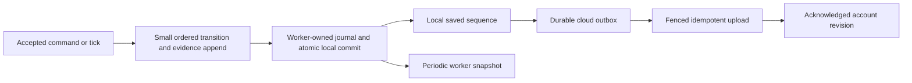

# Stitchin' Time save strategy — research and recommendation

**Date:** 2026-10-29. **Status:** research for owner/manager review; no implementation authorized by this report. **Sources:** [source register](sources-save-strategy-20261029.md). Every external citation below was accessed **2026-10-29**; individual records include dates, authors, source type and limitations. Numeric policy targets below are proposals, not platform guarantees.

Scope: read-only web research and inspection of the shared working tree. Only this document and its source register were written. No code, tests, clinical content, configuration, planning/handoff files, Git operations, dependency installations, deployments or network writes were performed. No tester save, account payload or live Supabase data was accessed. Existing test and release results are attributed to project records, not rerun here.

## Recommendation and answer to the owner's hypothesis

**Use cheap, frequent local recovery; reserve cloud uploads for manual Save, leaving, meaningful session boundaries and a five-minute dirty-progress fallback. Do not depend solely on leaving the game.** Keep the restored five-minute policy while profiling the actual iPhone. The highest-value optimization is reducing repeated whole-history work, not choosing a longer upload timer alone.

The owner's concern is well founded as a performance hypothesis: replacing five-minute uploads with fifteen-second uploads increases opportunities for copying, verification and cache work. However, **the cause of the live persistent freeze remains unconfirmed**. This audit finds save-related work on every account-game command and facility tick, plus separate authority, lifecycle and renderer failure modes. A timer change alone cannot remove those paths.

Three distinctions matter:

- **Local persistence** makes progress recoverable on this device after a reload. It should be small, asynchronous and independent of an upload.
- **Cloud backup/synchronization** makes an acknowledged revision available to another device or after losing local storage. It may lag local progress.
- **Writer-lease renewal** maintains permission to write the shared campaign. Today's fifteen-second renewal is a small scalar RPC, not a full save. Keep it until a separately reviewed ownership design replaces it.

“Manual save + when leaving” is reasonable as the core **cloud** policy, with a longer fallback for people who forget to save or lose the app unexpectedly. As the **only local** policy it leaves all progress since the last completed save exposed. On mobile, a final lifecycle callback and completion of its asynchronous work are separate uncertainties. [SS20, lifecycle guidance](https://developer.chrome.com/docs/web-platform/page-lifecycle-api), [SS22, mobile event limitations](https://developer.mozilla.org/en-US/docs/Web/API/Window/pagehide_event).

## What comparable games and platforms actually document

This is a purposive comparison, not a survey establishing an industry average. “Unknown” means the inspected evidence does not establish the behavior; it does not mean the feature is absent. In-game dates, real elapsed time, local saves and cloud uploads must not be conflated.

### Games

| Game / category | Documented save triggers or cadence | Device/cloud and recovery | Performance evidence and applicability |
| --- | --- | --- | --- |
| **Project Hospital**, desktop hospital management | Developer Patch 34 describes autosaving at **08:00 and 20:00 in-game**. Earlier Patch 7 changed autosaves to alternate between two files. | Rotating recovery files are documented. Cloud scheduling/conflict UX is not established by these posts. | The studio added a notification explaining the brief save pause. Good precedent for meaningful boundaries and visible state; historical behavior, not a browser performance target. [SS01](https://steamcommunity.com/app/868360/discussions/0/2261313417704798219/?ctp=2), [SS02](https://store.steampowered.com/news/posts/?appids=868360&enddate=1544545485&feed=steam_community_announcements). |
| **Two Point Hospital**, desktop hospital/business sim | A reliable first-party exact autosave/menu cadence was not recovered. | SEGA documents on-device save directories for Windows, macOS and Linux. The directory's Cloud name does not establish when uploads occur. | No studio measurement supporting a particular interval was recovered. Avoid turning community reports into a technical default or freeze diagnosis. [SS03](https://support.sega.com/hc/en-gb/articles/360000315538-Save-Location). |
| **Factorio**, factory/business simulation | Official **server example** uses **10 real minutes** and **5 rotating slots**; these are not universal single-player defaults. | Local/server save files; Steam synchronization is a separate platform layer where integrated. | Wube explains background saving through an OS process fork on macOS/Linux, with substantial memory use and remaining freeze investigation. A worker does not replicate OS copy-on-write. [SS05](https://github.com/wube/factorio-data/blob/master/server-settings.example.json), [SS04](https://www.factorio.com/blog/post/fff-408). |
| **Stardew Valley**, desktop/mobile farming | Standard overnight save; mobile adds emergency background save and manual backup. | Previous standard save retained; mobile can offer restoration of an interrupted session. This evidence does not establish automatic cross-platform cloud sync. | The game-hosted community manual says emergency saving takes time and can fail if the app is killed too soon. Native app behavior supplies a caution, not an iOS web-app grace period. [SS06](https://wiki.stardewvalley.net/Mobile_Saves). |
| **OpenTTD**, transport tycoon | Current source reference includes configurable interval, autosave-on-exit and error-disconnect options. | Configurable retention; local-save controls and threaded-save option. Cloud interval/conflict handling not established here. | Threaded-save support is evidence of separating work, not proof that snapshot capture never blocks. Archived in-game monthly defaults were not presented as current. [SS07](https://docs.openttd.org/source/d6/d4b/structGUISettings). |
| **Cities: Skylines**, city builder | Original manual provides **Save Game from the pause menu**, including a new named save or overwrite. | Explicit save/load selection. No cloud timing or Cities: Skylines II default inferred. | A pause/menu is a comprehensible explicit save boundary; the manual provides no save-time benchmark. [SS08](https://cdn.akamai.steamstatic.com/steam/apps/255710/manuals/CitiesSkylines-UserManual_EN.pdf). |
| **Trimps**, browser idle/incremental | Published source schedules local autosave every **60 seconds**, subject to settings/offline-processing guards. Routine PlayFab backup is gated by **2 hours**; manual save can bypass that longer gate, subject to a **60-second** minimum. | Local compressed save, export, optional cloud backup; source checks cloud progress and invokes a conflict prompt. | Source performs synchronous JSON/compression/localStorage work. Its cadence separation is useful; its implementation is not evidence of jank-free saving or a pattern to copy wholesale. Static inspection, not runtime testing. [SS09](https://raw.githubusercontent.com/Trimps/Trimps.github.io/refs/heads/master/main.js). |
| **Melvor Idle**, cross-platform idle | Offline-client announcement documents local resources/data by default and internet-dependent cloud functions; **no exact save timer supplied**. | Local saves remain important and the publisher recommends backup before switching beta clients. | Published support guidance, not a CPU profile. Separately, the **Melvor Idle 2** announcement describes automatic cloud saving and manual save-string export; it does not specify cadence. These are different product/version records. [SS10](https://news.melvoridle.com/offline-client-public-beta-now-available-on-steam-mobile/), [SS11](https://news.melvoridle.com/melvor-idle-2-a-runescape-adventure-releases-17-november-2026-into-steam-early-access-next-fest-roundup/). |
| **Tiny Tower**, mobile building/business management | Official FAQ documents explicit cloud enrollment and secondary-device activation/confirmation; **upload timer undisclosed**. | Registered tower can be restored or synchronized to another device; recovery/rollback support exists. | Good precedent for making backup enrollment and transfer understandable. No local engine, merge or stutter claim can be inferred from support UX. [SS12](https://support.nimblebit.com/support/solutions/articles/150000013061-cloud-backup-syncing-and-restoring-a-lost-tower-faq). |

### Cloud-save platforms

| Platform | Local versus cloud timing | Conflicts / UX / performance implication |
| --- | --- | --- |
| **Apple GameKit saved games in iCloud** | The developer encodes and saves at chosen points; no universal fifteen-second policy. Requires the applicable iCloud setup. | Conflicting filenames across devices are surfaced for game-specific resolution, potentially player choice. Apple advises minimizing saved data for space/performance. These are native APIs, not capabilities granted by adding a website to the Home Screen. [SS13](https://developer.apple.com/documentation/gamekit/saving-the-player-s-game-data-to-an-icloud-account). |
| **Google Play Games Saved Games** | Local reads/writes can continue offline; the service synchronizes asynchronously on reconnection. Guidance encourages current data at start/resume and reasonable save frequency, without one universal interval. | Developer resolves competing versions, possibly through user choice. Loading a cloud account must not silently erase meaningful guest progress. [SS14](https://developer.android.com/games/pgs/savedgames), [SS15](https://developer.android.com/games/pgs/android/saved-games). |
| **Steam Cloud** | Ordinary synchronization is before launch/after exit. Optional **Dynamic Cloud Sync** adds upload on suspend and download/change notification on resume. | Game must handle files changed while suspended. Valve recommends separating frequently changed data from stable data to avoid unnecessary transfer; large/many files can delay sync. Steam's external client can do work after the game stops; a PWA has no equivalent guarantee. [SS16](https://partner.steamgames.com/doc/features/cloud). |
| **Xbox Game Saves, documented GDK flow** | Gameplay writes are local. The described APIs attempt periodic cloud synchronization at **30 minutes**, plus session-boundary synchronization. | Locks, offline startup/reconnection and merge/conflict behavior are explicit; console and PC cases differ. This supports distinguishing local durability from cloud ownership, not importing Xbox suspension behavior into Safari. [SS17](https://learn.microsoft.com/en-us/gaming/gdk/docs/features/common/game-save/game-saves-syncing?view=gdk-2604). |
| **PlayStation Plus / PS5** | Automatic cloud sync can occur on game close/rest mode with the required connectivity/settings. Manual controls also exist. | Consumer guidance distinguishes PS5 synchronization from PS4 upload/download behavior. No proprietary certification rule or per-title timer is inferred. [SS18](https://www.playstation.com/en-us/support/subscriptions/ps5-ps-plus-cloud-storage/). |
| **Nintendo Switch Online** | Supported titles offer automatic/manual backup; automatic opportunities include exit/sleep. | Backup is conditional on settings/connectivity; the currently played software is not backed up until exit/sleep. Platform backup supplements the game's own saves. [SS19](https://support.nintendo.com/my/nso/services/savedata-backup/index.html). |

The comparison supports multiple layers: manual intent, automatic local recovery, recognizable boundaries, retained prior copies and separately scheduled cloud transfer. It does **not** establish that all similar games use long intervals, that native games save only on exit, or that a successful cloud request implies a cheap client.

## Web/PWA constraints, especially an installed iPhone app

### Leaving is an opportunity, not a durability protocol

| Signal / mechanism | Appropriate use | Limit |
| --- | --- | --- |
| `visibilitychange` to hidden | Stop simulation/render work as appropriate; request a small local drain; attempt an already prepared cloud upload. | Normal mobile session-end signal. It cannot guarantee delivery on every crash/process kill or that an asynchronous worker/IDB/RPC chain finishes. [SS21](https://developer.mozilla.org/en-US/docs/Web/API/Document/visibilitychange_event). |
| `pagehide` | Supplemental navigation/session-end handling; distinguish back/forward-cache transitions where relevant. | May not fire for mobile app-manager termination. Deduplicate with hidden rather than launching another full save. [SS22](https://developer.mozilla.org/en-US/docs/Web/API/Window/pagehide_event). |
| `beforeunload` / `unload` | A narrowly scoped unsaved-change warning where supported. | Unreliable mobile delivery; dialogs are not a save mechanism. Never block navigation with serialization/network waits. [SS22](https://developer.mozilla.org/en-US/docs/Web/API/Window/beforeunload_event). |
| `freeze` / `resume` | Optional additional hooks when actually supported. | Chromium lifecycle guidance is not a portable iOS callback contract. Timers and worker execution may stop; no fixed background completion window is promised here. [SS20](https://developer.chrome.com/docs/web-platform/page-lifecycle-api). |
| Focus / visible / pageshow | Reconcile actual visibility and ownership cheaply; repair the timer/render lifecycle independently. | Focus is not proof a save was lost and is not a reason to scan/decode every retained campaign. Duplicate events must coalesce. This is the recommendation, informed by the current implementation audit. |

Historical WebKit reports also document missed exit events. They justify testing failure paths, not asserting the same bug affects every current version. **No event can run after a process has already been killed.** Therefore make the last *completed foreground local transaction* sufficient for recovery; hidden should improve freshness, not create the first recoverable copy. [SS23](https://bugs.webkit.org/show_bug.cgi?id=199854).

Do not replace this with a multi-megabyte beacon. `sendBeacon` has a small queued-data budget, supplies no campaign acknowledgement, and cannot provide arbitrary authentication-header/response handling like the current RPC protocol. Fetch keepalive also has an aggregate **64 KiB** in-flight body budget in the standard. Even an eligible small compressed delta still needs authentication, idempotency and later outcome reconciliation. A queued request is not proof of an accepted revision. [SS32](https://developer.mozilla.org/en-US/docs/Web/API/Navigator/sendBeacon), [SS33](https://fetch.spec.whatwg.org/#http-network-or-cache-fetch).

An installed Home Screen app is still web content subject to suspension. A service worker can assist supported offline workflows but must not be assumed to drain an outbox after iOS kills the document. Do not make Background Sync or a continuously running worker a correctness prerequisite. Retry from persistent state at the next verified foreground/open opportunity.

### Storage survival and storage speed are different questions

WebKit's Safari 17+ policy gives standalone apps the browser-app quota category: origin upper bound up to **60%** of disk and overall up to **80%**. These are policy ceilings, not allocated free space. Origins are best-effort by default and may be evicted under pressure; `estimate`, `persisted` and `persist` help observe/request persistence. Home Screen use is a granting heuristic, not proof of a grant. Handle failures. [SS24](https://webkit.org/blog/14403/updates-to-storage-policy/).

The older ITP explanation gives Home Screen apps separate usage accounting from Safari's seven-days-of-Safari-use inactivity rule. Consequently, “every installed app loses storage after seven calendar days” is inaccurate. Installation nevertheless does not protect against user deletion or all storage loss. [SS25](https://webkit.org/blog/10218/full-third-party-cookie-blocking-and-more/).

Large origin quotas do not remove separate Web Storage limits. `localStorage` holds strings, is synchronous, and commonly has a much smaller cap than IDB/OPFS. Browser storage is origin-scoped: `127.0.0.1`, `localhost`, another port and the remote site are different. Browser profiles/storage partitions also matter. Do not infer save disappearance without recording `location.origin` and opening pathway. [SS26](https://developer.mozilla.org/en-US/docs/Web/API/Web_Storage_API), [SS26, quotas](https://developer.mozilla.org/en-US/docs/Web/API/Storage_API/Storage_quotas_and_eviction_criteria).

| Storage option | Relevant cost | Recommendation for this game |
| --- | --- | --- |
| **localStorage** | Main-thread serialization plus synchronous string access/write. Full profile includes all serialized campaigns, not just the active change. | Keep small settings/metadata and the existing tiny diagnostic journal here. Migrate large campaign writes carefully; extending their timer alone leaves heavy action-triggered writes. |
| **IndexedDB** | Async transaction/disk API; object serialization, result materialization and callbacks still cost CPU. Whole nested records after every change can cause jank. | Preferred next step: small transactional records/deltas and immutable chunks; use it from the worker when feasible. Normalize by actual update patterns. Measure on Safari. [SS27](https://web.dev/articles/indexeddb-best-practices-app-state). |
| **OPFS** | Byte-oriented files and worker-only synchronous access handles can support efficient journals. Private origin storage remains quota/eviction-managed. | Consider only if measured IDB limits justify the added file format, locking, crash recovery and migration work. It is not an automatic fix for main-thread evidence traversal. [SS30](https://webkit.org/blog/12257/the-file-system-access-api-with-origin-private-file-system/). |

“Async” and “in a worker” do not mean cost-free. Structured serialization for `postMessage` and IDB can execute on the calling thread. Repeatedly shipping a full graph still copies it, and allocates receiver objects. Prefer worker-owned stable data, small deltas and compact responses; Blob handles can avoid repeated deep value copying. [SS28](https://www.w3.org/2018/12/games-workshop/slides/13-storage.pdf).

Transfer an `ArrayBuffer` when data already exists in byte form and ownership can move. The sender's buffer becomes detached. Converting the full graph with `JSON.stringify` and `TextEncoder` on the main thread first merely moves the bottleneck earlier; create those bytes in the worker or persist them there. [SS29](https://developer.mozilla.org/en-US/docs/Web/API/Web_Workers_API/Transferable_objects).

Idle callbacks are useful for optional compaction, with feature detection and a bounded fallback. They do not split a large synchronous serialization call; a timeout may force that call during busy rendering. A microtask is also not a rendering yield. Local durability must have a maximum batching delay rather than a trailing debounce that waits forever during continuous play. [SS31](https://developer.mozilla.org/en-US/docs/Web/API/Window/requestIdleCallback). The last two sentences are scheduling recommendations for this implementation.

## Read-only codebase audit

Paths and line anchors describe the inspected **working tree**, not necessarily a particular installed release. A concurrent worker may change them later. `S` means current operational state size, `E` total evidence/history size, `D` new evidence since acknowledgement, and `P` all campaigns in the local profile. Size descriptions identify dependencies, not a measured asymptotic bound for the whole function.

### (a) Every game command

| Path | Main-thread work and size dependence |
| --- | --- |
| Shared React command entry: [usePrototypeSession.ts:712](../../apps/player/src/session/usePrototypeSession.ts#L712) | Creates command/operation ID. Account mode synchronously calls `cloud.execute`, updates state/profile and publishes the receipt. Local mode calls the domain reducer directly, then decides whether to write through, schedule or stage. Rendering/view-model work follows these updates and is additional to codec timing. |
| Account command: [cloud/gameSession.ts:93](../../apps/player/src/session/cloud/gameSession.ts#L93) | `applyGameEvidenceCommand` is synchronous. `lastCommandMs` times this call, including its evidence/domain work, but **excludes** later worker posting, cache persistence and React rendering. Every non-replayed result marks dirty, schedules a flush and emits. |
| Evidence application: [game-evidence.ts:317](../../packages/game-domain/src/game-evidence.ts#L317) | Reimports the checkpoint, searches transition history for the operation ID, copies the evidence array/index, projects before/after state and runs the reducer. This depends on `S`, history and `E`; it is not just appending the new row. |
| Full reconciliation: [game-evidence.ts:275](../../packages/game-domain/src/game-evidence.ts#L275), [game-evidence.ts:347](../../packages/game-domain/src/game-evidence.ts#L347), [game-evidence.ts:221](../../packages/game-domain/src/game-evidence.ts#L221) | Imports apply patches, resolve evidence references and validate the finance/learning chain. After creating the new snapshot, the transition function imports/reconciles again before returning. The chain walk scales with accumulated transitions. Frozen archive indexes are cached, but copying the index/array and walking history still occur. |
| Copy/equality/diff helpers: [game-evidence-json.ts:10](../../packages/game-domain/src/game-evidence-json.ts#L10), [game-evidence-json.ts:22](../../packages/game-domain/src/game-evidence-json.ts#L22) | JSON round trips, canonical recursive equality and recursive patch comparisons traverse data. Equality can reserialize nested subtrees at successive diff levels; do not assume constant or strictly linear per-command work. [EvidenceBuilder:149](../../packages/game-domain/src/game-evidence.ts#L149) copies existing arrays/maps. |
| Domain cloning: [reducer.ts:248](../../packages/game-domain/src/reducer.ts#L248) | `clonePlain` is a JSON round trip. Individual reducers use it; domain simulation cost is separate from remote save scheduling. |
| Local branch persistence decision: [usePrototypeSession.ts:760](../../apps/player/src/session/usePrototypeSession.ts#L760) | Non-tick commands normally serialize/write the full local profile unless explicitly deferred. Tick commands use a facility-tick boundary. The large account checkpoint path is different; do not attribute localStorage campaign writes to every hosted command. |

### (b) Every facility tick

[usePrototypeSession.ts:986](../../apps/player/src/session/usePrototypeSession.ts#L986) sends `ADVANCE_TICK` through the same command boundary. [facilityClock.ts:19](../../apps/player/src/session/facilityClock.ts#L19) checks real visibility, pause and authority before advancing; [tutorialTiming.ts:27](../../apps/player/src/session/tutorialTiming.ts#L27) scales the timer by speed/tutorial pacing. [reducer.ts:8488](../../packages/game-domain/src/reducer.ts#L8488) clones the state before performing the tick's simulation work. In account mode the evidence wrapper and local-candidate preparation described above therefore also apply to ticks.

Local-only profile autosaving is **every 15 facility ticks**, not five real minutes: [prototypeAutosave.ts:3](../../apps/player/src/session/prototypeAutosave.ts#L3). Its documented ordinary rates are roughly 15 seconds at 1x and 3.75 seconds at 4x; the tutorial multiplier can differ. Idle scheduling defers the full write but does not shrink it. All intervening local state is staged in memory. The clock's independent watchdog checks stalled progress and restarts an eligible timer without catch-up ticks: [facilityClock.ts:31](../../apps/player/src/session/facilityClock.ts#L31).

### (c) Local checkpoints: two distinct paths

**Local-only campaign profile:** [usePrototypeSession.ts:596](../../apps/player/src/session/usePrototypeSession.ts#L596) stages the active state in a profile containing all campaigns. [prototypeStorage.ts:612](../../apps/player/src/session/prototypeStorage.ts#L612) serializes each campaign, serializes the outer profile and calls `localStorage.setItem`. [persistence.ts:114](../../packages/game-domain/src/persistence.ts#L114) is plain `JSON.stringify`. This is synchronous main-thread work depending on `P`, including inactive campaigns. A nested serialized-state string also requires escaping in the outer JSON. [usePrototypeSession.ts:680](../../apps/player/src/session/usePrototypeSession.ts#L680) performs scheduled writes. Manual local Save & Close uses [usePrototypeSession.ts:1890](../../apps/player/src/session/usePrototypeSession.ts#L1890).

**Account game's local durable candidate:**

1. [cloud/gameSession.ts:117](../../apps/player/src/session/cloud/gameSession.ts#L117) coalesces synchronous command bursts in a microtask. Each flush posts the **full checkpoint** to an encode task; ongoing commands cause another iteration. This is not a five-minute encoder.
2. [cloud/codecEvidence.ts:64](../../apps/player/src/session/cloud/codecEvidence.ts#L64), executed in the worker for that task, reimports the checkpoint, canonicalizes the archive/header/records and compresses **all records**. Only afterwards does it select the unacknowledged suffix for upload. Network deltas already exist; encoding is still dependent on all `E`.
3. [cloud/codecWorker.ts:86](../../apps/player/src/session/cloud/codecWorker.ts#L86) posts object graphs without a transfer list. Native posting has a structured-serialization cost on the sender. Development/test additionally clone for boundary checking at [line 39](../../apps/player/src/session/cloud/codecWorker.ts#L39); do not count that extra guard as release work. [codec.worker.ts:8](../../apps/player/src/session/cloud/codec.worker.ts#L8) returns task results, which also require deserialization.
4. [cloud/coordinator.ts:514](../../apps/player/src/session/cloud/coordinator.ts#L514) clones the candidate and attempted full cache entry; a worker task verifies candidate plus confirmed history. [line 236](../../apps/player/src/session/cloud/coordinator.ts#L236) clones again before persistence. These main-thread copies depend on compressed candidate/cache sizes, not just the small command.
5. [cloud/cache.ts:104](../../apps/player/src/session/cloud/cache.ts#L104) packs the full entry in the worker, writes one IDB record, awaits transaction completion, reads it back and unpacks/verifies it in the worker. [codecCache.ts:16](../../apps/player/src/session/cloud/codecCache.ts#L16) JSON/hash work is off-thread, but full entry messages, stored strings, readback results and notifications still have costs.
6. [cloud/gameSession.ts:159](../../apps/player/src/session/cloud/gameSession.ts#L159) waits for the version captured at the durability call. New later ticks no longer have to finish before this barrier resolves. This recent correction prevents starvation; it does not eliminate processing cost.

The separately implemented [localCampaignRepository.ts:566](../../apps/player/src/session/localCampaignRepository.ts#L566) must not be mistaken for the current hook's storage path. A read-only non-test source search found its session-barrel export but no production construction/use. Reuse its ideas only after confirming integration and guarantees; this report does not propose switching storage by an unreviewed import.

### (d) Cloud checkpoints and lease pulses

| Trigger / stage | Work |
| --- | --- |
| Cadence constants | [cloud/transport.ts:9](../../apps/player/src/session/cloud/transport.ts#L9): 60-second lease, **15-second renewal**, **five-minute checkpoint**, 30-second grace. They serve different purposes. |
| Foreground pulse | [usePrototypeSession.ts:641](../../apps/player/src/session/usePrototypeSession.ts#L641) calls `pulse` every second while visible. [coordinator.ts:833](../../apps/player/src/session/cloud/coordinator.ts#L833) checks time/authority, renews when due, and requests an upload when dirty age reaches the checkpoint interval. Stable pulses do not deliberately reserialize a campaign. |
| Renewal | [supabaseTransport.ts:142](../../apps/player/src/session/cloud/supabaseTransport.ts#L142) sends protocol, campaign, revision, generation and token scalars to the lease RPC. Normal success has no campaign IDB/codec pass. Network/auth and gate effects can still matter. |
| Explicit checkpoint entry | [gameSession.ts:206](../../apps/player/src/session/cloud/gameSession.ts#L206) first waits for local durability, then calls coordinator checkpoint. Periodic coordinator upload uses the candidate already staged there; it need not start a fresh domain reducer operation. |
| Freeze operation | [coordinator.ts:550](../../apps/player/src/session/cloud/coordinator.ts#L550) freezes an immutable request, worker-serializes/hashes it, prepares the wire in the worker, and locally persists the in-flight operation before transport. |
| RPC / main parsing | [supabaseTransport.ts:189](../../apps/player/src/session/cloud/supabaseTransport.ts#L189) verifies the wire hash via worker, parses request JSON on main, then calls `beta2_cloud_write`. Receipt handling also parses request text at [line 179](../../apps/player/src/session/cloud/supabaseTransport.ts#L179). RPC packaging and response handling add work; network awaiting itself does not execute CPU continuously. |
| Acknowledgement | [coordinator.ts:568](../../apps/player/src/session/cloud/coordinator.ts#L568) parses the frozen request again, checks receipt/revision/bytes/high-water, appends confirmed evidence, verifies through worker and persists/readbacks the full cache again. Following pending progress is rebased without repeating accepted evidence. |
| Open/recovery exception | [App.tsx:550](../../apps/player/src/App.tsx#L550) attempts a checkpoint after a verified open/reopen. Retry/recovery and campaign transitions can also upload outside the timer. “Five-minute policy” does not mean there can be no other account operations. |
| Save & Close | [gameSession.ts:210](../../apps/player/src/session/cloud/gameSession.ts#L210) pauses live ticks, waits for accepted progress to be durable; [coordinator.ts:895](../../apps/player/src/session/cloud/coordinator.ts#L895) drains recovery and releases the lease after confirmation. Existing UI waits for account confirmation: [CloudSaveControls.tsx:109](../../apps/player/src/ui/CloudSaveControls.tsx#L109). |

### (e) Focus, visibility and large recovery paths

The current hook binds focus/pageshow/online/document resume at [usePrototypeSession.ts:629](../../apps/player/src/session/usePrototypeSession.ts#L629). Routine foreground handling in [coordinator.ts:740](../../apps/player/src/session/cloud/coordinator.ts#L740) coalesces checks, skips unnecessary work with a healthy lease, and otherwise performs admission/head/renew reads without deliberately withdrawing valid authority. Exceptions, expired ownership and actual changed heads still require recovery. Full `focus()` remains a gate-changing recovery operation at [line 801](../../apps/player/src/session/cloud/coordinator.ts#L801); confusing the two APIs recreates the earlier problem.

Hidden calls `markBackground` and `checkpointNow`; pagehide/freeze also attempt a checkpoint: [usePrototypeSession.ts:934](../../apps/player/src/session/usePrototypeSession.ts#L934). Those are fire-and-forget asynchronous chains, so the event handler does not guarantee completion. Local-only hidden dispatches a pause/write-through action when running; pagehide cancels the scheduled task and synchronously attempts the staged profile. Repeated hidden/pagehide can still call through multiple layers even though an active upload coalesces.

Full open/recovery is materially different: [automaticResolution.ts:39](../../apps/player/src/session/cloud/automaticResolution.ts#L39) checks account/local/retained copies and promotion; [cache.ts:132](../../apps/player/src/session/cloud/cache.ts#L132) enumerates campaign caches. [supabaseTransport.ts:106](../../apps/player/src/session/cloud/supabaseTransport.ts#L106) loads/decompresses/repackages history in the adapter; unlike codec tasks, this adapter is not itself a worker. Async compression/hash waits still interleave main-thread parsing, canonicalization and allocations. Retained-entry [entryStorage.ts:74](../../apps/player/src/session/cloud/entryStorage.ts#L74) uses main-thread JSON/hash-input/readback operations; `entries` reads all matching entries at [line 108](../../apps/player/src/session/cloud/entryStorage.ts#L108). Small identity entries are cheap; full protected copies can scale with history. Keep this work out of healthy routine focus.

## What the existing measurements establish

The project record, [flag-freeze-20261028.md:2637](../execplans/flag-freeze-20261028.md#L2637), describes a Windows/Node benchmark with real codecs, a production-like input-clone boundary and asynchronous fake IDB/transport. It used a **paused Level 5 fixture**, not five minutes of live iPhone simulation. It did not measure native worker-result deserialization, real disk/quota latency, Safari GC/rendering or network latency.

| Recorded measurement | Before cadence/focus repair | After |
| --- | ---: | ---: |
| Client clone + JSON CPU per remote checkpoint after local durability | 14.08 ms | 14.46 ms |
| Worker posts for 20 separately flushed commands in the five-minute workload | 150 | 87 |
| Measured clone calls in that workload | 350 | 215 |
| Account uploads in that workload | 10 | 1 |
| Cache writes in that workload | 40 | 22 |
| Full scans for six independent focus bursts | 6 | 0 |

The source profile was **1,405,053 UTF-8 bytes**, about **2.81 MB of UTF-16** before the profile envelope, with **1,960 evidence records**. These are different byte representations, not one universal “save size.” The normalized worker input and compressed evidence have different sizes again.

The same record reports **four worker task posts and ten measured clone calls per separately flushed command**. Instrumented synchronous speed-change application took approximately **237–305 ms**, and command-plus-local-save elapsed around **1.4 seconds**, with instrumentation overhead. These are strong reasons to profile the command path, not reliable native latency estimates or proof of an optimization. Live facility ticks can generate many more commands than that synthetic workload. [Existing measurement interpretation:2685](../execplans/flag-freeze-20261028.md#L2685).

Consequently: restoring five minutes reduces upload frequency; it does not make each upload smaller, eliminate per-command encoding, or establish that a persistent iPhone stall is fixed. A desktop 14 ms clone/JSON measurement by itself cannot explain an app stuck until restart.

## Ranked freeze hypotheses and how to distinguish them

Ranking is investigation priority for the **persistent iPhone symptom**, not a probability estimate. More than one may be true. Project records report continued freezing even in a small Level 1 campaign, which weakens an explanation based solely on large Level 5 saves. [Incident record:2950](../execplans/flag-freeze-20261028.md#L2950).

| Rank / hypothesis | Evidence and limits | Confirmation / falsification on device |
| --- | --- | --- |
| **1. Authority/lifecycle or clock/render/input state appears frozen** | Earlier full-focus gating and stale visibility stopping the clock were reproduced. Later controlled fixes cover durability starvation, silent expired gates, phone playback latch and Phaser lifecycle pause. Those fixes prove mechanisms, not that the owner's current session hit them. Fits a persistent stop better than a short copy. [Record:2958](../execplans/flag-freeze-20261028.md#L2958), [clock:31](../../apps/player/src/session/facilityClock.ts#L31), [render watchdog:12](../../apps/player/src/diagnostics/renderLoopWatchdog.ts#L12). | During the freeze, distinguish functioning More/DOM/report button from refused commands and stopped canvas. Compare `canExecute`, phase/failure, lease, paused/finish-report, actual tick, timer/rAF/frame ages. An active DOM with denied commands supports a gate; an advancing tick with old frames supports rendering. All handlers blocked points elsewhere. |
| **2. Synchronous evidence/reducer work blocks the main thread** | Confirmed repeated history/state traversal; instrumented desktop command cost is substantial. Runs on ticks as well as clicks, independent of five-minute uploads. Strong candidate for recurring jank and overload; not yet proof of an indefinite Level 1 hang. | Native call tree must show time in evidence import/reconciliation, canonical equality/diff, JSON clone or simulation. Compare small/large history with similar active facility state, 1x/4x and paused/manual commands. Measure full handler and downstream work, not just the existing command field. |
| **3. Worker or IDB stops responding, with a save/recovery barrier or gate waiting** | Heavy encode/candidate/pack/readback traffic is confirmed. Missing completion/worker events have bounded watchdogs now. A past native `DataCloneError` on reopening was directly observed and corrected; it must not be silently treated as the current cause. [Worker:7](../../apps/player/src/session/cloud/codecWorker.ts#L7), [cache:36](../../apps/player/src/session/cloud/cache.ts#L36), [prior native evidence:2108](../execplans/flag-freeze-20261028.md#L2108). | DOM continues; `encoding` or task/IDB age grows; worker response stops; watchdog restarts/errors appear. Correlate whether barriers finish while later ticks keep arriving. Timers cannot enforce a real-time deadline while the entire page is suspended/blocked. |
| **4. Allocation/GC or WebKit process pressure caused by overlapping full copies** | Full raw evidence, compressed records, cache entries, strings and cloned graphs coexist across threads; source proves opportunities for amplification. No device peak-memory or jetsam evidence was obtained. | Compare allocations/GC and process restart timing against worker posts/cache writes; record whether the page reloads into a new session. Native memory/process evidence is required before claiming an OS kill. A small single JSON file does not describe peak live memory. |
| **5. localStorage full-profile writes cause periodic stutter in local-only mode** | Direct synchronous write-through and 15-facility-tick full writes exist. Lower priority for an account session whose active saves use cloud IDB cache; still relevant to local owner tests. | Verify actual mode/origin; profile `serializeGameState`, outer profile JSON and `setItem`. Increasing inactive-campaign size should increase profile work. Compare event timing with facility-tick boundaries. |
| **6. Slow RPC/auth/database work alone** | RPCs can delay cloud confirmation and trigger expiry/recovery gates. A healthy awaited network request should not monopolize JS. Small renewals have no full checkpoint payload. | Network latency with working DOM and visible pending status is not a blocked thread. Correlate RPC deadlines/ownership transitions with loss of command authority. Investigate a UI/gate failure if networking produces an unexplained permanent stop. |

### What today's in-game problem report can show

[problemDiagnostics.ts:12](../../apps/player/src/diagnostics/problemDiagnostics.ts#L12) allowlists health fields for coordinator, session, facility, clock, render, codec, storage, shell and outboxes. [line 100](../../apps/player/src/diagnostics/problemDiagnostics.ts#L100) includes build/release, `location.origin`, standalone/display mode, visibility and network hints. Important readings:

- **Gate:** `phase`, `failure`, `canExecute`, `leaseRemainingMs`, `resumeAuthorized`, `localDurable`, `reloadRequired`, `closing`.
- **Simulation/presentation:** accepted tick, pause/speed/finish-report; `tickAge`, `timerAge`, `rafAge`, `rafPendingAge`; renderer `frameAge`, `running`, `paused`, restart count.
- **Processing:** `lastCommandMs`/command age; codec alive/ready, task kinds/ages/retries, last response/error; pending storage operations, their ages and last duration/error.

Interpret the combination. Old tick + `paused=true` may be intentional. Old tick + `allowed=false` is an authority diagnosis. Old frame + increasing ticks is a renderer diagnosis. High command duration establishes a synchronous hot path but does not time the entire save pipeline. Missing memory hints are expected on implementations that do not expose them; they are not evidence of low memory use.

The diagnostic journal is at most **3,072 characters / 6 KiB UTF-16**, ordinarily persisted every five seconds plus lifecycle/error opportunities: [problemDiagnostics.ts:117](../../apps/player/src/diagnostics/problemDiagnostics.ts#L117). A subsequent launch can include its prior snapshot. It can be stale/truncated and is **not** a save-stage profiler, a continuous frame trace, or a complete crash log.

[TesterFeedback.tsx:97](../../apps/player/src/feedback/TesterFeedback.tsx#L97) provides the consented problem-report action independently of game command authority, only when the feedback transport exists. It packages current/prior technical rings into immutable numbered feedback parts: [problemReport.ts:6](../../apps/player/src/feedback/problemReport.ts#L6). No report was submitted during this research. A fully blocked JS thread cannot execute that action or its watchdogs; after restart the prior journal is a limited fallback, not proof of the last unrecorded operation. The current schema excludes campaign contents, answers, patient/comment text, tokens and arbitrary stacks.

### Real-device confirmation plan

1. Record actual installed build, iPhone model/iOS version, standalone/browser mode, exact opening pathway and `location.origin`. Do not reinstall, clear storage or change origins to diagnose an existing save. Current canonical owner local pathway remains **START_GAME.cmd → http://127.0.0.1:4173** in the intended persistent profile; remote playtest remains **https://melissarowlandc-afk.github.io/GamifySurgery/**. They have separate local stores. No pathway was changed here.
2. Use existing problem reports if DOM remains responsive, with the player's consent. Record whether More/tabs work, whether time advances and whether switching away triggers the issue. If restart is necessary, capture the prior technical report promptly. Do not request clinic contents as default diagnostics.
3. For a controlled device reproduction, use **macOS Safari Web Inspector attached to the actual Home Screen app**, after normal device trust/inspection setup. The documented route includes Home Screen websites. This Windows research session did not claim to perform it. [SS35](https://webkit.org/web-inspector/enabling-web-inspector/).
4. Correlate JavaScript call trees, CPU, rendering, network and selected allocation recordings. Run an uninspected comparison because profiling itself can change behavior. Use both Level 1 and representative Level 5 fixtures, with history growth separate from active-world complexity. [SS36](https://webkit.org/web-inspector/timelines-tab/).
5. In a future implementation milestone, add bounded numeric stage timings: command/reducer/evidence; sender `postMessage`; worker queue/start/end/result receipt; candidate verification; cache pack/IDB transaction/readback; wire/RPC/ack; notification/render; input-to-next-frame and event-loop gaps. Add sequence/high-water/byte-count metadata without content. Existing `lastCommandMs` cannot attribute these stages. Feature-detect Long Tasks rather than assuming availability or interpreting no entries as no jank. [SS37](https://developer.mozilla.org/en-US/docs/Web/API/PerformanceLongTaskTiming).
6. Compare baseline five-minute behavior with each optimization separately. Exercise no cloud change, dirty manual Save, normal five-minute upload, hide/show bursts, lock/unlock, long suspension, offline return, slow service, worker loss, IDB failure and second-device takeover. Distinguish synthetic injected failures from naturally reproduced incidents. No cadence A/B that puts real tester progress at risk is authorized by this report.

## Concrete proposed policy

These choices target a small invited beta with valuable learning/campaign history. They are not justified by a claim that another game's exact timer is optimal.

### Local durability

- Maintain a **persistent incremental journal plus periodic operational snapshot**, with a committed sequence/high-water mark. Start a small local transaction promptly for meaningful actions, including answers, purchases and campaign changes. Aim for a committed action within **one second** of acceptance during normal foreground play; never label an in-memory update as saved.
- Batch high-frequency **facility-tick** changes over approximately **one real second**, with a proposed maximum normal dirty age of **two seconds**, independent of simulation speed. Retain **every required evidence record** within the batch; coalescing the latest operational projection must not discard evidence or scored-review events. These are latency targets, not guaranteed deadlines under suspension or failure.
- Keep one active persistence drain, with bounded queued work. Coalesce snapshot projections, not immutable operations. A continuous stream must not reset the deadline indefinitely. A Save/barrier waits for its captured version, as today's corrected barrier already does.
- Produce a full local recovery snapshot/compaction about **every five foreground minutes while dirty**, plus a suitable day-end/session boundary when it is useful. Run bulk work in the worker and budget its message costs. Background/hide should drain already accumulated small work, not start a first multi-megabyte re-encoding/compaction.
- On manual Save/Save & Close, campaign switch, explicit pause/menu boundary and hidden/pagehide, request an immediate drain to a **captured version**. Deduplicate lifecycle requests. Maintain the previous verified snapshot and journal until the new manifest transaction commits. If iOS kills the app without any event, recover from completed foreground writes.

The one/two-second targets describe intended exposure before a transaction completes. No finite data-loss ceiling is promised when storage fails, the thread cannot run or the OS terminates before completion. Surface failure and stop accepting progress that cannot be protected under the selected safety policy. Committed local data also remains vulnerable to user clearing/eviction/device loss; cloud/export covers different risks.

### Cloud backup and cross-device continuation

- **Retain five real minutes of dirty progress as the ordinary cloud fallback.** Do not upload unchanged campaigns. This preserves the restored direction and limits ordinary upload opportunities to about twelve per active hour, instead of 240 at fifteen seconds, before lifecycle/manual/recovery exceptions. Those are interval arithmetic, not measured traffic.
- Upload on **manual Save**, **Save & Close / explicit switch-device action**, campaign switching/sign-out after local drain, and **best-effort hidden/pagehide**. On hide, use a prepared durable candidate; do not require the worker to begin a full-history encode before an upload can start.
- Also consider **day-end/summary or completed inspection** a useful cloud checkpoint if dirty. Coalesce automatic boundary/lifecycle jobs and avoid repeated automatic boundary uploads within a proposed **60-second cooldown**; manual switch-device saves retain priority subject to backend limits. A day is a narrative boundary, not a substitute for the real-time fallback during paused or long-running play.
- Retry a persistently queued, immutable operation when connectivity returns or at next verified open. Preserve operation ID/body/hash, reconcile uncertain acknowledgements and fence changed heads/writers before a new upload. No blind retry with a newly minted revision or fabricated success.
- Keep the **fifteen-second tiny lease renewal** for the current shared-writer protocol. It must stay independent of bulk encoding/cache work. Routine healthy focus gets the current cheap check; full selection belongs to opening, actual divergence or authority repair.

Cloud freshness is conditional: five minutes plus processing/upload time is an objective on a healthy foreground connection, not a bound during offline play or failed synchronization. A different device can only load the **last acknowledged cloud revision**, not progress merely saved on the first device. Switching immediately should use explicit Save/Save & Close and wait for **account confirmation**. If the first phone is killed before an upload finishes, reopening that phone may recover its newer local progress; another device cannot discover unsent bytes.

### Manual Save conventions

Keep **Save & Close** for an explicit pause/drain/upload/release flow. Add a discoverable **Save** action if the owner wants an in-play save without leaving; it saves the current captured version and requests cloud backup when enabled. Repeated taps share the same in-flight operation. A successful local commit may be shown before a slower cloud outcome, with separate wording such as:

- “Saved on this device at …”
- “Backed up to your account at …”
- “Saved on this device; account backup pending.”

Use “safe to continue on another device” only after cloud confirmation. Offline Save should still protect locally and explain the pending backup; Save & Close should not spin indefinitely or imply account confirmation it lacks. Ordinary automatic saves should stay quiet and must not pause play or open a modal. Current healthy-cloud UI intentionally has no indicator: [CloudSaveControls.tsx:20](../../apps/player/src/ui/CloudSaveControls.tsx#L20). A new persistent save-status presentation is therefore a product choice, not an already implemented behavior.

### Options and data-loss trade-offs

| Option | Abrupt kill / same-device recovery | Lost device, cleared storage, switching devices | Cost / recommendation |
| --- | --- | --- | --- |
| **Only manual + leaving, for all persistence** | Can lose the entire session since the last completed manual save if exit is missed/incomplete. No time bound. | Same unbounded gap to the last completed cloud save. | Lowest scheduled frequency but unacceptable default protection for this beta. |
| **Cheap local automatic persistence; cloud only manual + leaving** | Good recovery to the last completed local transaction. | Cloud staleness can be an entire long session; a missed exit requires reopening the original device. | Closest safe interpretation of the owner's proposal. Viable opt-in low-upload mode if that trade-off is explicit. Does not remove per-command CPU without architecture work. |
| **Above + day-end cloud** | Same local protection. | Usually a smaller gap, but paused/long days still give no real-time freshness bound. | Useful additional boundary; insufficient alone. |
| **Above + five-minute dirty cloud fallback — recommended** | Same local protection; foreground journal remains primary. | Healthy-connection target approximately five minutes plus pipeline time; immediate cross-device use still requires confirmation. Outages make the gap longer. | Conservative beta default; optimize cost per change before revisiting cadence. |
| **Ten/fifteen-minute cloud fallback** | Same local protection. | Larger potential remote gap and greater chance of switching to stale progress. | Could reduce ordinary uploads further if device measurements justify it and owner accepts the gap. Full-copy command work persists. |
| **Fifteen-second full cloud checkpoints** | Does not substitute for a committed local journal. | Fresher cloud when healthy, but more activity and overlapping failure opportunities. | No demonstrated need for this beta; do not restore it as a freeze remedy or confuse it with renewal. |

Example: if a player spends thirty minutes without a manual save and iOS kills the app without an exit event, manual/exit-only **local** saving can lose those thirty minutes. With the proposed local journal, the same device should recover to its last committed batch. If that phone is then unavailable, only its last acknowledged upload is recoverable remotely. This is a scenario, not a measured probability.

## Architecture required to achieve that policy cheaply

The local-first principle is local availability with synchronization as a separate concern; it does not require automatic merging of arbitrary campaign branches. [SS34](https://www.inkandswitch.com/essay/local-first/). Today's account mode is only partly local-first: it persists local candidates, but command permission still depends on lease/phase/local-durability gates. A promise of unrestricted offline continuation would require an explicit ownership/product change.

This is a proposed dependency flow, not a diagram of current implementation.

1. **Make per-command evidence incremental.** Keep the already hydrated operational state and stable indexes instead of importing/reconciling the entire checkpoint twice on every tick. Maintain operation-ID and evidence-content indexes; append new immutable rows; reuse unchanged structures. Prove the same money, review/card, identity, frozen-encounter and ordering invariants incrementally. Full validation remains at load/import/recovery and selected checkpoints. Do not simply remove integrity checks or compact away immutable evidence.
2. **Give the worker stable ownership of encoding data.** Send command-result deltas/new evidence to a persistent worker mirror, not a full archive on every flush. Canonicalize/compress new records once and cache immutable bytes/hashes. Serialize new snapshots in that worker. Return acknowledgements and compact UI metadata; avoid cycling full cache graphs through main for validation/pack/readback. A full simulation-in-worker migration is a separate, larger decision if reducer profiling justifies it.
3. **Normalize local persistence.** Use separate immutable evidence/chunk records, operational snapshot(s), a small active manifest and exact frozen in-flight/following operations. Commit related manifest/high-water changes in one IDB transaction with the existing cross-document CAS/fencing guarantees. Prefer worker-side IDB to avoid sender-side whole-graph serialization. Never claim durable before the selected transaction completes. Retain previous verified recovery until the replacement is verified.
4. **Keep compaction separate from backup.** Creating a faster operational base must retain all required evidence, stable IDs, FSRS state/reviews, pinned releases, frozen encounters and old-operation outcomes. A raw command journal that reruns answers against today's content is not an acceptable recovery shortcut. Restore recorded results/versions exactly; no regrading, duplicated usage credit or clinical-content promotion.
5. **Keep uploads suffix-based and versioned.** That property already exists: [codecEvidence.ts:80](../../apps/player/src/session/cloud/codecEvidence.ts#L80). Optimize repeated **preparation of the old prefix** and local storage layout first. A wholesale new cloud protocol/database is not required merely to remove a local full-copy bottleneck.
6. **Preserve approved conflict behavior.** Current verified-copy ranking uses facility tick, transition sequence, XP, level, evidence count and deterministic digest, not wall-clock last-write-wins: [copySelection.ts:18](../../apps/player/src/session/cloud/copySelection.ts#L18). Descendant checks use immutable prefixes. True losing branches are preserved locally and archived remotely when a slot is available: [automaticResolution.ts:245](../../apps/player/src/session/cloud/automaticResolution.ts#L245). Keep this approved automatic reopening direction unless the owner changes it. A conventional manual chooser could display device/last backup/day/level and preserve both, but must not be introduced as an unnoticed reversal. Never merge balances, random state or scored-review chains by taking the largest numbers.
7. **Decouple optional backup availability carefully.** If the owner chooses fully local-first account play, continue offline on an explicit local branch after ownership becomes uncertain, and reacquire/reconcile before cloud writes. This changes the current lease-based command policy and must be designed/reviewed separately. Disabling renewal or bypassing `canExecute` is not that design.

## Migration, rollout and acceptance

These are proposed future milestones for the manager. This research changed no runtime behavior.

| Stage | Scope and safeguards | Acceptance evidence |
| --- | --- | --- |
| **0. Attribute the live symptom** | Keep current five-minute cadence, cheap foreground checks and diagnostics. Obtain a consented report/native trace on the affected build. | Classify gate, clock, canvas, main-thread CPU, worker, IDB or process loss. Preserve an unresolved classification if evidence is inadequate. A desktop green test suite is not iPhone acceptance. |
| **1. Reduce preparation cost without changing save meaning** | Cache immutable encodings/indexes; eliminate full-prefix recompression and unnecessary graph crossings; keep existing wire/schema/integrity behavior. Add bounded stage counters. | Same fixture produces equivalent frozen data, evidence order/high-water, reviews and money; no changed operation IDs/bodies/hashes on retry. Reproduce old/new cost separately. |
| **2. Incremental local store** | Add versioned stores alongside old data. Read old verified copy, build new copy, verify/reopen new copy, then atomically mark migration complete. Keep original/recovery data until retention policy and verification permit cleanup. | Interrupted migration, quota error, schema mismatch and old/new document contention all retain a recoverable copy. Rollback must understand the new save before an old writer resumes; never let rollback silently overwrite newer data. No storage clear/reset instruction. |
| **3. Apply triggers and manual UX** | Add journal batching, captured-version Save, day/session boundaries and quiet status. Keep retry/lease paths separate. | Continuous ticks cannot starve Save. Hidden/pagehide/focus bursts coalesce. Cloud timestamp changes only on receipt; local timestamp changes only on local commit. Offline behavior matches the chosen product policy. |
| **4. Device canary, then cohort expansion** | Proposed first 3 willing testers, then about 10, then the ~45-person beta after review. Cover older/supported iPhones, standalone and desktop, early/late campaigns. | Compare reports, tail latency, memory, recovery correctness and backup freshness against baseline. Stop expansion on any unexplained lost progress, duplicate scored history, silent gate or persistent save-induced stall. Deployment remains a separate authorization. |

### Proposed measurement budgets

These are acceptance targets to validate or revise on the **oldest supported real iPhone**, not numbers inferred from desktop results or platform standards:

- **Main-thread persistence overhead:** p95 under **4 ms** per ordinary batch and p99 under **16 ms**; no save-preparation slice above **50 ms** in the representative workload. Record full command and total input latency separately so moving work outside a timed span cannot manufacture a pass.
- **Local acknowledgement:** normal meaningful-action p95 within **1 second**, facility-batch dirty age normally at most **2 seconds**. Measure queueing plus commit/readback, not only the IDB request. Record worst case and failure behavior, not just averages.
- **History scaling:** at a fixed active facility state, compare roughly 1,000 versus 4,000 evidence rows. New-record encoding and local append work should track the delta, with no whole-prefix compression on each command. Any remaining growth in domain/reconciliation cost must be reported separately. One small worker append message per batch is a useful structural target; snapshots/recovery are separately counted.
- **Cloud:** on a documented healthy test connection, target manual cloud acknowledgement p95 below **5 seconds** after local preparation; slower conditions must show an accurate pending/failure state and bounded recovery. Ordinary dirty fallback should not silently reset forever, and zero dirty state should produce zero checkpoint uploads. Keep renewal RPC counts separate.
- **Liveness:** during healthy lease authority, a held/slow foreground check or upload must not stop eligible commands/ticks. On real expiry/takeover, show the explanation promptly while preserving recovery. More/report should remain usable whenever the DOM thread runs. Watchdog deadlines are active-execution safeguards, not background wall-clock promises.
- **Durability/correctness:** forcibly terminate at pre-commit, post-local-commit, pre-upload, uncertain server acknowledgement and post-ack/pre-cache-update boundaries. Verify exact accepted sequence, pause state, financial totals, frozen encounter data, FSRS/review history, usage deduplication and immutable evidence after reopening. Include two devices, two same-origin documents, offline branches, quota pressure, failed worker and missing lifecycle events. Do not test destructive cases on the owner's only save.

Run controlled thirty-minute normal-play sessions and repeated background/foreground/lock cycles at 1x and 4x, with both inspected and uninspected runs. Use existing native-browser recovery cases as a regression baseline, augmented by explicit serialization and process-boundary tests. Benchmarks must use real native workers and IDB at least once: the project already encountered an inline-executor test that hid a native clone failure. No new tests or benchmark were run in this research milestone.

### Owner decisions

1. **Cloud freshness:** accept five-minute fallback as the beta default, or explicitly choose manual/exit-only cloud with potentially whole-session remote staleness? Recommendation: five minutes plus boundaries/manual intent.
2. **Offline authority:** retain current safety gate/lease policy for now, or authorize a separate local-branch design so account play can continue after ownership/network uncertainty? Recommendation: do not change it incidentally while optimizing serialization.
3. **Manual presentation:** add in-play Save with separate device/account status, alongside existing Save & Close? Decide how visible pending backup should be without reintroducing distracting autosave UI.
4. **Recovery retention and storage:** choose how long verified prior operational snapshots and recovery branches remain, while preserving required immutable evidence and exports. Do not silently sacrifice provenance for speed.
5. **Supported device floor / acceptance:** identify the oldest iPhone/iOS combination and willing canary testers. Native profiling access and any future save-copy access need their own scoped arrangements; this milestone collected neither.

The immediate implementation priority is **measurement and cheaper per-command/local preparation**, while leaving the restored five-minute fallback intact. Manual/exit-only cloud is an available product option with a clear remote-recovery trade-off; manual/exit-only local persistence is not recommended.

## Audit identity and handoff

Selected SHA-256 prefixes identify the inspected source bytes without creating an extra manifest file:

| Repository path | SHA-256 prefix |
| --- | --- |
| `packages/game-domain/src/game-evidence.ts` | `82b9af0c1e70` |
| `packages/game-domain/src/game-evidence-json.ts` | `c123e6171249` |
| `packages/game-domain/src/reducer.ts` | `ef966d7a3dc5` |
| `apps/player/src/session/usePrototypeSession.ts` | `29993aff76e5` |
| `apps/player/src/session/prototypeStorage.ts` | `b507eba29e71` |
| `apps/player/src/session/cloud/gameSession.ts` | `a50ada0878a7` |
| `apps/player/src/session/cloud/coordinator.ts` | `4ce1b74880bf` |
| `apps/player/src/session/cloud/codecWorker.ts` | `87bcc804dddf` |
| `apps/player/src/session/cloud/cache.ts` | `f39e50f6d6be` |
| `apps/player/src/session/cloud/transport.ts` | `5a0cb8f1e935` |
| `apps/player/src/diagnostics/problemDiagnostics.ts` | `1f005856701d` |

**Documentation validation:** all 37 external source IDs are defined and used; all 77 relative links resolve, including file-line anchors checked against current file lengths. Both documents have balanced fences/tables and no replacement characters or trailing whitespace. The 173 monitored source/plan files were byte-unchanged between the audit baseline and final draft check. These checks validate the documents and audit references, not the game or a device hypothesis.

**Handoff:** two research files only. The manager should review policy/owner decisions, arrange native evidence collection and scope an incremental-preparation milestone. No runtime fix, live causal diagnosis, deployment verification or cloud backup is claimed by this research. Existing saves, origins and launch pathways are unchanged. Work is local; no GitHub backup was created. The manager retains acceptance and the checkpoint reminder; the owner can say **“push to GitHub”** for a separately audited backup.

## Owner decisions (2026-10-30)

1. Cloud freshness: recommended policy accepted — five-minute dirty fallback plus uploads on leaving/Save & Close and a day-end boundary.
2. No in-play Save button; Save & Close remains.
3. Engineering fix approved: incremental per-command/per-tick evidence work (milestone A), then local incremental persistence and the boundary policy (milestone B).
4. Device floor: owner believes testers use recent iPhones; target current iOS and one major version back.
